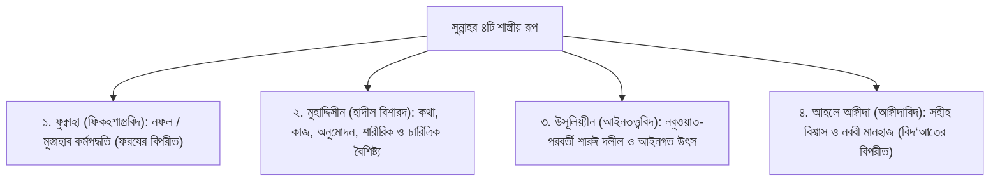

# অধ্যায় ০২: সুন্নাহর চতুর্মুখী শাস্ত্রীয় সংজ্ঞা ও আহলুস সুন্নাহর মানহাজ
### চার শ্রেণির আলিমের নিকট সুন্নাহর পরিভাষাগত অর্থ এবং আহলুস সুন্নাহ ওয়াল জামা‘আতের ঐতিহাসিক উৎপত্তি ও মূলনীতি

> **মূল নির্দেশক ও আলোচক:** ইঞ্জিনিয়ার মুহাম্মাদ এনামুল হক  
> **প্রতিষ্ঠান:** ইনস্টিটিউট ফর কমিউনিটি ডেভেলপমেন্ট (ICD) ও স্কুল ফর কমিউনিটি ডেভেলপমেন্ট (SCD)  
> **কোর্স:** বেসিক ইসলাম (প্রাপ্তবয়স্কদের মৌলিক ইসলামী শিক্ষা ও আক্বীদা পরিক্রমা) — ১ম খণ্ড: ঈমান ও তাওহীদের বুনিয়াদ  
> **উৎস অডিও:** `Basic_Islam_02.mp3` (দৈর্ঘ্য: ৮ মিনিট ৫১ সেকেন্ড)  
> **সংস্করণ মানদণ্ড:** সম্পূর্ণ আন-অ্যাব্রিজড প্রামাণ্য সংস্করণ — মূল লেকচারের শতভাগ বক্তব্য, তাত্ত্বিক রূপরেখা ও বিশুদ্ধ তাখরীজ সমন্বিত।

---

## অধ্যায়ের সূচিপত্র
- [১. ভূমিকা: সুন্নাহর বিভিন্ন শাস্ত্রীয় প্রয়োগ](#১-ভূমিকা-সুন্নাহর-বিভিন্ন-শাস্ত্রীয়-প্রয়োগ)
- [২. চার শ্রেণির আলিমদের নিকট সুন্নাহর চতুর্মুখী সংজ্ঞা](#২-চার-শ্রেণির-আলিমদের-নিকট-সুন্নাহর-চতুর্মুখী-সংজ্ঞা)
  - [১. ফুক্বাহা বা ফিকহশাস্ত্রবিদগণের নিকট সুন্নাহ](#১-ফুক্বাহা-বা-ফিকহশাস্ত্রবিদগণের-নিকট-সুন্নাহ)
  - [২. মুহাদ্দিসীন বা হাদীস বিশারদগণের নিকট সুন্নাহ](#২-মুহাদ্দিসীন-বা-হাদীস-বিশারদগণের-নিকট-সুন্নাহ)
  - [৩. উসূলিয়্যীন বা ইসলামী আইনতত্ত্ববিদগণের নিকট সুন্নাহ](#৩-উসূলিয়্যীন-বা-ইসলামী-আইনতত্ত্ববিদগণের-নিকট-সুন্নাহ)
  - [৪. আহলে আক্বীদা ও কালামশাস্ত্রবিদগণের নিকট সুন্নাহ](#৪-আহলে-আক্বীদা-ও-কালামশাস্ত্রবিদগণের-নিকট-সুন্নাহ)
- [৩. সুন্নাহ ত্যাগের ক্ষেত্রে দ্বিমুখী হুকুম ও পরিণাম](#৩-সুন্নাহ-ত্যাগের-ক্ষেত্রে-দ্বিমুখী-হুকুম-ও-পরিণাম)
- [৪. 'আহলুস সুন্নাহ ওয়াল জামা‘আত' পরিভাষার ঐতিহাসিক উৎপত্তি ও মানহাজ](#৪-আহলুস-সুন্নাহ-ওয়াল-জামাআত-পরিভাষার-ঐতিহাসিক-উৎপত্তি-ও-মানহাজ)
  - [ক. পরিভাষার প্রথম প্রবক্তা: আব্দুল্লাহ ইবনু আব্বাস (রা.)](#ক-পরিভাষার-প্রথম-প্রবক্তা-আব্দুল্লাহ-ইবনু-আব্বাস-রা)
  - [খ. সিরাতুল মুস্তাক্বীম ও সোজা-বাঁকা দাগের হাদীস](#খ-সিরাতুল-মুস্তাক্বীম-ও-সোজা-বাঁকা-দাগের-হাদীস)
  - [গ. তিয়াত্তর (৭৩) ফিরক্বার হাদীস ও আল-জামা‘আত](#গ-তিয়াত্তর-৭৩-ফিরক্বার-হাদীস-ও-আল-জামাআত)
  - [ঘ. আহলুস সুন্নাহ কোনো দল বা গোষ্ঠী নয়, একটি বিশুদ্ধ মানহাজ](#ঘ-আহলুস-সুন্নাহ-কোনো-দল-বা-গোষ্ঠী-নয়-একটি-বিশুদ্ধ-মানহাজ)
- [৫. কুরআন ও সুন্নাহর প্রামাণ্য দলীলসমূহ](#৫-কুরআন-ও-সুন্নাহর-প্রামাণ্য-দলীলসমূহ)
- [৬. প্রাপ্তবয়স্ক মুমিনের চিন্তন ও আত্মোপলব্ধির পাঠ](#৬-প্রাপ্তবয়স্ক-মুমিনের-চিন্তন-ও-আত্মোপলব্ধির-পাঠ)

---

## ১. ভূমিকা: সুন্নাহর বিভিন্ন শাস্ত্রীয় প্রয়োগ

بِسْمِ اللَّهِ الرَّحْمَٰنِ الرَّحِيمِ  
إِنَّ الْحَمْدَ لِلَّهِ، نَحْمَدُهُ وَنَسْتَعِينُهُ وَنَسْتَغْفِرُهُ، وَنَعُوذُ بِاللَّهِ مِنْ شُرُورِ أَنْفُسِنَا... أَمَّا بَعْدُ، فَإِنَّ خَيْرَ الْحَدِيثِ كِتَابُ اللَّهِ، وَخَيْرَ الْهَدْيِ هَدْيُ مُحَمَّدٍ صَلَّى اللَّهُ عَلَيْهِ وَسَلَّمَ:

গত পর্বে আমরা সুন্নাহর আভিধানিক অর্থ এবং কুরআনে 'সুন্নাতুল্লাহ'র তাৎপর্য আলোচনা করেছি। কিন্তু যখন আমরা ইসলামী শরীয়াহর গভীর জ্ঞান চর্চায় প্রবেশ করব, তখন দেখব যে বিভিন্ন শাস্ত্রের পণ্ডিতগণ (স্কলারগণ) 'সুন্নাহ' শব্দটি উচ্চারণ করেন, অথচ তাঁদের উদ্দেশ্য থাকে সম্পূর্ণ ভিন্ন ভিন্ন অর্থ। 

যদি একজন সাধারণ পাঠক বা শিক্ষার্থী না জানেন যে কোন্ শাস্ত্রের আলিম সুন্নাহ বলতে কী বোঝাচ্ছেন, তবে তিনি মারাত্মক গুলিয়ে ফেলতে পারেন। ইঞ্জিনিয়ার মুহাম্মাদ এনামুল হক এই পর্বে সুন্নাহর চারটি শাস্ত্রীয় সংজ্ঞা এবং আমাদের আক্বীদা পরিক্রমার কেন্দ্রবিন্দু **"আহলুস সুন্নাহ ওয়াল জামা‘আত"**-এর ঐতিহাসিক উৎপত্তি ও মানহাজ অত্যন্ত প্রজ্ঞার সাথে উন্মোচন করেছেন।

---

## ২. চার শ্রেণির আলিমদের নিকট সুন্নাহর চতুর্মুখী সংজ্ঞা

ইসলামী জ্ঞানের চারটি প্রধান ডিসিপ্লিনের আলিমগণ সুন্নাহকে নিজস্ব দৃষ্টিকোণ থেকে সংজ্ঞায়িত করেছেন:

### ১. ফুক্বাহা বা ফিকহশাস্ত্রবিদগণের নিকট সুন্নাহ
ফকীহগণ যখন কোনো আমলকে 'সুন্নাহ' বলেন, তখন তাঁদের উদ্দেশ্য থাকে শরীয়াহর আহকাম বা হুকুমের একটি নির্দিষ্ট স্তর বোঝানো। 
- **সংজ্ঞা:** এমন এক প্রশংসনীয় কর্মপদ্ধতি, যা রাসূলুল্লাহ ﷺ নিয়মিত বা প্রায়শই পালন করেছেন, কিন্তু ফরয বা ওয়াজিবের মতো তা বাধ্যতামূলক করেননি।
- **হুকুম:** এটি করলে সাওয়াব আছে, কিন্তু কোনো ওজরবশত না করলে কোনো শাস্তি বা গুনাহ নেই। যেমন সালাতের আগে মিসওয়াক করা, কিংবা যোহরের পূর্বে চার রাকাত সুন্নাতে মুয়াক্কাদাহ আদায় করা। এটি মূলত 'ফরয ও ওয়াজিব'-এর বিপরীত অর্থে ব্যবহৃত হয়।

### ২. মুহাদ্দিসীন বা হাদীস বিশারদগণের নিকট সুন্নাহ
হাদীসের ইমামগণ যখন সুন্নাহ শব্দ ব্যবহার করেন, তখন এটি সবচেয়ে ব্যাপক ও সামগ্রিক অর্থ ধারণ করে।
- **সংজ্ঞা:** রাসূলুল্লাহ ﷺ হতে তাঁর নবুওয়াত লাভের পূর্বাপর সমগ্র জীবনে যা কিছু বর্ণিত হয়েছে—তা হোক তাঁর মুখের বাণী (ক্বওল - قول), তাঁর কর্ম (ফে‘ল - فعل), তাঁর নীরব মৌন সম্মতি (তাক্বরীর - تقرير), তাঁর শারীরিক গঠন ও বৈশিষ্ট্য (সিফাতুল খালক্বিয়্যাহ - صفة خلقية) কিংবা তাঁর নৈতিক চরিত্র ও সামগ্রিক জীবনচরিত (সীরাত - سيرة)। মুহাদ্দিসগণের দৃষ্টিতে এ সবকিছুর সমষ্টিই হলো 'সুন্নাহ'।

### ৩. উসূলিয়্যীন বা ইসলামী আইনতত্ত্ববিদগণের নিকট সুন্নাহ
উসূলে ফিকহ বা ইসলামী আইনতত্ত্বের বিশেষজ্ঞদের দায়িত্ব হলো—কুরআনের বাইরে কোন্ কোন্ বিষয়কে শরীয়াহর আইন ও বিধানের অকাট্য দলীল হিসেবে গ্রহণ করা যাবে তা নির্ধারণ করা।
- **সংজ্ঞা:** নবী করীম ﷺ-এর কাছ থেকে কুরআন ব্যতীত এমন প্রতিটি কথা, কাজ বা মৌন সম্মতি—যা নবুওয়াত লাভের পর শারঈ বিধান প্রতিষ্ঠার দলীল হিসেবে প্রকাশিত হয়েছে।
- **স্বতন্ত্র বৈশিষ্ট্য:** উসূলিয়্যীনগণ নবুওয়াত-পূর্ব কোনো বিষয়কে (যেমন নবুওয়াত লাভের পূর্বে হেরা গুহায় ধ্যান বা তাহানুছ) শরীয়াহর সরাসরি আইনগত দলীল হিসেবে গণ্য করেন না। তাঁদের দৃষ্টিতে কেবল নবুওয়াত-পরবর্তী অংশই শারঈ দলীলরূপী সুন্নাহ।

### ৪. আহলে আক্বীদা ও কালামশাস্ত্রবিদগণের নিকট সুন্নাহ
আক্বীদার ইমামগণের নিকট সুন্নাহর অর্থ ফিকহ বা আইনতত্ত্বের চেয়ে সম্পূর্ণ আলাদা।
- **সংজ্ঞা:** রাসূলুল্লাহ ﷺ এবং তাঁর সাহাবায়ে কেরামের অনুসৃত বিশুদ্ধ বিশ্বাস ও নির্ভুল দ্বীনি পদ্ধতি—যা যে কোনো প্রকার বিদ‘আত (بدعة) ও বিভ্রান্তির বিপরীত।
- আক্বীদার ক্ষেত্রে যখন বলা হয় অমুক ব্যক্তি "সুন্নাহর ওপর প্রতিষ্ঠিত", তার অর্থ হলো তার আক্বীদা সহীহ এবং সে নববী মানহাজে অবিচল। আর যখন বলা হয় অমুক বিষয় "সুন্নাহর পরিপন্থী", তার অর্থ তা বাতিল, কুফর বা দ্বীনের মাঝে নতুন উদ্ভাবিত বিদ‘আত।

---

## ৩. সুন্নাহ ত্যাগের ক্ষেত্রে দ্বিমুখী হুকুম ও পরিণাম

শায়খ এনামুল হক এখানে একটি অত্যন্ত সূক্ষ্ম ও বাস্তবমুখী বিভ্রান্তি নিরসন করেছেন:

যদি কোনো ব্যক্তি ফিকহী অর্থে কোনো সুন্নাহ ত্যাগ করে—যেমন সে হয়তো অলসতাবশত মিসওয়াক করল না কিংবা সালাতের পূর্বে নফল সুন্নাতটি পড়ল না—এর কারণে সে কিন্তু ইসলাম থেকে বের হয়ে যায় না এবং সে কাফের হয়ে যায় না। সে হয়তো একটি বিরাট সাওয়াব থেকে বঞ্চিত হলো, কিন্তু সে মুসলিমই থাকে।

কিন্তু যদি কোনো ব্যক্তি রাসূলুল্লাহ ﷺ-এর সুন্নাহকে সামগ্রিক আদর্শ (Way of Life / মানহাজ) হিসেবে অস্বীকার করে—যেমন আধুনিক তথাকথিত 'আহলে কুরআন' বা হাদিস অস্বীকারকারী দল বলে থাকে: "আমরা কেবল কুরআন মানি, সুন্নাহ মানি না"—তবে সমগ্র উম্মাহর সর্বসম্মত ইজমা অনুযায়ী সেই ব্যক্তি ইসলাম থেকে সম্পূর্ণ খারিজ হয়ে যাবে। 

রাসূলুল্লাহ ﷺ এই সামগ্রিক আদর্শিক সুন্নাহ সম্পর্কেই চরম সতর্কবাণী উচ্চারণ করে ইরশাদ করেছেন:
> **«فَمَنْ رَغِبَ عَنْ سُنَّتِي فَلَيْسَ مِنِّي»**  
> “যে ব্যক্তি আমার সুন্নাহ (আমার আদর্শ ও দ্বীনি পথ) থেকে মুখ ফিরিয়ে নেয়, সে আমার উম্মতের অন্তর্ভুক্ত নয়।” ([সহীহ বুখারী: ৫০৬৩](https://www.hadithbd.com/hadith/detail/?book=1&hadith=5063), [সহীহ মুসলিম: ১৪০১](https://www.hadithbd.com/hadith/detail/?book=2&hadith=1401))

অতএব সুন্নাহ শব্দটি শুনলেই আমাদের বুঝতে হবে—বক্তা কোন্ শাস্ত্রীয় দৃষ্টিকোণ থেকে শব্দটি উচ্চারণ করছেন।

---

## ৪. 'আহলুস সুন্নাহ ওয়াল জামা‘আত' পরিভাষার ঐতিহাসিক উৎপত্তি ও মানহাজ

যখন আমরা দ্বীন শিক্ষার মূল বডিতে প্রবেশ করব, তখন বারবার একটি মৌলিক পরিচয় উঠে আসবে—**"আহলুস সুন্নাহ ওয়াল জামা‘আত" (أهل السنة والجماعة)**।

### ক. পরিভাষার প্রথম প্রবক্তা: আব্দুল্লাহ ইবনু আব্বাস (রা.)
শায়খ স্পষ্ট করেন যে, 'আহলুস সুন্নাহ ওয়াল জামা‘আত' এই যৌগিক পরিভাষাটি রাসূলুল্লাহ ﷺ সরাসরি নিজের মুখনিঃসৃত বাক্যে উল্লেখ করেননি। এটি সর্বপ্রথম ইসলামের শ্রেষ্ঠ মুফাসসির, সাহাবী **আব্দুল্লাহ ইবনু আব্বাস (রা.)**-এর ভাষায় উচ্চারিত হয়েছিল।

পবিত্র কুরআনের সূরা আলে ইমরানের ১০৬ নম্বর আয়াতে আল্লাহ তা‘আলা কিয়ামতের ময়দানের ভয়াবহ দৃশ্য বর্ণনা করে ইরশাদ করেছেন:
> **﴿يَوْمَ تَبْيَضُّ وُجُوهٌ وَتَسْوَدُّ وُجُوهٌ﴾**  
> “যেদিন বহু চেহারা শুভ্রোজ্জ্বল হবে, আর বহু চেহারা হবে ঘোর কৃষ্ণবর্ণ।” ([সূরা আলে ইমরান: ১০৬](https://quran.com/3/106))

এই আয়াতের তাফসীরে ইবনু আব্বাস (রা.) বলেন:
> **«فَأَمَّا الَّذِينَ ابْيَضَّتْ وُجُوهُهُمْ فَأَهْلُ السُّنَّةِ وَالْجَمَاعَةِ، وَأَمَّا الَّذِينَ اسْوَدَّتْ وُجُوهُهُمْ فَأَهْلُ الْبِدْعَةِ وَالضَّلَالَةِ»**  
> “যাদের মুখমণ্ডল উজ্জ্বল ও ধবধবে সাদা হবে, তারা হলেন **আহলুস সুন্নাহ ওয়াল জামা‘আত** (সুন্নাহ ও সাহাবীদের ঐক্যে অটল দল); আর যাদের চেহারা কালো ও মলিন হবে, তারা হলেন **আহলুল বিদ‘আত ওয়াদ-দ্বালালাহ** (বিদ‘আতী ও বিভ্রান্ত দল)।”

### খ. সিরাতুল মুস্তাক্বীম ও সোজা-বাঁকা দাগের হাদীস
উম্মাহর মধ্যে যে পথভ্রষ্টতা ও বিভেদ তৈরি হবে, তা রাসূলুল্লাহ ﷺ একটি বাস্তবমুখী চিত্রাঙ্কনের মাধ্যমে সাহাবীদের বুঝিয়ে দিয়েছিলেন:

عَنْ عَبْدِ اللَّهِ بْنِ مَسْعُودٍ رَضِيَ اللَّهُ عَنْهُ، قَالَ: خَطَّ لَنَا رَسُولُ اللَّهِ ﷺ خَطًّا، ثُمَّ قَالَ: **«هَذَا سَبِيلُ اللَّهِ»**، ثُمَّ خَطَّ خُطُوطًا عَنْ يَمِينِهِ وَعَنْ شِمَالِهِ، ثُمَّ قَالَ: **«هَذِهِ سُبُلٌ، عَلَى كُلِّ سَبِيلٍ مِنْهَا شَيْطَانٌ يَدْعُو إِلَيْهِ»**، ثُمَّ قَرَأَ: **﴿وَأَنَّ هَٰذَا صِرَاطِي مُسْتَقِيمًا فَاتَّبِعُوهُ ۖ وَلَا تَتَّبِعُوا السُّبُلَ فَتَفَرَّقَ بِكُمْ عَن سَبِيلِهِ﴾**

> **বঙ্গানুবাদ:** “আব্দুল্লাহ ইবনু মাসউদ (রা.) হতে বর্ণিত, তিনি বলেন: একদা রাসূলুল্লাহ ﷺ আমাদের সামনে মাটিতে একটি সোজা দাগ টানলেন এবং বললেন: ‘এটি আল্লাহর সরল পথ (সিরাতুল মুস্তাক্বীম)।’ অতঃপর তিনি সেই সোজা দাগের ডানে ও বামে বহুগুলো বাঁকা দাগ টানলেন এবং বললেন: ‘এগুলো নানা বিভ্রান্তির পথ; এর প্রতিটি পথের মুখে একজন করে শয়তান বসে আছে, যে মানুষকে সেদিকে আহ্বান করছে।’ অতঃপর তিনি তিলাওয়াত করলেন: *‘আর নিশ্চয় এটিই আমার সরল পথ, সুতরাং তোমরা এর অনুসরণ কর এবং অন্যান্য বাঁকা পথের অনুসরণ করো না, করলে তা তোমাদের আল্লাহর পথ থেকে বিচ্ছিন্ন করে ফেলবে।’* (সূরা আল-আন‘আম: ১৫৩)।”  
> **তাহক্বীক্ব ও মান:** হাদীসটি সহীহ।  
> **তথ্যসূত্র ও সক্রিয় লিংক:** [মুসনাদে আহমাদ: ৪৪৩২](https://www.hadithbd.com/hadith/detail/?book=17&hadith=4432), [সুনানে দারেমী: ২০৮](https://www.hadithbd.com/hadith/detail/?book=13&hadith=208)

### গ. তিয়াত্তর (৭৩) ফিরক্বার হাদীস ও আল-জামা‘আত
রাসূলুল্লাহ ﷺ উম্মাহর বিভক্তির ভবিষ্যৎবাণী করে স্পষ্ট করেছেন যে, একমাত্র একটি দলই নাজাতপ্রাপ্ত হবে:

عَنْ عَبْدِ اللَّهِ بْنِ عَمْرٍو رَضِيَ اللَّهُ عَنْهُمَا، قَالَ: قَالَ رَسُولُ اللَّهِ ﷺ:  
**«وَتَفْتَرِقُ أُمَّتِي عَلَى ثَلاَثٍ وَسَبْعِينَ مِلَّةً، كُلُّهُمْ فِي النَّارِ إِلاَّ مِلَّةً وَاحِدَةً»، قَالُوا: وَمَنْ هِيَ يَا رَسُولَ اللَّهِ؟ قَالَ: «مَا أَنَا عَلَيْهِ وَأَصْحَابِي»**

> **বঙ্গানুবাদ:** “আব্দুল্লাহ ইবনু আমর (রা.) হতে বর্ণিত, তিনি বলেন, রাসূলুল্লাহ ﷺ ইরশাদ করেছেন: ‘আমার উম্মত তিয়াত্তরটি (৭৩) দলে বিভক্ত হবে; তাদের মধ্যে একটি দল ব্যতীত বাকি সকল দলই জাহান্নামে যাবে।’ সাহাবীগণ আরয করলেন: ‘হে আল্লাহর রাসূল! সেই মুক্তিপ্রাপ্ত দলটি কারা?’ তিনি ইরশাদ করলেন: **‘আমি এবং আমার সাহাবীগণ আজ যে পথের ওপর প্রতিষ্ঠিত আছি, যারা সেই পথের ওপর অবিচল থাকবে।’**”  
> **তাহক্বীক্ব ও মান:** হাদীসটি হাসান।  
> **তথ্যসূত্র ও সক্রিয় লিংক:** [জামে আত-তিরমিযী: ২৬৪১](https://www.hadithbd.com/hadith/detail/?book=5&hadith=2641), [সুনান আবু দাউদ: ৪৫৯৭](https://www.hadithbd.com/hadith/detail/?book=4&hadith=4597)

অন্য বর্ণনায় তিনি মুক্তিপ্রাপ্ত এই দলকে সংজ্ঞায়িত করেছেন **"আল-জামা‘আত" (الجماعة)** বলে। অর্থাৎ রাসূলুল্লাহ ﷺ এবং তাঁর সাহাবীগণের ঐকমত্যের পথ।

### ঘ. আহলুস সুন্নাহ কোনো দল বা গোষ্ঠী নয়, একটি বিশুদ্ধ মানহাজ
শায়খ এনামুল হক অত্যন্ত জোরালোভাবে একটি মূলনীতি হৃদয়ে গেঁথে নিতে বলেছেন:
> **“আহলুস সুন্নাহ ওয়াল জামা‘আত কোনো নির্দিষ্ট রাজনৈতিক দল নয়, কোনো বিশেষ সংগঠন নয়, কোনো পীর-মুরিদীর তরীকা নয়, কিংবা নির্দিষ্ট কোনো ভৌগোলিক জাতি বা গোষ্ঠী নয়। এটি মূলত একটি অকাট্য ‘পদ্ধতি’র নাম (Methodology / মানহাজ)।”**

পৃথিবীর যে প্রান্তেই যে মুসলিম অবস্থান করুক না কেন—যদি সে কুরআন ও সহীহ সুন্নাহকে সাহাবায়ে কেরামের সমঝ ও ব্যাখ্যার আলোকে গ্রহণ করে এবং নিজের জীবন পরিচালনা করে, তবে সে-ই আহলুস সুন্নাহ ওয়াল জামা‘আতের অন্তর্ভুক্ত।

---

## ৫. কুরআন ও সুন্নাহর প্রামাণ্য দলীলসমূহ

### আল-কুরআনের অকাট্য নির্দেশ: সাহাবায়ে কেরামের অনুসরণের পথ
আল্লাহ সুবহানাহু ওয়া তা‘আলা সাহাবায়ে কেরামের পথ ছেড়ে নতুন কোনো পথ আবিষ্কারকারীদের জন্য জাহান্নামের চূড়ান্ত শাস্তির ঘোষণা দিয়ে ইরশাদ করেন:

قَالَ اللَّهُ تَعَالَى:  
**﴿وَمَن يُشَاقِقِ الرَّسُولَ مِن بَعْدِ مَا تَبَيَّنَ لَهُ الْهُدَىٰ وَيَتَّبِعْ غَيْرَ سَبِيلِ الْمُؤْمِنِينَ نُوَلِّهِ مَا تَوَلَّىٰ وَنُصْلِهِ جَهَنَّمَ ۖ وَسَاءَتْ مَصِيرًا﴾**

> **বঙ্গানুবাদ:** “আর যে ব্যক্তি তার সামনে হিদায়াত স্পষ্ট হয়ে যাওয়ার পরও রাসূলের বিরুদ্ধাচরণ করে এবং মুমিনদের (সাহাবীদের) অনুসৃত পথ ছাড়া অন্য কোনো পথের অনুসরণ করে, তবে সে যে পথ অবলম্বন করেছে আমি তাকে সে পথেই ছেড়ে দেব এবং তাকে জাহান্নামে নিক্ষেপ করব; আর তা কতই না নিকৃষ্ট ঠিকানা!”  
> **তথ্যসূত্র ও সক্রিয় লিংক:** [সূরা আন-নিসা: ১১৫](https://quran.com/4/115)

### রাসূলুল্লাহ ﷺ-এর সুন্নাহ: খুলাফায়ে রাশেদীনের সুন্নাহ আঁকড়ে ধরা
عَنِ الْعِرْبَاضِ بْنِ سَارِيَةَ رَضِيَ اللَّهُ عَنْهُ، قَالَ: صَلَّى بِنَا رَسُولُ اللَّهِ ﷺ ذَاتَ يَوْمٍ... فَقَالَ:  
**«فَعَلَيْكُمْ بِسُنَّتِي وَسُنَّةِ الْخُلَفَاءِ الرَّاشِدِينَ الْمَهْدِيِّينَ، عَضُّوا عَلَيْهَا بِالنَّوَاجِذِ، وَإِيَّاكُمْ وَمُحْدَثَاتِ الأُمُورِ، فَإِنَّ كُلَّ مُحْدَثَةٍ بِدْعَةٌ، وَكُلَّ بِدْعَةٍ ضَلاَلَةٌ»**

> **বঙ্গানুবাদ:** “ইরবায ইবনু সারিয়াহ (রা.) হতে বর্ণিত, তিনি বলেন, রাসূলুল্লাহ ﷺ একদা আমাদের এমন এক মর্মস্পর্শী উপদেশ দিলেন যাতে চোখ অশ্রুসজল হলো এবং অন্তর ভীতসন্ত্রস্ত হলো... তিনি বললেন: ‘তোমাদের মধ্যে যারা আমার পরে বেঁচে থাকবে তারা বহু মতভেদ দেখতে পাবে। অতএব তোমরা আমার সুন্নাহ এবং আমার হিদায়াতপ্রাপ্ত খুলাফায়ে রাশেদীনের সুন্নাহকে শক্তভাবে আঁকড়ে ধরবে; তা মাড়ির দাঁত দিয়ে কামড়ে ধরে থাকবে। আর দ্বীনের মাঝে নব-উদ্ভাবিত বিষয় (বিদ‘আত) থেকে কঠোরভাবে বেঁচে থাকবে; কেননা প্রতিটি নব-উদ্ভাবিত বিষয়ই বিদ‘আত, আর প্রতিটি বিদ‘আতই পথভ্রষ্টতা।’”  
> **তাহক্বীক্ব ও মান:** হাদীসটি সহীহ।  
> **তথ্যসূত্র ও সক্রিয় লিংক:** [সুনান আবু দাউদ: ৪৬০৭](https://www.hadithbd.com/hadith/detail/?book=4&hadith=4607), [জামে আত-তিরমিযী: ২৬৭৬](https://www.hadithbd.com/hadith/detail/?book=5&hadith=2676)

---

## ৬. প্রাপ্তবয়স্ক মুমিনের চিন্তন ও আত্মোপলব্ধির পাঠ

1. **দলবাজির ঊর্ধ্বে বিশুদ্ধ মানহাজ ধারণ:** বর্তমান মুসলিম সমাজে বিভক্তি ও দলীয় অন্ধ গোঁড়ামি মহামারী রূপ নিয়েছে। আমাদের বুঝতে হবে মুক্তি কোনো বিশেষ সাংগঠনিক লেবেলে নেই; মুক্তি নিহিত রয়েছে রাসূল ﷺ ও তাঁর সাহাবীদের সেই সরল রেখায় (সিরাতুল মুস্তাক্বীম)।
2. **কুরআন বোঝার মাপকাঠি সাহাবায়ে কেরাম:** কুরআনের মনগড়া ব্যাখ্যা দিয়ে বহু বিদ‘আতী দল পথভ্রষ্ট হয়েছে। তাই কুরআনকে বুঝতে হবে সাহাবায়ে কেরামের প্রত্যক্ষ বোঝাপড়া ও প্রায়োগিক জীবনের আলোকে।
3. **দ্বীনের নব-উদ্ভাবন থেকে সতর্কতা:** সুন্নাহর নামে সমাজে বহু ভিত্তিহীন প্রথা চালু রয়েছে। কোনো আমল করার পূর্বে আমাদের নিশ্চিত হতে হবে—রাসূলুল্লাহ ﷺ ও তাঁর সাহাবীগণ কি তা করেছেন?
