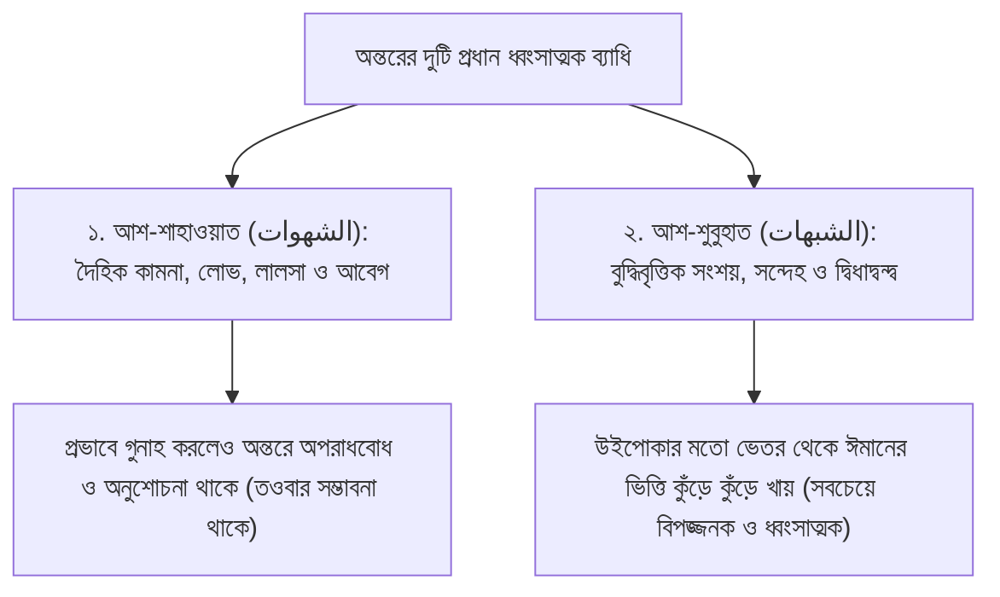

# অধ্যায় ০৪: আল্লাহকে ভয়, পরম সত্য (আল-হাক্ব) ও অন্তরের ব্যাধি — শুবুহাত বনাম শাহাওয়াত
### তাওহীদের মর্যাদা, তাওবায় গড়িমসির মনস্তত্ত্ব, অন্তরের ব্যাধি এবং পরম সত্তার পরিচয়

> **মূল নির্দেশক ও আলোচক:** ইঞ্জিনিয়ার মুহাম্মাদ এনামুল হক  
> **প্রতিষ্ঠান:** ইনস্টিটিউট ফর কমিউনিটি ডেভেলপমেন্ট (ICD) ও স্কুল ফর কমিউনিটি ডেভেলপমেন্ট (SCD)  
> **কোর্স:** বেসিক ইসলাম (প্রাপ্তবয়স্কদের মৌলিক ইসলামী শিক্ষা ও আক্বীদা পরিক্রমা) — ১ম খণ্ড: ঈমান ও তাওহীদের বুনিয়াদ  
> **উৎস অডিও:** `Basic_Islam_04.mp3` (দৈর্ঘ্য: ১০ মিনিট ১৮ সেকেন্ড)  
> **সংস্করণ মানদণ্ড:** সম্পূর্ণ আন-অ্যাব্রিজড প্রামাণ্য সংস্করণ — মূল লেকচারের শতভাগ বক্তব্য, তাত্ত্বিক রূপরেখা ও বিশুদ্ধ তাখরীজ সমন্বিত।

---

## অধ্যায়ের সূচিপত্র
- [১. ভূমিকা: আল্লাহকে যেমন ভয় করা উচিত](#১-ভূমিকা-আল্লাহকে-যেমন-ভয়-করা-উচিত)
- [২. মানুষের রাগ বনাম আল্লাহর অমোঘ ন্যায়বিচার ও গযব](#২-মানুষের-রাগ-বনাম-আল্লাহর-অমোঘ-ন্যায়বিচার-ও-গযব)
- [৩. তাওবায় বিলম্ব ও পাপের অবচেতন মানসিকতা: "আল্লাহ ক্যান ওয়েট ফর ওয়ান ডে"](#৩-তাওবায়-বিলম্ব-ও-পাপের-অবচেতন-মানসিকতা-আল্লাহ-ক্যান-ওয়েট-ফর-ওয়ান-ডে)
  - [ক. বিয়ের দিনে হিজাব ও পার্লারের বাস্তব দৃষ্টান্ত](#ক-বিয়ের-দিনে-হিজাব-ও-পার্লারের-বাস্তব-দৃষ্টান্ত)
  - [খ. ট্রাফিক পুলিশের সংকেত বনাম রবের নিষেধাজ্ঞা](#খ-ট্রাফিক-পুলিশের-সংকেত-বনাম-রবের-নিষেধাজ্ঞা)
- [৪. অন্তরের দুটি মৌলিক ধ্বংসাত্মক ব্যাধি: শাহাওয়াত বনাম শুবুহাত](#৪-অন্তরের-দুটি-মৌলিক-ধ্বংসাত্মক-ব্যাধি-শাহাওয়াত-বনাম-শুবুহাত)
  - [১. আশ-শাহাওয়াত (الشهوات — প্রবৃত্তির কামনা)](#১-আশ-শাহাওয়াত-الشهوات-প্রবৃত্তির-কামনা)
  - [২. আশ-শুবুহাত (الشبهات — বুদ্ধিবৃত্তিক সংশয় ও উইপোকার উপমা)](#২-আশ-শুবুহাত-الشبهات-বুদ্ধিবৃত্তিক-সংশয়-ও-উইপোকার-উপমা)
- [৫. পরম সত্য 'আল-হাক্ব' (الحق) বনাম আপেক্ষিক বাস্তবতা](#৫-পরম-সত্য-আল-হাক্ব-الحق-বনাম-আপেক্ষিক-বাস্তবতা)
- [৬. কুরআন ও সুন্নাহর প্রামাণ্য দলীলসমূহ](#৬-কুরআন-ও-সুন্নাহর-প্রামাণ্য-দলীলসমূহ)
- [৭. প্রাপ্তবয়স্ক মুমিনের চিন্তন ও আত্মোপলব্ধির পাঠ](#৭-প্রাপ্তবয়স্ক-মুমিনের-চিন্তন-ও-আত্মোপলব্ধির-পাঠ)

---

## ১. ভূমিকা: আল্লাহকে যেমন ভয় করা উচিত

بِسْمِ اللَّهِ الرَّحْمَٰنِ الرَّحِيمِ  
إِنَّ الْحَمْدَ لِلَّهِ، نَحْمَدُهُ وَنَسْتَعِينُهُ وَنَسْتَغْفِرُهُ... أَمَّا بَعْدُ:

গত পর্বে আমরা আলোচনা করেছিলাম যে, পবিত্র কুরআনের সূরা আলে ইমরানের ১০২ নম্বর আয়াতে আল্লাহ তা‘আলা নির্দেশ দিয়েছেন: *“তোমরা আল্লাহকে এমনভাবে ভয় কর যেমন ভয় করা উচিত (হাক্কা তুকাতিহি) এবং অবশ্যই মুসলিম অবস্থায় মৃত্যুবরণ কর।”*

কিন্তু প্রশ্ন হলো—আল্লাহকে ‘যেমন ভয় করা উচিত’ তা কেমন? কীভাবে একজন মানুষ অন্তরে আল্লাহর ভয় বা তাক্বওয়া জাগ্রত করবে? 

ইঞ্জিনিয়ার মুহাম্মাদ এনামুল হক এই পর্বে ব্যাখ্যা করেন যে, আল্লাহকে ভয় করার প্রথম সোপান হলো—আল্লাহর বিরাটত্ব, তাঁর সীমাহীন পরাক্রম এবং তাঁর সার্বভৌম ক্ষমতা নিয়ে গভীর চিন্তা করা। তিনি চাইলে আমাদের এক সেকেন্ডের মধ্যে নিশ্চিহ্ন করে দিতে পারেন; তিনি চাইলে এমন এক বিপদে আমাদের নিমজ্জিত করতে পারেন যা থেকে উদ্ধারের কোনো জাগতিক শক্তি নেই।

---

## ২. মানুষের রাগ বনাম আল্লাহর অমোঘ ন্যায়বিচার ও গযব

মানুষের ক্রোধ ও রাগ আর মহান আল্লাহর ক্রোধের (গযবের) প্রকৃতি এক নয়। মানুষের ক্রোধ ক্ষণস্থায়ী, দুর্বল ও ভাবাবেগতাড়িত। আমরা কোনো মানুষের ওপর চরম রেগে গেলাম; কিন্তু সে যদি একটু মিষ্টি করে কথা বলে, একটু অনুনয়-বিনয় করে বা পায়ে ধরে ক্ষমা চায়, তবে আমাদের মন মুহূর্তে গলে যায় এবং রাগ উবে যায়। 

কিন্তু মহান আল্লাহ পরম ধৈর্যশীল ও পরম ক্ষমাশীল হলেও, তাঁর ন্যায়বিচারের বিধান অমোঘ। তিনি বান্দাকে বারবার অবকাশ দেন, তাওবার সুযোগ দেন। কিন্তু অবাধ্যতার সীমা ছাড়িয়ে যখন আল্লাহর পক্ষ থেকে চূড়ান্ত শাস্তি বা গযব অবধারিত হয়ে যায়, তখন আর তা প্রতিহত করার কোনো ক্ষমতা কারো থাকে না।

শায়খ এ প্রসঙ্গে কুরআনে বর্ণিত প্রাচীন জাতিসমূহের ইতিহাস স্মরণ করিয়ে দেন:
- কওমে ‘আদ, কওমে ছামূদ কিংবা পম্পেই (Pompeii) নগরীর ধ্বংসের মুহূর্তগুলো লক্ষ্য করুন। যখন আল্লাহর গযব মেঘের রূপ ধরে আকাশ থেকে নেমে আসছিল, তখন তারা বুঝতে পেরেছিল যে সর্বনাশ আসন্ন! কিন্তু সেই মুহূর্তে তওবা করার, অনুশোচনা প্রকাশের বা মাফ চাওয়ার এক সেকেন্ড সময়ও তাদের দেওয়া হয়নি। মুহূর্তে সমগ্র জাতি ধ্বংসস্তূপে পরিণত হয়েছিল।

---

## ৩. তাওবায় বিলম্ব ও পাপের অবচেতন মানসিকতা: "আল্লাহ ক্যান ওয়েট ফর ওয়ান ডে"

শায়খ এনামুল হক বলেন, আমরা কেন আল্লাহর আদেশ পালন করতে পারি না এবং নিষেধ বর্জন করতে পারি না? এর পেছনে সমকালীন মানুষের একটি চরম আত্মঘাতী মনোভাব কাজ করে। অধিকাংশ মানুষ অবচেতনভাবে মনে করে: 
> *“এখন তো যৌবনকাল, জীবনটাকে একটু উপভোগ (Enjoy) করে নিই। যখন বয়স হবে, চুল পাকবে, শরীরে রোগ বাসা বাঁধবে—তখন মসজিদে যাতায়াত শুরু করব, তওবা করব, কিংবা একটি হজ করে এসে সব গুনাহ মাফ করিয়ে নেব!”*

মানুষের এই অবচেতন ধারণাটি হলো—**"আল্লাহ ক্যান ওয়েট" (আল্লাহ কিছুক্ষণ অপেক্ষা করতে পারেন)**; আমার গুনাহের কাজটি সেরে নিই, পরে আল্লাহর কাছে মাফ চেয়ে নেব।

### ক. বিয়ের দিনে হিজাব ও পার্লারের বাস্তব দৃষ্টান্ত
শায়খ এ প্রসঙ্গে ইংল্যান্ডে বসবাসরত তাঁর নিজের এক নিকটাত্মীয় পরিবারের একটি অত্যন্ত মর্মস্পর্শী ও বাস্তব ঘটনা তুলে ধরেন:
> ইংল্যান্ডের প্রতিকূল ধর্মনিরপেক্ষ পরিবেশেও সেই পরিবারের ছোট মেয়েটি ছিল অত্যন্ত দ্বীনদার ও প্র্যাকটিসিং। সে নিয়মিত হিজাব করত, ঠিকমতো সালাত আদায় করত, বাজে আড্ডা বা পার্টি থেকে নিজেকে সম্পূর্ণ মুক্ত রাখত এবং মা-বাবার অত্যন্ত বাধ্য ছিল।  
> যখন মেয়েটির বিয়ে ঠিক হলো, তখন বিয়ের দিন পরিবারের মা, নানী ও অন্যান্য আত্মীয়রা তাকে জোর করে পার্লারে নিয়ে গেলেন। পার্লারের ভারী সাজগোজ ও ফ্যাশনের কারণে হিজাব ঠিক রাখা সম্ভব হচ্ছিল না। মেয়েটি অত্যন্ত দৃঢ়ভাবে আপত্তি জানাল: *“আমি সারাটা জীবন আল্লাহর হুকুম মতো চলার চেষ্টা করেছি; আর জীবনের এই সবচেয়ে গুরুত্বপূর্ণ দিনে—যেখানে আমি আল্লাহর বরকত আশা করছি—সেখানে কীভাবে আমি আল্লাহর হুকুম অমান্য করে হিজাব খুলে সাজব?”*  
> কিন্তু মা, নানী সহ মুরব্বিরা তাকে বুঝিয়ে বললেন: *“মানুষের জীবনে বিয়ে তো একবারই আসে! আজকের এই একটি দিনের জন্য একটু মানিয়ে নাও!”*

শায়খ প্রশ্ন তোলেন—এই কথার পেছনের আসল মানসিকতাটা কী? পেছনের সূক্ষ্ম মানসিকতা হলো: **“আল্লাহ ক্যান ওয়েট ফর ওয়ান ডে!”** অর্থাৎ আজকের একটি দিনের জন্য না হয় আল্লাহকে একটু দূরে সরিয়ে রাখলাম, কালকে থেকে আবার হিজাব পরব! এই মারাত্মক ব্যাধি কেবল সেই পরিবারের নয়; আমাদের প্রায় প্রত্যেকের অবচেতন মনে কোনো না কোনো ক্ষেত্রে এই প্রবণতা লুকিয়ে রয়েছে।

### খ. ট্রাফিক পুলিশের সংকেত বনাম রবের নিষেধাজ্ঞা
শায়খ এই দ্বিচারিতার বিপরীতে একটি অকাট্য সামাজিক উপমা পেশ করেন:
> রাজধানী ঢাকার তীব্র ট্রাফিক জ্যামের কথা চিন্তা করুন। শত শত কোটি টাকার বিলাসবহুল গাড়ি বহর দাঁড়িয়ে আছে। সেখানে হয়তো রাষ্ট্রের অত্যন্ত প্রভাবশালী ব্যক্তিত্ব, মন্ত্রী, বিচারপতি, ব্রিগেডিয়ার বা শিল্পপতিরা বসে আছেন। রাস্তার মাঝখানে দাঁড়িয়ে থাকা ট্রাফিক পুলিশ কিন্তু পদমর্যাদায় একজন সাধারণ কনস্টেবল মাত্র।  
> অথচ সেই কনস্টেবলটি যখন হাত তুলে সংকেত দেয়, তখন সেই ক্ষমতাবান ব্যক্তিরাও টু শব্দটি না করে চুপচাপ গাড়ি থামিয়ে বসে থাকেন! কেউ সংকেত অমান্য করে এগিয়ে যাওয়ার দুঃসাহস দেখায় না। 

কেন তাঁরা পুলিশকে এতো মান্য করেন? কারণ তাঁরা বিশ্বাস করেন—এই পুলিশ কনস্টেবলটি যদি ক্ষুব্ধ হয়, তবে সে মামলা দিতে পারে, গাড়ি জব্দ করতে পারে বা ক্ষতি করতে পারে। অর্থাৎ পুলিশের কর্তৃত্ব ও ক্ষমতাকে তাঁরা শতভাগ ‘বাস্তব’ (Real) মনে করেন।

অথচ সমগ্র মহাবিশ্বের রব, যিনি এক নিমেষে হৃৎস্পন্দন বন্ধ করে দিতে পারেন—তাঁর নিষেধাজ্ঞার সামনে এসে আমরা কোনো তোয়াক্কাই করি না! পুলিশের ক্ষমতার প্রতি মানুষের যতটুকু প্রত্যয় আছে, মহাবিশ্বের রবের শাস্তির প্রতি মানুষের অন্তরে ততটুকু প্রত্যয়ও নেই।

---

## ৪. অন্তরের দুটি মৌলিক ধ্বংসাত্মক ব্যাধি: শাহাওয়াত বনাম শুবুহাত

ইসলামী আক্বীদা ও আত্মশুদ্ধির ইমামগণ স্পষ্ট করেছেন যে, মানুষের অন্তরের ব্যাধি মূলত দুটি প্রধান ভাগে বিভক্ত:

### ১. আশ-শাহাওয়াত (الشهوات — প্রবৃত্তির কামনা)
এটি হলো মানুষের দৈহিক লালসা, রিপুর তাড়না, লোভ, কামভাব বা আর্থিক মোহ। মানুষ যখন শাহাওয়াতের বশবর্তী হয়ে কোনো গুনাহ করে—যেমন কেউ হয়তো কোনো নিষিদ্ধ কিছু দেখল বা কোনো লোভে পড়ল—তখন সে অন্যায় করলেও তার ভেতরে একটি অপরাধবোধ কাজ করে। সে জানে যে সে খারাপ কাজ করেছে, এবং ভেতরে ভেতরে সে অনুতপ্ত হয়ে তওবা করার পথ খোঁজে।

### ২. আশ-শুবুহাত (الشبهات — বুদ্ধিবৃত্তিক সংশয় ও উইপোকার উপমা)
শুবুহাত হলো মানুষের বুদ্ধিবৃত্তিক সংশয়, অবিশ্বাস ও বিভ্রান্তি। যেমন কারো মনে কুচিন্তা আসা:
- আল্লাহ কি সত্যিই আছেন? যদি না থাকেন?
- জান্নাত-জাহান্নাম কি সত্যিই বাস্তব, নাকি নিছক রূপকথা?
- যদি পরকাল না-ই থাকে, তবে আমি পৃথিবীর এতো ভোগ-বিলাস থেকে বঞ্চিত হয়ে কী লাভ করলাম?

শায়খ এনামুল হক অত্যন্ত সতর্কবাণী উচ্চারণ করে বলেন:
> **“আশ-শুবুহাত হলো শাহাওয়াতের চেয়ে অনন্তগুণে মারাত্মক ও বিষাক্ত! কারণ এটি মানুষের ঈমানকে উইপোকার মতো ভেতর থেকে ধ্বংস করে দেয়।”**

একটি বিশাল কাঠের খুঁটি বা আলমারির কথা চিন্তা করুন। বাইরে থেকে দেখলে মনে হয় কাঠটি অত্যন্ত মজবুত ও অটুট। কিন্তু ভেতর থেকে উইপোকা যদি সেটি নিঃশেষ করে ফেলে, তবে এক আঙুলের মৃদু স্পর্শেই তা ভেঙে ধূলিসাৎ হয়ে যায়! 

সংশয় ঠিক একইভাবে একজন মানুষের সালাত, সিয়াম ও যাবতীয় আমলকে ভেতর থেকে অন্তঃসারশূন্য করে ফেলে। যদি সেই সংশয় দূর না করা হয়, তবে বাহ্যিকভাবে সে নিজেকে মুসলিম দাবি করলেও আল্লাহর সামনে তার ঈমান ধূলিকণার মতো উড়ে যাবে।

আর এই ভয়াবহ শুবুহাত বা সংশয়ের একমাত্র ওষুধ হলো: **বিশুদ্ধ শারঈ জ্ঞান অর্জন করা (العلم الشرعي)**। কুরআন ও সহীহ সুন্নাহর প্রামাণ্য দলীল ও যুক্তি অনুধাবন করা ব্যতীত এই সংশয় থেকে মুক্তির কোনো পথ নেই।

---

## ৫. পরম সত্য 'আল-হাক্ব' (الحق) বনাম আপেক্ষিক বাস্তবতা

আধুনিক বস্তুবাদী নাস্তিক্যবাদ ও অজ্ঞেয়বাদ (Agnosticism) দাবি করে—জীবন নিছক একটি দুর্ঘটনাবশত (Accident) সৃষ্টি হয়েছে; এর কোনো উদ্দেশ্য নেই। 

কিন্তু ইসলামের চিরন্তন শিক্ষা হলো—আল্লাহ সুবহানাহু ওয়া তা‘আলার অন্যতম প্রধান সিফাতি নাম হলো **"আল-হাক্ব" (الحق — The Absolute Reality / পরম সত্য)**। 
- আল্লাহ তা‘আলাই হলেন একমাত্র নিরঙ্কুশ ও চিরন্তন বাস্তবতা।
- আর এই সৃষ্টিজগৎ, গ্যালাক্সি, মানুষ এবং পার্থিব জীবন হলো আল্লাহর সৃষ্ট এক ক্ষণস্থায়ী 'আপেক্ষিক বাস্তবতা' (Relative Reality)। আজ যা আছে, কাল তা থাকবে না। কিন্তু আল্লাহ চিরকাল ছিলেন, আছেন এবং থাকবেন।

অতএব আপেক্ষিক ক্ষণস্থায়ী মোহে পড়ে পরম চিরন্তন সত্যকে অবহেলা করা মানব ইতিহাসের সবচেয়ে নির্বোধ ও আত্মঘাতী পদক্ষেপ।

---

## ৬. কুরআন ও সুন্নাহর প্রামাণ্য দলীলসমূহ

### আল-কুরআনের অকাট্য নির্দেশ: আল্লাহই একমাত্র পরম সত্য (আল-হাক্ব)
قَالَ اللَّهُ تَعَالَى:  
**﴿ذَٰلِكَ بِأَنَّ اللَّهَ هُوَ الْحَقُّ وَأَنَّهُ يُحْيِي الْمَوْتَىٰ وَأَنَّهُ عَلَىٰ كُلِّ شَيْءٍ قَدِيرٌ﴾**  
> **বঙ্গানুবাদ:** “এটা এজন্য যে, আল্লাহই হলেন পরম সত্য (আল-হাক্ব), আর নিশ্চয় তিনি মৃতকে জীবিত করেন এবং নিশ্চয় তিনি সবকিছুর ওপর সর্বশক্তিমান।”  
> **তথ্যসূত্র ও সক্রিয় লিংক:** [সূরা আল-হাজ্জ: ৬](https://quran.com/22/6)

### আল-কুরআনের অকাট্য নির্দেশ: প্রকাশ্য ও গোপন সকল পাপ বর্জন
قَالَ اللَّهُ تَعَالَى:  
**﴿وَذَرُوا ظَاهِرَ الْإِثْمِ وَبَاطِنَهُ ۚ إِنَّ الَّذِينَ يَكْسِبُونَ الْإِثْمَ سَيُجْزَوْنَ بِمَا كَانُوا يَقْتَرِفُونَ﴾**  
> **বঙ্গানুবাদ:** “আর তোমরা প্রকাশ্য পাপ এবং গোপন পাপ উভয়ই বর্জন কর। নিশ্চয় যারা পাপাচার করে, অচিরেই তাদের কৃতকর্মের উপযুক্ত শাস্তি দেওয়া হবে।”  
> **তথ্যসূত্র ও সক্রিয় লিংক:** [সূরা আল-আন‘আম: ১২০](https://quran.com/6/120)

### রাসূলুল্লাহ ﷺ-এর সুন্নাহ: আল্লাহর শ্রেষ্ঠত্বের সামনে অন্তরের বিনয়
عَنْ أَبِي هُرَيْرَةَ رَضِيَ اللَّهُ عَنْهُ، عَنِ النَّبِيِّ ﷺ قَالَ:  
**«لَوْ يَعْلَمُ الْمُؤْمِنُ مَا عِنْدَ اللَّهِ مِنَ الْعُقُوبَةِ، مَا طَمِعَ بِجَنَّتِهِ أَحَدٌ، وَلَوْ يَعْلَمُ الْكَافِرُ مَا عِنْدَ اللَّهِ مِنَ الرَّحْمَةِ، مَا قَنِطَ مِنْ جَنَّتِهِ أَحَدٌ»**  
> **বঙ্গানুবাদ:** “আবু হুরায়রা (রা.) হতে বর্ণিত, নবী করীম ﷺ ইরশাদ করেছেন: মুমিন যদি জানতে পারত আল্লাহর নিকট কী ভয়াবহ শাস্তি রয়েছে, তবে কেউই তাঁর জান্নাতের আশা করতে পারত না; আর কাফের যদি জানতে পারত আল্লাহর নিকট কী অপরিসীম রহমত রয়েছে, তবে কেউই তাঁর জান্নাত থেকে নিরাশ হতো না।”  
> **তাহক্বীক্ব ও মান:** সহীহ মুসলিম।  
> **তথ্যসূত্র ও সক্রিয় লিংক:** [সহীহ মুসলিম: ২৭৫৫](https://www.hadithbd.com/hadith/detail/?book=2&hadith=2755)

---

## ৭. প্রাপ্তবয়স্ক মুমিনের চিন্তন ও আত্মোপলব্ধির পাঠ

1. **তাওবায় গড়িমসির আত্মঘাতী ফাঁদ:** "বয়স হলে তওবা করব"—এই শয়তানি প্রতারণা থেকে বেরিয়ে আসুন। কবরে কোনো বয়সের ক্রম নেই; শিশু-যুবক-বৃদ্ধ সকলের জন্যই মৃত্যুর দরজা যে কোনো মুহূর্তে খুলে যেতে পারে।
2. **ট্রাফিক পুলিশ বনাম রবের ভয়:** একজন রক্তমাংসের কনস্টেবলকে যদি আমরা জরিমানার ভয়ে এতো সমীহ করি, তবে মহাবিশ্বের রাজাধিরাজের সামনে দাঁড়িয়ে গোপনে কিংবা প্রকাশ্যে অবাধ্য হওয়ার স্পর্ধা আমরা কীভাবে দেখাতে পারি?
3. **অন্তরের উইপোকা নিধন:** আপনার মনে কি দ্বীনের কোনো মৌলিক বিষয় নিয়ে সংশয় রয়েছে? তবে তা চেপে রাখবেন না। সময় থাকতে কুরআন ও সহীহ সুন্নাহর প্রামাণ্য ইলম অর্জন করে সেই সংশয় সমূলে উৎপাটন করুন।
