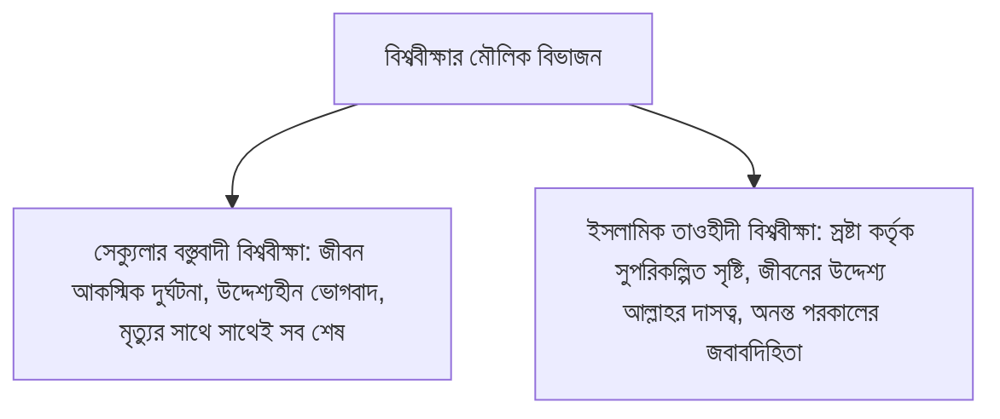

# অধ্যায় ০৯: মুসলিম বিশ্ববীক্ষা (Islamic Worldview) ও শাহাদাহর প্রথম শর্ত — 'ইলম
### ইসলামী জীবনদর্শন, কালিমায়ে শাহাদাহর তাৎপর্য এবং জান্নাতের চাবির প্রথম শর্ত: জ্ঞান বনাম অজ্ঞতা

> **মূল নির্দেশক ও আলোচক:** ইঞ্জিনিয়ার মুহাম্মাদ এনামুল হক  
> **প্রতিষ্ঠান:** ইনস্টিটিউট ফর কমিউনিটি ডেভেলপমেন্ট (ICD) ও স্কুল ফর কমিউনিটি ডেভেলপমেন্ট (SCD)  
> **কোর্স:** বেসিক ইসলাম (প্রাপ্তবয়স্কদের মৌলিক ইসলামী শিক্ষা ও আক্বীদা পরিক্রমা) — ১ম খণ্ড: ঈমান ও তাওহীদের বুনিয়াদ  
> **উৎস অডিও:** `Basic_Islam_09.mp3` (দৈর্ঘ্য: ১৮ মিনিট ৫৫ সেকেন্ড)  
> **সংস্করণ মানদণ্ড:** সম্পূর্ণ আন-অ্যাব্রিজড প্রামাণ্য সংস্করণ — মূল লেকচারের শতভাগ বক্তব্য, তাত্ত্বিক রূপরেখা ও বিশুদ্ধ তাখরীজ সমন্বিত।

---

## অধ্যায়ের সূচিপত্র
- [১. ভূমিকা: বিশ্ববীক্ষা (Worldview) কী এবং কেন অপরিহার্য?](#১-ভূমিকা-বিশ্ববীক্ষা-worldview-কী-এবং-কেন-অপরিহার্য)
- [২. সেক্যুলার বস্তুবাদী দৃষ্টিভঙ্গি বনাম ইসলামিক বিশ্ববীক্ষা](#২-সেক্যুলার-বস্তুবাদী-দৃষ্টিভঙ্গি-বনাম-ইসলামিক-বিশ্ববীক্ষা)
- [৩. কালিমায়ে শাহাদাহ: তোতাপাখির বুলি (Parroting) বনাম হৃদয়ঙ্গম](#৩-কালিমায়ে-শাহাদাহ-তোতাপাখির-বুলি-parroting-বনাম-হৃদয়ঙ্গম)
- [৪. জান্নাতের চাবি ও শর্তাবলীর দাঁত (আসনানু মিফতাহ)](#৪-জান্নাতের-চাবি-ও-শর্তাবলীর-দাঁত-আসনানু-মিফতাহ)
- [৫. শাহাদাহর প্রথম শর্ত: আল-‘ইলম (العلم — জ্ঞান)](#৫-শাহাদাহর-প্রথম-শর্ত-আল-ইলম-العلم-জ্ঞান)
  - [ক. লা ইলাহা ইল্লাল্লাহর অর্থের জ্ঞান](#ক-লা-ইলাহা-ইল্লাল্লাহর-অর্থের-জ্ঞান)
  - [খ. অজ্ঞতা (আল-জাহল)-এর মূলোৎপাটন](#খ-অজ্ঞতা-আল-জাহল-এর-মূলোৎপাটন)
- [৬. কুরআন ও সুন্নাহর প্রামাণ্য দলীলসমূহ](#৬-কুরআন-ও-সুন্নাহর-প্রামাণ্য-দলীলসমূহ)
- [৭. প্রাপ্তবয়স্ক মুমিনের চিন্তন ও আত্মোপলব্ধির পাঠ](#৭-প্রাপ্তবয়স্ক-মুমিনের-চিন্তন-ও-আত্মোপলব্ধির-পাঠ)

---

## ১. ভূমিকা: বিশ্ববীক্ষা (Worldview) কী এবং কেন অপরিহার্য?

بِسْمِ اللَّهِ الرَّحْمَٰنِ الرَّحِيمِ  
الْحَمْدُ لِلَّهِ، وَالصَّلَاةُ وَالسَّلَامُ عَلَى رَسُولِ اللَّهِ... أَمَّا بَعْدُ:

গত পর্বগুলোতে আমরা মহাজাগতিক নিদর্শন, বিবেক ও ওহীর প্রামাণিকতার মাধ্যমে মহান আল্লাহর অস্তিত্ব ও রাসূলুল্লাহ ﷺ-এর রিসালাতের সত্যতা নিরূপণ করেছি। একজন সত্যসন্ধানী মানুষ যখন এই পরম সত্যে উপনীত হন, তখন তাঁর দেখার চোখ সম্পূর্ণ পাল্টে যায়। তিনি সমগ্র বিশ্বজগতকে এক নতুন দৃষ্টিতে অবলোকন করতে শুরু করেন। 

দর্শন ও সমাজবিজ্ঞানের ভাষায় এই জীবনদৃষ্টিকে বলা হয় **"বিশ্ববীক্ষা" বা Worldview**। আর একজন মুসলিম যখন আল্লাহর তাওহীদকে নিজের জীবনের কেন্দ্রবিন্দু বানায়, তখন গড়ে ওঠে **"ইসলামিক বিশ্ববীক্ষা" (Islamic Worldview)**।

ইঞ্জিনিয়ার মুহাম্মাদ এনামুল হক এই পর্বে আধুনিক বস্তুবাদী জীবনদৃষ্টির অসারতা তুলে ধরে ইসলামিক বিশ্ববীক্ষার রূপরেখা এবং জান্নাতের চাবিকাঠি **কালিমায়ে শাহাদাহর প্রথম শর্ত—'ইলম (العلم - জ্ঞান)** বিস্তারিতভাবে ব্যাখ্যা করেছেন।

---

## ২. সেক্যুলার বস্তুবাদী দৃষ্টিভঙ্গি বনাম ইসলামিক বিশ্ববীক্ষা

একজন মানুষের জীবনের প্রতিটি সিদ্ধান্ত—সে কীভাবে অর্থ উপার্জন করবে, কার সাথে বন্ধুত্ব করবে, নিজের পরিবার কীভাবে চালাবে এবং বিপদে কীভাবে ধৈর্য ধারণ করবে—সবকিছু নির্ধারিত হয় তার 'ওয়ার্ল্ডভিউ' বা বিশ্ববীক্ষার ওপর।

1. **সেক্যুলার বস্তুবাদী দৃষ্টিভঙ্গি:** এদের মতে মানুষ মহাবিশ্বের এক অন্ধ বিবর্তনের ফসল। এখানে জীবনের কোনো উদ্দেশ্য নেই। তাই এদের একমাত্র লক্ষ্য হলো—যত দিন বেঁচে থাকা যায় ভোগ-বিলাস করে নেওয়া। এদের নীতি হলো: *“Eat, drink and be merry, for tomorrow we die!”*
2. **ইসলামিক বিশ্ববীক্ষা:** একজন মুমিনের কাছে পৃথিবী কোনো খেলার মাঠ বা উদ্দেশ্যহীন দুর্ঘটনার আস্তানা নয়। মুমিন বিশ্বাস করে—মহান আল্লাহ এই সুবিশাল মহাবিশ্ব সৃষ্টি করেছেন এবং মানুষকে তাঁর খলীফা (প্রতিনিধি) বানিয়ে একটি পরম পরীক্ষার জন্য এই পৃথিবীতে প্রেরণ করেছেন। মুমিনের প্রতিটি নিঃশ্বাস, প্রতিটি শ্রম এবং প্রতিটি আত্মত্যাগ সংরক্ষিত হচ্ছে। মৃত্যুর মধ্য দিয়ে জীবন শেষ হয় না, বরং অনন্ত চিরস্থায়ী আখেরাতের প্রকৃত জীবন শুরু হয়।

---

## ৩. কালিমায়ে শাহাদাহ: তোতাপাখির বুলি (Parroting) বনাম হৃদয়ঙ্গম

ইসলামে প্রবেশের মূল ফটক হলো কালিমায়ে শাহাদাহ:
> **«أَشْهَدُ أَنْ لَا إِلَهَ إِلَّا اللَّهُ، وَأَشْهَدُ أَنَّ مُحَمَّدًا عَبْدُهُ وَرَسُولُهُ»**  
> “আমি সাক্ষ্য দিচ্ছি যে, আল্লাহ ছাড়া কোনো সত্য উপাস্য নেই; এবং আমি সাক্ষ্য দিচ্ছি যে, মুহাম্মাদ ﷺ আল্লাহর বান্দা ও তাঁর প্রেরিত রাসূল।”

শায়খ এনামুল হক অত্যন্ত ক্ষোভ ও আক্ষেপের সাথে বলেন:
> আমাদের সমাজের কোটি কোটি মানুষ কালিমায়ে শাহাদাহ পড়ে ঠিকই, কিন্তু তাদের এই পড়াটা হয়েছে নিছক **তোতাপাখির মতো মুখস্থ বুলি আওড়ানো (Parroting)!**  
> একটি তোতাপাখিকে যদি আপনি শিখিয়ে দেন ‘লা ইলাহা ইল্লাল্লাহ’, তবে সে অবিকল মানুষের মতো মিষ্টি কণ্ঠে সারাদিন তা জপতে থাকবে। কিন্তু সেই পাখিটি কি জানে সে কী বলছে? তার অন্তরে কি কোনো বিশ্বাস বা আনুগত্য তৈরি হয়েছে? কখনোই নয়!

দুর্ভাগ্যবশত, মুসলিম সমাজের বহু মানুষ তোতাপাখির মতো কালিমার বাক্য মুখে আওড়ায়, অথচ সে জানে না এই বাক্যের দাবি কী! সে একদিকে কালিমা পড়ে, আবার অন্যদিকে কবরে সিজদা দেয়, জ্যোতিষীর কাছে হাত দেখায়, কিংবা আল্লাহর আইনের বিপরীতে মানব রচিত কুফরী আইনের আনুগত্য করে! এই তোতাপাখির বুলি কাল কিয়ামতের দিন কোনো মানুষের মুক্তি নিশ্চিত করতে পারবে না।

---

## ৪. জান্নাতের চাবি ও শর্তাবলীর দাঁত (আসনানু মিফতাহ)

রাসূলুল্লাহ ﷺ সুসংবাদ দিয়েছেন যে, ‘লা ইলাহা ইল্লাল্লাহ’ হলো জান্নাতের চাবি। কিন্তু একটি চাবি নিয়ে তাবেয়ী ইমাম ওহাব ইবনু মুনাব্বিহ (রহ.)-এর সেই বিখ্যাত ঐতিহাসিক বিতর্কটি মনে রাখা জরুরি:

এক ব্যক্তি এসে তাবেয়ী ওহাব ইবনু মুনাব্বিহ (রহ.)-কে জিজ্ঞাসা করল:
> *“লা ইলাহা ইল্লাল্লাহ কি জান্নাতের চাবি নয়?”*  
> ইমাম ওহাব ইবনু মুনাব্বিহ (রহ.) জবাব দিলেন:  
> **«بَلَى، وَلَكِنْ لَيْسَ مِفْتَاحٌ إِلَّا لَهُ أَسْنَانٌ، فَإِنْ جِئْتَ بِمِفْتَاحٍ لَهُ أَسْنَانٌ فُتِحَ لَكَ، وَإِلَّا لَمْ يُفْتَحْ لَكَ»**  
> **“হ্যাঁ, অবশ্যই তা জান্নাতের চাবি। কিন্তু এমন কোনো চাবি কি আছে যার কোনো দাঁত (দাঁদালি) নেই? অতএব তুমি যদি দাঁতযুক্ত সঠিক চাবি নিয়ে আস, তবেই কেবল তোমার জন্য জান্নাতের দরজা খোলা হবে; আর যদি দাঁতহীন একটি সমতল লোহার টুকরো নিয়ে আস, তবে কখনোই তোমার জন্য দরজা খোলা হবে না!”** ([সহীহ বুখারী, কিতাবুল জানায়েযের অধ্যায়-শিরোনামে বর্ণিত](https://www.hadithbd.com/hadith/detail/?book=1&hadith=1237))

আর সেই জান্নাতের চাবির দাঁতগুলোই হলো—**কালিমায়ে শাহাদাহর শর্তাবলী (শুরাত লা ইলাহা ইল্লাল্লাহ)**।

---

## ৫. শাহাদাহর প্রথম শর্ত: আল-‘ইলম (العلم — জ্ঞান)

কালিমায়ে শাহাদাহর সর্বপ্রথম এবং অপরিহার্য শর্ত হলো **'আল-ইলম' (العلم - জ্ঞান)**, যার বিপরীত হলো **'আল-জাহল' (الجهل - অজ্ঞতা)**।

### ক. লা ইলাহা ইল্লাল্লাহর অর্থের জ্ঞান
একজন মানুষকে সুস্পষ্টভাবে জানতে হবে যে ‘লা ইলাহা ইল্লাল্লাহ’ বাক্যে দুটি মৌলিক অংশ রয়েছে:
1. **না-বাচক অংশ (নাফি - نفي):** **«لَا إِلَهَ»** (কোনো সত্য ইলাহ নেই) — সমস্ত মিথ্যা উপাস্য, তাগূত, মূর্তি, পীর-মাযার, খেয়াল-খুশি এবং মানবীয় কর্তৃত্বকে ইবাদতের ক্ষেত্র থেকে সম্পূর্ণ নাকচ করা।
2. **হ্যাঁ-বাচক অংশ (ইসবাত - إثبات):** **«إِلَّا اللَّهُ»** (একমাত্র আল্লাহ ব্যতীত) — সমস্ত ইবাদত, ভয়, আশা, আনুগত্য, রুকু-সিজদা ও আইন প্রণয়নের নিরঙ্কুশ অধিকার কেবল একমাত্র আল্লাহর জন্য সাব্যস্ত করা।

যদি কোনো ব্যক্তি না জেনে নিছক মুখে উচ্চারণ করে, তবে আল্লাহর নিকট তার সেই সাক্ষ্য গ্রহণযোগ্য হবে না।

### খ. অজ্ঞতা (আল-জাহল)-এর মূলোৎপাটন
আল্লাহ তা‘আলা পবিত্র কুরআনে সর্বাগ্রে জ্ঞান অর্জনের নির্দেশ দিয়েছেন। এমনকি আমল করার পূর্বেও এলেম অর্জনের হুকুম এসেছে সূরা মুহাম্মাদের ১৯ নম্বর আয়াতে:
> **﴿فَاعْلَمْ أَنَّهُ لَا إِلَٰهَ إِلَّا اللَّهُ﴾**  
> “অতএব জেনে রাখুন! নিশ্চয় আল্লাহ ছাড়া সত্য কোনো উপাস্য নেই।” ([সূরা মুহাম্মাদ: ১৯](https://quran.com/47/19))

ইমাম বুখারী (রহ.) তাঁর সহীহ বুখারীতে একটি অনন্য অধ্যায় রচনা করেছেন: **"বুল ইলমি ক্ববলাল ক্বওলি ওয়াল ‘আমল" (باب العلم قبل القول والعمل — কথা ও কাজের পূর্বে জ্ঞান অর্জন ফরজ)**।

---

## ৬. কুরআন ও সুন্নাহর প্রামাণ্য দলীলসমূহ

### আল-কুরআনের অকাট্য নির্দেশ: জেনে-বুঝে সাক্ষ্য প্রদান
পবিত্র কুরআনে আল্লাহ তা‘আলা স্পষ্ট করেছেন যে, কেবল তাদের সুপারিশ ও ঈমান ফলপ্রসূ হবে যারা জেনে-বুঝে সত্যের সাক্ষ্য দেয়:

قَالَ اللَّهُ تَعَالَى:  
**﴿وَلَا يَمْلِكُ الَّذِينَ يَدْعُونَ مِن دُونِهِ الشَّفَاعَةَ إِلَّا مَن شَهِدَ بِالْحَقِّ وَهُمْ يَعْلَمُونَ﴾**  
> **বঙ্গানুবাদ:** “আর আল্লাহকে ছাড়া যাদের তারা আহ্বান করে তারা কোনো সুপারিশের অধিকার রাখে না; কেবল তারা ব্যতীত, যারা জেনে-বুঝে সত্যের সাক্ষ্য প্রদান করে এবং তারা (তা অন্তরে) নিশ্চিতভাবে জানে।”  
> **তথ্যসূত্র ও সক্রিয় লিংক:** [সূরা আয-যুখরুফ: ৮৬](https://quran.com/43/86)

### রাসূলুল্লাহ ﷺ-এর সুন্নাহ: জ্ঞানসহ মৃত্যুবরণ জান্নাতের চাবিকাঠি
عَنْ عُثْمَانَ بْنِ عَفَّانَ رَضِيَ اللَّهُ عَنْهُ، قَالَ: قَالَ رَسُولُ اللَّهِ ﷺ:  
**«مَنْ مَاتَ وَهُوَ يَعْلَمُ أَنَّهُ لَا إِلَهَ إِلَّا اللَّهُ، دَخَلَ الْجَنَّةَ»**  
> **বঙ্গানুবাদ:** “উসমান ইবনু আফফান (রা.) হতে বর্ণিত, তিনি বলেন, রাসূলুল্লাহ ﷺ ইরশাদ করেছেন: যে ব্যক্তি এই জ্ঞান (ইলম) অন্তরে ধারণ করে মৃত্যুবরণ করবে যে ‘আল্লাহ ব্যতীত সত্য কোনো ইলাহ নেই’, সে নিশ্চিত জান্নাতে প্রবেশ করবে।”  
> **তাহক্বীক্ব ও মান:** সহীহ মুসলিম।  
> **তথ্যসূত্র ও সক্রিয় লিংক:** [সহীহ মুসলিম: ২৬](https://www.hadithbd.com/hadith/detail/?book=2&hadith=26)

---

## ৭. প্রাপ্তবয়স্ক মুমিনের চিন্তন ও আত্মোপলব্ধির পাঠ

1. **তোতাপাখির কালচার থেকে মুক্তি:** নিজের পরিবার, সন্তান ও প্রতিবেশীদের সাথে বসুন। তাদের জিজ্ঞাসা করুন—আমরা যে প্রতিদিন ‘লা ইলাহা ইল্লাল্লাহ’ বলি, এর অর্থ কী? এর শর্তগুলো কী? তোতাপাখির মুখস্থ বুলি থেকে বের করে তাদের অন্তরে এর হাকীকত প্রবেশ করান।
2. **চাবির দাঁতগুলো মেরামত করা:** যদি জান্নাতে প্রবেশ করতে চান, তবে শুধু চাবি আঁকড়ে ধরে বসে থাকলে চলবে না; সেই চাবির প্রতিটি দাঁত (শর্তাবলী) নিজের জীবনে অটুট রয়েছে কিনা তা যাচাই করুন।
3. **দ্বীনি শিক্ষার প্রাতিষ্ঠানিক তাগিদ:** না জেনে মুসলিম হওয়া যায় না। প্রতিদিন অন্তত কিছুটা সময় দ্বীনের মৌলিক আক্বীদা ও ইলম অর্জনে ব্যয় করাকে নিজের জীবনের রুটিন বানিয়ে নিন।
