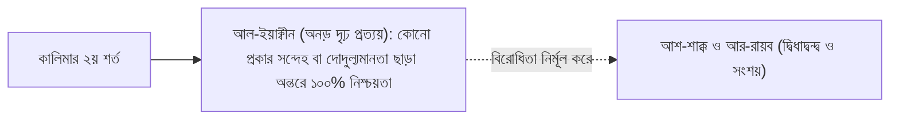

# অধ্যায় ১০: শাহাদাহর দ্বিতীয় শর্ত — ইয়াক্বীন (দৃঢ় প্রত্যয়) বনাম অন্তরের দ্বিধাদ্বন্দ্ব
### কালিমার দ্বিতীয় শর্তের গভীর তাৎপর্য, দুর্বল মানুষের জীবনে তাওহীদের মুক্তি এবং সংশয়মুক্ত ঈমানের স্বরূপ

> **মূল নির্দেশক ও আলোচক:** ইঞ্জিনিয়ার মুহাম্মাদ এনামুল হক  
> **প্রতিষ্ঠান:** ইনস্টিটিউট ফর কমিউনিটি ডেভেলপমেন্ট (ICD) ও স্কুল ফর কমিউনিটি ডেভেলপমেন্ট (SCD)  
> **কোর্স:** বেসিক ইসলাম (প্রাপ্তবয়স্কদের মৌলিক ইসলামী শিক্ষা ও আক্বীদা পরিক্রমা) — ১ম খণ্ড: ঈমান ও তাওহীদের বুনিয়াদ  
> **উৎস অডিও:** `Basic_Islam_10.mp3` (দৈর্ঘ্য: ১৩ মিনিট ৫০ সেকেন্ড)  
> **সংস্করণ মানদণ্ড:** সম্পূর্ণ আন-অ্যাব্রিজড প্রামাণ্য সংস্করণ — মূল লেকচারের শতভাগ বক্তব্য, তাত্ত্বিক রূপরেখা ও বিশুদ্ধ তাখরীজ সমন্বিত।

---

## অধ্যায়ের সূচিপত্র
- [১. ভূমিকা: সমাজতাত্ত্বিক প্রেক্ষাপট ও তাওহীদের বিপ্লব](#১-ভূমিকা-সমাজতাত্ত্বিক-প্রেক্ষাপট-ও-তাওহীদের-বিপ্লব)
- [২. নিপীড়িত মানুষের জীবনে তাওহীদের মুক্তির বার্তা](#২-নিপীড়িত-মানুষের-জীবনে-তাওহীদের-মুক্তির-বার্তা)
  - [ক. দুর্বল ও সহায়হীন মানুষের পাশে খাঁটি মানুষ](#ক-দুর্বল-ও-সহায়হীন-মানুষের-পাশে-খাঁটি-মানুষ)
  - [খ. মানুষের দাসত্ব বনাম একমাত্র রবের গোলামি](#খ-মানুষের-দাসত্ব-বনাম-একমাত্র-রবের-গোলামি)
- [৩. শাহাদাহর দ্বিতীয় শর্ত: আল-ইয়াক্বীন (اليقين — অনড় দৃঢ় প্রত্যয়)](#৩-শাহাদাহর-দ্বিতীয়-শর্ত-আল-ইয়াক্বীন-اليقين-অনড়-দৃঢ়-প্রত্যয়)
  - [ক. সংশয় (আশ-শাক্ক) ও দ্বিধাদ্বন্দ্বের মূলোৎপাটন](#ক-সংশয়-আশ-শাক্ক-ও-দ্বিধাদ্বন্দ্বের-মূলোৎপাটন)
  - [খ. অন্তরে সামান্যতম সন্দেহের ভয়াবহ পরিণতি](#খ-অন্তরে-সামান্যতম-সন্দেহের-ভয়াবহ-পরিণতি)
- [৪. নিফাক্বের স্বরূপ: সূরা আত-তাওবার ৪৫ নম্বর আয়াত](#৪-নিফাক্বের-স্বরূপ-সূরা-আত-তাওবার-৪৫-নম্বর-আয়াত)
- [৫. কুরআন ও সুন্নাহর প্রামাণ্য দলীলসমূহ](#৫-কুরআন-ও-সুন্নাহর-প্রামাণ্য-দলীলসমূহ)
- [৬. প্রাপ্তবয়স্ক মুমিনের চিন্তন ও আত্মোপলব্ধির পাঠ](#৬-প্রাপ্তবয়স্ক-মুমিনের-চিন্তন-ও-আত্মোপলব্ধির-পাঠ)

---

## ১. ভূমিকা: সমাজতাত্ত্বিক প্রেক্ষাপট ও তাওহীদের বিপ্লব

بِسْمِ اللَّهِ الرَّحْمَٰنِ الرَّحِيمِ  
الْحَمْدُ لِلَّهِ، وَالصَّلَاةُ وَالسَّلَامُ عَلَى رَسُولِ اللَّهِ... أَمَّا بَعْدُ:

গত পর্বে আমরা কালিমায়ে শাহাদাহর প্রথম শর্ত—'আল-ইলম' (জ্ঞান) আলোচনা করেছি। আজকের পর্বে আমরা প্রবেশ করব কালিমার দ্বিতীয় শর্তে, যা ব্যতীত প্রথম শর্তের জ্ঞান কোনোভাবেই ফলপ্রসূ হতে পারে না। সেই দ্বিতীয় শর্তটি হলো **"আল-ইয়াক্বীন" (اليقين — অনড় দৃঢ় প্রত্যয় ও অবিচল নিশ্চয়তা)**।

ইঞ্জিনিয়ার মুহাম্মাদ এনামুল হক এই আলোচনার সূচনায় এক অসাধারণ সমাজতাত্ত্বিক ও মনস্তাত্ত্বিক বাস্তবতা উন্মোচন করেন। তিনি দেখান—যখন সমাজে একজন মানুষ নির্যাতিত, নিপীড়িত, দুর্বল বা সহায়-সম্বলহীন অবস্থায় পতিত হয়, তখন তার চারপাশের স্বার্থপর মানুষের দল দূরে সরে যায়। কারণ তার কাছ থেকে কোনো জাগতিক প্রাপ্তির আশা থাকে না। কেবল সেই বিরল খাঁটি মানুষগুলোই পাশে থাকে, যাদের অন্তরে থাকে নিঃস্বার্থ ভালোবাসা ও তাক্বওয়া। 

ইতিহাস সাক্ষী—মক্কার চরম বর্বর যুগে কুরাইশদের অহংকার ও জুলুমের জাঁতাকলে পিষ্ট হওয়া সেই দুর্বল, গোলাম ও মজলুম মানুষদের অন্তরে যখন তাওহীদের বাণী প্রবেশ করেছিল, তখন কীভাবে তারা পৃথিবীর সর্বশ্রেষ্ঠ আত্মমর্যাদাবান ব্যক্তিতে রূপান্তরিত হয়েছিলেন!

---

## ২. নিপীড়িত মানুষের জীবনে তাওহীদের মুক্তির বার্তা

### ক. দুর্বল ও সহায়হীন মানুষের পাশে খাঁটি মানুষ
শায়খ বলেন, সুস্থ ও প্রভাবশালী মানুষের পাশে শত শত তোষামোদকারী ভিড় জমায়। কিন্তু যখন একজন মানুষ অসহায় ও মাজলুম হয়, তখন দুনিয়ার মিথ্যা সম্পর্কগুলোর আসল রূপ প্রকাশ পায়। 

ঠিক তেমনি মক্কার আরবে বিলাল, আম্মার, সুমাইয়া ও খাব্বাব (রা.)-এর মতো মানুষদের সামাজিক কোনো বংশমর্যাদা বা শক্তি ছিল না। কিন্তু কালিমায়ে শাহাদাহ তাঁদের এমন এক রবের সাথে যুক্ত করে দিয়েছিল, যিনি সকল জালিমের চেয়ে মহাশক্তিমান। 

### খ. মানুষের দাসত্ব বনাম একমাত্র রবের গোলামি
তাওহীদ মানুষের অন্তরে যে বিপ্লব ঘটায় তা হলো—তাওহীদ মানুষকে মানুষের দাসত্ব থেকে মুক্ত করে একমাত্র বিশ্বজগতের রবের দাসত্বে সমর্পিত করে। যে ব্যক্তি লা ইলাহা ইল্লাল্লাহর ওপর পূর্ণ ইয়াক্বীন লাভ করে, সে পৃথিবীর কোনো জালিম শাসক, কোনো ধনকুবের বা কোনো পরাশক্তিকে আর ভয় পায় না। সে জানে—তার জীবন ও মৃত্যুর চাবিকাঠি কোনো মানুষের হাতে নেই, তা কেবল আসমান ও জমিনের মালিক আল্লাহর হাতে।

---

## ৩. শাহাদাহর দ্বিতীয় শর্ত: আল-ইয়াক্বীন (اليقين — অনড় দৃঢ় প্রত্যয়)

কালিমার দ্বিতীয় শর্ত হলো **'আল-ইয়াক্বীন'**, যার বিপরীত হলো **'আশ-শাক্ক' (الشك - সন্দেহ)** এবং **'আর-রায়ব' (الريب - দ্বিধাদ্বন্দ্ব)**।

### ক. সংশয় (আশ-শাক্ক) ও দ্বিধাদ্বন্দ্বের মূলোৎপাটন
ইয়াক্বীন হলো এমন এক সুদৃঢ় আত্মিক প্রত্যয়, যেখানে কোনো অনুমানের স্থান নেই। 
- একজন মুমিন যখন বলে ‘লা ইলাহা ইল্লাল্লাহ’, তখন তার অন্তরে সূর্য ওঠার মতো স্পষ্ট নিশ্চয়তা থাকতে হবে যে, সত্যই আল্লাহ ছাড়া ইবাদতের যোগ্য কোনো উপাস্য নেই।
- সেখানে যদি ১% বা ০.১% সংশয়ও থাকে—‘আল্লাহ কি সত্যিই আছেন? যদি না থাকেন?’—তবে সেই সামান্যতম সন্দেহ সমগ্র ঈমানকে মুহূর্তে ধ্বংস করে দেওয়ার জন্য যথেষ্ট।

### খ. অন্তরে সামান্যতম সন্দেহের ভয়াবহ পরিণতি
শায়খ স্পষ্ট করেন যে, ইসলামে সন্দেহের কোনো স্থান নেই। যদি কোনো মানুষ ইসলামে কোনো কিছু নিয়ে বিভ্রান্তিতে পড়ে, তবে তাকে অবিলম্বে কুরআন ও সুন্নাহর প্রামাণ্য ইলম অর্জন করে সেই সন্দেহ দূর করতে হবে। যদি সে সংশয় পুষে রেখে মৃত্যুবরণ করে, তবে কাল কিয়ামতের দিন সে মুমিন হিসেবে নয়, বরং মুনাফিক্ব বা কাফের হিসেবে পুনরুত্থিত হবে।

---

## ৪. নিফাক্বের স্বরূপ: সূরা আত-তাওবার ৪৫ নম্বর আয়াত

পবিত্র কুরআনে আল্লাহ তা‘আলা মুনাফিক্বদের সবচেয়ে বড় চারিত্রিক ব্যাধি চিহ্নিত করেছেন—তাদের অন্তরের **"দ্বিধাদ্বন্দ্ব ও রায়ব" (الريب)**।

আল্লাহ সুবহানাহু ওয়া তা‘আলা ইরশাদ করেন:

قَالَ اللَّهُ تَعَالَى:  
**﴿إِنَّمَا يَسْتَأْذِنُكَ الَّذِينَ لَا يُؤْمِنُونَ بِاللَّهِ وَالْيَوْمِ الْآخِرِ وَارْتَابَتْ قُلُوبُهُمْ فَهُمْ فِي رَيْبِهِمْ يَتَرَدَّدُونَ﴾**  
> **তথ্যসূত্র ও সক্রিয় লিংক:** [সূরা আত-তাওবাহ: ৪৫](https://quran.com/9/45)

আল্লাহ স্পষ্ট করে দিচ্ছেন: জিহাদের ময়দানে বা সত্যের চরম পরীক্ষায় কেবল তারাই পিছপা হয় এবং নানা বাহানা খোঁজে, যাদের অন্তরে আল্লাহ ও পরকালের প্রতি অটল বিশ্বাস নেই; যাদের অন্তর সন্দেহে জর্জরিত; আর সেই সন্দেহের ঘুর্ণিপাকে পড়ে তারা চিরকাল দোদুল্যমান ও দ্বিধাগ্রস্ত অবস্থায় হাবুডুবু খেতে থাকে।

অতএব ইয়াক্বীন হলো সেই ঈমানী নোঙর, যা ঝঞ্ঝাবিক্ষুব্ধ সাগরেও মুমিনের আত্মিক তরীকে অটল ও স্থির রাখে।

---

## ৫. কুরআন ও সুন্নাহর প্রামাণ্য দলীলসমূহ

### আল-কুরআনের অকাট্য নির্দেশ: সত্যবাদী মুমিনের প্রধান বৈশিষ্ট্য—নিঃসংশয় ঈমান
আল্লাহ সুবহানাহু ওয়া তা‘আলা প্রকৃত মুমিনদের সংজ্ঞা দিতে গিয়ে সবার আগে সন্দেহের অনুপস্থিতির শর্ত জুড়ে দিয়ে ইরশাদ করেন:

قَالَ اللَّهُ تَعَالَى:  
**﴿إِنَّمَا الْمُؤْمِنُونَ الَّذِينَ آمَنُوا بِاللَّهِ وَرَسُولِهِ ثُمَّ لَمْ يَرْتَابُوا وَجَاهَدُوا بِأَمْوَالِهِمْ وَأَنفُسِهِمْ فِي سَبِيلِ اللَّهِ ۚ أُولَٰئِكَ هُمُ الصَّادِقُونَ﴾**

> **বঙ্গানুবাদ:** “প্রকৃত মুমিন কেবল তারাই, যারা আল্লাহ ও তাঁর রাসূলের প্রতি ঈমান এনেছে, অতঃপর কোনো প্রকার সন্দেহে পতিত হয়নি; এবং তাদের জান ও মাল দিয়ে আল্লাহর পথে জিহাদ করেছে। তারাই হলো প্রকৃত সত্যবাদী।”  
> **তথ্যসূত্র ও সক্রিয় লিংক:** [সূরা আল-হুজুরাত: ১৫](https://quran.com/49/15)

### রাসূলুল্লাহ ﷺ-এর সুন্নাহ: সন্দেহহীন শাহাদাহ জান্নাতের জামিনদার
عَنْ أَبِي هُرَيْرَةَ رَضِيَ اللَّهُ عَنْهُ، قَالَ: قَالَ رَسُولُ اللَّهِ ﷺ:  
**«أَشْهَدُ أَنْ لَا إِلَهَ إِلَّا اللَّهُ، وَأَنِّي رَسُولُ اللَّهِ، لَا يَلْقَى اللَّهَ بِهِمَا عَبْدٌ غَيْرَ شَاكٍّ فِيهِمَا، إِلَّا دَخَلَ الْجَنَّةَ»**

> **বঙ্গানুবাদ:** “আবু হুরায়রা (রা.) হতে বর্ণিত, তিনি বলেন, রাসূলুল্লাহ ﷺ ইরশাদ করেছেন: আমি সাক্ষ্য দিচ্ছি যে আল্লাহ ব্যতীত কোনো সত্য উপাস্য নেই এবং আমি আল্লাহর রাসূল; যে বান্দা এ দুটি বিষয়ে কোনো প্রকার সন্দেহ পোষণ না করে এ সাক্ষ্য নিয়ে আল্লাহর সাথে সাক্ষাৎ করবে, সে নিশ্চিত জান্নাতে প্রবেশ করবে।”  
> **তাহক্বীক্ব ও মান:** সহীহ মুসলিম।  
> **তথ্যসূত্র ও সক্রিয় লিংক:** [সহীহ মুসলিম: ২৭](https://www.hadithbd.com/hadith/detail/?book=2&hadith=27)

---

## ৬. প্রাপ্তবয়স্ক মুমিনের চিন্তন ও আত্মোপলব্ধির পাঠ

1. **অন্তরের দ্বিধাদ্বন্দ্বের তল্লাশি:** নিজের মনের গভীরে আলো ফেলুন—আল্লাহর অস্তিত্ব, পরকালের জবাবদিহিতা, বা কবরের আযাব নিয়ে কি আপনার অন্তরে কোনো সূক্ষ্ম দ্বিধাদ্বন্দ্ব বা সংশয় রয়েছে? যদি থাকে, তবে এখনই তা দূর করার জন্য কুরআন ও সহীহ হাদীসের তাফসীর অধ্যয়ন করুন।
2. **তাওহীদের নির্ভীকতা অর্জন:** যদি আপনি বিশ্বাস করেন আল্লাহই একমাত্র জীবন ও রিযিকের মালিক, তবে দুনিয়ার কোনো মানুষের অন্যায় চাপের মুখে মাথা নত করবেন না। সত্য ও ন্যায়ের পথে অবিচল থাকুন।
3. **সন্দেহহীন ঈমানের দু‘আ:** অন্তরের সংশয় দূর করতে এবং ঈমানের ওপর অবিচল থাকতে রাসূলুল্লাহ ﷺ-এর সেই প্রিয় দু‘আটি বেশি বেশি পাঠ করুন: *«يَا مُقَلِّبَ الْقُلُوبِ ثَبِّتْ قَلْبِي عَلَى دِينِكَ»* (হে অন্তরসমূহের পরিবর্তনকারী! আমার অন্তরকে আপনার দ্বীনের ওপর অবিচল রাখুন)।
