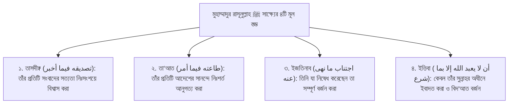

# অধ্যায় ১৩: "মুহাম্মাদুর রাসূলুল্লাহ" সাক্ষ্যের তাৎপর্য — চার মূলনীতি ও সুন্নাহর সার্বভৌমত্ব
### রিসালাতের সাক্ষ্যের শর্তাবলী, সংবাদের সত্যায়ন, আনুগত্যের পরাকাষ্ঠা এবং বিদ‘আত বর্জনের অপরিহার্যতা

> **মূল নির্দেশক ও আলোচক:** ইঞ্জিনিয়ার মুহাম্মাদ এনামুল হক  
> **প্রতিষ্ঠান:** ইনস্টিটিউট ফর কমিউনিটি ডেভেলপমেন্ট (ICD) ও স্কুল ফর কমিউনিটি ডেভেলপমেন্ট (SCD)  
> **কোর্স:** বেসিক ইসলাম (প্রাপ্তবয়স্কদের মৌলিক ইসলামী শিক্ষা ও আক্বীদা পরিক্রমা) — ১ম খণ্ড: ঈমান ও তাওহীদের বুনিয়াদ  
> **উৎস অডিও:** `Basic_Islam_13.mp3` (দৈর্ঘ্য: ২০ মিনিট ২৬ সেকেন্ড)  
> **সংস্করণ মানদণ্ড:** সম্পূর্ণ আন-অ্যাব্রিজড প্রামাণ্য সংস্করণ — মূল লেকচারের শতভাগ বক্তব্য, তাত্ত্বিক রূপরেখা ও বিশুদ্ধ তাখরীজ সমন্বিত।

---

## অধ্যায়ের সূচিপত্র
- [১. ভূমিকা: শাহাদাতাইনের দ্বিতীয় অবিচ্ছেদ্য স্তম্ভ](#১-ভূমিকা-শাহাদাতাইনের-দ্বিতীয়-অবিচ্ছেদ্য-স্তম্ভ)
- [২. "মুহাম্মাদুর রাসূলুল্লাহ" সাক্ষ্যের চতুর্মুখী মূলনীতি](#২-মুহাম্মাদুর-রাসূলুল্লাহ-সাক্ষ্যের-চতুর্মুখী-মূলনীতি)
  - [১. তাঁর প্রদত্ত সমস্ত সংবাদের অকপট সত্যায়ন (তাসদীক্ব)](#১-তাঁর-প্রদত্ত-সমস্ত-সংবাদের-অকপট-সত্যায়ন-তাসদীক্ব)
  - [২. তাঁর প্রতিটি আদেশের সানন্দ আনুগত্য (তা‘আত)](#২-তাঁর-প্রতিটি-আদেশের-সানন্দ-আনুগত্য-তাআত)
  - [৩. তিনি যা নিষেধ করেছেন তা সম্পূর্ণ বর্জন (ইজতিনাব)](#৩-তিনি-যা-নিষেধ-করেছেন-তা-সম্পূর্ণ-বর্জন-ইজতিনাব)
  - [৪. কেবল তাঁর প্রদর্শিত পদ্ধতিতে ইবাদত ও বিদ‘আত বর্জন](#৪-কেবল-তাঁর-প্রদর্শিত-পদ্ধতিতে-ইবাদত-ও-বিদআত-বর্জন)
- [৩. সুন্নাহর সার্বভৌমত্ব বনাম মানুষের মনগড়া সংযোজন](#৩-সুন্নাহর-সার্বভৌমত্ব-বনাম-মানুষের-মনগড়া-সংযোজন)
- [৪. বিদ‘আতের ভয়াবহতা: সহীহ বুখারী ও মুসলিমের অকাট্য হাদীস](#৪-বিদআতের-ভয়াবহতা-সহীহ-বুখারী-ও-মুসলিমের-অকাট্য-হাদীস)
- [৫. কুরআন ও সুন্নাহর প্রামাণ্য দলীলসমূহ](#৫-কুরআন-ও-সুন্নাহর-প্রামাণ্য-দলীলসমূহ)
- [৬. প্রাপ্তবয়স্ক মুমিনের চিন্তন ও আত্মোপলব্ধির পাঠ](#৬-প্রাপ্তবয়স্ক-মুমিনের-চিন্তন-ও-আত্মোপলব্ধির-পাঠ)

---

## ১. ভূমিকা: শাহাদাতাইনের দ্বিতীয় অবিচ্ছেদ্য স্তম্ভ

بِسْمِ اللَّهِ الرَّحْمَٰنِ الرَّحِيمِ  
الْحَمْدُ لِلَّهِ، وَالصَّلَاةُ وَالسَّلَامُ عَلَى رَسُولِ اللَّهِ... أَمَّا বَعْدُ:

আমরা কালিমায়ে তাওহীদের প্রথম অংশ *«أَشْهَدُ أَنْ لَا إِلَهَ إِلَّا اللَّهُ»*-এর সাতটি শর্ত পুঙ্খানুপুঙ্খভাবে সমাপ্ত করেছি। কিন্তু ইসলামে প্রবেশের জন্য কেবল প্রথম অংশ যথেষ্ট নয়; এর সাথে দ্বিতীয় অংশ সমান গুরুত্ব ও মর্যাদায় অঙ্গাঙ্গিভাবে জড়িত—তা হলো:
> **«وَأَشْهَدُ أَنَّ مُحَمَّدًا رَسُولُ اللَّهِ»**  
> “এবং আমি সাক্ষ্য দিচ্ছি যে, নিশ্চয় মুহাম্মাদ ﷺ আল্লাহর প্রেরিত সত্য রাসূল।”

ইঞ্জিনিয়ার মুহাম্মাদ এনামুল হক এই পর্বে উন্মোচন করেন যে, নিছক মুখে ‘মুহাম্মাদুর রাসূলুল্লাহ’ উচ্চারণ করলেই এই সাক্ষ্যের হক আদায় হয় না। এই সাক্ষ্য হলো সৃষ্টির শ্রেষ্ঠ মানবের সামনে নিজের চিন্তাভাবনা, আকিদা, আচরণ ও ইবাদতকে নিঃশর্তভাবে সমর্পণ করার এক অলঙ্ঘনীয় শারঈ অঙ্গীকার।

উলামায়ে কেরাম ও আক্বীদার ইমামগণ এই মহান সাক্ষ্যের দাবিকে **চারটি মৌলিক স্তম্ভের (Four Fundamental Pillars)** ওপর সংজ্ঞায়িত করেছেন।

---

## ২. "মুহাম্মাদুর রাসূলুল্লাহ" সাক্ষ্যের চতুর্মুখী মূলনীতি

### ১. তাঁর প্রদত্ত সমস্ত সংবাদের অকপট সত্যায়ন (তাসদীক্ব)
> **«تَصْدِيقُهُ فِيمَا أَخْبَرَ»**

রাসূলুল্লাহ ﷺ অতীত, বর্তমান ও ভবিষ্যৎ সম্পর্কে যা কিছু সংবাদ দিয়েছেন—তা হোক পূর্ববর্তী আম্বিয়ায়ে কেরামের ইতিহাস, হোক অদৃশ্য জগতের ফেরেশতা ও জিনদের বিবরণ, হোক মৃত্যুর পরবর্তী কবরের আযাব-সাওয়াব, হাশরের ময়দান, পুলসিরাত, মীযান, কিংবা জান্নাত ও জাহান্নামের বর্ণনা—প্রতিটি সংবাদকে কোনো প্রকার বৈজ্ঞানিক সংশয় বা মানবীয় যুক্তির কূটতর্ক ছাড়াই শতভাগ পরম সত্য বলে বিশ্বাস করা।

যদি কোনো ব্যক্তি বলে: *“কবরের সাওয়াল-জওয়াব বা মিরাজের ঘটনা আধুনিক বিজ্ঞানের ল্যাবরেটরিতে প্রমাণ করা যায় না, তাই আমি তা রূপক মনে করি”*—তবে সে মুহাম্মাদুর রাসূলুল্লাহর সাক্ষ্যকে সরাসরি অস্বীকার করল।

### ২. তাঁর প্রতিটি আদেশের সানন্দ আনুগত্য (তা‘আত)
> **«طَاعَتُهُ فِيمَا أَمَرَ»**

রাসূলুল্লাহ ﷺ দ্বীন ও জীবনের যে কোনো ক্ষেত্রে যা কিছু করার নির্দেশ দিয়েছেন, একজন মুমিনের কর্তব্য হলো কোনো প্রকার টালবাহানা বা দ্বিধাদ্বন্দ্ব ছাড়া সানন্দে তা পালন করা।

পবিত্র কুরআনে আল্লাহ তা‘আলা স্পষ্ট করেছেন: রাসূলুল্লাহ ﷺ-এর আনুগত্য করা প্রকৃতপক্ষে স্বয়ং আল্লাহরই আনুগত্য করা:
> **﴿مَّن يُطِعِ الرَّسُولَ فَقَدْ أَطَاعَ اللَّهَ﴾**  
> “যে ব্যক্তি রাসূলের আনুগত্য করল, সে প্রকারান্তরে আল্লাহরই আনুগত্য করল।” ([সূরা আন-নিসা: ৮০](https://quran.com/4/80))

### ৩. তিনি যা নিষেধ করেছেন তা সম্পূর্ণ বর্জন (ইজতিনাব)
> **«اجْتِنَابُ مَا نَهَى عَنْهُ وَزَجَرَ»**

রাসূলুল্লাহ ﷺ যা কিছু হারাম করেছেন, যা থেকে নিষেধ করেছেন এবং যা থেকে কঠোরভাবে ভীতি প্রদর্শন করেছেন—তা হোক বড় গুনাহ কিংবা ছোট গুনাহ, হোক মিথ্যা, গীবত, সুদ, ঘুষ, ব্যভিচার, বেপর্দা কিংবা আত্মীয়তার সম্পর্কচ্ছেদ—তা থেকে সম্পূর্ণ নিজেকে গুটিয়ে নেওয়া। 

মুমিনের নীতি হবে—রাসূলুল্লাহ ﷺ নিষেধ করেছেন মানেই আলোচনা শেষ; সেখানে কোনো আপসের সুযোগ নেই।

### ৪. কেবল তাঁর প্রদর্শিত পদ্ধতিতে ইবাদত ও বিদ‘আত বর্জন
> **«أَنْ لَا يُعْبَدَ اللَّهُ إِلَّا بِمَا شَرَعَ»**

এটি হলো এই সাক্ষ্যের সবচেয়ে সংবেদনশীল ও বিপ্লবী নীতি: **“আল্লাহর ইবাদত কেবল সেই পদ্ধতিতে করতে হবে, যা স্বয়ং রাসূলুল্লাহ ﷺ শিখিয়েছেন ও বিধিবদ্ধ করেছেন।”**

এখানে কোনো মানুষের ভালো লাগা, সমাজের কোনো প্রথা বা নতুন কোনো উদ্ভাবনের সুযোগ নেই। মানুষ যদি নিজের ইচ্ছামতো অতি ভক্তি বা সাওয়াবের আশায় দ্বীনের মাঝে কোনো নতুন আমল, নতুন যিকির বা নতুন কোনো ইবাদতের রূপ উদ্ভাবন করে, তবে তা আল্লাহর দরবারে সাওয়াব তো আনবেই না, বরং তা মারাত্মক গুনাহ ও সরাসরি প্রত্যাখ্যাত হবে!

---

## ৩. সুন্নাহর সার্বভৌমত্ব বনাম মানুষের মনগড়া সংযোজন

শায়খ এনামুল হক বলেন, বহু মানুষ অজ্ঞতাবশত যুক্তি দেয়: *“আমরা তো একটি ভালো কাজই করছি! আমরা রাসূল ﷺ-এর জন্য মিলাদ পড়ছি বা অমুক রাতে বিশেষ কায়দায় নফল নামাজ পড়ছি—এতে ক্ষতির কী আছে?”*

উলামায়ে কেরাম এর অকাট্য জবাব দিয়েছেন:
> দ্বীনের পূর্ণতা আল্লাহ সুবহানাহু ওয়া তা‘আলা রাসূলুল্লাহ ﷺ-এর জীবদ্দশাতেই সমাপ্ত ঘোষণা করেছেন: **«الْيَوْمَ أَكْمَلْتُ لَكُمْ دِينَكُمْ»** (আজ আমি তোমাদের জন্য তোমাদের দ্বীনকে পূর্ণাঙ্গ করে দিলাম—সূরা আল-মায়িদাহ: ৩)।  
> এখন যদি কেউ দ্বীনে নতুন কোনো ইবাদত উদ্ভাবন করে, তবে সে প্রকারান্তরে দাবি করল যে—নাউযুবিল্লাহ, রাসূলুল্লাহ ﷺ দ্বীনের কোনো সাওয়াবের কাজ আমাদের কাছে পৌঁছাতে ভুলে গিয়েছিলেন, যা আজ চৌদ্দশত বছর পর এই নতুন ব্যক্তি আবিষ্কার করেছে! এটি নবুওয়াতের আমানতদারিতার ওপর চরম কটাক্ষ।

---

## ৪. বিদ‘আতের ভয়াবহতা: সহীহ বুখারী ও মুসলিমের অকাট্য হাদীস

উম্মুল মুমিনীন আয়েশা (রা.) হতে বর্ণিত রাসূলুল্লাহ ﷺ-এর একটি সুবিখ্যাত অকাট্য মূলনীতি হাদিস শায়খ উদ্ধৃত করেন:

عَنْ عَائِشَةَ رَضِيَ اللَّهُ عَنْهَا، قَالَتْ: قَالَ رَسُولُ اللَّهِ ﷺ:  
**«مَنْ أَحْدَثَ فِي أَمْرِنَا هَذَا مَا لَيْسَ فِيهِ فَهُوَ رَدٌّ»**

> **বঙ্গানুবাদ:** “উম্মুল মুমিনীন আয়েশা (রা.) হতে বর্ণিত, তিনি বলেন, রাসূলুল্লাহ ﷺ ইরশাদ করেছেন: যে ব্যক্তি আমাদের এই দ্বীনের মাঝে এমন কোনো নতুন বিষয়ের উদ্ভাবন ঘটাবে যা এর অন্তর্ভুক্ত নয়, তা সরাসরি প্রত্যাখ্যাত (বাতিল)।”  
> **তাহক্বীক্ব ও মান:** সহীহুল বুখারী ও সহীহ মুসলিম।  
> **তথ্যসূত্র ও সক্রিয় লিংক:** [সহীহ বুখারী: ২৬৯৭](https://www.hadithbd.com/hadith/detail/?book=1&hadith=2697), [সহীহ মুসলিম: ১৭১৮](https://www.hadithbd.com/hadith/detail/?book=2&hadith=1718)

সহীহ মুসলিমের অন্য বর্ণনায় আরো স্পষ্ট করে এসেছে:
> **«مَنْ عَمِلَ عَمَلًا لَيْسَ عَلَيْهِ أَمْرُنَا فَهُوَ رَدٌّ»**  
> “যে ব্যক্তি এমন কোনো আমল করল যার ওপর আমাদের কোনো নির্দেশনা বা অনুমোদন নেই, তা সরাসরি প্রত্যাখ্যাত।” ([সহীহ মুসলিম: ১৭১৮](https://www.hadithbd.com/hadith/detail/?book=2&hadith=1718))

অতএব কোনো আমল কবুল হওয়ার জন্য দুটি পূর্বশর্ত অপরিহার্য:
1. **ইখলাস:** একমাত্র আল্লাহর সন্তুষ্টির জন্য হতে হবে।
2. **মুসাবা‘আত বা ইত্তিবা:** হুবহু রাসূলুল্লাহ ﷺ-এর সুন্নাহর তরিকায় হতে হবে।

---

## ৫. কুরআন ও সুন্নাহর প্রামাণ্য দলীলসমূহ

### আল-কুরআনের অকাট্য নির্দেশ: সুন্নাহর খেলাফকারীদের জন্য ফিতনা ও কঠিন শাস্তির হুমকি
আল্লাহ তা‘আলা রাসূলুল্লাহ ﷺ-এর নির্দেশ অমান্যকারীদের ব্যাপারে কঠোর হুঁশিয়ারি উচ্চারণ করে ইরশাদ করেন:

قَالَ اللَّهُ تَعَالَى:  
**﴿فَلْيَحْذَرِ الَّذِينَ يُخَالِفُونَ عَنْ أَمْرِهِ أَن تُصِيبَهُمْ فِتْنَةٌ أَوْ يُصِيبَهُمْ عَذَابٌ أَلِيمٌ﴾**  
> **বঙ্গানুবাদ:** “অতএব যারা তাঁর (রাসূলের) আদেশের বিরুদ্ধাচরণ করে, তারা যেন এ বিষয়ে চরম সতর্ক ও ভীত থাকে যে—তাদের ওপর কোনো কঠিন ফিতনা (বিপর্যয় বা পথভ্রষ্টতা) আপতিত হবে কিংবা তাদের ওপর কোনো যন্ত্রণাদায়ক শাস্তি নেমে আসবে।”  
> **তথ্যসূত্র ও সক্রিয় লিংক:** [সূরা আন-নূর: ৬৩](https://quran.com/24/63)

### রাসূলুল্লাহ ﷺ-এর সুন্নাহ: হাউযে কাউসারে বিদ‘আতীদের বিতাড়ন
عَنْ سَهْلِ بْنِ سَعْدٍ رَضِيَ اللَّهُ عَنْهُ، قَالَ: قَالَ النَّبِيُّ ﷺ:  
**«إِنِّي فَرَطُكُمْ عَلَى الْحَوْضِ، مَنْ مَرَّ عَلَيَّ شَرِبَ، وَمَنْ شَرِبَ لَمْ يَظْمَأْ أَبَدًا، لَيَرِدَنَّ عَلَيَّ أَقْوَامٌ أَعْرِفُهُمْ وَيَعْرِفُونِي، ثُمَّ يُحَالُ بَيْنِي وَبَيْنَهُمْ... فَأَقُولُ: إِنَّهُمْ مِنِّي! فَيُقَالُ: إِنَّكَ لاَ تَدْرِي مَا أَحْدَثُوا بَعْدَكَ! فَأَقُولُ: سُحْقًا سُحْقًا لِمَنْ غَيَّرَ بَعْدِي»**  
> **বঙ্গানুবাদ:** “সাহল ইবনু সা‘দ (রা.) হতে বর্ণিত, নবী করীম ﷺ ইরশাদ করেছেন: আমি হাউযে কাউসারে তোমাদের অগ্রগামী হব। যে ব্যক্তি সেখানে উপস্থিত হবে সে পানি পান করবে; আর যে একবার পান করবে সে আর কখনো তৃষ্ণার্ত হবে না। অতঃপর নিশ্চয় এমন কিছু লোক আমার কাছে আসবে যাদের আমি চিনব এবং তারাও আমাকে চিনবে। অতঃপর আমার ও তাদের মাঝে অন্তরায় তৈরি করা হবে (ফেরেশতারা তাদের তাড়িয়ে দেবে)... তখন আমি বলব: এরা তো আমার উম্মত! কিন্তু বলা হবে: আপনি জানেন না আপনার চলে যাওয়ার পর এরা দ্বীনে কী সব নতুন বিষয়ের (বিদ‘আতের) উদ্ভাবন করেছিল! তখন আমি বলব: দূর হও! দূর হও সেই লোক—যে আমার পরে আমার দ্বীনকে বিকৃত ও পরিবর্তন করেছিল!”  
> **তাহক্বীক্ব ও মান:** সহীহুল বুখারী ও সহীহ মুসলিম।  
> **তথ্যসূত্র ও সক্রিয় লিংক:** [সহীহ বুখারী: ৭০৫০](https://www.hadithbd.com/hadith/detail/?book=1&hadith=7050), [সহীহ মুসলিম: ২২৯০](https://www.hadithbd.com/hadith/detail/?book=2&hadith=2290)

---

## ৬. প্রাপ্তবয়স্ক মুমিনের চিন্তন ও আত্মোপলব্ধির পাঠ

1. **আমলে সুন্নাহর কষ্টিপাথর:** বংশপরম্পরায় সমাজে প্রচলিত রসম-রেওয়াজ অন্ধভাবে অনুসরণ করা বন্ধ করুন। প্রতিটি আমল করার আগে নিজেকে জিজ্ঞাসা করুন—এই আমলটি কি আল্লাহর রাসূল ﷺ বা তাঁর সাহাবীগণ করেছিলেন? যদি দলীল না থাকে, তবে তা অবিলম্বে বর্জন করুন।
2. **হাউযে কাউসারের তৃষ্ণা নিবারণের আকুলতা:** কিয়ামতের সেই ভয়ংকর দিনে যখন তৃষ্ণায় কলিজা ফেটে যাবে, তখন যেন রাসূলুল্লাহ ﷺ-এর পবিত্র হাত থেকে হাউযে কাউসারের পানি পান করতে পারি; বিদ‘আতী হয়ে যেন তাঁর দরবার থেকে বিতাড়িত হতে না হয়।
3. **নবীপ্রেমে সুন্নাহর আনুগত্য:** নিছক গজল বা মৌখিক ভালোবাসার দাবি নয়; জীবনের পোশাক, চালচলন, পরিবার ও চরিত্রকে প্রিয় নবী ﷺ-এর সুন্নাহর নিখুঁত ছাঁচে ঢেলে সাজানোই হলো ভালোবাসার আসল প্রমাণ।
