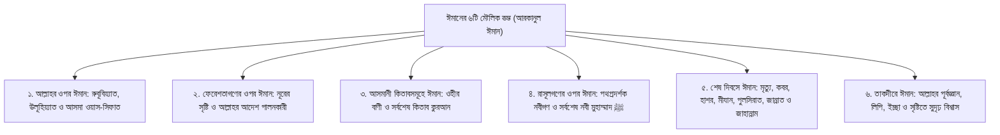

# অধ্যায় ১৫: ঈমানের স্তম্ভসমূহ ও আক্বীদার ভিত্তিপ্রস্তর — বৃদ্ধি ও হ্রাসের মূলনীতি
### ঈমানের ছয়টি মৌলিক রুকন, হাদীসে জিবরীল, নেক আমলে ঈমানের বৃদ্ধি এবং পাপাচারের আত্মিক ক্ষয়

> **মূল নির্দেশক ও আলোচক:** ইঞ্জিনিয়ার মুহাম্মাদ এনামুল হক  
> **প্রতিষ্ঠান:** ইনস্টিটিউট ফর কমিউনিটি ডেভেলপমেন্ট (ICD) ও স্কুল ফর কমিউনিটি ডেভেলপমেন্ট (SCD)  
> **কোর্স:** বেসিক ইসলাম (প্রাপ্তবয়স্কদের মৌলিক ইসলামী শিক্ষা ও আক্বীদা পরিক্রমা) — ১ম খণ্ড: ঈমান ও তাওহীদের বুনিয়াদ  
> **উৎস অডিও:** `Basic_Islam_15.mp3` (দৈর্ঘ্য: ২১ মিনিট ৩০ সেকেন্ড)  
> **সংস্করণ মানদণ্ড:** সম্পূর্ণ আন-অ্যাব্রিজড প্রামাণ্য সংস্করণ — মূল লেকচারের শতভাগ বক্তব্য, তাত্ত্বিক রূপরেখা ও বিশুদ্ধ তাখরীজ সমন্বিত।

---

## অধ্যায়ের সূচিপত্র
- [১. ভূমিকা: ইসলাম ও ঈমানের মধ্যকার সূক্ষ্ম সম্পর্ক](#১-ভূমিকা-ইসলাম-ও-ঈমানের- মধ্যকার-সূক্ষ্ম-সম্পর্ক)
- [২. হাদীসে জিবরীল: ঈমানের ছয়টি মৌলিক স্তম্ভ (আরকানুল ঈমান)](#২-হাদীসে-জিবরীল-ঈমানের-ছয়টি-মৌলিক-স্তম্ভ-আরকানুল-ঈমান)
  - [১. আল্লাহর প্রতি ঈমান (الإيمان بالله)](#১-আল্লাহর-প্রতি-ঈমান-الإيمان-بالله)
  - [২. ফেরেশতাগণের প্রতি ঈমান (الإيمان بالملائكة)](#২-ফেরেশতাগণের-প্রতি-ঈমান-الإيمان-بالملائكة)
  - [৩. আসমানী কিতাবসমূহের প্রতি ঈমান (الإيمان بالكتب)](#৩-আসমানী-কিতাবসমূহের-প্রতি-ঈমান-الإيمان-بالكتب)
  - [৪. রাসূলগণের প্রতি ঈমান (الإيمان بالرسل)](#৪-রাসূলগণের-প্রতি-ঈমান-الإيمان-بالرسل)
  - [৫. শেষ দিবস বা পরকালের প্রতি ঈমান (الإيمان باليوم الآخر)](#৫-শেষ-দিবস-বা-পরকালের-প্রতি-ঈমান-الإيمان-باليوم-الآخر)
  - [৬. তাকদীরের ভালো-মন্দের ওপর ঈমান (الإيمان بالقدر خيره وشره)](#৬-তাকদীরের-ভালো-মন্দের-ওপর-ঈমান-الإيمان-بالقدر-خيره-وشره)
- [৩. আহলুস সুন্নাহর মৌলিক আক্বীদা: ঈমানের বৃদ্ধি ও হ্রাস](#৩-আহলুস-সুন্নাহর-মৌলিক-আক্বীদা-ঈমানের-বৃদ্ধি-ও-হ্রাস)
  - [ক. ঈমানের ত্রিমুখী সংজ্ঞা: অন্তর, যবান ও অঙ্গপ্রত্যঙ্গ](#ক-ঈমানের-ত্রিমুখী-সংজ্ঞা-অন্তর-যবান-ও-অঙ্গপ্রত্যঙ্গ)
  - [খ. আনুগত্যে ঈমান বাড়ে, পাপে ঈমান কমে](#খ-আনুগত্যে-ঈমান-বাড়ে-পাপে-ঈমান-কমে)
- [৪. কুরআন ও সুন্নাহর প্রামাণ্য দলীলসমূহ](#৪-কুরআন-ও-সুন্নাহর-প্রামাণ্য-দলীলসমূহ)
- [৫. প্রাপ্তবয়স্ক মুমিনের চিন্তন ও আত্মোপলব্ধির পাঠ](#৫-প্রাপ্তবয়স্ক-মুমিনের-চিন্তন-ও-আত্মোপলব্ধির-পাঠ)

---

## ১. ভূমিকা: ইসলাম ও ঈমানের মধ্যকার সূক্ষ্ম সম্পর্ক

بِسْمِ اللَّهِ الرَّحْمَٰنِ الرَّحِيمِ  
الْحَمْدُ لِلَّهِ، وَالصَّلَاةُ وَالسَّلَامُ عَلَى رَسُولِ اللَّهِ... أَمَّا بَعْدُ:

কালিমায়ে শাহাদাহর শর্তাবলী ও রাসূলুল্লাহ ﷺ-এর প্রতি ভালোবাসার স্বরূপ জানার পর এবার আমাদের প্রবেশ করতে হবে মুমিনের আত্মিক দুর্গ—অর্থাৎ **"ঈমানের রুকনসমূহ" (أركان الإيمان)** এবং তার ভিত্তিপ্রস্তরে।

শায়খ এনামুল হক ব্যাখ্যা করেন যে, বাহ্যিক কর্ম ও আমলকে বলা হয় 'ইসলাম' (যেমন সালাত, সাওম, যাকাত, হজ); আর অন্তরের গভীর প্রত্যয় ও বিশ্বাসমালাকে বলা হয় 'ঈমান'। ইসলাম ও ঈমান পরস্পরের পরিপূরক। একটি বাদ দিয়ে অন্যটি টিকে থাকতে পারে না।

---

## ২. হাদীসে জিবরীল: ঈমানের ছয়টি মৌলিক স্তম্ভ (আরকানুল ঈমান)

সহীহ মুসলিমে হযরত উমর ইবনুল খাত্তাব (রা.) হতে বর্ণিত সুবিখ্যাত ‘হাদীসে জিবরীল’-এ যখন জিবরীল (আ.) মানুষের বেশে এসে রাসূলুল্লাহ ﷺ-কে জিজ্ঞাসা করলেন: *“হে আল্লাহর রাসূল! আমাকে ঈমান সম্পর্কে বলুন!”* 

তখন প্রিয় নবী ﷺ ঈমানের ছয়টি অবিচ্ছেদ্য রুকন ঘোষণা করলেন:
> **«أَنْ تُؤْمِنَ بِاللَّهِ، وَمَلاَئِكَتِهِ، وَكُتُبِهِ، وَرُسُلِهِ، وَالْيَوْمِ الآخِرِ، وَتُؤْمِنَ بِالْقَدَرِ خَيْرِهِ وَشَرِّهِ»**  
> **“ঈমান হলো—তুমি বিশ্বাস স্থাপন করবে:  
> ১. আল্লাহর প্রতি,  
> ২. তাঁর ফেরেশতাগণের প্রতি,  
> ৩. তাঁর অবতীর্ণ কিতাবসমূহের প্রতি,  
> ৪. তাঁর প্রেরিত রাসূলগণের প্রতি,  
> ৫. শেষ দিবসের (পরকালের) প্রতি,  
> ৬. এবং তাকদীরের ভালো ও মন্দের প্রতি।”** ([সহীহ মুসলিম: ৮](https://www.hadithbd.com/hadith/detail/?book=2&hadith=8))

এই ছয়টি বিষয়ের যে কোনো একটিকে সামান্যতম অস্বীকার বা সন্দেহ করলে একজন মানুষ মুহূর্তের মধ্যে কাফের ও ইসলাম থেকে সম্পূর্ণ খারিজ হয়ে যাবে।

---

## ৩. আহলুস সুন্নাহর মৌলিক আক্বীদা: ঈমানের বৃদ্ধি ও হ্রাস

মুর্জিয়া কিংবা খারেজীদের মতো বিভ্রান্ত দলগুলোর বিপরীতে **আহলুস সুন্নাহ ওয়াল জামা‘আতের** সর্বসম্মত মূলনীতি হলো:

### ক. ঈমানের ত্রিমুখী সংজ্ঞা: অন্তর, যবান ও অঙ্গপ্রত্যঙ্গ
> **«الإِيمَانُ: قَوْلٌ بِاللِّسَانِ، وَاعْتِقَادٌ بِالْجَنَانِ، وَعَمَلٌ بِالأَرْكَانِ»**  
> “ঈমান হলো: মুখে উচ্চারণ করা, অন্তরে দৃঢ় বিশ্বাস পোষণ করা, এবং দেহের অঙ্গপ্রত্যঙ্গ দ্বারা তা বাস্তবে আমল করা।”

### খ. আনুগত্যে ঈমান বাড়ে, পাপে ঈমান কমে
> **«يَزِيدُ بِالطَّاعَةِ، وَيَنْقُصُ بِالْمَعْصِيَةِ»**  
> “ঈমান কোনো স্থির পাথরের মতো নয়; বরং নেক আমল ও আনুগত্যের মাধ্যমে ঈমান বৃদ্ধি পায় এবং গুনাহ ও পাপাচারের কারণে ঈমান হ্রাস পায়।”

পবিত্র কুরআনে আল্লাহ সুবহানাহু ওয়া তা‘আলা বহু আয়াতে মুমিনদের ঈমান বৃদ্ধির সাক্ষ্য দিয়েছেন:
> **﴿إِنَّمَا الْمُؤْمِنُونَ الَّذِينَ إِذَا ذُكِرَ اللَّهُ وَجِلَتْ قُلُوبُهُمْ وَإِذَا تُلِيَتْ عَلَيْهِمْ آيَاتُهُ زَادَتْهُمْ إِيمَانًا وَعَلَىٰ رَبِّهِمْ يَتَوَكَّلُونَ﴾**  
> “প্রকৃত মুমিন তো তারাই—যাদের অন্তর আল্লাহর স্মরণে ভীতসন্ত্রস্ত হয়ে ওঠে, এবং যখন তাদের সামনে আল্লাহর আয়াত তিলাওয়াত করা হয় তখন তা তাদের ঈমানকে বহুগুণ বৃদ্ধি করে দেয়; আর তারা কেবল তাদের রবের ওপরই ভরসা করে।” ([সূরা আল-আনফাল: ২](https://quran.com/8/2))

যখন একজন মানুষ কুরআন তিলাওয়াত করে, যিকির করে, সালাতে দাঁড়িয়ে রবের সাথে সম্পর্ক স্থাপন করে, তখন তার অন্তরে ঈমানের জ্যোতি ও সাহস বৃদ্ধি পায়। আর যখন সে অনর্থক পাপে জড়িয়ে পড়ে, হারাম খায় বা চোখের অপব্যবহার করে, তখন তার অন্তরে কালো দাগ পড়ে এবং ঈমানের তীব্রতা নিভে আসতে থাকে।

---

## ৪. কুরআন ও সুন্নাহর প্রামাণ্য দলীলসমূহ

### আল-কুরআনের অকাট্য নির্দেশ: নেককারদের ঈমানের সামগ্রিক রূপরেখা
قَالَ اللَّهُ تَعَالَى:  
**﴿آمَنَ الرَّسُولُ بِمَا أُنزِلَ إِلَيْهِ مِن رَّبِّهِ وَالْمُؤْمِنُونَ ۚ كُلٌّ آمَنَ بِاللَّهِ وَمَلَائِكَتِهِ وَكُتُبِهِ وَرُسُلِهِ لَا نُفَرِّقُ بَيْنَ أَحَدٍ مِّن رُّسُلِهِ ۚ وَقَالُوا سَمِعْنَا وَأَطَعْنَا ۖ غُفْرَانَكَ رَبَّنَا وَإِلَيْكَ الْمَصِيرُ﴾**  
> **বঙ্গানুবাদ:** “রাসূল তাঁর রবের পক্ষ থেকে যা নাযিল হয়েছে তার ওপর ঈমান এনেছেন এবং মুমিনগণও। তারা প্রত্যেকেই ঈমান এনেছে আল্লাহর ওপর, তাঁর ফেরেশতাগণের ওপর, তাঁর কিতাবসমূহের ওপর এবং তাঁর রাসূলগণের ওপর। তারা বলে: ‘আমরা তাঁর রাসূলগণের কারও মাঝে কোনো তারতম্য বা পার্থক্য করি না।’ আর তারা বলে: ‘আমরা শুনলাম এবং আনুগত্য করলাম; হে আমাদের রব! আমরা আপনারই ক্ষমা প্রার্থনা করি এবং আপনার দিকেই আমাদের প্রত্যাবর্তন।’”  
> **তথ্যসূত্র ও সক্রিয় লিংক:** [সূরা আল-বাক্বারাহ: ২৮৫](https://quran.com/2/285)

### রাসূলুল্লাহ ﷺ-এর সুন্নাহ: ঈমানের সত্তরের অধিক শাখা
عَنْ أَبِي هُرَيْرَةَ رَضِيَ اللَّهُ عَنْهُ، عَنِ النَّبِيِّ ﷺ قَالَ:  
**«الإِيمَانُ بِضْعٌ وَسَبْعُونَ شُعْبَةً، فَأَفْضَلُهَا قَوْلُ لاَ إِلَهَ إِلاَّ اللَّهُ، وَأَدْنَاهَا إِمَاطَةُ الأَذَى عَنِ الطَّرِيقِ، وَالْحَيَاءُ شُعْبَةٌ مِنَ الإِيمَانِ»**  
> **বঙ্গানুবাদ:** “আবু হুরায়রা (রা.) হতে বর্ণিত, নবী করীম ﷺ ইরশাদ করেছেন: ঈমানের সত্তরেরও অধিক শাখা-প্রশাখা রয়েছে। তার মধ্যে সর্বোত্তম শাখা হলো ‘লা ইলাহা ইল্লাল্লাহ’ ঘোষণা করা, আর সর্বনিম্ন শাখা হলো রাস্তা থেকে কষ্টদায়ক বস্তু অপসারণ করা; এবং লজ্জা ও শালীনতাবোধ হলো ঈমানের অন্যতম এক গুরুত্বপূর্ণ শাখা।”  
> **তাহক্বীক্ব ও মান:** সহীহুল বুখারী ও সহীহ মুসলিম।  
> **তথ্যসূত্র ও সক্রিয় লিংক:** [সহীহ বুখারী: ৯](https://www.hadithbd.com/hadith/detail/?book=1&hadith=9), [সহীহ মুসলিম: ৩৫](https://www.hadithbd.com/hadith/detail/?book=2&hadith=35)

---

## ৫. প্রাপ্তবয়স্ক মুমিনের চিন্তন ও আত্মোপলব্ধির পাঠ

1. **ঈমানের থার্মোমিটার পর্যবেক্ষণ:** প্রতিদিন নিজের অন্তরের অবস্থা নিরীক্ষণ করুন—আজ কি আমার সালাতে মন বসছে? কুরআনের আয়াত শুনে কি চোখ দিয়ে অশ্রু ঝরছে? যদি না ঝরে, তবে বুঝবেন পাপে জড়িয়ে ঈমানের ব্যাটারি ডাউন হয়ে গেছে; অবিলম্বে তওবা ও যিকিরের মাধ্যমে তা রিচার্জ করুন।
2. **তাকদীরের ওপর অবিচল সন্তুষ্টি:** জীবনে কোনো ক্ষতি বা বিপদ আসলে কখনো হতাশায় ভেঙে পড়বেন না বা বলবেন না "যদি এমনটি না হতো!" বরং পূর্ণ প্রত্যয়ে বলুন: *«قَدَرُ اللَّهِ وَمَا شَاءَ فَعَلَ»* (আল্লাহর যা তাকদীরে ছিল এবং তিনি যা চেয়েছেন তাই ঘটেছে)। তাকদীরের ওপর ঈমানই মুমিনের পরম শান্তির আশ্রয়।
3. **লজ্জাশীলতার মর্যাদা রক্ষা:** আধুনিক জাহিলিয়্যাত যখন বেহায়াপনা ও পর্দাহীনতাকে প্রগতি বলে প্রচার করে, তখন মনে রাখবেন—লজ্জাশীলতা হলো ঈমানের প্রধান ভূষণ। লজ্জা হারিয়ে গেলে ঈমানও হারিয়ে যায়।
