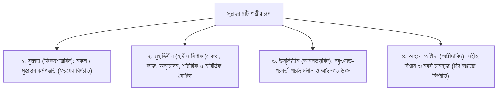
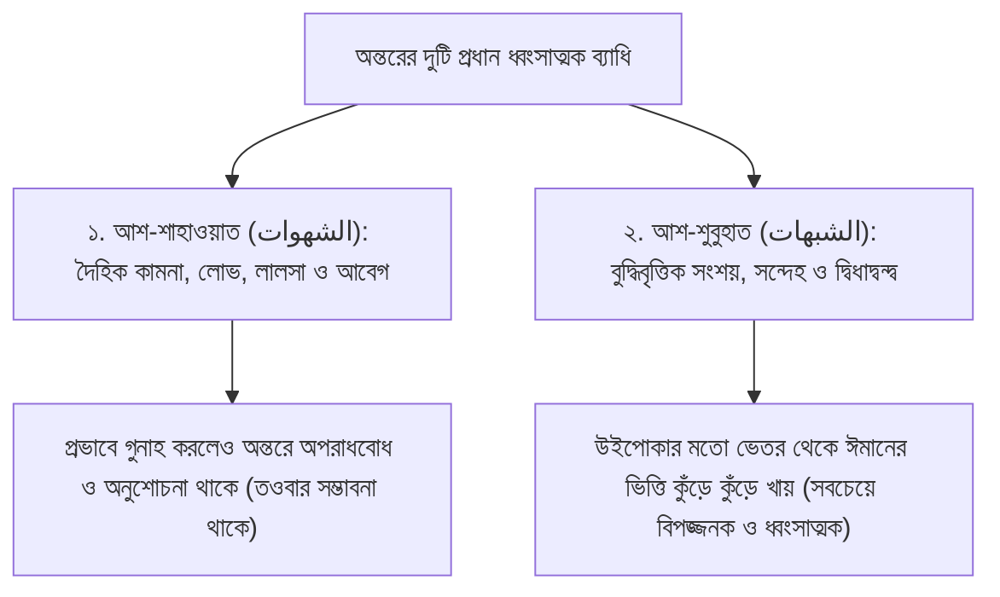
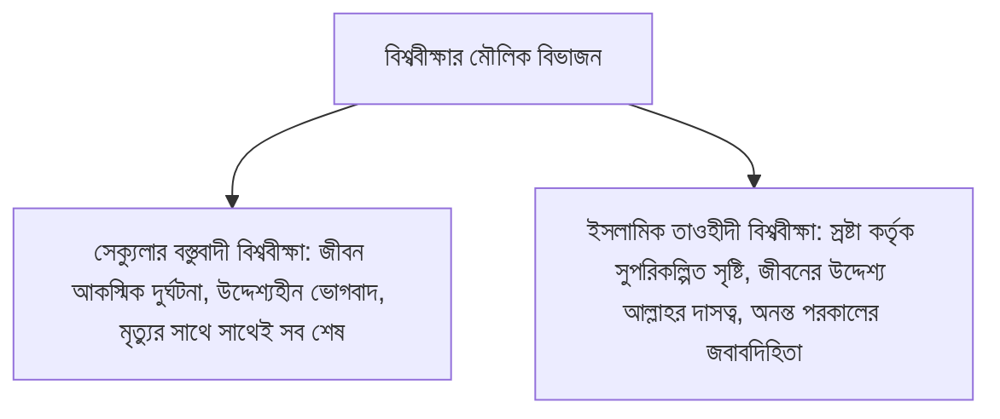
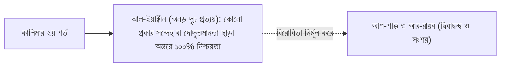
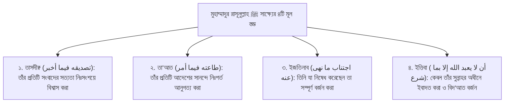
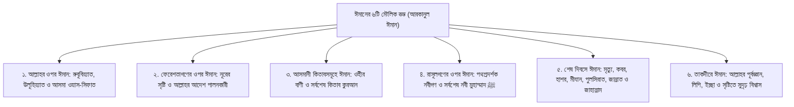

# বেসিক ইসলাম (Basic Islam: Adults)
### ১ম খণ্ড: ঈমান ও তাওহীদের বুনিয়াদ (পর্ব ০০ – ৩০)

> **মূল নির্দেশক ও আলোচক:** ইঞ্জিনিয়ার মুহাম্মাদ এনামুল হক  
> (প্রতিষ্ঠাতা: ইনস্টিটিউট ফর কমিউনিটি ডেভেলপমেন্ট - ICD ও স্কুল ফর কমিউনিটি ডেভেলপমেন্ট - SCD)  
> **সংকলন ও তাহকীক:** আধুনিক প্রকাশনা মানদণ্ড অনুযায়ী পূর্ণাঙ্গ আরবী হরকত, বিশুদ্ধ বঙ্গানুবাদ, প্রামাণ্য তাখরীজ ও সক্রিয় তথ্যসূত্রসহ সংকলিত।  
> **সংস্করণ:** প্রথম খণ্ড (পর্ব ০০ – ৩০: ঈমান ও আক্বীদার ভিত্তি) — আন-অ্যাব্রিজড পূর্ণাঙ্গ প্রামাণ্য সংস্করণ।  

---

## ভূমিকা ও প্রকাশকের আরয

بِسْمِ اللَّهِ الرَّحْمَٰنِ الرَّحِيمِ

الْحَمْدُ لِلَّهِ رَبِّ الْعَالَمِينَ، وَالصَّلَاةُ وَالسَّلَامُ عَلَى نَبِيِّنَا مُحَمَّدٍ خَاتَمِ النَّبِيِّينَ، وَعَلَى آلِهِ وَأَصْحَابِهِ أَجْمَعِينَ، أَمَّا بَعْدُ:

মানবজীবনের সবচেয়ে মহিমান্বিত ও অমূল্য সম্পদ হলো আল্লাহর ওপর খাঁটি ঈমান এবং তাওহীদের বিশুদ্ধ উপলব্ধি। আধুনিক শিক্ষার ব্যাপক প্রসার ঘটলেও মুসলিম সমাজের একটি বিশাল অংশ দ্বীনের প্রাথমিক বুনিয়াদ, কালিমায়ে শাহাদাতের শর্তাবলী এবং ঈমান বিনষ্টকারী মারাত্মক কারণসমূহ সম্পর্কে অসচেতন।

এই তীব্র শূন্যতা পূরণের লক্ষ্যে বিশিষ্ট চিন্তাবিদ, গবেষক ও দাঈ **ইঞ্জিনিয়ার মুহাম্মাদ এনামুল হক** তাঁর সুদীর্ঘ শিক্ষকতা ও দাওয়াহ জীবনের অভিজ্ঞতার আলোকে প্রণয়ন করেছেন ধারাবাহিক কোর্স **"বেসিক ইসলাম"** (Basic Islam)।

এই সুবিশাল ১৭৪ পর্বের কর্মযজ্ঞের প্রথম খণ্ডে (পর্ব ০০ থেকে ৩০) স্থান পেয়েছে:
১. দ্বীন শিক্ষার সঠিক প্ল্যাটফর্ম, মানহাজ ও শিক্ষার্থীদের বিনম্র আদব।  
২. মহান আল্লাহর অস্তিত্বের অকাট্য যুক্তি, মহাজাগতিক ফাইন টিউনিং ও নাস্তিক্যবাদের তাত্ত্বিক জবাব।  
৩. কালিমায়ে তাওহীদ (লা ইলাহা ইল্লাল্লাহ)-এর অপরিহার্য শর্তসমূহের প্রামাণ্য বিশ্লেষণ।  
৪. ঈমান বিনষ্টকারী মারাত্মক কারণসমূহ (নাওয়াক্বিদুল ইসলাম) এবং আধুনিক শির্ক ও কুফরের অপসংস্কৃতি।  
৫. আখেরাত, রূহের সফর, কবরের সাওয়াল-জওয়াব ও কিয়ামতের প্রস্তুতি।

এই সংকলনে প্রতিটি অধ্যায়কে সুবিন্যস্ত সূচিপত্র, কুরআনের পূর্ণ হরকতযুক্ত আয়াত, সহীহ হাদীসের নির্ভরযোগ্য সনদ এবং প্রাপ্তবয়স্ক মুমিনের গভীর আত্মোপলব্ধির চিন্তন পাঠের মাধ্যমে সাজানো হয়েছে।

মহান রাব্বুল আলামীন এই গ্রন্থটিকে মুসলিম উম্মাহর জন্য হিদায়াত ও পরকালীন নাজাতের উসিলা হিসেবে কবুল করুন। আমীন।

---

## ১ম খণ্ডের পূর্ণাঙ্গ সূচিপত্র (Table of Contents)
* [অধ্যায় ০০: সূচনা — দ্বীন শিক্ষার প্ল্যাটফর্ম ও জীবনের ত্রিবিধ লক্ষ্য](#অধ্যায়-00)
* [অধ্যায় ০১: মৌলিক পরিভাষা — আক্বীদা ও সুন্নাহর ভাষাগত ও প্রায়োগিক তাৎপর্য](#অধ্যায়-01)
* [অধ্যায় ০২: সুন্নাহর চতুর্মুখী শাস্ত্রীয় সংজ্ঞা ও আহলুস সুন্নাহর মানহাজ](#অধ্যায়-02)
* [অধ্যায় ০৩: দ্বীন শিক্ষার পদ্ধতি — গভীরতা বনাম অগভীর তথ্যসার্ফিং ও মানব মনস্তত্ত্ব](#অধ্যায়-03)
* [অধ্যায় ০৪: আল্লাহকে ভয়, পরম সত্য (আল-হাক্ব) ও অন্তরের ব্যাধি — শুবুহাত বনাম শাহাওয়াত](#অধ্যায়-04)
* [অধ্যায় ০৫: ঈমান পুনর্গঠন — দৈবচয়ন (Chances) বনাম সুনিপুণ নকশা (Grand Design)](#অধ্যায়-05)
* [অধ্যায় ০৬: আল্লাহ কি সত্যিই আছেন? বিবেক ও ফিতরাতের অকাট্য সাক্ষ্য](#অধ্যায়-06)
* [অধ্যায় ০৭: মহাজাগতিক নিদর্শন, ফাইন টিউনিং ও একক স্রষ্টার সুনিপুণ কারিগরি](#অধ্যায়-07)
* [অধ্যায় ০৮: প্রথম ওহী, হেরা গুহার ঐতিহাসিক বাস্তবতা ও নবুওয়াতের প্রামাণিকতা](#অধ্যায়-08)
* [অধ্যায় ০৯: মুসলিম বিশ্ববীক্ষা (Islamic Worldview) ও শাহাদাহর প্রথম শর্ত — 'ইলম](#অধ্যায়-09)
* [অধ্যায় ১০: শাহাদাহর দ্বিতীয় শর্ত — ইয়াক্বীন (দৃঢ় প্রত্যয়) বনাম অন্তরের দ্বিধাদ্বন্দ্ব](#অধ্যায়-10)
* [অধ্যায় 11: লা ইলাহা ইল্লাল্লাহ-এর প্রথম দুই শর্ত: ইলম ও ইয়াক্বীন](#অধ্যায়-11)
* [অধ্যায় 12: কালিমার তৃতীয় ও চতুর্থ শর্ত: ইখলাস ও সত্যবাদিতা](#অধ্যায়-12)
* [অধ্যায় 13: কালিমার পঞ্চম ও ষষ্ঠ শর্ত: মহব্বত ও আত্মসমর্পণ](#অধ্যায়-13)
* [অধ্যায় 14: কালিমার সপ্তম শর্ত: কবুলিয়াত ও বিরোধীতা বর্জন](#অধ্যায়-14)
* [অধ্যায় 15: শাহাদাতের জরুরি খুতবা ও সামাজিক প্রেক্ষাপট](#অধ্যায়-15)
* [অধ্যায় 16: ঈমানের রুকনসমূহ ও আক্বীদার ভিত্তিপ্রস্তর](#অধ্যায়-16)
* [অধ্যায় 17: ঈমান বিনষ্টকারী কারণসমূহ: নাওয়াক্বিদুল ইসলাম](#অধ্যায়-17)
* [অধ্যায় 18: ঈমান ভঙ্গের প্রধান কারণসমূহ ও আধুনিক বিভ্রান্তি](#অধ্যায়-18)
* [অধ্যায় 19: শির্কের ভয়াবহ পরিণতি ও এর সূক্ষ্ম রূপভেদ](#অধ্যায়-19)
* [অধ্যায় 20: কুফর ও তার প্রকারভেদ: ঈমানের প্রাচীর রক্ষা](#অধ্যায়-20)
* [অধ্যায় 21: নিফাক্ব ও মুনাফিক্বীর আলামত](#অধ্যায়-21)
* [অধ্যায় 22: দ্বীনের মধ্যমপন্থা ও নব উদ্ভাবিত বিদ‘আত বর্জন](#অধ্যায়-22)
* [অধ্যায় 23: কুরআন ও সুন্নাহর নিঃশর্ত অনুসরণ বনাম প্রবৃত্তিপূজা](#অধ্যায়-23)
* [অধ্যায় 24: মুহাম্মাদুর রাসূলুল্লাহ ﷺ-এর রিসালাতের সত্যতা ও নিখুঁত চরিত্র](#অধ্যায়-24)
* [অধ্যায় 25: সাহাবায়ে কেরামের অনন্য মর্যাদা ও তাঁদের মানহাজ](#অধ্যায়-25)
* [অধ্যায় 26: তাকদীরের ওপর ঈমান: রবের ফয়সালায় পরম সন্তুষ্টি](#অধ্যায়-26)
* [অধ্যায় 27: আখেরাতের অনন্ত সফর: রূহের সৃষ্টি ও মৃত্যুর মুহূর্ত](#অধ্যায়-27)
* [অধ্যায় 28: কবরের জীবন ও বারযাখের সাওয়াল-জওয়াব](#অধ্যায়-28)
* [অধ্যায় 29: কিয়ামত সংঘটন, হাশরের ময়দান ও চূড়ান্ত বিচার](#অধ্যায়-29)
* [অধ্যায় 30: জান্নাত-জাহান্নাম ও ঈমানিয়াতের সামগ্রিক পরিসমাপ্তি](#অধ্যায়-30)

---

---

---

---

# অধ্যায় ০০: সূচনা — দ্বীন শিক্ষার প্ল্যাটফর্ম ও জীবনের ত্রিবিধ লক্ষ্য
### সত্যসন্ধানী প্ল্যাটফর্মের প্রারম্ভিক প্রেক্ষাপট, প্রাতিষ্ঠানিক লক্ষ্য ও অগ্রাধিকারভিত্তিক দ্বীন শিক্ষা

> **মূল নির্দেশক ও আলোচক:** ইঞ্জিনিয়ার মুহাম্মাদ এনামুল হক  
> **প্রতিষ্ঠান:** ইনস্টিটিউট ফর কমিউনিটি ডেভেলপমেন্ট (ICD) ও স্কুল ফর কমিউনিটি ডেভেলপমেন্ট (SCD)  
> **কোর্স:** বেসিক ইসলাম (প্রাপ্তবয়স্কদের মৌলিক ইসলামী শিক্ষা ও আক্বীদা পরিক্রমা) — ১ম খণ্ড: ঈমান ও তাওহীদের বুনিয়াদ  
> **উৎস অডিও:** `Basic_Islam_00.mp3` (দৈর্ঘ্য: ৪ মিনিট)  
> **সংস্করণ মানদণ্ড:** সম্পূর্ণ আন-অ্যাব্রিজড প্রামাণ্য সংস্করণ — মূল লেকচারের শতভাগ বক্তব্য, তাত্ত্বিক রূপরেখা ও বিশুদ্ধ তাখরীজ সমন্বিত।

---

## অধ্যায়ের সূচিপত্র
- [১. ভূমিকা ও সত্যসন্ধানী প্ল্যাটফর্মের প্রারম্ভিক প্রেক্ষাপট](#১-ভূমিকা-ও-সত্যসন্ধানী-প্ল্যাটফর্মের-প্রারম্ভিক-প্রেক্ষাপট)
- [২. দ্বীন শিক্ষার ত্রিবিধ মৌলিক লক্ষ্য ও অগ্রাধিকার](#২-দ্বীন-শিক্ষার-ত্রিবিধ-মৌলিক-লক্ষ্য-ও-অগ্রাধিকার)
  - [ক. প্রাপ্তবয়স্ক ও পিতা-মাতাদের জন্য জীবনঘনিষ্ঠ দ্বীন শিক্ষা](#ক-প্রাপ্তবয়স্ক-ও-পিতা-মাতাদের-জন্য-জীবনঘনিষ্ঠ-দ্বীন-শিক্ষা)
  - [খ. কিশোর-কিশোরী ও তরুণ প্রজন্মের মানসিক দ্বন্দ্ব নিরসন](#খ-কিশোর-কিশোরী-ও-তরুণ-প্রজন্মের-মানসিক-দ্বন্দ্ব-নিরসন)
  - [গ. বাস্তব পারিবারিক ও সামাজিক জীবনের আলোতে নারীদের শিক্ষা](#গ-বাস্তব-পারিবারিক-ও-সামাজিক-জীবনের-আলোতে-নারীদের-শিক্ষা)
- [৩. খাঁটি দ্বীন ও শিক্ষার অগ্রাধিকার নীতি (Fiqh of Priorities)](#৩-খাঁটি-দ্বীন-ও-শিক্ষার-অগ্রাধিকার-নীতি-fiqh-of-priorities)
- [৪. কুরআন ও সুন্নাহর প্রামাণ্য দলীলসমূহ](#৪-কুরআন-ও-সুন্নাহর-প্রামাণ্য-দলীলসমূহ)
- [৫. প্রাপ্তবয়স্ক মুমিনের চিন্তন ও আত্মোপলব্ধির পাঠ](#৫-প্রাপ্তবয়স্ক-মুমিনের-চিন্তন-ও-আত্মোপলব্ধির-পাঠ)

---

## ১. ভূমিকা ও সত্যসন্ধানী প্ল্যাটফর্মের প্রারম্ভিক প্রেক্ষাপট

بِسْمِ اللَّهِ الرَّحْمَٰنِ الرَّحِيمِ  
الْحَمْدُ لِلَّهِ رَبِّ الْعَالَمِينَ، وَالصَّلَاةُ وَالسَّلَامُ عَلَى نَبِيِّنَا مُحَمَّدٍ خَاتَمِ النَّبِيِّينَ، وَعَلَى آلِهِ وَأَصْحَابِهِ أَجْمَعِينَ. أَمَّا بَعْدُ:

মানবজীবনের সবচেয়ে অমূল্য ও অপরিহার্য সম্পদ হলো বিশুদ্ধ দ্বীনী ইলম এবং সহীহ আক্বীদার ওপর প্রতিষ্ঠিত জীবনবোধ। একজন মানুষ চিকিৎসাবিজ্ঞান, প্রকৌশল, অর্থনীতি বা দর্শনে যত শীর্ষ যোগ্যতাই অর্জন করুক না কেন, যদি সে নিজের স্রষ্টা, নিজের সৃষ্টির উদ্দেশ্য এবং পরকালীন জবাবদিহিতা সম্পর্কে অজ্ঞ থাকে, তবে আল্লাহর মানদণ্ডে তার সমগ্র জীবনই চরম ব্যর্থতায় পর্যবসিত হয়।

বিশিষ্ট চিন্তাবিদ ও গবেষক **ইঞ্জিনিয়ার মুহাম্মাদ এনামুল হক** তাঁর দীর্ঘকালীন দাওয়াতি অভিজ্ঞতার আলোকে সমকালীন মুসলিম সমাজের এক গভীর আত্মিক সংকট প্রত্যক্ষ করেন। আমাদের প্রাতিষ্ঠানিক শিক্ষাব্যবস্থা একজন মানুষকে পার্থিব জীবিকা উপার্জনের উপযুক্ত কারিগর বানালেও, তার ভেতরে খাঁটি মুসলিম পরিচয় ও আল্লাহর সার্বভৌমত্বের প্রতি অবিচল প্রত্যয় তৈরি করতে পারে না। ফলে শিক্ষিত মুসলিম সমাজের একটি বিরাট অংশ ঐতিহ্যগত বা নিছক সামাজিক মুসলমান হিসেবে বেড়ে ওঠে। 

এই বাস্তবতায় রাজধানী ঢাকা ও প্রবাসে বসবাসরত সচেতন মুসলিম পরিবারসমূহের সরাসরি অনুরোধে গড়ে ওঠে **"সত্যসন্ধানী"** নামক বিশেষ দ্বীন শিক্ষা প্ল্যাটফর্ম। শায়খ এই সূচনামূলক অডিও রেকর্ডে প্ল্যাটফর্মটির উৎপত্তি, গঠনের প্রাথমিক পর্যায় (Formative Stage) এবং ভবিষ্যৎ কর্মপরিকল্পনা সুস্পষ্টভাবে তুলে ধরেছেন।

---

## ২. দ্বীন শিক্ষার ত্রিবিধ মৌলিক লক্ষ্য ও অগ্রাধিকার

শায়খ এনামুল হক স্পষ্টভাবে উল্লেখ করেন যে, এই উদ্যোগটি নিছক আরেকটি সাধারণ সামাজিক যোগাযোগ মাধ্যমের গ্রুপ বা দায়সারা ফোরাম নয়। বরং ইংল্যান্ড ও অস্ট্রেলিয়ায় অবস্থানরত দ্বীনদরদী দুই সচেতন মুসলিম বোনের সুনির্দিষ্ট অনুরোধ ও সার্বিক বাস্তবতার পরিপ্রেক্ষিতে এর ভিত্তি স্থাপিত হয়েছে। শায়খ প্রাথমিকভাবে কিছুটা ইতস্তত বা অনিচ্ছুক থাকলেও, পরবর্তীতে সমকালীন প্রেক্ষাপট চিন্তা করে অনুভব করেন যে মুসলিম উম্মাহর বর্তমান পরিস্থিতিতে এরকম একটি সুসংগঠিত উদ্যোগ অত্যন্ত কল্যাণকর ও অপরিহার্য। 

এই প্ল্যাটফর্মের মূল কার্যপরিধিকে তিনি তিনটি সুস্পষ্ট উদ্দেশ্য বা লক্ষ্যের ওপর বিন্যস্ত করেছেন:

### ক. প্রাপ্তবয়স্ক ও পিতা-মাতাদের জন্য জীবনঘনিষ্ঠ দ্বীন শিক্ষা
আমাদের সমাজে সাধারণ ধারণা হলো, দ্বীন শেখার বয়স বুঝি শৈশব কিংবা বার্ধক্য। কিন্তু বাস্তব সত্য হলো, যারা বর্তমানে সংসার পরিচালনা করছেন, সন্তান লালন-পালন করছেন এবং সমাজ ও কর্মক্ষেত্রে নেতৃত্ব দিচ্ছেন—সেই প্রাপ্তবয়স্ক নর-নারী ও পিতা-মাতাদের দ্বীনের মৌলিক জ্ঞান অর্জন সবচেয়ে জরুরি। 

শায়খ বলেন, নিছক কিছু আনুষ্ঠানিক আচার-অনুষ্ঠানের নাম ইসলাম নয়; বরং ইসলাম হলো এক পূর্ণাঙ্গ জীবনবিধান। তাই প্রাপ্তবয়স্ক মুসলিমদের জন্য প্রয়োজন এমন এক জীবননিষ্ঠ দ্বীন শিক্ষা, যা তাদের দৈনন্দিন কাজ, ব্যবসা-বাণিজ্য, বৈবাহিক সম্পর্ক এবং মানসিক প্রশান্তির সাথে ওতপ্রোতভাবে জড়িয়ে থাকবে।

### খ. কিশোর-কিশোরী ও তরুণ প্রজন্মের মানসিক দ্বন্দ্ব নিরসন
সমকালীন বিশ্বে সবচেয়ে বড় হুমকির মুখে রয়েছে আমাদের তরুণ ও কিশোর প্রজন্ম (Teenagers & Youth)। দেশে কিংবা বিদেশে—যেখানেই তারা বেড়ে উঠুক না কেন, পশ্চিমা ধর্মনিরপেক্ষ শিক্ষাব্যবস্থা, সোশ্যাল মিডিয়ার নাস্তিক্যবাদী সংশয় এবং বস্তুবাদী ভোগবাদ প্রতিনিয়ত তাদের ঈমানী ভিত্তিকে নাড়া দিচ্ছে।

কিশোর-তরুণদের মনে ঈমান, বিজ্ঞান, সৃষ্টিতত্ত্ব, স্বাধীনতা ও নৈতিকতা নিয়ে শত শত সংবেদনশীল প্রশ্ন ঘুরপাক খায়। সনাতন ধারায় ধমক দিয়ে বা অন্ধ বিশ্বাসের বুলি আওড়ে আধুনিক শিক্ষায় শিক্ষিত তরুণদের সংশয় দূর করা সম্ভব নয়। তাদের প্রয়োজন পরিকল্পিত, যুক্তিগ্রাহ্য ও আন্তরিক প্রশ্নোত্তর। বিশেষ করে যারা ইংরেজি মাধ্যমে বা প্রবাসে বড় হচ্ছে, তাদের উপযোগী ভাষায় যুক্তিপূর্ণ সমাধান উপস্থাপনের লক্ষ্যে ইংল্যান্ড ও অন্যান্য দেশের অভিজ্ঞ শিক্ষাবিদদের সম্পৃক্ত করে এই প্ল্যাটফর্ম কাজ করবে।

### গ. বাস্তব পারিবারিক ও সামাজিক জীবনের আলোতে নারীদের শিক্ষা
পরিবার হলো একটি সমাজের মূল ভিত্তিপ্রস্তর, আর সেই পরিবারের হৃদয় হলেন নারী—মা ও স্ত্রী। শায়খের সহধর্মিণী দীর্ঘকাল ধরে নারীদের মাঝে বাস্তবভিত্তিক দাওয়াতি কাজ পরিচালনা করে আসছেন। নারীদের দৈনন্দিন দাম্পত্য সংকট, সন্তান প্রতিপালন, আত্মীয়তার সম্পর্ক রক্ষা এবং পারিবারিক টানাপোড়েনের মাঝে শরীয়াহর বিধানকে কীভাবে প্রজ্ঞার সাথে বাস্তবায়ন করা যায়—এ বিষয়ে অসংখ্য মা-বোন নিয়মিত নির্দেশনা প্রত্যাশা করেন। এই প্ল্যাটফর্ম তাঁদের সেই বাস্তব জিজ্ঞাসার সহীহ কুরআন ও সুন্নাহভিত্তিক সমাধান নিশ্চিত করবে।

---

## ৩. খাঁটি দ্বীন ও শিক্ষার অগ্রাধিকার নীতি (Fiqh of Priorities)

শায়খ এনামুল হক তাঁর সূচনামূলক বক্তব্যে দ্বীন শিক্ষার একটি মৌলিক উসূল নির্ধারণ করে দিয়েছেন—**"পিওর দ্বীন" (Pure Deen)** বা খাঁটি দ্বীন শেখা। খাঁটি দ্বীন বলতে তিনি বুঝিয়েছেন এমন দ্বীন, যা নিছক কোনো ব্যক্তিপূজা, দলীয় অন্ধ পক্ষপাত বা স্থান-কাল-পাত্রের ভেজালমুক্ত; যা সরাসরি কুরআন ও রাসূলুল্লাহ ﷺ-এর সুন্নাহর বিশুদ্ধ উৎসের ওপর প্রতিষ্ঠিত।

দ্বিতীয়ত, দ্বীন শিক্ষার ক্ষেত্রে **অগ্রাধিকার নীতি (Fiqh of Priorities)** কঠোরভাবে মেনে চলা হবে:
1. **যা সবার আগে আসা উচিত, তা আগে শেখা:** ইসলামে সকল বিষয়ের মর্যাদা এক নয়। আক্বীদা ও তাওহীদের স্থান সবার শীর্ষে। তাওহীদ যদি বিশুদ্ধ না হয়, তবে কোটি টাকার দান-সদক্বাহ কিংবা সারারাত জেগে তাহাজ্জুদ আল্লাহর দরবারে ধূলিকণার মতো উড়ে যাবে।
2. **যা জানা প্রতিটি মুসলিমের ওপর অবশ্য-কর্তব্য (ফরযে আইন):** কোনো প্রান্তিক বা গৌণ মতভেদ নিয়ে সময় নষ্ট না করে, ঈমানের সেই মৌলিক স্তম্ভগুলো শেখা যা একজন মুসলিমের জন্য জানা বাধ্যতামূলক।
3. **ধৈর্য ও ধারাবাহিকতা:** সত্যসন্ধানী প্ল্যাটফর্মটি অত্যন্ত ধীরস্থিরভাবে, গভীরতা নিশ্চিত করে প্রতিটি বিষয় পুঙ্খানুপুঙ্খরূপে আলোচনা করবে। তাড়াহুড়ো করে ভাসা-ভাসা জ্ঞান অর্জনের চেয়ে অল্প বিষয় সুদৃঢ়ভাবে শেখা অনন্তগুণে উত্তম।

---

## ৪. কুরআন ও সুন্নাহর প্রামাণ্য দলীলসমূহ

### আল-কুরআনের অকাট্য নির্দেশ: দ্বীনের গভীর প্রজ্ঞা অর্জন
আল্লাহ সুবহানাহু ওয়া তা‘আলা উম্মাহর একটি দলের জন্য দ্বীনের গভীর জ্ঞান ও প্রজ্ঞা অর্জনকে অপরিহার্য কর্তব্য ঘোষণা করে ইরশাদ করেন:

قَالَ اللَّهُ تَعَالَى:  
**﴿وَمَا كَانَ الْمُؤْمِنُونَ لِيَنفِرُوا كَافَّةً ۚ فَلَوْلَا نَفَرَ مِن كُلِّ فِرْقَةٍ مِّنْهُمْ طَائِفَةٌ لِّيَتَفَقَّهُوا فِي الدِّينِ وَلِيُنذِرُوا قَوْمَهُمْ إِذَا رَجَعُوا إِلَيْهِمْ لَعَلَّهُمْ يَحْذَرُونَ﴾**

> **বঙ্গানুবাদ:** “আর মুমিনদের পক্ষে একযোগে অভিযানে বের হওয়া সমীচীন নয়। সুতরাং তাদের প্রত্যেকটি দল থেকে একটি অংশ কেন বের হয় না—যাতে তারা দ্বীনের গভীর প্রজ্ঞা অর্জন করতে পারে এবং তাদের সম্প্রদায়ের নিকট ফিরে এসে তাদের সতর্ক করতে পারে, যাতে তারা (পাপ ও অবাধ্যতা থেকে) সাবধান হতে পারে?”  
> **তথ্যসূত্র ও সক্রিয় লিংক:** [সূরা আত-তাওবাহ: ১২২](https://quran.com/9/122)

### রাসূলুল্লাহ ﷺ-এর সুন্নাহ: দ্বীনি এলেম অর্জন প্রত্যেক মুসলিমের ওপর ফরয
দ্বীনের মৌলিক জ্ঞান অর্জন কোনো ঐচ্ছিক বিষয় নয়, বরং প্রতিটি নর-নারীর ঈমানী অস্তিত্বের দাবি।

عَنْ أَنَسِ بْنِ مَالِكٍ رَضِيَ اللَّهُ عَنْهُ، قَالَ: قَالَ رَسُولُ اللَّهِ ﷺ:  
**«طَلَبُ الْعِلْمِ فَرِيضَةٌ عَلَى كُلِّ مُسْلِمٍ»**

> **বঙ্গানুবাদ:** “আনাস ইবনু মালিক (রা.) হতে বর্ণিত, তিনি বলেন, রাসূলুল্লাহ ﷺ ইরশাদ করেছেন: দ্বীনি জ্ঞান অন্বেষণ করা প্রতিটি মুসলিমের ওপর অবশ্য কর্তব্য (ফরয)।”  
> **তাহক্বীক্ব ও মান:** হাদীসটি সহীহ।  
> **তথ্যসূত্র ও সক্রিয় লিংক:** [সুনান ইবনে মাজাহ: ২২৪](https://www.hadithbd.com/hadith/detail/?book=14&hadith=224)

### রাসূলুল্লাহ ﷺ-এর সুন্নাহ: আল্লাহর পক্ষ হতে সর্বশ্রেষ্ঠ কল্যাণের নিদর্শন
আল্লাহ তা‘আলা যখন কোনো বান্দার চূড়ান্ত কল্যাণ চান, তখন তাকে পার্থিব ধনদৌলতের প্রাচুর্য নয়, বরং দ্বীনের গভীর অন্তর্দৃষ্টি দান করেন।

عَنْ مُعَاوِيَةَ رَضِيَ اللَّهُ عَنْهُ، قَالَ: سَمِعْتُ النَّبِيَّ ﷺ يَقُولُ:  
**«مَنْ يُرِدِ اللَّهُ بِهِ خَيْرًا يُفَقِّهْهُ فِي الدِّينِ»**

> **বঙ্গানুবাদ:** “মু‘আবিয়া (রা.) হতে বর্ণিত, তিনি বলেন, আমি নবী করীম ﷺ-কে বলতে শুনেছি: আল্লাহ যার প্রভূত কল্যাণ চান, তাকে দ্বীনের গভীর প্রজ্ঞা ও সঠিক সমঝ দান করেন।”  
> **তাহক্বীক্ব ও মান:** সহীহুল বুখারী ও সহীহ মুসলিম।  
> **তথ্যসূত্র ও সক্রিয় লিংক:** [সহীহ বুখারী: ৭১](https://www.hadithbd.com/hadith/detail/?book=1&hadith=71), [সহীহ মুসলিম: ১০৩৭](https://www.hadithbd.com/hadith/detail/?book=2&hadith=1037)

---

## ৫. প্রাপ্তবয়স্ক মুমিনের চিন্তন ও আত্মোপলব্ধির পাঠ

1. **উদ্দেশ্যহীন জীবন বনাম সচেতন সাধনা:** আমরা পার্থিব ক্যারিয়ার, বাড়ি-গাড়ি ও সামাজিক প্রতিষ্ঠার জন্য বছরের পর বছর অক্লান্ত পরিশ্রম করি। কিন্তু যে রব আমাকে অস্তিত্ব দিলেন এবং যাঁর সামনে আগামীকাল আমাকে দাঁড়াতে হবে—তাঁর দ্বীন শেখার পেছনে আমরা কতটুকু সময় বরাদ্দ করছি?
2. **পরিবারের অভিভাবকত্বের দায়িত্ব:** কেবল সন্তানদের খাদ্য, বস্ত্র ও বিলাসবহুল শিক্ষা নিশ্চিত করাই অভিভাবকের দায়িত্ব নয়। সবচেয়ে বড় দায়িত্ব হলো তাদের অন্তরে বিশুদ্ধ তাওহীদের চারা রোপণ করা, যাতে তারা আধুনিক সংশয়বাদের বন্যায় বিভ্রান্ত না হয়।
3. **দ্বীনের অগ্রাধিকার উপলব্ধি:** দ্বীনের ভিত্তি হলো আক্বীদা। আক্বীদা দুর্বল থাকলে বাহ্যিক আমলের কোনো মূল্য থাকে না। তাই আমাদের দ্বীন শিক্ষার যাত্রা শুরু হতে হবে তাওহীদের অকাট্য বুনিয়াদকে কেন্দ্র করে।

---

# অধ্যায় ০১: মৌলিক পরিভাষা — আক্বীদা ও সুন্নাহর ভাষাগত ও প্রায়োগিক তাৎপর্য
### দ্বীনি পরিভাষাসমূহের সঠিক সংজ্ঞা, আক্বীদার মূল ভিত্তি এবং সুন্নাহর আভিধানিক ও শারঈ রূপরেখা

> **মূল নির্দেশক ও আলোচক:** ইঞ্জিনিয়ার মুহাম্মাদ এনামুল হক  
> **প্রতিষ্ঠান:** ইনস্টিটিউট ফর কমিউনিটি ডেভেলপমেন্ট (ICD) ও স্কুল ফর কমিউনিটি ডেভেলপমেন্ট (SCD)  
> **কোর্স:** বেসিক ইসলাম (প্রাপ্তবয়স্কদের মৌলিক ইসলামী শিক্ষা ও আক্বীদা পরিক্রমা) — ১ম খণ্ড: ঈমান ও তাওহীদের বুনিয়াদ  
> **উৎস অডিও:** `Basic_Islam_01.mp3` (দৈর্ঘ্য: ৭ মিনিট ২২ সেকেন্ড)  
> **সংস্করণ মানদণ্ড:** সম্পূর্ণ আন-অ্যাব্রিজড প্রামাণ্য সংস্করণ — মূল লেকচারের শতভাগ বক্তব্য, তাত্ত্বিক রূপরেখা ও বিশুদ্ধ তাখরীজ সমন্বিত।

---

## অধ্যায়ের সূচিপত্র
- [১. ভূমিকা: পরিভাষা বোঝার অপরিহার্য গুরুত্ব](#১-ভূমিকা-পরিভাষা-বোঝার-অপরিহার্য-গুরুত্ব)
- [২. 'আক্বীদা' (العقيدة) পরিভাষার আভিধানিক ও শারঈ তাৎপর্য](#২-আক্বীদা-العقيدة-পরিভাষার-আভিধানিক-ও-শারঈ-তাৎপর্য)
  - [ক. শব্দমূল ও আভিধানিক অর্থ](#ক-শব্দমূল-ও-আভিধানিক-অর্থ)
  - [খ. ইসলামী পরিভাষায় আক্বীদার সীমানা](#খ-ইসলামী-পরিভাষায়-আক্বীদার-সীমানা)
- [৩. 'সুন্নাহ' (السنة) পরিভাষার ভাষাগত ও সাধারণ রূপরেখা](#৩-সুন্নাহ-السنة-পরিভাষার-ভাষাগত-ও-সাধারণ-রূপরেখা)
  - [ক. আরবি অভিধান ও এডওয়ার্ড লেনের লেক্সিকন](#ক-আরবি-অভিধান-ও-এডওয়ার্ড-লেনের-লেক্সিকন)
  - [খ. সুন্নাহর আভিধানিক প্রয়োগে সহীহ মুসলিমের দলীল](#খ-সুন্নাহর-আভিধানিক-প্রয়োগে-সহীহ-মুসলিমের-দলীল)
- [৪. কুরআনের পরিভাষায় 'সুন্নাতুল্লাহ' (سنة الله)](#৪-কুরআনের-পরিভাষায়-সুন্নাতুল্লাহ-سنة-الله)
- [৫. শারঈ পরিভাষায় 'কুরআন ও সুন্নাহ'](#৫-শারঈ-পরিভাষায়-কুরআন-ও-সুন্নাহ)
- [৬. কুরআন ও সুন্নাহর প্রামাণ্য দলীলসমূহ](#৬-কুরআন-ও-সুন্নাহর-প্রামাণ্য-দলীলসমূহ)
- [৭. প্রাপ্তবয়স্ক মুমিনের চিন্তন ও আত্মোপলব্ধির পাঠ](#৭-প্রাপ্তবয়স্ক-মুমিনের-চিন্তন-ও-আত্মোপলব্ধির-পাঠ)

---

## ১. ভূমিকা: পরিভাষা বোঝার অপরিহার্য গুরুত্ব

بِسْمِ اللَّهِ الرَّحْمَٰنِ الرَّحِيمِ  
إِنَّ الْحَمْدَ لِلَّهِ، نَحْمَدُهُ وَنَسْتَعِينُهُ وَنَسْتَغْفِرُهُ، وَنَعُوذُ بِاللَّهِ مِنْ شُرُورِ أَنْفُسِنَا وَمِنْ سَيِّئَاتِ أَعْمَالِنَا... أَمَّا بَعْدُ:

যে কোনো জ্ঞান বা ডিসিপ্লিনে প্রবেশ করার পূর্বে তার মূল পরিভাষাগুলোর (Terminology) সুস্পষ্ট ও নির্ভুল অর্থ জেনে নেওয়া অপরিহার্য। যদি মৌলিক পরিভাষার অর্থ অন্তরে পরিষ্কার না থাকে, তবে একটি সামগ্রিক আলোচনা বা কিতাব পাঠ করার সময় মানুষ মারাত্মক বিভ্রান্তিতে পতিত হতে পারে; হয়তো সে বিষয়ের অর্ধেক বুঝবে, অথবা সম্পূর্ণ ভুল অর্থ গ্রহণ করবে।

ইঞ্জিনিয়ার মুহাম্মাদ এনামুল হক এই পর্বে দ্বীনের দুটি অত্যন্ত বহুল ব্যবহৃত ও মৌলিক পরিভাষা নিয়ে আলোচনা করেছেন, যা আমাদের পুরো বেসিক ইসলাম কোর্সে বারবার আবর্তিত হবে। পরিভাষা দুটি হলো: **আক্বীদা (العقيدة)** এবং **সুন্নাহ (السنة)**।

---

## ২. 'আক্বীদা' (العقيدة) পরিভাষার আভিধানিক ও শারঈ তাৎপর্য

### ক. শব্দমূল ও আভিধানিক অর্থ
আরবি ভাষায় 'আক্বীদা' শব্দটি নির্গত হয়েছে **'আকদ' (العَقْد)** শব্দমূল থেকে। 
- সাধারণ আরবি ব্যবহারে 'আকদ' বলতে বোঝায়—কোনো কিছুতে শক্তভাবে গিঁট দেওয়া বা গাঁটছড়া বাঁধা (Knots/Binding)। যেমন বিবাহের শারঈ চুক্তিকে আরবিতে বলা হয় 'আকদুন নিকাহ' (عقد النكاح)—যার অর্থ হলো দুই ব্যক্তির মাঝে একটি সুদৃঢ়, অলঙ্ঘনীয় ও স্থায়ী বন্ধন রচিত হওয়া।
- এই আভিধানিক অর্থ থেকে চিন্তার জগতে যখন শব্দটি ব্যবহৃত হয়, তখন এর অর্থ দাঁড়ায়: কোনো বিষয় সম্পর্কে মানুষের মনের এমন এক সুদৃঢ়, অনড় ও অবিচল প্রত্যয়—যাতে কোনো প্রকার দ্বিধাদ্বন্দ্ব বা শিথিলতা থাকে না। অর্থাৎ অন্তরে এমনভাবে কোনো বিশ্বাসকে বেঁধে নেওয়া, যা আর কখনো খুলে পড়ে না।

### খ. ইসলামী পরিভাষায় আক্বীদার সীমানা
ইসলামী পরিভাষায় 'আক্বীদা' হলো সেই সমস্ত বিশ্বাস ও প্রত্যয়মালা, যা একজন মানুষের মুসলিম ও মুমিন হওয়ার জন্য অপরিহার্য। 

মূলত ঈমানের যে মৌলিক ছয়টি স্তম্ভ রয়েছে:
1. আল্লাহর প্রতি ঈমান
2. ফেরেশতাগণের প্রতি ঈমান
3. আসমানী কিতাবসমূহের প্রতি ঈমান
4. রাসূলগণের প্রতি ঈমান
5. শেষ দিবস বা পরকালের প্রতি ঈমান
6. তাকদীরের ভালো-মন্দের ওপর ঈমান

এই ছয়টি মৌলিক স্তম্ভের সাথে সংশ্লিষ্ট যাবতীয় অকাট্য বিশ্বাস ও ধারণার সুসংগঠিত রূপকেই **"ইসলামী আক্বীদা" (Islamic Creed)** বলা হয়। এটি এমন এক অবিচল বিশ্বাস, যা কোনো অনুমান বা অন্ধ কল্পনার ওপর নয়, বরং কুরআন ও সহীহ সুন্নাহর অকাট্য প্রমাণের ওপর প্রতিষ্ঠিত।

---

## ৩. 'সুন্নাহ' (السنة) পরিভাষার ভাষাগত ও সাধারণ রূপরেখা

আমরা যখন সাধারণভাবে কোনো বিশেষ প্রেক্ষিত উল্লেখ না করে কেবল 'সুন্নাহ' শব্দটি বলি, তখন আমাদের মনে প্রথম অর্থ আসে: প্রিয় নবী মুহাম্মাদুর রাসূলুল্লাহ ﷺ-এর সামগ্রিক জীবনাদর্শ, শিক্ষা ও পথ। কিন্তু সুন্নাহ শব্দের শিকড় অনেক গভীরে প্রোথিত।

### ক. আরবি অভিধান ও এডওয়ার্ড লেনের লেক্সিকন
বিখ্যাত প্রাচ্যবিদ ও আরবি ভাষাবিদ এডওয়ার্ড উইলিয়াম লেন (Edward William Lane) তাঁর জগদ্বিখ্যাত আরবি-ইংরেজি অভিধান **Arabic-English Lexicon (Volume 1)**-এ সুন্নাহ শব্দের আভিধানিক অর্থের নিখুঁত বিশ্লেষণ করেছেন:
> সুন্নাহর আভিধানিক অর্থ হলো: মানুষের কাজকর্ম, আচরণ বা জীবনের একটি সুনির্দিষ্ট পথ, চলার রাস্তা, নিয়ম, প্রথা বা রীতি—তা ভালো হোক কিংবা মন্দ হোক, অনুমোদিত হোক কিংবা অননুমোদিত হোক। অর্থাৎ পূর্ববর্তী কোনো প্রজন্ম বা ব্যক্তি যে কর্মপদ্ধতি চালু করেছে এবং পরবর্তী প্রজন্মের লোকেরা যার অনুসরণ করে চলছে, সেই অনুসৃত রীতি বা পথকেই ভাষাগতভাবে 'সুন্নাহ' বলা হয়।

### খ. সুন্নাহর আভিধানিক প্রয়োগে সহীহ মুসলিমের দলীল
সুন্নাহ শব্দের এই ব্যাপক আভিধানিক অর্থটি স্বয়ং রাসূলুল্লাহ ﷺ-এর একটি সুবিখ্যাত হাদীসে অত্যন্ত স্পষ্টভাবে প্রতিফলিত হয়েছে:

عَنْ جَرِيرِ بْنِ عَبْدِ اللَّهِ رَضِيَ اللَّهُ عَنْهُ، قَالَ: جَاءَ نَاسٌ مِنَ الأَعْرَابِ إِلَى رَسُولِ اللَّهِ ﷺ عَلَيْهِمُ النِّمَارُ، فَرَأَى سُوءَ حَالِهِمْ قَدْ أَصَابَتْهُمْ حَاجَةٌ، فَحَثَّ النَّاسَ عَلَى الصَّدَقَةِ، فَأَبْطَئُوا عَنْهُ حَتَّى رُئِيَ فِي وَجْهِهِ الْغَضَبُ... ثُمَّ جَاءَ رَجُلٌ مِنَ الأَنْصَارِ بِصُرَّةٍ مِنْ وَرِقٍ، ثُمَّ جَاءَ آخَرُ، ثُمَّ تَتَابَعُوا حَتَّى عُرِفَ السُّرُورُ فِي وَجْهِهِ، فَقَالَ رَسُولُ اللَّهِ ﷺ:  
**«مَنْ سَنَّ فِي الإِسْلاَمِ سُنَّةً حَسَنَةً، فَلَهُ أَجْرُهَا وَأَجْرُ مَنْ عَمِلَ بِهَا بَعْدَهُ، مِنْ غَيْرِ أَنْ يَنْقُصَ مِنْ أُجُورِهِمْ شَيْءٌ، وَمَنْ سَنَّ فِي الإِسْلاَمِ سُنَّةً سَيِّئَةً، كَانَ عَلَيْهِ وِزْرُهَا وَوِزْرُ مَنْ عَمِلَ بِهَا مِنْ بَعْدِهِ، مِنْ غَيْرِ أَنْ يَنْقُصَ مِنْ أَوْزَارِهِمْ شَيْءٌ»**

> **বঙ্গানুবাদ:** “জারীর ইবনু আব্দুল্লাহ (রা.) হতে বর্ণিত, তিনি বলেন: একদা মুদার গোত্রের কিছু নিঃস্ব, বস্ত্রহীন গ্রাম্য লোক রাসূলুল্লাহ ﷺ-এর দরবারে উপস্থিত হলো। তাদের চরম অভাব-অনটন দেখে রাসূলুল্লাহ ﷺ-এর চেহারা ব্যথিত হয়ে উঠল। তিনি সমবেত সাহাবীদের দান-সদক্বাহ করার জোর তাগিদ দিলেন। কিন্তু সাহাবীদের পক্ষ থেকে সাড়া দিতে কিছুটা বিলম্ব হচ্ছিল, যার ফলে তাঁর পবিত্র চেহারায় অসন্তোষ ফুটে উঠল। অতঃপর একজন আনসারী সাহাবী একটি ভারী রূপার থলি নিয়ে উপস্থিত হলেন। তাঁকে দেখে অন্য লোকেরাও দলে দলে দান সামগ্রী নিয়ে এগিয়ে এলেন, যার ফলে রাসূলুল্লাহ ﷺ-এর চেহারায় পরম সন্তুষ্টি ও আনন্দের আভা ফুটে উঠল।  
> তখন তিনি ইরশাদ করলেন: **যে ব্যক্তি ইসলামে কোনো ভালো রীতির (সুন্নাতুন হাসানাহ) প্রচলন ঘটাবে, সে তার নিজের সওয়াব পাবে এবং তার পরে যারা সে অনুযায়ী আমল করবে তাদের সমপরিমাণ সওয়াবও সে লাভ করবে; এতে তাদের কারও সওয়াব সামান্যতমও হ্রাস পাবে না। আর যে ব্যক্তি ইসলামে কোনো মন্দ রীতির (সুন্নাতুন সাইয়িআহ) প্রচলন ঘটাবে, তার ওপর তার নিজের পাপের বোঝা বর্তাবে এবং পরবর্তীতে যারা সে পাপ করবে তাদের পাপের বোঝাও তার ওপর চাপবে; এতে তাদের কারও পাপের বোঝা এতটুকুও কমবে না।”**  
> **তাহক্বীক্ব ও মান:** সহীহ মুসলিম।  
> **তথ্যসূত্র ও সক্রিয় লিংক:** [সহীহ মুসলিম: ১০১৭](https://www.hadithbd.com/hadith/detail/?book=2&hadith=1017)

এখানে লক্ষ্যণীয় যে, রাসূলুল্লাহ ﷺ 'সুন্নাহ' শব্দটিকে ভালো ও মন্দ—উভয় ধরনের প্রথা বা চালুরূপী কর্মপদ্ধতির অর্থে ব্যবহার করেছেন। আনসারী সাহাবী নিজে দান করে অন্যদের জন্য দানের একটি পথ উন্মুক্ত করেছিলেন, তাই তিনি ভালো প্রথা প্রবর্তনকারী হিসেবে অভিহিত হয়েছেন।

---

## ৪. কুরআনের পরিভাষায় 'সুন্নাতুল্লাহ' (سنة الله)

পবিত্র কুরআনে আল্লাহ তা‘আলা বহু আয়াতে 'সুন্নাহ' শব্দটিকে তাঁর নিজের সত্তার সাথে যুক্ত করে **"সুন্নাতুল্লাহ" (سنة الله — আল্লাহর সুন্নাহ বা আল্লাহর অপরিবর্তনীয় নিয়ম)** হিসেবে ব্যবহার করেছেন। মহাবিশ্বের সৃষ্টিজগত, সমাজ এবং মানবজাতির উত্থান-পতনের পেছনে আল্লাহ যে সুনির্দিষ্ট, অটল ও স্থায়ী আইন বা বিধান নির্ধারণ করে দিয়েছেন, তাকেই বলা হয় সুন্নাতুল্লাহ।

যেমন আল্লাহ তা‘আলা সৃষ্টিজগতের জন্য কিছু ভৌত নিয়ম বেঁধে দিয়েছেন—আগুনে তাপ থাকবে এবং তা পোড়াবে, পানি নিচের দিকে গড়াবে, প্রতিটি বস্তু মাধ্যাকর্ষণের টানে নিচের দিকে আকৃষ্ট হবে। এটি সৃষ্টিজগতের জন্য আল্লাহর সুন্নাহ। তেমনি সমাজে পাপের সীমা ছাড়িয়ে গেলে ধ্বংস অনিবার্য—এটিও আল্লাহর সমাজতাত্ত্বিক সুন্নাহ।

পবিত্র কুরআনের তিনটি উল্লেখযোগ্য আয়াতে সুন্নাতুল্লাহর এই অপরিবর্তনীয় রূপ ঘোষণা করা হয়েছে:

### ১. সূরা আল-আহযাব (৩৩:৬২)
قَالَ اللَّهُ تَعَالَى:  
**﴿سُنَّةَ اللَّهِ فِي الَّذِينَ خَلَوْا مِن قَبْلُ ۖ وَلَن تَجِدَ لِسُنَّةِ اللَّهِ تَبْدِيلًا﴾**  
> **বঙ্গানুবাদ:** “পূর্বে যারা অতীত হয়ে গেছে তাদের ব্যাপারেও এটাই ছিল আল্লাহর বিধান (সুন্নাহ)। আর আপনি কখনোই আল্লাহর বিধানে কোনো পরিবর্তন পাবেন না।”  
> **তথ্যসূত্র ও সক্রিয় লিংক:** [সূরা আল-আহযাব: ৬২](https://quran.com/33/62)

### ২. সূরা আল-ফাতহ (৪৮:২৩)
قَالَ اللَّهُ تَعَالَى:  
**﴿سُنَّةَ اللَّهِ الَّتِي قَدْ خَلَتْ مِن قَبْلُ ۖ وَلَن تَجِدَ لِسُنَّةِ اللَّهِ تَبْدِيلًا﴾**  
> **বঙ্গানুবাদ:** “এটাই আল্লাহর চিরন্তন রীতি (সুন্নাহ), যা পূর্ব থেকেই চলে আসছে। আর আপনি আল্লাহর রীতিতে কোনো রদবদল পাবেন না।”  
> **তথ্যসূত্র ও সক্রিয় লিংক:** [সূরা আল-ফাতহ: ২৩](https://quran.com/48/23)

### ৩. সূরা আল-ইসরা (১৭:৭৭)
قَالَ اللَّهُ تَعَالَى:  
**﴿سُنَّةَ مَن قَدْ أَرْسَلْنَا قَبْلَكَ مِن رُّسُلِنَا ۖ وَلَا تَجِدُ لِسُنَّتِنَا تَحْوِيلًا﴾**  
> **বঙ্গানুবাদ:** “আপনার পূর্বে আমি যে সকল রাসূল প্রেরণ করেছিলাম, তাদের ক্ষেত্রেও এই একই নিয়ম (সুন্নাহ) প্রযোজ্য ছিল। আর আপনি আমার নিয়মের কোনো ব্যত্যয় পাবেন না।”  
> **তথ্যসূত্র ও সক্রিয় লিংক:** [সূরা আল-ইসরা: ৭৭](https://quran.com/17/77)

---

## ৫. শারঈ পরিভাষায় 'কুরআন ও সুন্নাহ'

যখন দ্বীনী পরিভাষায় যৌগিকভাবে বলা হয়—"কুরআন ও সুন্নাহর অনুসরণ", তখন সুন্নাহ বলতে বোঝায়:
> মহান আল্লাহ তাঁর প্রিয় রাসূল মুহাম্মাদ ﷺ-এর মাধ্যমে কুরআনের অতিরিক্ত যে হিদায়াত, শারঈ বিধিবিধান, আদেশ-নিষেধ এবং প্রজ্ঞাময় দিকনির্দেশনা মানবজাতির কাছে প্রেরণ করেছেন। 

কুরআন যেমন ওহী, তেমনি সুন্নাহও ওহীর একটি অংশ (ওহীয়ে গাইরে মাতলু বা অপঠিত ওহী)। সুন্নাহ ব্যতীত শুধু কুরআন দিয়ে কোনো মুসলিমের পক্ষে সালাতের রাকাত সংখ্যা, যাকাতের নিসাব কিংবা হজের রুকন পালন করা কস্মিনকালেও সম্ভব নয়।

---

## ৬. কুরআন ও সুন্নাহর প্রামাণ্য দলীলসমূহ

### আল-কুরআনের অকাট্য নির্দেশ: সুন্নাহর নিঃশর্ত আনুগত্য
قَالَ اللَّهُ تَعَالَى:  
**﴿وَمَا آتَاكُمُ الرَّسُولُ فَخُذُوهُ وَمَا نَهَاكُمْ عَنْهُ فَانتَهُوا ۚ وَاتَّقُوا اللَّهَ ۖ إِنَّ اللَّهَ شَدِيدُ الْعِقَابِ﴾**  
> **বঙ্গানুবাদ:** “আর রাসূল তোমাদের যা দেন তা গ্রহণ কর এবং যা থেকে তিনি তোমাদের নিষেধ করেন তা থেকে বিরত থাক। আর আল্লাহকে ভয় কর; নিশ্চয় আল্লাহ শাস্তি দানে অত্যন্ত কঠোর।”  
> **তথ্যসূত্র ও সক্রিয় লিংক:** [সূরা আল-হাশর: ৭](https://quran.com/59/7)

### রাসূলুল্লাহ ﷺ-এর সুন্নাহ: কিতাবুল্লাহ ও সুন্নাহর অবিচ্ছেদ্য বন্ধন
عَنِ الْمِقْدَامِ بْنِ مَعْدِيكَرِبَ رَضِيَ اللَّهُ عَنْهُ، عَنْ رَسُولِ اللَّهِ ﷺ أَنَّهُ قَالَ:  
**«أَلاَ إِنِّي أُوتِيتُ الْكِتَابَ وَمِثْلَهُ مَعَهُ»**  
> **বঙ্গানুবাদ:** “মিকদাম ইবনু মাদীকারিব (রা.) হতে বর্ণিত, রাসূলুল্লাহ ﷺ ইরশাদ করেছেন: সাবধান! জেনে রেখো, আমাকে কিতাব (কুরআন) দান করা হয়েছে এবং তার সাথে তার অনুরূপ আরেকটি জিনিস (সুন্নাহ) দেওয়া হয়েছে।”  
> **তাহক্বীক্ব ও মান:** হাদীসটি সহীহ।  
> **তথ্যসূত্র ও সক্রিয় লিংক:** [সুনান আবু দাউদ: ৪৬০৪](https://www.hadithbd.com/hadith/detail/?book=4&hadith=4604)

---

## ৭. প্রাপ্তবয়স্ক মুমিনের চিন্তন ও আত্মোপলব্ধির পাঠ

1. **বিশ্বাসকে নিছক ধারণায় সীমাবদ্ধ না রাখা:** আক্বীদা মানে কোনো দোলাচলযুক্ত ধারণা নয়; এটি হলো অন্তরের অটুট গিঁট। আমরা কি সত্যিই আমাদের ঈমানী স্তম্ভগুলোকে এমন অনড়ভাবে অন্তরে বেঁধেছি, যা কোনো পার্থিব প্রলোভন বা সংকটে নড়েচড়ে না?
2. **সমাজে সুন্নাতুন হাসানাহর দৃষ্টান্ত স্থাপন:** জারীর ইবনু আব্দুল্লাহর হাদীস আমাদের শিক্ষা দেয় যে, পরিবার ও সমাজে ভালো কাজের প্রথম উদ্যোগ নেওয়া এক বিরাট সাওয়াবের কাজ। আমরা কি আমাদের পরিবারে কোনো কল্যাণকর সুন্নাহর পরিবেশ চালু করছি, নাকি কোনো অপসংস্কৃতিকে প্রশ্রয় দিচ্ছি?
3. **সুন্নাতুল্লাহর বাস্তবতাকে উপলব্ধি করা:** ব্যক্তি ও জাতির জীবনে আল্লাহর অপরিবর্তনীয় নিয়ম কাজ করে। পাপ ও জুলুমের পথ বেছে নিয়ে কখনো সমাজে চিরস্থায়ী শান্তি বা বরকত নেমে আসতে পারে না।

---

# অধ্যায় ০২: সুন্নাহর চতুর্মুখী শাস্ত্রীয় সংজ্ঞা ও আহলুস সুন্নাহর মানহাজ
### চার শ্রেণির আলিমের নিকট সুন্নাহর পরিভাষাগত অর্থ এবং আহলুস সুন্নাহ ওয়াল জামা‘আতের ঐতিহাসিক উৎপত্তি ও মূলনীতি

> **মূল নির্দেশক ও আলোচক:** ইঞ্জিনিয়ার মুহাম্মাদ এনামুল হক  
> **প্রতিষ্ঠান:** ইনস্টিটিউট ফর কমিউনিটি ডেভেলপমেন্ট (ICD) ও স্কুল ফর কমিউনিটি ডেভেলপমেন্ট (SCD)  
> **কোর্স:** বেসিক ইসলাম (প্রাপ্তবয়স্কদের মৌলিক ইসলামী শিক্ষা ও আক্বীদা পরিক্রমা) — ১ম খণ্ড: ঈমান ও তাওহীদের বুনিয়াদ  
> **উৎস অডিও:** `Basic_Islam_02.mp3` (দৈর্ঘ্য: ৮ মিনিট ৫১ সেকেন্ড)  
> **সংস্করণ মানদণ্ড:** সম্পূর্ণ আন-অ্যাব্রিজড প্রামাণ্য সংস্করণ — মূল লেকচারের শতভাগ বক্তব্য, তাত্ত্বিক রূপরেখা ও বিশুদ্ধ তাখরীজ সমন্বিত।

---

## অধ্যায়ের সূচিপত্র
- [১. ভূমিকা: সুন্নাহর বিভিন্ন শাস্ত্রীয় প্রয়োগ](#১-ভূমিকা-সুন্নাহর-বিভিন্ন-শাস্ত্রীয়-প্রয়োগ)
- [২. চার শ্রেণির আলিমদের নিকট সুন্নাহর চতুর্মুখী সংজ্ঞা](#২-চার-শ্রেণির-আলিমদের-নিকট-সুন্নাহর-চতুর্মুখী-সংজ্ঞা)
  - [১. ফুক্বাহা বা ফিকহশাস্ত্রবিদগণের নিকট সুন্নাহ](#১-ফুক্বাহা-বা-ফিকহশাস্ত্রবিদগণের-নিকট-সুন্নাহ)
  - [২. মুহাদ্দিসীন বা হাদীস বিশারদগণের নিকট সুন্নাহ](#২-মুহাদ্দিসীন-বা-হাদীস-বিশারদগণের-নিকট-সুন্নাহ)
  - [৩. উসূলিয়্যীন বা ইসলামী আইনতত্ত্ববিদগণের নিকট সুন্নাহ](#৩-উসূলিয়্যীন-বা-ইসলামী-আইনতত্ত্ববিদগণের-নিকট-সুন্নাহ)
  - [৪. আহলে আক্বীদা ও কালামশাস্ত্রবিদগণের নিকট সুন্নাহ](#৪-আহলে-আক্বীদা-ও-কালামশাস্ত্রবিদগণের-নিকট-সুন্নাহ)
- [৩. সুন্নাহ ত্যাগের ক্ষেত্রে দ্বিমুখী হুকুম ও পরিণাম](#৩-সুন্নাহ-ত্যাগের-ক্ষেত্রে-দ্বিমুখী-হুকুম-ও-পরিণাম)
- [৪. 'আহলুস সুন্নাহ ওয়াল জামা‘আত' পরিভাষার ঐতিহাসিক উৎপত্তি ও মানহাজ](#৪-আহলুস-সুন্নাহ-ওয়াল-জামাআত-পরিভাষার-ঐতিহাসিক-উৎপত্তি-ও-মানহাজ)
  - [ক. পরিভাষার প্রথম প্রবক্তা: আব্দুল্লাহ ইবনু আব্বাস (রা.)](#ক-পরিভাষার-প্রথম-প্রবক্তা-আব্দুল্লাহ-ইবনু-আব্বাস-রা)
  - [খ. সিরাতুল মুস্তাক্বীম ও সোজা-বাঁকা দাগের হাদীস](#খ-সিরাতুল-মুস্তাক্বীম-ও-সোজা-বাঁকা-দাগের-হাদীস)
  - [গ. তিয়াত্তর (৭৩) ফিরক্বার হাদীস ও আল-জামা‘আত](#গ-তিয়াত্তর-৭৩-ফিরক্বার-হাদীস-ও-আল-জামাআত)
  - [ঘ. আহলুস সুন্নাহ কোনো দল বা গোষ্ঠী নয়, একটি বিশুদ্ধ মানহাজ](#ঘ-আহলুস-সুন্নাহ-কোনো-দল-বা-গোষ্ঠী-নয়-একটি-বিশুদ্ধ-মানহাজ)
- [৫. কুরআন ও সুন্নাহর প্রামাণ্য দলীলসমূহ](#৫-কুরআন-ও-সুন্নাহর-প্রামাণ্য-দলীলসমূহ)
- [৬. প্রাপ্তবয়স্ক মুমিনের চিন্তন ও আত্মোপলব্ধির পাঠ](#৬-প্রাপ্তবয়স্ক-মুমিনের-চিন্তন-ও-আত্মোপলব্ধির-পাঠ)

---

## ১. ভূমিকা: সুন্নাহর বিভিন্ন শাস্ত্রীয় প্রয়োগ

بِسْمِ اللَّهِ الرَّحْمَٰنِ الرَّحِيمِ  
إِنَّ الْحَمْدَ لِلَّهِ، نَحْمَدُهُ وَنَسْتَعِينُهُ وَنَسْتَغْفِرُهُ، وَنَعُوذُ بِاللَّهِ مِنْ شُرُورِ أَنْفُسِنَا... أَمَّا بَعْدُ، فَإِنَّ خَيْرَ الْحَدِيثِ كِتَابُ اللَّهِ، وَخَيْرَ الْهَدْيِ هَدْيُ مُحَمَّدٍ صَلَّى اللَّهُ عَلَيْهِ وَسَلَّمَ:

গত পর্বে আমরা সুন্নাহর আভিধানিক অর্থ এবং কুরআনে 'সুন্নাতুল্লাহ'র তাৎপর্য আলোচনা করেছি। কিন্তু যখন আমরা ইসলামী শরীয়াহর গভীর জ্ঞান চর্চায় প্রবেশ করব, তখন দেখব যে বিভিন্ন শাস্ত্রের পণ্ডিতগণ (স্কলারগণ) 'সুন্নাহ' শব্দটি উচ্চারণ করেন, অথচ তাঁদের উদ্দেশ্য থাকে সম্পূর্ণ ভিন্ন ভিন্ন অর্থ। 

যদি একজন সাধারণ পাঠক বা শিক্ষার্থী না জানেন যে কোন্ শাস্ত্রের আলিম সুন্নাহ বলতে কী বোঝাচ্ছেন, তবে তিনি মারাত্মক গুলিয়ে ফেলতে পারেন। ইঞ্জিনিয়ার মুহাম্মাদ এনামুল হক এই পর্বে সুন্নাহর চারটি শাস্ত্রীয় সংজ্ঞা এবং আমাদের আক্বীদা পরিক্রমার কেন্দ্রবিন্দু **"আহলুস সুন্নাহ ওয়াল জামা‘আত"**-এর ঐতিহাসিক উৎপত্তি ও মানহাজ অত্যন্ত প্রজ্ঞার সাথে উন্মোচন করেছেন।

---

## ২. চার শ্রেণির আলিমদের নিকট সুন্নাহর চতুর্মুখী সংজ্ঞা

ইসলামী জ্ঞানের চারটি প্রধান ডিসিপ্লিনের আলিমগণ সুন্নাহকে নিজস্ব দৃষ্টিকোণ থেকে সংজ্ঞায়িত করেছেন:

### ১. ফুক্বাহা বা ফিকহশাস্ত্রবিদগণের নিকট সুন্নাহ
ফকীহগণ যখন কোনো আমলকে 'সুন্নাহ' বলেন, তখন তাঁদের উদ্দেশ্য থাকে শরীয়াহর আহকাম বা হুকুমের একটি নির্দিষ্ট স্তর বোঝানো। 
- **সংজ্ঞা:** এমন এক প্রশংসনীয় কর্মপদ্ধতি, যা রাসূলুল্লাহ ﷺ নিয়মিত বা প্রায়শই পালন করেছেন, কিন্তু ফরয বা ওয়াজিবের মতো তা বাধ্যতামূলক করেননি।
- **হুকুম:** এটি করলে সাওয়াব আছে, কিন্তু কোনো ওজরবশত না করলে কোনো শাস্তি বা গুনাহ নেই। যেমন সালাতের আগে মিসওয়াক করা, কিংবা যোহরের পূর্বে চার রাকাত সুন্নাতে মুয়াক্কাদাহ আদায় করা। এটি মূলত 'ফরয ও ওয়াজিব'-এর বিপরীত অর্থে ব্যবহৃত হয়।

### ২. মুহাদ্দিসীন বা হাদীস বিশারদগণের নিকট সুন্নাহ
হাদীসের ইমামগণ যখন সুন্নাহ শব্দ ব্যবহার করেন, তখন এটি সবচেয়ে ব্যাপক ও সামগ্রিক অর্থ ধারণ করে।
- **সংজ্ঞা:** রাসূলুল্লাহ ﷺ হতে তাঁর নবুওয়াত লাভের পূর্বাপর সমগ্র জীবনে যা কিছু বর্ণিত হয়েছে—তা হোক তাঁর মুখের বাণী (ক্বওল - قول), তাঁর কর্ম (ফে‘ল - فعل), তাঁর নীরব মৌন সম্মতি (তাক্বরীর - تقرير), তাঁর শারীরিক গঠন ও বৈশিষ্ট্য (সিফাতুল খালক্বিয়্যাহ - صفة خلقية) কিংবা তাঁর নৈতিক চরিত্র ও সামগ্রিক জীবনচরিত (সীরাত - سيرة)। মুহাদ্দিসগণের দৃষ্টিতে এ সবকিছুর সমষ্টিই হলো 'সুন্নাহ'।

### ৩. উসূলিয়্যীন বা ইসলামী আইনতত্ত্ববিদগণের নিকট সুন্নাহ
উসূলে ফিকহ বা ইসলামী আইনতত্ত্বের বিশেষজ্ঞদের দায়িত্ব হলো—কুরআনের বাইরে কোন্ কোন্ বিষয়কে শরীয়াহর আইন ও বিধানের অকাট্য দলীল হিসেবে গ্রহণ করা যাবে তা নির্ধারণ করা।
- **সংজ্ঞা:** নবী করীম ﷺ-এর কাছ থেকে কুরআন ব্যতীত এমন প্রতিটি কথা, কাজ বা মৌন সম্মতি—যা নবুওয়াত লাভের পর শারঈ বিধান প্রতিষ্ঠার দলীল হিসেবে প্রকাশিত হয়েছে।
- **স্বতন্ত্র বৈশিষ্ট্য:** উসূলিয়্যীনগণ নবুওয়াত-পূর্ব কোনো বিষয়কে (যেমন নবুওয়াত লাভের পূর্বে হেরা গুহায় ধ্যান বা তাহানুছ) শরীয়াহর সরাসরি আইনগত দলীল হিসেবে গণ্য করেন না। তাঁদের দৃষ্টিতে কেবল নবুওয়াত-পরবর্তী অংশই শারঈ দলীলরূপী সুন্নাহ।

### ৪. আহলে আক্বীদা ও কালামশাস্ত্রবিদগণের নিকট সুন্নাহ
আক্বীদার ইমামগণের নিকট সুন্নাহর অর্থ ফিকহ বা আইনতত্ত্বের চেয়ে সম্পূর্ণ আলাদা।
- **সংজ্ঞা:** রাসূলুল্লাহ ﷺ এবং তাঁর সাহাবায়ে কেরামের অনুসৃত বিশুদ্ধ বিশ্বাস ও নির্ভুল দ্বীনি পদ্ধতি—যা যে কোনো প্রকার বিদ‘আত (بدعة) ও বিভ্রান্তির বিপরীত।
- আক্বীদার ক্ষেত্রে যখন বলা হয় অমুক ব্যক্তি "সুন্নাহর ওপর প্রতিষ্ঠিত", তার অর্থ হলো তার আক্বীদা সহীহ এবং সে নববী মানহাজে অবিচল। আর যখন বলা হয় অমুক বিষয় "সুন্নাহর পরিপন্থী", তার অর্থ তা বাতিল, কুফর বা দ্বীনের মাঝে নতুন উদ্ভাবিত বিদ‘আত।

---

## ৩. সুন্নাহ ত্যাগের ক্ষেত্রে দ্বিমুখী হুকুম ও পরিণাম

শায়খ এনামুল হক এখানে একটি অত্যন্ত সূক্ষ্ম ও বাস্তবমুখী বিভ্রান্তি নিরসন করেছেন:

যদি কোনো ব্যক্তি ফিকহী অর্থে কোনো সুন্নাহ ত্যাগ করে—যেমন সে হয়তো অলসতাবশত মিসওয়াক করল না কিংবা সালাতের পূর্বে নফল সুন্নাতটি পড়ল না—এর কারণে সে কিন্তু ইসলাম থেকে বের হয়ে যায় না এবং সে কাফের হয়ে যায় না। সে হয়তো একটি বিরাট সাওয়াব থেকে বঞ্চিত হলো, কিন্তু সে মুসলিমই থাকে।

কিন্তু যদি কোনো ব্যক্তি রাসূলুল্লাহ ﷺ-এর সুন্নাহকে সামগ্রিক আদর্শ (Way of Life / মানহাজ) হিসেবে অস্বীকার করে—যেমন আধুনিক তথাকথিত 'আহলে কুরআন' বা হাদিস অস্বীকারকারী দল বলে থাকে: "আমরা কেবল কুরআন মানি, সুন্নাহ মানি না"—তবে সমগ্র উম্মাহর সর্বসম্মত ইজমা অনুযায়ী সেই ব্যক্তি ইসলাম থেকে সম্পূর্ণ খারিজ হয়ে যাবে। 

রাসূলুল্লাহ ﷺ এই সামগ্রিক আদর্শিক সুন্নাহ সম্পর্কেই চরম সতর্কবাণী উচ্চারণ করে ইরশাদ করেছেন:
> **«فَمَنْ رَغِبَ عَنْ سُنَّتِي فَلَيْسَ مِنِّي»**  
> “যে ব্যক্তি আমার সুন্নাহ (আমার আদর্শ ও দ্বীনি পথ) থেকে মুখ ফিরিয়ে নেয়, সে আমার উম্মতের অন্তর্ভুক্ত নয়।” ([সহীহ বুখারী: ৫০৬৩](https://www.hadithbd.com/hadith/detail/?book=1&hadith=5063), [সহীহ মুসলিম: ১৪০১](https://www.hadithbd.com/hadith/detail/?book=2&hadith=1401))

অতএব সুন্নাহ শব্দটি শুনলেই আমাদের বুঝতে হবে—বক্তা কোন্ শাস্ত্রীয় দৃষ্টিকোণ থেকে শব্দটি উচ্চারণ করছেন।

---

## ৪. 'আহলুস সুন্নাহ ওয়াল জামা‘আত' পরিভাষার ঐতিহাসিক উৎপত্তি ও মানহাজ

যখন আমরা দ্বীন শিক্ষার মূল বডিতে প্রবেশ করব, তখন বারবার একটি মৌলিক পরিচয় উঠে আসবে—**"আহলুস সুন্নাহ ওয়াল জামা‘আত" (أهل السنة والجماعة)**।

### ক. পরিভাষার প্রথম প্রবক্তা: আব্দুল্লাহ ইবনু আব্বাস (রা.)
শায়খ স্পষ্ট করেন যে, 'আহলুস সুন্নাহ ওয়াল জামা‘আত' এই যৌগিক পরিভাষাটি রাসূলুল্লাহ ﷺ সরাসরি নিজের মুখনিঃসৃত বাক্যে উল্লেখ করেননি। এটি সর্বপ্রথম ইসলামের শ্রেষ্ঠ মুফাসসির, সাহাবী **আব্দুল্লাহ ইবনু আব্বাস (রা.)**-এর ভাষায় উচ্চারিত হয়েছিল।

পবিত্র কুরআনের সূরা আলে ইমরানের ১০৬ নম্বর আয়াতে আল্লাহ তা‘আলা কিয়ামতের ময়দানের ভয়াবহ দৃশ্য বর্ণনা করে ইরশাদ করেছেন:
> **﴿يَوْمَ تَبْيَضُّ وُجُوهٌ وَتَسْوَدُّ وُجُوهٌ﴾**  
> “যেদিন বহু চেহারা শুভ্রোজ্জ্বল হবে, আর বহু চেহারা হবে ঘোর কৃষ্ণবর্ণ।” ([সূরা আলে ইমরান: ১০৬](https://quran.com/3/106))

এই আয়াতের তাফসীরে ইবনু আব্বাস (রা.) বলেন:
> **«فَأَمَّا الَّذِينَ ابْيَضَّتْ وُجُوهُهُمْ فَأَهْلُ السُّنَّةِ وَالْجَمَاعَةِ، وَأَمَّا الَّذِينَ اسْوَدَّتْ وُجُوهُهُمْ فَأَهْلُ الْبِدْعَةِ وَالضَّلَالَةِ»**  
> “যাদের মুখমণ্ডল উজ্জ্বল ও ধবধবে সাদা হবে, তারা হলেন **আহলুস সুন্নাহ ওয়াল জামা‘আত** (সুন্নাহ ও সাহাবীদের ঐক্যে অটল দল); আর যাদের চেহারা কালো ও মলিন হবে, তারা হলেন **আহলুল বিদ‘আত ওয়াদ-দ্বালালাহ** (বিদ‘আতী ও বিভ্রান্ত দল)।”

### খ. সিরাতুল মুস্তাক্বীম ও সোজা-বাঁকা দাগের হাদীস
উম্মাহর মধ্যে যে পথভ্রষ্টতা ও বিভেদ তৈরি হবে, তা রাসূলুল্লাহ ﷺ একটি বাস্তবমুখী চিত্রাঙ্কনের মাধ্যমে সাহাবীদের বুঝিয়ে দিয়েছিলেন:

عَنْ عَبْدِ اللَّهِ بْنِ مَسْعُودٍ رَضِيَ اللَّهُ عَنْهُ، قَالَ: خَطَّ لَنَا رَسُولُ اللَّهِ ﷺ خَطًّا، ثُمَّ قَالَ: **«هَذَا سَبِيلُ اللَّهِ»**، ثُمَّ خَطَّ خُطُوطًا عَنْ يَمِينِهِ وَعَنْ شِمَالِهِ، ثُمَّ قَالَ: **«هَذِهِ سُبُلٌ، عَلَى كُلِّ سَبِيلٍ مِنْهَا شَيْطَانٌ يَدْعُو إِلَيْهِ»**، ثُمَّ قَرَأَ: **﴿وَأَنَّ هَٰذَا صِرَاطِي مُسْتَقِيمًا فَاتَّبِعُوهُ ۖ وَلَا تَتَّبِعُوا السُّبُلَ فَتَفَرَّقَ بِكُمْ عَن سَبِيلِهِ﴾**

> **বঙ্গানুবাদ:** “আব্দুল্লাহ ইবনু মাসউদ (রা.) হতে বর্ণিত, তিনি বলেন: একদা রাসূলুল্লাহ ﷺ আমাদের সামনে মাটিতে একটি সোজা দাগ টানলেন এবং বললেন: ‘এটি আল্লাহর সরল পথ (সিরাতুল মুস্তাক্বীম)।’ অতঃপর তিনি সেই সোজা দাগের ডানে ও বামে বহুগুলো বাঁকা দাগ টানলেন এবং বললেন: ‘এগুলো নানা বিভ্রান্তির পথ; এর প্রতিটি পথের মুখে একজন করে শয়তান বসে আছে, যে মানুষকে সেদিকে আহ্বান করছে।’ অতঃপর তিনি তিলাওয়াত করলেন: *‘আর নিশ্চয় এটিই আমার সরল পথ, সুতরাং তোমরা এর অনুসরণ কর এবং অন্যান্য বাঁকা পথের অনুসরণ করো না, করলে তা তোমাদের আল্লাহর পথ থেকে বিচ্ছিন্ন করে ফেলবে।’* (সূরা আল-আন‘আম: ১৫৩)।”  
> **তাহক্বীক্ব ও মান:** হাদীসটি সহীহ।  
> **তথ্যসূত্র ও সক্রিয় লিংক:** [মুসনাদে আহমাদ: ৪৪৩২](https://www.hadithbd.com/hadith/detail/?book=17&hadith=4432), [সুনানে দারেমী: ২০৮](https://www.hadithbd.com/hadith/detail/?book=13&hadith=208)

### গ. তিয়াত্তর (৭৩) ফিরক্বার হাদীস ও আল-জামা‘আত
রাসূলুল্লাহ ﷺ উম্মাহর বিভক্তির ভবিষ্যৎবাণী করে স্পষ্ট করেছেন যে, একমাত্র একটি দলই নাজাতপ্রাপ্ত হবে:

عَنْ عَبْدِ اللَّهِ بْنِ عَمْرٍو رَضِيَ اللَّهُ عَنْهُمَا، قَالَ: قَالَ رَسُولُ اللَّهِ ﷺ:  
**«وَتَفْتَرِقُ أُمَّتِي عَلَى ثَلاَثٍ وَسَبْعِينَ مِلَّةً، كُلُّهُمْ فِي النَّارِ إِلاَّ مِلَّةً وَاحِدَةً»، قَالُوا: وَمَنْ هِيَ يَا رَسُولَ اللَّهِ؟ قَالَ: «مَا أَنَا عَلَيْهِ وَأَصْحَابِي»**

> **বঙ্গানুবাদ:** “আব্দুল্লাহ ইবনু আমর (রা.) হতে বর্ণিত, তিনি বলেন, রাসূলুল্লাহ ﷺ ইরশাদ করেছেন: ‘আমার উম্মত তিয়াত্তরটি (৭৩) দলে বিভক্ত হবে; তাদের মধ্যে একটি দল ব্যতীত বাকি সকল দলই জাহান্নামে যাবে।’ সাহাবীগণ আরয করলেন: ‘হে আল্লাহর রাসূল! সেই মুক্তিপ্রাপ্ত দলটি কারা?’ তিনি ইরশাদ করলেন: **‘আমি এবং আমার সাহাবীগণ আজ যে পথের ওপর প্রতিষ্ঠিত আছি, যারা সেই পথের ওপর অবিচল থাকবে।’**”  
> **তাহক্বীক্ব ও মান:** হাদীসটি হাসান।  
> **তথ্যসূত্র ও সক্রিয় লিংক:** [জামে আত-তিরমিযী: ২৬৪১](https://www.hadithbd.com/hadith/detail/?book=5&hadith=2641), [সুনান আবু দাউদ: ৪৫৯৭](https://www.hadithbd.com/hadith/detail/?book=4&hadith=4597)

অন্য বর্ণনায় তিনি মুক্তিপ্রাপ্ত এই দলকে সংজ্ঞায়িত করেছেন **"আল-জামা‘আত" (الجماعة)** বলে। অর্থাৎ রাসূলুল্লাহ ﷺ এবং তাঁর সাহাবীগণের ঐকমত্যের পথ।

### ঘ. আহলুস সুন্নাহ কোনো দল বা গোষ্ঠী নয়, একটি বিশুদ্ধ মানহাজ
শায়খ এনামুল হক অত্যন্ত জোরালোভাবে একটি মূলনীতি হৃদয়ে গেঁথে নিতে বলেছেন:
> **“আহলুস সুন্নাহ ওয়াল জামা‘আত কোনো নির্দিষ্ট রাজনৈতিক দল নয়, কোনো বিশেষ সংগঠন নয়, কোনো পীর-মুরিদীর তরীকা নয়, কিংবা নির্দিষ্ট কোনো ভৌগোলিক জাতি বা গোষ্ঠী নয়। এটি মূলত একটি অকাট্য ‘পদ্ধতি’র নাম (Methodology / মানহাজ)।”**

পৃথিবীর যে প্রান্তেই যে মুসলিম অবস্থান করুক না কেন—যদি সে কুরআন ও সহীহ সুন্নাহকে সাহাবায়ে কেরামের সমঝ ও ব্যাখ্যার আলোকে গ্রহণ করে এবং নিজের জীবন পরিচালনা করে, তবে সে-ই আহলুস সুন্নাহ ওয়াল জামা‘আতের অন্তর্ভুক্ত।

---

## ৫. কুরআন ও সুন্নাহর প্রামাণ্য দলীলসমূহ

### আল-কুরআনের অকাট্য নির্দেশ: সাহাবায়ে কেরামের অনুসরণের পথ
আল্লাহ সুবহানাহু ওয়া তা‘আলা সাহাবায়ে কেরামের পথ ছেড়ে নতুন কোনো পথ আবিষ্কারকারীদের জন্য জাহান্নামের চূড়ান্ত শাস্তির ঘোষণা দিয়ে ইরশাদ করেন:

قَالَ اللَّهُ تَعَالَى:  
**﴿وَمَن يُشَاقِقِ الرَّسُولَ مِن بَعْدِ مَا تَبَيَّنَ لَهُ الْهُدَىٰ وَيَتَّبِعْ غَيْرَ سَبِيلِ الْمُؤْمِنِينَ نُوَلِّهِ مَا تَوَلَّىٰ وَنُصْلِهِ جَهَنَّمَ ۖ وَسَاءَتْ مَصِيرًا﴾**

> **বঙ্গানুবাদ:** “আর যে ব্যক্তি তার সামনে হিদায়াত স্পষ্ট হয়ে যাওয়ার পরও রাসূলের বিরুদ্ধাচরণ করে এবং মুমিনদের (সাহাবীদের) অনুসৃত পথ ছাড়া অন্য কোনো পথের অনুসরণ করে, তবে সে যে পথ অবলম্বন করেছে আমি তাকে সে পথেই ছেড়ে দেব এবং তাকে জাহান্নামে নিক্ষেপ করব; আর তা কতই না নিকৃষ্ট ঠিকানা!”  
> **তথ্যসূত্র ও সক্রিয় লিংক:** [সূরা আন-নিসা: ১১৫](https://quran.com/4/115)

### রাসূলুল্লাহ ﷺ-এর সুন্নাহ: খুলাফায়ে রাশেদীনের সুন্নাহ আঁকড়ে ধরা
عَنِ الْعِرْبَاضِ بْنِ سَارِيَةَ رَضِيَ اللَّهُ عَنْهُ، قَالَ: صَلَّى بِنَا رَسُولُ اللَّهِ ﷺ ذَاتَ يَوْمٍ... فَقَالَ:  
**«فَعَلَيْكُمْ بِسُنَّتِي وَسُنَّةِ الْخُلَفَاءِ الرَّاشِدِينَ الْمَهْدِيِّينَ، عَضُّوا عَلَيْهَا بِالنَّوَاجِذِ، وَإِيَّاكُمْ وَمُحْدَثَاتِ الأُمُورِ، فَإِنَّ كُلَّ مُحْدَثَةٍ بِدْعَةٌ، وَكُلَّ بِدْعَةٍ ضَلاَلَةٌ»**

> **বঙ্গানুবাদ:** “ইরবায ইবনু সারিয়াহ (রা.) হতে বর্ণিত, তিনি বলেন, রাসূলুল্লাহ ﷺ একদা আমাদের এমন এক মর্মস্পর্শী উপদেশ দিলেন যাতে চোখ অশ্রুসজল হলো এবং অন্তর ভীতসন্ত্রস্ত হলো... তিনি বললেন: ‘তোমাদের মধ্যে যারা আমার পরে বেঁচে থাকবে তারা বহু মতভেদ দেখতে পাবে। অতএব তোমরা আমার সুন্নাহ এবং আমার হিদায়াতপ্রাপ্ত খুলাফায়ে রাশেদীনের সুন্নাহকে শক্তভাবে আঁকড়ে ধরবে; তা মাড়ির দাঁত দিয়ে কামড়ে ধরে থাকবে। আর দ্বীনের মাঝে নব-উদ্ভাবিত বিষয় (বিদ‘আত) থেকে কঠোরভাবে বেঁচে থাকবে; কেননা প্রতিটি নব-উদ্ভাবিত বিষয়ই বিদ‘আত, আর প্রতিটি বিদ‘আতই পথভ্রষ্টতা।’”  
> **তাহক্বীক্ব ও মান:** হাদীসটি সহীহ।  
> **তথ্যসূত্র ও সক্রিয় লিংক:** [সুনান আবু দাউদ: ৪৬০৭](https://www.hadithbd.com/hadith/detail/?book=4&hadith=4607), [জামে আত-তিরমিযী: ২৬৭৬](https://www.hadithbd.com/hadith/detail/?book=5&hadith=2676)

---

## ৬. প্রাপ্তবয়স্ক মুমিনের চিন্তন ও আত্মোপলব্ধির পাঠ

1. **দলবাজির ঊর্ধ্বে বিশুদ্ধ মানহাজ ধারণ:** বর্তমান মুসলিম সমাজে বিভক্তি ও দলীয় অন্ধ গোঁড়ামি মহামারী রূপ নিয়েছে। আমাদের বুঝতে হবে মুক্তি কোনো বিশেষ সাংগঠনিক লেবেলে নেই; মুক্তি নিহিত রয়েছে রাসূল ﷺ ও তাঁর সাহাবীদের সেই সরল রেখায় (সিরাতুল মুস্তাক্বীম)।
2. **কুরআন বোঝার মাপকাঠি সাহাবায়ে কেরাম:** কুরআনের মনগড়া ব্যাখ্যা দিয়ে বহু বিদ‘আতী দল পথভ্রষ্ট হয়েছে। তাই কুরআনকে বুঝতে হবে সাহাবায়ে কেরামের প্রত্যক্ষ বোঝাপড়া ও প্রায়োগিক জীবনের আলোকে।
3. **দ্বীনের নব-উদ্ভাবন থেকে সতর্কতা:** সুন্নাহর নামে সমাজে বহু ভিত্তিহীন প্রথা চালু রয়েছে। কোনো আমল করার পূর্বে আমাদের নিশ্চিত হতে হবে—রাসূলুল্লাহ ﷺ ও তাঁর সাহাবীগণ কি তা করেছেন?

---

# অধ্যায় ০৩: দ্বীন শিক্ষার পদ্ধতি — গভীরতা বনাম অগভীর তথ্যসার্ফিং ও মানব মনস্তত্ত্ব
### সাহাবায়ে কেরামের শিক্ষাপদ্ধতি, সামাজিক মাধ্যমের অগভীরতার ব্যাধি এবং আদেশ-নিষেধ পালনে বিশ্বাসের মনস্তাত্ত্বিক যোগসূত্র

> **মূল নির্দেশক ও আলোচক:** ইঞ্জিনিয়ার মুহাম্মাদ এনামুল হক  
> **প্রতিষ্ঠান:** ইনস্টিটিউট ফর কমিউনিটি ডেভেলপমেন্ট (ICD) ও স্কুল ফর কমিউনিটি ডেভেলপমেন্ট (SCD)  
> **কোর্স:** বেসিক ইসলাম (প্রাপ্তবয়স্কদের মৌলিক ইসলামী শিক্ষা ও আক্বীদা পরিক্রমা) — ১ম খণ্ড: ঈমান ও তাওহীদের বুনিয়াদ  
> **উৎস অডিও:** `Basic_Islam_03.mp3` (দৈর্ঘ্য: ১০ মিনিট ৩৫ সেকেন্ড)  
> **সংস্করণ মানদণ্ড:** সম্পূর্ণ আন-অ্যাব্রিজড প্রামাণ্য সংস্করণ — মূল লেকচারের শতভাগ বক্তব্য, তাত্ত্বিক রূপরেখা ও বিশুদ্ধ তাখরীজ সমন্বিত।

---

## অধ্যায়ের সূচিপত্র
- [১. ভূমিকা: দ্বীন শিক্ষার শিক্ষণরীতি (Pedagogy)](#১-ভূমিকা-দ্বীন-শিক্ষার-শিক্ষণরীতি-pedagogy)
- [২. পরিধি বনাম গভীরতা (Breadth vs. Depth): সাহাবীদের মানহাজ](#২-পরিধি-বনাম-গভীরতা-breadth-vs-depth-সাহাবীদের-মানহাজ)
  - [ক. আধুনিক সোশ্যাল মিডিয়ার ১০০ শব্দের রোগ](#ক-আধুনিক-সোশ্যাল-মিডিয়ার-১০০-শব্দের-রোগ)
  - [খ. সাহাবায়ে কেরামের ৮ বছরে একটি সূরা শেখার আদর্শ](#খ-সাহাবায়ে-কেরামের-৮-বছরে-একটি-সূরা-শেখার-আদর্শ)
- [৩. মনস্তাত্ত্বিক বিশ্লেষণ: আমরা কেন আল্লাহর আদেশ মানি না ও নিষেধ ছাড়ি না?](#৩-মনস্তাত্ত্বিক-বিশ্লেষণ-আমরা-কেন-আল্লাহর-আদেশ-মানি-না-ও-নিষেধ-ছাড়ি-না)
  - [ক. বিশ্বাসের বাস্তবতাই আচরণ নির্ধারণ করে (সাপ ও ফুটানো পানির উপমা)](#ক-বিশ্বাসের-বাস্তবতাই-আচরণ-নির্ধারণ-করে-সাপ-ও-ফুটানো-পানির-উপমা)
  - [খ. আল্লাহর অস্তিত্ব ও শাস্তিকে কি আমরা বাস্তব মনে করি?](#খ-আল্লাহর-অস্তিত্ব-ও-শাস্তিকে-কি-আমরা-বাস্তব-মনে-করি)
- [৪. সূরা আলে ইমরানের ১০২ আয়াত ও 'হাল'-এর সূক্ষ্ম ব্যাকরণগত অর্থ](#৪-সূরা-আলে-ইমরানের-১০২-আয়াত-ও-হাল-এর-সূক্ষ্ম-ব্যাকরণগত-অর্থ)
- [৫. ইহসানের সর্বোচ্চ শিখর ও আল্লাহকে নিয়ে তাদাব্বুর](#৫-ইহসানের-সর্বোচ্চ-শিখর-ও-আল্লাহকে-নিয়ে-তাদাব্বুর)
- [৬. কুরআন ও সুন্নাহর প্রামাণ্য দলীলসমূহ](#৬-কুরআন-ও-সুন্নাহর-প্রামাণ্য-দলীলসমূহ)
- [৭. প্রাপ্তবয়স্ক মুমিনের চিন্তন ও আত্মোপলব্ধির পাঠ](#৭-প্রাপ্তবয়স্ক-মুমিনের-চিন্তন-ও-আত্মোপলব্ধির-পাঠ)

---

## ১. ভূমিকা: দ্বীন শিক্ষার শিক্ষণরীতি (Pedagogy)

بِسْمِ اللَّهِ الرَّحْمَٰنِ الرَّحِيمِ  
إِنَّ الْحَمْدَ لِلَّهِ، نَحْمَدُهُ وَنَسْتَعِينُهُ وَنَسْتَغْفِرُهُ... أَمَّا بَعْدُ:

একটি বিষয় শেখার জন্য কেবল আগ্রহ থাকাই যথেষ্ট নয়; সেই জ্ঞান অর্জনের জন্য কোন্ শিক্ষাপদ্ধতি (Methodology / Pedagogy) অবলম্বন করা হচ্ছে, তার ওপর নির্ভর করে ফলাফল কী হবে। ভুল পদ্ধতিতে বছরের পর বছর সময় দিলেও অর্জিত জ্ঞান জীবনে কোনো কার্যকর পরিবর্তন আনতে পারে না।

ইঞ্জিনিয়ার মুহাম্মাদ এনামুল হক এই পর্বে আধুনিক তথ্যপ্রযুক্তির যুগে দ্বীন শিক্ষার সবচেয়ে মারাত্মক অসুস্থতা চিহ্নিত করেছেন এবং তার বিপরীতে সাহাবায়ে কেরামের বাস্তবসম্মত ও বৈপ্লবিক শিক্ষাপদ্ধতি উপস্থাপন করেছেন। একই সাথে তিনি একজন মানুষের মনস্তত্ত্ব বিশ্লেষণ করে উন্মোচন করেছেন—কেন আমরা আল্লাহর আদেশ জেনেও পালন করতে পারি না এবং নিষেধ জেনেও তা থেকে বিরত থাকতে ব্যর্থ হই।

---

## ২. পরিধি বনাম গভীরতা (Breadth vs. Depth): সাহাবীদের মানহাজ

দ্বীন শিক্ষার ক্ষেত্রে মূলত দুটি পথ বা দৃষ্টিভঙ্গি রয়েছে:
1. **Breadth (পরিধি বা অগভীর বিস্তার):** এক ওয়েবসাইট থেকে আরেক ওয়েবসাইট, এক ফেসবুক গ্রুপ থেকে আরেক ফেসবুক গ্রুপ, কিংবা ইউটিউবের এক খণ্ড ক্লিপ থেকে আরেক ক্লিপে সার্ফিং বা হপিং করা। অসংখ্য বিষয়ে সামান্য সামান্য জানা, অথচ কোনো একটি বিষয়েও গভীর ও সুদৃঢ় জ্ঞান না থাকা।
2. **Depth (গভীরতা ও আত্মস্থকরণ):** অল্প বিষয় শেখা, কিন্তু সেই বিষয়ের মূল শিকড় পর্যন্ত প্রবেশ করা, প্রতিটি দলীল গভীরভাবে অনুধাবন করা এবং তা নিজের দৈনন্দিন জীবনে বাস্তবায়ন করা।

### ক. আধুনিক সোশ্যাল মিডিয়ার ১০০ শব্দের রোগ
শায়খ সমকালীন মানুষের একটি চরম বুদ্ধিবৃত্তিক বিপর্যয় তুলে ধরেছেন। আজকাল মানুষ কোনো গভীর বা বিশদ বই পড়তে চায় না। মানুষের পড়ার অভ্যাস নেমে এসেছে ফেসবুক বা টুইটারের ৫০ থেকে ১০০ শব্দের ছোট্ট অনুচ্ছেদে! একটু বড় বা তাত্ত্বিক লেখা দেখলেই মানুষ বিরক্ত হয়ে স্ক্রোল করে চলে যায়।

এই ‘কপি-পেস্ট কালচার’ এবং ১০০ শব্দের ক্ষুদ্রাতিক্ষুদ্র পাঠ মুসলিম সমাজের জন্য এক নীরব ধ্বংস ডেকে এনেছে। কারণ দ্বীনের গভীর প্রজ্ঞা, আক্বীদার জটিল দর্শন এবং শরীয়াহর সূক্ষ্ম মূলনীতি কখনো ১০০ শব্দের স্ট্যাটাস পড়ে অর্জন করা সম্ভব নয়। এর ফলে মানুষ হয়তো কিছু মুখস্থ তথ্য বা স্লোগান আওড়াতে পারে, কিন্তু অন্তরে কোনো পরিবর্তন ঘটে না এবং তা জীবনে কোনো প্রায়োগিক রূপ ধারণ করতে পারে না।

### খ. সাহাবায়ে কেরামের ৮ বছরে একটি সূরা শেখার আদর্শ
এর বিপরীতে শায়খ তুলে ধরেন রাসূলুল্লাহ ﷺ-এর সাহাবায়ে কেরামের সোনালী শিক্ষাপদ্ধতি। সাহাবীদের নীতি ছিল—'Breadth'-এর চেয়ে 'Depth' বা গভীরতাকে অনন্তগুণে প্রাধান্য দেওয়া।

বিখ্যাত সাহাবী হযরত আব্দুল্লাহ ইবনু উমর (রা.) পবিত্র কুরআনের শুধুমাত্র **সূরা আল-বাকারাহ শিখতে দীর্ঘ আটটি বছর ব্যয় করেছিলেন!** (মুয়াত্তা মালিক: ৪৭৭)। 

প্রশ্ন জাগতে পারে, আব্দুল্লাহ ইবনু উমর (রা.)-এর মাতৃভাষা তো ছিল আরবি; তবে কেন তাঁর আটটি বছর লাগল? 
মুহাদ্দিস ও উলামায়ে কেরাম ব্যাখ্যা করেছেন—সাহাবীদের নিকট কুরআন শিক্ষা মানে নিছক ঠোঁট দিয়ে তিলাওয়াত করা বা বাক্য মুখস্থ করা ছিল না। সাহাবী আবু আব্দুর রহমান আস-সুলামী (রহ.) বলেন:
> “সাহাবায়ে কেরাম আমাদের বলেছেন যে, তাঁরা যখন রাসূলুল্লাহ ﷺ হতে দশটি আয়াত শিখতেন, তখন সেই দশটি আয়াতের ইলম এবং তার ভেতরের যাবতীয় আমল জীবনে পরিপূর্ণ বাস্তবায়ন না করা পর্যন্ত পরবর্তী দশটি আয়াতে যেতেন না। ফলে তাঁরা একই সাথে ইলম এবং আমল উভয়টি শিক্ষা করতেন।”

সাহাবীদের প্রতিটি আয়াত শেখা মানে ছিল—নিজের চরিত্র বদলানো, নিজের সংসার ও ব্যবসায় তা বাস্তবায়ন করা এবং আল্লাহর ভয় অন্তরে স্থায়ীভাবে গেঁথে নেওয়া। শায়খ এনামুল হক বলেন, এই সত্যসন্ধানী প্ল্যাটফর্মে আমরা সোশ্যাল মিডিয়ার মতো তাড়াহুড়ো করব না; আমরা ধীরে ধীরে, অল্প অল্প করে কিন্তু প্রতিটি বিষয় অত্যন্ত গভীরে গিয়ে আত্মস্থ করার চেষ্টা করব।

---

## ৩. মনস্তাত্ত্বিক বিশ্লেষণ: আমরা কেন আল্লাহর আদেশ মানি না ও নিষেধ ছাড়ি না?

শায়খ এ আলোচনায় একটি মৌলিক প্রশ্ন তোলেন:
> **আমরা কেন জেনে-শুনেও আল্লাহর একটি আদেশ মানতে পারি না, কিংবা আল্লাহর একটি নিষেধ থেকে নিজেকে বিরত রাখতে পারি না? এর আসল গোড়া কোথায়?**

এর উত্তর খুঁজতে গিয়ে তিনি মানুষের মনস্তত্ত্ব ও আক্বীদার সংযোগ বিশ্লেষণ করেন। মানুষ সকালে ঘুম থেকে ওঠা থেকে শুরু করে রাতে ঘুমাতে যাওয়া পর্যন্ত জীবনে যত কাজ করে—তা হোক ছোট কিংবা বড়—প্রতিটি কাজ সে করে তার অন্তরের **"বদ্ধমূল বিশ্বাস" (আক্বীদা)** অনুযায়ী।

### ক. বিশ্বাসের বাস্তবতাই আচরণ নির্ধারণ করে (সাপ ও ফুটানো পানির উপমা)
মানুষের দৈনন্দিন জীবনের কয়েকটি বাস্তব উপমা শায়খ অত্যন্ত চমৎকারভাবে তুলে ধরেন:
1. **বিষাক্ত সাপের উপমা:** আমরা কেউ কখনো বিষাক্ত গোখরো সাপ নিয়ে খেলাধুলা করি না। কেন করি না? কারণ আমাদের মনে শতভাগ বদ্ধমূল বিশ্বাস আছে যে, সাপে কামড় দিলে নিশ্চিত বিষক্রিয়ায় চরম যন্ত্রণাদায়ক মৃত্যু হবে। এই বিশ্বাসের কারণে কোনো পুলিশ পাহারা না দিলেও আমরা এক মুহূর্তের জন্যও সাপের কাছে যাই না।
2. **ফুটানো বা ফিল্টার করা পানির উপমা:** আমরা ময়লা ড্রেনের পানি খাই না; কষ্ট করে পানি ফুটিয়ে বা ফিল্টার করে পান করি। কারণ আমাদের বিশ্বাস আছে যে, দূষিত পানি খেলে ডায়রিয়া বা কঠিন রোগে আক্রান্ত হব।
3. **শীতের রাতে গরম কাপড়ের উপমা:** তীব্র শীতে আমরা খালি গায়ে রাস্তায় হাঁটি না; কারণ নিশ্চিত বিশ্বাস আছে যে এতে নিউমোনিয়া বা জ্বর হবে।

অতএব মানুষের আচরণ পরিচালিত হয় তার বিশ্বাসের ওপর। মানুষ যা করে বা যা করা থেকে বিরত থাকে—তার পেছনে চালিকাশক্তি হলো তার বিশ্বাস।

### খ. আল্লাহর অস্তিত্ব ও শাস্তিকে কি আমরা বাস্তব মনে করি?
তাহলে প্রশ্ন আসে—সাপের কামড় কিংবা অসুস্থতাকে আমরা যতটা ‘বাস্তব ও সুনিশ্চিত’ মনে করি, আল্লাহর আযাব ও জাহান্নামের আগুনকে কি আমরা ততটা বাস্তব (Real) মনে করতে পারছি?

শায়খ দ্ব্যর্থহীনভাবে বলেন:
> “যখন আমরা আল্লাহর কোনো সুস্পষ্ট নিষেধ অনায়াসে লঙ্ঘন করি, কিংবা আল্লাহর কোনো আদেশকে তুচ্ছ জ্ঞান করে পরিত্যাগ করি, তখন বুঝতে হবে—আল্লাহর অস্তিত্ব ও তাঁর শাস্তির হুমকিকে আমরা বাস্তব সত্য মনে করছি না! আমাদের বিশ্বাস কেবল মুখের দাবিতে সীমাবদ্ধ, তা অন্তরে সাপের কামড়ের মতো জীবন্ত বাস্তবতা হিসেবে স্থান পায়নি।”

যদি আমরা অন্তরে শতভাগ দৃঢ়ভাবে উপলব্ধি করতে পারতাম যে, আল্লাহ আমাকে এখন দেখছেন এবং তাঁর আযাব সাপের কামড়ের চেয়ে কোটি গুণ বেশি বাস্তব ও ভয়াবহ, তবে আমাদের পক্ষে কখনোই প্রকাশ্যে বা গোপনে অবাধ্যতায় লিপ্ত হওয়া সম্ভব হতো না।

---

## ৪. সূরা আলে ইমরানের ১০২ আয়াত ও 'হাল'-এর সূক্ষ্ম ব্যাকরণগত অর্থ

আল্লাহ সুবহানাহু ওয়া তা‘আলা পবিত্র কুরআনে মুমিনদের এই পরম বাস্তবতার প্রতি আহ্বান জানিয়ে ইরশাদ করেন:

قَالَ اللَّهُ تَعَالَى:  
**﴿يَا أَيُّهَا الَّذِينَ آمَنُوا اتَّقُوا اللَّهَ حَقَّ تُقَاتِهِ وَلَا تَمُوتُنَّ إِلَّا وَأَنتُم مُّسْلِمُونَ﴾**

> **তথ্যসূত্র ও সক্রিয় লিংক:** [সূরা আলে ইমরান: ১০২](https://quran.com/3/102)

শায়খ এনামুল হক এই আয়াতের দ্বিতীয় অংশের বঙ্গানুবাদের একটি সূক্ষ্ম ব্যাকরণগত দিক তুলে ধরেন। সাধারণ অনুবাদে বলা হয়: *“তোমরা মুসলিম না হয়ে মৃত্যুবরণ করো না।”* কিন্তু আরবি ব্যাকরণে **«وَأَنتُم مُّسْلِمُونَ»** বাক্যটি হলো একটি **"হাল" (حال - State/Condition)**।

অর্থাৎ এর গভীরতম অর্থ হলো:
> **“মৃত্যুর সেই অন্তিম মুহূর্তটিতে তোমার অবস্থা যেন অবশ্যই অবশ্যই পরিপূর্ণ আত্মসমর্পণকারী (মুসলিম) অবস্থায় থাকে!”**

কারণ মৃত্যু কখন, কোন্ মুহূর্তে আসবে—তা কারো জানা নেই। যে কোনো নিঃশ্বাসই হতে পারে একজন মানুষের শেষ নিঃশ্বাস। অতএব প্রতিটি মুহূর্তে, প্রতিটি সেকেন্ডে মুমিনকে সচেতন থাকতে হবে যেন সে আল্লাহর আনুগত্য ও মুসলিম অবস্থায় রয়েছে; কারণ অবাধ্যতার হালতে যদি মালাকুল মাউত উপস্থিত হয়, তবে অনন্ত আখেরাত চিরতরে বরবাদ হয়ে যাবে।

---

## ৫. ইহসানের সর্বোচ্চ শিখর ও আল্লাহকে নিয়ে তাদাব্বুর

আল্লাহকে কীভাবে ভয় করা উচিত (হাক্কা তুকাতিহি)? এ প্রশ্নের উত্তর মেলে জিবরীল (আ.)-এর সেই বিখ্যাত হাদীসে, যেখানে রাসূলুল্লাহ ﷺ দ্বীনের সর্বোচ্চ স্তর **"ইহসান" (الإحسان)**-এর সংজ্ঞা দিয়েছেন:
> **«أَنْ تَعْبُدَ اللَّهَ كَأَنَّكَ تَرَاهُ، فَإِنْ لَمْ تَكُنْ تَرَاهُ فَإِنَّهُ يَرَاكَ»**  
> “তুমি এমনভাবে আল্লাহর ইবাদত ও আনুগত্য করবে যেন তুমি আল্লাহকে স্বচক্ষে দেখতে পাচ্ছ; আর যদি তুমি তাঁকে দেখতে নাও পাও, তবে সুদৃঢ়ভাবে জেনে রাখবে যে নিশ্চয় তিনি তোমাকে দেখছেন।” ([সহীহ মুসলিম: ৮](https://www.hadithbd.com/hadith/detail/?book=2&hadith=8))

শায়খ আক্ষেপ করে বলেন, সমকালীন জীবনে মানুষ এতো বেশি ব্যস্ত যে নিজের স্রষ্টাকে নিয়ে ভাবার সময়টুকুও তার নেই। অথচ কুরআনে বারবার তাগিদ দেওয়া হয়েছে **"তাদাব্বুর" (تدبر)** এবং **"তাফাক্কুর" (تفكر)** করার—সৃষ্টিজগৎ নিয়ে ভাবার, নিজের অন্তরের গভীরতা নিরীক্ষণ করার। এই ভাবনাহীন যান্ত্রিক ব্যস্ততাই আমাদের ঈমানকে অন্তঃসারশূন্য করে তুলছে।

---

## ৬. কুরআন ও সুন্নাহর প্রামাণ্য দলীলসমূহ

### আল-কুরআনের অকাট্য নির্দেশ: সবকিছুর বিনাশ ও আল্লাহর চিরস্থায়ী সত্তা
قَالَ اللَّهُ تَعَالَى:  
**﴿كُلُّ مَنْ عَلَيْهَا فَانٍ * وَيَبْقَىٰ وَجْهُ رَبِّكَ ذُو الْجَلَالِ وَالإِكْرَامِ﴾**  
> **বঙ্গানুবাদ:** “ভূপৃষ্ঠে যা কিছু আছে সবই ধ্বংসশীল। কেবল চিরস্থায়ী থাকবেন আপনার রবের চেহারা, যিনি মহামহিমান্বিত ও পরম মর্যাদাবান।”  
> **তথ্যসূত্র ও সক্রিয় লিংক:** [সূরা আর-রহমান: ২৬-২৭](https://quran.com/55/26)

### সাহাবায়ে কেরামের মানহাজ: সূরা আল-বাকারাহ শিক্ষায় আট বছর
عَنْ نَافِعٍ، عَنِ ابْنِ عُمَرَ رَضِيَ اللَّهُ عَنْهُمَا، قَالَ:  
**«تَعَلَّمَ ابْنُ عُمَرَ الْبَقَرَةَ فِي ثَمَانِي سِنِينَ»**  
> **বঙ্গানুবাদ:** “নাফে‘ (রহ.) হতে বর্ণিত, আব্দুল্লাহ ইবনু উমর (রা.) সূরা আল-বাকারাহ (তার ইলম ও আমলসহ) শিখতে আটটি বছর অতিবাহিত করেছিলেন।”  
> **তাহক্বীক্ব ও মান:** সানাদ সহীহ।  
> **তথ্যসূত্র ও সক্রিয় লিংক:** [মুয়াত্তা মালিক: ৪৭৭ (কিতাবুল কুরআন)](https://www.hadithbd.com/hadith/detail/?book=10&hadith=477)

---

## ৭. প্রাপ্তবয়স্ক মুমিনের চিন্তন ও আত্মোপলব্ধির পাঠ

1. **সোশ্যাল মিডিয়ার ভাসমান অভ্যাস পরিহার:** দ্বীন শেখার ক্ষেত্রে খণ্ড খণ্ড ক্লিপের পেছনে ছুটে বেড়ানো বন্ধ করে সুসংগঠিতভাবে কোনো একটি কিতাব বা কোর্স শুরু থেকে শেষ পর্যন্ত গভীর মনোযোগে শেষ করার সংকল্প নেওয়া।
2. **নিজের অন্তরের সাথে বোঝাপড়া:** নির্জনে বসে নিজেকে প্রশ্ন করুন—আমি কি সত্যি সত্যি আল্লাহকে বিশ্বাস করি? যদি করি, তবে কীভাবে আমি আল্লাহর নিষেধের সামনে দাঁড়িয়ে অবাধ্যতার স্পর্ধা দেখাই?
3. **প্রতিটি নিঃশ্বাসে মুসলিম অবস্থায় থাকার সাধনা:** যেহেতু মৃত্যুর কোনো পূর্বঘোষণা নেই, তাই পাপ হয়ে যাওয়ার সাথে সাথেই বিলম্ব না করে খাঁটি তওবা করে আল্লাহর আনুগত্যে ফিরে আসা।

---

# অধ্যায় ০৪: আল্লাহকে ভয়, পরম সত্য (আল-হাক্ব) ও অন্তরের ব্যাধি — শুবুহাত বনাম শাহাওয়াত
### তাওহীদের মর্যাদা, তাওবায় গড়িমসির মনস্তত্ত্ব, অন্তরের ব্যাধি এবং পরম সত্তার পরিচয়

> **মূল নির্দেশক ও আলোচক:** ইঞ্জিনিয়ার মুহাম্মাদ এনামুল হক  
> **প্রতিষ্ঠান:** ইনস্টিটিউট ফর কমিউনিটি ডেভেলপমেন্ট (ICD) ও স্কুল ফর কমিউনিটি ডেভেলপমেন্ট (SCD)  
> **কোর্স:** বেসিক ইসলাম (প্রাপ্তবয়স্কদের মৌলিক ইসলামী শিক্ষা ও আক্বীদা পরিক্রমা) — ১ম খণ্ড: ঈমান ও তাওহীদের বুনিয়াদ  
> **উৎস অডিও:** `Basic_Islam_04.mp3` (দৈর্ঘ্য: ১০ মিনিট ১৮ সেকেন্ড)  
> **সংস্করণ মানদণ্ড:** সম্পূর্ণ আন-অ্যাব্রিজড প্রামাণ্য সংস্করণ — মূল লেকচারের শতভাগ বক্তব্য, তাত্ত্বিক রূপরেখা ও বিশুদ্ধ তাখরীজ সমন্বিত।

---

## অধ্যায়ের সূচিপত্র
- [১. ভূমিকা: আল্লাহকে যেমন ভয় করা উচিত](#১-ভূমিকা-আল্লাহকে-যেমন-ভয়-করা-উচিত)
- [২. মানুষের রাগ বনাম আল্লাহর অমোঘ ন্যায়বিচার ও গযব](#২-মানুষের-রাগ-বনাম-আল্লাহর-অমোঘ-ন্যায়বিচার-ও-গযব)
- [৩. তাওবায় বিলম্ব ও পাপের অবচেতন মানসিকতা: "আল্লাহ ক্যান ওয়েট ফর ওয়ান ডে"](#৩-তাওবায়-বিলম্ব-ও-পাপের-অবচেতন-মানসিকতা-আল্লাহ-ক্যান-ওয়েট-ফর-ওয়ান-ডে)
  - [ক. বিয়ের দিনে হিজাব ও পার্লারের বাস্তব দৃষ্টান্ত](#ক-বিয়ের-দিনে-হিজাব-ও-পার্লারের-বাস্তব-দৃষ্টান্ত)
  - [খ. ট্রাফিক পুলিশের সংকেত বনাম রবের নিষেধাজ্ঞা](#খ-ট্রাফিক-পুলিশের-সংকেত-বনাম-রবের-নিষেধাজ্ঞা)
- [৪. অন্তরের দুটি মৌলিক ধ্বংসাত্মক ব্যাধি: শাহাওয়াত বনাম শুবুহাত](#৪-অন্তরের-দুটি-মৌলিক-ধ্বংসাত্মক-ব্যাধি-শাহাওয়াত-বনাম-শুবুহাত)
  - [১. আশ-শাহাওয়াত (الشهوات — প্রবৃত্তির কামনা)](#১-আশ-শাহাওয়াত-الشهوات-প্রবৃত্তির-কামনা)
  - [২. আশ-শুবুহাত (الشبهات — বুদ্ধিবৃত্তিক সংশয় ও উইপোকার উপমা)](#২-আশ-শুবুহাত-الشبهات-বুদ্ধিবৃত্তিক-সংশয়-ও-উইপোকার-উপমা)
- [৫. পরম সত্য 'আল-হাক্ব' (الحق) বনাম আপেক্ষিক বাস্তবতা](#৫-পরম-সত্য-আল-হাক্ব-الحق-বনাম-আপেক্ষিক-বাস্তবতা)
- [৬. কুরআন ও সুন্নাহর প্রামাণ্য দলীলসমূহ](#৬-কুরআন-ও-সুন্নাহর-প্রামাণ্য-দলীলসমূহ)
- [৭. প্রাপ্তবয়স্ক মুমিনের চিন্তন ও আত্মোপলব্ধির পাঠ](#৭-প্রাপ্তবয়স্ক-মুমিনের-চিন্তন-ও-আত্মোপলব্ধির-পাঠ)

---

## ১. ভূমিকা: আল্লাহকে যেমন ভয় করা উচিত

بِسْمِ اللَّهِ الرَّحْمَٰنِ الرَّحِيمِ  
إِنَّ الْحَمْدَ لِلَّهِ، نَحْمَدُهُ وَنَسْتَعِينُهُ وَنَسْتَغْفِرُهُ... أَمَّا بَعْدُ:

গত পর্বে আমরা আলোচনা করেছিলাম যে, পবিত্র কুরআনের সূরা আলে ইমরানের ১০২ নম্বর আয়াতে আল্লাহ তা‘আলা নির্দেশ দিয়েছেন: *“তোমরা আল্লাহকে এমনভাবে ভয় কর যেমন ভয় করা উচিত (হাক্কা তুকাতিহি) এবং অবশ্যই মুসলিম অবস্থায় মৃত্যুবরণ কর।”*

কিন্তু প্রশ্ন হলো—আল্লাহকে ‘যেমন ভয় করা উচিত’ তা কেমন? কীভাবে একজন মানুষ অন্তরে আল্লাহর ভয় বা তাক্বওয়া জাগ্রত করবে? 

ইঞ্জিনিয়ার মুহাম্মাদ এনামুল হক এই পর্বে ব্যাখ্যা করেন যে, আল্লাহকে ভয় করার প্রথম সোপান হলো—আল্লাহর বিরাটত্ব, তাঁর সীমাহীন পরাক্রম এবং তাঁর সার্বভৌম ক্ষমতা নিয়ে গভীর চিন্তা করা। তিনি চাইলে আমাদের এক সেকেন্ডের মধ্যে নিশ্চিহ্ন করে দিতে পারেন; তিনি চাইলে এমন এক বিপদে আমাদের নিমজ্জিত করতে পারেন যা থেকে উদ্ধারের কোনো জাগতিক শক্তি নেই।

---

## ২. মানুষের রাগ বনাম আল্লাহর অমোঘ ন্যায়বিচার ও গযব

মানুষের ক্রোধ ও রাগ আর মহান আল্লাহর ক্রোধের (গযবের) প্রকৃতি এক নয়। মানুষের ক্রোধ ক্ষণস্থায়ী, দুর্বল ও ভাবাবেগতাড়িত। আমরা কোনো মানুষের ওপর চরম রেগে গেলাম; কিন্তু সে যদি একটু মিষ্টি করে কথা বলে, একটু অনুনয়-বিনয় করে বা পায়ে ধরে ক্ষমা চায়, তবে আমাদের মন মুহূর্তে গলে যায় এবং রাগ উবে যায়। 

কিন্তু মহান আল্লাহ পরম ধৈর্যশীল ও পরম ক্ষমাশীল হলেও, তাঁর ন্যায়বিচারের বিধান অমোঘ। তিনি বান্দাকে বারবার অবকাশ দেন, তাওবার সুযোগ দেন। কিন্তু অবাধ্যতার সীমা ছাড়িয়ে যখন আল্লাহর পক্ষ থেকে চূড়ান্ত শাস্তি বা গযব অবধারিত হয়ে যায়, তখন আর তা প্রতিহত করার কোনো ক্ষমতা কারো থাকে না।

শায়খ এ প্রসঙ্গে কুরআনে বর্ণিত প্রাচীন জাতিসমূহের ইতিহাস স্মরণ করিয়ে দেন:
- কওমে ‘আদ, কওমে ছামূদ কিংবা পম্পেই (Pompeii) নগরীর ধ্বংসের মুহূর্তগুলো লক্ষ্য করুন। যখন আল্লাহর গযব মেঘের রূপ ধরে আকাশ থেকে নেমে আসছিল, তখন তারা বুঝতে পেরেছিল যে সর্বনাশ আসন্ন! কিন্তু সেই মুহূর্তে তওবা করার, অনুশোচনা প্রকাশের বা মাফ চাওয়ার এক সেকেন্ড সময়ও তাদের দেওয়া হয়নি। মুহূর্তে সমগ্র জাতি ধ্বংসস্তূপে পরিণত হয়েছিল।

---

## ৩. তাওবায় বিলম্ব ও পাপের অবচেতন মানসিকতা: "আল্লাহ ক্যান ওয়েট ফর ওয়ান ডে"

শায়খ এনামুল হক বলেন, আমরা কেন আল্লাহর আদেশ পালন করতে পারি না এবং নিষেধ বর্জন করতে পারি না? এর পেছনে সমকালীন মানুষের একটি চরম আত্মঘাতী মনোভাব কাজ করে। অধিকাংশ মানুষ অবচেতনভাবে মনে করে: 
> *“এখন তো যৌবনকাল, জীবনটাকে একটু উপভোগ (Enjoy) করে নিই। যখন বয়স হবে, চুল পাকবে, শরীরে রোগ বাসা বাঁধবে—তখন মসজিদে যাতায়াত শুরু করব, তওবা করব, কিংবা একটি হজ করে এসে সব গুনাহ মাফ করিয়ে নেব!”*

মানুষের এই অবচেতন ধারণাটি হলো—**"আল্লাহ ক্যান ওয়েট" (আল্লাহ কিছুক্ষণ অপেক্ষা করতে পারেন)**; আমার গুনাহের কাজটি সেরে নিই, পরে আল্লাহর কাছে মাফ চেয়ে নেব।

### ক. বিয়ের দিনে হিজাব ও পার্লারের বাস্তব দৃষ্টান্ত
শায়খ এ প্রসঙ্গে ইংল্যান্ডে বসবাসরত তাঁর নিজের এক নিকটাত্মীয় পরিবারের একটি অত্যন্ত মর্মস্পর্শী ও বাস্তব ঘটনা তুলে ধরেন:
> ইংল্যান্ডের প্রতিকূল ধর্মনিরপেক্ষ পরিবেশেও সেই পরিবারের ছোট মেয়েটি ছিল অত্যন্ত দ্বীনদার ও প্র্যাকটিসিং। সে নিয়মিত হিজাব করত, ঠিকমতো সালাত আদায় করত, বাজে আড্ডা বা পার্টি থেকে নিজেকে সম্পূর্ণ মুক্ত রাখত এবং মা-বাবার অত্যন্ত বাধ্য ছিল।  
> যখন মেয়েটির বিয়ে ঠিক হলো, তখন বিয়ের দিন পরিবারের মা, নানী ও অন্যান্য আত্মীয়রা তাকে জোর করে পার্লারে নিয়ে গেলেন। পার্লারের ভারী সাজগোজ ও ফ্যাশনের কারণে হিজাব ঠিক রাখা সম্ভব হচ্ছিল না। মেয়েটি অত্যন্ত দৃঢ়ভাবে আপত্তি জানাল: *“আমি সারাটা জীবন আল্লাহর হুকুম মতো চলার চেষ্টা করেছি; আর জীবনের এই সবচেয়ে গুরুত্বপূর্ণ দিনে—যেখানে আমি আল্লাহর বরকত আশা করছি—সেখানে কীভাবে আমি আল্লাহর হুকুম অমান্য করে হিজাব খুলে সাজব?”*  
> কিন্তু মা, নানী সহ মুরব্বিরা তাকে বুঝিয়ে বললেন: *“মানুষের জীবনে বিয়ে তো একবারই আসে! আজকের এই একটি দিনের জন্য একটু মানিয়ে নাও!”*

শায়খ প্রশ্ন তোলেন—এই কথার পেছনের আসল মানসিকতাটা কী? পেছনের সূক্ষ্ম মানসিকতা হলো: **“আল্লাহ ক্যান ওয়েট ফর ওয়ান ডে!”** অর্থাৎ আজকের একটি দিনের জন্য না হয় আল্লাহকে একটু দূরে সরিয়ে রাখলাম, কালকে থেকে আবার হিজাব পরব! এই মারাত্মক ব্যাধি কেবল সেই পরিবারের নয়; আমাদের প্রায় প্রত্যেকের অবচেতন মনে কোনো না কোনো ক্ষেত্রে এই প্রবণতা লুকিয়ে রয়েছে।

### খ. ট্রাফিক পুলিশের সংকেত বনাম রবের নিষেধাজ্ঞা
শায়খ এই দ্বিচারিতার বিপরীতে একটি অকাট্য সামাজিক উপমা পেশ করেন:
> রাজধানী ঢাকার তীব্র ট্রাফিক জ্যামের কথা চিন্তা করুন। শত শত কোটি টাকার বিলাসবহুল গাড়ি বহর দাঁড়িয়ে আছে। সেখানে হয়তো রাষ্ট্রের অত্যন্ত প্রভাবশালী ব্যক্তিত্ব, মন্ত্রী, বিচারপতি, ব্রিগেডিয়ার বা শিল্পপতিরা বসে আছেন। রাস্তার মাঝখানে দাঁড়িয়ে থাকা ট্রাফিক পুলিশ কিন্তু পদমর্যাদায় একজন সাধারণ কনস্টেবল মাত্র।  
> অথচ সেই কনস্টেবলটি যখন হাত তুলে সংকেত দেয়, তখন সেই ক্ষমতাবান ব্যক্তিরাও টু শব্দটি না করে চুপচাপ গাড়ি থামিয়ে বসে থাকেন! কেউ সংকেত অমান্য করে এগিয়ে যাওয়ার দুঃসাহস দেখায় না। 

কেন তাঁরা পুলিশকে এতো মান্য করেন? কারণ তাঁরা বিশ্বাস করেন—এই পুলিশ কনস্টেবলটি যদি ক্ষুব্ধ হয়, তবে সে মামলা দিতে পারে, গাড়ি জব্দ করতে পারে বা ক্ষতি করতে পারে। অর্থাৎ পুলিশের কর্তৃত্ব ও ক্ষমতাকে তাঁরা শতভাগ ‘বাস্তব’ (Real) মনে করেন।

অথচ সমগ্র মহাবিশ্বের রব, যিনি এক নিমেষে হৃৎস্পন্দন বন্ধ করে দিতে পারেন—তাঁর নিষেধাজ্ঞার সামনে এসে আমরা কোনো তোয়াক্কাই করি না! পুলিশের ক্ষমতার প্রতি মানুষের যতটুকু প্রত্যয় আছে, মহাবিশ্বের রবের শাস্তির প্রতি মানুষের অন্তরে ততটুকু প্রত্যয়ও নেই।

---

## ৪. অন্তরের দুটি মৌলিক ধ্বংসাত্মক ব্যাধি: শাহাওয়াত বনাম শুবুহাত

ইসলামী আক্বীদা ও আত্মশুদ্ধির ইমামগণ স্পষ্ট করেছেন যে, মানুষের অন্তরের ব্যাধি মূলত দুটি প্রধান ভাগে বিভক্ত:

### ১. আশ-শাহাওয়াত (الشهوات — প্রবৃত্তির কামনা)
এটি হলো মানুষের দৈহিক লালসা, রিপুর তাড়না, লোভ, কামভাব বা আর্থিক মোহ। মানুষ যখন শাহাওয়াতের বশবর্তী হয়ে কোনো গুনাহ করে—যেমন কেউ হয়তো কোনো নিষিদ্ধ কিছু দেখল বা কোনো লোভে পড়ল—তখন সে অন্যায় করলেও তার ভেতরে একটি অপরাধবোধ কাজ করে। সে জানে যে সে খারাপ কাজ করেছে, এবং ভেতরে ভেতরে সে অনুতপ্ত হয়ে তওবা করার পথ খোঁজে।

### ২. আশ-শুবুহাত (الشبهات — বুদ্ধিবৃত্তিক সংশয় ও উইপোকার উপমা)
শুবুহাত হলো মানুষের বুদ্ধিবৃত্তিক সংশয়, অবিশ্বাস ও বিভ্রান্তি। যেমন কারো মনে কুচিন্তা আসা:
- আল্লাহ কি সত্যিই আছেন? যদি না থাকেন?
- জান্নাত-জাহান্নাম কি সত্যিই বাস্তব, নাকি নিছক রূপকথা?
- যদি পরকাল না-ই থাকে, তবে আমি পৃথিবীর এতো ভোগ-বিলাস থেকে বঞ্চিত হয়ে কী লাভ করলাম?

শায়খ এনামুল হক অত্যন্ত সতর্কবাণী উচ্চারণ করে বলেন:
> **“আশ-শুবুহাত হলো শাহাওয়াতের চেয়ে অনন্তগুণে মারাত্মক ও বিষাক্ত! কারণ এটি মানুষের ঈমানকে উইপোকার মতো ভেতর থেকে ধ্বংস করে দেয়।”**

একটি বিশাল কাঠের খুঁটি বা আলমারির কথা চিন্তা করুন। বাইরে থেকে দেখলে মনে হয় কাঠটি অত্যন্ত মজবুত ও অটুট। কিন্তু ভেতর থেকে উইপোকা যদি সেটি নিঃশেষ করে ফেলে, তবে এক আঙুলের মৃদু স্পর্শেই তা ভেঙে ধূলিসাৎ হয়ে যায়! 

সংশয় ঠিক একইভাবে একজন মানুষের সালাত, সিয়াম ও যাবতীয় আমলকে ভেতর থেকে অন্তঃসারশূন্য করে ফেলে। যদি সেই সংশয় দূর না করা হয়, তবে বাহ্যিকভাবে সে নিজেকে মুসলিম দাবি করলেও আল্লাহর সামনে তার ঈমান ধূলিকণার মতো উড়ে যাবে।

আর এই ভয়াবহ শুবুহাত বা সংশয়ের একমাত্র ওষুধ হলো: **বিশুদ্ধ শারঈ জ্ঞান অর্জন করা (العلم الشرعي)**। কুরআন ও সহীহ সুন্নাহর প্রামাণ্য দলীল ও যুক্তি অনুধাবন করা ব্যতীত এই সংশয় থেকে মুক্তির কোনো পথ নেই।

---

## ৫. পরম সত্য 'আল-হাক্ব' (الحق) বনাম আপেক্ষিক বাস্তবতা

আধুনিক বস্তুবাদী নাস্তিক্যবাদ ও অজ্ঞেয়বাদ (Agnosticism) দাবি করে—জীবন নিছক একটি দুর্ঘটনাবশত (Accident) সৃষ্টি হয়েছে; এর কোনো উদ্দেশ্য নেই। 

কিন্তু ইসলামের চিরন্তন শিক্ষা হলো—আল্লাহ সুবহানাহু ওয়া তা‘আলার অন্যতম প্রধান সিফাতি নাম হলো **"আল-হাক্ব" (الحق — The Absolute Reality / পরম সত্য)**। 
- আল্লাহ তা‘আলাই হলেন একমাত্র নিরঙ্কুশ ও চিরন্তন বাস্তবতা।
- আর এই সৃষ্টিজগৎ, গ্যালাক্সি, মানুষ এবং পার্থিব জীবন হলো আল্লাহর সৃষ্ট এক ক্ষণস্থায়ী 'আপেক্ষিক বাস্তবতা' (Relative Reality)। আজ যা আছে, কাল তা থাকবে না। কিন্তু আল্লাহ চিরকাল ছিলেন, আছেন এবং থাকবেন।

অতএব আপেক্ষিক ক্ষণস্থায়ী মোহে পড়ে পরম চিরন্তন সত্যকে অবহেলা করা মানব ইতিহাসের সবচেয়ে নির্বোধ ও আত্মঘাতী পদক্ষেপ।

---

## ৬. কুরআন ও সুন্নাহর প্রামাণ্য দলীলসমূহ

### আল-কুরআনের অকাট্য নির্দেশ: আল্লাহই একমাত্র পরম সত্য (আল-হাক্ব)
قَالَ اللَّهُ تَعَالَى:  
**﴿ذَٰلِكَ بِأَنَّ اللَّهَ هُوَ الْحَقُّ وَأَنَّهُ يُحْيِي الْمَوْتَىٰ وَأَنَّهُ عَلَىٰ كُلِّ شَيْءٍ قَدِيرٌ﴾**  
> **বঙ্গানুবাদ:** “এটা এজন্য যে, আল্লাহই হলেন পরম সত্য (আল-হাক্ব), আর নিশ্চয় তিনি মৃতকে জীবিত করেন এবং নিশ্চয় তিনি সবকিছুর ওপর সর্বশক্তিমান।”  
> **তথ্যসূত্র ও সক্রিয় লিংক:** [সূরা আল-হাজ্জ: ৬](https://quran.com/22/6)

### আল-কুরআনের অকাট্য নির্দেশ: প্রকাশ্য ও গোপন সকল পাপ বর্জন
قَالَ اللَّهُ تَعَالَى:  
**﴿وَذَرُوا ظَاهِرَ الْإِثْمِ وَبَاطِنَهُ ۚ إِنَّ الَّذِينَ يَكْسِبُونَ الْإِثْمَ سَيُجْزَوْنَ بِمَا كَانُوا يَقْتَرِفُونَ﴾**  
> **বঙ্গানুবাদ:** “আর তোমরা প্রকাশ্য পাপ এবং গোপন পাপ উভয়ই বর্জন কর। নিশ্চয় যারা পাপাচার করে, অচিরেই তাদের কৃতকর্মের উপযুক্ত শাস্তি দেওয়া হবে।”  
> **তথ্যসূত্র ও সক্রিয় লিংক:** [সূরা আল-আন‘আম: ১২০](https://quran.com/6/120)

### রাসূলুল্লাহ ﷺ-এর সুন্নাহ: আল্লাহর শ্রেষ্ঠত্বের সামনে অন্তরের বিনয়
عَنْ أَبِي هُرَيْرَةَ رَضِيَ اللَّهُ عَنْهُ، عَنِ النَّبِيِّ ﷺ قَالَ:  
**«لَوْ يَعْلَمُ الْمُؤْمِنُ مَا عِنْدَ اللَّهِ مِنَ الْعُقُوبَةِ، مَا طَمِعَ بِجَنَّتِهِ أَحَدٌ، وَلَوْ يَعْلَمُ الْكَافِرُ مَا عِنْدَ اللَّهِ مِنَ الرَّحْمَةِ، مَا قَنِطَ مِنْ جَنَّتِهِ أَحَدٌ»**  
> **বঙ্গানুবাদ:** “আবু হুরায়রা (রা.) হতে বর্ণিত, নবী করীম ﷺ ইরশাদ করেছেন: মুমিন যদি জানতে পারত আল্লাহর নিকট কী ভয়াবহ শাস্তি রয়েছে, তবে কেউই তাঁর জান্নাতের আশা করতে পারত না; আর কাফের যদি জানতে পারত আল্লাহর নিকট কী অপরিসীম রহমত রয়েছে, তবে কেউই তাঁর জান্নাত থেকে নিরাশ হতো না।”  
> **তাহক্বীক্ব ও মান:** সহীহ মুসলিম।  
> **তথ্যসূত্র ও সক্রিয় লিংক:** [সহীহ মুসলিম: ২৭৫৫](https://www.hadithbd.com/hadith/detail/?book=2&hadith=2755)

---

## ৭. প্রাপ্তবয়স্ক মুমিনের চিন্তন ও আত্মোপলব্ধির পাঠ

1. **তাওবায় গড়িমসির আত্মঘাতী ফাঁদ:** "বয়স হলে তওবা করব"—এই শয়তানি প্রতারণা থেকে বেরিয়ে আসুন। কবরে কোনো বয়সের ক্রম নেই; শিশু-যুবক-বৃদ্ধ সকলের জন্যই মৃত্যুর দরজা যে কোনো মুহূর্তে খুলে যেতে পারে।
2. **ট্রাফিক পুলিশ বনাম রবের ভয়:** একজন রক্তমাংসের কনস্টেবলকে যদি আমরা জরিমানার ভয়ে এতো সমীহ করি, তবে মহাবিশ্বের রাজাধিরাজের সামনে দাঁড়িয়ে গোপনে কিংবা প্রকাশ্যে অবাধ্য হওয়ার স্পর্ধা আমরা কীভাবে দেখাতে পারি?
3. **অন্তরের উইপোকা নিধন:** আপনার মনে কি দ্বীনের কোনো মৌলিক বিষয় নিয়ে সংশয় রয়েছে? তবে তা চেপে রাখবেন না। সময় থাকতে কুরআন ও সহীহ সুন্নাহর প্রামাণ্য ইলম অর্জন করে সেই সংশয় সমূলে উৎপাটন করুন।

---

# অধ্যায় ০৫: ঈমান পুনর্গঠন — দৈবচয়ন (Chances) বনাম সুনিপুণ নকশা (Grand Design)
### সৃষ্টিতত্ত্বের বৈজ্ঞানিক অসারতা, কুরআনের অকাট্য চ্যালেঞ্জ এবং সৃষ্টিজগতের সুশৃঙ্খল বিন্যাস

> **মূল নির্দেশক ও আলোচক:** ইঞ্জিনিয়ার মুহাম্মাদ এনামুল হক  
> **প্রতিষ্ঠান:** ইনস্টিটিউট ফর কমিউনিটি ডেভেলপমেন্ট (ICD) ও স্কুল ফর কমিউনিটি ডেভেলপমেন্ট (SCD)  
> **কোর্স:** বেসিক ইসলাম (প্রাপ্তবয়স্কদের মৌলিক ইসলামী শিক্ষা ও আক্বীদা পরিক্রমা) — ১ম খণ্ড: ঈমান ও তাওহীদের বুনিয়াদ  
> **উৎস অডিও:** `Basic_Islam_05.mp3` (দৈর্ঘ্য: ১১ মিনিট ৩৪ সেকেন্ড)  
> **সংস্করণ মানদণ্ড:** সম্পূর্ণ আন-অ্যাব্রিজড প্রামাণ্য সংস্করণ — মূল লেকচারের শতভাগ বক্তব্য, তাত্ত্বিক রূপরেখা ও বিশুদ্ধ তাখরীজ সমন্বিত।

---

## অধ্যায়ের সূচিপত্র
- [১. ভূমিকা: ঈমান পুনর্গঠন ও আত্মশুদ্ধির প্রথম পদক্ষেপ](#১-ভূমিকা-ঈমান-পুনর্গঠন-ও-আত্মশুদ্ধির-প্রথম-পদক্ষেপ)
- [২. দুটি বিপরীতমুখী প্রস্তাবনা: অ্যাক্সিডেন্ট বনাম সুনিপুণ নকশা](#২-দুটি-বিপরীতমুখী-প্রস্তাবনা-অ্যাক্সিডেন্ট-বনাম-সুনিপুণ-নকশা)
  - [ক. বস্তুবাদী বিবর্তনবাদীদের দৈবচয়ন তত্ত্ব (Pure Chance)](#ক-বস্তুবাদী-বিবর্তনবাদীদের-দৈবচয়ন-তত্ত্ব-pure-chance)
  - [খ. মুমিনের অকাট্য বিশ্বাস: মহাসুনিপুণ নকশা (Grand Design)](#খ-মুমিনের-অকাট্য-বিশ্বাস-মহাসুনিপুণ-নকশা-grand-design)
- [৩. বাস্তবের দুটি দৃশ্যপট: ভাঙা ইট বনাম সুসজ্জিত সিরামিক ইটের স্তূপ](#৩-বাস্তবের-দুটি-দৃশ্যপট-ভাঙা-ইট-বনাম-সুসজ্জিত-সিরামিক-ইটের-স্তূপ)
- [৪. বুদ্ধিবৃত্তিক চ্যালেঞ্জ: সূরা আন-নিসার ৮২ নম্বর আয়াত](#৪-বুদ্ধিবৃত্তিক-চ্যালেঞ্জ-সূরা-আন-নিসার-৮২-নম্বর-আয়াত)
  - [ক. ঢাকা বিশ্ববিদ্যালয়ের রাষ্ট্রবিজ্ঞানের প্রফেসর চৌধুরীর হেদায়াতের ঘটনা](#ক-ঢাকা-বিশ্ববিদ্যালয়ের-রাষ্ট্রবিজ্ঞানের-প্রফেসর-চৌধুরীর-হেদায়াতের-ঘটনা)
  - [খ. ইমাম শাফেয়ীর কিতাবুর 'রিসালাহ' ও শতবার রিভিশনের ঐতিহাসিক উক্তি](#খ-ইমাম-শাফেয়ীর-কিতাবুর-রিসালাহ-ও-শতবার-রিভিশনের-ঐতিহাসিক-উক্তি)
- [৫. মহাজাগতিক ক্যালেন্ডার: দিন-রাত্রির পরিক্রমা ও ঋতুচক্রের অপরিবর্তনীয় ধারা](#৫-মহাজাগতিক-ক্যালেন্ডার-দিন-রাত্রির-পরিক্রমা-ও-ঋতুচক্রের-অপরিবর্তনীয়-ধারা)
- [৬. কুরআন ও সুন্নাহর প্রামাণ্য দলীলসমূহ](#৬-কুরআন-ও-সুন্নাহর-প্রামাণ্য-দলীলসমূহ)
- [৭. প্রাপ্তবয়স্ক মুমিনের চিন্তন ও আত্মোপলব্ধির পাঠ](#৭-প্রাপ্তবয়স্ক-মুমিনের-চিন্তন-ও-আত্মোপলব্ধির-পাঠ)

---

## ১. ভূমিকা: ঈমান পুনর্গঠন ও আত্মশুদ্ধির প্রথম পদক্ষেপ

بِسْمِ اللَّهِ الرَّحْمَٰنِ الرَّحِيمِ  
الْحَمْدُ لِلَّهِ، وَالصَّلَاةُ وَالسَّلَامُ عَلَى رَسُولِ اللَّهِ... أَمَّا بَعْدُ:

আমরা যদি সত্যিই আমাদের দ্বীনদারি ও ঈমানকে নতুন করে গুছিয়ে নিতে চাই, অন্তরের ত্রুটি-বিচ্যুতিগুলোকে মেরামত (Repair) করতে চাই, এবং আল্লাহকে তেমনভাবে বিশ্বাস করতে চাই যেমন বিশ্বাস করা উচিত—তবে আমাদের সর্বপ্রথম যে কাজটি করতে হবে তা হলো:
> **“নিজের অস্তিত্বের চেয়েও বেশি নিশ্চিত ও অনড়ভাবে জেনে নেওয়া যে, মহান আল্লাহ সুবহানাহু ওয়া তা‘আলা সত্যিই আছেন; আল্লাহর প্রতিটি কথা সত্য; তাঁর জান্নাতের প্রতিশ্রুতি আক্ষরিক অর্থে পরম সত্য; এবং তাঁর জাহান্নামের আগুনের যে ধমক তিনি দিয়েছেন—তা নিছক রূপক বা কথার কথা নয়, বরং তা রক্তমাংসের বাস্তবতায় এক প্রলয়ংকর সত্য।”**

এই পরম নিশ্চয়তায় পৌঁছানোর দুটি পথ রয়েছে:
1. নিজেকে যুক্তি ও নিদর্শনের মাধ্যমে কনভিন্স করা যে, এই মহাবিশ্বের একজন একক সৃষ্টিকর্তা আছেন।
2. পবিত্র কুরআন যে সত্যই আল্লাহর পক্ষ থেকে নাজিলকৃত কিতাব এবং মুহাম্মাদ ﷺ যে সত্যই আল্লাহর প্রেরিত সত্য রাসূল—তা অকাট্য প্রমাণের মাধ্যমে হৃদয়ে উপলব্ধি করা।

যদি কুরআন সত্য প্রমাণিত হয়, তবে রাসূলুল্লাহ ﷺ-এর রিসালাত স্বতঃসিদ্ধভাবেই সত্য প্রমাণিত হয়। আর যদি রাসূলুল্লাহ ﷺ-এর নবুওয়াত প্রমাণিত হয়, তবে কুরআনও নিঃসন্দেহে আল্লাহর কালাম বলে সাব্যস্ত হয়।

---

## ২. দুটি বিপরীতমুখী প্রস্তাবনা: অ্যাক্সিডেন্ট বনাম সুনিপুণ নকশা

শায়খ এনামুল হক বলেন, মানবজাতির সামনে সৃষ্টিজগৎ সম্পর্কে মূলত দুটি বিপরীতমুখী প্রস্তাবনা (Propositions) উপস্থিত রয়েছে:

### ক. বস্তুবাদী বিবর্তনবাদীদের দৈবচয়ন তত্ত্ব (Pure Chance)
নাস্তিক, বস্তুবাদী ও ডারউইনীয় বিবর্তনবাদীদের বক্তব্য হলো—এই মহাবিশ্ব এবং পৃথিবীর জীবনের পেছনে কোনো সুনির্দিষ্ট পরিকল্পনা বা উদ্দেশ্য নেই। সব কিছুই নিতান্ত আকস্মিক এক দৈবচয়ন (Accident বা Pure Chance)।

তাদের ভাষ্যমতে, কোটি কোটি বছর পূর্বে প্রাইমর্ডিয়াল সময়ে (Primordial Soup) পৃথিবীতে আকস্মিকভাবে কার্বন, হাইড্রোজেন ও অক্সিজেন একসাথে বিক্রিয়া করে একটি এককোষী লিভিং সেল (Living Cell) তৈরি হয়েছে। সেখান থেকে অ্যামিবা, সেখান থেকে কোটি কোটি পরিবর্তনের মধ্য দিয়ে প্রাণীজগৎ, এবং একপর্যায়ে বানর সদৃশ পূর্বপুরুষ থেকে মানুষ বিবর্তিত হয়েছে। অর্থাৎ তারা মনে করে—বিশ্বজগৎ উদ্দেশ্যহীনভাবে চলছে এবং মানুষ নিতান্তই এক দুর্ঘটনাজাত প্রাণী!

### খ. মুমিনের অকাট্য বিশ্বাস: মহাসুনিপুণ নকশা (Grand Design)
এর বিপরীতে মুমিনদের অকাট্য বিশ্বাস হলো—এই মহাবিশ্বের প্রতিটি ধূলিকণা থেকে শুরু করে সুউচ্চ গ্যালাক্সি পর্যন্ত প্রতিটি সৃষ্টি একটি মহাসুনিপুণ পরিকল্পনা, উদ্দেশ্য ও লক্ষ্যের ওপর সৃষ্টি করা হয়েছে। এটি এক মহাশিল্পীর **মহাসুনিপুণ নকশা (Grand Design)**। এখানে কোনো কিছুই উদ্দেশ্যহীন নয়।

---

## ৩. বাস্তবের দুটি দৃশ্যপট: ভাঙা ইট বনাম সুসজ্জিত সিরামিক ইটের স্তূপ

শায়খ সাধারণ মানুষের বোধগম্য একটি অত্যন্ত প্রাঞ্জল ও চমৎকার পার্থিব উপমার মাধ্যমে এই দুই দর্শনের পার্থক্য তুলে ধরেন:

> ধরুন, আপনি বাংলাদেশের একটি রাস্তা দিয়ে হেঁটে যাচ্ছেন। আপনি দেখলেন রাস্তার একপাশে একটি ইট ভেঙে চার-পাঁচ টুকরা হয়ে বিশৃঙ্খলভাবে ছড়িয়ে পড়ে আছে।  
> এটি দেখে আপনার মনে হতেই পারে—‘এটি নিশ্চয় একটি দুর্ঘটনা (Accident)।’ হয়তো কোনো ট্রাক থেকে ইটটি অসাবধানতাবশত নিচে পড়ে ভেঙে গেছে। এই ভাঙা ইটের টুকরোগুলো কোনো সুনির্দিষ্ট উদ্দেশ্যে এখানে সাজিয়ে রাখা হয়নি। এটি শতভাগ সত্য।  
> 
> কিন্তু ধরুন, আপনি দেখলেন রাস্তার পাশে একটি খালি প্লটের ভেতর অত্যন্ত চমৎকারভাবে, সোজা সারিবদ্ধ করে হাজার হাজার নতুন সিরামিক ইট সুবিন্যস্ত স্তূপাকারে সাজিয়ে রাখা হয়েছে।  
> তখন কি আপনি বলবেন যে এটি একটি এক্সিডেন্ট? কোটি কোটি বছরের বাতাসে বা বাতাসে উড়ে এসে ইটগুলো এভাবে একের ওপর আরেকটি নিখুঁতভাবে স্তূপ হয়ে গেছে? কখনোই কোনো সুস্থ মস্তিষ্কের মানুষ তা বলবে না!  
> আপনি তৎক্ষণাৎ সিদ্ধান্ত নেবেন: **“নিশ্চয় এই জায়গার মালিক এখানে একটি সুন্দর ভবন নির্মাণ করার পরিকল্পনা করেছেন; আর সেই পরিকল্পনার অংশ হিসেবেই উদ্দেশ্যমূলকভাবে এই ইটগুলো এখানে সুসজ্জিত করে রাখা হয়েছে।”**

সৃষ্টিজগতের দিকে তাকালে কি আমরা ভাঙা ইটের মতো বিশৃঙ্খলা দেখি, নাকি সুসজ্জিত ইটের চেয়ে কোটি গুণ বেশি নিখুঁত শৃঙ্খলা প্রত্যক্ষ করি?

---

## ৪. বুদ্ধিবৃত্তিক চ্যালেঞ্জ: সূরা আন-নিসার ৮২ নম্বর আয়াত

আল্লাহ তা‘আলা মানুষকে অন্ধ বিশ্বাসের দিকে ডাকেন না; বরং তিনি মানুষকে অত্যন্ত সহজ ও প্রামাণ্য যুক্তি দিয়ে সত্যের দিকে আহ্বান জানান। পবিত্র কুরআনে আল্লাহ মানুষের চিন্তাশক্তিকে এক ঐতিহাসিক চ্যালেঞ্জ ছুড়ে দিয়েছেন:

قَالَ اللَّهُ تَعَالَى:  
**﴿أَفَلَا يَتَدَبَّرُونَ الْقُرْآنَ ۚ وَلَوْ كَانَ مِنْ عِندِ غَيْرِ اللَّهِ لَوَجَدُوا فِيهِ اخْتِلَافًا كَثِيرًا﴾**  
> **তথ্যসূত্র ও সক্রিয় লিংক:** [সূরা আন-নিসা: ৮২](https://quran.com/4/82)

আল্লাহ ইরশাদ করছেন: *“তারা কি কুরআন নিয়ে গভীরভাবে চিন্তা-ভাবনা (তাদাব্বুর) করে না? যদি এই কিতাব আল্লাহ ছাড়া অন্য কারও নিকট থেকে আসত, তবে তারা এতে বহু ভুলভ্রান্তি, অসঙ্গতি ও পরস্পরবিরোধিতা দেখতে পেত!”*

শায়খ বলেন, কোনো অবিশ্বাসী বা সংশয়বাদী যদি সত্যের সন্ধান করতে চায়, তবে এই একটি আয়াতই তার চোখ খুলে দেওয়ার জন্য যথেষ্ট।

### ক. ঢাকা বিশ্ববিদ্যালয়ের রাষ্ট্রবিজ্ঞানের প্রফেসর চৌধুরীর হেদায়াতের ঘটনা
শায়খ এ প্রসঙ্গে এক বিশিষ্ট প্রফেসরের বাস্তব জীবনের অবিস্মরণীয় ঘটনা শোনান:
> ড. দিলারা চৌধুরীর স্বামী, যিনি ঢাকা বিশ্ববিদ্যালয় ও জাহাঙ্গীরনগর বিশ্ববিদ্যালয়ের রাষ্ট্রবিজ্ঞান বিভাগের প্রখ্যাত শিক্ষক ছিলেন। একদা এক দ্বীনি মজলিসে তিনি অত্যন্ত অকপটে নিজের পেছনের জীবনের কথা স্বীকার করে বলেন:  
> *“আমি একসময় ঘোর কমিউনিস্ট ও নাস্তিক ছিলাম। যেহেতু কমিউনিস্টরা ধর্মে বিশ্বাস করে না, তাই আমি কুরআন অধ্যয়ন শুরু করেছিলাম অত্যন্ত দুরভিসন্ধি নিয়ে—যে কুরআনের কোথায় কোথায় ভুল ও অসঙ্গতি আছে তা খুঁজে বের করব এবং সেগুলোকে তালিকাভুক্ত করে একটি বই রচনা করব!”*  
> 
> কিন্তু যখন তিনি নিরপেক্ষ গবেষকের দৃষ্টি নিয়ে কুরআনের ভেতরে প্রবেশ করলেন, তখন প্রতিটি পৃষ্ঠায় কুরআনের অকাট্য প্রজ্ঞা, বৈজ্ঞানিক ও ঐতিহাসিক নির্ভুলতা এবং ঐশী বাণী তাঁকে স্তম্ভিত করে দিল। কুরআনে একটিও ভুল খুঁজে না পেয়ে তিনি নিজের ভুল বুঝতে পারলেন এবং পরম রবের সামনে সিজদায় অবনত হয়ে খাঁটি মুসলিম হয়ে গেলেন!

### খ. ইমাম শাফেয়ীর কিতাবুর 'রিসালাহ' ও শতবার রিভিশনের ঐতিহাসিক উক্তি
মানুষের রচিত যে কোনো গ্রন্থেই ত্রুটি-বিচ্যুতি থাকবেই। ইসলামের অন্যতম শ্রেষ্ঠ ইমাম, ইমাম মুহাম্মাদ ইবনু ইদরীস আশ-শাফেয়ী (রহ.) ইসলামী আইনতত্ত্বের ওপর তাঁর বিখ্যাত অমর গ্রন্থ **'আর-রিসালাহ' (الرسالة)** রচনা করেছিলেন। 

তখনকার দিনে কম্পিউটার বা প্রিন্টিং প্রেস ছিল না; হাতে কালি দিয়ে প্রতিটি শব্দ লিখতে হতো। ইমাম শাফেয়ী সেই কিতাবটি লেখার পর নির্ভুল করার উদ্দেশ্যে **কমপক্ষে একশত বার রিভিশন ও সম্পাদন করেছিলেন!** কিন্তু শতবার পরীক্ষা করার পরও যখনই তিনি সেটি পাঠ করতেন, কোথাও না কোথাও একটি বাক্য বা শব্দ পরিবর্তনের প্রয়োজন অনুভব করতেন।

অবশেষে তিনি কলম রেখে দিয়ে এক ঐতিহাসিক চিরন্তন উক্তি করেছিলেন:
> **«أَبَى اللَّهُ أَنْ يَكُونَ كِتَابٌ صَحِيحًا غَيْرَ كِتَابِهِ»**  
> “মহান আল্লাহ মনস্থ করেছেন যে, তাঁর কিতাব (কুরআন) ব্যতীত মানবজাতির কোনো কিতাবই যেন কখনোই সম্পূর্ণ নির্ভুল হতে না পারে!”

কুরআনই হলো পৃথিবীর একমাত্র গ্রন্থ, যার ভেতর বিগত চৌদ্দশত বছরে একটি হরফেরও কোনো পরিবর্তন বা অভ্যন্তরীণ অসঙ্গতি কেউ প্রমাণ করতে পারেনি।

---

## ৫. মহাজাগতিক ক্যালেন্ডার: দিন-রাত্রির পরিক্রমা ও ঋতুচক্রের অপরিবর্তনীয় ধারা

আল্লাহ সুবহানাহু ওয়া তা‘আলা মানুষকে তাঁর অস্তিত্ব চেনার জন্য জটিল বিজ্ঞানের দিকে নয়, বরং চোখের সামনের সহজ নিদর্শনের দিকে তাকাতে বলেছেন।

প্রতিদিন আমাদের চোখের সামনে রাত এবং দিনের যে আবর্তন ঘটে—তা কি নিতান্ত কোনো অন্ধ দুর্ঘটনা?
- যদি কোনো দেশে আজ ১২ ঘণ্টা দিন এবং ১২ ঘণ্টা রাত হয়, তবে আগামীকাল তা হুট করে ১৮ ঘণ্টা হয়ে যায় না। বরং এক নির্দিষ্ট হিসাব মেনে প্রতি সেকেন্ডের সমন্বয়ে সূর্য ওঠে ও ডোবে।
- বাংলাদেশে যে ছয়টি ঋতু—গ্রীষ্ম, বর্ষা, শরৎ, হেমন্ত, শীত ও বসন্ত—একটি নির্দিষ্ট চক্র মেনে পর্যায়ক্রমে আবির্ভূত হয়, এটি কার ব্যবস্থাপনায় চলছে?
- পৃথিবীর অক্ষ যদি সামান্য হেলে না থাকত, তবে কখনো ঋতু পরিবর্তন হতো না; শস্য উৎপাদিত হতো না এবং মানবজাতি টিকে থাকতে পারত না।

এই নিখুঁত ও অপরিবর্তনীয় ক্যালেন্ডারই প্রমাণ করে যে, এই মহাবিশ্বের পেছনে রয়েছেন এক পরম প্রজ্ঞাময় মহা পরিচালক ও একক স্রষ্টা।

---

## ৬. কুরআন ও সুন্নাহর প্রামাণ্য দলীলসমূহ

### আল-কুরআনের অকাট্য নির্দেশ: মহাজাগতিক সৃষ্টি ও দিন-রাত্রির নিদর্শন
قَالَ اللَّهُ تَعَالَى:  
**﴿إِنَّ فِي خَلْقِ السَّمَاوَاتِ وَالْأَرْضِ وَاخْتِلَافِ اللَّيْلِ وَالنَّهَارِ لَآيَاتٍ لِّأُولِي الْأَلْبَابِ﴾**  
> **বঙ্গানুবাদ:** “নিশ্চয় আসমানসমূহ ও জমিনের সৃষ্টিতে এবং রাত ও দিনের আবর্তনে বুদ্ধিমান ও চিন্তাশীল লোকদের জন্য স্পষ্ট বহু নিদর্শন রয়েছে।”  
> **তথ্যসূত্র ও সক্রিয় লিংক:** [সূরা আলে ইমরান: ১৯০](https://quran.com/3/190)

### আল-কুরআনের অকাট্য নির্দেশ: সূর্যের সুনির্দিষ্ট কক্ষপথ ও হিসাব
قَالَ اللَّهُ تَعَالَى:  
**﴿الشَّمْسُ وَالْقَمَرُ بِحُسْبَانٍ﴾**  
> **বঙ্গানুবাদ:** “সূর্য ও চন্দ্র এক অতি নিখুঁত হিসাবের অধীনে আবর্তিত হচ্ছে।”  
> **তথ্যসূত্র ও সক্রিয় লিংক:** [সূরা আর-রহমান: ৫](https://quran.com/55/5)

### রাসূলুল্লাহ ﷺ-এর সুন্নাহ: রাত-দিনের পরিবর্তনের সময়ের দু‘আ
عَنْ عَبْدِ اللَّهِ بْنِ عَبَّاسٍ رَضِيَ اللَّهُ عَنْهُمَا، أَنَّ النَّبِيَّ ﷺ كَانَ إِذَا قَامَ مِنَ اللَّيْلِ يَتَهَجَّدُ قَالَ:  
**«اللَّهُمَّ لَكَ الْحَمْدُ، أَنْتَ نُورُ السَّمَاوَاتِ وَالأَرْضِ وَمَنْ فِيهِنَّ... وَأَنْتَ الْحَقُّ، وَوَعْدُكَ الْحَقُّ، وَقَوْلُكَ الْحَقُّ، وَلِقَاؤُكَ الْحَقُّ، وَالْجَنَّةُ حَقٌّ، وَالنَّارُ حَقٌّ»**  
> **বঙ্গানুবাদ:** “ইবনু আব্বাস (রা.) হতে বর্ণিত, নবী করীম ﷺ রাতে যখন তাহাজ্জুদের জন্য উঠতেন, তখন বলতেন: হে আল্লাহ! সমস্ত প্রশংসা আপনারই; আপনি আসমান ও জমিন এবং এর মধ্যকার সবকিছুর আলো... আর আপনিই পরম সত্য (আল-হাক্ব), আপনার ওয়াদা সত্য, আপনার বাণী সত্য, আপনার সাথে সাক্ষাৎ সত্য, জান্নাত সত্য এবং জাহান্নাম সত্য।”  
> **তাহক্বীক্ব ও মান:** সহীহুল বুখারী ও সহীহ মুসলিম।  
> **তথ্যসূত্র ও সক্রিয় লিংক:** [সহীহ বুখারী: ১১২০](https://www.hadithbd.com/hadith/detail/?book=1&hadith=1120), [সহীহ মুসলিম: ৭৬৯](https://www.hadithbd.com/hadith/detail/?book=2&hadith=769)

---

## ৭. প্রাপ্তবয়স্ক মুমিনের চিন্তন ও আত্মোপলব্ধির পাঠ

1. **কুরআন নিয়ে অনুসন্ধানী তাদাব্বুর:** আমরা কি কখনো কুরআনকে সত্যের অন্বেষণে মনোযোগ দিয়ে অর্থসহ পাঠ করেছি? যদি মনে কোনো প্রশ্ন থাকে, তবে কোনো বিদ্বানের শরণাপন্ন হয়ে তা নিরসন করার আন্তরিক চেষ্টা করা।
2. **প্রকৃতির মাঝে রবের স্বাক্ষর দর্শন:** প্রতিদিনের সূর্যোদয়, রাতের নিস্তব্ধতা এবং ঋতু পরিবর্তনের দিকে চোখ তুলে তাকিয়ে অনুধাবন করুন—এ সবকিছু আপনার ও আমার রবের সুনিপুণ পরিকল্পনার জীবন্ত প্রমাণ।
3. **অনর্থক বিনোদনের অপচয় বর্জন:** ফেসবুক, ইউটিউব ও সোপ অপেরায় জীবনের অমূল্য সময় নিঃশেষ না করে প্রতিদিন অন্তত কিছুটা সময় নিজের পরকাল ও ঈমান পুনর্গঠনে ব্যয় করুন।

---

# অধ্যায় ০৬: আল্লাহ কি সত্যিই আছেন? বিবেক ও ফিতরাতের অকাট্য সাক্ষ্য
### নাস্তিক্যবাদী সংশয়ের ব্যবচ্ছেদ, ধর্মতত্ত্বের ভয়-তত্ত্বের খণ্ডন এবং মানব ফিতরাতের অমোঘ আহ্বান

> **মূল নির্দেশক ও আলোচক:** ইঞ্জিনিয়ার মুহাম্মাদ এনামুল হক  
> **প্রতিষ্ঠান:** ইনস্টিটিউট ফর কমিউনিটি ডেভেলপমেন্ট (ICD) ও স্কুল ফর কমিউনিটি ডেভেলপমেন্ট (SCD)  
> **কোর্স:** বেসিক ইসলাম (প্রাপ্তবয়স্কদের মৌলিক ইসলামী শিক্ষা ও আক্বীদা পরিক্রমা) — ১ম খণ্ড: ঈমান ও তাওহীদের বুনিয়াদ  
> **উৎস অডিও:** `Basic_Islam_06.mp3` (দৈর্ঘ্য: ১৬ মিনিট ৩৭ সেকেন্ড)  
> **সংস্করণ মানদণ্ড:** সম্পূর্ণ আন-অ্যাব্রিজড প্রামাণ্য সংস্করণ — মূল লেকচারের শতভাগ বক্তব্য, তাত্ত্বিক রূপরেখা ও বিশুদ্ধ তাখরীজ সমন্বিত।

---

## অধ্যায়ের সূচিপত্র
- [১. ভূমিকা: অস্তিত্বের মূল সংকট ও মৌলিক অনুসন্ধান](#১-ভূমিকা-অস্তিত্বের-মূল-সংকট-ও-মৌলিক-অনুসন্ধান)
- [২. নাস্তিক্যবাদী 'ভয়-তত্ত্ব' (Fear Theory of Religion)-এর বিশ্লেষণ ও খণ্ডন](#২-নাস্তিক্যবাদী-ভয়-তত্ত্ব-fear-theory-of-religion-এর-বিশ্লেষণ-ও-খণ্ডন)
  - [ক. প্রাচীন আদিম ভীতি বনাম আধুনিক খোদাভীতি](#ক-প্রাচীন-আদিম-ভীতি-বনাম-আধুনিক-খোদাভীতি)
  - [খ. রাসূলুল্লাহ ﷺ-এর আল্লাহভীতি: ভয় ভালোবাসার সর্বোচ্চ রূপ](#খ-রাসূলুল্লাহ-ﷺ-এর-আল্লাহভীতি-ভয়-ভালোবাসার-সর্বোচ্চ-রূপ)
- [৩. কার্যকারণ নীতি (The Law of Causality) ও শূন্য থেকে সৃষ্টির অসম্ভবতা](#৩-কার্যকারণ-নীতি-the-law-of-causality-ও-শূন্য-থেকে-সৃষ্টির-অসম্ভবতা)
- [৪. মানব ফিতরাতের (Human Fitrah) অমোঘ অন্তর্নিহিত সাক্ষ্য](#৪-মানব-ফিতরাতের-human-fitrah-এর-অমোঘ-অন্তর্নিহিত-সাক্ষ্য)
  - [ক. চরম সংকটের মুহূর্তে নাস্তিকের অবচেতন আর্তনাদ](#ক-চরম-সংকটের-মুহূর্তে-নাস্তিকের-অবচেতন-আর্তনাদ)
  - [খ. শয়তানের উপহাস ও অমূলক অন্ধবিশ্বাস](#খ-শয়তানের-উপহাস-ও-অমূলক-অন্ধবিশ্বাস)
- [৫. কুরআন ও সুন্নাহর প্রামাণ্য দলীলসমূহ](#৫-কুরআন-ও-সুন্নাহর-প্রামাণ্য-দলীলসমূহ)
- [৬. প্রাপ্তবয়স্ক মুমিনের চিন্তন ও আত্মোপলব্ধির পাঠ](#৬-প্রাপ্তবয়স্ক-মুমিনের-চিন্তন-ও-আত্মোপলব্ধির-পাঠ)

---

## ১. ভূমিকা: অস্তিত্বের মূল সংকট ও মৌলিক অনুসন্ধান

بِسْمِ اللَّهِ الرَّحْمَٰنِ الرَّحِيمِ  
الْحَمْدُ لِلَّهِ، وَالصَّلَاةُ وَالسَّلَامُ عَلَى رَسُولِ اللَّهِ... أَمَّا بَعْدُ:

মানুষের জীবনের সবচেয়ে মৌলিক, গভীর ও চিরন্তন প্রশ্ন হলো: **"আল্লাহ কি সত্যিই আছেন?"** 

একজন মানুষ হয়তো মুসলিম পরিবারে জন্মগ্রহণ করেছে, পিতা-মাতাকে সালাত আদায় করতে দেখেছে এবং সামাজিকভাবে নিজেকে মুসলিম বলে পরিচয় দেয়। কিন্তু তার অন্তরের গভীরে কি এই প্রশ্নের অকাট্য, সুনিশ্চিত ও নিঃসংশয় সমাধান রচিত হয়েছে? যদি একজন মানুষ নিজের ভেতরে শতভাগ নিশ্চিত হতে না পারে যে তাঁর একজন স্রষ্টা আছেন, তবে তার কোনো আমলই স্থায়ী বা ফলপ্রসূ হতে পারে না।

ইঞ্জিনিয়ার মুহাম্মাদ এনামুল হক এই পর্বে আধুনিক সংশয়বাদ, নাস্তিক্যবাদী যুক্তি এবং মানুষের অন্তর্গত বিবেকের (Conscience) গভীর মনস্তাত্ত্বিক বিশ্লেষণ করে আল্লাহর অস্তিত্বের অকাট্য সত্যতা উন্মোচন করেছেন।

---

## ২. নাস্তিক্যবাদী 'ভয়-তত্ত্ব' (Fear Theory of Religion)-এর বিশ্লেষণ ও খণ্ডন

নাস্তিক ও বস্তুবাদী নৃবিজ্ঞানীরা ধর্মের উৎপত্তি ব্যাখ্যা করতে গিয়ে একটি বহুল প্রচলিত তত্ত্ব উপস্থাপন করে থাকে, যাকে বলা হয় **"ভয়-তত্ত্ব" (The Fear Theory of Religion)**। 

তাদের যুক্তি হলো: আদিম যুগের অসভ্য মানুষ যখন প্রকৃতির ভয়াবহ রূপ প্রত্যক্ষ করত—যেমন মেঘের প্রলয়ংকর গর্জন, বিদ্যুৎ চমক, ঝড়-তুফান, আগ্নেয়গিরির অগ্ন্যুৎপাত বা বন্য হিংস্র পশুর আক্রমণ—তখন ভয়ে ও অসহায়ত্বে তারা এই প্রাকৃতিক শক্তিগুলোকে পূজা করতে শুরু করে। তারা বাতাসকে দেবতা, আগুনকে দেবতা বা সূর্যকে উপাস্য বানিয়ে তাদের তোষণ করতে থাকে যাতে সেই বিপদ থেকে রক্ষা পাওয়া যায়। নাস্তিকদের দাবি—সেই ভয় থেকেই নাকি মানুষ একপর্যায়ে ঈশ্বরের ধারণা তৈরি করেছে!

### ক. প্রাচীন আদিম ভীতি বনাম আধুনিক খোদাভীতি
শায়খ এনামুল হক এই তত্ত্বের ব্যবচ্ছেদ করে বলেন:
> আদিম পৌত্তলিক সমাজের মানুষের প্রকৃতির শক্তিকে ভয় পেয়ে দেব-দেবী বানানোর যে বক্তব্য নৃবিজ্ঞানীরা দেয়, তা একটি বিশেষ বিভ্রান্ত ভ্রান্তির ক্ষেত্রে আংশিক সত্য হতে পারে। কিন্তু **ইসলামের তাওহীদভিত্তিক খোদাভীতি সেই আদিম অজ্ঞতাপ্রসূত ভীতি নয়!**

ইসলামের খোদাভীতি (খওফ ও তাক্বওয়া) কোনো কাল্পনিক ভূত-প্রেত বা অন্ধ প্রাকৃতিক শক্তির ভয় নয়; বরং এটি হলো **"পরম সত্যকে জানার মধ্য থেকে উৎসারিত শ্রদ্ধা ও সম্ভ্রম"**।

### খ. রাসূলুল্লাহ ﷺ-এর আল্লাহভীতি: ভয় ভালোবাসার সর্বোচ্চ রূপ
পবিত্র কুরআনে আল্লাহ সুবহানাহু ওয়া তা‘আলা স্পষ্ট করে ইরশাদ করেছেন:
> **﴿إِنَّمَا يَخْشَى اللَّهَ مِنْ عِبَادِهِ الْعُلَمَاءُ﴾**  
> “নিশ্চয় আল্লাহর বান্দাদের মধ্যে যারা জ্ঞানী (যাদের প্রজ্ঞা ও ইলম রয়েছে), কেবল তারাই আল্লাহকে ভয় করে।” ([সূরা ফাতির: ২৮](https://quran.com/35/28))

সৃষ্টির শ্রেষ্ঠ মানব হযরত মুহাম্মাদ ﷺ পৃথিবীর অন্য যেকোনো মানুষের চেয়ে মহান আল্লাহকে সবচেয়ে বেশি জানতেন এবং চিনতেন। আর সেই কারণে তিনি আল্লাহকে সবচেয়ে বেশি ভালোবাসতেন এবং একই সাথে আল্লাহকে সবচেয়ে বেশি ভয় করতেন! 

এই ভয় কোনো পালিয়ে যাওয়ার ভয় নয়। বাঘকে মানুষ ভয় পেয়ে দূরে পালিয়ে যায়; কিন্তু আল্লাহকে মানুষ যত বেশি ভয় করে, তত বেশি তাঁরই রহমতের কোলে আশ্রয় গ্রহণ করে! এটি হলো পরম রবের মর্যাদা, ন্যায়বিচার ও গযবের ভয়—যা কেবল তখনই তৈরি হয় যখন মানুষ আল্লাহর সার্বভৌম ক্ষমতা অনুধাবন করতে পারে।

---

## ৩. কার্যকারণ নীতি (The Law of Causality) ও শূন্য থেকে সৃষ্টির অসম্ভবতা

বুদ্ধিবৃত্তিক দর্শনের একটি সর্বজনস্বীকৃত অকাট্য সত্য হলো **কার্যকারণ নীতি (The Law of Cause and Effect / Causality)**। 
> এই মহাবিশ্বে প্রতিটি ঘটনার পেছনে অবশ্যই একটি কারণ (Cause) থাকে। কোনো জিনিস নিজেই নিজের সৃষ্টিকর্তা হতে পারে না, এবং শূন্য (Nothing) থেকে কখনোই কোনো কিছু স্বতঃস্ফূর্তভাবে আবির্ভূত হতে পারে না।

আল্লাহ তা‘আলা পবিত্র কুরআনের সূরা আত-তূরে নাস্তিক্যবাদী চিন্তার মূলোৎপাটন করে তিনটি অকাট্য যৌক্তিক বিকল্প পেশ করেছেন:

قَالَ اللَّهُ تَعَالَى:  
**﴿أَمْ خُلِقُوا مِنْ غَيْرِ شَيْءٍ أَمْ هُمُ الْخَالِقُونَ * أَمْ خَلَقُوا السَّمَاوَاتِ وَالْأَرْضَ ۚ بَل لَّا يُوقِنُونَ﴾**  
> **তথ্যসূত্র ও সক্রিয় লিংক:** [সূরা আত-তূর: ৩৫-৩৬](https://quran.com/52/35)

আল্লাহ মানবজাতিকে জিজ্ঞাসা করছেন:
1. **তারা কি কোনো কারণ বা স্রষ্টা ছাড়াই শূন্য থেকে অস্তিত্ব লাভ করেছে?** (যা চরম অযৌক্তিক ও বৈজ্ঞানিকভাবে অসম্ভব)।
2. **নাকি তারা নিজেরাই নিজেদেরকে সৃষ্টি করেছে?** (যা স্পষ্টতই হাস্যকর; কারণ যে নিজেই পূর্বে অস্তিত্বহীন ছিল, সে কীভাবে নিজের স্রষ্টা হবে?)।
3. **নাকি তারা আসমানসমূহ ও জমিনকে সৃষ্টি করেছে?** 

অতএব যৌক্তিক সিদ্ধান্ত মাত্র একটিই: **“নিশ্চয় এমন এক চিরঞ্জীব, অনাদি ও অনন্ত মহাশক্তিমান সত্তা আছেন, যিনি স্বয়ং কারো সৃষ্টি নন, বরং যিনি এই সমগ্র মহাবিশ্ব ও মানবজাতিকে নিখুঁত উদ্দেশ্য নিয়ে সৃষ্টি করেছেন।”** সেই একক পরম সত্তাই হলেন আল্লাহ।

---

## ৪. মানব ফিতরাতের (Human Fitrah) অমোঘ অন্তর্নিহিত সাক্ষ্য

আল্লাহর অস্তিত্বের সবচেয়ে বড় প্রমাণ মানুষের বাইরের সৃষ্টিজগতে যেমন রয়েছে, তেমনি রয়েছে তার নিজের অন্তরের গভীরে—যাকে ইসলামে বলা হয় **"ফিতরাত" (فطرة — মানুষের জন্মগত প্রকৃতি)**।

প্রতিটি মানবশিশু জন্মগতভাবে এক আল্লাহর প্রতি বিশ্বাসের প্রাকৃতিক প্রবণতা নিয়ে জন্মগ্রহণ করে। পরবর্তীতে সমাজ, পরিবার ও বস্তুবাদী দর্শন তার সেই ফিতরাতকে নানা মতবাদের আবরণে ঢেকে ফেলে।

### ক. চরম সংকটের মুহূর্তে নাস্তিকের অবচেতন আর্তনাদ
শায়খ এ প্রসঙ্গে এক গভীর মনস্তাত্ত্বিক বাস্তবতা উন্মোচন করেন:
> একজন মানুষ হয়তো সুস্থ অবস্থায়, নিরাপদ ড্রয়িংরুমে বসে চায়ের কাপে ঝড় তুলে নাস্তিকতার বড় বড় বুলি আওড়াতে পারে। সে হয়তো বলতে পারে—‘আমি কোনো আল্লাহ-ঈশ্বর বিশ্বাস করি না।’  
> কিন্তু যখন সেই মানুষটি একটি ভয়াবহ বিমান দুর্ঘটনার মুখে পড়ে, বিমান যখন মাঝ আকাশে তীব্র ঝাঁকুনি দিয়ে নিচের দিকে পড়তে থাকে এবং সকল বৈজ্ঞানিক প্রযুক্তির নিয়ন্ত্রণ ব্যর্থ হয়ে যায়; অথবা মাঝসমুদ্রে জাহাজ যখন উত্তাল ঢেউয়ে ডুবতে বসে—তখন সেই চরম নাস্তিকটিরও সকল অহংকার মুহূর্তে চূর্ণ হয়ে যায়!  
> তখন তার অবচেতন অন্তর থেকে অনিচ্ছাকৃতভাবেই এক আকুল আর্তনাদ বেরিয়ে আসে: **“হে সৃষ্টিকর্তা! হে অদৃশ্য মহাশক্তি! আমাকে রক্ষা কর!”**

কুরআনে আল্লাহ সুবহানাহু ওয়া তা‘আলা এই মানব মনস্তত্ত্বের হুবহু চিত্র অঙ্কন করে ইরশাদ করেছেন সূরা ইউনুসের ২২ নম্বর আয়াতে—জাহাজে থাকা অবাধ্য মানুষেরা যখন ঝড়ের কবলে পড়ে চারদিক থেকে মৃত্যু অবধারিত দেখে, তখন তারা সমস্ত শিরক ভুলে একমাত্র নিষ্ঠার সাথে আল্লাহকে ডাকতে শুরু করে!

এই অন্তর্নিহিত আকুলতাই প্রমাণ করে যে, মানুষের অন্তরের গভীরে এক পরম রবের ঠিকানা স্থায়ীভাবে খোদাই করা রয়েছে।

### খ. শয়তানের উপহাস ও অমূলক অন্ধবিশ্বাস
শায়খ বলেন, যখন মানুষ সত্যের পথ থেকে বিচ্যুত হয়, তখন শয়তান কীভাবে তাকে নিয়ে উপহাস করে। যারা বলে ‘আমরা প্রমাণ ছাড়া কিছু বিশ্বাস করি না’, অথচ তারাই আবার নানা অলীক কুসংস্কার, জ্যোতিষশাস্ত্র, রাশিফল বা ভাগ্যের পাথরে বিশ্বাস করে বসে থাকে! 

রাসূলুল্লাহ ﷺ-এর সুন্নাহ আমাদের শিখিয়েছে যে, আল্লাহকে চেনা হলো মানুষের পরম মুক্তির পথ। আল্লাহর معرفت (পরিচয়) অন্তরে প্রতিষ্ঠিত হলে মানুষ জগতের সকল মিথ্যা ভয় থেকে মুক্ত হয়ে যায়।

---

## ৫. কুরআন ও সুন্নাহর প্রামাণ্য দলীলসমূহ

### আল-কুরআনের অকাট্য নির্দেশ: মানবজাতির জন্মগত ফিতরাত
قَالَ اللَّهُ تَعَالَى:  
**﴿فَأَقِمْ وَجْهَكَ لِلدِّينِ حَنِيفًا ۚ فِطْرَتَ اللَّهِ الَّتِي فَطَرَ النَّاسَ عَلَيْهَا ۚ لَا تَبْدِيلَ لِخَلْقِ اللَّهِ ۚ ذَٰلِكَ الدِّينُ الْقَيِّمُ وَلَٰكِنَّ أَكْثَرَ النَّاسِ لَا يَعْلَمُونَ﴾**  
> **বঙ্গানুবাদ:** “অতএব আপনি একনিষ্ঠভাবে নিজেকে দ্বীনের ওপর প্রতিষ্ঠিত রাখুন। এটাই আল্লাহর সেই ফিতরাত (প্রকৃতি), যার ওপর তিনি সমস্ত মানুষকে সৃষ্টি করেছেন। আল্লাহর সৃষ্টিতে কোনো পরিবর্তন নেই। এটিই সুপ্রতিষ্ঠিত দ্বীন; কিন্তু অধিকাংশ মানুষ তা অবগত নয়।”  
> **তথ্যসূত্র ও সক্রিয় লিংক:** [সূরা আর-রূম: ৩০](https://quran.com/30/30)

### আল-কুরআনের অকাট্য নির্দেশ: অন্তরের নিদর্শন দর্শন
قَالَ اللَّهُ تَعَالَى:  
**﴿وَفِي أَنفُسِكُمْ ۚ أَفَلَا تُبْصِرُونَ﴾**  
> **বঙ্গানুবাদ:** “আর তোমাদের নিজেদের অস্তিত্বের ভেতরেও (আল্লাহর অসংখ্য নিদর্শন) রয়েছে; তবুও কি তোমরা তা প্রত্যক্ষ করবে না?”  
> **তথ্যসূত্র ও সক্রিয় লিংক:** [সূরা আয-যারিয়াত: ২১](https://quran.com/51/21)

### রাসূলুল্লাহ ﷺ-এর সুন্নাহ: প্রতিটি শিশু ফিতরাতের ওপর জন্ম নেয়
عَنْ أَبِي هُرَيْرَةَ رَضِيَ اللَّهُ عَنْهُ، أَنَّهُ كَانَ يَقُولُ: قَالَ رَسُولُ اللَّهِ ﷺ:  
**«مَا مِنْ مَوْلُودٍ إِلَّا يُولَدُ عَلَى الْفِطْرَةِ، فَأَبَوَاهُ يُهَوِّدَانِهِ أَوْ يُنَصِّرَانِهِ أَوْ يُمَجِّسَانِهِ»**  
> **বঙ্গানুবাদ:** “আবু হুরায়রা (রা.) হতে বর্ণিত, তিনি বলেন, রাসূলুল্লাহ ﷺ ইরশাদ করেছেন: প্রতিটি নবজাতক শিশুই বিশুদ্ধ ফিতরাতের (ইসলামের স্বভাবধর্মের) ওপর জন্মগ্রহণ করে। অতঃপর তার পিতা-মাতা তাকে ইহুদী বানায়, খ্রিস্টান বানায় কিংবা অগ্নিপূজক বানায়।”  
> **তাহক্বীক্ব ও মান:** সহীহুল বুখারী ও সহীহ মুসলিম।  
> **তথ্যসূত্র ও সক্রিয় লিংক:** [সহীহ বুখারী: ১৩৫৮](https://www.hadithbd.com/hadith/detail/?book=1&hadith=1358), [সহীহ মুসলিম: ২৬৫৮](https://www.hadithbd.com/hadith/detail/?book=2&hadith=2658)

---

## ৬. প্রাপ্তবয়স্ক মুমিনের চিন্তন ও আত্মোপলব্ধির পাঠ

1. **অন্ধ অনুসরণের অবসান:** নিছক পৈতৃক সূত্রে পাওয়া ইসলাম নিয়ে সন্তুষ্ট না থেকে নিজের বিবেক ও যুক্তি দিয়ে উপলব্ধি করুন—আমার রব সত্য এবং তাঁর অস্তিত্ব সন্দেহাতীত।
2. **ফিতরাতের ওপর পরিবারের হিফাজত:** আপনার সন্তান নিষ্পাপ ফিতরাত নিয়ে জন্মগ্রহণ করেছে। আধুনিক ধর্মনিরপেক্ষ শিক্ষা ও নাস্তিক্যবাদী মিডিয়া যেন তার সেই নির্মল ফিতরাতকে কলুষিত করতে না পারে, সে ব্যাপারে সজাগ থাকুন।
3. **আল্লাহর ভয়েই প্রকৃত স্বাধীনতা:** যে মানুষ আল্লাহকে ভয় করে, সে পৃথিবীর কোটি মানুষের গোলামি ও ভীতি থেকে মুক্ত হয়ে যায়। আর যে আল্লাহকে ভয় করে না, সে সামান্য ভাইরাসের ভয়েও কুঁকড়ে থাকে।

---

# অধ্যায় ০৭: মহাজাগতিক নিদর্শন, ফাইন টিউনিং ও একক স্রষ্টার সুনিপুণ কারিগরি
### মহাবিশ্বের সূক্ষ্ম সমন্বয়, চোখে না দেখার অজুহাত খণ্ডন এবং রাসূলুল্লাহ ﷺ-এর নবুওয়াতের প্রামাণিকতা

> **মূল নির্দেশক ও আলোচক:** ইঞ্জিনিয়ার মুহাম্মাদ এনামুল হক  
> **প্রতিষ্ঠান:** ইনস্টিটিউট ফর কমিউনিটি ডেভেলপমেন্ট (ICD) ও স্কুল ফর কমিউনিটি ডেভেলপমেন্ট (SCD)  
> **কোর্স:** বেসিক ইসলাম (প্রাপ্তবয়স্কদের মৌলিক ইসলামী শিক্ষা ও আক্বীদা পরিক্রমা) — ১ম খণ্ড: ঈমান ও তাওহীদের বুনিয়াদ  
> **উৎস অডিও:** `Basic_Islam_07.mp3` (দৈর্ঘ্য: ১৫ মিনিট ৩২ সেকেন্ড)  
> **সংস্করণ মানদণ্ড:** সম্পূর্ণ আন-অ্যাব্রিজড প্রামাণ্য সংস্করণ — মূল লেকচারের শতভাগ বক্তব্য, তাত্ত্বিক রূপরেখা ও বিশুদ্ধ তাখরীজ সমন্বিত।

---

## অধ্যায়ের সূচিপত্র
- [১. ভূমিকা: সৃষ্টিজগতের বিস্ময়কর সুসমন্বয়](#১-ভূমিকা-সৃষ্টিজগতের-বিস্ময়কর-সুসমন্বয়)
- [২. মহাবিশ্বের ফাইন টিউনিং (Fine-Tuning of the Universe)](#২-মহাবিশ্বের-ফাইন-টিউনিং-fine-tuning-of-the-universe)
  - [ক. মাধ্যাকর্ষণ বল ও সৌরজগতের দূরত্ব](#ক-মাধ্যাকর্ষণ-বল-ও-সৌরজগতের-দূরত্ব)
  - [খ. অক্সিজেন ও কার্বন ডাই অক্সাইডের নিখুঁত জীবচক্র](#খ-অক্সিজেন-ও-কার্বন-ডাই-অক্সাইডের-নিখুঁত-জীবচক্র)
- [৩. নাস্তিকদের 'চোখে না দেখার অজুহাত' খণ্ডন](#৩-নাস্তিকদের-চোখে-না-দেখার-অজুহাত-খণ্ডন)
- [৪. শাহাদাতাইনের দ্বিতীয় ভিত্তি: রাসূলুল্লাহ ﷺ-এর নবুওয়াতের সত্যতা](#৪-শাহাদাতাইনের-দ্বিতীয়-ভিত্তি-রাসূলুল্লাহ-ﷺ-এর-নবুওয়াতের-সত্যতা)
  - [ক. তিনি কেন কবি বা গণক হতে পারেন না?](#ক-তিনি-কেন-কবি-বা-গণক-হতে-পারেন-না)
  - [খ. প্রথম ওহী অবতরণের প্রতিক্রিয়া ও সাহাবীদের সাক্ষ্য](#খ-প্রথম-ওহী-অবতরণের-প্রতিক্রিয়া-ও-সাহাবীদের-সাক্ষ্য)
- [৫. কুরআন ও সুন্নাহর প্রামাণ্য দলীলসমূহ](#৫-কুরআন-ও-সুন্নাহর-প্রামাণ্য-দলীলসমূহ)
- [৬. প্রাপ্তবয়স্ক মুমিনের চিন্তন ও আত্মোপলব্ধির পাঠ](#৬-প্রাপ্তবয়স্ক-মুমিনের-চিন্তন-ও-আত্মোপলব্ধির-পাঠ)

---

## ১. ভূমিকা: সৃষ্টিজগতের বিস্ময়কর সুসমন্বয়

بِسْمِ اللَّهِ الرَّحْمَٰنِ الرَّحِيمِ  
الْحَمْدُ لِلَّهِ، وَالصَّلَاةُ وَالسَّلَامُ عَلَى رَسُولِ اللَّهِ... أَمَّا বَعْدُ:

গত পর্বগুলোতে আমরা মানব বিবেক ও ফিতরাতের আলোকে আল্লাহর অস্তিত্ব নিয়ে আলোচনা করেছি। আজকের পর্বে আমরা আমাদের দৃষ্টি প্রসারিত করব সুবিশাল দিগন্তের দিকে—মহাকাশ, গ্যালাক্সি এবং আমাদের চারপাশের প্রকৃতির এক পরম বিস্ময়কর বাস্তবতার দিকে।

আধুনিক পদার্থবিজ্ঞান ও জ্যোতির্বিজ্ঞানের সবচেয়ে আলোড়ন সৃষ্টিকারী আবিষ্কার হলো **"মহাবিশ্বের ফাইন টিউনিং" (Fine-Tuning of the Universe)**। অর্থাৎ এই মহাবিশ্বের মৌলিক ধ্রুবকগুলো এমন অবিশ্বাস্য রকমের সূক্ষ্ম হিসাব মেনে প্রতিষ্ঠিত, যার সামান্যতম ভগ্নাংশও যদি এদিক-সেদিক হতো, তবে এই মহাবিশ্বে কোনো গ্রহ, নক্ষত্র বা জীবনের অস্তিত্ব কস্মিনকালেও সম্ভব হতো না।

ইঞ্জিনিয়ার মুহাম্মাদ এনামুল হক এই পর্বে বিজ্ঞান ও কুরআনের সমন্বয়ে স্রষ্টার অস্তিত্ব এবং ইসলামে প্রবেশের দ্বিতীয় অপরিহার্য স্তম্ভ—মুহাম্মাদুর রাসূলুল্লাহ ﷺ-এর সত্যতার অকাট্য ভিত্তি তুলে ধরেছেন।

---

## ২. মহাবিশ্বের ফাইন টিউনিং (Fine-Tuning of the Universe)

### ক. মাধ্যাকর্ষণ বল ও সৌরজগতের দূরত্ব
সূর্য থেকে পৃথিবীর দূরত্ব প্রায় ১৫ কোটি কিলোমিটার। এই দূরত্বটি এমন এক ‘গোল্ডিলকস জোনে’ (Habitable Zone) অবস্থিত, যেখানে পানি তরল অবস্থায় থাকতে পারে। 
- পৃথিবী যদি সূর্যের একটুখানি কাছে অবস্থান করত, তবে তীব্র উত্তাপে সমগ্র পৃথিবীর জলভাগ বাষ্পীভূত হয়ে জীবন ধ্বংস হয়ে যেত।
- আর যদি পৃথিবী সূর্যের সামান্য দূরে অবস্থান করত, তবে সমগ্র পৃথিবী বরফে ঢেকে গিয়ে চিরতরে জমে যেত।

তেমনি পৃথিবীর বায়ুমণ্ডলের ওজোন স্তর—যা অদৃশ্য এক ছাতার মতো সূর্যের প্রাণঘাতী অতিবেগুনি রশ্মিকে আটকে দিয়ে পৃথিবীতে প্রাণের বিকাশ সম্ভব করেছে। এই প্রতিটি ধ্রুবক কি অন্ধ দৈবচয়ন হতে পারে? 

### খ. অক্সিজেন ও কার্বন ডাই অক্সাইডের নিখুঁত জীবচক্র
শায়খ এ প্রসঙ্গে উদ্ভিদ ও প্রাণিজগতের পারস্পরিক ভারসাম্যের উপমা দেন। 
- কোটি কোটি মানুষ ও প্রাণী অবিরাম অক্সিজেন গ্রহণ করছে এবং কার্বন ডাই অক্সাইড ত্যাগ করছে।
- আর লক্ষ লক্ষ উদ্ভিদ ও বৃক্ষরাজি সূর্যের আলোর উপস্থিতিতে সালোকসংশ্লেষণ প্রক্রিয়ায় সেই বিষাক্ত কার্বন ডাই অক্সাইড শোষণ করে প্রাণদায়ী অক্সিজেন ফিরিয়ে দিচ্ছে!

কে স্থাপন করল প্রাণী ও উদ্ভিদের মাঝে এই অবিশ্বাস্য ভারসাম্য? অন্ধ জড় প্রকৃতি কি নিজের ইচ্ছায় মানুষের বেঁচে থাকার উপযোগী অক্সিজেন চক্র তৈরি করতে পারে?

---

## ৩. নাস্তিকদের 'চোখে না দেখার অজুহাত' খণ্ডন

নাস্তিক্যবাদীদের একটি সাধারণ চটকদার যুক্তি হলো: *“আমরা যা চোখে দেখি না, বৈজ্ঞানিক ল্যাবরেটরিতে ইন্দ্রিয় দিয়ে পরীক্ষা করতে পারি না—তা আমরা মানি না। আল্লাহকে চোখে দেখা যায় না, সুতরাং তিনি নেই!”*

শায়খ এই খোঁড়া যুক্তির অসারতা প্রমাণ করে বলেন:
> আমরা মানুষেরা আমাদের দৈনন্দিন জীবনে এমন হাজারো পরম সত্যে বিশ্বাস করি, যা আমরা কখনোই খালি চোখে দেখি না!  
> - আমরা কি কেউ বিদ্যুতের কারেন্ট খালি চোখে দেখেছি? আমরা বিদ্যুৎ দেখি না, কিন্তু তার প্রভাব—ফ্যানের ঘোরা, বাল্বের আলো প্রত্যক্ষ করি।  
> - আমরা কি কেউ মাধ্যাকর্ষণ বল বা ম্যাগনেটিজমকে স্বচক্ষে দেখেছি? আমরা দেখি না, কিন্তু তার শক্তি ও ক্রিয়া প্রত্যক্ষ করি।  
> - ভালোবাসা, স্নেহ, ব্যথা ও যন্ত্রণাকে কি কোনো ল্যাবরেটরিতে ওজন করা যায়? যায় না, কিন্তু তা পরম বাস্তব।

তেমনি মহান আল্লাহকে আমাদের এই পার্থিব অপূর্ণ চোখ দিয়ে দেখা সম্ভব নয়; কিন্তু মহাবিশ্বের প্রতিটি পাতায়, প্রতিটি নক্ষত্রে এবং জীবনের প্রতিটি স্পন্দনে তাঁর পরম অস্তিত্বের স্বাক্ষর দিবালোকের মতো স্পষ্ট।

---

## ৪. শাহাদাতাইনের দ্বিতীয় ভিত্তি: রাসূলুল্লাহ ﷺ-এর নবুওয়াতের সত্যতা

ইসলামের মূল ভিত্তি হলো কালিমায়ে শাহাদাহর দুটি সাক্ষ্য (শাহাদাতাইন):
1. **«أَشْهَدُ أَنْ لَا إِلَهَ إِلَّا اللَّهُ»** — আল্লাহ ছাড়া কোনো সত্য উপাস্য নেই।
2. **«وَأَشْهَدُ أَنَّ مُحَمَّدًا رَسُولُ اللَّهِ»** — মুহাম্মাদ ﷺ আল্লাহর বান্দা ও রাসূল।

আল্লাহর অস্তিত্ব স্বীকার করার পর একজন মানুষের জীবনে সবচেয়ে গুরুত্বপূর্ণ প্রশ্ন দাঁড়ায়: মুহাম্মাদ ﷺ কি সত্যই আল্লাহর প্রেরিত নবী? 

মক্কার কাফের ও মুশরিকরা তাঁর দাওয়াতকে প্রতিহত করার জন্য নানা অপপ্রচার চালাত। তারা কখনো বলত তিনি 'জাদুকর', কখনো বলত 'কবি', আবার কখনো বলত 'পাগল'। কিন্তু তাদের এই প্রতিটি দাবি ছিল চরম স্ববিরোধী ও অসার।

### ক. তিনি কেন কবি বা গণক হতে পারেন না?
শায়খ অত্যন্ত চমৎকার বুদ্ধিবৃত্তিক যুক্তি পেশ করেন:
> তৎকালীন আরবে বহু বিখ্যাত কবি ছিলেন, যাঁরা এক বসায় শত শত পংক্তির কবিতা রচনা করতে পারতেন। একজন কবির বৈশিষ্ট্য হলো—সে নিয়মিত কবিতা লিখতে থাকে।  
> অথচ রাসূলুল্লাহ ﷺ যখন নবুওয়াত লাভ করলেন, তখন সূরা আল-আলাক্বের প্রথম পাঁচটি আয়াত অবতীর্ণ হওয়ার পর **দীর্ঘ কয়েক মাস কিংবা প্রায় দুই বছর ওহী সম্পূর্ণ বন্ধ ছিল (ফাতরাতুল ওহী)!**  
> যদি তিনি নিজেই কুরআনের রচয়িতা বা কোনো সাধারণ কবি হতেন, তবে পাঁচ লাইন লিখে তিনি কি দুই বছর চুপ করে বসে থাকতেন? তিনি কি তাঁর জীবদ্দশায় কুরআনের সাথে নিজের মুখের কথার (হাদীসের) ভাষার সুস্পষ্ট পার্থক্য তৈরি করে রাখতে পারতেন? 

সমগ্র পৃথিবীর আরবী সাহিত্যিক ও ভাষাবিদগণ একবাক্যে স্বীকার করেছেন যে, পবিত্র কুরআনের অনন্য অলংকার, ছন্দ ও ধ্বনিমাধুর্য কোনো মানবীয় কাব্যের সাথে দূরতম সাদৃশ্যও রাখে না।

### খ. প্রথম ওহী অবতরণের প্রতিক্রিয়া ও সাহাবীদের সাক্ষ্য
প্রথম ওহী অবতরণের পর রাসূলুল্লাহ ﷺ নিজে কোনো উল্লাস প্রকাশ করেননি বা দাবি করেননি যে তিনি রাজত্ব চান। বরং তিনি ভীতসন্ত্রস্ত অবস্থায় ঘরে ফিরে বলেছিলেন: *“আমাকে চাদর দিয়ে আবৃত কর!”* তাঁর এই নিখাদ সততা, ত্যাগ এবং আজীবন দারিদ্র্য বরণ করে সত্য প্রচারই প্রমাণ করে যে তিনি ছিলেন আল্লাহর সত্য রাসূল।

---

## ৫. কুরআন ও সুন্নাহর প্রামাণ্য দলীলসমূহ

### আল-কুরআনের অকাট্য নির্দেশ: সৃষ্টিজগতের নিখুঁত সুসমন্বয়
আল্লাহ তা‘আলা মানুষকে চ্যালেঞ্জ করে সমগ্র আসমানের দিকে বারবার দৃষ্টি নিক্ষেপ করতে নির্দেশ দিয়ে ইরশাদ করেন:

قَالَ اللَّهُ تَعَالَى:  
**﴿الَّذِي خَلَقَ سَبْعَ سَمَاوَاتٍ طِبَاقًا ۖ مَّا تَرَىٰ فِي خَلْقِ الرَّحْمَٰنِ مِن تَفَاوُتٍ ۖ فَارْجِعِ الْبَصَرَ هَلْ تَرَىٰ مِن فُطُورٍ * ثُمَّ ارْجِعِ الْبَصَرَ كَرَّتَيْنِ يَنقَلِبْ إِلَيْكَ الْبَصَرُ خَاسِئًا وَهُوَ حَسِيرٌ﴾**

> **বঙ্গানুবাদ:** “যিনি সপ্ত আসমান সৃষ্টি করেছেন স্তরে স্তরে। পরম করুণাময়ের সৃষ্টিতে আপনি কোনো প্রকার অসামঞ্জস্য দেখতে পাবেন না। অতএব আপনি আবার দৃষ্টি ফিরিয়ে দেখুন—কোথাও কোনো ফাটল বা ত্রুটি দেখতে পান কি? অতঃপর আপনি বারবার দৃষ্টি ফিরিয়ে দেখুন; আপনার দৃষ্টি ক্লান্ত ও ব্যর্থ হয়ে আপনার দিকেই ফিরে আসবে।”  
> **তথ্যসূত্র ও সক্রিয় লিংক:** [সূরা আল-মুলক: ৩-৪](https://quran.com/67/3)

### আল-কুরআনের অকাট্য নির্দেশ: দিগন্ত ও অন্তরের মাঝে নিদর্শন প্রদর্শন
قَالَ اللَّهُ تَعَالَى:  
**﴿سَنُرِيهِمْ آيَاتِنَا فِي الْآفَاقِ وَفِي أَنفُسِهِمْ حَتَّىٰ يَتَبَيَّنَ لَهُمْ أَنَّهُ الْحَقُّ ۗ أَوَلَمْ يَكْفِ بِرَبِّكَ أَنَّهُ عَلَىٰ كُلِّ شَيْءٍ شَهِيدٌ﴾**  
> **বঙ্গানুবাদ:** “অচিরেই আমি তাদেরকে আমার নিদর্শনাবলী প্রদর্শন করব দূর দিগন্তে এবং তাদের নিজেদের সত্তার ভেতরেও—যাতে তাদের নিকট সুস্পষ্ট হয়ে ওঠে যে নিশ্চয় এটিই (কুরআন) পরম সত্য।”  
> **তথ্যসূত্র ও সক্রিয় লিংক:** [সূরা ফুসসিলাত: ৫৩](https://quran.com/41/53)

---

## ৬. প্রাপ্তবয়স্ক মুমিনের চিন্তন ও আত্মোপলব্ধির পাঠ

1. **মহাবিশ্বের দিকে তাকিয়ে বিনম্র হওয়া:** মহাকাশের শত কোটি গ্যালাক্সির তুলনায় এই পৃথিবী একটি ক্ষুদ্র বালুকণার সমান। আর সেই পৃথিবীর বুকে দাঁড়িয়ে কোনো মানুষ কীভাবে নিজের রবকে অস্বীকার করার ঔদ্ধত্য দেখাতে পারে?
2. **রাসূলুল্লাহ ﷺ-এর সুন্নাহকে নিঃশর্তভাবে ভালোবাসা:** যাঁর সত্যতা ও নবুওয়াত অকাট্য দলীলে প্রতিষ্ঠিত, তাঁর প্রতিটি সুন্নাহর সামনে মাথা নত করাই একজন প্রকৃত মুমিনের ঈমানী দায়িত্ব।
3. **সংশয়হীন অন্তরে শাহাদাহ ধারণ:** সৃষ্টিজগতের ফাইন টিউনিং এবং প্রিয় নবীর নিখুঁত জীবনচরিত আমাদের অন্তরকে নিঃসংশয় প্রত্যয়ে (ইয়াক্বীন) ভরিয়ে দেয়।

---

# অধ্যায় ০৮: প্রথম ওহী, হেরা গুহার ঐতিহাসিক বাস্তবতা ও নবুওয়াতের প্রামাণিকতা
### ওহী অবতরণের ঐতিহাসিক প্রেক্ষাপট, উম্মুল মুমিনীন খাদিজা (রা.)-এর অতুলনীয় সাক্ষ্য এবং ওয়ারাক্বা ইবনু নাওফালের ভবিষ্যৎবাণী

> **মূল নির্দেশক ও আলোচক:** ইঞ্জিনিয়ার মুহাম্মাদ এনামুল হক  
> **প্রতিষ্ঠান:** ইনস্টিটিউট ফর কমিউনিটি ডেভেলপমেন্ট (ICD) ও স্কুল ফর কমিউনিটি ডেভেলপমেন্ট (SCD)  
> **কোর্স:** বেসিক ইসলাম (প্রাপ্তবয়স্কদের মৌলিক ইসলামী শিক্ষা ও আক্বীদা পরিক্রমা) — ১ম খণ্ড: ঈমান ও তাওহীদের বুনিয়াদ  
> **উৎস অডিও:** `Basic_Islam_08.mp3` (দৈর্ঘ্য: ১৮ মিনিট ৩২ সেকেন্ড)  
> **সংস্করণ মানদণ্ড:** সম্পূর্ণ আন-অ্যাব্রিজড প্রামাণ্য সংস্করণ — মূল লেকচারের শতভাগ বক্তব্য, তাত্ত্বিক রূপরেখা ও বিশুদ্ধ তাখরীজ সমন্বিত।

---

## অধ্যায়ের সূচিপত্র
- [১. ভূমিকা: প্রথম ওহী ও নবুওয়াতের সূচনা](#১-ভূমিকা-প্রথম-ওহী-ও-নবুওয়াতের-সূচনা)
- [২. হেরা গুহায় জিবরীল (আ.) ও সূরা আল-আলাক্বের প্রথম পাঁচ আয়াত](#২-হেরা-গুহায়-জিবরীল-আ-ও-সূরা-আল-আলাক্বের-প্রথম-পাঁচ-আয়াত)
- [৩. হেরা গুহা থেকে কাঁপতে কাঁপতে ঘরে ফেরা: "যাম্মিলূনী যাম্মিলূনী"](#৩-হেরা-গুহা-থেকে-কাঁপতে-কাঁপতে-ঘরে-ফেরা-যাম্মিলূনী-যাম্মিলূনী)
- [৪. উম্মুল মুমিনীন খাদিজা (রা.)-এর ঐতিহাসিক চিরন্তন সাক্ষ্য](#৪-উম্মুল-মুমিনীন-খাদিজা-রা-এর-ঐতিহাসিক-চিরন্তন-সাক্ষ্য)
  - [ক. নববী চরিত্রের পাঁচটি স্বর্ণোজ্জ্বল মানবিক বৈশিষ্ট্য](#ক-নববী-চরিত্রের-পাঁচটি-স্বর্ণোজ্জ্বল-মানবিক-বৈশিষ্ট্য)
  - [খ. একজন স্ত্রীর নিখাদ ভালোবাসা ও অবিচল শ্রদ্ধা](#খ-একজন-স্ত্রীর-নিখাদ-ভালোবাসা-ও-অবিচল-শ্রদ্ধা)
- [৫. ওয়ারাক্বা ইবনু নাওফালের ভবিষ্যৎবাণী ও হিজরতের পূর্বাভাস](#৫-ওয়ারাক্বা-ইবনু-নাওফালের-ভবিষ্যৎবাণী-ও-হিজরতের-পূর্বাভাস)
- [৬. কুরআন ও সুন্নাহর প্রামাণ্য দলীলসমূহ](#৬-কুরআন-ও-সুন্নাহর-প্রামাণ্য-দলীলসমূহ)
- [৭. প্রাপ্তবয়স্ক মুমিনের চিন্তন ও আত্মোপলব্ধির পাঠ](#৭-প্রাপ্তবয়স্ক-মুমিনের-চিন্তন-ও-আত্মোপলব্ধির-পাঠ)

---

## ১. ভূমিকা: প্রথম ওহী ও নবুওয়াতের সূচনা

بِسْمِ اللَّهِ الرَّحْمَٰنِ الرَّحِيمِ  
الْحَمْدُ لِلَّهِ، وَالصَّلَاةُ وَالسَّلَامُ عَلَى رَسُولِ اللَّهِ... أَمَّا بَعْدُ:

গত পর্বের আলোচনার ধারাবাহিকতায় এক বোন প্রশ্ন করেছিলেন—কুরআনের প্রথম অবতীর্ণ ওহী কোনটি এবং তার প্রেক্ষাপট কী? 

ইসলামের ইতিহাসে হেরা গুহায় প্রথম ওহী অবতরণের মুহূর্তটি ছিল সমগ্র মানবজাতির ইতিহাসের সবচেয়ে স্মরণীয়, বৈপ্লবিক ও সন্ধিক্ষণীয় মুহূর্ত। অন্ধকার নিমজ্জিত জাহিলিয়্যাতের ধরণীতে আসমান থেকে ওহীর নূরের যে সংযোগ রচিত হয়েছিল, তা কেবল আরবের ইতিহাস নয়, বরং কিয়ামত পর্যন্ত অনাগত সকল মানুষের মুক্তি ও হিদায়াতের চিরন্তন দিশারী হিসেবে প্রতিষ্ঠিত হয়েছে।

ইঞ্জিনিয়ার মুহাম্মাদ এনামুল হক এই পর্বে সহীহ বুখারীর ৩ নম্বর হাদীস—যা ওহীর সূচনার ওপর বর্ণিত হয়েছে—তার গভীর তাত্ত্বিক ও মনস্তাত্ত্বিক রূপ বিশ্লেষণ করেছেন।

---

## ২. হেরা গুহায় জিবরীল (আ.) ও সূরা আল-আলাক্বের প্রথম পাঁচ আয়াত

নবুওয়াত লাভের পূর্বে রাসূলুল্লাহ ﷺ মক্কার পৌত্তলিক সমাজের শিরক, জাহিলিয়্যাত ও পাপাচার থেকে নিজেকে দূরে সরিয়ে রেখেছিলেন। তিনি মক্কা থেকে কয়েক মাইল দূরে নির্জন জাবালে নূরের চূড়ায় **'হেরা গুহা'য়** একাকী আল্লাহর ইবাদত (তাহানুছ) ও ধ্যানে নিমগ্ন থাকতেন। 

এমতাবস্থায় চল্লিশ বছর বয়সে রমযান মাসের এক বরকতময় রজনীতে আল্লাহর পক্ষ থেকে প্রধান ফেরেশতা জিবরীল (আ.) ওহী নিয়ে উপস্থিত হন। 

জিবরীল (আ.) এসে বললেন: **«اقْرَأْ»** (পড়ুন!)।  
রাসূলুল্লাহ ﷺ নিরক্ষর ছিলেন, তিনি কোনো প্রাতিষ্ঠানিক লেখাপড়া জানতেন না। তাই তিনি অত্যন্ত বিনম্রভাবে উত্তর দিলেন: **«مَا أَنَا بِقَارِئٍ»** (আমি তো পড়তে জানি না)। 

তখন জিবরীল (আ.) তাঁকে জড়িয়ে ধরে সজোরে এমন চাপ দিলেন যে তাঁর সহ্যক্ষমতার শেষ সীমায় পৌঁছে গেল। অতঃপর তাঁকে ছেড়ে দিয়ে বললেন: ‘পড়ুন!’ তিনি পুনরায় বললেন: ‘আমি তো পড়তে জানি না।’ এভাবে তিনবার সজোরে আলিঙ্গনাবদ্ধ করার পর জিবরীল (আ.) পবিত্র কুরআনের সর্বপ্রথম পাঁচটি আয়াত তিলাওয়াত করে শুনিয়ে দিলেন:

قَالَ اللَّهُ تَعَالَى:  
**﴿اقْرَأْ بِاسْمِ رَبِّكَ الَّذِي خَلَقَ * خَلَقَ الْإِنسَانَ مِنْ عَلَقٍ * اقْرَأْ وَرَبُّكَ الْأَكْرَمُ * الَّذِي عَلَّمَ بِالْقَلَمِ * عَلَّمَ الْإِنسَانَ مَا لَمْ يَعْلَمْ﴾**  
> **বঙ্গানুবাদ:** “পাঠ করুন আপনার রবের নামে, যিনি সৃষ্টি করেছেন। সৃষ্টি করেছেন মানুষকে একবিন্দু জমাট রক্তপিণ্ড হতে। পাঠ করুন, আর আপনার রব পরম সম্মানিত ও মহামহিমান্বিত; যিনি কলমের সাহায্যে শিক্ষা দিয়েছেন। তিনি মানুষকে শিক্ষা দিয়েছেন যা সে জানত না।” ([সূরা আল-আলাক্ব: ১-৫](https://quran.com/96/1))

---

## ৩. হেরা গুহা থেকে কাঁপতে কাঁপতে ঘরে ফেরা: "যাম্মিলূনী যাম্মিলূনী"

ওহী প্রত্যক্ষ করার এই অলৌকিক ও গম্ভীর অভিজ্ঞতার পর রাসূলুল্লাহ ﷺ অত্যন্ত ভীতসন্ত্রস্ত অবস্থায় কাঁপতে কাঁপতে নিজের গৃহে ফিরে এলেন। 

একজন ভণ্ড বা মিথ্যাবাদী যদি নবুওয়াত দাবি করতে চাইত, তবে সে হয়তো গুহা থেকে নেমে এসেই উল্লাস করত, অনুসারীদের জড়ো করে নিজের অলৌকিক ক্ষমতার মিথ্যা প্রচার শুরু করত। কিন্তু সত্য নবী মুহাম্মাদুর রাসূলুল্লাহ ﷺ-এর হৃদয়ে সৃষ্টি হয়েছিল পরম খোদাভীতি ও আত্মিক কাঁপুনি। 

তিনি ঘরে প্রবেশ করে তাঁর বিশ্বস্ত ও স্নেহময়ী সহধর্মিণী উম্মুল মুমিনীন খাদিজা বিনতু খুওয়াইলিদ (রা.)-কে বললেন:
> **«زَمِّلُونِي زَمِّلُونِي»**  
> “আমাকে চাদর দিয়ে আবৃত কর! আমাকে চাদর দিয়ে আবৃত কর!”

খাদিজা (রা.) কোনো প্রশ্ন না করে তৎক্ষণাৎ তাঁকে চাদর ও কম্বল দিয়ে জড়িয়ে দিলেন, যতক্ষণ না তাঁর মনের ভয় ও শারীরিক কম্পন প্রশমিত হলো।

---

## ৪. উম্মুল মুমিনীন খাদিজা (রা.)-এর ঐতিহাসিক চিরন্তন সাক্ষ্য

ভয় দূর হওয়ার পর রাসূলুল্লাহ ﷺ খাদিজা (রা.)-কে হেরা গুহায় ঘটে যাওয়া সমগ্র ঘটনার বিবরণ দিলেন এবং বললেন: *“আমি তো নিজের জীবনের ওপর শঙ্কা বোধ করছি!”*

সেই ঐতিহাসিক মুহূর্তে উম্মুল মুমিনীন খাদিজা (রা.) যে অভয়বাণী উচ্চারণ করেছিলেন, তা ইসলামের ইতিহাসে সত্যবাদিতার এক অনন্য সোনালী দলিল হয়ে আছে। খাদিজা (রা.) পূর্ণ প্রত্যয়ে বললেন:

> **«كَلَّا وَاللَّهِ مَا يُخْزِيكَ اللَّهُ أَبَدًا، إِنَّكَ لَتَصِلُ الرَّحِمَ، وَتَحْمِلُ الْكَلَّ، وَتَكْسِبُ الْمَعْدُومَ، وَتَقْرِي الضَّيْفَ، وَتُعِينُ عَلَى نَوَائِبِ الْحَقِّ»**  
> **“কখনোই না! আল্লাহর কসম, আল্লাহ আপনাকে কখনোই লাঞ্ছিত বা অপমানিত করবেন না! কারণ নিশ্চয় আপনি আত্মীয়তার সম্পর্ক অটুট রাখেন, নিঃস্ব ও দুর্বলের বোঝা বহন করেন, অভাবগ্রস্ত ও বঞ্চিতদের উপার্জনের ব্যবস্থা করে দেন, মেহমানের পরম সম্মান ও আপ্যায়ন করেন এবং যেকোনো সত্য ও ন্যায়ের বিপদে মানুষের পাশে দাঁড়ান।”** ([সহীহ বুখারী: ৩](https://www.hadithbd.com/hadith/detail/?book=1&hadith=3))

### ক. নববী চরিত্রের পাঁচটি স্বর্ণোজ্জ্বল মানবিক বৈশিষ্ট্য
খাদিজা (রা.) রাসূলুল্লাহ ﷺ-এর চরিত্রের যে পাঁচটি চারিত্রিক বৈশিষ্ট্যের কথা উল্লেখ করেছেন, তা হলো:
1. **সিলাতুর রাহিম (صلة الرحم):** আত্মীয়-স্বজনদের সাথে অটুট ও গভীর সম্পর্ক রক্ষা করা।
2. **তাহমিলুল কাল্ল (تحمل الكل):** সমাজের অক্ষম, দুর্বল, এতিম ও সহায়হীন মানুষের বোঝা নিজের কাঁধে তুলে নেওয়া।
3. **তাকসিবুল মাদূম (تكسب المعدوم):** যাদের কোনো সম্বল নেই, তাদের জন্য নিজের পরিশ্রম দিয়ে সম্বল তৈরি করে দেওয়া।
4. **তাক্বরীদ দায়ফ (تقري الضيف):** নিঃস্বার্থভাবে মেহমান ও মুসাফিরদের আতিথেয়তা প্রদান করা।
5. **তু‘ঈনু ‘আলা নাওয়াইবিল হাক্ব (تعين على نوائب الحق):** সমাজে যেখানেই কোনো ন্যায়ের সংকট বা বিপদ আসে, সেখানে মজলুমের পাশে দাঁড়ানো।

খাদিজা (রা.)-এর যুক্তি ছিল অকাট্য: যে মানুষের নৈতিক চরিত্র এতো নিষ্কলুষ ও পরোপকারী, দয়াময় আল্লাহ কখনোই তাঁর কোনো অমঙ্গল বা লাঞ্ছনা ঘটাতে পারেন না।

### খ. একজন স্ত্রীর নিখাদ ভালোবাসা ও অবিচল শ্রদ্ধা
শায়খ এনামুল হক এখানে গভীর আবেগ নিয়ে এক দাম্পত্য ও মানবিক শিক্ষা তুলে ধরেন:
> মানুষ বাইরে কোটি মানুষের সামনে সাধু সাজতে পারে; কিন্তু নিজের ঘরে, নিজের স্ত্রীর সামনে মানুষ সম্পূর্ণ উন্মুক্ত। কোনো ব্যক্তির আসল চরিত্র যদি কেউ সবচেয়ে নিখুঁতভাবে জানে, তবে তিনি হলেন তাঁর স্ত্রী।  
> খাদিজা (রা.) দীর্ঘ ১৫ বছর রাসূলুল্লাহ ﷺ-এর সাথে সংসার করেছিলেন। নবুওয়াত লাভের সেই সংকটের মুহূর্তে একজন স্ত্রী যদি তাঁর স্বামীর প্রতি পূর্ণ আস্থা রেখে শপথ করে বলতে পারেন যে ‘আল্লাহ আপনাকে কখনো লাঞ্ছিত করবেন না’, তবে চিন্তা করে দেখুন রাসূলুল্লাহ ﷺ-এর ব্যক্তিগত চরিত্র কতখানি নিষ্কলুষ, পবিত্র ও সুমহান ছিল!

---

## ৫. ওয়ারাক্বা ইবনু নাওফালের ভবিষ্যৎবাণী ও হিজরতের পূর্বাভাস

অতঃপর খাদিজা (রা.) রাসূলুল্লাহ ﷺ-কে নিয়ে তাঁর চাচাতো ভাই ওয়ারাক্বা ইবনু নাওফালের কাছে উপস্থিত হলেন। ওয়ারাক্বা ছিলেন তৎকালীন আরবের অন্যতম প্রবীণ মনীষী, যিনি জাহিলিয়্যাতের মূর্তিপূজা ত্যাগ করে তাওরাত ও ইনজিল অধ্যয়ন করেছিলেন এবং ইবরানি ভাষায় সুসংবাদ জানতেন।

ওয়ারাক্বা রাসূলুল্লাহ ﷺ-এর কাছে হেরা গুহার বিবরণ শুনেই বলে উঠলেন:
> **«هَذَا النَّامُوسُ الَّذِي نَزَّلَ اللَّهُ عَلَى مُوسَى»**  
> “ইনিই তো সেই পরম গোপন বার্তাবাহক (জিবরীল আ.), যাঁকে আল্লাহ তা‘আলা মূসা (আ.)-এর নিকট প্রেরণ করেছিলেন!”

অতঃপর ওয়ারাক্বা এক মর্মস্পর্শী ভবিষ্যৎবাণী করে বললেন:
> *“হায়! আমি যদি আপনার নবুওয়াতের যুগে তরতাজা যুবক থাকতাম! হায়! আমি যদি সেদিন জীবিত থাকতাম—যেদিন আপনার নিজের জাতি আপনাকে দেশ থেকে তাড়িয়ে দেবে!”*  
> রাসূলুল্লাহ ﷺ বিস্মিত হয়ে জিজ্ঞাসা করলেন: *“আমার জাতি কি আমাকে দেশ থেকে তাড়িয়ে দেবে?”* (কারণ মক্কার মানুষেরা তাঁকে ‘আল-আমীন’ বা পরম বিশ্বস্ত উপাধিতে ভূষিত করেছিল)।  
> ওয়ারাক্বা উত্তর দিলেন: *“হ্যাঁ! আপনার পূর্বে যে নবীই এমন সত্য বাণী নিয়ে এসেছেন যা আপনি নিয়ে এসেছেন, তার সাথেই শত্রুতা করা হয়েছে এবং তাকে বহিষ্কার করা হয়েছে। আমি যদি সেই দিন পাই, তবে সর্বশক্তি দিয়ে আপনাকে সাহায্য করব।”*

এর কিছুদিন পরই ওয়ারাক্বা ইবনু নাওফাল মৃত্যুবরণ করেন। এই ঐতিহাসিক ঘটনাই প্রমাণ করে যে, মুহাম্মাদ ﷺ ছিলেন আসমানী ওহীপ্রাপ্ত পূর্ববর্তী সমস্ত নবী-রাসূলগণের সেই প্রতিশ্রুত সর্বশেষ ও সর্বশ্রেষ্ঠ রাসূল।

---

## ৬. কুরআন ও সুন্নাহর প্রামাণ্য দলীলসমূহ

### আল-কুরআনের অকাট্য নির্দেশ: প্রথম অবতীর্ণ পাঁচটি আয়াত
قَالَ اللَّهُ تَعَالَى:  
**﴿اقْرَأْ بِاسْمِ رَبِّكَ الَّذِي خَلَقَ * خَلَقَ الْإِنسَانَ مِنْ عَلَقٍ * اقْرَأْ وَرَبُّكَ الْأَكْرَمُ * الَّذِي عَلَّمَ بِالْقَلَمِ * عَلَّمَ الْإِنسَانَ مَا لَمْ يَعْلَمْ﴾**  
> **তথ্যসূত্র ও সক্রিয় লিংক:** [সূরা আল-আলাক্ব: ১-৫](https://quran.com/96/1)

### রাসূলুল্লাহ ﷺ-এর সুন্নাহ: ওহী অবতরণের পূর্ণাঙ্গ বিবরণ
عَنْ عَائِشَةَ أُمِّ الْمُؤْمِنِينَ رَضِيَ اللَّهُ عَنْهَا، أَنَّهَا قَالَتْ: أَوَّلُ مَا بُدِئَ بِهِ رَسُولُ اللَّهِ ﷺ مِنَ الْوَحْيِ الرُّؤْيَا الصَّالِحَةُ فِي النَّوْمِ... ثُمَّ فُجِئَهُ الْحَقُّ وَهُوَ فِي غَارِ حِرَاءٍ...  
> **তাহক্বীক্ব ও মান:** সহীহুল বুখারী ও সহীহ মুসলিম।  
> **তথ্যসূত্র ও সক্রিয় লিংক:** [সহীহ বুখারী: ৩](https://www.hadithbd.com/hadith/detail/?book=1&hadith=3), [সহীহ মুসলিম: ১৬০](https://www.hadithbd.com/hadith/detail/?book=2&hadith=160)

---

## ৭. প্রাপ্তবয়স্ক মুমিনের চিন্তন ও আত্মোপলব্ধির পাঠ

1. **নৈতিক চরিত্রের শ্রেষ্ঠত্বই দ্বীনের ভিত্তি:** ওহী লাভের পূর্বেও রাসূলুল্লাহ ﷺ মানুষের উপকার, এতিম-অসহায়কে সাহায্য এবং আত্মীয়তার বন্ধন রক্ষায় শীর্ষস্থানে ছিলেন। একজন মুসলিমের ঈমান তার উন্নত আখলাক ও সামাজিক পরোপকারের মাধ্যমে প্রতিফলিত হতে হবে।
2. **পরিবারে বিশ্বাসের আশ্রয় হওয়া:** খাদিজা (রা.)-এর মতো একজন আদর্শ সহধর্মিণী ও অভিভাবক সংকটময় মুহূর্তে পরিবারকে সান্ত্বনা ও অবিচল ঈমানী সাহস জোগায়। আমাদের পারিবারিক পরিবেশও যেন হয় পারস্পরিক বিশ্বাসের দুর্গ।
3. **সত্যের জন্য ত্যাগের প্রস্তুতি:** ওয়ারাক্বার বাণী স্মরণ করিয়ে দেয়—হক ও সুন্নাহর পথে চললে সমাজ ও নিকটজনের পক্ষ থেকে বিরোধিতা আসবেই। সেই প্রতিকূলতাকে হাসিমুখে বরণ করাই খাঁটি মুমিনের ঐতিহ্য।

---

# অধ্যায় ০৯: মুসলিম বিশ্ববীক্ষা (Islamic Worldview) ও শাহাদাহর প্রথম শর্ত — 'ইলম
### ইসলামী জীবনদর্শন, কালিমায়ে শাহাদাহর তাৎপর্য এবং জান্নাতের চাবির প্রথম শর্ত: জ্ঞান বনাম অজ্ঞতা

> **মূল নির্দেশক ও আলোচক:** ইঞ্জিনিয়ার মুহাম্মাদ এনামুল হক  
> **প্রতিষ্ঠান:** ইনস্টিটিউট ফর কমিউনিটি ডেভেলপমেন্ট (ICD) ও স্কুল ফর কমিউনিটি ডেভেলপমেন্ট (SCD)  
> **কোর্স:** বেসিক ইসলাম (প্রাপ্তবয়স্কদের মৌলিক ইসলামী শিক্ষা ও আক্বীদা পরিক্রমা) — ১ম খণ্ড: ঈমান ও তাওহীদের বুনিয়াদ  
> **উৎস অডিও:** `Basic_Islam_09.mp3` (দৈর্ঘ্য: ১৮ মিনিট ৫৫ সেকেন্ড)  
> **সংস্করণ মানদণ্ড:** সম্পূর্ণ আন-অ্যাব্রিজড প্রামাণ্য সংস্করণ — মূল লেকচারের শতভাগ বক্তব্য, তাত্ত্বিক রূপরেখা ও বিশুদ্ধ তাখরীজ সমন্বিত।

---

## অধ্যায়ের সূচিপত্র
- [১. ভূমিকা: বিশ্ববীক্ষা (Worldview) কী এবং কেন অপরিহার্য?](#১-ভূমিকা-বিশ্ববীক্ষা-worldview-কী-এবং-কেন-অপরিহার্য)
- [২. সেক্যুলার বস্তুবাদী দৃষ্টিভঙ্গি বনাম ইসলামিক বিশ্ববীক্ষা](#২-সেক্যুলার-বস্তুবাদী-দৃষ্টিভঙ্গি-বনাম-ইসলামিক-বিশ্ববীক্ষা)
- [৩. কালিমায়ে শাহাদাহ: তোতাপাখির বুলি (Parroting) বনাম হৃদয়ঙ্গম](#৩-কালিমায়ে-শাহাদাহ-তোতাপাখির-বুলি-parroting-বনাম-হৃদয়ঙ্গম)
- [৪. জান্নাতের চাবি ও শর্তাবলীর দাঁত (আসনানু মিফতাহ)](#৪-জান্নাতের-চাবি-ও-শর্তাবলীর-দাঁত-আসনানু-মিফতাহ)
- [৫. শাহাদাহর প্রথম শর্ত: আল-‘ইলম (العلم — জ্ঞান)](#৫-শাহাদাহর-প্রথম-শর্ত-আল-ইলম-العلم-জ্ঞান)
  - [ক. লা ইলাহা ইল্লাল্লাহর অর্থের জ্ঞান](#ক-লা-ইলাহা-ইল্লাল্লাহর-অর্থের-জ্ঞান)
  - [খ. অজ্ঞতা (আল-জাহল)-এর মূলোৎপাটন](#খ-অজ্ঞতা-আল-জাহল-এর-মূলোৎপাটন)
- [৬. কুরআন ও সুন্নাহর প্রামাণ্য দলীলসমূহ](#৬-কুরআন-ও-সুন্নাহর-প্রামাণ্য-দলীলসমূহ)
- [৭. প্রাপ্তবয়স্ক মুমিনের চিন্তন ও আত্মোপলব্ধির পাঠ](#৭-প্রাপ্তবয়স্ক-মুমিনের-চিন্তন-ও-আত্মোপলব্ধির-পাঠ)

---

## ১. ভূমিকা: বিশ্ববীক্ষা (Worldview) কী এবং কেন অপরিহার্য?

بِسْمِ اللَّهِ الرَّحْمَٰنِ الرَّحِيمِ  
الْحَمْدُ لِلَّهِ، وَالصَّلَاةُ وَالسَّلَامُ عَلَى رَسُولِ اللَّهِ... أَمَّا بَعْدُ:

গত পর্বগুলোতে আমরা মহাজাগতিক নিদর্শন, বিবেক ও ওহীর প্রামাণিকতার মাধ্যমে মহান আল্লাহর অস্তিত্ব ও রাসূলুল্লাহ ﷺ-এর রিসালাতের সত্যতা নিরূপণ করেছি। একজন সত্যসন্ধানী মানুষ যখন এই পরম সত্যে উপনীত হন, তখন তাঁর দেখার চোখ সম্পূর্ণ পাল্টে যায়। তিনি সমগ্র বিশ্বজগতকে এক নতুন দৃষ্টিতে অবলোকন করতে শুরু করেন। 

দর্শন ও সমাজবিজ্ঞানের ভাষায় এই জীবনদৃষ্টিকে বলা হয় **"বিশ্ববীক্ষা" বা Worldview**। আর একজন মুসলিম যখন আল্লাহর তাওহীদকে নিজের জীবনের কেন্দ্রবিন্দু বানায়, তখন গড়ে ওঠে **"ইসলামিক বিশ্ববীক্ষা" (Islamic Worldview)**।

ইঞ্জিনিয়ার মুহাম্মাদ এনামুল হক এই পর্বে আধুনিক বস্তুবাদী জীবনদৃষ্টির অসারতা তুলে ধরে ইসলামিক বিশ্ববীক্ষার রূপরেখা এবং জান্নাতের চাবিকাঠি **কালিমায়ে শাহাদাহর প্রথম শর্ত—'ইলম (العلم - জ্ঞান)** বিস্তারিতভাবে ব্যাখ্যা করেছেন।

---

## ২. সেক্যুলার বস্তুবাদী দৃষ্টিভঙ্গি বনাম ইসলামিক বিশ্ববীক্ষা

একজন মানুষের জীবনের প্রতিটি সিদ্ধান্ত—সে কীভাবে অর্থ উপার্জন করবে, কার সাথে বন্ধুত্ব করবে, নিজের পরিবার কীভাবে চালাবে এবং বিপদে কীভাবে ধৈর্য ধারণ করবে—সবকিছু নির্ধারিত হয় তার 'ওয়ার্ল্ডভিউ' বা বিশ্ববীক্ষার ওপর।

1. **সেক্যুলার বস্তুবাদী দৃষ্টিভঙ্গি:** এদের মতে মানুষ মহাবিশ্বের এক অন্ধ বিবর্তনের ফসল। এখানে জীবনের কোনো উদ্দেশ্য নেই। তাই এদের একমাত্র লক্ষ্য হলো—যত দিন বেঁচে থাকা যায় ভোগ-বিলাস করে নেওয়া। এদের নীতি হলো: *“Eat, drink and be merry, for tomorrow we die!”*
2. **ইসলামিক বিশ্ববীক্ষা:** একজন মুমিনের কাছে পৃথিবী কোনো খেলার মাঠ বা উদ্দেশ্যহীন দুর্ঘটনার আস্তানা নয়। মুমিন বিশ্বাস করে—মহান আল্লাহ এই সুবিশাল মহাবিশ্ব সৃষ্টি করেছেন এবং মানুষকে তাঁর খলীফা (প্রতিনিধি) বানিয়ে একটি পরম পরীক্ষার জন্য এই পৃথিবীতে প্রেরণ করেছেন। মুমিনের প্রতিটি নিঃশ্বাস, প্রতিটি শ্রম এবং প্রতিটি আত্মত্যাগ সংরক্ষিত হচ্ছে। মৃত্যুর মধ্য দিয়ে জীবন শেষ হয় না, বরং অনন্ত চিরস্থায়ী আখেরাতের প্রকৃত জীবন শুরু হয়।

---

## ৩. কালিমায়ে শাহাদাহ: তোতাপাখির বুলি (Parroting) বনাম হৃদয়ঙ্গম

ইসলামে প্রবেশের মূল ফটক হলো কালিমায়ে শাহাদাহ:
> **«أَشْهَدُ أَنْ لَا إِلَهَ إِلَّا اللَّهُ، وَأَشْهَدُ أَنَّ مُحَمَّدًا عَبْدُهُ وَرَسُولُهُ»**  
> “আমি সাক্ষ্য দিচ্ছি যে, আল্লাহ ছাড়া কোনো সত্য উপাস্য নেই; এবং আমি সাক্ষ্য দিচ্ছি যে, মুহাম্মাদ ﷺ আল্লাহর বান্দা ও তাঁর প্রেরিত রাসূল।”

শায়খ এনামুল হক অত্যন্ত ক্ষোভ ও আক্ষেপের সাথে বলেন:
> আমাদের সমাজের কোটি কোটি মানুষ কালিমায়ে শাহাদাহ পড়ে ঠিকই, কিন্তু তাদের এই পড়াটা হয়েছে নিছক **তোতাপাখির মতো মুখস্থ বুলি আওড়ানো (Parroting)!**  
> একটি তোতাপাখিকে যদি আপনি শিখিয়ে দেন ‘লা ইলাহা ইল্লাল্লাহ’, তবে সে অবিকল মানুষের মতো মিষ্টি কণ্ঠে সারাদিন তা জপতে থাকবে। কিন্তু সেই পাখিটি কি জানে সে কী বলছে? তার অন্তরে কি কোনো বিশ্বাস বা আনুগত্য তৈরি হয়েছে? কখনোই নয়!

দুর্ভাগ্যবশত, মুসলিম সমাজের বহু মানুষ তোতাপাখির মতো কালিমার বাক্য মুখে আওড়ায়, অথচ সে জানে না এই বাক্যের দাবি কী! সে একদিকে কালিমা পড়ে, আবার অন্যদিকে কবরে সিজদা দেয়, জ্যোতিষীর কাছে হাত দেখায়, কিংবা আল্লাহর আইনের বিপরীতে মানব রচিত কুফরী আইনের আনুগত্য করে! এই তোতাপাখির বুলি কাল কিয়ামতের দিন কোনো মানুষের মুক্তি নিশ্চিত করতে পারবে না।

---

## ৪. জান্নাতের চাবি ও শর্তাবলীর দাঁত (আসনানু মিফতাহ)

রাসূলুল্লাহ ﷺ সুসংবাদ দিয়েছেন যে, ‘লা ইলাহা ইল্লাল্লাহ’ হলো জান্নাতের চাবি। কিন্তু একটি চাবি নিয়ে তাবেয়ী ইমাম ওহাব ইবনু মুনাব্বিহ (রহ.)-এর সেই বিখ্যাত ঐতিহাসিক বিতর্কটি মনে রাখা জরুরি:

এক ব্যক্তি এসে তাবেয়ী ওহাব ইবনু মুনাব্বিহ (রহ.)-কে জিজ্ঞাসা করল:
> *“লা ইলাহা ইল্লাল্লাহ কি জান্নাতের চাবি নয়?”*  
> ইমাম ওহাব ইবনু মুনাব্বিহ (রহ.) জবাব দিলেন:  
> **«بَلَى، وَلَكِنْ لَيْسَ مِفْتَاحٌ إِلَّا لَهُ أَسْنَانٌ، فَإِنْ جِئْتَ بِمِفْتَاحٍ لَهُ أَسْنَانٌ فُتِحَ لَكَ، وَإِلَّا لَمْ يُفْتَحْ لَكَ»**  
> **“হ্যাঁ, অবশ্যই তা জান্নাতের চাবি। কিন্তু এমন কোনো চাবি কি আছে যার কোনো দাঁত (দাঁদালি) নেই? অতএব তুমি যদি দাঁতযুক্ত সঠিক চাবি নিয়ে আস, তবেই কেবল তোমার জন্য জান্নাতের দরজা খোলা হবে; আর যদি দাঁতহীন একটি সমতল লোহার টুকরো নিয়ে আস, তবে কখনোই তোমার জন্য দরজা খোলা হবে না!”** ([সহীহ বুখারী, কিতাবুল জানায়েযের অধ্যায়-শিরোনামে বর্ণিত](https://www.hadithbd.com/hadith/detail/?book=1&hadith=1237))

আর সেই জান্নাতের চাবির দাঁতগুলোই হলো—**কালিমায়ে শাহাদাহর শর্তাবলী (শুরাত লা ইলাহা ইল্লাল্লাহ)**।

---

## ৫. শাহাদাহর প্রথম শর্ত: আল-‘ইলম (العلم — জ্ঞান)

কালিমায়ে শাহাদাহর সর্বপ্রথম এবং অপরিহার্য শর্ত হলো **'আল-ইলম' (العلم - জ্ঞান)**, যার বিপরীত হলো **'আল-জাহল' (الجهل - অজ্ঞতা)**।

### ক. লা ইলাহা ইল্লাল্লাহর অর্থের জ্ঞান
একজন মানুষকে সুস্পষ্টভাবে জানতে হবে যে ‘লা ইলাহা ইল্লাল্লাহ’ বাক্যে দুটি মৌলিক অংশ রয়েছে:
1. **না-বাচক অংশ (নাফি - نفي):** **«لَا إِلَهَ»** (কোনো সত্য ইলাহ নেই) — সমস্ত মিথ্যা উপাস্য, তাগূত, মূর্তি, পীর-মাযার, খেয়াল-খুশি এবং মানবীয় কর্তৃত্বকে ইবাদতের ক্ষেত্র থেকে সম্পূর্ণ নাকচ করা।
2. **হ্যাঁ-বাচক অংশ (ইসবাত - إثبات):** **«إِلَّا اللَّهُ»** (একমাত্র আল্লাহ ব্যতীত) — সমস্ত ইবাদত, ভয়, আশা, আনুগত্য, রুকু-সিজদা ও আইন প্রণয়নের নিরঙ্কুশ অধিকার কেবল একমাত্র আল্লাহর জন্য সাব্যস্ত করা।

যদি কোনো ব্যক্তি না জেনে নিছক মুখে উচ্চারণ করে, তবে আল্লাহর নিকট তার সেই সাক্ষ্য গ্রহণযোগ্য হবে না।

### খ. অজ্ঞতা (আল-জাহল)-এর মূলোৎপাটন
আল্লাহ তা‘আলা পবিত্র কুরআনে সর্বাগ্রে জ্ঞান অর্জনের নির্দেশ দিয়েছেন। এমনকি আমল করার পূর্বেও এলেম অর্জনের হুকুম এসেছে সূরা মুহাম্মাদের ১৯ নম্বর আয়াতে:
> **﴿فَاعْلَمْ أَنَّهُ لَا إِلَٰهَ إِلَّا اللَّهُ﴾**  
> “অতএব জেনে রাখুন! নিশ্চয় আল্লাহ ছাড়া সত্য কোনো উপাস্য নেই।” ([সূরা মুহাম্মাদ: ১৯](https://quran.com/47/19))

ইমাম বুখারী (রহ.) তাঁর সহীহ বুখারীতে একটি অনন্য অধ্যায় রচনা করেছেন: **"বুল ইলমি ক্ববলাল ক্বওলি ওয়াল ‘আমল" (باب العلم قبل القول والعمل — কথা ও কাজের পূর্বে জ্ঞান অর্জন ফরজ)**।

---

## ৬. কুরআন ও সুন্নাহর প্রামাণ্য দলীলসমূহ

### আল-কুরআনের অকাট্য নির্দেশ: জেনে-বুঝে সাক্ষ্য প্রদান
পবিত্র কুরআনে আল্লাহ তা‘আলা স্পষ্ট করেছেন যে, কেবল তাদের সুপারিশ ও ঈমান ফলপ্রসূ হবে যারা জেনে-বুঝে সত্যের সাক্ষ্য দেয়:

قَالَ اللَّهُ تَعَالَى:  
**﴿وَلَا يَمْلِكُ الَّذِينَ يَدْعُونَ مِن دُونِهِ الشَّفَاعَةَ إِلَّا مَن شَهِدَ بِالْحَقِّ وَهُمْ يَعْلَمُونَ﴾**  
> **বঙ্গানুবাদ:** “আর আল্লাহকে ছাড়া যাদের তারা আহ্বান করে তারা কোনো সুপারিশের অধিকার রাখে না; কেবল তারা ব্যতীত, যারা জেনে-বুঝে সত্যের সাক্ষ্য প্রদান করে এবং তারা (তা অন্তরে) নিশ্চিতভাবে জানে।”  
> **তথ্যসূত্র ও সক্রিয় লিংক:** [সূরা আয-যুখরুফ: ৮৬](https://quran.com/43/86)

### রাসূলুল্লাহ ﷺ-এর সুন্নাহ: জ্ঞানসহ মৃত্যুবরণ জান্নাতের চাবিকাঠি
عَنْ عُثْمَانَ بْنِ عَفَّانَ رَضِيَ اللَّهُ عَنْهُ، قَالَ: قَالَ رَسُولُ اللَّهِ ﷺ:  
**«مَنْ مَاتَ وَهُوَ يَعْلَمُ أَنَّهُ لَا إِلَهَ إِلَّا اللَّهُ، دَخَلَ الْجَنَّةَ»**  
> **বঙ্গানুবাদ:** “উসমান ইবনু আফফান (রা.) হতে বর্ণিত, তিনি বলেন, রাসূলুল্লাহ ﷺ ইরশাদ করেছেন: যে ব্যক্তি এই জ্ঞান (ইলম) অন্তরে ধারণ করে মৃত্যুবরণ করবে যে ‘আল্লাহ ব্যতীত সত্য কোনো ইলাহ নেই’, সে নিশ্চিত জান্নাতে প্রবেশ করবে।”  
> **তাহক্বীক্ব ও মান:** সহীহ মুসলিম।  
> **তথ্যসূত্র ও সক্রিয় লিংক:** [সহীহ মুসলিম: ২৬](https://www.hadithbd.com/hadith/detail/?book=2&hadith=26)

---

## ৭. প্রাপ্তবয়স্ক মুমিনের চিন্তন ও আত্মোপলব্ধির পাঠ

1. **তোতাপাখির কালচার থেকে মুক্তি:** নিজের পরিবার, সন্তান ও প্রতিবেশীদের সাথে বসুন। তাদের জিজ্ঞাসা করুন—আমরা যে প্রতিদিন ‘লা ইলাহা ইল্লাল্লাহ’ বলি, এর অর্থ কী? এর শর্তগুলো কী? তোতাপাখির মুখস্থ বুলি থেকে বের করে তাদের অন্তরে এর হাকীকত প্রবেশ করান।
2. **চাবির দাঁতগুলো মেরামত করা:** যদি জান্নাতে প্রবেশ করতে চান, তবে শুধু চাবি আঁকড়ে ধরে বসে থাকলে চলবে না; সেই চাবির প্রতিটি দাঁত (শর্তাবলী) নিজের জীবনে অটুট রয়েছে কিনা তা যাচাই করুন।
3. **দ্বীনি শিক্ষার প্রাতিষ্ঠানিক তাগিদ:** না জেনে মুসলিম হওয়া যায় না। প্রতিদিন অন্তত কিছুটা সময় দ্বীনের মৌলিক আক্বীদা ও ইলম অর্জনে ব্যয় করাকে নিজের জীবনের রুটিন বানিয়ে নিন।

---

# অধ্যায় ১০: শাহাদাহর দ্বিতীয় শর্ত — ইয়াক্বীন (দৃঢ় প্রত্যয়) বনাম অন্তরের দ্বিধাদ্বন্দ্ব
### কালিমার দ্বিতীয় শর্তের গভীর তাৎপর্য, দুর্বল মানুষের জীবনে তাওহীদের মুক্তি এবং সংশয়মুক্ত ঈমানের স্বরূপ

> **মূল নির্দেশক ও আলোচক:** ইঞ্জিনিয়ার মুহাম্মাদ এনামুল হক  
> **প্রতিষ্ঠান:** ইনস্টিটিউট ফর কমিউনিটি ডেভেলপমেন্ট (ICD) ও স্কুল ফর কমিউনিটি ডেভেলপমেন্ট (SCD)  
> **কোর্স:** বেসিক ইসলাম (প্রাপ্তবয়স্কদের মৌলিক ইসলামী শিক্ষা ও আক্বীদা পরিক্রমা) — ১ম খণ্ড: ঈমান ও তাওহীদের বুনিয়াদ  
> **উৎস অডিও:** `Basic_Islam_10.mp3` (দৈর্ঘ্য: ১৩ মিনিট ৫০ সেকেন্ড)  
> **সংস্করণ মানদণ্ড:** সম্পূর্ণ আন-অ্যাব্রিজড প্রামাণ্য সংস্করণ — মূল লেকচারের শতভাগ বক্তব্য, তাত্ত্বিক রূপরেখা ও বিশুদ্ধ তাখরীজ সমন্বিত।

---

## অধ্যায়ের সূচিপত্র
- [১. ভূমিকা: সমাজতাত্ত্বিক প্রেক্ষাপট ও তাওহীদের বিপ্লব](#১-ভূমিকা-সমাজতাত্ত্বিক-প্রেক্ষাপট-ও-তাওহীদের-বিপ্লব)
- [২. নিপীড়িত মানুষের জীবনে তাওহীদের মুক্তির বার্তা](#২-নিপীড়িত-মানুষের-জীবনে-তাওহীদের-মুক্তির-বার্তা)
  - [ক. দুর্বল ও সহায়হীন মানুষের পাশে খাঁটি মানুষ](#ক-দুর্বল-ও-সহায়হীন-মানুষের-পাশে-খাঁটি-মানুষ)
  - [খ. মানুষের দাসত্ব বনাম একমাত্র রবের গোলামি](#খ-মানুষের-দাসত্ব-বনাম-একমাত্র-রবের-গোলামি)
- [৩. শাহাদাহর দ্বিতীয় শর্ত: আল-ইয়াক্বীন (اليقين — অনড় দৃঢ় প্রত্যয়)](#৩-শাহাদাহর-দ্বিতীয়-শর্ত-আল-ইয়াক্বীন-اليقين-অনড়-দৃঢ়-প্রত্যয়)
  - [ক. সংশয় (আশ-শাক্ক) ও দ্বিধাদ্বন্দ্বের মূলোৎপাটন](#ক-সংশয়-আশ-শাক্ক-ও-দ্বিধাদ্বন্দ্বের-মূলোৎপাটন)
  - [খ. অন্তরে সামান্যতম সন্দেহের ভয়াবহ পরিণতি](#খ-অন্তরে-সামান্যতম-সন্দেহের-ভয়াবহ-পরিণতি)
- [৪. নিফাক্বের স্বরূপ: সূরা আত-তাওবার ৪৫ নম্বর আয়াত](#৪-নিফাক্বের-স্বরূপ-সূরা-আত-তাওবার-৪৫-নম্বর-আয়াত)
- [৫. কুরআন ও সুন্নাহর প্রামাণ্য দলীলসমূহ](#৫-কুরআন-ও-সুন্নাহর-প্রামাণ্য-দলীলসমূহ)
- [৬. প্রাপ্তবয়স্ক মুমিনের চিন্তন ও আত্মোপলব্ধির পাঠ](#৬-প্রাপ্তবয়স্ক-মুমিনের-চিন্তন-ও-আত্মোপলব্ধির-পাঠ)

---

## ১. ভূমিকা: সমাজতাত্ত্বিক প্রেক্ষাপট ও তাওহীদের বিপ্লব

بِسْمِ اللَّهِ الرَّحْمَٰنِ الرَّحِيمِ  
الْحَمْدُ لِلَّهِ، وَالصَّلَاةُ وَالسَّلَامُ عَلَى رَسُولِ اللَّهِ... أَمَّا بَعْدُ:

গত পর্বে আমরা কালিমায়ে শাহাদাহর প্রথম শর্ত—'আল-ইলম' (জ্ঞান) আলোচনা করেছি। আজকের পর্বে আমরা প্রবেশ করব কালিমার দ্বিতীয় শর্তে, যা ব্যতীত প্রথম শর্তের জ্ঞান কোনোভাবেই ফলপ্রসূ হতে পারে না। সেই দ্বিতীয় শর্তটি হলো **"আল-ইয়াক্বীন" (اليقين — অনড় দৃঢ় প্রত্যয় ও অবিচল নিশ্চয়তা)**।

ইঞ্জিনিয়ার মুহাম্মাদ এনামুল হক এই আলোচনার সূচনায় এক অসাধারণ সমাজতাত্ত্বিক ও মনস্তাত্ত্বিক বাস্তবতা উন্মোচন করেন। তিনি দেখান—যখন সমাজে একজন মানুষ নির্যাতিত, নিপীড়িত, দুর্বল বা সহায়-সম্বলহীন অবস্থায় পতিত হয়, তখন তার চারপাশের স্বার্থপর মানুষের দল দূরে সরে যায়। কারণ তার কাছ থেকে কোনো জাগতিক প্রাপ্তির আশা থাকে না। কেবল সেই বিরল খাঁটি মানুষগুলোই পাশে থাকে, যাদের অন্তরে থাকে নিঃস্বার্থ ভালোবাসা ও তাক্বওয়া। 

ইতিহাস সাক্ষী—মক্কার চরম বর্বর যুগে কুরাইশদের অহংকার ও জুলুমের জাঁতাকলে পিষ্ট হওয়া সেই দুর্বল, গোলাম ও মজলুম মানুষদের অন্তরে যখন তাওহীদের বাণী প্রবেশ করেছিল, তখন কীভাবে তারা পৃথিবীর সর্বশ্রেষ্ঠ আত্মমর্যাদাবান ব্যক্তিতে রূপান্তরিত হয়েছিলেন!

---

## ২. নিপীড়িত মানুষের জীবনে তাওহীদের মুক্তির বার্তা

### ক. দুর্বল ও সহায়হীন মানুষের পাশে খাঁটি মানুষ
শায়খ বলেন, সুস্থ ও প্রভাবশালী মানুষের পাশে শত শত তোষামোদকারী ভিড় জমায়। কিন্তু যখন একজন মানুষ অসহায় ও মাজলুম হয়, তখন দুনিয়ার মিথ্যা সম্পর্কগুলোর আসল রূপ প্রকাশ পায়। 

ঠিক তেমনি মক্কার আরবে বিলাল, আম্মার, সুমাইয়া ও খাব্বাব (রা.)-এর মতো মানুষদের সামাজিক কোনো বংশমর্যাদা বা শক্তি ছিল না। কিন্তু কালিমায়ে শাহাদাহ তাঁদের এমন এক রবের সাথে যুক্ত করে দিয়েছিল, যিনি সকল জালিমের চেয়ে মহাশক্তিমান। 

### খ. মানুষের দাসত্ব বনাম একমাত্র রবের গোলামি
তাওহীদ মানুষের অন্তরে যে বিপ্লব ঘটায় তা হলো—তাওহীদ মানুষকে মানুষের দাসত্ব থেকে মুক্ত করে একমাত্র বিশ্বজগতের রবের দাসত্বে সমর্পিত করে। যে ব্যক্তি লা ইলাহা ইল্লাল্লাহর ওপর পূর্ণ ইয়াক্বীন লাভ করে, সে পৃথিবীর কোনো জালিম শাসক, কোনো ধনকুবের বা কোনো পরাশক্তিকে আর ভয় পায় না। সে জানে—তার জীবন ও মৃত্যুর চাবিকাঠি কোনো মানুষের হাতে নেই, তা কেবল আসমান ও জমিনের মালিক আল্লাহর হাতে।

---

## ৩. শাহাদাহর দ্বিতীয় শর্ত: আল-ইয়াক্বীন (اليقين — অনড় দৃঢ় প্রত্যয়)

কালিমার দ্বিতীয় শর্ত হলো **'আল-ইয়াক্বীন'**, যার বিপরীত হলো **'আশ-শাক্ক' (الشك - সন্দেহ)** এবং **'আর-রায়ব' (الريب - দ্বিধাদ্বন্দ্ব)**।

### ক. সংশয় (আশ-শাক্ক) ও দ্বিধাদ্বন্দ্বের মূলোৎপাটন
ইয়াক্বীন হলো এমন এক সুদৃঢ় আত্মিক প্রত্যয়, যেখানে কোনো অনুমানের স্থান নেই। 
- একজন মুমিন যখন বলে ‘লা ইলাহা ইল্লাল্লাহ’, তখন তার অন্তরে সূর্য ওঠার মতো স্পষ্ট নিশ্চয়তা থাকতে হবে যে, সত্যই আল্লাহ ছাড়া ইবাদতের যোগ্য কোনো উপাস্য নেই।
- সেখানে যদি ১% বা ০.১% সংশয়ও থাকে—‘আল্লাহ কি সত্যিই আছেন? যদি না থাকেন?’—তবে সেই সামান্যতম সন্দেহ সমগ্র ঈমানকে মুহূর্তে ধ্বংস করে দেওয়ার জন্য যথেষ্ট।

### খ. অন্তরে সামান্যতম সন্দেহের ভয়াবহ পরিণতি
শায়খ স্পষ্ট করেন যে, ইসলামে সন্দেহের কোনো স্থান নেই। যদি কোনো মানুষ ইসলামে কোনো কিছু নিয়ে বিভ্রান্তিতে পড়ে, তবে তাকে অবিলম্বে কুরআন ও সুন্নাহর প্রামাণ্য ইলম অর্জন করে সেই সন্দেহ দূর করতে হবে। যদি সে সংশয় পুষে রেখে মৃত্যুবরণ করে, তবে কাল কিয়ামতের দিন সে মুমিন হিসেবে নয়, বরং মুনাফিক্ব বা কাফের হিসেবে পুনরুত্থিত হবে।

---

## ৪. নিফাক্বের স্বরূপ: সূরা আত-তাওবার ৪৫ নম্বর আয়াত

পবিত্র কুরআনে আল্লাহ তা‘আলা মুনাফিক্বদের সবচেয়ে বড় চারিত্রিক ব্যাধি চিহ্নিত করেছেন—তাদের অন্তরের **"দ্বিধাদ্বন্দ্ব ও রায়ব" (الريب)**।

আল্লাহ সুবহানাহু ওয়া তা‘আলা ইরশাদ করেন:

قَالَ اللَّهُ تَعَالَى:  
**﴿إِنَّمَا يَسْتَأْذِنُكَ الَّذِينَ لَا يُؤْمِنُونَ بِاللَّهِ وَالْيَوْمِ الْآخِرِ وَارْتَابَتْ قُلُوبُهُمْ فَهُمْ فِي رَيْبِهِمْ يَتَرَدَّدُونَ﴾**  
> **তথ্যসূত্র ও সক্রিয় লিংক:** [সূরা আত-তাওবাহ: ৪৫](https://quran.com/9/45)

আল্লাহ স্পষ্ট করে দিচ্ছেন: জিহাদের ময়দানে বা সত্যের চরম পরীক্ষায় কেবল তারাই পিছপা হয় এবং নানা বাহানা খোঁজে, যাদের অন্তরে আল্লাহ ও পরকালের প্রতি অটল বিশ্বাস নেই; যাদের অন্তর সন্দেহে জর্জরিত; আর সেই সন্দেহের ঘুর্ণিপাকে পড়ে তারা চিরকাল দোদুল্যমান ও দ্বিধাগ্রস্ত অবস্থায় হাবুডুবু খেতে থাকে।

অতএব ইয়াক্বীন হলো সেই ঈমানী নোঙর, যা ঝঞ্ঝাবিক্ষুব্ধ সাগরেও মুমিনের আত্মিক তরীকে অটল ও স্থির রাখে।

---

## ৫. কুরআন ও সুন্নাহর প্রামাণ্য দলীলসমূহ

### আল-কুরআনের অকাট্য নির্দেশ: সত্যবাদী মুমিনের প্রধান বৈশিষ্ট্য—নিঃসংশয় ঈমান
আল্লাহ সুবহানাহু ওয়া তা‘আলা প্রকৃত মুমিনদের সংজ্ঞা দিতে গিয়ে সবার আগে সন্দেহের অনুপস্থিতির শর্ত জুড়ে দিয়ে ইরশাদ করেন:

قَالَ اللَّهُ تَعَالَى:  
**﴿إِنَّمَا الْمُؤْمِنُونَ الَّذِينَ آمَنُوا بِاللَّهِ وَرَسُولِهِ ثُمَّ لَمْ يَرْتَابُوا وَجَاهَدُوا بِأَمْوَالِهِمْ وَأَنفُسِهِمْ فِي سَبِيلِ اللَّهِ ۚ أُولَٰئِكَ هُمُ الصَّادِقُونَ﴾**

> **বঙ্গানুবাদ:** “প্রকৃত মুমিন কেবল তারাই, যারা আল্লাহ ও তাঁর রাসূলের প্রতি ঈমান এনেছে, অতঃপর কোনো প্রকার সন্দেহে পতিত হয়নি; এবং তাদের জান ও মাল দিয়ে আল্লাহর পথে জিহাদ করেছে। তারাই হলো প্রকৃত সত্যবাদী।”  
> **তথ্যসূত্র ও সক্রিয় লিংক:** [সূরা আল-হুজুরাত: ১৫](https://quran.com/49/15)

### রাসূলুল্লাহ ﷺ-এর সুন্নাহ: সন্দেহহীন শাহাদাহ জান্নাতের জামিনদার
عَنْ أَبِي هُرَيْرَةَ رَضِيَ اللَّهُ عَنْهُ، قَالَ: قَالَ رَسُولُ اللَّهِ ﷺ:  
**«أَشْهَدُ أَنْ لَا إِلَهَ إِلَّا اللَّهُ، وَأَنِّي رَسُولُ اللَّهِ، لَا يَلْقَى اللَّهَ بِهِمَا عَبْدٌ غَيْرَ شَاكٍّ فِيهِمَا، إِلَّا دَخَلَ الْجَنَّةَ»**

> **বঙ্গানুবাদ:** “আবু হুরায়রা (রা.) হতে বর্ণিত, তিনি বলেন, রাসূলুল্লাহ ﷺ ইরশাদ করেছেন: আমি সাক্ষ্য দিচ্ছি যে আল্লাহ ব্যতীত কোনো সত্য উপাস্য নেই এবং আমি আল্লাহর রাসূল; যে বান্দা এ দুটি বিষয়ে কোনো প্রকার সন্দেহ পোষণ না করে এ সাক্ষ্য নিয়ে আল্লাহর সাথে সাক্ষাৎ করবে, সে নিশ্চিত জান্নাতে প্রবেশ করবে।”  
> **তাহক্বীক্ব ও মান:** সহীহ মুসলিম।  
> **তথ্যসূত্র ও সক্রিয় লিংক:** [সহীহ মুসলিম: ২৭](https://www.hadithbd.com/hadith/detail/?book=2&hadith=27)

---

## ৬. প্রাপ্তবয়স্ক মুমিনের চিন্তন ও আত্মোপলব্ধির পাঠ

1. **অন্তরের দ্বিধাদ্বন্দ্বের তল্লাশি:** নিজের মনের গভীরে আলো ফেলুন—আল্লাহর অস্তিত্ব, পরকালের জবাবদিহিতা, বা কবরের আযাব নিয়ে কি আপনার অন্তরে কোনো সূক্ষ্ম দ্বিধাদ্বন্দ্ব বা সংশয় রয়েছে? যদি থাকে, তবে এখনই তা দূর করার জন্য কুরআন ও সহীহ হাদীসের তাফসীর অধ্যয়ন করুন।
2. **তাওহীদের নির্ভীকতা অর্জন:** যদি আপনি বিশ্বাস করেন আল্লাহই একমাত্র জীবন ও রিযিকের মালিক, তবে দুনিয়ার কোনো মানুষের অন্যায় চাপের মুখে মাথা নত করবেন না। সত্য ও ন্যায়ের পথে অবিচল থাকুন।
3. **সন্দেহহীন ঈমানের দু‘আ:** অন্তরের সংশয় দূর করতে এবং ঈমানের ওপর অবিচল থাকতে রাসূলুল্লাহ ﷺ-এর সেই প্রিয় দু‘আটি বেশি বেশি পাঠ করুন: *«يَا مُقَلِّبَ الْقُلُوبِ ثَبِّتْ قَلْبِي عَلَى دِينِكَ»* (হে অন্তরসমূহের পরিবর্তনকারী! আমার অন্তরকে আপনার দ্বীনের ওপর অবিচল রাখুন)।

---

# অধ্যায় ১১: কালিমায়ে শাহাদাহর শর্তাবলী — ক্ববূলিয়াত, আনুগত্য (ইনক্বিয়াদ) ও সত্যবাদিতা
### কালিমার ৩য়, ৪র্থ ও ৫ম শর্তের বিশ্লেষণ, আবু তালিবের ঐতিহাসিক দৃষ্টান্ত এবং আত্মসমর্পণের অপরিহার্যতা

> **মূল নির্দেশক ও আলোচক:** ইঞ্জিনিয়ার মুহাম্মাদ এনামুল হক  
> **প্রতিষ্ঠান:** ইনস্টিটিউট ফর কমিউনিটি ডেভেলপমেন্ট (ICD) ও স্কুল ফর কমিউনিটি ডেভেলপমেন্ট (SCD)  
> **কোর্স:** বেসিক ইসলাম (প্রাপ্তবয়স্কদের মৌলিক ইসলামী শিক্ষা ও আক্বীদা পরিক্রমা) — ১ম খণ্ড: ঈমান ও তাওহীদের বুনিয়াদ  
> **উৎস অডিও:** `Basic_Islam_11.mp3` (দৈর্ঘ্য: ২২ মিনিট ২১ সেকেন্ড)  
> **সংস্করণ মানদণ্ড:** সম্পূর্ণ আন-অ্যাব্রিজড প্রামাণ্য সংস্করণ — মূল লেকচারের শতভাগ বক্তব্য, তাত্ত্বিক রূপরেখা ও বিশুদ্ধ তাখরীজ সমন্বিত।

---

## অধ্যায়ের সূচিপত্র
- [১. ভূমিকা: কালিমায়ে শাহাদাহর শর্তাবলীর ধারাবাহিকতা](#১-ভূমিকা-কালিমায়ে-শাহাদাহর-শর্তাবলীর-ধারাবাহিকতা)
- [২. তৃতীয় শর্ত: আল-ক্ববূল (القبول — আন্তরিক গ্রহণ ও সন্তুষ্টচিত্তে বরণ)](#২-তৃতীয়-শর্ত-আল-ক্ববূল-القبول-আন্তরিক-গ্রহণ-ও-সন্তুষ্টচিত্তে-বরণ)
  - [ক. জানা ও মানার মধ্যকার বিস্তর ব্যবধান](#ক-জানা-ও-মানার- মধ্যকার-বিস্তর-ব্যবধান)
  - [খ. আবু তালিবের ঐতিহাসিক দৃষ্টান্ত: সত্য জেনেও বরণ না করা](#খ-আবু-তালিবের-ঐতিহাসিক-দৃষ্টান্ত-সত্য-জেনেও-বরণ-না-করা)
  - [গ. অহংকার ও প্রত্যাখ্যানের (আর-রাদ্দ) ভয়াবহতা](#গ-অহংকার-ও-প্রত্যাখ্যানের-আর-রাদ্দ-ভয়াবহতা)
- [৩. চতুর্থ শর্ত: আল-ইনক্বিয়াদ (الانقياد — বিনম্র আত্মসমর্পণ ও বাস্তব আনুগত্য)](#৩-চতুর্থ-শর্ত-আল-ইনক্বিয়াদ-الانقياد-বিনম্র-আত্মসমর্পণ-ও-বাস্তব-আনুগত্য)
  - [ক. ইসলামের মূল সংজ্ঞা: রবের আদেশের সামনে নিজেকে সমর্পণ](#ক-ইসলামের-মূল-সংজ্ঞা-রবের-আদেশের-সামনে-নিজেকে-সমর্পণ)
  - [খ. সূরা আন-নিসার ৬৫ নম্বর আয়াত: অন্তরের অসন্তোষহীন ফায়সালা মেনে নেওয়া](#খ-সূরা-আন-নিসার-৬৫-নম্বর-আয়াত-অন্তরের-অসন্তোষহীন-ফায়সালা-মেনে-নেওয়া)
  - [গ. দ্বীনের বিধানের সামনে যুক্তি ও তর্কের ফাঁদ](#গ-দ্বীনের-বিধানের-সামনে-যুক্তি-ও-তর্কের-ফাঁদ)
- [৪. পঞ্চম শর্ত: আস-সিদ্ক্ব (الصدق — সত্যবাদিতা ও বিশ্বস্ততা)](#৪-পঞ্চম-শর্ত-আস-সিদ্ক্ব-الصدق-সত্যবাদিতা-ও-বিশ্বস্ততা)
  - [ক. ক্বলব ও যবানের অভিন্নতা](#ক-ক্বলব-ও-যবানের-অভিন্নতা)
  - [খ. মুনাফিক্বদের অন্তরের ব্যাধি ও দ্বিমুখী আচরণ](#খ-মুনাফিক্বদের-অন্তরের-ব্যাধি-ও-দ্বিমুখী-আচরণ)
- [৫. কুরআন ও সুন্নাহর প্রামাণ্য দলীলসমূহ](#৫-কুরআন-ও-সুন্নাহর-প্রামাণ্য-দলীলসমূহ)
- [৬. প্রাপ্তবয়স্ক মুমিনের চিন্তন ও আত্মোপলব্ধির পাঠ](#৬-প্রাপ্তবয়স্ক-মুমিনের-চিন্তন-ও-আত্মোপলব্ধির-পাঠ)

---

## ১. ভূমিকা: কালিমায়ে শাহাদাহর শর্তাবলীর ধারাবাহিকতা

بِسْمِ اللَّهِ الرَّحْمَٰنِ الرَّحِيمِ  
إِنَّ الْحَمْدَ لِلَّهِ، نَحْمَدُهُ وَنَسْتَعِينُهُ وَنَسْتَغْفِرُهُ... أَمَّا بَعْدُ:

গত পর্বগুলোতে আমরা কালিমায়ে শাহাদাহর প্রথম দুটি মৌলিক শর্ত আলোচনা করেছি: প্রথমটি হলো **'ইলম' (জ্ঞান)**—যা অজ্ঞতা দূর করে, এবং দ্বিতীয়টি হলো **'ইয়াক্বীন' (দৃঢ় প্রত্যয়)**—যা অন্তরের যাবতীয় সংশয় ও দ্বিধাদ্বন্দ্বকে নির্মূল করে। 

আজকের পর্বে ইঞ্জিনিয়ার মুহাম্মাদ এনামুল হক কালিমায়ে তাওহীদের পরবর্তী তিনটি অত্যন্ত সংবেদনশীল ও অপরিহার্য শর্ত নিয়ে আলোচনা করেছেন। এই শর্তগুলো পূরণ না হলে মানুষের কালিমা পাঠ নিছক ঠোঁটের নড়াচড়ায় পর্যবসিত হয়, যার কোনো মূল্য আল্লাহর আদালতে থাকবে না। শর্ত তিনটি হলো: **আল-ক্ববূল (قبول - গ্রহণ করা)**, **আল-ইনক্বিয়াদ (انقياد - আত্মসমর্পণ)**, এবং **আস-সিদ্ক্ব (صدق - সত্যবাদিতা)**।

---

## ২. তৃতীয় শর্ত: আল-ক্ববূল (القبول — আন্তরিক গ্রহণ ও সন্তুষ্টচিত্তে বরণ)

কালিমার তৃতীয় শর্ত হলো **'আল-ক্ববূল'**, যার বিপরীত হলো **'আর-রাদ্দ' (الرد - প্রত্যাখ্যান)** এবং **'আল-ইসতিকবার' (الاستكبار - অহংকার)**। 

মানুষের মুখে কালিমা উচ্চারণ করার পর তার অন্তরে এই কালিমার যাবতীয় দাবি, শরীয়াহর বিধিবিধান এবং আল্লাহর আদেশ-নিষেধকে সর্বান্তকরণে বরণ করে নিতে হবে। সেখানে কোনো প্রকার বিরক্তি, অনীহা বা নাক সিঁটকানোর অবকাশ নেই।

### ক. জানা ও মানার মধ্যকার বিস্তর ব্যবধান
শায়খ এনামুল হক এখানে একটি অত্যন্ত সূক্ষ্ম মনস্তাত্ত্বিক তফাত উন্মোচন করেন:
> **কোনো জিনিস ‘জানা’ আর সেই জিনিসকে নিজের জীবনে ‘গ্রহণ করে মানা’—এই দুটির মধ্যে আসমান-জমিনের ব্যবধান রয়েছে।** 

একজন মানুষ হয়তো একশত ভাগ জানে যে ইসলাম সত্য, কুরআন আল্লাহর কালাম এবং মুহাম্মাদ ﷺ আল্লাহর সত্য রাসূল। কিন্তু জানা সত্ত্বেও যদি সে সেই সত্যকে অহংকার বা সামাজিক মর্যাদার ভয়ে গ্রহণ না করে, তবে সে কিছুতেই মুসলিম হতে পারে না।

### খ. আবু তালিবের ঐতিহাসিক দৃষ্টান্ত: সত্য জেনেও বরণ না করা
এর সবচেয়ে উজ্জ্বল ঐতিহাসিক দৃষ্টান্ত হলেন রাসূলুল্লাহ ﷺ-এর আপন চাচা **আবু তালিব**।
- আবু তালিব তাঁর সারাটি জীবন ভাতিজা মুহাম্মাদ ﷺ-কে ছায়ার মতো আগলে রেখেছেন, কুরাইশদের যাবতীয় সামাজিক বয়কট ও নির্যাতন হাসিমুখে বরণ করেছেন এবং ভাতিজার সততায় এক মুহূর্তের জন্যও সন্দেহ পোষণ করেননি।
- তিনি নিজের মুখে বহু কবিতার পংক্তিতে স্বীকার করেছেন:
  > *“আমি নিশ্চিতভাবে জেনেছি যে, মুহাম্মাদের দ্বীনই সমগ্র মানবজাতির সর্বশ্রেষ্ঠ জীবনবিধান! কিন্তু সমাজ ও কুরাইশ নারীদের খোঁটার ভয় যদি না থাকত—যে আবু তালিব মৃত্যুর ভয়ে বাপ-দাদার ধর্ম ত্যাগ করেছে—তবে তোমরা আমাকে প্রকাশ্যে এই কালিমা গ্রহণ করতে দেখতে!”*

মৃত্যুশয্যায় রাসূলুল্লাহ ﷺ ব্যাকুল হয়ে বলেছিলেন: *“চাচাজান! আপনি শুধু একবার গোপনে আমার কানে কানে বলুন—‘লা ইলাহা ইল্লাল্লাহ’, আমি কিয়ামতের দিন আল্লাহর দরবারে আপনার মুক্তির জন্য সুপারিশের হুজ্জত পেশ করব!”* কিন্তু আবু জাহেলের কথায় গোত্রীয় অহংকারের কাছে পরাজিত হয়ে তিনি কালিমা গ্রহণ না করেই মৃত্যুবরণ করলেন। 

জাহান্নামের সবচেয়ে ন্যূনতম শাস্তি হিসেবে তাঁর পায়ের নিচে আগুনের দুটি অঙ্গার রাখা হবে, যার তীব্র উত্তাপে তাঁর মাথার মগজ ভাতের হাঁড়ির মতো টগবগ করে ফুটতে থাকবে। সত্যকে জানার পরও অন্তরে বিনম্রভাবে গ্রহণ (ক্ববূল) না করার পরিণাম কত ভয়াবহ—আবু তালিবের পরিণতি তার জীবন্ত প্রমাণ।

### গ. অহংকার ও প্রত্যাখ্যানের (আর-রাদ্দ) ভয়াবহতা
মক্কার পৌত্তলিক মুশরিকরা কেন কালিমা গ্রহণ করেনি? তাদের অহংকার বাধা দিয়েছিল। পবিত্র কুরআনে আল্লাহ তা‘আলা তাদের চারিত্রিক ব্যাধি উন্মোচন করে ইরশাদ করেছেন:
> **﴿إِنَّهُمْ كَانُوا إِذَا قِيلَ لَهُمُ لَا إِلَٰهَ إِلَّا اللَّهُ يَسْتَكْبِرُونَ﴾**  
> “নিশ্চয় তাদের যখন বলা হতো ‘আল্লাহ ছাড়া কোনো সত্য উপাস্য নেই’, তখন তারা অহংকার করত এবং ঔদ্ধত্য দেখাত।” ([সূরা আস-সাফফাত: ৩৫](https://quran.com/37/35))

---

## ৩. চতুর্থ শর্ত: আল-ইনক্বিয়াদ (الانقياد — বিনম্র আত্মসমর্পণ ও বাস্তব আনুগত্য)

কালিমার চতুর্থ শর্ত হলো **'আল-ইনক্বিয়াদ'**, যার বিপরীত হলো **'আত-তার্ক' (الترك - পরিত্যাগ করা ও অবাধ্যতা)**।

### ক. ইসলামের মূল সংজ্ঞা: রবের আদেশের সামনে নিজেকে সমর্পণ
'ইসলাম' শব্দের মূল আভিধানিক অর্থই হলো—**"নিজের ইচ্ছাকে আল্লাহর ইচ্ছা ও আদেশের কাছে বিনম্রভাবে সমর্পণ করে দেওয়া"**। কালিমায়ে শাহাদাহ পাঠ করার অর্থ হলো, আমি আমার জীবন, আমার ভালোলাগা-মন্দলাগা, আমার রুচি এবং আমার সংস্কৃতিকে আল্লাহর বিধানের কাছে সম্পূর্ণ সঁপে দিলাম।

আল্লাহ সুবহানাহু ওয়া তা‘আলা পবিত্র কুরআনের সূরা আন-নিসায় ইরশাদ করেন:
> **﴿وَمَنْ أَحْسَنُ دِينًا مِّمَّنْ أَسْلَمَ وَجْهَهُ لِلَّهِ وَهُوَ مُحْسِنٌ﴾**  
> “দ্বীনের দিক থেকে সেই ব্যক্তির চেয়ে আর কার দ্বীন উত্তম হতে পারে, যে একনিষ্ঠভাবে আল্লাহর সমীপে নিজেকে সমর্পণ করে এবং সে সৎকর্মশীল?” ([সূরা আন-নিসা: ১২৫](https://quran.com/4/125))

### খ. সূরা আন-নিসার ৬৫ নম্বর আয়াত: অন্তরের অসন্তোষহীন ফায়সালা মেনে নেওয়া
শায়খ এনামুল হক সূরা আন-নিসার ৬৫ নম্বর আয়াতটিকে ঈমানের চরম কষ্টিপাথর হিসেবে উল্লেখ করেন। আল্লাহ তা‘আলা স্বীয় পবিত্র সত্তার শপথ করে ইরশাদ করেছেন:

قَالَ اللَّهُ تَعَالَى:  
**﴿فَلَا وَرَبِّكَ لَا يُؤْمِنُونَ حَتَّىٰ يُحَكِّمُوكَ فِيمَا شَجَرَ بَيْنَهُمْ ثُمَّ لَا يَجِدُوا فِي أَنفُسِهِمْ حَرَجًا مِّمَّا قَضَيْتَ وَيُسَلِّمُوا تَسْلِيمًا﴾**  
> **তথ্যসূত্র ও সক্রিয় লিংক:** [সূরা আন-নিসা: ৬৫](https://quran.com/4/65)

আল্লাহ স্পষ্ট ঘোষণা দিচ্ছেন: 
1. কোনো মানুষ মুমিন হতে পারবে না যতক্ষণ না সে জীবনের প্রতিটি বিরোধ ও সংকটে রাসূলুল্লাহ ﷺ-কে চূড়ান্ত বিচারক হিসেবে মেনে নেয়।
2. বিচারক মানার পর রাসূলুল্লাহ ﷺ যে ফায়সালা দেবেন, সেই ফায়সালার বিরুদ্ধে অন্তরে সামান্যতম দ্বিধা, অসন্তোষ বা সংকীর্ণতা পোষণ করতে পারবে না।
3. এবং সম্পূর্ণ দ্বিধাহীন চিত্তে তা সানন্দে শিরোধার্য করে নেবে (ইউসাল্লিমূ তাসলীমা)।

### গ. দ্বীনের বিধানের সামনে যুক্তি ও তর্কের ফাঁদ
শায়খ বলেন, আধুনিক সমাজে অনেকেই বলে: *“বিধানটি আমার যুক্তিতে ধরে না, বা আমার পছন্দ হয় না, তাই মানব না।”* আবার কেউ কেউ দার্শনিক কূটতর্ক (Fallacy & Deconstruction) দিয়ে আল্লাহর সুস্পষ্ট হালাল-হারামের সীমানাকে বদলে দিতে চায়। 

যদি একজন মানুষ নিজের দুর্বলতার কারণে কোনো আমল করতে ব্যর্থও হয়, তবুও তার অকপটে স্বীকার করতে হবে: *“আল্লাহর বিধানই একমাত্র পরম সত্য ও নির্ভুল; আমার পালন করতে না পারাটা আমার নিজের ঈমানী দুর্বলতা ও ব্যর্থতা।”* কিন্তু আল্লাহর বিধানকে অসঙ্গত মনে করা বা অস্বীকার করা সরাসরি কুফর।

---

## ৪. পঞ্চম শর্ত: আস-সিদ্ক্ব (الصدق — সত্যবাদিতা ও বিশ্বস্ততা)

কালিমার পঞ্চম শর্ত হলো **'আস-সিদ্ক্ব'**, যার বিপরীত হলো **'আল-কিযব' (الكذب - মিথ্যাচার)** এবং **'আন-নিফাক্ব' (النفاق - কপটতা)**।

### ক. ক্বলব ও যবানের অভিন্নতা
সত্যবাদিতা অর্থ হলো—মুখের যবান দিয়ে যে কালিমার সাক্ষ্য দেওয়া হচ্ছে, অন্তরের গভীরেও সেই সাক্ষ্যের হুবহু সত্যতা থাকতে হবে। মুখের ঘোষণা এবং অন্তরের বিশ্বাসের মাঝে চুল পরিমাণ গরমিল থাকা চলবে না।

### খ. মুনাফিক্বদের অন্তরের ব্যাধি ও দ্বিমুখী আচরণ
মুনাফিক্বরা মুখে অত্যন্ত সুন্দর করে বলত: *“আমরা সাক্ষ্য দিচ্ছি যে আপনি আল্লাহর রাসূল।”* কিন্তু আল্লাহ তা‘আলা তাদের সেই সাক্ষ্যকে মিথ্যাবাদী আখ্যা দিয়েছেন। কারণ তাদের মুখের ভাষা আর অন্তরের বিশ্বাস এক ছিল না।

আল্লাহ সুবহানাহু ওয়া তা‘আলা সূরা আল-বাকারায় তাদের স্বরূপ উন্মোচন করে ইরশাদ করেন:
> **﴿وَمِنَ النَّاسِ مَن يَقُولُ آمَنَّا بِاللَّهِ وَبِالْيَوْمِ الْآخِرِ وَمَا هُم بِمُؤْمِنِينَ * يُخَادِعُونَ اللَّهَ وَالَّذِينَ آمَنُوا وَمَا يَخْدَعُونَ إِلَّا أَنفُسَهُمْ وَمَا يَشْعُرُونَ * فِي قُلُوبِهِم مَّرَضٌ فَزَادَهُمُ اللَّهُ مَرَضًا ۖ وَلَهُمْ عَذَابٌ أَلِيمٌ بِمَا كَانُوا يَكْذِبُونَ﴾**  
> **বঙ্গানুবাদ:** “মানুষের মধ্যে এমন কিছু লোক রয়েছে যারা বলে, ‘আমরা আল্লাহ ও পরকালের প্রতি ঈমান এনেছি’, অথচ তারা আদৌ মুমিন নয়। তারা আল্লাহ ও ঈমানদারদের প্রতারিত করতে চায়; প্রকৃতপক্ষে তারা নিজেদের ছাড়া কাউকে প্রতারিত করে না, অথচ তারা তা উপলব্ধি করতে পারে না। তাদের অন্তরে রয়েছে মারাত্মক ব্যাধি, অতঃপর আল্লাহ তাদের ব্যাধি আরও বাড়িয়ে দিয়েছেন; আর তাদের জন্য রয়েছে যন্ত্রণাদায়ক শাস্তি, কারণ তারা মিথ্যাবাদী।” ([সূরা আল-বাক্বারাহ: ৮-১০](https://quran.com/2/8))

---

## ৫. কুরআন ও সুন্নাহর প্রামাণ্য দলীলসমূহ

### আল-কুরআনের অকাট্য নির্দেশ: আল্লাহ ও রাসূলের ফায়সালার সামনে মুমিনের কোনো স্বাধীনতা নেই
قَالَ اللَّهُ تَعَالَى:  
**﴿وَمَا كَانَ لِمُؤْمِنٍ وَلَا مُؤْمِنَةٍ إِذَا قَضَى اللَّهُ وَرَسُولُهُ أَمْرًا أَن يَكُونَ لَهُمُ الْخِيَرَةُ مِنْ أَمْرِهِمْ ۗ وَمَن يَعْصِ اللَّهَ وَرَسُولَهُ فَقَدْ ضَلَّ ضَلَالًا مُّبِينًا﴾**  
> **বঙ্গানুবাদ:** “আল্লাহ ও তাঁর রাসূল কোনো বিষয়ে ফায়সালা দিলে কোনো মুমিন পুরুষ বা মুমিন নারীর সে বিষয়ে নিজস্ব কোনো পছন্দের অধিকার থাকে না। আর যে ব্যক্তি আল্লাহ ও তাঁর রাসূলের অবাধ্য হয়, সে নিশ্চিত প্রকাশ্য পথভ্রষ্টতায় পতিত হয়।”  
> **তথ্যসূত্র ও সক্রিয় লিংক:** [সূরা আল-আহযাব: ৩৬](https://quran.com/33/36)

### রাসূলুল্লাহ ﷺ-এর সুন্নাহ: খাঁটি অন্তরের সত্যবাদী সাক্ষ্য
عَنْ مُعَاذِ بْنِ جَبَلٍ رَضِيَ اللَّهُ عَنْهُ، عَنِ النَّبِيِّ ﷺ قَالَ:  
**«مَا مِنْ أَحَدٍ يَشْهَدُ أَنْ لَا إِلَهَ إِلَّا اللَّهُ وَأَنَّ مُحَمَّدًا رَسُولُ اللَّهِ، صِدْقًا مِنْ قَلْبِهِ، إِلَّا حَرَّمَهُ اللَّهُ عَلَى النَّارِ»**  
> **বঙ্গানুবাদ:** “মু‘আয ইবনু জাবাল (রা.) হতে বর্ণিত, নবী করীম ﷺ ইরশাদ করেছেন: যে কোনো ব্যক্তি খাঁটি অন্তর থেকে সত্যবাদী হয়ে (সিদ্ক্বের সাথে) সাক্ষ্য দেবে যে ‘আল্লাহ ব্যতীত কোনো সত্য উপাস্য নেই এবং মুহাম্মাদ ﷺ আল্লাহর রাসূল’, আল্লাহ সুবহানাহু ওয়া তা‘আলা তার জন্য জাহান্নামের আগুনকে হারাম করে দেবেন।”  
> **তাহক্বীক্ব ও মান:** সহীহুল বুখারী ও সহীহ মুসলিম।  
> **তথ্যসূত্র ও সক্রিয় লিংক:** [সহীহ বুখারী: ১২৮](https://www.hadithbd.com/hadith/detail/?book=1&hadith=128), [সহীহ মুসলিম: ৩২](https://www.hadithbd.com/hadith/detail/?book=2&hadith=32)

---

## ৬. প্রাপ্তবয়স্ক মুমিনের চিন্তন ও আত্মোপলব্ধির পাঠ

1. **আবু তালিবের করুণ পরিণতি থেকে শিক্ষা:** সামাজিক মর্যাদা, বন্ধুমহলের চাপ কিংবা পরিবারের খোঁটার ভয়ে সত্য দ্বীন গ্রহণ করা থেকে বিরত থাকা অনন্ত জাহান্নামের নিশ্চিত পথ। সত্যকে নিঃসংকোচে বরণ করে নেওয়াই সাহসিকতা।
2. **কুরআনের ফায়সালার সামনে বিনম্র আত্মসমর্পণ:** শরীয়াহর কোনো আইন যখন নিজের স্বার্থ বা প্রবৃত্তির বিরুদ্ধে যায়, তখন কি আমরা তা সানন্দে মেনে নিতে পারি? অন্তরের এই প্রতিক্রিয়া দেখেই নিজের ঈমানের গভীরতা পরিমাপ করুন।
3. **মুনাফিক্বীর বীজ উপড়ে ফেলা:** মুখের মিষ্টি কথা আর অন্তরের কুচিন্তার ব্যবধান দূর করুন। আল্লাহর সাথে সত্যবাদী (সাদিক্ব) হোন; কারণ মানুষের চোখকে ফাঁকি দেওয়া গেলেও অন্তর্যামী আল্লাহর চোখকে ফাঁকি দেওয়া অসম্ভব।

---

# অধ্যায় ১২: কালিমায়ে শাহাদাহর শর্তাবলী — একনিষ্ঠতা (ইখলাস) ও পরম ভালোবাসা (মাহাব্বাহ)
### কালিমার ৬ষ্ঠ ও ৭ম শর্তের স্বরূপ, রিয়া ও শিরকমুক্ত ইবাদত এবং ঈমানের পরম মিষ্টতা অর্জনের উপায়

> **মূল নির্দেশক ও আলোচক:** ইঞ্জিনিয়ার মুহাম্মাদ এনামুল হক  
> **প্রতিষ্ঠান:** ইনস্টিটিউট ফর কমিউনিটি ডেভেলপমেন্ট (ICD) ও স্কুল ফর কমিউনিটি ডেভেলপমেন্ট (SCD)  
> **কোর্স:** বেসিক ইসলাম (প্রাপ্তবয়স্কদের মৌলিক ইসলামী শিক্ষা ও আক্বীদা পরিক্রমা) — ১ম খণ্ড: ঈমান ও তাওহীদের বুনিয়াদ  
> **উৎস অডিও:** `Basic_Islam_12.mp3` (দৈর্ঘ্য: ১৭ মিনিট ১০ সেকেন্ড)  
> **সংস্করণ মানদণ্ড:** সম্পূর্ণ আন-অ্যাব্রিজড প্রামাণ্য সংস্করণ — মূল লেকচারের শতভাগ বক্তব্য, তাত্ত্বিক রূপরেখা ও বিশুদ্ধ তাখরীজ সমন্বিত।

---

## অধ্যায়ের সূচিপত্র
- [১. ভূমিকা: জান্নাতের চাবির পূর্ণতা](#১-ভূমিকা-জান্নাতের-চাবির-পূর্ণতা)
- [২. ষষ্ঠ শর্ত: আল-ইখলাস (الإخلاص — একনিষ্ঠতা ও খাঁটি নিষ্ঠা)](#২-ষষ্ঠ-শর্ত-আল-ইখলাস-الإخلاص-একনিষ্ঠতা-ও-খাঁটি-নিষ্ঠা)
  - [ক. শিরক ও রিয়ার যাবতীয় মিশ্রণ থেকে নিয়তকে মুক্ত করা](#ক-শিরক-ও-রিয়ার-যাবতীয়-মিশ্রণ-থেকে-নিয়তকে-মুক্ত-করা)
  - [খ. রাসূলুল্লাহ ﷺ-এর শাফায়াত লাভের পরম সৌভাগ্যবান ব্যক্তি](#খ-রাসূলুল্লাহ-ﷺ-এর-শাফায়াত-লাভের-পরম-সৌভাগ্যবান-ব্যক্তি)
- [৩. সপ্তম শর্ত: আল-মাহাব্বাহ (المحبة — পরম ভালোবাসা)](#৩-সপ্তম-শর্ত-আল-মাহাব্বাহ-المحبة-পরম-ভালোবাসা)
  - [ক. আল্লাহ ও তাঁর রাসূলকে সর্বকিছুর ঊর্ধ্বে ভালোবাসা](#ক-আল্লাহ-ও-তাঁর-রাসূলকে-সর্বকিছুর-ঊর্ধ্বে-ভালোবাসা)
  - [খ. ভালোবাসার তিনটি স্তর ও ভালোবাসায় শিরক](#খ-ভালোবাসার-তিনটি-স্তর-ও-ভালোবাসায়-শিরক)
  - [গ. ঈমানের পরম মিষ্টতা লাভের ৩টি সোনালী চাবিকাঠি](#গ-ঈমানের-পরম-মিষ্টতা-লাভের-৩টি-সোনালী-চাবিকাঠি)
- [৪. সাহাবায়ে কেরামের বাস্তব জীবনের ইখলাস ও ভালোবাসা](#৪-সাহাবায়ে-কেরামের-বাস্তব-জীবনের-ইখলাস-ও-ভালোবাসা)
- [৫. কুরআন ও সুন্নাহর প্রামাণ্য দলীলসমূহ](#৫-কুরআন-ও-সুন্নাহর-প্রামাণ্য-দলীলসমূহ)
- [৬. প্রাপ্তবয়স্ক মুমিনের চিন্তন ও আত্মোপলব্ধির পাঠ](#৬-প্রাপ্তবয়স্ক-মুমিনের-চিন্তন-ও-আত্মোপলব্ধির-পাঠ)

---

## ১. ভূমিকা: জান্নাতের চাবির পূর্ণতা

بِسْمِ اللَّهِ الرَّحْمَٰنِ الرَّحِيمِ  
الْحَمْدُ لِلَّهِ، وَالصَّلَاةُ وَالسَّلَامُ عَلَى رَسُولِ اللَّهِ... أَمَّا بَعْدُ:

আমরা কালিমায়ে তাওহীদের শর্তাবলী অধ্যয়ন করছি। এই শর্তগুলো নিছক কোনো মুখস্থ বিদ্যার বিষয় নয়; এগুলো হলো জান্নাতের চাবির সেই অবিচ্ছেদ্য দাঁত—যা ছাড়া জান্নাতের সুবিশাল তোরণ উন্মুক্ত হওয়া অসম্ভব। 

ইঞ্জিনিয়ার মুহাম্মাদ এনামুল হক এই পর্বে কালিমায়ে শাহাদাহর চূড়ান্ত দুটি শর্ত অত্যন্ত আবেগ ও প্রজ্ঞার সাথে তুলে ধরেছেন: **আল-ইখলাস (خلوص النية - একনিষ্ঠতা)** এবং **আল-মাহাব্বাহ (حب الله ورسوله - পরম ভালোবাসা)**।

---

## ২. ষষ্ঠ শর্ত: আল-ইখলাস (الإخلاص — একনিষ্ঠতা ও খাঁটি নিষ্ঠা)

কালিমার ষষ্ঠ শর্ত হলো **'আল-ইখলাস'**, যার বিপরীত হলো **'আশ-শিরক' (الشرك - অংশীদারিত্ব)** এবং **'আর-রিয়া' (الرياء - লোকদেখানো মানসিকতা)**।

### ক. শিরক ও রিয়ার যাবতীয় মিশ্রণ থেকে নিয়তকে মুক্ত করা
'খালাস' বা 'ইখলাস' শব্দের মূল অর্থ হলো—কোনো বস্তুকে যাবতীয় খাদ, ভেজাল ও নোংরামি থেকে সম্পূর্ণ নিখাদ ও খাঁটি করা। যেমন এক ফোঁটা রক্ত বা গোবরের স্পর্শ ছাড়া খাঁটি দুধ নিষ্কাশন করা।

তেমনি একজন মুমিন যখন ‘লা ইলাহা ইল্লাল্লাহ’ উচ্চারণ করে, তখন তার অন্তরে একমাত্র মহান আল্লাহর সন্তুষ্টি ব্যতীত কোনো পার্থিব সুনাম, খ্যাতি, সামাজিক প্রশংসা, ভোট, অর্থ বা মানুষের বাহবা পাওয়ার সামান্যতম অভিপ্রায়ও থাকতে পারবে না। 

আল্লাহ সুবহানাহু ওয়া তা‘আলা পবিত্র কুরআনের সূরা আল-বায়্যিনাহে দ্ব্যর্থহীনভাবে ঘোষণা করেছেন:
> **﴿وَمَا أُمِرُوا إِلَّا لِيَعْبُدُوا اللَّهَ مُخْلِصِينَ لَهُ الدِّينَ حُنَفَاءَ﴾**  
> “আর তাদেরকে কেবল এই নির্দেশই প্রদান করা হয়েছিল যে, তারা যেন দ্বীনকে একমাত্র আল্লাহর জন্য একনিষ্ঠ করে বিশুদ্ধচিত্তে তাঁরই ইবাদত করে।” ([সূরা আল-বায়্যিনাহ: ৫](https://quran.com/98/5))

আর সূরা আয-যুমারে আল্লাহ স্পষ্ট করে দিয়েছেন: **«أَلَا لِلَّهِ الدِّينُ الْخَالِصُ»** — *“জেনে রেখো! একমাত্র নিখাদ ও খাঁটি আনুগত্যই কেবল আল্লাহর জন্য শোভনীয়!”* ([সূরা আয-যুমার: ৩](https://quran.com/39/3))। সেখানে ১% ভেজাল থাকলেও আল্লাহ সমগ্র আমল ছুঁড়ে ফেলে দেন।

### খ. রাসূলুল্লাহ ﷺ-এর শাফায়াত লাভের পরম সৌভাগ্যবান ব্যক্তি
হযরত আবু হুরায়রা (রা.) রাসূলুল্লাহ ﷺ-কে অত্যন্ত চমৎকার একটি প্রশ্ন করেছিলেন: *“ইয়া রাসূলাল্লাহ! কিয়ামতের দিন আপনার সুপারিশ (শাফায়াত) লাভের ক্ষেত্রে সবচেয়ে সৌভাগ্যবান ব্যক্তি কে হবে?”* 

রাসূলুল্লাহ ﷺ উত্তর দিলেন:
> **«أَسْعَدُ النَّاسِ بِشَفَاعَتِي يَوْمَ الْقِيَامَةِ، مَنْ قَالَ لَا إِلَهَ إِلَّا اللَّهُ، خَالِصًا مِنْ قَلْبِهِ أَوْ نَفْسِهِ»**  
> **“কিয়ামতের দিন আমার শাফায়াত লাভের ব্যাপারে সবচেয়ে সৌভাগ্যবান ব্যক্তি হবে সেই মানুষ—যে নিজের অন্তরের অন্তস্তল থেকে শতভাগ একনিষ্ঠতার সাথে (ইখলাসের সাথে) বলেছে: ‘লা ইলাহা ইল্লাল্লাহ’!”** ([সহীহ বুখারী: ৯৯](https://www.hadithbd.com/hadith/detail/?book=1&hadith=99))

---

## ৩. সপ্তম শর্ত: আল-মাহাব্বাহ (المحبة — পরম ভালোবাসা)

কালিমার সপ্তম এবং প্রাণবন্ত শর্ত হলো **'আল-মাহাব্বাহ'**, যার বিপরীত হলো **'আল-বুগদ' (البغض - ঘৃণা ও বিদ্বেষ)**।

কালিমা পাঠকারীকে অবশ্যই মহান আল্লাহকে, তাঁর প্রিয় রাসূল ﷺ-কে এবং আল্লাহর দ্বীন ও শরীয়াহর প্রতিটি বিধানকে সমগ্র জগতের সবকিছুর চেয়ে বেশি ভালোবাসতে হবে।

### ক. আল্লাহ ও তাঁর রাসূলকে সর্বকিছুর ঊর্ধ্বে ভালোবাসা
পবিত্র কুরআনে আল্লাহ তা‘আলা প্রকৃত মুমিনদের পরিচয় দিতে গিয়ে ইরশাদ করেছেন:
> **﴿وَالَّذِينَ آمَنُوا أَشَدُّ حُبًّا لِّلَّهِ﴾**  
> “আর যারা সত্যিকার অর্থে ঈমান এনেছে, আল্লাহর প্রতি তাদের ভালোবাসা হলো সর্বাধিক তীব্র ও সুগভীর।” ([সূরা আল-বাক্বারাহ: ১৬৫](https://quran.com/2/165))

মুশরিকরাও আল্লাহকে ভালোবাসত, কিন্তু তারা তাদের প্রতিমা ও দেব-দেবীকেও আল্লাহর মতো ভালোবাসত। আর মুমিনের বৈশিষ্ট্য হলো—মুমিনের অন্তরে রবের ভালোবাসায় কোনো অংশীদার থাকে না।

### খ. ভালোবাসার তিনটি স্তর ও ভালোবাসায় শিরক
মানুষ স্বভাবগতভাবেই তার সন্তান, স্ত্রী, সম্পদ, ব্যবসা ও গৃহকে ভালোবাসে। এটি মানুষের ফিতরাতি ও স্বাভাবিক ভালোবাসা (মুহাব্বাতুত তাবি‘ইয়্যাহ)। ইসলাম এই ভালোবাসাকে নিষেধ করে না।

কিন্তু সংকট তখনই তৈরি হয়, যখন পার্থিব এই ভালোবাসা আল্লাহর হুকুম ও আনুগত্যের ওপর প্রাধান্য লাভ করে! 
- যদি সন্তানের ভালোবাসা কোনো পিতাকে সুদের চাকরিতে লিপ্ত হতে বাধ্য করে;
- যদি স্ত্রীর ভালোবাসা কোনো স্বামীকে আল্লাহর হুকুম ত্যাগ করতে প্ররোচিত করে;
- যদি ব্যবসার লাভ কাউকে জুমু‘আ ও সালাত বর্জনে বাধ্য করে;

তবে সেই ভালোবাসা পরিণত হয় **"মুহাব্বাতুশ শিরক" বা ভালোবাসায় শিরকে!** সূরা আত-তাওবার ২৪ নম্বর আয়াতে আল্লাহ তা‘আলা এই আটটি পার্থিব ভালোবাসাকে আল্লাহর ভালোবাসার চেয়ে প্রাধান্য দানকারীদের জন্য কঠোর শাস্তির হুমকি দিয়েছেন।

### গ. ঈমানের পরম মিষ্টতা লাভের ৩টি সোনালী চাবিকাঠি
রাসূলুল্লাহ ﷺ উম্মাহকে শিখিয়ে দিয়েছেন কীভাবে অন্তরে ঈমানের আসল মিষ্টতা ও স্বর্গীয় স্বাদ আস্বাদন করা যায়:

عَنْ أَنَسِ بْنِ مَالِكٍ رَضِيَ اللَّهُ عَنْهُ، عَنِ النَّبِيِّ ﷺ قَالَ:  
**«ثَلاَثٌ مَنْ كُنَّ فِيهِ وَجَدَ حَلاَوَةَ الإِيمَانِ: أَنْ يَكُونَ اللَّهُ وَرَسُولُهُ أَحَبَّ إِلَيْهِ مِمَّا سِوَاهُمَا، وَأَنْ يُحِبَّ الْمَرْءَ لاَ يُحِبُّهُ إِلاَّ لِلَّهِ، وَأَنْ يَكْرَهَ أَنْ يَعُودَ فِي الْكُفْرِ كَمَا يَكْرَهُ أَنْ يُقْذَفَ فِي النَّارِ»**

> **বঙ্গানুবাদ:** “আনাস ইবনু মালিক (রা.) হতে বর্ণিত, নবী করীম ﷺ ইরশাদ করেছেন: তিনটি গুণ যার মধ্যে বিদ্যমান থাকবে, সে ঈমানের অনাবিল মিষ্টতা লাভ করবে:  
> ১. যার নিকট আল্লাহ ও তাঁর রাসূল সমগ্র জগতের অন্য সবকিছুর চেয়ে অধিক প্রিয় হবেন;  
> ২. যে কোনো মানুষকে কেবল একমাত্র আল্লাহর সন্তুষ্টির জন্যই ভালোবাসবে;  
> ৩. এবং আল্লাহ যাকে কুফর ও জাহিলিয়্যাত থেকে মুক্তি দিয়েছেন, সে পুনরায় কুফরে ফিরে যাওয়াকে এমন ভয়াবহ ঘৃণা করবে যেমন আগুনে নিক্ষিপ্ত হওয়াকে ঘৃণা করে।”  
> **তাহক্বীক্ব ও মান:** সহীহুল বুখারী ও সহীহ মুসলিম।  
> **তথ্যসূত্র ও সক্রিয় লিংক:** [সহীহ বুখারী: ১৬](https://www.hadithbd.com/hadith/detail/?book=1&hadith=16), [সহীহ মুসলিম: ৪৩](https://www.hadithbd.com/hadith/detail/?book=2&hadith=43)

---

## ৪. সাহাবায়ে কেরামের বাস্তব জীবনের ইখলাস ও ভালোবাসা

শায়খ এনামুল হক আলোচনা সমাপ্ত করতে গিয়ে সাহাবায়ে কেরামের বাস্তব জীবনের উদাহরণ দেন। সাহাবায়ে কেরাম কোনো কিতাব খতম করার প্রতিযোগিতায় লিপ্ত ছিলেন না। তাঁদের চিন্তা ছিল—প্রতিটি আয়াত অন্তরে কতটা ইখলাস ও ভালোবাসার সঞ্চার করছে। 

তাঁরা যখন লা ইলাহা ইল্লাল্লাহ বলতেন, তখন হাসিমুখে মক্কার উত্তপ্ত মরুভূমিতে বুকের ওপর পাথরের চাপ সহ্য করতেন, দ্বীনের জন্য মাতৃভূমি ত্যাগ করে মদীনায় হিজরত করতেন এবং হাসিমুখে উহুদ ও বদরের ময়দানে জীবন বিলিয়ে দিতেন। তাঁদের এই আত্মত্যাগের মূল শক্তিই ছিল আল্লাহর প্রতি নিখাদ ইখলাস এবং পরম ভালোবাসা।

---

## ৫. কুরআন ও সুন্নাহর প্রামাণ্য দলীলসমূহ

### আল-কুরআনের অকাট্য নির্দেশ: একনিষ্ঠ দ্বীন আল্লাহর সমীপে নিবেদন
قَالَ اللَّهُ تَعَالَى:  
**﴿فَاعْبُدِ اللَّهَ مُخْلِصًا لَّهُ الدِّينَ﴾**  
> **বঙ্গানুবাদ:** “অতএব আপনি একমাত্র আল্লাহরই ইবাদত করুন তাঁর আনুগত্যে সম্পূর্ণ একনিষ্ঠ হয়ে।”  
> **তথ্যসূত্র ও সক্রিয় লিংক:** [সূরা আয-যুমার: ২](https://quran.com/39/2)

### আল-কুরআনের অকাট্য সতর্কবাণী: পার্থিব ভালোবাসাকে দ্বীনের ওপর প্রাধান্য দেওয়ার পরিণতি
قَالَ اللَّهُ تَعَالَى:  
**﴿قُلْ إِن كَانَ آبَاؤُكُمْ وَأَبْنَاؤُكُمْ وَإِخْوَانُكُمْ وَأَزْوَاجُكُمْ وَعَشِيرَتُكُمْ وَأَمْوَالٌ اقْتَرَفْتُمُوهَا وَتِجَارَةٌ تَخْشَوْنَ كَسَادَهَا وَمَسَاكِنُ تَرْضَوْنَهَا أَحَبَّ إِلَيْكُم مِّنَ اللَّهِ وَرَسُولِهِ وَجِهَادٍ فِي سَبِيلِهِ فَتَرَبَّصُوا حَتَّىٰ يَأْتِيَ اللَّهُ بِأَمْرِهِ ۗ وَاللَّهُ لَا يَهْدِي الْقَوْمَ الْفَاسِقِينَ﴾**  
> **বঙ্গানুবাদ:** “বলুন, তোমাদের পিতা, তোমাদের সন্তান, তোমাদের ভাই, তোমাদের স্ত্রী, তোমাদের স্বগোষ্ঠী, তোমাদের অর্জিত ধন-সম্পদ, তোমাদের ব্যবসা-বাণিজ্য যার মন্দা পড়ার আশঙ্কা কর এবং তোমাদের বাসস্থান যা তোমরা ভালোবাস—এগুলো যদি তোমাদের নিকট আল্লাহ, তাঁর রাসূল এবং তাঁর পথে জিহাদ করার চেয়ে অধিক প্রিয় হয়, তবে অপেক্ষা কর যে পর্যন্ত না আল্লাহ তাঁর ফায়সালা নিয়ে আসেন; আর আল্লাহ পাপাচারী কওমকে হিদায়াত দান করেন না।”  
> **তথ্যসূত্র ও সক্রিয় লিংক:** [সূরা আত-তাওবাহ: ২৪](https://quran.com/9/24)

---

## ৬. প্রাপ্তবয়স্ক মুমিনের চিন্তন ও আত্মোপলব্ধির পাঠ

1. **ইবাদতের ভেজাল দূরীকরণ:** সালাত, দান-সদক্বাহ কিংবা দ্বীনি আলোচনায় মানুষের বাহবা বা সোশ্যাল মিডিয়ার লাইক পাওয়ার বাসনা কাজ করছে কি? প্রতিটি কাজের পূর্বে নিয়তকে খাঁটি করে কেবল আল্লাহর দিকে নিবিষ্ট করুন।
2. **ভালোবাসার অগ্রাধিকারের পরীক্ষা:** যখনই ক্যারিয়ার বা পারিবারিক চাহিদার সাথে আল্লাহর কোনো ফরয বিধানের সংঘাত ঘটে, তখন আপনি কার পক্ষে সিদ্ধান্ত নিচ্ছেন? আপনার সিদ্ধান্তই সাক্ষ্য দেবে আপনি আল্লাহকে বেশি ভালোবাসেন নাকি দুনিয়াকে।
3. **ঈমানের স্বাদের অন্বেষণ:** যে মানুষ রবের সাথে গভীর ভালোবাসার সম্পর্ক তৈরি করে, সে সালাতে দাঁড়িয়ে এমন আত্মিক প্রশান্তি ও মিষ্টতা লাভ করে যা পৃথিবীর সমস্ত সম্পদের চেয়ে কোটি গুণ বেশি আনন্দদায়ক।

---

# অধ্যায় ১৩: "মুহাম্মাদুর রাসূলুল্লাহ" সাক্ষ্যের তাৎপর্য — চার মূলনীতি ও সুন্নাহর সার্বভৌমত্ব
### রিসালাতের সাক্ষ্যের শর্তাবলী, সংবাদের সত্যায়ন, আনুগত্যের পরাকাষ্ঠা এবং বিদ‘আত বর্জনের অপরিহার্যতা

> **মূল নির্দেশক ও আলোচক:** ইঞ্জিনিয়ার মুহাম্মাদ এনামুল হক  
> **প্রতিষ্ঠান:** ইনস্টিটিউট ফর কমিউনিটি ডেভেলপমেন্ট (ICD) ও স্কুল ফর কমিউনিটি ডেভেলপমেন্ট (SCD)  
> **কোর্স:** বেসিক ইসলাম (প্রাপ্তবয়স্কদের মৌলিক ইসলামী শিক্ষা ও আক্বীদা পরিক্রমা) — ১ম খণ্ড: ঈমান ও তাওহীদের বুনিয়াদ  
> **উৎস অডিও:** `Basic_Islam_13.mp3` (দৈর্ঘ্য: ২০ মিনিট ২৬ সেকেন্ড)  
> **সংস্করণ মানদণ্ড:** সম্পূর্ণ আন-অ্যাব্রিজড প্রামাণ্য সংস্করণ — মূল লেকচারের শতভাগ বক্তব্য, তাত্ত্বিক রূপরেখা ও বিশুদ্ধ তাখরীজ সমন্বিত।

---

## অধ্যায়ের সূচিপত্র
- [১. ভূমিকা: শাহাদাতাইনের দ্বিতীয় অবিচ্ছেদ্য স্তম্ভ](#১-ভূমিকা-শাহাদাতাইনের-দ্বিতীয়-অবিচ্ছেদ্য-স্তম্ভ)
- [২. "মুহাম্মাদুর রাসূলুল্লাহ" সাক্ষ্যের চতুর্মুখী মূলনীতি](#২-মুহাম্মাদুর-রাসূলুল্লাহ-সাক্ষ্যের-চতুর্মুখী-মূলনীতি)
  - [১. তাঁর প্রদত্ত সমস্ত সংবাদের অকপট সত্যায়ন (তাসদীক্ব)](#১-তাঁর-প্রদত্ত-সমস্ত-সংবাদের-অকপট-সত্যায়ন-তাসদীক্ব)
  - [২. তাঁর প্রতিটি আদেশের সানন্দ আনুগত্য (তা‘আত)](#২-তাঁর-প্রতিটি-আদেশের-সানন্দ-আনুগত্য-তাআত)
  - [৩. তিনি যা নিষেধ করেছেন তা সম্পূর্ণ বর্জন (ইজতিনাব)](#৩-তিনি-যা-নিষেধ-করেছেন-তা-সম্পূর্ণ-বর্জন-ইজতিনাব)
  - [৪. কেবল তাঁর প্রদর্শিত পদ্ধতিতে ইবাদত ও বিদ‘আত বর্জন](#৪-কেবল-তাঁর-প্রদর্শিত-পদ্ধতিতে-ইবাদত-ও-বিদআত-বর্জন)
- [৩. সুন্নাহর সার্বভৌমত্ব বনাম মানুষের মনগড়া সংযোজন](#৩-সুন্নাহর-সার্বভৌমত্ব-বনাম-মানুষের-মনগড়া-সংযোজন)
- [৪. বিদ‘আতের ভয়াবহতা: সহীহ বুখারী ও মুসলিমের অকাট্য হাদীস](#৪-বিদআতের-ভয়াবহতা-সহীহ-বুখারী-ও-মুসলিমের-অকাট্য-হাদীস)
- [৫. কুরআন ও সুন্নাহর প্রামাণ্য দলীলসমূহ](#৫-কুরআন-ও-সুন্নাহর-প্রামাণ্য-দলীলসমূহ)
- [৬. প্রাপ্তবয়স্ক মুমিনের চিন্তন ও আত্মোপলব্ধির পাঠ](#৬-প্রাপ্তবয়স্ক-মুমিনের-চিন্তন-ও-আত্মোপলব্ধির-পাঠ)

---

## ১. ভূমিকা: শাহাদাতাইনের দ্বিতীয় অবিচ্ছেদ্য স্তম্ভ

بِسْمِ اللَّهِ الرَّحْمَٰنِ الرَّحِيمِ  
الْحَمْدُ لِلَّهِ، وَالصَّلَاةُ وَالسَّلَامُ عَلَى رَسُولِ اللَّهِ... أَمَّا বَعْدُ:

আমরা কালিমায়ে তাওহীদের প্রথম অংশ *«أَشْهَدُ أَنْ لَا إِلَهَ إِلَّا اللَّهُ»*-এর সাতটি শর্ত পুঙ্খানুপুঙ্খভাবে সমাপ্ত করেছি। কিন্তু ইসলামে প্রবেশের জন্য কেবল প্রথম অংশ যথেষ্ট নয়; এর সাথে দ্বিতীয় অংশ সমান গুরুত্ব ও মর্যাদায় অঙ্গাঙ্গিভাবে জড়িত—তা হলো:
> **«وَأَشْهَدُ أَنَّ مُحَمَّدًا رَسُولُ اللَّهِ»**  
> “এবং আমি সাক্ষ্য দিচ্ছি যে, নিশ্চয় মুহাম্মাদ ﷺ আল্লাহর প্রেরিত সত্য রাসূল।”

ইঞ্জিনিয়ার মুহাম্মাদ এনামুল হক এই পর্বে উন্মোচন করেন যে, নিছক মুখে ‘মুহাম্মাদুর রাসূলুল্লাহ’ উচ্চারণ করলেই এই সাক্ষ্যের হক আদায় হয় না। এই সাক্ষ্য হলো সৃষ্টির শ্রেষ্ঠ মানবের সামনে নিজের চিন্তাভাবনা, আকিদা, আচরণ ও ইবাদতকে নিঃশর্তভাবে সমর্পণ করার এক অলঙ্ঘনীয় শারঈ অঙ্গীকার।

উলামায়ে কেরাম ও আক্বীদার ইমামগণ এই মহান সাক্ষ্যের দাবিকে **চারটি মৌলিক স্তম্ভের (Four Fundamental Pillars)** ওপর সংজ্ঞায়িত করেছেন।

---

## ২. "মুহাম্মাদুর রাসূলুল্লাহ" সাক্ষ্যের চতুর্মুখী মূলনীতি

### ১. তাঁর প্রদত্ত সমস্ত সংবাদের অকপট সত্যায়ন (তাসদীক্ব)
> **«تَصْدِيقُهُ فِيمَا أَخْبَرَ»**

রাসূলুল্লাহ ﷺ অতীত, বর্তমান ও ভবিষ্যৎ সম্পর্কে যা কিছু সংবাদ দিয়েছেন—তা হোক পূর্ববর্তী আম্বিয়ায়ে কেরামের ইতিহাস, হোক অদৃশ্য জগতের ফেরেশতা ও জিনদের বিবরণ, হোক মৃত্যুর পরবর্তী কবরের আযাব-সাওয়াব, হাশরের ময়দান, পুলসিরাত, মীযান, কিংবা জান্নাত ও জাহান্নামের বর্ণনা—প্রতিটি সংবাদকে কোনো প্রকার বৈজ্ঞানিক সংশয় বা মানবীয় যুক্তির কূটতর্ক ছাড়াই শতভাগ পরম সত্য বলে বিশ্বাস করা।

যদি কোনো ব্যক্তি বলে: *“কবরের সাওয়াল-জওয়াব বা মিরাজের ঘটনা আধুনিক বিজ্ঞানের ল্যাবরেটরিতে প্রমাণ করা যায় না, তাই আমি তা রূপক মনে করি”*—তবে সে মুহাম্মাদুর রাসূলুল্লাহর সাক্ষ্যকে সরাসরি অস্বীকার করল।

### ২. তাঁর প্রতিটি আদেশের সানন্দ আনুগত্য (তা‘আত)
> **«طَاعَتُهُ فِيمَا أَمَرَ»**

রাসূলুল্লাহ ﷺ দ্বীন ও জীবনের যে কোনো ক্ষেত্রে যা কিছু করার নির্দেশ দিয়েছেন, একজন মুমিনের কর্তব্য হলো কোনো প্রকার টালবাহানা বা দ্বিধাদ্বন্দ্ব ছাড়া সানন্দে তা পালন করা।

পবিত্র কুরআনে আল্লাহ তা‘আলা স্পষ্ট করেছেন: রাসূলুল্লাহ ﷺ-এর আনুগত্য করা প্রকৃতপক্ষে স্বয়ং আল্লাহরই আনুগত্য করা:
> **﴿مَّن يُطِعِ الرَّسُولَ فَقَدْ أَطَاعَ اللَّهَ﴾**  
> “যে ব্যক্তি রাসূলের আনুগত্য করল, সে প্রকারান্তরে আল্লাহরই আনুগত্য করল।” ([সূরা আন-নিসা: ৮০](https://quran.com/4/80))

### ৩. তিনি যা নিষেধ করেছেন তা সম্পূর্ণ বর্জন (ইজতিনাব)
> **«اجْتِنَابُ مَا نَهَى عَنْهُ وَزَجَرَ»**

রাসূলুল্লাহ ﷺ যা কিছু হারাম করেছেন, যা থেকে নিষেধ করেছেন এবং যা থেকে কঠোরভাবে ভীতি প্রদর্শন করেছেন—তা হোক বড় গুনাহ কিংবা ছোট গুনাহ, হোক মিথ্যা, গীবত, সুদ, ঘুষ, ব্যভিচার, বেপর্দা কিংবা আত্মীয়তার সম্পর্কচ্ছেদ—তা থেকে সম্পূর্ণ নিজেকে গুটিয়ে নেওয়া। 

মুমিনের নীতি হবে—রাসূলুল্লাহ ﷺ নিষেধ করেছেন মানেই আলোচনা শেষ; সেখানে কোনো আপসের সুযোগ নেই।

### ৪. কেবল তাঁর প্রদর্শিত পদ্ধতিতে ইবাদত ও বিদ‘আত বর্জন
> **«أَنْ لَا يُعْبَدَ اللَّهُ إِلَّا بِمَا شَرَعَ»**

এটি হলো এই সাক্ষ্যের সবচেয়ে সংবেদনশীল ও বিপ্লবী নীতি: **“আল্লাহর ইবাদত কেবল সেই পদ্ধতিতে করতে হবে, যা স্বয়ং রাসূলুল্লাহ ﷺ শিখিয়েছেন ও বিধিবদ্ধ করেছেন।”**

এখানে কোনো মানুষের ভালো লাগা, সমাজের কোনো প্রথা বা নতুন কোনো উদ্ভাবনের সুযোগ নেই। মানুষ যদি নিজের ইচ্ছামতো অতি ভক্তি বা সাওয়াবের আশায় দ্বীনের মাঝে কোনো নতুন আমল, নতুন যিকির বা নতুন কোনো ইবাদতের রূপ উদ্ভাবন করে, তবে তা আল্লাহর দরবারে সাওয়াব তো আনবেই না, বরং তা মারাত্মক গুনাহ ও সরাসরি প্রত্যাখ্যাত হবে!

---

## ৩. সুন্নাহর সার্বভৌমত্ব বনাম মানুষের মনগড়া সংযোজন

শায়খ এনামুল হক বলেন, বহু মানুষ অজ্ঞতাবশত যুক্তি দেয়: *“আমরা তো একটি ভালো কাজই করছি! আমরা রাসূল ﷺ-এর জন্য মিলাদ পড়ছি বা অমুক রাতে বিশেষ কায়দায় নফল নামাজ পড়ছি—এতে ক্ষতির কী আছে?”*

উলামায়ে কেরাম এর অকাট্য জবাব দিয়েছেন:
> দ্বীনের পূর্ণতা আল্লাহ সুবহানাহু ওয়া তা‘আলা রাসূলুল্লাহ ﷺ-এর জীবদ্দশাতেই সমাপ্ত ঘোষণা করেছেন: **«الْيَوْمَ أَكْمَلْتُ لَكُمْ دِينَكُمْ»** (আজ আমি তোমাদের জন্য তোমাদের দ্বীনকে পূর্ণাঙ্গ করে দিলাম—সূরা আল-মায়িদাহ: ৩)।  
> এখন যদি কেউ দ্বীনে নতুন কোনো ইবাদত উদ্ভাবন করে, তবে সে প্রকারান্তরে দাবি করল যে—নাউযুবিল্লাহ, রাসূলুল্লাহ ﷺ দ্বীনের কোনো সাওয়াবের কাজ আমাদের কাছে পৌঁছাতে ভুলে গিয়েছিলেন, যা আজ চৌদ্দশত বছর পর এই নতুন ব্যক্তি আবিষ্কার করেছে! এটি নবুওয়াতের আমানতদারিতার ওপর চরম কটাক্ষ।

---

## ৪. বিদ‘আতের ভয়াবহতা: সহীহ বুখারী ও মুসলিমের অকাট্য হাদীস

উম্মুল মুমিনীন আয়েশা (রা.) হতে বর্ণিত রাসূলুল্লাহ ﷺ-এর একটি সুবিখ্যাত অকাট্য মূলনীতি হাদিস শায়খ উদ্ধৃত করেন:

عَنْ عَائِشَةَ رَضِيَ اللَّهُ عَنْهَا، قَالَتْ: قَالَ رَسُولُ اللَّهِ ﷺ:  
**«مَنْ أَحْدَثَ فِي أَمْرِنَا هَذَا مَا لَيْسَ فِيهِ فَهُوَ رَدٌّ»**

> **বঙ্গানুবাদ:** “উম্মুল মুমিনীন আয়েশা (রা.) হতে বর্ণিত, তিনি বলেন, রাসূলুল্লাহ ﷺ ইরশাদ করেছেন: যে ব্যক্তি আমাদের এই দ্বীনের মাঝে এমন কোনো নতুন বিষয়ের উদ্ভাবন ঘটাবে যা এর অন্তর্ভুক্ত নয়, তা সরাসরি প্রত্যাখ্যাত (বাতিল)।”  
> **তাহক্বীক্ব ও মান:** সহীহুল বুখারী ও সহীহ মুসলিম।  
> **তথ্যসূত্র ও সক্রিয় লিংক:** [সহীহ বুখারী: ২৬৯৭](https://www.hadithbd.com/hadith/detail/?book=1&hadith=2697), [সহীহ মুসলিম: ১৭১৮](https://www.hadithbd.com/hadith/detail/?book=2&hadith=1718)

সহীহ মুসলিমের অন্য বর্ণনায় আরো স্পষ্ট করে এসেছে:
> **«مَنْ عَمِلَ عَمَلًا لَيْسَ عَلَيْهِ أَمْرُنَا فَهُوَ رَدٌّ»**  
> “যে ব্যক্তি এমন কোনো আমল করল যার ওপর আমাদের কোনো নির্দেশনা বা অনুমোদন নেই, তা সরাসরি প্রত্যাখ্যাত।” ([সহীহ মুসলিম: ১৭১৮](https://www.hadithbd.com/hadith/detail/?book=2&hadith=1718))

অতএব কোনো আমল কবুল হওয়ার জন্য দুটি পূর্বশর্ত অপরিহার্য:
1. **ইখলাস:** একমাত্র আল্লাহর সন্তুষ্টির জন্য হতে হবে।
2. **মুসাবা‘আত বা ইত্তিবা:** হুবহু রাসূলুল্লাহ ﷺ-এর সুন্নাহর তরিকায় হতে হবে।

---

## ৫. কুরআন ও সুন্নাহর প্রামাণ্য দলীলসমূহ

### আল-কুরআনের অকাট্য নির্দেশ: সুন্নাহর খেলাফকারীদের জন্য ফিতনা ও কঠিন শাস্তির হুমকি
আল্লাহ তা‘আলা রাসূলুল্লাহ ﷺ-এর নির্দেশ অমান্যকারীদের ব্যাপারে কঠোর হুঁশিয়ারি উচ্চারণ করে ইরশাদ করেন:

قَالَ اللَّهُ تَعَالَى:  
**﴿فَلْيَحْذَرِ الَّذِينَ يُخَالِفُونَ عَنْ أَمْرِهِ أَن تُصِيبَهُمْ فِتْنَةٌ أَوْ يُصِيبَهُمْ عَذَابٌ أَلِيمٌ﴾**  
> **বঙ্গানুবাদ:** “অতএব যারা তাঁর (রাসূলের) আদেশের বিরুদ্ধাচরণ করে, তারা যেন এ বিষয়ে চরম সতর্ক ও ভীত থাকে যে—তাদের ওপর কোনো কঠিন ফিতনা (বিপর্যয় বা পথভ্রষ্টতা) আপতিত হবে কিংবা তাদের ওপর কোনো যন্ত্রণাদায়ক শাস্তি নেমে আসবে।”  
> **তথ্যসূত্র ও সক্রিয় লিংক:** [সূরা আন-নূর: ৬৩](https://quran.com/24/63)

### রাসূলুল্লাহ ﷺ-এর সুন্নাহ: হাউযে কাউসারে বিদ‘আতীদের বিতাড়ন
عَنْ سَهْلِ بْنِ سَعْدٍ رَضِيَ اللَّهُ عَنْهُ، قَالَ: قَالَ النَّبِيُّ ﷺ:  
**«إِنِّي فَرَطُكُمْ عَلَى الْحَوْضِ، مَنْ مَرَّ عَلَيَّ شَرِبَ، وَمَنْ شَرِبَ لَمْ يَظْمَأْ أَبَدًا، لَيَرِدَنَّ عَلَيَّ أَقْوَامٌ أَعْرِفُهُمْ وَيَعْرِفُونِي، ثُمَّ يُحَالُ بَيْنِي وَبَيْنَهُمْ... فَأَقُولُ: إِنَّهُمْ مِنِّي! فَيُقَالُ: إِنَّكَ لاَ تَدْرِي مَا أَحْدَثُوا بَعْدَكَ! فَأَقُولُ: سُحْقًا سُحْقًا لِمَنْ غَيَّرَ بَعْدِي»**  
> **বঙ্গানুবাদ:** “সাহল ইবনু সা‘দ (রা.) হতে বর্ণিত, নবী করীম ﷺ ইরশাদ করেছেন: আমি হাউযে কাউসারে তোমাদের অগ্রগামী হব। যে ব্যক্তি সেখানে উপস্থিত হবে সে পানি পান করবে; আর যে একবার পান করবে সে আর কখনো তৃষ্ণার্ত হবে না। অতঃপর নিশ্চয় এমন কিছু লোক আমার কাছে আসবে যাদের আমি চিনব এবং তারাও আমাকে চিনবে। অতঃপর আমার ও তাদের মাঝে অন্তরায় তৈরি করা হবে (ফেরেশতারা তাদের তাড়িয়ে দেবে)... তখন আমি বলব: এরা তো আমার উম্মত! কিন্তু বলা হবে: আপনি জানেন না আপনার চলে যাওয়ার পর এরা দ্বীনে কী সব নতুন বিষয়ের (বিদ‘আতের) উদ্ভাবন করেছিল! তখন আমি বলব: দূর হও! দূর হও সেই লোক—যে আমার পরে আমার দ্বীনকে বিকৃত ও পরিবর্তন করেছিল!”  
> **তাহক্বীক্ব ও মান:** সহীহুল বুখারী ও সহীহ মুসলিম।  
> **তথ্যসূত্র ও সক্রিয় লিংক:** [সহীহ বুখারী: ৭০৫০](https://www.hadithbd.com/hadith/detail/?book=1&hadith=7050), [সহীহ মুসলিম: ২২৯০](https://www.hadithbd.com/hadith/detail/?book=2&hadith=2290)

---

## ৬. প্রাপ্তবয়স্ক মুমিনের চিন্তন ও আত্মোপলব্ধির পাঠ

1. **আমলে সুন্নাহর কষ্টিপাথর:** বংশপরম্পরায় সমাজে প্রচলিত রসম-রেওয়াজ অন্ধভাবে অনুসরণ করা বন্ধ করুন। প্রতিটি আমল করার আগে নিজেকে জিজ্ঞাসা করুন—এই আমলটি কি আল্লাহর রাসূল ﷺ বা তাঁর সাহাবীগণ করেছিলেন? যদি দলীল না থাকে, তবে তা অবিলম্বে বর্জন করুন।
2. **হাউযে কাউসারের তৃষ্ণা নিবারণের আকুলতা:** কিয়ামতের সেই ভয়ংকর দিনে যখন তৃষ্ণায় কলিজা ফেটে যাবে, তখন যেন রাসূলুল্লাহ ﷺ-এর পবিত্র হাত থেকে হাউযে কাউসারের পানি পান করতে পারি; বিদ‘আতী হয়ে যেন তাঁর দরবার থেকে বিতাড়িত হতে না হয়।
3. **নবীপ্রেমে সুন্নাহর আনুগত্য:** নিছক গজল বা মৌখিক ভালোবাসার দাবি নয়; জীবনের পোশাক, চালচলন, পরিবার ও চরিত্রকে প্রিয় নবী ﷺ-এর সুন্নাহর নিখুঁত ছাঁচে ঢেলে সাজানোই হলো ভালোবাসার আসল প্রমাণ।

---

# অধ্যায় ১৪: রাসূলুল্লাহ ﷺ-এর প্রতি পরম ভালোবাসা — উমর (রা.)-এর ঐতিহাসিক উপলব্ধি ও ইত্তিবা
### নিজের প্রাণের চেয়েও বেশি ভালোবাসার মানদণ্ড, নববী সুন্নাহর অনুগমন এবং ভালোবাসার প্রায়োগিক প্রমাণ

> **মূল নির্দেশক ও আলোচক:** ইঞ্জিনিয়ার মুহাম্মাদ এনামুল হক  
> **প্রতিষ্ঠান:** ইনস্টিটিউট ফর কমিউনিটি ডেভেলপমেন্ট (ICD) ও স্কুল ফর কমিউনিটি ডেভেলপমেন্ট (SCD)  
> **কোর্স:** বেসিক ইসলাম (প্রাপ্তবয়স্কদের মৌলিক ইসলামী শিক্ষা ও আক্বীদা পরিক্রমা) — ১ম খণ্ড: ঈমান ও তাওহীদের বুনিয়াদ  
> **উৎস অডিও:** `Basic_Islam_14.mp3` (দৈর্ঘ্য: ২১ মিনিট ৩৯ সেকেন্ড)  
> **সংস্করণ মানদণ্ড:** সম্পূর্ণ আন-অ্যাব্রিজড প্রামাণ্য সংস্করণ — মূল লেকচারের শতভাগ বক্তব্য, তাত্ত্বিক রূপরেখা ও বিশুদ্ধ তাখরীজ সমন্বিত।

---

## অধ্যায়ের সূচিপত্র
- [১. ভূমিকা: নবুওয়াতের ভালোবাসা ঈমানের পরম শর্ত](#১-ভূমিকা-নবুওয়াতের-ভালোবাসা-ঈমানের-পরম-শর্ত)
- [২. উমর ইবনুল খাত্তাব (রা.)-এর ঐতিহাসিক ঘটনা: নিজের প্রাণের চেয়েও বেশি ভালোবাসা](#২-উমর-ইবনুল-খাত্তাব-রা-এর-ঐতিহাসিক-ঘটনা-নিজের-প্রাণের-চেয়েও-বেশি-ভালোবাসা)
  - [ক. প্রাথমিক সত্যভাষণ বনাম চূড়ান্ত আত্মোপলব্ধি](#ক-প্রাথমিক-সত্যভাষণ-বনাম-চূড়ান্ত-আত্মোপলব্ধি)
  - [খ. "আল-আনা ইয়া ‘উমার" (এখন তোমার ঈমান পূর্ণ হলো)](#খ-আল-আনা-ইয়া-উমার-এখন-তোমার-ঈমান-পূর্ণ-হলো)
- [৩. ভালোবাসার দাবি: মৌখিক দাবি বনাম সুন্নাহর অনুগমন (ইত্তিবা)](#৩-ভালোবাসার-দাবি-মৌখিক-দাবি-বনাম-সুন্নাহর-অনুগমন-ইত্তিবা)
  - [ক. সূরা আলে ইমরানের ৩১ আয়াত (আয়াতুল মিহনা বা পরীক্ষার আয়াত)](#ক-সূরা-আলে-ইমরানের-৩১-আয়াত-আয়াতুল-মিহনা-বা-পরীক্ষার-আয়াত)
  - [খ. বিদ‘আতীদের ভালোবাসার মিথ্যা স্লোগান](#খ-বিদআতীদের-ভালোবাসার-মিথ্যা-স্লোগান)
- [৪. পিতামাতা ও সন্তানের চেয়েও অধিক প্রিয় হওয়ার হাদীস](#৪-পিতামাতা-ও-সন্তানের-চেয়েও-অধিক-প্রিয়-হওয়ার-হাদীস)
- [৫. কুরআন ও সুন্নাহর প্রামাণ্য দলীলসমূহ](#৫-কুরআন-ও-সুন্নাহর-প্রামাণ্য-দলীলসমূহ)
- [৬. প্রাপ্তবয়স্ক মুমিনের চিন্তন ও আত্মোপলব্ধির পাঠ](#৬-প্রাপ্তবয়স্ক-মুমিনের-চিন্তন-ও-আত্মোপলব্ধির-পাঠ)

---

## ১. ভূমিকা: নবুওয়াতের ভালোবাসা ঈমানের পরম শর্ত

بِسْمِ اللَّهِ الرَّحْمَٰنِ الرَّحِيمِ  
إِنَّ الْحَمْدَ لِلَّهِ، نَحْمَدُهُ وَنَسْتَعِينُهُ... أَمَّا بَعْدُ:

গত পর্বে আমরা মুহাম্মাদুর রাসূলুল্লাহ ﷺ সাক্ষ্যের চারটি মূল স্তম্ভ বিস্তারিতভাবে পড়েছি। আজকের পর্বে ইঞ্জিনিয়ার মুহাম্মাদ এনামুল হক এই সাক্ষ্যের প্রাণশক্তি—অর্থাৎ রাসূলুল্লাহ ﷺ-এর প্রতি মুমিনের আত্মিক ভালোবাসা ও সমর্পণের গভীরতম মানদণ্ড উন্মোচন করেছেন।

ইসলামে রাসূলুল্লাহ ﷺ-কে ভালোবাসা নিছক কোনো ঐচ্ছিক বা সাধারণ ভালোবাসার বিষয় নয়। এটি এমন এক শর্ত, যা পূর্ণ না হলে কোনো ব্যক্তির ঈমান পরিপূর্ণ হতেই পারে না।

---

## ২. উমর ইবনুল খাত্তাব (রা.)-এর ঐতিহাসিক ঘটনা: নিজের প্রাণের চেয়েও বেশি ভালোবাসা

সহীহ বুখারীতে হযরত আব্দুল্লাহ ইবনু হিশাম (রা.) হতে বর্ণিত একটি সুপ্রসিদ্ধ ঐতিহাসিক ঘটনা শায়খ অত্যন্ত চমৎকারভাবে বিশ্লেষণ করেন:

একদা সাহাবীগণ রাসূলুল্লাহ ﷺ-এর সাথে ছিলেন এবং তিনি হযরত উমর ইবনুল খাত্তাব (রা.)-এর হাত ধরে পথ চলছিলেন। 

হযরত উমর (রা.) অত্যন্ত আবেগাপ্লুত হয়ে বলে উঠলেন:
> **«يَا رَسُولَ اللَّهِ، لَأَنْتَ أَحَبُّ إِلَيَّ مِنْ كُلِّ شَيْءٍ إِلَّا مِنْ نَفْسِي»**  
> “হে আল্লাহর রাসূল! আমার নিজের প্রাণ (নফস) ব্যতীত সমগ্র পৃথিবীর অন্য সবকিছুর চেয়ে আপনি আমার নিকট অধিক প্রিয়!”

উমর (রা.) ছিলেন একজন নিখাদ সত্যবাদী মানুষ; তিনি কোনো লোকদেখানো ভণিতা করেননি। স্বভাবজাত মানবীয় ভালোবাসার কারণে তিনি অকপটে নিজের প্রাণের ভালোবাসার কথা উল্লেখ করলেন।

### ক. প্রাথমিক সত্যভাষণ বনাম চূড়ান্ত আত্মোপলব্ধি
কিন্তু নবী করীম ﷺ উমর (রা.)-এর এই জবাবে সন্তুষ্ট হলেন না। তিনি তাঁর ভালোবাসার মানদণ্ডকে সর্বোচ্চ শিখরে পৌঁছে দেওয়ার উদ্দেশ্যে ইরশাদ করলেন:
> **«لَا، وَالَّذِي نَفْسِي بِيَدِهِ، حَتَّى أَكُونَ أَحَبَّ إِلَيْكَ مِنْ نَفْسِكَ»**  
> “না, উমর! সেই মহান সত্তার শপথ যাঁর হাতে আমার প্রাণ, তোমার ঈমান পূর্ণ হবে না—যতক্ষণ না আমি তোমার নিজের প্রাণের চেয়েও তোমার নিকট অধিক প্রিয় হব!”

হযরত উমর (রা.) ক্ষণিকের জন্য আত্মমগ্ন হলেন। তিনি গভীরভাবে উপলব্ধি করলেন—তাঁর নিজের প্রাণ তাঁকে চিরস্থায়ী আখেরাতের জাহান্নাম থেকে বাঁচাতে পারবে না; কিন্তু রাসূলুল্লাহ ﷺ হলেন সেই মহামানব, যাঁর মাধ্যমে আল্লাহ তা‘আলা তাঁকে অন্ধকার থেকে আলোতে এনেছেন এবং অনন্ত নাজাতের পথ দেখিয়েছেন। অতএব নিজের প্রাণের চেয়েও রাসূলুল্লাহ ﷺ-এর অধিকার অনন্তগুণে বেশি!

### খ. "আল-আনা ইয়া ‘উমার" (এখন তোমার ঈমান পূর্ণ হলো)
মুহূর্তের আত্মোপলব্ধিতে উমর (রা.) চিৎকার করে বলে উঠলেন:
> **«فَإِنَّهُ الْآنَ، وَاللَّهِ، لَأَنْتَ أَحَبُّ إِلَيَّ مِنْ نَفْسِي»**  
> “আল্লাহর কসম! এখন এই মুহূর্তে আপনি আমার নিজের প্রাণের চেয়েও আমার নিকট অধিক প্রিয়!”

তখন রাসূলুল্লাহ ﷺ পরম তৃপ্তির সাথে ইরশাদ করলেন:
> **«الْآنَ يَا عُمَرُ»**  
> **“হ্যাঁ, উমর! এখন তোমার ঈমান পরিপূর্ণতা লাভ করল!”** ([সহীহ বুখারী: ৬৬৩২](https://www.hadithbd.com/hadith/detail/?book=1&hadith=6632))

---

## ৩. ভালোবাসার দাবি: মৌখিক দাবি বনাম সুন্নাহর অনুগমন (ইত্তিবা)

শায়খ এনামুল হক প্রশ্ন তোলেন—রাসূলুল্লাহ ﷺ-কে ভালোবাসার প্রমাণ কী? 
আজকাল বহু দল মুখে নবীপ্রেমের লম্বা লম্বা স্লোগান দেয়, জিলাপি খায়, শোভাযাত্রা বের করে কিংবা উচ্ছ্বাসে ভাসে। অথচ তাদের জীবনে রাসূলুল্লাহ ﷺ-এর সুন্নাহর কোনো চিহ্ন নেই; তাদের ব্যবসা সুদে জর্জরিত, তাদের পরিবারে পর্দা নেই, তাদের মুখে সুন্নাত দাড়ি নেই, কিংবা তাদের সালাতে খুশু-খুযু নেই।

### ক. সূরা আলে ইমরানের ৩১ আয়াত (আয়াতুল মিহনা বা পরীক্ষার আয়াত)
মহান আল্লাহ তা‘আলা ভালোবাসার এই মৌখিক দাবিদারদের পরীক্ষা করার জন্য পবিত্র কুরআনে একটি অকাট্য কষ্টিপাথর নাযিল করেছেন, যাকে উলামায়ে কেরাম বলেন **"আয়াতুল মিহনা" (পরীক্ষার আয়াত)**:

قَالَ اللَّهُ تَعَالَى:  
**﴿قُلْ إِن كُنتُمْ تُحِبُّونَ اللَّهَ فَاتَّبِعُونِي يُحْبِبْكُمُ اللَّهُ وَيَغْفِرْ لَكُمْ ذُنُوبَكُمْ ۗ وَاللَّهُ غَفُورٌ رَّحِيمٌ﴾**  
> **তথ্যসূত্র ও সক্রিয় লিংক:** [সূরা আলে ইমরান: ৩১](https://quran.com/3/31)

আল্লাহ তাঁর প্রিয় রাসূলকে নির্দেশ দিচ্ছেন: *“আপনি মানুষকে বলে দিন—তোমরা যদি সত্যি সত্যি আল্লাহকে ভালোবেসে থাক, তবে আমার (রাসূলের) পূর্ণ ইত্তিবা ও অনুগমন কর! তবেই কেবল আল্লাহ তোমাদের ভালোবাসবেন এবং তোমাদের সমস্ত পাপ ক্ষমা করে দেবেন।”*

ভালোবাসার একমাত্র শারঈ প্রমাণ হলো **"ইত্তিবা" (اتّباع - হুবহু নববী আদর্শের অনুসরণ)**।

### খ. বিদ‘আতীদের ভালোবাসার মিথ্যা স্লোগান
হাসান আল-বাসরী (রহ.) বলেন: তৎকালীন যুগে কিছু মানুষ দাবি করল যে তারা আল্লাহকে ভালোবাসে। তখন আল্লাহ তা‘আলা তাদের পরীক্ষার জন্য এই আয়াত নাযিল করে স্পষ্ট করলেন যে—যে ব্যক্তি সুন্নাহর বাইরে নিজের মনগড়া পদ্ধতিতে প্রেম দেখাতে চায়, তার দাবি সম্পূর্ণ মিথ্যা ও প্রতারণা।

---

## ৪. পিতামাতা ও সন্তানের চেয়েও অধিক প্রিয় হওয়ার হাদীস

সহীহ বুখারী ও সহীহ মুসলিমে হযরত আনাস ইবনু মালিক (রা.) হতে বর্ণিত হয়েছে, রাসূলুল্লাহ ﷺ ইরশাদ করেছেন:

عَنْ أَنَسٍ رَضِيَ اللَّهُ عَنْهُ، قَالَ: قَالَ النَّبِيُّ ﷺ:  
**«لاَ يُؤْمِنُ أَحَدُكُمْ حَتَّى أَكُونَ أَحَبَّ إِلَيْهِ مِنْ وَالِدِهِ وَوَلَدِهِ وَالنَّاسِ أَجْمَعِينَ»**

> **বঙ্গানুবাদ:** “তোমাদের মধ্যে কোনো ব্যক্তি ততক্ষণ পর্যন্ত পূর্ণ মুমিন হতে পারবে না, যতক্ষণ না আমি তার নিকট তার পিতা-মাতা, তার সন্তান-সন্ততি এবং সমগ্র মানবজাতির চেয়ে অধিক প্রিয় হব।”  
> **তাহক্বীক্ব ও মান:** সহীহুল বুখারী ও সহীহ মুসলিম।  
> **তথ্যসূত্র ও সক্রিয় লিংক:** [সহীহ বুখারী: ১৫](https://www.hadithbd.com/hadith/detail/?book=1&hadith=15), [সহীহ মুসলিম: ৪৪](https://www.hadithbd.com/hadith/detail/?book=2&hadith=44)

---

## ৫. কুরআন ও সুন্নাহর প্রামাণ্য দলীলসমূহ

### আল-কুরআনের অকাট্য নির্দেশ: মুমিনের ওপর নবীর অধিকার নিজের জীবনের চেয়েও বেশি
قَالَ اللَّهُ تَعَالَى:  
**﴿النَّبِيُّ أَوْلَىٰ بِالْمُؤْمِنِينَ مِنْ أَنفُسِهِمْ﴾**  
> **বঙ্গানুবাদ:** “নবী মুমিনদের নিকট তাদের নিজেদের জীবনের চেয়েও অধিক ঘনিষ্ঠ ও অগ্রাধিকারপ্রাপ্ত।”  
> **তথ্যসূত্র ও সক্রিয় লিংক:** [সূরা আল-আহযাব: ৬](https://quran.com/33/6)

### রাসূলুল্লাহ ﷺ-এর সুন্নাহ: কিয়ামতের দিন ব্যক্তির সঙ্গী হবে সে—যাকে সে ভালোবাসে
عَنْ عَبْدِ اللَّهِ بْنِ مَسْعُودٍ رَضِيَ اللَّهُ عَنْهُ، قَالَ: جَاءَ رَجُلٌ إِلَى رَسُولِ اللَّهِ ﷺ فَقَالَ: يَا رَسُولَ اللَّهِ، كَيْفَ تَقُولُ فِي رَجُلٍ أَحَبَّ قَوْمًا وَلَمْ يَلْحَقْ بِهِمْ؟ فَقَالَ رَسُولُ اللَّهِ ﷺ:  
**«الْمَرْءُ مَعَ مَنْ أَحَبَّ»**  
> **বঙ্গানুবাদ:** “আব্দুল্লাহ ইবনু মাসউদ (রা.) হতে বর্ণিত, এক ব্যক্তি রাসূলুল্লাহ ﷺ-এর নিকট এসে আরয করল: হে আল্লাহর রাসূল! সেই ব্যক্তির ব্যাপারে আপনি কী বলেন, যে কোনো জাতিকে ভালোবাসে অথচ আমলের দিক থেকে তাদের স্তরে পৌঁছাতে পারেনি? রাসূলুল্লাহ ﷺ ইরশাদ করলেন: মানুষ (কিয়ামতের দিন) তার সাথেই থাকবে—যাকে সে ভালোবাসে।”  
> **তাহক্বীক্ব ও মান:** সহীহুল বুখারী ও সহীহ মুসলিম।  
> **তথ্যসূত্র ও সক্রিয় লিংক:** [সহীহ বুখারী: ৬১৬৮](https://www.hadithbd.com/hadith/detail/?book=1&hadith=6168), [সহীহ মুসলিম: ২৬৪০](https://www.hadithbd.com/hadith/detail/?book=2&hadith=2640)

---

## ৬. প্রাপ্তবয়স্ক মুমিনের চিন্তন ও আত্মোপলব্ধির পাঠ

1. **উমর (রা.)-এর মতো আত্মপর্যালোচনা:** নির্জনে বসে নিজেকে জিজ্ঞাসা করুন—যদি আজ রাসূলুল্লাহ ﷺ-এর একটি সুন্নাহ এবং আমার নিজের সবচেয়ে প্রিয় কোনো পার্থিব অভ্যাসের মাঝে সংঘাত তৈরি হয়, আমি কোন্টিকে বিসর্জন দেব?
2. **ভালোবাসার মাপকাঠি ইত্তিবা:** গলার রগ ফুলিয়ে স্লোগান দেওয়া সহজ; কিন্তু প্রতিদিন ফজরের বিছানা ত্যাগ করে মসজিদে যাওয়া, দাড়ি রাখা, দৃষ্টির হিফাজত করা এবং হারাম উপার্জন থেকে বেঁচে থাকা হলো সুন্নাহর আসল পরীক্ষা।
3. **কিয়ামতের সঙ্গী নির্ধারণ:** আমরা আমাদের জীবনে কাদের ভালোবাসছি? পশ্চিমা খেলোয়াড়, চিত্রতারকা ও অমুসলিম ব্যক্তিত্বদের, নাকি রাসূলুল্লাহ ﷺ ও তাঁর পবিত্র সাহাবায়ে কেরামকে? মনে রাখবেন—হাশরের ময়দানে আপনার সঙ্গী হবে সে, যাকে আপনি হৃদয়ে ধারণ করেছেন।

---

# অধ্যায় ১৫: ঈমানের স্তম্ভসমূহ ও আক্বীদার ভিত্তিপ্রস্তর — বৃদ্ধি ও হ্রাসের মূলনীতি
### ঈমানের ছয়টি মৌলিক রুকন, হাদীসে জিবরীল, নেক আমলে ঈমানের বৃদ্ধি এবং পাপাচারের আত্মিক ক্ষয়

> **মূল নির্দেশক ও আলোচক:** ইঞ্জিনিয়ার মুহাম্মাদ এনামুল হক  
> **প্রতিষ্ঠান:** ইনস্টিটিউট ফর কমিউনিটি ডেভেলপমেন্ট (ICD) ও স্কুল ফর কমিউনিটি ডেভেলপমেন্ট (SCD)  
> **কোর্স:** বেসিক ইসলাম (প্রাপ্তবয়স্কদের মৌলিক ইসলামী শিক্ষা ও আক্বীদা পরিক্রমা) — ১ম খণ্ড: ঈমান ও তাওহীদের বুনিয়াদ  
> **উৎস অডিও:** `Basic_Islam_15.mp3` (দৈর্ঘ্য: ২১ মিনিট ৩০ সেকেন্ড)  
> **সংস্করণ মানদণ্ড:** সম্পূর্ণ আন-অ্যাব্রিজড প্রামাণ্য সংস্করণ — মূল লেকচারের শতভাগ বক্তব্য, তাত্ত্বিক রূপরেখা ও বিশুদ্ধ তাখরীজ সমন্বিত।

---

## অধ্যায়ের সূচিপত্র
- [১. ভূমিকা: ইসলাম ও ঈমানের মধ্যকার সূক্ষ্ম সম্পর্ক](#১-ভূমিকা-ইসলাম-ও-ঈমানের- মধ্যকার-সূক্ষ্ম-সম্পর্ক)
- [২. হাদীসে জিবরীল: ঈমানের ছয়টি মৌলিক স্তম্ভ (আরকানুল ঈমান)](#২-হাদীসে-জিবরীল-ঈমানের-ছয়টি-মৌলিক-স্তম্ভ-আরকানুল-ঈমান)
  - [১. আল্লাহর প্রতি ঈমান (الإيمان بالله)](#১-আল্লাহর-প্রতি-ঈমান-الإيمان-بالله)
  - [২. ফেরেশতাগণের প্রতি ঈমান (الإيمان بالملائكة)](#২-ফেরেশতাগণের-প্রতি-ঈমান-الإيمان-بالملائكة)
  - [৩. আসমানী কিতাবসমূহের প্রতি ঈমান (الإيمان بالكتب)](#৩-আসমানী-কিতাবসমূহের-প্রতি-ঈমান-الإيمان-بالكتب)
  - [৪. রাসূলগণের প্রতি ঈমান (الإيمان بالرسل)](#৪-রাসূলগণের-প্রতি-ঈমান-الإيمان-بالرسل)
  - [৫. শেষ দিবস বা পরকালের প্রতি ঈমান (الإيمان باليوم الآخر)](#৫-শেষ-দিবস-বা-পরকালের-প্রতি-ঈমান-الإيمان-باليوم-الآخر)
  - [৬. তাকদীরের ভালো-মন্দের ওপর ঈমান (الإيمان بالقدر خيره وشره)](#৬-তাকদীরের-ভালো-মন্দের-ওপর-ঈমান-الإيمان-بالقدر-خيره-وشره)
- [৩. আহলুস সুন্নাহর মৌলিক আক্বীদা: ঈমানের বৃদ্ধি ও হ্রাস](#৩-আহলুস-সুন্নাহর-মৌলিক-আক্বীদা-ঈমানের-বৃদ্ধি-ও-হ্রাস)
  - [ক. ঈমানের ত্রিমুখী সংজ্ঞা: অন্তর, যবান ও অঙ্গপ্রত্যঙ্গ](#ক-ঈমানের-ত্রিমুখী-সংজ্ঞা-অন্তর-যবান-ও-অঙ্গপ্রত্যঙ্গ)
  - [খ. আনুগত্যে ঈমান বাড়ে, পাপে ঈমান কমে](#খ-আনুগত্যে-ঈমান-বাড়ে-পাপে-ঈমান-কমে)
- [৪. কুরআন ও সুন্নাহর প্রামাণ্য দলীলসমূহ](#৪-কুরআন-ও-সুন্নাহর-প্রামাণ্য-দলীলসমূহ)
- [৫. প্রাপ্তবয়স্ক মুমিনের চিন্তন ও আত্মোপলব্ধির পাঠ](#৫-প্রাপ্তবয়স্ক-মুমিনের-চিন্তন-ও-আত্মোপলব্ধির-পাঠ)

---

## ১. ভূমিকা: ইসলাম ও ঈমানের মধ্যকার সূক্ষ্ম সম্পর্ক

بِسْمِ اللَّهِ الرَّحْمَٰنِ الرَّحِيمِ  
الْحَمْدُ لِلَّهِ، وَالصَّلَاةُ وَالسَّلَامُ عَلَى رَسُولِ اللَّهِ... أَمَّا بَعْدُ:

কালিমায়ে শাহাদাহর শর্তাবলী ও রাসূলুল্লাহ ﷺ-এর প্রতি ভালোবাসার স্বরূপ জানার পর এবার আমাদের প্রবেশ করতে হবে মুমিনের আত্মিক দুর্গ—অর্থাৎ **"ঈমানের রুকনসমূহ" (أركان الإيمان)** এবং তার ভিত্তিপ্রস্তরে।

শায়খ এনামুল হক ব্যাখ্যা করেন যে, বাহ্যিক কর্ম ও আমলকে বলা হয় 'ইসলাম' (যেমন সালাত, সাওম, যাকাত, হজ); আর অন্তরের গভীর প্রত্যয় ও বিশ্বাসমালাকে বলা হয় 'ঈমান'। ইসলাম ও ঈমান পরস্পরের পরিপূরক। একটি বাদ দিয়ে অন্যটি টিকে থাকতে পারে না।

---

## ২. হাদীসে জিবরীল: ঈমানের ছয়টি মৌলিক স্তম্ভ (আরকানুল ঈমান)

সহীহ মুসলিমে হযরত উমর ইবনুল খাত্তাব (রা.) হতে বর্ণিত সুবিখ্যাত ‘হাদীসে জিবরীল’-এ যখন জিবরীল (আ.) মানুষের বেশে এসে রাসূলুল্লাহ ﷺ-কে জিজ্ঞাসা করলেন: *“হে আল্লাহর রাসূল! আমাকে ঈমান সম্পর্কে বলুন!”* 

তখন প্রিয় নবী ﷺ ঈমানের ছয়টি অবিচ্ছেদ্য রুকন ঘোষণা করলেন:
> **«أَنْ تُؤْمِنَ بِاللَّهِ، وَمَلاَئِكَتِهِ، وَكُتُبِهِ، وَرُسُلِهِ، وَالْيَوْمِ الآخِرِ، وَتُؤْمِنَ بِالْقَدَرِ خَيْرِهِ وَشَرِّهِ»**  
> **“ঈমান হলো—তুমি বিশ্বাস স্থাপন করবে:  
> ১. আল্লাহর প্রতি,  
> ২. তাঁর ফেরেশতাগণের প্রতি,  
> ৩. তাঁর অবতীর্ণ কিতাবসমূহের প্রতি,  
> ৪. তাঁর প্রেরিত রাসূলগণের প্রতি,  
> ৫. শেষ দিবসের (পরকালের) প্রতি,  
> ৬. এবং তাকদীরের ভালো ও মন্দের প্রতি।”** ([সহীহ মুসলিম: ৮](https://www.hadithbd.com/hadith/detail/?book=2&hadith=8))

এই ছয়টি বিষয়ের যে কোনো একটিকে সামান্যতম অস্বীকার বা সন্দেহ করলে একজন মানুষ মুহূর্তের মধ্যে কাফের ও ইসলাম থেকে সম্পূর্ণ খারিজ হয়ে যাবে।

---

## ৩. আহলুস সুন্নাহর মৌলিক আক্বীদা: ঈমানের বৃদ্ধি ও হ্রাস

মুর্জিয়া কিংবা খারেজীদের মতো বিভ্রান্ত দলগুলোর বিপরীতে **আহলুস সুন্নাহ ওয়াল জামা‘আতের** সর্বসম্মত মূলনীতি হলো:

### ক. ঈমানের ত্রিমুখী সংজ্ঞা: অন্তর, যবান ও অঙ্গপ্রত্যঙ্গ
> **«الإِيمَانُ: قَوْلٌ بِاللِّسَانِ، وَاعْتِقَادٌ بِالْجَنَانِ، وَعَمَلٌ بِالأَرْكَانِ»**  
> “ঈমান হলো: মুখে উচ্চারণ করা, অন্তরে দৃঢ় বিশ্বাস পোষণ করা, এবং দেহের অঙ্গপ্রত্যঙ্গ দ্বারা তা বাস্তবে আমল করা।”

### খ. আনুগত্যে ঈমান বাড়ে, পাপে ঈমান কমে
> **«يَزِيدُ بِالطَّاعَةِ، وَيَنْقُصُ بِالْمَعْصِيَةِ»**  
> “ঈমান কোনো স্থির পাথরের মতো নয়; বরং নেক আমল ও আনুগত্যের মাধ্যমে ঈমান বৃদ্ধি পায় এবং গুনাহ ও পাপাচারের কারণে ঈমান হ্রাস পায়।”

পবিত্র কুরআনে আল্লাহ সুবহানাহু ওয়া তা‘আলা বহু আয়াতে মুমিনদের ঈমান বৃদ্ধির সাক্ষ্য দিয়েছেন:
> **﴿إِنَّمَا الْمُؤْمِنُونَ الَّذِينَ إِذَا ذُكِرَ اللَّهُ وَجِلَتْ قُلُوبُهُمْ وَإِذَا تُلِيَتْ عَلَيْهِمْ آيَاتُهُ زَادَتْهُمْ إِيمَانًا وَعَلَىٰ رَبِّهِمْ يَتَوَكَّلُونَ﴾**  
> “প্রকৃত মুমিন তো তারাই—যাদের অন্তর আল্লাহর স্মরণে ভীতসন্ত্রস্ত হয়ে ওঠে, এবং যখন তাদের সামনে আল্লাহর আয়াত তিলাওয়াত করা হয় তখন তা তাদের ঈমানকে বহুগুণ বৃদ্ধি করে দেয়; আর তারা কেবল তাদের রবের ওপরই ভরসা করে।” ([সূরা আল-আনফাল: ২](https://quran.com/8/2))

যখন একজন মানুষ কুরআন তিলাওয়াত করে, যিকির করে, সালাতে দাঁড়িয়ে রবের সাথে সম্পর্ক স্থাপন করে, তখন তার অন্তরে ঈমানের জ্যোতি ও সাহস বৃদ্ধি পায়। আর যখন সে অনর্থক পাপে জড়িয়ে পড়ে, হারাম খায় বা চোখের অপব্যবহার করে, তখন তার অন্তরে কালো দাগ পড়ে এবং ঈমানের তীব্রতা নিভে আসতে থাকে।

---

## ৪. কুরআন ও সুন্নাহর প্রামাণ্য দলীলসমূহ

### আল-কুরআনের অকাট্য নির্দেশ: নেককারদের ঈমানের সামগ্রিক রূপরেখা
قَالَ اللَّهُ تَعَالَى:  
**﴿آمَنَ الرَّسُولُ بِمَا أُنزِلَ إِلَيْهِ مِن رَّبِّهِ وَالْمُؤْمِنُونَ ۚ كُلٌّ آمَنَ بِاللَّهِ وَمَلَائِكَتِهِ وَكُتُبِهِ وَرُسُلِهِ لَا نُفَرِّقُ بَيْنَ أَحَدٍ مِّن رُّسُلِهِ ۚ وَقَالُوا سَمِعْنَا وَأَطَعْنَا ۖ غُفْرَانَكَ رَبَّنَا وَإِلَيْكَ الْمَصِيرُ﴾**  
> **বঙ্গানুবাদ:** “রাসূল তাঁর রবের পক্ষ থেকে যা নাযিল হয়েছে তার ওপর ঈমান এনেছেন এবং মুমিনগণও। তারা প্রত্যেকেই ঈমান এনেছে আল্লাহর ওপর, তাঁর ফেরেশতাগণের ওপর, তাঁর কিতাবসমূহের ওপর এবং তাঁর রাসূলগণের ওপর। তারা বলে: ‘আমরা তাঁর রাসূলগণের কারও মাঝে কোনো তারতম্য বা পার্থক্য করি না।’ আর তারা বলে: ‘আমরা শুনলাম এবং আনুগত্য করলাম; হে আমাদের রব! আমরা আপনারই ক্ষমা প্রার্থনা করি এবং আপনার দিকেই আমাদের প্রত্যাবর্তন।’”  
> **তথ্যসূত্র ও সক্রিয় লিংক:** [সূরা আল-বাক্বারাহ: ২৮৫](https://quran.com/2/285)

### রাসূলুল্লাহ ﷺ-এর সুন্নাহ: ঈমানের সত্তরের অধিক শাখা
عَنْ أَبِي هُرَيْرَةَ رَضِيَ اللَّهُ عَنْهُ، عَنِ النَّبِيِّ ﷺ قَالَ:  
**«الإِيمَانُ بِضْعٌ وَسَبْعُونَ شُعْبَةً، فَأَفْضَلُهَا قَوْلُ لاَ إِلَهَ إِلاَّ اللَّهُ، وَأَدْنَاهَا إِمَاطَةُ الأَذَى عَنِ الطَّرِيقِ، وَالْحَيَاءُ شُعْبَةٌ مِنَ الإِيمَانِ»**  
> **বঙ্গানুবাদ:** “আবু হুরায়রা (রা.) হতে বর্ণিত, নবী করীম ﷺ ইরশাদ করেছেন: ঈমানের সত্তরেরও অধিক শাখা-প্রশাখা রয়েছে। তার মধ্যে সর্বোত্তম শাখা হলো ‘লা ইলাহা ইল্লাল্লাহ’ ঘোষণা করা, আর সর্বনিম্ন শাখা হলো রাস্তা থেকে কষ্টদায়ক বস্তু অপসারণ করা; এবং লজ্জা ও শালীনতাবোধ হলো ঈমানের অন্যতম এক গুরুত্বপূর্ণ শাখা।”  
> **তাহক্বীক্ব ও মান:** সহীহুল বুখারী ও সহীহ মুসলিম।  
> **তথ্যসূত্র ও সক্রিয় লিংক:** [সহীহ বুখারী: ৯](https://www.hadithbd.com/hadith/detail/?book=1&hadith=9), [সহীহ মুসলিম: ৩৫](https://www.hadithbd.com/hadith/detail/?book=2&hadith=35)

---

## ৫. প্রাপ্তবয়স্ক মুমিনের চিন্তন ও আত্মোপলব্ধির পাঠ

1. **ঈমানের থার্মোমিটার পর্যবেক্ষণ:** প্রতিদিন নিজের অন্তরের অবস্থা নিরীক্ষণ করুন—আজ কি আমার সালাতে মন বসছে? কুরআনের আয়াত শুনে কি চোখ দিয়ে অশ্রু ঝরছে? যদি না ঝরে, তবে বুঝবেন পাপে জড়িয়ে ঈমানের ব্যাটারি ডাউন হয়ে গেছে; অবিলম্বে তওবা ও যিকিরের মাধ্যমে তা রিচার্জ করুন।
2. **তাকদীরের ওপর অবিচল সন্তুষ্টি:** জীবনে কোনো ক্ষতি বা বিপদ আসলে কখনো হতাশায় ভেঙে পড়বেন না বা বলবেন না "যদি এমনটি না হতো!" বরং পূর্ণ প্রত্যয়ে বলুন: *«قَدَرُ اللَّهِ وَمَا شَاءَ فَعَلَ»* (আল্লাহর যা তাকদীরে ছিল এবং তিনি যা চেয়েছেন তাই ঘটেছে)। তাকদীরের ওপর ঈমানই মুমিনের পরম শান্তির আশ্রয়।
3. **লজ্জাশীলতার মর্যাদা রক্ষা:** আধুনিক জাহিলিয়্যাত যখন বেহায়াপনা ও পর্দাহীনতাকে প্রগতি বলে প্রচার করে, তখন মনে রাখবেন—লজ্জাশীলতা হলো ঈমানের প্রধান ভূষণ। লজ্জা হারিয়ে গেলে ঈমানও হারিয়ে যায়।

---

# অধ্যায় ১৬: ঈমান বিনষ্টকারী কারণসমূহ (নাওয়াক্বিদুল ইসলাম) — সূচনা ও প্রথম কারণ: শিরকে আকবর
### ঈমান ভঙ্গের কারণ জানার অপরিহার্যতা, নাওয়াক্বিদুল ইসলামের ১০ মূলনীতি এবং শিরকের ক্ষমার অযোগ্য ভয়াবহতা

> **মূল নির্দেশক ও আলোচক:** ইঞ্জিনিয়ার মুহাম্মাদ এনামুল হক  
> **প্রতিষ্ঠান:** ইনস্টিটিউট ফর কমিউনিটি ডেভেলপমেন্ট (ICD) ও স্কুল ফর কমিউনিটি ডেভেলপমেন্ট (SCD)  
> **কোর্স:** বেসিক ইসলাম (প্রাপ্তবয়স্কদের মৌলিক ইসলামী শিক্ষা ও আক্বীদা পরিক্রমা) — ১ম খণ্ড: ঈমান ও তাওহীদের বুনিয়াদ  
> **উৎস অডিও:** `Basic_Islam_16.mp3` (দৈর্ঘ্য: ২২ মিনিট ৪৬ সেকেন্ড)  
> **সংস্করণ মানদণ্ড:** সম্পূর্ণ আন-অ্যাব্রিজড প্রামাণ্য সংস্করণ — মূল লেকচারের শতভাগ বক্তব্য, তাত্ত্বিক রূপরেখা ও বিশুদ্ধ তাখরীজ সমন্বিত।

---

## অধ্যায়ের সূচিপত্র
- [১. ভূমিকা: কেন ঈমান বিনষ্টকারী কারণ জানা ফরয?](#১-ভূমিকা-কেন-ঈমান-বিনষ্টকারী-কারণ-জানা-ফরয)
  - [ক. হুযায়ফা ইবনুল ইয়ামান (রা.)-এর ঐতিহাসিক মূলনীতি](#ক-হুযায়ফা-ইবনুল-ইয়ামান-রা-এর-ঐতিহাসিক-মূলনীতি)
  - [খ. ওযূ ভঙ্গের কারণ বনাম ঈমান ভঙ্গের কারণ](#খ-ওযূ-ভঙ্গের-কারণ-বনাম-ঈমান-ভঙ্গের-কারণ)
- [২. নাওয়াক্বিদুল ইসলাম (نواقض الإسلام)-এর ঐতিহাসিক পটভূমি](#২-নাওয়াক্বিদুল-ইসলাম-نواقض-الإسلام-এর-ঐতিহাসিক-পটভূমি)
- [৩. প্রথম বিনষ্টকারী কারণ: আল্লাহর সাথে ইবাদতে শিরক (الشرك في عبادة الله)](#৩-প্রথম-বিনষ্টকারী-কারণ-আল্লাহর-সাথে-ইবাদতে-শিরক-الشرك-في-عبادة-الله)
  - [ক. শিরকে আকবর (বড় শিরক): চিরস্থায়ী জাহান্নামের কারণ](#ক-শিরকে-আকবর-বড়-শিরক-চিরস্থায়ী-জাহান্নামের-কারণ)
  - [খ. সমগ্র জীবনের সকল নেক আমল ধ্বংস হওয়ার পরিণতি](#খ-সমগ্র-জীবনের-সকল-নেক-আমল-ধ্বংস-হওয়ার-পরিণতি)
- [৪. সমাজতাত্ত্বিক বিশ্লেষণ: বর্তমান সমাজে শিরকের অন্ধ মোহ](#৪-সমাজতাত্ত্বিক-বিশ্লেষণ-বর্তমান-সমাজে-শিরকের-অন্ধ-মোহ)
- [৫. কুরআন ও সুন্নাহর প্রামাণ্য দলীলসমূহ](#৫-কুরআন-ও-সুন্নাহর-প্রামাণ্য-দলীলসমূহ)
- [৬. প্রাপ্তবয়স্ক মুমিনের চিন্তন ও আত্মোপলব্ধির পাঠ](#৬-প্রাপ্তবয়স্ক-মুমিনের-চিন্তন-ও-আত্মোপলব্ধির-পাঠ)

---

## ১. ভূমিকা: কেন ঈমান বিনষ্টকারী কারণ জানা ফরয?

بِسْمِ اللَّهِ الرَّحْمَٰنِ الرَّحِيمِ  
الْحَمْدُ لِلَّهِ، وَالصَّلَاةُ وَالسَّلَامُ عَلَى رَسُولِ اللَّهِ... أَمَّا বَعْدُ:

আমরা জীবনের দীর্ঘ পথপরিক্রমায় ঈমান কী, তাওহীদের ভিত্তি কী এবং কালিমার শর্তাবলী কী—তা বিস্তারিতভাবে শিখেছি। কিন্তু একজন মানুষের জীবনে কেবল ঈমান আনাই শেষ কথা নয়; যে ঈমান সে তিল তিল করে গড়ে তুলেছে, তা যেন কোনো চোরাবালিতে তলিয়ে না যায়, সে ব্যাপারে অতন্দ্র প্রহরীর মতো সতর্ক থাকা প্রতিটি মুমিনের ওপর ফরযে আইন।

ইঞ্জিনিয়ার মুহাম্মাদ এনামুল হক এই পর্বে আক্বীদা শাস্ত্রের সবচেয়ে সংবেদনশীল অধ্যায় **"নাওয়াক্বিদুল ইসলাম" (نواقض الإسلام — ঈমান ভঙ্গকারী কারণসমূহ)** উন্মোচন করেছেন।

### ক. হুযায়ফা ইবনুল ইয়ামান (রা.)-এর ঐতিহাসিক মূলনীতি
সাহাবী হযরত হুযায়ফা ইবনুল ইয়ামান (রা.) সহীহ বুখারী ও সহীহ মুসলিমের এক বর্ণনায় এক অসাধারণ মূলনীতি শিখিয়েছেন:
> **«كَانَ النَّاسُ يَسْأَلُونَ رَسُولَ اللَّهِ ﷺ عَنِ الْخَيْرِ، وَكُنْتُ أَسْأَلُهُ عَنِ الشَّرِّ مَخَافَةَ أَنْ يُدْرِكَنِي»**  
> “সাধারণ মানুষ রাসূলুল্লাহ ﷺ-কে কল্যাণ, সাওয়াব ও জান্নাত লাভের আমল সম্পর্কে জিজ্ঞাসা করতেন; আর আমি তাঁকে অন্যায়, ফিতনা ও অমঙ্গল সম্পর্কে জিজ্ঞাসা করতাম—এই ভয়ে যে, পাছে আমি না জেনে তার ভেতর পতিত হয়ে যাই!” ([সহীহ বুখারী: ৩৬০৬](https://www.hadithbd.com/hadith/detail/?book=1&hadith=3606), [সহীহ মুসলিম: ১৮৪৭](https://www.hadithbd.com/hadith/detail/?book=2&hadith=1847))

শায়খ এ প্রসঙ্গে একজন দক্ষ চিকিৎসকের উপমা দেন: একজন মানুষকে সুস্থ থাকতে হলে যেমন পুষ্টিকর খাবার চিনতে হয়, তেমনি কোন খাদ্যে বিষক্রিয়া হতে পারে এবং কোন জীবাণু মানুষের জীবন ধ্বংস করে দেয়—তা জানা রোগীর বেঁচে থাকার জন্য সবচেয়ে বেশি জরুরি। বিষ না চিনলে অমৃতের সন্ধান করেও জীবন রক্ষা করা যায় না।

### খ. ওযূ ভঙ্গের কারণ বনাম ঈমান ভঙ্গের কারণ
শায়খ একটি মর্মান্তিক বৈপরীত্য তুলে ধরেন:
> আমাদের সমাজে মাদ্রাসার প্রাথমিক শিশু থেকে শুরু করে সাধারণ মুসল্লি পর্যন্ত প্রত্যেকেই ‘ওযূ ভঙ্গের সাতটি কারণ’ মুখস্থ রাখে! মানুষ জানে প্রস্রাব-পায়খানা করলে বা বায়ু নির্গত হলে ওযূ ভেঙে যায় এবং পুনরায় ওযূ না করা পর্যন্ত সালাত হয় না।  
> কিন্তু কী আশ্চর্য! ওযূ ভাঙলে মানুষ শুধু অপবিত্র হয়, কাফের হয় না। অথচ **ঈমান ভঙ্গের কারণসমূহ**—যার একটি সংঘটিত হলে মানুষ চিরতরে ইসলাম থেকে খারিজ হয়ে মুরতাদ ও চিরস্থায়ী জাহান্নামী হয়ে যায়—সেই মারাত্মক কারণগুলো সম্পর্কে শিক্ষিত মুসলিম সমাজের ৯৯% মানুষ সম্পূর্ণ অজ্ঞ ও বেখবর!

---

## ২. নাওয়াক্বিদুল ইসলাম (نواقض الإسلام)-এর ঐতিহাসিক পটভূমি

ইসলামের আক্বীদার ইমামগণ কুরআন ও সহীহ সুন্নাহর শত শত দলীল পুঙ্খানুপুঙ্খভাবে গবেষণা করে ঈমান বিনষ্টকারী এমন দশটি মৌলিক কারণ একত্রিত করেছেন, যার কোনো একটিতে লিপ্ত হলে একজন মানুষের বিগত জীবনের সকল নেক আমল মুহূর্তে ভস্মীভূত হয়ে যায়। 

ইমামুল মুজাদ্দিদ শায়খুল ইসলাম মুহাম্মাদ ইবনু আব্দুল ওয়াহহাব (রহ.) তাঁর বিশ্বখ্যাত রিসালাহ **"নাওয়াক্বিদুল ইসলাম"**-এ এই দশটি কারণ সুবিন্যস্ত করেছেন। শায়খ এনামুল হক এই দশটি কারণের প্রতিটি পর্ব ধরে ধরে বিশ্লেষণ শুরু করেছেন।

---

## ৩. প্রথম বিনষ্টকারী কারণ: আল্লাহর সাথে ইবাদতে শিরক (الشرك في عبادة الله)

নাওয়াক্বিদুল ইসলামের প্রথম এবং সর্বসম্মতভাবে সবচেয়ে মারাত্মক কারণটি হলো:
> **«الشِّرْكُ فِي عِبَادَةِ اللَّهِ تَعَالَى»**  
> **“মহান আল্লাহর ইবাদতে যে কোনো প্রকার শিরক (অংশীদারিত্ব) স্থাপন করা।”**

### ক. শিরকে আকবর (বড় শিরক): চিরস্থায়ী জাহান্নামের কারণ
শিরকে আকবর হলো—ইবাদতের যে কোনো একটি মাধ্যম বা রূপ (তা হোক দু‘আ, রুকু, সিজদা, সাহায্য প্রার্থনা, ভরসা বা ভয়) আল্লাহ সুবহানাহু ওয়া তা‘আলা ছাড়া অন্য কোনো সৃষ্টিকে নিবেদন করা। যেমন:
- কবরে শায়িত কোনো মৃত পীর, ওলী বা বুজুর্গের কাছে সন্তান চাওয়া, রোগমুক্তি চাওয়া বা বিপদাপদে ‘বাবা আমাকে রক্ষা কর’ বলে ডাক দেওয়া।
- গায়রুল্লাহর সামনে বিনম্র আনুগত্যের সিজদা দেওয়া।
- জ্যোতিষী, জিন বা অদৃশ্য কোনো সত্তাকে ভবিষ্যৎ জানার ক্ষমতাধর বা ভালো-মন্দের নিয়ন্ত্রক মনে করা।

পবিত্র কুরআনে আল্লাহ তা‘আলা ঘোষণা করেছেন—শিরক হলো একমাত্র সেই মহাপাপ, যা তওবা ছাড়া আল্লাহ কখনোই ক্ষমা করবেন না:

قَالَ اللَّهُ تَعَالَى:  
**﴿إِنَّ اللَّهَ لَا يَغْفِرُ أَن يُشْرَكَ بِهِ وَيَغْفِرُ مَا دُونَ ذَٰلِكَ لِمَن يَشَاءُ ۚ وَمَن يُشْرِكْ بِاللَّهِ فَقَدِ افْتَرَىٰ إِثْمًا عَظِيمًا﴾**  
> **তথ্যসূত্র ও সক্রিয় লিংক:** [সূরা আন-নিসা: ৪৮](https://quran.com/4/48)

### খ. সমগ্র জীবনের সকল নেক আমল ধ্বংস হওয়ার পরিণতি
যদি কোনো মানুষ হাজার কোটি টাকা দান করে, লক্ষ লক্ষ বার হজ করে এবং সারারাত তাহাজ্জুদে কাঁদে—কিন্তু তার জীবনে যদি শিরকে আকবরের লেশমাত্র থাকে, তবে কিয়ামতের দিন আল্লাহ তাঁর সমস্ত আমল ধ্বংস করে ধূলিকণায় পরিণত করবেন!

আল্লাহ তা‘আলা স্বীয় হাবীব মুহাম্মাদুর রাসূলুল্লাহ ﷺ-কে লক্ষ্য করে ইরশাদ করেছেন:
> **﴿وَلَقَدْ أُوحِيَ إِلَيْكَ وَإِلَى الَّذِينَ مِن قَبْلِكَ لَئِنْ أَشْرَكْتَ لَيَحْبَطَنَّ عَمَلُكَ وَلَتَكُونَنَّ مِنَ الْخَاسِرِينَ﴾**  
> “আর নিশ্চয় আপনার প্রতি এবং আপনার পূর্ববর্তী সমস্ত নবীগণের প্রতি এই ওহী প্রেরণ করা হয়েছিল যে—যদি আপনিও কখনো শিরক করেন, তবে নিশ্চিত আপনার সমস্ত আমল বাতিল ও বিনষ্ট হয়ে যাবে এবং আপনি ক্ষতিগ্রস্তদের অন্তর্ভুক্ত হবেন!” ([সূরা আয-যুমার: ৬৫](https://quran.com/39/65))

যেখানে স্বয়ং নবী করীম ﷺ-কে আল্লাহ এই চরম সতর্কতা শুনিয়েছেন, সেখানে সাধারণ মানুষের আমল শিরকের সামনে কীভাবে রেহাই পেতে পারে?

---

## ৪. সমাজতাত্ত্বিক বিশ্লেষণ: বর্তমান সমাজে শিরকের অন্ধ মোহ

শায়খ এনামুল হক অত্যন্ত ব্যথিত হৃদয়ে বলেন, আমাদের ভারতীয় উপমহাদেশে বহু মানুষ ইসলামের নামে মাযার পূজা, কদমবুসি ও ওরসের বিভ্রান্তিকর উৎসবে মেতে ওঠে। তারা মনে করে মৃত পীর-বুজুর্গ আল্লাহর কাছে তাদের জন্য পরম সুপারিশকারী। তারা নিজেদের মুসলিম মনে করে অথচ তাদের সামগ্রিক কর্মকাণ্ড মক্কার কুরাইশ মুশরিকদের মূর্তিপূজার চেয়েও ভয়াবহ রূপ ধারণ করেছে! 

এই শিরকের কারণেই মানুষ অজান্তেই ইসলাম থেকে খারিজ হয়ে যাচ্ছে।

---

## ৫. কুরআন ও সুন্নাহর প্রামাণ্য দলীলসমূহ

### আল-কুরআনের অকাট্য নির্দেশ: মুশরিকের জন্য জান্নাত চিরতরে হারাম
আল্লাহ তা‘আলা ঈসা (আ.)-এর ভাষায় মুশরিকদের চূড়ান্ত পরিণতি ঘোষণা করে ইরশাদ করেন:

قَالَ اللَّهُ تَعَالَى:  
**﴿إِنَّهُ مَن يُشْرِكْ بِاللَّهِ فَقَدْ حَرَّمَ اللَّهُ عَلَيْهِ الْجَنَّةَ وَمَأْوَاهُ النَّارُ ۖ وَمَا لِلظَّالِمِينَ مِنْ أَنصَارٍ﴾**  
> **বঙ্গানুবাদ:** “নিশ্চয় যে ব্যক্তি আল্লাহর সাথে কোনো প্রকার শিরক করবে, আল্লাহ তার জন্য জান্নাতকে চিরতরে হারাম করে দিয়েছেন এবং তার চিরস্থায়ী ঠিকানা হলো জাহান্নামের আগুন; আর এই রূপ যালেমদের জন্য কোনো সাহায্যকারী থাকবে না।”  
> **তথ্যসূত্র ও সক্রিয় লিংক:** [সূরা আল-মায়িদাহ: ৭২](https://quran.com/5/72)

### রাসূলুল্লাহ ﷺ-এর সুন্নাহ: সবচেয়ে বড় মহাপাপের বিবরণ
عَنْ عَبْدِ اللَّهِ بْنِ مَسْعُودٍ رَضِيَ اللَّهُ عَنْهُ، قَالَ: سَأَلْتُ رَسُولَ اللَّهِ ﷺ: أَيُّ الذَّنْبِ أَعْظَمُ عِنْدَ اللَّهِ؟ قَالَ:  
**«أَنْ تَجْعَلَ لِلَّهِ نِدًّا وَهُوَ خَلَقَكَ»**  
> **বঙ্গানুবাদ:** “আব্দুল্লাহ ইবনু মাসউদ (রা.) হতে বর্ণিত, তিনি বলেন, আমি রাসূলুল্লাহ ﷺ-কে জিজ্ঞাসা করলাম: আল্লাহর নিকট সবচেয়ে বড় ও মারাত্মক পাপ কোনটি? তিনি ইরশাদ করলেন: তুমি আল্লাহর জন্য কোনো সমকক্ষ বা অংশীদার স্থাপন করবে, অথচ তিনিই তোমাকে সৃষ্টি করেছেন!”  
> **তাহক্বীক্ব ও মান:** সহীহুল বুখারী ও সহীহ মুসলিম।  
> **তথ্যসূত্র ও সক্রিয় লিংক:** [সহীহ বুখারী: ৪৪৭৭](https://www.hadithbd.com/hadith/detail/?book=1&hadith=4477), [সহীহ মুসলিম: ৮৬](https://www.hadithbd.com/hadith/detail/?book=2&hadith=86)

---

## ৬. প্রাপ্তবয়স্ক মুমিনের চিন্তন ও আত্মোপলব্ধির পাঠ

1. **শিরকভীতি অন্তরে লালন:** ইব্রাহীম (আ.)-এর মতো পরম তাওহীদবাদী নবীও আল্লাহর কাছে দু‘আ করতেন: *«وَاجْنُبْنِي وَبَنِيَّ أَن نَّعْبُدَ الْأَصْنَامَ»* (হে আমার রব! আমাকে ও আমার সন্তানদের মূর্তিপূজা ও শিরক থেকে দূরে রাখুন)। আমরা যেন কখনো আত্মতুষ্টিতে না ভুগি যে আমরা শিরকমুক্ত।
2. **মাযার ও পীরপূজা থেকে পরিবারকে রক্ষা:** আপনার পরিবার বা আত্মীয়দের কেউ কি কোনো মাযারে মানত করছে, সুতা বাঁধছে বা মৃত ব্যক্তির কাছে দু‘আ করছে? তাদের কুরআন ও সুন্নাহর নূর দিয়ে ভালোবাসার সাথে শিরকের এই অন্ধকূপ থেকে রক্ষা করুন।
3. **একনিষ্ঠভাবে কেবল আল্লাহর কাছে চাওয়া:** রোগমুক্তি, সন্তান, চাকরি বা যেকোনো বিপদে একমাত্র রবের দরবারে হাত তুলুন; কারণ আসমান ও জমিনের সমস্ত ভাণ্ডার কেবল তাঁরই হাতে।

---

# অধ্যায় ১৭: শিরকের সূক্ষ্ম রূপভেদ ও মধ্যস্থতাকারী গ্রহণ — গায়রুল্লাহর নামে যবেহ ও মানত
### নাওয়াক্বিদুল ইসলামের ২য় কারণ, ওয়াসায়িত বা মধ্যস্থতাকারী গ্রহণের শিরক এবং পশু যবেহে আল্লাহর নিরঙ্কুশ অধিকার

> **মূল নির্দেশক ও আলোচক:** ইঞ্জিনিয়ার মুহাম্মাদ এনামুল হক  
> **প্রতিষ্ঠান:** ইনস্টিটিউট ফর কমিউনিটি ডেভেলপমেন্ট (ICD) ও স্কুল ফর কমিউনিটি ডেভেলপমেন্ট (SCD)  
> **কোর্স:** বেসিক ইসলাম (প্রাপ্তবয়স্কদের মৌলিক ইসলামী শিক্ষা ও আক্বীদা পরিক্রমা) — ১ম খণ্ড: ঈমান ও তাওহীদের বুনিয়াদ  
> **উৎস অডিও:** `Basic_Islam_17.mp3` (দৈর্ঘ্য: ১৫ মিনিট ৫৫ সেকেন্ড)  
> **সংস্করণ মানদণ্ড:** সম্পূর্ণ আন-অ্যাব্রিজড প্রামাণ্য সংস্করণ — মূল লেকচারের শতভাগ বক্তব্য, তাত্ত্বিক রূপরেখা ও বিশুদ্ধ তাখরীজ সমন্বিত।

---

## অধ্যায়ের সূচিপত্র
- [১. ভূমিকা: দ্বিতীয় বিনষ্টকারী কারণের স্বরূপ](#১-ভূমিকা-দ্বিতীয়-বিনষ্টকারী-কারণের-স্বরূপ)
- [২. মধ্যস্থতাকারী (الوسائط) গ্রহণের ঐতিহাসিক দর্শন](#২-মধ্যস্থতাকারী-الوسائط-গ্রহণের-ঐতিহাসিক-দর্শন)
  - [ক. জাহিলিয়্যাতের কুরাইশদের সেই চিরন্তন অজুহাত](#ক-জাহিলিয়্যাতের-কুরাইশদের-সেই-চিরন্তন-অজুহাত)
  - [খ. আল্লাহর দরবারে কি মানুষের মতো মন্ত্রীর মাধ্যম লাগে?](#খ-আল্লাহর-দরবারে-কি-মানুষের-মতো-মন্ত্রীর-মাধ্যম-লাগে)
- [৩. গায়রুল্লাহর জন্য যবেহ (الذبح لغير الله) ও মানতের বিধান](#৩-গায়রুল্লাহর-জন্য-যবেহ-الذبح-لغير-الله-ও-মানতের-বিধান)
  - [ক. পশু যবেহ একটি অন্যতম শ্রেষ্ঠ আর্থিক ও দৈহিক ইবাদত](#ক-পশু-যবেহ-একটি-অন্যতম-শ্রেষ্ঠ-আর্থিক-ও-দৈহিক-ইবাদত)
  - [খ. সহীহ মুসলিমের হাদীস: গায়রুল্লাহর নামে যবেহকারীর ওপর আল্লাহর লানত](#খ-সহীহ-মুসলিমের-হাদীস-গায়রুল্লাহর-নামে-যবেহকারীর-ওপর-আল্লাহর-লানত)
- [৪. তাওয়াক্কুল ও পরম ভরসায় শিরকের অন্ধকার](#৪-তাওয়াক্কুল-ও-পরম-ভরসায়-শিরকের-অন্ধকার)
- [৫. কুরআন ও সুন্নাহর প্রামাণ্য দলীলসমূহ](#৫-কুরআন-ও-সুন্নাহর-প্রামাণ্য-দলীলসমূহ)
- [৬. প্রাপ্তবয়স্ক মুমিনের চিন্তন ও আত্মোপলব্ধির পাঠ](#৬-প্রাপ্তবয়স্ক-মুমিনের-চিন্তন-ও-আত্মোপলব্ধির-পাঠ)

---

## ১. ভূমিকা: দ্বিতীয় বিনষ্টকারী কারণের স্বরূপ

بِسْمِ اللَّهِ الرَّحْمَٰنِ الرَّحِيمِ  
الْحَمْدُ লِلَّهِ، وَالصَّلَاةُ وَالسَّلَامُ عَلَى رَسُولِ اللَّهِ... أَمَّا بَعْدُ:

নাওয়াক্বিদুল ইসলামের প্রথম কারণ ছিল সামগ্রিকভাবে শিরকে আকবর। এবার ইমামগণ সেই শিরকের সবচেয়ে প্রতারণামূলক ও সূক্ষ্ম ফাঁদটি দ্বিতীয় কারণ হিসেবে স্পষ্টভাবে উন্মোচন করেছেন:
> **«مَنْ جَعَلَ بَيْنَهُ وَبَيْنَ اللَّهِ وَسَائِطَ، يَدْعُوهُمْ وَيَسْأَلُهُمُ الشَّفَاعَةَ وَيَتَوَكَّلُ عَلَيْهِمْ، كَفَرَ إِجْمَاعًا»**  
> **“যে ব্যক্তি নিজের ও আল্লাহর মাঝে এমন কোনো মধ্যস্থতাকারী (ওয়াসায়িত) নির্ধারণ করে—যাদের সে সরাসরি আহ্বান করে, যাদের কাছে শাফায়াত ও মুক্তি প্রার্থনা করে এবং যাদের ওপর পরম তাওয়াক্কুল ও ভরসা করে—সমগ্র উম্মাহর সর্বসম্মত ইজমা অনুযায়ী সেই ব্যক্তি কাফের হয়ে যায়।”**

ইঞ্জিনিয়ার মুহাম্মাদ এনামুল হক এই পর্বে প্রমাণ করেছেন যে, প্রাচীন মক্কার আবু জাহেল-আবু লাহাবদের শিরক এবং বর্তমান সমাজের বহু তথাকথিত মুসলিমের মাযারকেন্দ্রিক শিরকের দর্শন হুবহু এক ও অভিন্ন।

---

## ২. মধ্যস্থতাকারী (الوسائط) গ্রহণের ঐতিহাসিক দর্শন

### ক. জাহিলিয়্যাতের কুরাইশদের সেই চিরন্তন অজুহাত
অনেকে মনে করে, মক্কার মুশরিকরা বুঝি লাত, মানাত ও উযযাকে আসমান ও জমিনের সৃষ্টিকর্তা মনে করত! বাস্তব সত্য হলো—তারা কখনোই প্রতিমাগুলোকে সৃষ্টিকর্তা মনে করত না। তারা বিশ্বাস করত সৃষ্টি করেছেন একমাত্র আল্লাহ। 

তাহলে তারা কেন প্রতিমা পূজা করত? পবিত্র কুরআনে আল্লাহ তা‘আলা তাদের মুখের আসল বক্তব্য তুলে ধরেছেন সূরা আয-যুমারে:
> **﴿مَا نَعْبُدُهُمْ إِلَّا لِيُقَرِّبُونَا إِلَى اللَّهِ زُلْفَىٰ﴾**  
> **“তারা বলত: আমরা তো এদের উপাসনা করি কেবল এজন্য যে, এরা আমাদের সুপারিশ করে আল্লাহর অধিক নৈকট্যে পৌঁছে দেবে!”** ([সূরা আয-যুমার: ৩](https://quran.com/39/3))

কুরাইশরা মনে করত—আল্লাহ বহু দূরে থাকেন, তাই সরাসরি আল্লাহর কাছে পৌঁছানো যায় না। মাঝখানে কোনো বুজুর্গ বা মধ্যস্থতাকারীকে মাধ্যম ধরতে হবে।

### খ. আল্লাহর দরবারে কি মানুষের মতো মন্ত্রীর মাধ্যম লাগে?
শায়খ এনামুল হক একটি অত্যন্ত চমৎকার দার্শনিক ও যুক্তিগ্রাহ্য উপমা পেশ করেন:
> মানুষ যখন দুনিয়ার কোনো প্রধানমন্ত্রীর কাছে যেতে চায়, তখন তার সচিব বা মন্ত্রীর মাধ্যম লাগে; কারণ প্রধানমন্ত্রী একজন মানুষ—তিনি সকল নাগরিককে চেনেন না, কার কী অভাব তা জানেন না।  
> কিন্তু মহান আল্লাহ সুবহানাহু ওয়া তা‘আলা কি মানুষের মতো কোনো সৃষ্টি? নাউযুবিল্লাহ! আল্লাহ হলেন **"আস-সামী‘" (সর্বশ্রোতা)** এবং **"আল-কারীম" (পরম নিকটবর্তী)**। তিনি বান্দার অন্তরের গোপনতম নিঃশ্বাসও সরাসরি শোনেন। আল্লাহ পবিত্র কুরআনে ইরশাদ করেছেন:  
> **﴿وَإِذَا سَأَلَكَ عِبَادِي عَنِّي فَإِنِّي قَرِيبٌ ۖ أُجِيبُ دَعْوَةَ الدَّاعِ إِذَا دَعَانِ﴾**  
> “আর যখন আমার বান্দাগণ আমার সম্পর্কে আপনাকে জিজ্ঞাসা করে, তখন বলে দিন—নিশ্চয় আমি অতি নিকটবর্তী! কোনো আহ্বানকারী যখনই আমাকে ডাকে, আমি সরাসরি তার ডাকে সাড়া দিই!” ([সূরা আল-বাক্বারাহ: ১৮৬](https://quran.com/2/186))

যিনি এতো নিকটবর্তী, তাঁর সাথে সম্পর্ক তৈরি করতে মাঝখানে কোনো মৃত ব্যক্তি বা পীরের মাধ্যম খোঁজা মূলত আল্লাহর সার্বভৌম জ্ঞান ও ক্ষমতার অবমাননা করা।

---

## ৩. গায়রুল্লাহর জন্য যবেহ (الذبح لغير الله) ও মানতের বিধান

শায়খ এ পর্বে পশু যবেহ (কুরবানী ও নযর-নিয়ায)-এর মতো মহান ইবাদতে শিরকের ভয়াবহতা উন্মোচন করেন।

### ক. পশু যবেহ একটি অন্যতম শ্রেষ্ঠ আর্থিক ও দৈহিক ইবাদত
পবিত্র কুরআনে আল্লাহ তা‘আলা সালাতের সাথে পাশাপাশি পশু যবেহর হুকুম যুক্ত করেছেন:
> **﴿فَصَلِّ لِرَبِّكَ وَانْحَرْ﴾**  
> “অতএব আপনি আপনার রবের উদ্দেশ্যেই সালাত আদায় করুন এবং তাঁরই উদ্দেশ্যে কুরবানী ও পশু যবেহ করুন।” ([সূরা আল-কাওসার: ২](https://quran.com/108/2))

পশু যবেহ করা কোনো সাধারণ খাদ্য তৈরির বিষয় নয়; এটি আল্লাহর নামে রক্ত প্রবাহিত করার মাধ্যমে নিবেদিত এক সর্বোচ্চ ইবাদত।

### খ. সহীহ মুসলিমের হাদীস: গায়রুল্লাহর নামে যবেহকারীর ওপর আল্লাহর লানত
যদি কোনো ব্যক্তি আল্লাহ ছাড়া অন্য কারও সন্তুষ্টি বা ভয় কাটাতে কোনো পশু যবেহ করে—যেমন মাযারের সন্তুষ্টির জন্য গরু-খাসি দেওয়া, জিনের ভয় কাটাতে মোরগ যবেহ করে রক্ত ছিটানো, কিংবা নতুন বাড়ির ভিত্তিপ্রস্তরে রক্ত ঢালা—তবে সেই ব্যক্তি সরাসরি আল্লাহর লানত ও অভিশাপের পাত্র হয়।

আমীরুল মুমিনীন হযরত আলী ইবনু আবী তালিব (রা.) হতে বর্ণিত, রাসূলুল্লাহ ﷺ ইরশাদ করেছেন:
> **«لَعَنَ اللَّهُ مَنْ ذَبَحَ لِغَيْرِ اللَّهِ»**  
> **“আল্লাহর লানত ও অভিশাপ সেই ব্যক্তির ওপর—যে ব্যক্তি আল্লাহ ছাড়া অন্য কারও উদ্দেশ্যে পশু যবেহ করে!”** ([সহীহ মুসলিম: ১৯৭৮](https://www.hadithbd.com/hadith/detail/?book=2&hadith=1978))

---

## ৪. তাওয়াক্কুল ও পরম ভরসায় শিরকের অন্ধকার

যে ব্যক্তি কোনো পীর, মাযার বা কোনো সৃষ্টির ওপর এমনভাবে নির্ভর করে যে ‘অমুক বাবা না বাঁচালে আমার কোনো উপায় ছিল না’, সে তাওয়াক্কুলের ক্ষেত্রে শিরকে লিপ্ত হলো। তাওয়াক্কুল কেবল আসমান ও জমিনের চিরঞ্জীব রবের ওপর নিবেদন করতে হবে।

---

## ৫. কুরআন ও সুন্নাহর প্রামাণ্য দলীলসমূহ

### আল-কুরআনের অকাট্য নির্দেশ: সমগ্র জীবন ও কুরবানী কেবল রবের জন্য
قَالَ اللَّهُ تَعَالَى:  
**﴿قُلْ إِنَّ صَلَاتِي وَنُسُكِي وَمَحْيَايَ وَمَمَاتِي لِلَّهِ رَبِّ الْعَالَمِينَ * لَا شَرِيكَ لَهُ ۖ وَبِذَٰلِكَ أُمِرْتُ وَأَنَا أَوَّلُ الْمُسْلِمِينَ﴾**  
> **বঙ্গানুবাদ:** “বলুন, নিশ্চয় আমার সালাত, আমার কুরবানী (পশু যবেহ), আমার জীবন ও আমার মরণ—সবকিছুই কেবল সমগ্র সৃষ্টিজগতের রব আল্লাহর জন্য নিবেদিত। তাঁর কোনো অংশীদার নেই; আর আমাকে এরই নির্দেশ প্রদান করা হয়েছে এবং আমিই প্রথম আত্মসমর্পণকারী (মুসলিম)।”  
> **তথ্যসূত্র ও সক্রিয় লিংক:** [সূরা আল-আন‘আম: ১৬২-১৬৩](https://quran.com/6/162)

### আল-কুরআনের অকাট্য নির্দেশ: মাধ্যমবিহীন সরাসরি আল্লাহর নৈকট্য
قَالَ اللَّهُ تَعَالَى:  
**﴿وَأَنَّ الْمَسَاجِدَ لِلَّهِ فَلَا تَدْعُوا مَعَ اللَّهِ أَحَدًا﴾**  
> **বঙ্গানুবাদ:** “আর নিশ্চয় মসজিদসমূহ কেবল আল্লাহরই জন্য; অতএব তোমরা আল্লাহর সাথে অন্য কাউকে ডেকো না।”  
> **তথ্যসূত্র ও সক্রিয় লিংক:** [সূরা আল-জিন: ১৮](https://quran.com/72/18)

---

## ৬. প্রাপ্তবয়স্ক মুমিনের চিন্তন ও আত্মোপলব্ধির পাঠ

1. **সরাসরি রবের সাথে সম্পর্ক স্থাপন:** আপনার কোনো মধ্যস্থতাকারীর প্রয়োজন নেই। তাহাজ্জুদের শেষ প্রহরে সিজদায় লুটিয়ে পড়ে নিজের মাতৃভাষায় মনের সমস্ত আর্তি সরাসরি আপনার পরম স্নেহময় রবের কাছে পেশ করুন।
2. **মাযারের খাদ্য ও মানত থেকে বেঁচে থাকা:** যেসব পশু বা মিষ্টি কোনো মাযারে বা গায়রুল্লাহর নামে মানত করা হয়েছে, তা খাওয়া শরীয়াহর দৃষ্টিতে সম্পূর্ণ হারাম ও নাপাক।
3. **আল্লাহর ওপর অবিচল তাওয়াক্কুল:** কোনো ডাক্তার বা ওষুধ আরোগ্যকারী নয়; তারা মাধ্যম মাত্র। আসল আরোগ্য ও জীবনের মালিক একমাত্র আল্লাহ।

---

# অধ্যায় ১৮: কাফেরদের কুফরে সন্দেহ ও মানব রচিত মতবাদকে শরীয়তের শ্রেষ্ঠ মনে করা
### নাওয়াক্বিদুল ইসলামের ৩য় ও ৪র্থ কারণ, সেক্যুলারিজমের ফাঁদ এবং মানব রচিত আইনের মুখে শরীয়াহর শ্রেষ্ঠত্ব

> **মূল নির্দেশক ও আলোচক:** ইঞ্জিনিয়ার মুহাম্মাদ এনামুল হক  
> **প্রতিষ্ঠান:** ইনস্টিটিউট ফর কমিউনিটি ডেভেলপমেন্ট (ICD) ও স্কুল ফর কমিউনিটি ডেভেলপমেন্ট (SCD)  
> **কোর্স:** বেসিক ইসলাম (প্রাপ্তবয়স্কদের মৌলিক ইসলামী শিক্ষা ও আক্বীদা পরিক্রমা) — ১ম খণ্ড: ঈমান ও তাওহীদের বুনিয়াদ  
> **উৎস অডিও:** `Basic_Islam_18.mp3` (দৈর্ঘ্য: ২৩ মিনিট ২৬ সেকেন্ড)  
> **সংস্করণ মানদণ্ড:** সম্পূর্ণ আন-অ্যাব্রিজড প্রামাণ্য সংস্করণ — মূল লেকচারের শতভাগ বক্তব্য, তাত্ত্বিক রূপরেখা ও বিশুদ্ধ তাখরীজ সমন্বিত।

---

## অধ্যায়ের সূচিপত্র
- [১. ভূমিকা: আধুনিক বিশ্বের বুদ্ধিবৃত্তিক বিভ্রান্তি](#১-ভূমিকা-আধুনিক-বিশ্বের-বুদ্ধিবৃত্তিক-বিভ্রান্তি)
- [২. তৃতীয় বিনষ্টকারী কারণ: কাফেরকে কাফের মনে না করা বা তাদের ধর্মে সন্দেহ](#২-তৃতীয়-বিনষ্টকারী-কারণ-কাফেরকে-কাফের-মনে-না-করা-বা-তাদের-ধর্মে-সন্দেহ)
  - [ক. "সব পথেই খোদা পাওয়া যায়"—আন্তঃধর্মীয় সমন্বয়বাদের কুফর](#ক-সব-পথেই-খোদা-পাওয়া-যায়-আন্তঃধর্মীয়-সমন্বয়বাদের-কুফর)
  - [খ. অমুসলিমদের পরকালীন পরিণতি নিয়ে স্পষ্ট কুরআনিক ফায়সালা](#খ-অমুসলিমদের-পরকালীন-পরিণতি-নিয়ে-স্পষ্ট-কুরআনিক-ফায়সালা)
- [৩. চতুর্থ বিনষ্টকারী কারণ: মানব রচিত আইনকে শরীয়তের শ্রেষ্ঠ বা সমকক্ষ ভাবা](#৩-চতুর্থ-বিনষ্টকারী-কারণ-মানব-রচিত-আইনকে-শরীয়তের-শ্রেষ্ঠ-বা-সমকক্ষ-ভাবা)
  - [ক. রাসূলুল্লাহ ﷺ-এর জীবনবিধানের সর্বজনীন শ্রেষ্ঠত্ব](#ক-রাসূলুল্লাহ-ﷺ-এর-জীবনবিধানের-সর্বজনীন-শ্রেষ্ঠত্ব)
  - [খ. সেক্যুলারিজম ও মানবীয় ব্যবস্থার মুখে জাহিলিয়্যাতের শাসন](#খ-সেক্যুলারিজম-ও-মানবীয়-ব্যবস্থার-মুখে-জাহিলিয়্যাতের-শাসন)
  - [গ. ইসলামিক স্কলারের সেই ঐতিহাসিক উক্তি: পার্লামেন্টে ঈমান বিসর্জন](#গ-ইসলামিক-স্কলারের-সেই-ঐতিহাসিক-উক্তি-পার্লামেন্টে-ঈমান-বিসর্জন)
- [৪. সূরা আল-মায়িদাহর ৪৪-৪৭ আয়াত: আল্লাহর আইনে ফায়সালা না করার কুফর](#৪-সূরা-আল-মায়িদাহর-৪৪-৪৭-আয়াত-আল্লাহর-আইনে-ফায়সালা-না-করার-কুফর)
- [৫. কুরআন ও সুন্নাহর প্রামাণ্য দলীলসমূহ](#৫-কুরআন-ও-সুন্নাহর-প্রামাণ্য-দলীলসমূহ)
- [৬. প্রাপ্তবয়স্ক মুমিনের চিন্তন ও আত্মোপলব্ধির পাঠ](#৬-প্রাপ্তবয়স্ক-মুমিনের-চিন্তন-ও-আত্মোপলব্ধির-পাঠ)

---

## ১. ভূমিকা: আধুনিক বিশ্বের বুদ্ধিবৃত্তিক বিভ্রান্তি

بِسْمِ اللَّهِ الرَّحْمَٰنِ الرَّحِيمِ  
الْحَمْدُ لِلَّهِ، وَالصَّلَاةُ وَالسَّلَامُ عَلَى رَسُولِ اللَّهِ... أَمَّا بَعْدُ:

নাওয়াক্বিদুল ইসলামের প্রথম দুটি কারণ ছিল স্পষ্ট শিরক সংক্রান্ত। কিন্তু আধুনিক যুগে সবচেয়ে বেশি মুসলিম যে দুটি কারণে নিঃশব্দে ঈমান হারিয়ে ইসলাম থেকে খারিজ হয়ে যাচ্ছে, তা হলো এর **তৃতীয় ও চতুর্থ কারণ**।

আজকের সমাজে পশ্চিমা রাজনৈতিক দর্শন, ধর্মনিরপেক্ষতা (Secularism), এবং ধর্মীয় উদারতাবাদের (Liberalism) যে বিষাক্ত বাতাস বইছে, তা বহু মুসলিমের মগজকে এমনভাবে ধোলাই করেছে যে তারা নিজেদের অজান্তেই কুফরী আকিদা ধারণ করে বসে আছে। ইঞ্জিনিয়ার মুহাম্মাদ এনামুল হক এই পর্বে এই দুটি ধ্বংসাত্মক কারণের তাত্ত্বিক ও রাজনৈতিক মুখোশ উন্মোচন করেছেন।

---

## ২. তৃতীয় বিনষ্টকারী কারণ: কাফেরকে কাফের মনে না করা বা তাদের ধর্মে সন্দেহ

নাওয়াক্বিদুল ইসলামের তৃতীয় মূলনীতি হলো:
> **«مَنْ لَمْ يُكَفِّرِ الْمُشْرِكِينَ، أَوْ شَكَّ فِي كُفْرِهِمْ، أَوْ صَحَّحَ مَذْهَبَهُمْ، كَفَرَ»**  
> **“যে ব্যক্তি কুরআন-সুন্নাহর দৃষ্টিতে স্পষ্ট কাফের ও মুশরিকদের কাফের মনে করে না, কিংবা তাদের কুফরের ব্যাপারে কোনো প্রকার সন্দেহ বা দ্বিধা পোষণ করে, অথবা তাদের বাতিল ধর্মমতকে সত্য বা মুক্তির পথ মনে করে—সে ব্যক্তি নিশ্চিতভাবে কাফের।”**

### ক. "সব পথেই খোদা পাওয়া যায়"—আন্তঃধর্মীয় সমন্বয়বাদের কুফর
আজকাল এক শ্রেণির আধুনিক বুদ্ধিজীবী ও লিবারেল মুসলিম প্রচার করে: *“সকল ধর্মই সত্য! হিন্দু, বৌদ্ধ, খ্রিস্টান, ইহুদী যে যার পথে সততার সাথে চললেই জান্নাতে যেতে পারবে!”*

শায়খ এনামুল হক দ্ব্যর্থহীনভাবে বলেন:
> এই দর্শনটি সরাসরি পবিত্র কুরআন ও আল্লাহ তা‘আলাকে মিথ্যাবাদী সাব্যস্ত করার নামান্তর!  
> মহান আল্লাহ সুবহানাহু ওয়া তা‘আলা সমগ্র মানবজাতির জন্য একমাত্র গ্রহণযোগ্য দ্বীন হিসেবে ইসলামকে নির্ধারণ করেছেন:  
> **﴿إِنَّ الدِّينَ عِندَ اللَّهِ الْإِسْلَامُ﴾** (নিশ্চয় আল্লাহর নিকট একমাত্র মনোনীত দ্বীন হলো ইসলাম—সূরা আলে ইমরান: ১৯)।  
> আর সূরা আলে ইমরানের ৮৫ নম্বর আয়াতে আল্লাহ দ্ব্যর্থহীন ঘোষণা দিয়েছেন:  
> **﴿وَمَن يَبْتَغِ غَيْرَ الْإِسْلَامِ دِينًا فَلَن يُقْبَلَ مِنْهُ وَهُوَ فِي الْآخِرَةِ مِنَ الْخَاسِرِينَ﴾**  
> “আর যে ব্যক্তি ইসলাম ছাড়া অন্য কোনো দ্বীন অন্বেষণ করবে, তার নিকট থেকে তা কখনোই কবুল করা হবে না; এবং সে আখেরাতে চরম ক্ষতিগ্রস্তদের অন্তর্ভুক্ত হবে।” ([সূরা আলে ইমরান: ৮৫](https://quran.com/3/85))

যে ব্যক্তি বলে ইসলাম ছাড়াও অন্য ধর্মে মুক্তি আছে, সে প্রকারান্তরে বলে যে মুহাম্মাদুর রাসূলুল্লাহ ﷺ-কে প্রেরণ করার কোনো প্রয়োজন ছিল না! এটি সরাসরি কুফর।

### খ. অমুসলিমদের পরকালীন পরিণতি নিয়ে স্পষ্ট কুরআনিক ফায়সালা
আল্লাহ সুবহানাহু ওয়া তা‘আলা সূরা আল-বায়্যিনাহে আহলে কিতাব (ইহুদী-খ্রিস্টান) এবং মুশরিকদের ব্যাপারে চূড়ান্ত ফায়সালা দিয়ে ইরশাদ করেছেন:
> **﴿إِنَّ الَّذِينَ كَفَرُوا مِنْ أَهْلِ الْكِتَابِ وَالْمُشْرِكِينَ فِي نَارِ جَهَنَّمَ خَالِدِينَ فِيهَا ۚ أُولَٰئِكَ هُمْ شَرُّ الْبَرِيَّةِ﴾**  
> “নিশ্চয় কিতাবধারীদের মধ্যে যারা কুফরী করেছে এবং মুশরিকরা—তারা চিরকাল জাহান্নামের আগুনে অবস্থান করবে; তারাই হলো সৃষ্টির সর্বনিকৃষ্ট সৃষ্টি!” ([সূরা আল-বায়্যিনাহ: ৬](https://quran.com/98/6))

---

## ৩. চতুর্থ বিনষ্টকারী কারণ: মানব রচিত আইনকে শরীয়তের শ্রেষ্ঠ বা সমকক্ষ ভাবা

নাওয়াক্বিদুল ইসলামের চতুর্থ মূলনীতি হলো:
> **«مَنِ اعْتَقَدَ أَنَّ هَدْيَ غَيْرِ النَّبِيِّ ﷺ أَكْمَلُ مِنْ هَدْيِهِ، أَوْ أَنَّ حُكْمَ غَيْرِهِ أَحْسَنُ مِنْ حُكْمِهِ... فَهُوَ كَافِرٌ»**  
> **“যে ব্যক্তি এই বিশ্বাস পোষণ করে যে—রাসূলুল্লাহ ﷺ-এর আনীত হিদায়াত ও জীবনব্যবস্থার চেয়ে অন্য কোনো মানুষের মতবাদ অধিকতর নিখুঁত ও আধুনিক, কিংবা রাসূলুল্লাহ ﷺ-এর বিধানের চেয়ে মানব রচিত আদালত ও আইনের ফায়সালা অধিকতর শ্রেষ্ঠ বা সমকক্ষ—সেই ব্যক্তি কাফের।”**

### ক. রাসূলুল্লাহ ﷺ-এর জীবনবিধানের সর্বজনীন শ্রেষ্ঠত্ব
সহীহ মুসলিমের খুৎবাতুল হাজায় রাসূলুল্লাহ ﷺ স্পষ্ট করে গেছেন:
> **«خَيْرُ الْحَدِيثِ كِتَابُ اللَّهِ، وَخَيْرُ الْهُدَى هُدَى مُحَمَّدٍ صَلَّى اللَّهُ عَلَيْهِ وَسَلَّمَ»**  
> “সর্বশ্রেষ্ঠ বাণী হলো আল্লাহর কিতাব, আর সর্বশ্রেষ্ঠ হিদায়াত ও জীবনপদ্ধতি হলো মুহাম্মাদ ﷺ-এর প্রদর্শিত সুন্নাহ।” ([সহীহ মুসলিম: ৮৬৭](https://www.hadithbd.com/hadith/detail/?book=2&hadith=867))

### খ. সেক্যুলারিজম ও মানবীয় ব্যবস্থার মুখে জাহিলিয়্যাতের শাসন
যদি কোনো ব্যক্তি মনে করে:
- *“কুরআনের চোরের হাত কাটার আইন, ব্যভিচারীর রজম বা বেত্রাঘাতের বিধান, কিংবা উত্তরাধিকারের আইন একবিংশ শতাব্দীর আধুনিক সভ্যতায় অচল বা বর্বর; এর চেয়ে পশ্চিমা পেনাল কোড বা মানব রচিত আইন বেশি মানবিক!”*
- অথবা কেউ মনে করে: *“রাষ্ট্র, রাজনীতি, অর্থনীতি ও বিচারালয় থেকে ইসলামকে দূরে রাখতে হবে; কারণ রাষ্ট্র চলবে মানুষের তৈরি আইনে আর মসজিদ চলবে আল্লাহর আইনে!”*

তবে সেই ব্যক্তি সমগ্র উম্মাহর সর্বসম্মত ঐকমত্য (ইজমা) অনুযায়ী কাফের হয়ে যাবে। 

আল্লাহ তা‘আলা মানুষের আইনকে সরাসরি **"জাহিলিয়্যাতের বিধান"** আখ্যা দিয়ে ইরশাদ করেছেন:
> **﴿أَفَحُكْمَ الْجَاهِلِيَّةِ يَبْغُونَ ۚ وَمَنْ أَحْسَنُ مِنَ اللَّهِ حُكْمًا لِّقَوْمٍ يُوقِنُونَ﴾**  
> “তবে কি তারা জাহিলিয়্যাতের ফায়সালা ও আইন কামনা করে? আর দৃঢ় বিশ্বাসী কওমের নিকট বিধান প্রদানে আল্লাহর চেয়ে কে অধিক শ্রেষ্ঠ হতে পারে?” ([সূরা আল-মায়িদাহ: ৫০](https://quran.com/5/50))

### গ. ইসলামিক স্কলারের সেই ঐতিহাসিক উক্তি: পার্লামেন্টে ঈমান বিসর্জন
শায়খ এনামুল হক এ প্রসঙ্গে একজন বিশ্বখ্যাত মুসলিম স্কলারের এক তীব্র ব্যঙ্গাত্মক উক্তি স্মরণ করিয়ে দেন:
> এক মুসলিম রাজনীতিবিদ যখন ধর্মনিরপেক্ষ পার্লামেন্টে গিয়ে হালাল-হারামের বিপরীতে মানব রচিত কুফরী আইন পাস করার সপক্ষে সাফাই গাইছিল, তখন সেই মনীষী বলেছিলেন:  
> *“তুমি যখন পার্লামেন্টে ঢুকছ, তখন কি তোমার ঈমানকে কোটের মতো বাইরে আলনায় ঝুলিয়ে রেখে ঢুকছ? আর বের হওয়ার সময় আবার সেই ঈমান গায়ে চড়িয়ে নিচ্ছ?”*  
> অর্থাৎ একজন মানুষ জীবনের প্রতিটি ক্ষেত্রে—ব্যক্তিগত, পারিবারিক, ব্যবসায়িক, সামাজিক ও রাজনৈতিক—সব জায়গায় আল্লাহর বান্দা থাকতে বাধ্য।

---

## ৪. সূরা আল-মায়িদাহর ৪৪-৪৭ আয়াত: আল্লাহর আইনে ফায়সালা না করার কুফর

আল্লাহ সুবহানাহু ওয়া তা‘আলা পবিত্র কুরআনের সূরা আল-মায়িদাহে তিনটি ভয়াবহ ঘোষণা দিয়েছেন:
1. **﴿وَمَن لَّمْ يَحْكُم بِمَا أَنزَلَ اللَّهُ فَأُولَٰئِكَ هُمُ الْكَافِرُونَ﴾** — “আর যারা আল্লাহ যা নাযিল করেছেন সে অনুযায়ী ফায়সালা করে না, তারাই হলো কাফের।” ([সূরা আল-মায়িদাহ: ৪৪](https://quran.com/5/44))
2. **﴿فَأُولَٰئِكَ هُمُ الظَّالِمُونَ﴾** — “তারাই হলো যালেম।” ([সূরা আল-মায়িদাহ: ৪৫](https://quran.com/5/45))
3. **﴿فَأُولَٰئِكَ هُمُ الْفَاسِقُونَ﴾** — “তারাই হলো ফাসিক্ব।” ([সূরা আল-মায়িদাহ: ৪৭](https://quran.com/5/47))

---

## ৫. কুরআন ও সুন্নাহর প্রামাণ্য দলীলসমূহ

### আল-কুরআনের অকাট্য নির্দেশ: আইন ও সার্বভৌমত্ব একমাত্র আল্লাহর
قَالَ اللَّهُ تَعَالَى:  
**﴿إِنِ الْحُكْمُ إِلَّا لِلَّهِ ۚ أَمَرَ أَلَّا تَعْبُدُوا إِلَّا إِيَّاهُ ۚ ذَٰلِكَ الدِّينُ الْقَيِّمُ وَلَٰكِنَّ أَكْثَرَ النَّاسِ لَا يَعْلَمُونَ﴾**  
> **বঙ্গানুবাদ:** “হুকুম ও সার্বভৌম কর্তৃত্বের নিরঙ্কুশ অধিকার কেবল একমাত্র আল্লাহরই। তিনি নির্দেশ দিয়েছেন যে, তোমরা তাঁকে ছাড়া অন্য কারও ইবাদত ও দাসত্ব করবে না। এটিই সুপ্রতিষ্ঠিত সত্য দ্বীন; কিন্তু অধিকাংশ মানুষ তা অবগত নয়।”  
> **তথ্যসূত্র ও সক্রিয় লিংক:** [সূরা ইউসুফ: ৪০](https://quran.com/12/40)

### রাসূলুল্লাহ ﷺ-এর সুন্নাহ: ইহুদী ও খ্রিস্টানদের কুফরের ফায়সালা
عَنْ أَبِي هُرَيْرَةَ رَضِيَ اللَّهُ عَنْهُ، عَنْ رَسُولِ اللَّهِ ﷺ أَنَّهُ قَالَ:  
**«وَالَّذِي نَفْسُ مُحَمَّدٍ بِيَدِهِ، لاَ يَسْمَعُ بِي أَحَدٌ مِنْ هَذِهِ الأُمَّةِ يَهُودِيٌّ وَلاَ نَصْرَانِيٌّ، ثُمَّ يَمُوتُ وَلَمْ يُؤْمِنْ بِالَّذِي أُرْسِلْتُ بِهِ، إِلاَّ كَانَ مِنْ أَصْحَابِ النَّارِ»**  
> **বঙ্গানুবাদ:** “আবু হুরায়রা (রা.) হতে বর্ণিত, রাসূলুল্লাহ ﷺ ইরশাদ করেছেন: সেই সত্তার শপথ যাঁর হাতে মুহাম্মাদের প্রাণ! এই উম্মতের যে কোনো ব্যক্তি—হোক সে ইহুদী কিংবা খ্রিস্টান—যে আমার আগমন সম্পর্কে শুনল, অতঃপর আমি যা নিয়ে প্রেরিত হয়েছি তার ওপর ঈমান না এনে মৃত্যুবরণ করল, সে নিশ্চিতভাবেই জাহান্নামীদের অন্তর্ভুক্ত হবে।”  
> **তাহক্বীক্ব ও মান:** সহীহ মুসলিম।  
> **তথ্যসূত্র ও সক্রিয় লিংক:** [সহীহ মুসলিম: ১৫৩](https://www.hadithbd.com/hadith/detail/?book=2&hadith=153)

---

## ৬. প্রাপ্তবয়স্ক মুমিনের চিন্তন ও আত্মোপলব্ধির পাঠ

1. **বুদ্ধিবৃত্তিক গোলামি পরিহার:** পশ্চিমা মিডিয়ার তথাকথিত ‘মানবাধিকার’ বা ‘লিবারেলিজম’-এর মোহ কাটিয়ে কুরআনের শাশ্বত ন্যায়বিচারকে মনেপ্রাণে শ্রেষ্ঠ হিসেবে বিশ্বাস করুন।
2. **ধর্মীয় অস্পষ্টতা দূরীকরণ:** কোনো অমুসলিম ভালো মানুষ হতে পারেন, তাঁর সাথে সমাজে সদাচরণ ও ইনসাফ করতে হবে; কিন্তু পরকালে ঈমান ছাড়া মুক্তি অসম্ভব—এই কুরআনিক সত্যে এক মুহূর্তের জন্যও সংশয় পোষণ করা যাবে না।
3. **দ্বীনের সামগ্রিক শ্রেষ্ঠত্বে অটল থাকা:** পারিবারিক উত্তরাধিকার বা ফৌজদারী আইনের ক্ষেত্রে আল্লাহর বিধানকেই একমাত্র ত্রুটিহীন সমাধান হিসেবে গ্রহণ করুন।

---

# অধ্যায় ১৯: সুন্নাহর বিধানে ঘৃণা পোষণ ও দ্বীন নিয়ে উপহাসের কুফর
### নাওয়াক্বিদুল ইসলামের ৫ম ও ৬ষ্ঠ কারণ, তাবূক যুদ্ধের ঐতিহাসিক প্রেক্ষাপট এবং ব্যঙ্গ-বিদ্রূপের মারাত্মক পরিণতি

> **মূল নির্দেশক ও আলোচক:** ইঞ্জিনিয়ার মুহাম্মাদ এনামুল হক  
> **প্রতিষ্ঠান:** ইনস্টিটিউট ফর কমিউনিটি ডেভেলপমেন্ট (ICD) ও স্কুল ফর কমিউনিটি ডেভেলপমেন্ট (SCD)  
> **কোর্স:** বেсик ইসলাম (প্রাপ্তবয়স্কদের মৌলিক ইসলামী শিক্ষা ও আক্বীদা পরিক্রমা) — ১ম খণ্ড: ঈমান ও তাওহীদের বুনিয়াদ  
> **উৎস অডিও:** `Basic_Islam_19.mp3` (দৈর্ঘ্য: ২৪ মিনিট ৩২ সেকেন্ড)  
> **সংস্করণ মানদণ্ড:** সম্পূর্ণ আন-অ্যাব্রিজড প্রামাণ্য সংস্করণ — মূল লেকচারের শতভাগ বক্তব্য, তাত্ত্বিক রূপরেখা ও বিশুদ্ধ তাখরীজ সমন্বিত।

---

## অধ্যায়ের সূচিপত্র
- [১. ভূমিকা: অন্তরের গোপন কুফর ও যবানের ব্যঙ্গ](#১-ভূমিকা-অন্তরের-গোপন-কুফর-ও-যবানের-ব্যঙ্গ)
- [২. পঞ্চম বিনষ্টকারী কারণ: রাসূলুল্লাহ ﷺ-এর আনীত কোনো বিধানে ঘৃণা পোষণ](#২-পঞ্চম-বিনষ্টকারী-কারণ-রাসূলুল্লাহ-ﷺ-এর-আনীত-কোনো-বিধানে-ঘৃণা-পোষণ)
  - [ক. আমল করা সত্ত্বেও অন্তরের ঘৃণায় আমল বরবাদ](#ক-আমল-করা-সত্ত্বেও-অন্তরের-ঘৃণায়-আমল-বরবাদ)
  - [খ. পর্দা, বহুবিবাহ ও জিহাদের প্রতি আধুনিক এলার্জি](#খ-পর্দা-বহুবিবাহ-ও-জিহাদের-প্রতি-আধুনিক-এলার্জি)
- [৩. ষষ্ঠ বিনষ্টকারী কারণ: দ্বীনের কোনো প্রতীক বা সাওয়াব-শাস্তি নিয়ে উপহাস](#৩-ষষ্ঠ-বিনষ্টকারী-কারণ-দ্বীনের-কোনো-প্রতীক-বা-সাওয়াব-শাস্তি-নিয়ে-উপহাস)
  - [ক. তাবূক অভিযানের ঐতিহাসিক ঘটনা ও মুনাফিক্বদের কৌতুক](#ক-তাবূক-অভিযানের-ঐতিহাসিক-ঘটনা-ও-মুনাফিক্বদের-কৌতুক)
  - [খ. সূরা আত-তাওবার ৬৫-৬৬ আয়াত: "তোমরা ঈমান আনার পর কাফের হয়ে গেছ!"](#খ-সূরা-আত-তাওবার-৬৫-৬৬-আয়াত-তোমরা-ঈমান-আনার-পর-কাফের-হয়ে-গেছ)
- [৪. আধুনিক কৌতুক ও মিডিয়ায় দ্বীনের অবমাননা](#৪-আধুনিক-কৌতুক-ও-মিডিয়ায়-দ্বীনের-অবমাননা)
- [৫. কুরআন ও সুন্নাহর প্রামাণ্য দলীলসমূহ](#৫-কুরআন-ও-সুন্নাহর-প্রামাণ্য-দলীলসমূহ)
- [৬. প্রাপ্তবয়স্ক মুমিনের চিন্তন ও আত্মোপলব্ধির পাঠ](#৬-প্রাপ্তবয়স্ক-মুমিনের-চিন্তন-ও-আত্মোপলব্ধির-পাঠ)

---

## ১. ভূমিকা: অন্তরের গোপন কুফর ও যবানের ব্যঙ্গ

بِسْمِ اللَّهِ الرَّحْمَٰنِ الرَّحِيمِ  
الْحَمْدُ لِلَّهِ، وَالصَّلَاةُ وَالسَّلَامُ عَلَى رَسُولِ اللَّهِ... أَمَّا بَعْدُ:

মানুষ সাধারণত মনে করে, মূর্তি পূজা করলেই বুঝি মানুষ কাফের হয়। কিন্তু ইসলামী শরীয়াহর গভীর অনুসন্ধানে দেখা যায়—অনেক সময় অন্তরের একটি সূক্ষ্ম বিদ্বেষ কিংবা মুখের মাত্র একটি অসতর্ক বিদ্রূপাত্মক বাক্য একজন মানুষের দীর্ঘ ৫০ বছরের নামায, রোযা ও হজকে এক সেকেন্ডে ধূলিসাৎ করে তাকে জাহান্নামের অতল গহ্বরে নিক্ষেপ করতে পারে!

ইঞ্জিনিয়ার মুহাম্মাদ এনামুল হক এই পর্বে নাওয়াক্বিদুল ইসলামের অত্যন্ত ভয়াবহ দুটি কারণ বিশ্লেষণ করেছেন: **রাসূলুল্লাহ ﷺ-এর আনীত কোনো বিধানকে মনে মনে অপছন্দ করা (আল-বুগদ)**, এবং **দ্বীনের কোনো বিষয় নিয়ে উপহাস ও ঠাট্টা-বিদ্রূপ করা (আল-ইসতিহযা)**।

---

## ২. পঞ্চম বিনষ্টকারী কারণ: রাসূলুল্লাহ ﷺ-এর আনীত কোনো বিধানে ঘৃণা পোষণ

নাওয়াক্বিদুল ইসলামের পঞ্চম মূলনীতি হলো:
> **«مَنْ أَبْغَضَ شَيْئًا مِمَّا جَاءَ بِهِ الرَّسُولُ ﷺ، وَلَوْ عَمِلَ بِهِ، كَفَرَ»**  
> **“যে ব্যক্তি রাসূলুল্লাহ ﷺ যা কিছু নিয়ে এসেছেন তার কোনো একটি বিষয়কে অন্তরে ঘৃণা বা অপছন্দ করে—যদিও সে বাহ্যিকভাবে তা পালন করে থাকে—তবুও সে কাফের হয়ে যাবে।”**

### ক. আমল করা সত্ত্বেও অন্তরের ঘৃণায় আমল বরবাদ
শায়খ এনামুল হক এখানে এক চরম আত্মঘাতী মানসিকতা উন্মোচন করেন:
> লক্ষ্য করুন, কোনো ব্যক্তি হয়তো বাহ্যিকভাবে বিধানটি পালন করছে; কিন্তু তার অন্তরের গভীরে সেই শারঈ বিধানের প্রতি এক তীব্র অনীহা, বিদ্বেষ ও ঘৃণা লুকিয়ে রয়েছে।  
> আল্লাহ সুবহানাহু ওয়া তা‘আলা পবিত্র কুরআনের সূরা মুহাম্মাদে এই শ্রেণীর মুনাফিক্বদের সমস্ত আমল ধ্বংসের ঘোষণা দিয়ে ইরশাদ করেছেন:  
> **﴿ذَٰلِكَ بِأَنَّهُمْ كَرِهُوا مَا أَنزَلَ اللَّهُ فَأَحْبَطَ أَعْمَالَهُمْ﴾**  
> **“এটা এজন্য যে—আল্লাহ যা নাযিল করেছেন তারা তা অন্তরে অপছন্দ ও ঘৃণা করেছে; যার ফলশ্রুতিতে আল্লাহ তাদের যাবতীয় নেক আমল সম্পূর্ণ বরবাদ ও বিনষ্ট করে দিয়েছেন!”** ([সূরা মুহাম্মাদ: ৯](https://quran.com/47/9))

### খ. পর্দা, বহুবিবাহ ও জিহাদের প্রতি আধুনিক এলার্জি
আজকাল শিক্ষিত সমাজের অনেক মুসলিমকে দেখা যায়:
- তারা নারীদের পর্দা ও হিজাবের বিধান শুনলেই তেলেবেগুনে জ্বলে ওঠে এবং একে নারী অধিকারের পরিপন্থী বলে কটাক্ষ করে।
- শরীয়তের বহুবিবাহের বৈধতা বা জিহাদ ও ক্বিতালের আয়াত দেখলে মনে মনে লজ্জা পায় ও অস্বস্তি বোধ করে।
- পুরুষের দাড়ি রাখা বা টাখনুর ওপর কাপড় পরার সুন্নাতকে ব্যাকডেটেড বা নোংরামি বলে অবজ্ঞা করে।

যদি কোনো ব্যক্তি নিজের ঈমানের দুর্বলতার কারণে কোনো আমল করতে নাও পারে, তবুও তার অন্তরে সেই বিধানের প্রতি শ্রদ্ধা ও ভালোবাসা থাকতে হবে। কিন্তু আল্লাহর কোনো হালাল বা ফরয বিধানকে অপছন্দ করা সরাসরি কুফর ও নিফাক্ব।

---

## ৩. ষষ্ঠ বিনষ্টকারী কারণ: দ্বীনের কোনো প্রতীক বা সাওয়াব-শাস্তি নিয়ে উপহাস

নাওয়াক্বিদুল ইসলামের ষষ্ঠ মূলনীতি হলো:
> **«مَنِ اسْتَهْزَأَ بِشَيْءٍ مِنْ دِينِ الرَّسُولِ ﷺ، أَوْ ثَوَابِهِ، أَوْ عِقَابِهِ، كَفَرَ»**  
> **“যে ব্যক্তি রাসূলুল্লাহ ﷺ-এর দ্বীনের কোনো প্রতীক, বা তার কোনো সাওয়াবের বিধান, কিংবা তার শাস্তির কোনো বিষয় নিয়ে উপহাস, ঠাট্টা বা তাচ্ছিল্য করে—সে কাফের হয়ে যায়।”**

### ক. তাবূক অভিযানের ঐতিহাসিক ঘটনা ও মুনাফিক্বদের কৌতুক
পবিত্র কুরআনে এই আয়াত নাযিল হওয়ার পেছনের প্রেক্ষাপটটি শায়খ অত্যন্ত বিস্তারিতভাবে তুলে ধরেন:
> তাবূক যুদ্ধের সেই তীব্র উত্তাপ ও দুর্ভিক্ষের সময় রাসূলুল্লাহ ﷺ সাহাবায়ে কেরামকে নিয়ে দীর্ঘ সফরে যাচ্ছিলেন। যাত্রাপথে মুনাফিক্বদের একটি দল নিজেদের আড্ডায় হাসাহাসি করতে করতে রাসূলুল্লাহ ﷺ এবং বিশিষ্ট সাহাবী-ক্বারীগণকে ইঙ্গিত করে বলল:  
> *“আমরা আমাদের এই ক্বারী-আলেমদের মতো এতো বড় পেটুক, কথায় এতো মিথ্যাবাদী এবং যুদ্ধক্ষেত্রে শত্রুর মুখোমুখি হলে এদের মতো এমন চরম ভীরু ও কাপুরুষ আর কাউকে দেখিনি!”*  
> 
> হযরত আউফ ইবনু মালিক (রা.) সেই মজলিসে উপস্থিত ছিলেন। তিনি ক্ষুব্ধ হয়ে বলে উঠলেন: *“মিথ্যাবাদী! তুই তো মুনাফিক্ব! আমি এখনই গিয়ে আল্লাহর রাসূল ﷺ-কে তোর এই কথার খবর দেব!”*  
> কিন্তু তিনি রাসূলুল্লাহ ﷺ-এর কাছে পৌঁছার পূর্বেই আকাশ থেকে জিবরীল (আ.) ওহী নিয়ে অবতীর্ণ হলেন।

### খ. সূরা আত-তাওবার ৬৫-৬৬ আয়াত: "তোমরা ঈমান আনার পর কাফের হয়ে গেছ!"
মুনাফিক্বদের সেই ব্যক্তিটি ভয়ে কাঁপতে কাঁপতে রাসূলুল্লাহ ﷺ-এর নিকট ছুটে এল। তখন রাসূলুল্লাহ ﷺ উটের ওপর সওয়ার হচ্ছিলেন। সে উটের জিনের চামড়া ধরে পাথুরে জমিনে হোঁচট খেতে খেতে বলতে লাগল:
> *“ইয়া রাসূলাল্লাহ! আমরা তো সিরিয়াসলি কিছু বলিনি! আমরা তো সফরের ক্লান্তি দূর করার জন্য নিছক একটু কৌতুক, হাসি-ঠাট্টা ও গল্পগুজব করছিলাম!”*

রাসূলুল্লাহ ﷺ তার মুখের দিকে তাকালেনও না; তিনি কেবল আল্লাহর নাযিলকৃত সেই অকাট্য আয়াতগুলো তিলাওয়াত করে শুনিয়ে দিলেন:

قَالَ اللَّهُ تَعَالَى:  
**﴿وَلَئِن سَأَلْتَهُمْ لَيَقُولُنَّ إِنَّمَا كُنَّا نَخُوضُ وَنَلْعَبُ ۚ قُلْ أَبِاللَّهِ وَآيَاتِهِ وَرَسُولِهِ كُنتُمْ تَسْتَهْزِئُونَ * لَا تَعْتَذِرُوا قَدْ كَفَرْتُم بَعْدَ إِيمَانِكُمْ﴾**  
> **তথ্যসূত্র ও সক্রিয় লিংক:** [সূরা আত-তাওবাহ: ৬৫-৬৬](https://quran.com/9/65)

আল্লাহ ইরশাদ করছেন:
> “আপনি যদি তাদের জিজ্ঞাসা করেন, তবে তারা অবশ্যই বলবে: ‘আমরা তো নিছক আলাপচারিতা ও কৌতুক করছিলাম!’  
> **আপনি বলে দিন: তোমরা কি আল্লাহকে নিয়ে, তাঁর আয়াতসমূহ নিয়ে এবং তাঁর রাসূলকে নিয়ে উপহাস করছিলে? কোনো অজুহাত পেশ করো না; তোমরা ঈমান আনার পর পুনরায় কাফের হয়ে গেছ!”**

উলামায়ে কেরাম এই আয়াত থেকে অকাট্য মূলনীতি নির্ধারণ করেছেন: **দ্বীনের কোনো বিষয় নিয়ে উপহাস করার ক্ষেত্রে ইচ্ছা, রসিকতা বা খেলার ছলে বলা—সবকিছুই সমান অপরাধ। এতে কোনো অজুহাত বা ক্ষমা নেই; মুহূর্তের মধ্যে ঈমান বাতিল হয়ে যায়।**

---

## ৪. আধুনিক কৌতুক ও মিডিয়ায় দ্বীনের অবমাননা

শায়খ এনামুল হক অত্যন্ত কঠোরভাবে সতর্ক করেন:
আজকাল নাটক, সিনেমা, স্টুডেন্টদের আড্ডা কিংবা সামাজিক যোগাযোগ মাধ্যমের মিমসে (Memes) দাড়ি, টুপি, বোরকা, জান্নাতের হূর কিংবা জাহান্নামের আযাব নিয়ে নির্বিঘ্নে হাসাহাসি ও কৌতুক করা হয়! মানুষ হাসির পাত্র বানায় দ্বীনের প্রতীকগুলোকে। মনে রাখবেন—এই ধরনের একটি কৌতুক আপনার জীবনের সমগ্র ঈমানী পুঁজি এক নিমেষে ছারখার করে দেওয়ার জন্য যথেষ্ট।

---

## ৫. কুরআন ও সুন্নাহর প্রামাণ্য দলীলসমূহ

### আল-কুরআনের অকাট্য নির্দেশ: উপহাসকারীদের মজলিস বর্জনের নির্দেশ
আল্লাহ তা‘আলা মুমিনদের নির্দেশ দিচ্ছেন যে মজলিসে দ্বীন নিয়ে বিদ্রূপ করা হয় সেখান থেকে অবিলম্বে উঠে চলে যেতে:

قَالَ اللَّهُ تَعَالَى:  
**﴿وَقَدْ نَزَّلَ عَلَيْكُمْ فِي الْكِتَابِ أَنْ إِذَا سَمِعْتُمْ آيَاتِ اللَّهِ يُكْفَرُ بِهَا وَيُسْتَهْزَأُ بِهَا فَلَا تَقْعُدُوا مَعَهُمْ حَتَّىٰ يَخُوضُوا فِي حَدِيثٍ غَيْرِهِ ۚ إِنَّكُمْ إِذًا مِّثْلُهُمْ ۗ إِنَّ اللَّهَ جَامِعُ الْمُنَافِقِينَ وَالْكَافِرِينَ فِي جَهَنَّمَ جَمِيعًا﴾**  
> **বঙ্গানুবাদ:** “আর কিতাবে তিনি তোমাদের প্রতি এই নির্দেশ অবতীর্ণ করেছেন যে—যখন তোমরা শুনবে আল্লাহর আয়াতসমূহকে প্রত্যাখ্যান করা হচ্ছে এবং তা নিয়ে উপহাস ও বিদ্রূপ করা হচ্ছে, তখন তোমরা সেই লোকদের সাথে বসবে না, যতক্ষণ না তারা অন্য কোনো প্রসঙ্গে লিপ্ত হয়; নতুবা তোমরাও তাদের সমকক্ষ সাব্যস্ত হবে! নিশ্চয় আল্লাহ মুনাফিক্ব ও কাফের সকলকে জাহান্নামে একত্রিত করবেন।”  
> **তথ্যসূত্র ও সক্রিয় লিংক:** [সূরা আন-নিসা: ১৪০](https://quran.com/4/140)

### রাসূলুল্লাহ ﷺ-এর সুন্নাহ: অনিচ্ছাকৃত ধ্বংসাত্মক কথার পরিণতি
عَنْ أَبِي هُرَيْرَةَ رَضِيَ اللَّهُ عَنْهُ، عَنِ النَّبِيِّ ﷺ قَالَ:  
**«إِنَّ الْعَبْدَ لَيَتَكَلَّمُ بِالْكَلِمَةِ مِنْ سَخَطِ اللَّهِ، لاَ يُلْقِي لَهَا بَالاً، يَهْوِي بِهَا فِي جَهَنَّمَ»**  
> **বঙ্গানুবাদ:** “আবু হুরায়রা (রা.) হতে বর্ণিত, নবী করীম ﷺ ইরশাদ করেছেন: নিশ্চয় বান্দা কখনো কখনো আল্লাহর অসন্তোষজনক এমন একটি কথা উচ্চারণ করে বসে—যার পরিণাম সম্পর্কে সে কোনো ভাবনাই করে না; অথচ সেই একটিমাত্র কথার কারণে সে জাহান্নামের অতল গভীরে নিক্ষিপ্ত হয়!”  
> **তাহক্বীক্ব ও মান:** সহীহ বুখারী।  
> **তথ্যসূত্র ও সক্রিয় লিংক:** [সহীহ বুখারী: ৬৪৭৮](https://www.hadithbd.com/hadith/detail/?book=1&hadith=6478)

---

## ৬. প্রাপ্তবয়স্ক মুমিনের চিন্তন ও আত্মোপলব্ধির পাঠ

1. **যবানের সীমাহীন সতর্কতা:** হাসি-ঠাট্টা বা আড্ডার ছলেও দ্বীনের কোনো সুন্নাত বা শারঈ বিধানকে নিয়ে যেন কোনো ব্যঙ্গাত্মক শব্দ আমাদের মুখ দিয়ে না বের হয়।
2. **উপহাসের আসর বর্জন:** ফেসবুকে বা আড্ডায় যদি কেউ ইসলাম, হিজাব বা আলেম-উলামাদের উপহাস করে, তবে তাকে প্রতিরোধ করুন; ব্যর্থ হলে সেই আসর অবিলম্বে ত্যাগ করুন।
3. **দ্বীনের প্রতিটি বিধানকে অন্তরে বরণ:** কুরআনের কোনো বিধান যদি নিজের মানবীয় যুক্তির বাইরে মনে হয়, তবুও বলুন: *“আমি বিশ্বাস করি এতেই পরম প্রজ্ঞা রয়েছে।”* অন্তরে কোনো ক্ষোভ বা বিদ্বেষ লালন করবেন না।

---

# অধ্যায় ২০: কুফর, যাদু, দ্বীন বিমুখতা ও কাফেরদের সহযোগিতার ধ্বংসলীলা
### নাওয়াক্বিদুল ইসলামের ৭ম হতে ১০ম কারণ, যাদুর কুফর, শরীয়ত ত্যাগের ভ্রান্ত দর্শন এবং ঈমানের প্রাচীর রক্ষা

> **মূল নির্দেশক ও আলোচক:** ইঞ্জিনিয়ার মুহাম্মাদ এনামুল হক  
> **প্রতিষ্ঠান:** ইনস্টিটিউট ফর কমিউনিটি ডেভেলপমেন্ট (ICD) ও স্কুল ফর কমিউনিটি ডেভেলপমেন্ট (SCD)  
> **কোর্স:** বেসিক ইসলাম (প্রাপ্তবয়স্কদের মৌলিক ইসলামী শিক্ষা ও আক্বীদা পরিক্রমা) — ১ম খণ্ড: ঈমান ও তাওহীদের বুনিয়াদ  
> **উৎস অডিও:** `Basic_Islam_20.mp3` (দৈর্ঘ্য: ২০ মিনিট ৪৪ সেকেন্ড)  
> **সংস্করণ মানদণ্ড:** সম্পূর্ণ আন-অ্যাব্রিজড প্রামাণ্য সংস্করণ — মূল লেকচারের শতভাগ বক্তব্য, তাত্ত্বিক রূপরেখা ও বিশুদ্ধ তাখরীজ সমন্বিত।

---

## অধ্যায়ের সূচিপত্র
- [১. ভূমিকা: নাওয়াক্বিদুল ইসলামের সমাপ্তি পরিক্রমা](#১-ভূমিকা-নাওয়াক্বিদুল-ইসলামের-সমাপ্তি-পরিক্রমা)
- [২. সপ্তম বিনষ্টকারী কারণ: যাদু (আস-সিহর - السحر) ও তার পরিণতি](#২-সপ্তম-বিনষ্টকারী-কারণ-যাদু-আস-সিহর---السحر-ও-তার-পরিণতি)
  - [ক. হারূত ও মারূতের কুরআনিক ঘটনা (সূরা বাকারা ১০২)](#ক-হারূত-ও-মারূতের-কুরআনিক-ঘটনা-সূরা-বাকারা-১০২)
  - [খ. দাম্পত্য বিচ্ছেদ ও আকর্ষণের যাদু (আস-সারফ ওয়াল ‘আতফ)](#খ-দাম্পত্য-বিচ্ছেদ-ও-আকর্ষণের-যাদু-আস-সারফ-ওয়াল-আতফ)
- [৩. অষ্টম বিনষ্টকারী কারণ: মুসলমানদের বিরুদ্ধে কাফেরদের সহযোগিতা (মুযাহারা)](#৩-অষ্টম-বিনষ্টকারী-কারণ-মুসলমানদের-বিরুদ্ধে-কাফেরদের-সহযোগিতা-মুযাহারা)
  - [ক. ওয়ালী ও মিত্রতার শারঈ সীমানা](#ক-ওয়ালী-ও-মিত্রতার-শারঈ-সীমানা)
  - [খ. সূরা আল-মায়িদাহর ৫১ নম্বর আয়াত](#খ-সূরা-আল-মায়িদাহর-৫১-নম্বর-আয়াত)
- [৪. নবম বিনষ্টকারী কারণ: শরীয়তের সার্বজনীনতার বাইরে চলার অপতত্ত্ব](#৪-নবম-বিনষ্টকারী-কারণ-শরীয়তের-সার্বজনীনতার-বাইরে-চলার-অপতত্ত্ব)
  - [ক. খিজির (আ.)-এর ভ্রান্ত উপমা ও চরমপন্থী সুফীদের বিভ্রান্তি](#ক-খিজির-আ-এর-ভ্রান্ত-উপমা-ও-চরমপন্থী-সুফীদের-বিভ্রান্তি)
  - [খ. মুহাম্মাদ ﷺ-এর শরীয়তের কিয়ামত পর্যন্ত বাধ্যবাধকতা](#খ-মুহাম্মাদ-ﷺ-এর-শরীয়তের-কিয়ামত-পর্যন্ত-বাধ্যবাধকতা)
- [৫. দশম বিনষ্টকারী কারণ: আল্লাহর দ্বীন থেকে সম্পূর্ণ বিমুখতা (আল-ই‘রাদ)](#৫-দশম-বিনষ্টকারী-কারণ-আল্লাহর-দ্বীন-থেকে-সম্পূর্ণ-বিমুখতা-আল-ইরাদ)
- [৬. কুরআন ও সুন্নাহর প্রামাণ্য দলীলসমূহ](#৬-কুরআন-ও-সুন্নাহর-প্রামাণ্য-দলীলসমূহ)
- [৭. প্রাপ্তবয়স্ক মুমিনের চিন্তন ও আত্মোপলব্ধির পাঠ](#৭-প্রাপ্তবয়স্ক-মুমিনের-চিন্তন-ও-আত্মোপলব্ধির-পাঠ)

---

## ১. ভূমিকা: নাওয়াক্বিদুল ইসলামের সমাপ্তি পরিক্রমা

بِسْمِ اللَّهِ الرَّحْمَٰنِ الرَّحِيمِ  
الْحَمْدُ لِلَّهِ، وَالصَّلَاةُ وَالسَّلَامُ عَلَى رَسُولِ اللَّهِ... أَمَّا بَعْدُ:

আমরা ঈমান বিনষ্টকারী মারাত্মক দশটি কারণের শেষ চারটি চূড়ান্ত পর্বে উপনীত হয়েছি। এই চারটি কারণ সমাজে বিভিন্ন সূক্ষ্ম দার্শনিক, তান্ত্রিক ও রাজনৈতিক রূপ ধরে মুসলিমদের ঈমানকে ধ্বংস করে দেয়।

ইঞ্জিনিয়ার মুহাম্মাদ এনামুল হক এই পর্বে যাদুর কুফরী বাস্তবতা, মুসলিম উম্মাহর সাথে রাজনৈতিক গাদ্দারি, শরীয়ত থেকে মুক্তির চরম বিভ্রান্তিকর সুফিবাদী দর্শন এবং দ্বীন থেকে সামগ্রিক উদাসীনতা ও বিমুখতার স্বরূপ কুরআন ও সুন্নাহর অকাট্য দলীলে উন্মোচন করেছেন।

---

## ২. সপ্তম বিনষ্টকারী কারণ: যাদু (আস-সিহর - السحر) ও তার পরিণতি

নাওয়াক্বিদুল ইসলামের সপ্তম মূলনীতি হলো:
> **«السِّحْرُ، وَمِنْهُ الصَّرْفُ وَالْعَطْفُ، فَمَنْ فَعَلَهُ أَوْ رَضِيَ بِهِ كَفَرَ»**  
> **“যাদু করা; আর এর অন্তর্ভুক্ত হলো কাউকে কোনো কিছু থেকে বিতৃষ্ণ করা (আস-সারফ) কিংবা কোনো কিছুর প্রতি অন্ধভাবে আসক্ত করা (আল-‘আতফ)—যে ব্যক্তি নিজে যাদু করবে কিংবা এতে সন্তুষ্ট থাকবে, সে কাফের হয়ে যাবে।”**

### ক. হারূত ও মারূতের কুরআনিক ঘটনা (সূরা বাকারা ১০২)
পবিত্র কুরআনের সূরা আল-বাকারার ১০২ নম্বর আয়াতে আল্লাহ তা‘আলা ব্যবিলন নগরীতে হারূত ও মারূত ফেরেশতাদ্বয়ের পরীক্ষার ঘটনা উল্লেখ করে স্পষ্ট করেছেন:
> **﴿وَمَا يُعَلِّمَانِ مِنْ أَحَدٍ حَتَّىٰ يَقُولَا إِنَّمَا نَحْنُ فِتْنَةٌ فَلَا تَكْفُرْ﴾**  
> “আর সেই ফেরেশতাদ্বয় কাউকে কোনো কিছু শিক্ষা দেওয়ার পূর্বে স্পষ্টভাবে সতর্ক করে দিত—‘আমরা তো নিতান্তই এক পরীক্ষা মাত্র, অতএব তোমরা যাদু শিখে কাফের হয়ো না!’” ([সূরা আল-বাক্বারাহ: ১০২](https://quran.com/2/102))

আল্লাহ স্পষ্ট ঘোষণা দিয়েছেন—যাদু শেখা এবং প্রয়োগ করা সরাসরি কুফর।

### খ. দাম্পত্য বিচ্ছেদ ও আকর্ষণের যাদু (আস-সারফ ওয়াল ‘আতফ)
শায়খ এনামুল হক বলেন, আমাদের সমাজে বহু মানুষ স্বামী-স্ত্রীর মাঝে বিচ্ছেদ ঘটানোর জন্য (আস-সারফ) কিংবা কোনো নারী বা পুরুষকে বশ করার জন্য (আল-‘আতফ) তান্ত্রিক, কবিরাজ বা কালো যাদুর আশ্রয় নেয়। 

মনে রাখবেন—যে ব্যক্তি কোনো যাদুকরের কাছে গেল, বান মারল বা তাবিজ-কবচের নামে কুফরী যাদু করাল, সে মুহূর্তের মধ্যে আল্লাহর দ্বীন ও ইসলামের সীমানা থেকে চিরতরে খারিজ হয়ে গেল!

---

## ৩. অষ্টম বিনষ্টকারী কারণ: মুসলমানদের বিরুদ্ধে কাফেরদের সহযোগিতা (মুযাহারা)

নাওয়াক্বিদুল ইসলামের অষ্টম মূলনীতি হলো:
> **«مُظَاهَرَةُ الْمُشْرِكِينَ وَمُعَاوَنَتُهُمْ عَلَى الْمُسْلِمِينَ»**  
> **“মুসলিমদের বিরুদ্ধে কাফের ও মুশরিকদের সহযোগিতা করা, তাদের শক্তি বৃদ্ধি করা এবং মুসলিমদের ওপর তাদের বিজয়ী করার চক্রান্তে লিপ্ত হওয়া।”**

### ক. ওয়ালী ও মিত্রতার শারঈ সীমানা
ইসলামের দৃষ্টিতে সকল মুসলিম হলেন একটি দেহের মতো। যখন কোনো ব্যক্তি বা দল পার্থিব ক্ষমতা, স্বার্থ বা অর্থের লোভে অমুসলিম আগ্রাসী শক্তির সাথে হাত মিলিয়ে মুসলিম জনগোষ্ঠীর ওপর আক্রমণ, দমন-পীড়ন বা গোয়েন্দাগিরিতে সাহায্য করে, তখন সে আর মুসলিম থাকে না।

### খ. সূরা আল-মায়িদাহর ৫১ নম্বর আয়াত
আল্লাহ সুবহানাহু ওয়া তা‘আলা এই মারাত্মক অপরাধের শাস্তি ঘোষণা করে ইরশাদ করেছেন:
> **﴿يَا أَيُّهَا الَّذِينَ آمَنُوا لَا تَتَّخِذُوا الْيَهُودَ وَالنَّصَارَىٰ أَوْلِيَاءَ ۘ بَعْضُهُمْ أَوْلِيَاءُ بَعْضٍ ۚ وَمَن يَتَوَلَّهُم مِّنكُمْ فَإِنَّهُ مِنْهُمْ ۗ إِنَّ اللَّهَ لَا يَهْدِي الْقَوْمَ الظَّالِمِينَ﴾**  
> **“হে মুমিনগণ! তোমরা ইহুদী ও খ্রিস্টানদের মিত্র ও অভিভাবকরূপে গ্রহণ করো না; তারা পরস্পরের মিত্র। আর তোমাদের মধ্য থেকে যে তাদের সাথে মিত্রতা করবে, নিশ্চয় সে তাদেরই অন্তর্ভুক্ত হবে! নিশ্চয় আল্লাহ যালেম কওমকে হিদায়াত দান করেন না।”** ([সূরা আল-মায়িদাহ: ৫১](https://quran.com/5/51))

---

## ৪. নবম বিনষ্টকারী কারণ: শরীয়তের সার্বজনীনতার বাইরে চলার অপতত্ত্ব

নাওয়াক্বিদুল ইসলামের নবম মূলনীতি হলো:
> **«مَنِ اعْتَقَدَ أَنَّ بَعْضَ النَّاسِ يَسَعُهُ الْخُرُوجُ عَنْ شَرِيعَةِ مُحَمَّدٍ ﷺ، كَمَا وَسِعَ الْخَضِرَ الْخُرُوجُ عَنْ شَرِيعَةِ مُوسَى عَلَيْهِ السَّلَامُ، فَهُوَ كَافِرٌ»**  
> **“যে ব্যক্তি এই ভ্রান্ত বিশ্বাস পোষণ করে যে—কিছু বিশেষ মানুষের (যেমন কোনো পীর, ওলী বা দরবেশের) জন্য মুহাম্মাদ ﷺ-এর শরীয়াহর বাধ্যবাধকতা থেকে বাইরে চলার সুযোগ রয়েছে, যেমন খিজির (আ.) মুসা (আ.)-এর শরীয়ত মানতে বাধ্য ছিলেন না—সে নিশ্চিতভাবে কাফের।”**

### ক. খিজির (আ.)-এর ভ্রান্ত উপমা ও চরমপন্থী সুফীদের বিভ্রান্তি
শায়খ এনামুল হক উপমহাদেশে প্রচলিত এক চরম সর্বনাশা বাতেনী ও সুফিবাদী বিভ্রান্তির মুখোশ উন্মোচন করেন:
> কিছু ভণ্ড পীর দাবি করে—‘শরিয়ত হলো সাধারণ মানুষের জন্য; আর আমরা পৌঁছে গেছি মারিফত ও হাকীকতে! তাই আমাদের আর নামায-রোযা করা লাগে না, আমাদের জন্য মদ-নারী সব হালাল!’ তারা সূরা কাহাফের খিজির (আ.)-এর ঘটনাকে দলীল হিসেবে পেশ করে বলে—মুসা (আ.) নবী হওয়া সত্ত্বেও খিজির তাঁর শরীয়ত মানেননি।  
> 
> শায়খ এর দাঁতভাঙা জবাব দিয়ে বলেন: মুসা (আ.) ছিলেন কেবল বনী ইসরাঈলের জন্য প্রেরিত নবী; তিনি সমগ্র মানবজাতির নবী ছিলেন না। তাই খিজির (আ.) তাঁর উম্মতভুক্ত ছিলেন না।  
> কিন্তু প্রিয় নবী মুহাম্মাদুর রাসূলুল্লাহ ﷺ হলেন কিয়ামত পর্যন্ত সমগ্র জগত ও মানবজাতির একমাত্র সর্বজনীন রাসূল!

### খ. মুহাম্মাদ ﷺ-এর শরীয়তের কিয়ামত পর্যন্ত বাধ্যবাধকতা
পবিত্র কুরআনে আল্লাহ তা‘আলা ঘোষণা করেছেন:
> **﴿وَمَا أَرْسَلْنَاكَ إِلَّا كَافَّةً لِّلنَّاسِ بَشِيرًا وَنَذِيرًا﴾**  
> “আর আমি আপনাকে সমগ্র মানবজাতির জন্য সুসংবাদদাতা ও সতর্ককারীরূপেই প্রেরণ করেছি।” ([সূরা সাবা: ২৮](https://quran.com/34/28))

এমনকি শেষ যামানায় ঈসা (আ.) যখন পুনরায় আকাশ থেকে অবতীর্ণ হবেন, তিনিও তাঁর ইনজিল অনুযায়ী নয়, বরং মুহাম্মাদ ﷺ-এর শরীয়তের অনুসারী উম্মত হয়েই জীবন পরিচালনা করবেন। অতএব পৃথিবীর কোনো পীর-মুর্শিদের পক্ষে শরীয়তের বাইরে যাওয়ার দাবি সরাসরি কুফর।

---

## ৫. দশম বিনষ্টকারী কারণ: আল্লাহর দ্বীন থেকে সম্পূর্ণ বিমুখতা (আল-ই‘রাদ)

নাওয়াক্বিদুল ইসলামের দশম এবং চূড়ান্ত কারণটি হলো:
> **«الإِعْرَاضُ عَنْ دِينِ اللَّهِ تَعَالَى، لَا يَتَعَلَّمُهُ وَلَا يَعْمَلُ بِهِ»**  
> **“মহান আল্লাহর দ্বীন থেকে সম্পূর্ণ মুখ ফিরিয়ে নেওয়া—না সে দ্বীন শিক্ষা করে, আর না সে দ্বীনের ওপর কোনো আমল করে।”**

এই শ্রেণীর মানুষ হয়তো মুখে নিজেকে মুসলিম দাবি করে; কিন্তু দ্বীনের হালাল-হারাম, ঈমান-কুফর, নামায-রোযা নিয়ে তার জীবনে কোনো মাথাব্যথা নেই। সে সম্পূর্ণ উদাসীন ও অনায়াসে আল্লাহর কিতাবকে পেছনে ফেলে জীবন অতিবাহিত করে।

আল্লাহ সুবহানাহু ওয়া তা‘আলা তাদের ব্যাপারে কঠোরতম হুশিয়ারি দিয়ে ইরশাদ করেছেন:
> **﴿وَمَنْ أَظْلَمُ مِمَّن ذُكِّرَ بِآيَاتِ رَبِّهِ ثُمَّ أَعْرَضَ عَنْهَا ۚ إِنَّا مِنَ الْمُجْرِمِينَ مُنتَقِمُونَ﴾**  
> **“আর সেই ব্যক্তির চেয়ে বড় যালেম আর কে হতে পারে—যাকে তার রবের আয়াতসমূহ দ্বারা উপদেশ দেওয়া হলো, অতঃপর সে তা থেকে মুখ ফিরিয়ে নিল? নিশ্চয় আমি এমন অপরাধীদের থেকে উপযুক্ত প্রতিশোধ গ্রহণকারী!”** ([সূরা আস-সাজদাহ: ২২](https://quran.com/32/22))

---

## ৬. কুরআন ও সুন্নাহর প্রামাণ্য দলীলসমূহ

### আল-কুরআনের অকাট্য নির্দেশ: দ্বীন বিমুখ কাফেরদের অন্তিম পরিণতি
قَالَ اللَّهُ تَعَالَى:  
**﴿وَالَّذِينَ كَفَرُوا عَمَّا أُنذِرُوا مُعْرِضُونَ﴾**  
> **বঙ্গানুবাদ:** “আর যারা কুফরী করেছে, তাদেরকে যে বিষয়ে সতর্ক করা হয়েছিল তা থেকে তারা মুখ ফিরিয়ে নেয়।”  
> **তথ্যসূত্র ও সক্রিয় লিংক:** [সূরা আল-আহক্বাফ: ৩](https://quran.com/46/3)

### রাসূলুল্লাহ ﷺ-এর সুন্নাহ: সাতটি ধ্বংসাত্মক মহাপাপ (আল-মূবিক্বাত)
عَنْ أَبِي هُرَيْرَةَ رَضِيَ اللَّهُ عَنْهُ، عَنِ النَّبِيِّ ﷺ قَالَ:  
**«اجْتَنِبُوا السَّبْعَ الْمُوبِقَاتِ»، قَالُوا: يَا رَسُولَ اللَّهِ، وَمَا هُنَّ؟ قَالَ: «الشِّرْكُ بِاللَّهِ، وَالسِّحْرُ، وَقَتْلُ النَّفْسِ الَّتِي حَرَّمَ اللَّهُ إِلَّا بِالْحَقِّ، وَأَكْلُ الرِّبَا، وَأَكْلُ مَالِ الْيَتِيمِ، وَالتَّوَلِّي يَوْمَ الزَّحْفِ، وَقَذْفُ الْمُحْصَنَاتِ الْمُؤْمِنَاتِ الْغَافِلَاتِ»**  
> **বঙ্গানুবাদ:** “আবু হুরায়রা (রা.) হতে বর্ণিত, নবী করীম ﷺ ইরশাদ করেছেন: তোমরা সাতটি ধ্বংসাত্মক মহাপাপ থেকে বেঁচে থাক! সাহাবীগণ আরয করলেন: হে আল্লাহর রাসূল! সেগুলো কী কী? তিনি ইরশাদ করলেন:  
> ১. আল্লাহর সাথে শিরক করা;  
> ২. যাদু করা;  
> ৩. আল্লাহ যার হত্যা নিষিদ্ধ করেছেন তাকে অন্যায়ভাবে হত্যা করা;  
> ৪. সুদ খাওয়া;  
> ৫. এতিমের সম্পদ আত্মসাৎ করা;  
> ৬. জিহাদের ময়দান থেকে পৃষ্ঠপ্রদর্শন করে পলায়ন করা;  
> ৭. এবং সতী-সাধ্বী নিষ্পাপ মুমিন নারীদের ওপর ব্যভিচারের অপবাদ দেওয়া।”  
> **তাহক্বীক্ব ও মান:** সহীহুল বুখারী ও সহীহ মুসলিম।  
> **তথ্যসূত্র ও সক্রিয় লিংক:** [সহীহ বুখারী: ২৭৬৬](https://www.hadithbd.com/hadith/detail/?book=1&hadith=2766), [সহীহ মুসলিম: ৮৯](https://www.hadithbd.com/hadith/detail/?book=2&hadith=89)

---

## ৭. প্রাপ্তবয়স্ক মুমিনের চিন্তন ও আত্মোপলব্ধির পাঠ

1. **যাদু ও তান্ত্রিকতার বিরুদ্ধে আপসহীন অবস্থান:** পরিবারে যে কোনো সংকট বা রোগ আসুক না কেন—কখনো কোনো কবিরাজ, তান্ত্রিক বা তথাকথিত হাতুড়ে পীরের দরবারে যাবেন না। কুরআন ও মাসনূন দু‘আর মাধ্যমে রুকইয়াহ শারঈয়্যাহ করুন।
2. **ভণ্ড পীরতন্ত্রের মোহমুক্তি:** যে ব্যক্তি বা পীর শরীয়তের নামায, রোযা ও সুন্নাহ মানে না, সে কোনো ওলী নয় বরং শয়তানের অনুচর। শরীয়তের উর্ধ্বে কোনো মারিফত নেই।
3. **দ্বীনের প্রতি সর্বাত্মক সমর্পণ:** উদাসীনতা কাটিয়ে আজই সংকল্প করুন—দ্বীনের হালাল-হারাম পুঙ্খানুপুঙ্খ শিখবেন এবং নিজের পরিবার ও সমাজে তা কায়েম করবেন।

---

# অধ্যায় ২১: সুন্নাহর বিধানে আন্তরিক ঘৃণা ও দ্বীন নিয়ে উপহাস-বিদ্রূপের কুফর
### নাওয়াক্বিদুল ইসলামের পঞ্চম ও ষষ্ঠ কারণ: শরীয়তের বিধানে বিতৃষ্ণা, দ্বীনের নিদর্শন নিয়ে উপহাস এবং মুনাফিক্বীর স্বরূপ

---

## সূচিপত্র
* [১. নাওয়াক্বিদুল ইসলামের ধারাবাহিকতা ও অন্তরের ব্যাধির ভয়াবহতা](#অনুচ্ছেদ-১)
* [২. পঞ্চম কারণ: রাসূলুল্লাহ ﷺ আনীত যেকোনো বিধানে আন্তরিক অপছন্দ বা ঘৃণা](#অনুচ্ছেদ-২)
* [৩. সামাজিক চাপে বাহ্যিক আমল বনাম অন্তরের লুক্কায়িত বিতৃষ্ণা](#অনুচ্ছেদ-৩)
* [৪. আধুনিক সমাজের প্রেক্ষাপট: পর্দা, বহুবিবাহ ও দণ্ডবিধির প্রতি সংশয়](#অনুচ্ছেদ-৪)
* [৫. ষষ্ঠ কারণ: দ্বীন, ওহী, রাসূলুল্লাহ ﷺ বা ইসলামের নিদর্শন নিয়ে উপহাস ও বিদ্রূপ](#অনুচ্ছেদ-৫)
* [৬. তাবূক যুদ্ধের ঐতিহাসিক প্রেক্ষাপট ও মুনাফিক্বদের কুফরী ঠাট্টা](#অনুচ্ছেদ-৬)
* [৭. বিদ্রূপের মজলিসে নীরব উপস্থিতি ও সূরা নিসার কড়া হুশিয়ারি](#অনুচ্ছেদ-৭)
* [৮. আধুনিক সেক্যুলার পরিবেশে মুমিনের আচরণ ও জিহ্বার হেফাযত](#অনুচ্ছেদ-৮)
* [৯. আত্মপর্যালোচনা ও ঈমান রক্ষার পথ](#অনুচ্ছেদ-৯)

---

### ১. নাওয়াক্বিদুল ইসলামের ধারাবাহিকতা ও অন্তরের ব্যাধির ভয়াবহতা
বিগত অধ্যায়গুলোতে আমরা ঈমান বিনষ্টকারী প্রধান চারটি কারণ বিশদভাবে পর্যালোচনা করেছি—শিরকে আকবর, আল্লাহর নৈকট্য লাভের জন্য মধ্যস্থতাকারী বা ওয়াসায়িত গ্রহণ, কাফেরদের কুফরে সন্দেহ পোষণ এবং মানব রচিত কোনো বিধানকে শরীয়তের সমকক্ষ বা শ্রেষ্ঠ মনে করা। 

আজকের আলোচনায় আমরা ইমাম মুহাম্মাদ ইবনে আব্দুল ওয়াহহাব (রহ.) সংকলিত 'নাওয়াক্বিদুল ইসলাম'-এর অত্যন্ত সংবেদনশীল ও বাস্তবমুখী দুটি বিষয় নিয়ে আলোচনা করব। শায়খ ইঞ্জিনিয়ার এনামুল হক তাঁর বক্তব্যে উল্লেখ করেছেন যে, অনেক মুসলিম বাইরে থেকে নামাজ পড়েন, রোজা রাখেন এবং সমাজে একজন ধার্মিক হিসেবে পরিচিত থাকেন; কিন্তু তাঁদের অন্তরের কোনো কোনো গোপন কোণে এমন কিছু মানসিক বিকৃতি বা অন্ধ ক্ষোভ বাসা বাঁধে যা তাঁদের সমস্ত আমলকে ভেতর থেকে ধ্বংস করে দেয়। ইসলাম কেবল কতগুলো বাহ্যিক অঙ্গভঙ্গির নাম নয়, ইসলাম হলো অন্তরের পরম সমর্পণ, ভালোবাসা ও সন্তুষ্টির সুসংহত রূপ।

### ২. পঞ্চম কারণ: রাসূলুল্লাহ ﷺ আনীত যেকোনো বিধানে আন্তরিক অপছন্দ বা ঘৃণা
নাওয়াক্বিদুল ইসলামের পঞ্চম কারণটি হলো:
> مَنْ أَبْغَضَ شَيْئًا مِمَّا جَاءَ بِهِ الرَّسُولُ ﷺ وَلَوْ عَمِلَ بِهِ كَفَرَ
> "যে ব্যক্তি রাসূলুল্লাহ ﷺ আনীত কোনো বিধান বা শিক্ষার সামান্যতম অংশকে অন্তরে ঘৃণা বা অপছন্দ করে, সে কাফের হয়ে যাবে—যদিও সে নিজে বাহ্যিকভাবে তা আমল করে থাকে।"

এটি অত্যন্ত সূক্ষ্ম ও বিপজ্জনক একটি ব্যাধি। মানুষ অনেক সময় প্রবৃত্তির কারণে কোনো গুনাহ করে ফেলে, যেমন অলসতাবশত নামাজ কাযা করা বা লোভের বশে সুদ বা ঘুষ গ্রহণ করা। গুনাহগার ব্যক্তি যখন জানে যে সে অন্যায় করছে এবং আল্লাহর বিধানের শ্রেষ্ঠত্বকে স্বীকার করে লজ্জিত হয়, তখন সে ইসলামের গণ্ডি থেকে বের হয় না। কিন্তু যখন কেউ বিধানটিকেই মনে মনে ঘৃণা করে, বিধানটির প্রতি বিতৃষ্ণা পোষণ করে কিংবা মনে করে যে "এই বিধানটি না থাকলে কতই না ভালো হতো", তখন সে সরাসরি আল্লাহর প্রজ্ঞা ও রুবূবিয়্যাতকে অস্বীকার করে বসে।

> **কুরআনের অকাট্য দলীল:**  
> ذَٰلِكَ بِأَنَّهُمْ كَرِهُوا مَا أَنزَلَ اللَّهُ فَأَحْبَطَ أَعْمَالَهُمْ  
> **উচ্চারণ:** যালিকা বিআন্নাহুম কারিহূ মা আনযালাল্লাহু ফাআহবাতা আ‘মালাহুম।  
> **বঙ্গানুবাদ:** "এটা এ কারণে যে, আল্লাহ যা নাযিল করেছেন তারা তা অপছন্দ করেছে; ফলে তিনি তাদের সমস্ত আমল বিনষ্ট করে দিয়েছেন।"  
> **তথ্যসূত্র ও সক্রিয় লিংক:** [সূরা মুহাম্মাদ: ৯](https://quran.com/47/9)

আল্লাহ তা‘আলা এই আয়াতে স্পষ্ট করে দিয়েছেন যে, তাঁর নাযিলকৃত ওহীর কোনো অংশকে অপছন্দ বা ঘৃণা করার পরিণতি হলো জীবনের সমস্ত নেক আমল বিনষ্ট (হাবত্ব) হয়ে যাওয়া। আমল বিনষ্ট হওয়া কেবল কুফর ও শিরকের কারণেই ঘটে থাকে।

### ৩. সামাজিক চাপে বাহ্যিক আমল বনাম অন্তরের লুক্কায়িত বিতৃষ্ণা
শায়খ এনামুল হক তাঁর লেকচারে আধুনিক মনস্তত্ত্বের একটি সূক্ষ্ম দিক তুলে ধরেছেন। সমাজে অনেক মানুষ আছেন যারা পারিবারিক ঐতিহ্য, সামাজিক লোকলজ্জা বা রাষ্ট্রীয় আইনের চাপে পড়ে হয়তো কোনো দ্বীনি কাজ করছেন, কিন্তু তাদের অন্তরের গভীরতম প্রদেশে সেই কাজটির প্রতি তীব্র অসন্তোষ জ্বলছে। 

উদাহরণস্বরূপ:
* একজন নারী হয়তো রক্ষণশীল পরিবারের চাপে হিজাব বা পর্দা পরিধান করছেন, কিন্তু তিনি মনে মনে হিজাবকে দাসত্বের প্রতীক মনে করেন এবং অন্তরে হিজাবের বিধানকে তীব্র ঘৃণা করেন।
* একজন পুরুষ হয়তো বাবার ভয়ে কিংবা ব্যবসায়িক কারণে জুমু‘আর নামাজে যাচ্ছেন, কিন্তু মনে মনে তিনি ইসলামের অনুশাসনকে ব্যক্তি-স্বাধীনতার প্রতিবন্ধক মনে করে ক্ষোভ প্রকাশ করেন।

বাহ্যিক অঙ্গপ্রত্যঙ্গ আল্লাহর আনুগত্য করছে ঠিকই, কিন্তু আত্মা কুফরী ও বিতৃষ্ণায় আচ্ছন্ন। আল্লাহ অন্তর্যামী; তিনি বান্দার অন্তরের খাঁটি অবস্থা পর্যবেক্ষণ করেন। অন্তরে যদি ওহীর বিধানের প্রতি ভালোবাসা ও সম্মান না থাকে, তবে সেই বাহ্যিক আমল আল্লাহর দরবারে গ্রহণযোগ্য তো নয়ই, বরং তা নিফাক্ব ও কুফরে পরিণত হয়।

### ৪. আধুনিক সমাজের প্রেক্ষাপট: পর্দা, বহুবিবাহ ও দণ্ডবিধির প্রতি সংশয়
বর্তমান সেক্যুলার শিক্ষা ও পশ্চিমা মিডিয়ার আগ্রাসনের ফলে অনেক তথাকথিত আধুনিক শিক্ষিত মুসলিমের অন্তরে ইসলামের বেশ কিছু সামাজিক ও পারিবারিক বিধান সম্পর্কে বিষবাষ্প ঢুকিয়ে দেওয়া হয়েছে।

১. **পর্দা ও মাহরামের বিধান:** আধুনিক প্রগতিশীলতার মোহে অনেকে পর্দাকে "মধ্যযুগীয় অন্ধকার" বা "নারীর পশ্চাৎপদতা" হিসেবে চিত্রায়িত করে। অন্তরে পর্দার বিধানের প্রতি ঘৃণা পোষণ করা স্পষ্ট কুফর।
২. **বহুবিবাহের অনুমতি:** পুরুষদের জন্য শরীয়তনির্দিষ্ট কঠোর শর্তসাপেক্ষে চার বিয়ে পর্যন্ত যে অনুমতি দেওয়া হয়েছে, অনেক মুসলিম নামধারী ব্যক্তি তা শুনে নাক সিঁটকায় এবং আল্লাহর এই বৈধ বিধানকে "বর্বরতা" বলে কটাক্ষ করে।
৩. **উত্তরাধিকার আইন ও শরীয়তের হদ:** ইসলামে পুরুষের দ্বিগুণ অংশ প্রাপ্তির আর্থিক ভারসাম্যকে না বুঝে অনেকে সমতার নামে আল্লাহর ইনসাফপূর্ণ বণ্টনকে ত্রুটিযুক্ত মনে করে। চোরের হাত কাটা, ব্যভিচারীর রজম বা বেত্রাঘাতের মতো আল্লাহর হুদূদকে যারা নিষ্ঠুর ও বর্বর মনে করে, তারা সরাসরি নাওয়াক্বিদুল ইসলামের এই পঞ্চম কারণে পতিত হয়।

### ৫. ষষ্ঠ কারণ: দ্বীন, ওহী, রাসূলুল্লাহ ﷺ বা ইসলামের নিদর্শন নিয়ে উপহাস ও বিদ্রূপ
নাওয়াক্বিদুল ইসলামের ষষ্ঠ কারণটি অত্যন্ত মারাত্মক:
> مَنِ اسْتَهْزَأَ بِشَيْءٍ مِنْ دِينِ الرَّسُولِ ﷺ أَوْ ثَوَابِهِ أَوْ عِقَابِهِ كَفَرَ
> "যে ব্যক্তি রাসূলুল্লাহ ﷺ-এর দ্বীনের কোনো অংশ, অথবা দ্বীনের কোনো সওয়াব কিংবা কোনো শাস্তির বিধান নিয়ে উপহাস, বিদ্রূপ বা ঠাট্টা-তামাশা করে, সে সর্বসম্মতিক্রমে কাফের হয়ে যাবে।"

উপহাস বা الاستهزاء (ইস্তিহযা) হলো ঈমানের পরম পরিপন্থী। ঈমানের মূল ভিত্তি হলো আল্লাহর নিদর্শনাবলীকে তা‘যীম বা সর্বোচ্চ সম্মান ও শ্রদ্ধা প্রদর্শন করা (সূরা হজ্জ: ৩২)। যেখানে শ্রদ্ধা ও ভয় থাকার কথা, সেখানে তুচ্ছতাচ্ছিল্য ও ব্যঙ্গ-বিদ্রূপ আসা মানে অন্তরে ঈমানের তিলমাত্র অস্তিত্বও অবশিষ্ট নেই।

> **কুরআনের অকাট্য দলীল:**  
> وَلَئِن سَأَلْتَهُمْ لَيَقُولُنَّ إِنَّمَا كُنَّا نَخُوضُ وَنَلْعَبُ ۚ قُلْ أَبِاللَّهِ وَآيَاتِهِ وَرَسُولِهِ كُنتُمْ تَسْتَهْزِئُونَ ۝ لَا تَعْتَذِرُوا قَدْ كَفَرْتُم بَعْدَ إِيمَانِكُمْ  
> **উচ্চারণ:** ওয়া লাইং সাআলতাহুম লাইয়াক্বূলুন্না ইন্নামা কুন্না নাখূদু ওয়া নাল‘আব, ক্বুল আবিহি ওয়া আয়াতিহি ওয়া রাসূলিহি কুংতুম তাসতাহযিঊন। লা তা‘তাযিরূ ক্বাদ কাফারতুম বা‘দা ঈমানিকুম।  
> **বঙ্গানুবাদ:** "আর আপনি যদি তাদের জিজ্ঞেস করেন, তবে তারা অবশ্যই বলবে, 'আমরা তো কেবল আলাপচারিতা ও হাসি-তামাশা করছিলাম।' বলুন, 'তোমরা কি আল্লাহ, তাঁর আয়াতসমূহ এবং তাঁর রাসূলকে নিয়ে বিদ্রূপ করছিলে?' তোমরা কোনো অজুহাত পেশ করো না; তোমরা তো ঈমান আনার পর পুনরায় কুফরী করেছ।"  
> **তথ্যসূত্র ও সক্রিয় লিংক:** [সূরা আত-তাওবাহ: ৬৫-৬৬](https://quran.com/9/65-66)

### ৬. তাবূক যুদ্ধের ঐতিহাসিক প্রেক্ষাপট ও মুনাফিক্বদের কুফরী ঠাট্টা
সূরা তাওবার উক্ত আয়াতটি নাযিল হওয়ার পটভূমি অত্যন্ত প্রণিধানযোগ্য। তাবূকের অত্যন্ত তীব্র গরম ও দীর্ঘ সফরের সময় এক মজলিসে কয়েকজন লোক বসা ছিল। তাদের মধ্যে একজন বলল:
"আমাদের এই ক্বারী সাহেবদের (রাসূলুল্লাহ ﷺ ও সাহাবায়ে কেরাম) মতো পেটুক, কথায় মিথ্যাবাদী এবং যুদ্ধের ময়দানে ভীতু লোক আমরা আর কাউকে দেখিনি!"

সেখানে উপস্থিত একজন নিষ্ঠাবান সাহাবী আওফ ইবনে মালিক (রা.) ক্ষুব্ধ হয়ে বললেন: "তুমি মিথ্যা বলেছ! তুমি নির্ঘাত একজন মুনাফিক্ব। আমি অবশ্যই আল্লাহর রাসূল ﷺ-কে এ কথা জানিয়ে দেব।" কিন্তু তিনি রাসূলুল্লাহ ﷺ-এর কাছে পৌঁছার আগেই ওহীর মাধ্যমে আয়াত নাযিল হয়ে গেল। 

সেই মুনাফিক্ব লোকটি উটের জিন ধরে দৌড়াতে দৌড়াতে এসে কাঁপতে কাঁপতে বলল: "ইয়া রাসূলাল্লাহ! আমরা তো সিরিয়াসলি কিছু বলিনি, আমরা দীর্ঘ সফরের ক্লান্তি দূর করার জন্য নিছক হাস্যরস ও কৌতুক করছিলাম!"
কিন্তু রহমাতুল্লিল আলামীন ﷺ তার দিকে মুখ তুলে তাকাননি; তিনি কেবল ওহীর বাণী তিলাওয়াত করে শুনিয়ে দিলেন: **"তোমরা কি আল্লাহ, তাঁর নিদর্শনাবলী ও তাঁর রাসূলকে নিয়ে ঠাট্টা করছিলে? কোনো ওজর দেখিও না, ঈমান আনার পর তোমরা কাফের হয়ে গেছ।"**

ইসলামী আক্বীদার আলেমগণ এই ঘটনা থেকে সর্বসম্মত মূলনীতি গ্রহণ করেছেন যে: দ্বীন নিয়ে ঠাট্টা করার ক্ষেত্রে কেউ ইচ্ছাকৃত করুক কিংবা নিছক মজার ছলে কৌতুক করুক—উভয় অবস্থাতেই সে নিঃশর্তভাবে কাফের হয়ে যাবে।

### ৭. বিদ্রূপের মজলিসে নীরব উপস্থিতি ও সূরা নিসার কড়া হুশিয়ারি
শায়খ এনামুল হক এখানে একটি অত্যন্ত বাস্তব চিত্র তুলে ধরেছেন। অনেকে হয়তো নিজের মুখে ব্যঙ্গ করেন না, কিন্তু বন্ধুদের আড্ডায়, অফিসে কিংবা সোশ্যাল মিডিয়ায় যখন ইসলাম, হিজাব, দাড়ি, জান্নাতের হূর বা আখেরাতের আযাব নিয়ে ট্রল ও নোংরা রসিকতা চলে, তখন তাঁরা সেখানে চুপচাপ বসে শোনেন এবং মৃদু হাসেন।

আল্লাহ তা‘আলা এ বিষয়ে অত্যন্ত কঠোর বিধান জারি করেছেন:
> **কুরআনের অকাট্য দলীল:**  
> وَقَدْ نَزَّلَ عَلَيْكُمْ فِي الْكِتَابِ أَنْ إِذَا سَمِعْتُمْ آيَاتِ اللَّهِ يُكْفَرُ بِهَا وَيُسْتَهْزَأُ بِهَا فَلَا تَقْعُدُوا مَعَهُمْ حَتَّىٰ يَخُوضُوا فِي حَدِيثٍ غَيْرِهِ ۚ إِنَّكُمْ إِذًا مِّثْلُهُمْ ۗ إِنَّ اللَّهَ جَامِعُ الْمُنَافِقِينَ وَالْكَافِرِينَ فِي جَهَنَّمَ جَمِيعًا  
> **উচ্চারণ:** ওয়া ক্বাদ নায্যালা আলাইকুম ফিল কিতাবি আন ইযা সামি‘তুম আয়াতিল্লাহি ইয়ুকফারু বিহা ওয়া ইউসতাহযাউ বিহা ফালা তাক্ব‘উদূ মা‘আহুম হাত্তা ইয়াখূদূ ফী হাদীসিন গায়রিহি, ইন্নাকুম ইযাম মিছলুহুম; ইন্নাল্লাহা জামি‘উল মুনাফিক্বীনা ওয়াল কাফিরীনা ফী জাহান্নামা জামী‘আ।  
> **বঙ্গানুবাদ:** "আর কিতাবে তিনি তোমাদের ওপর নির্দেশ নাযিল করেছেন যে, যখন তোমরা শুনবে আল্লাহর আয়াতসমূহ অস্বীকার করা হচ্ছে এবং তা নিয়ে বিদ্রূপ করা হচ্ছে, তখন তোমরা তাদের সাথে বসবে না, যতক্ষণ না তারা অন্য প্রসঙ্গে লিপ্ত হয়। অন্যথায় তোমরাও তাদের মতোই গণ্য হবে। নিশ্চয় আল্লাহ মুনাফিক্ব ও কাফেরদের সবাইকে জাহান্নামে একত্রিত করবেন।"  
> **তথ্যসূত্র ও সক্রিয় লিংক:** [সূরা আন-নিসা: ১৪০](https://quran.com/4/140)

এই আয়াতের দ্ব্যর্থহীন ঘোষণা: যারা দ্বীন নিয়ে উপহাসের মজলিসে কোনো প্রতিবাদ না করে বা স্থান ত্যাগ না করে বসে থাকে, তারাও পাপ ও পরিণতির দিক থেকে উপহাসকারীদের সমান (إِنَّكُمْ إِذًا مِّثْلُهُمْ)।

### ৮. আধুনিক সেক্যুলার পরিবেশে মুমিনের আচরণ ও জিহ্বার হেফাযত
আজকের যুগে সোশ্যাল মিডিয়ায় মিমস (Memes), কমেডি শো এবং টকশোতে প্রায়শই দ্বীনিয়াত নিয়ে চরম ধৃষ্টতা দেখানো হয়। অনেক মুসলিম ভাই-বোনও অবচেতনভাবে সেগুলোতে লাইক দেন বা শেয়ার করেন। এটি ঈমানের শিকড় কেটে ফেলার শামিল।

> **সহীহ হাদীসের তাখরীজ ও হুশিয়ারি:**  
> عَنْ أَبِي هُرَيْرَةَ رَضِيَ اللَّهُ عَنْهُ، عَنِ النَّبِيِّ ﷺ قَالَ: «إِنَّ العَبْدَ لَيَتَكَلَّمُ بِالكَلِمَةِ مِنْ سَخَطِ اللَّهِ، لاَ يُلْقِي لَهَا بَالًا، يَهْوِي بِهَا فِي جَهَنَّمَ»  
> **বঙ্গানুবাদ:** আবু হুরায়রা (রা.) হতে বর্ণিত, নবী করীম ﷺ ইরশাদ করেছেন: "নিশ্চয়ই বান্দা অনেক সময় আল্লাহর অসন্তোষজনক এমন কথা বলে ফেলে যার মারাত্মক পরিণতির কথা সে চিন্তাও করে না; অথচ এর কারণে সে নিজেকে জাহান্নামের অতল গহ্বরে নিক্ষেপ করে।"  
> **তাহক্বীক্ব ও মান:** সহীহুল বুখারী (সহীহ)।  
> **তথ্যসূত্র ও সক্রিয় লিংক:** [সহীহ বুখারী: ৬৪৭৮](https://www.hadithbd.com/hadith/detail/?book=1&hadith=6478)

### ৯. আত্মপর্যালোচনা ও ঈমান রক্ষার পথ
১. রাসূলুল্লাহ ﷺ যা কিছু নিয়ে এসেছেন, তার প্রতিটি হরফ ও বিধানের প্রতি অন্তরে অকৃত্রিম ভালোবাসা ও পরম ভক্তি পোষণ করতে হবে।
২. নিজের প্রবৃত্তি বা পার্থিব সুবিধার সাথে না মিললেও ওহীর বিধানকে অভ্রান্ত ও ইনসাফপূর্ণ বলে মস্তক অবনত করতে হবে।
৩. দ্বীনের কোনো প্রতীক (দাড়ি, টুপি, মিসওয়াক, হিজাব, আযান, সালাত, জান্নাত, জাহান্নাম) নিয়ে কখনোই কোনো ধরনের কৌতুক করা যাবে না।
৪. যেসব আড্ডায় বা ডিজিটাল প্ল্যাটফর্মে দ্বীন নিয়ে মস্করা চলে, অবিলম্বে তা বর্জন ও প্রতিরোধ করতে হবে।

---

# অধ্যায় ২২: যাদুর কুফর এবং মুসলিমদের বিরুদ্ধে কাফেরদের সহায়তা করার পরিণতি
### নাওয়াক্বিদুল ইসলামের সপ্তম ও অষ্টম কারণ: যাদু-টোনার ভয়াবহতা, মিত্রতার সীমারেখা ও সুন্নাহর নিরাপত্তা

---

## সূচিপত্র
* [১. নাওয়াক্বিদুল ইসলামের সপ্তম কারণ: যাদু বা সিহরের স্বরূপ](#অনুচ্ছেদ-১)
* [২. যাদুর কুফরী প্রকৃতি: জিন ও শয়তানের উপাসনার অন্ধকার পথ](#অনুচ্ছেদ-২)
* [৩. কুরআনের ফয়সালা: হারূত-মারূত ও সুলাইমান (আ.)-এর নির্দোষিতা](#অনুচ্ছেদ-৩)
* [৪. সরফ ও আত্বফ: আধুনিক সমাজ ও সংসার ধ্বংসের অপকৌশল](#অনুচ্ছেদ-৪)
* [৫. নাওয়াক্বিদুল ইসলামের অষ্টম কারণ: মুসলিমদের বিরুদ্ধে কাফেরদের পৃষ্ঠপোষকতা](#অনুচ্ছেদ-৫)
* [৬. আল-ওয়ালা ওয়াল-বারা: ইসলামী ভ্রাতৃত্বের চিরন্তন মূলনীতি](#অনুচ্ছেদ-৬)
* [৭. আধুনিক ভূরাজনীতি ও মুসলিম উম্মাহর ক্রান্তিলগ্নে অবস্থান](#অনুচ্ছেদ-৭)
* [৮. কুফরী যাদু ও তাবীজের বিপরীতে শরীয়তসম্মত চিকিৎসা (রুক্বইয়াহ)](#অনুচ্ছেদ-৮)
* [৯. ঈমান ও আত্মমর্যাদার জাগরণ](#অনুচ্ছেদ-৯)

---

### ১. নাওয়াক্বিদুল ইসলামের সপ্তম কারণ: যাদু বা সিহরের স্বরূপ
ইমাম মুহাম্মাদ ইবনে আব্দুল ওয়াহহাব (রহ.) তাঁর সুপ্রসিদ্ধ সংকলনে নাওয়াক্বিদুল ইসলামের সপ্তম কারণ উল্লেখ করেছেন:
> السِّحْرُ؛ وَمِنْهُ الصَّرْفُ وَالْعَطْفُ، فَمَنْ فَعَلَهُ أَوْ رَضِيَ بِهِ كَفَرَ
> "যাদু বা সিহর করা; যার অন্যতম প্রকার হলো সরফ (ঘৃণা ও বিচ্ছেদ সৃষ্টি) এবং আত্বফ (অবৈধ আকর্ষণ ও বশীকরণ)। যে ব্যক্তি যাদু করে কিংবা যাদুর কর্মকাণ্ডে সন্তুষ্টি প্রকাশ করে, সে কাফের হয়ে যাবে।"

শায়খ ইঞ্জিনিয়ার এনামুল হক তাঁর বক্তৃতায় অত্যন্ত জোরালোভাবে সতর্ক করেছেন যে, উপমহাদেশীয় সমাজে লোকমুখে যাদু, বানমারা, তাবীজ-কবচ এবং তথাকথিত তান্ত্রিক ও জ্যোতিষীদের কাছে যাওয়াকে খুবই সাধারণ একটি বিষয় মনে করা হয়। অথচ এটি যে তাওহীদের মূল স্তম্ভকে গুঁড়িয়ে দেয় এবং একজন মানুষকে সরাসরি ইসলামের বাইরে নিক্ষেপ করে দেয়, সে সম্পর্কে সিংহভাগ মানুষ অজ্ঞ।

### ২. যাদুর কুফরী প্রকৃতি: জিন ও শয়তানের উপাসনার অন্ধকার পথ
যাদু কেবল কোনো মানসিক কৌশল বা ভেলকিবাজি নয়। ইসলামী শরীয়তের পরিভাষায় সিহর হলো শয়তান ও অবাধ্য জিনদের সাথে সরাসরি চুক্তি করা। শয়তান কোনো মানুষের জন্য কাজ করতে তখনই রাজি হয়, যখন সেই মানুষটি আল্লাহর সাথে কুফরী করে, কুরআনের অবমাননা করে, অপবিত্রতা অর্জন করে এবং গায়রুল্লাহর উদ্দেশ্যে রক্ত উৎসর্গ করে। অর্থাৎ কুফরির গভীর অন্ধকূপে নিমজ্জিত হওয়া ব্যতীত কেউই যাদুকর হতে পারে না।

### ৩. কুরআনের ফয়সালা: হারূত-মারূত ও সুলাইমান (আ.)-এর নির্দোষিতা
ইয়াহূদীরা সুলাইমান (আ.)-এর মুজিযাকে যাদু বলে অপবাদ দিয়েছিল। মহান আল্লাহ স্বয়ং কুরআনুল কারীমে সুলাইমান (আ.)-এর পবিত্রতা ঘোষণা করেছেন এবং যাদু শিক্ষাকে স্পষ্ট কুফর হিসেবে চিহ্নিত করেছেন।

> **কুরআনের অকাট্য দলীল:**  
> وَاتَّبَعُوا مَا تَتْلُو الشَّيَاطِينُ عَلَىٰ مُلْكِ سُلَيْمَانَ ۖ وَمَا كَفَرَ سُلَيْمَانُ وَلَٰكِنَّ الشَّيَاطِينَ كَفَرُوا يُعَلِّمُونَ النَّاسَ السِّحْرَ وَمَا أُنزِلَ عَلَى الْمَلَكَيْنِ بِبَابِلَ هَارُوتَ وَمَارُوتَ ۚ وَمَا يُعَلِّمَانِ مِنْ أَحَدٍ حَتَّىٰ يَقُولَا إِنَّمَا نَحْنُ فِتْنَةٌ فَلَا تَكْفُرْ  
> **উচ্চারণ:** ওয়াত্তাবা‘ঊ মা তাতলুশ শায়াতীনু ‘আলা মুলকি সুলাইমানা ওয়া মা কাফারা সুলাইমানু ওয়া লাকিন্নাশ শায়াতীনা কাফারূ ইউ‘আল্লিমূনান নাসাস সিহরা... ওয়া মা ইউ‘আল্লিমানি মিন আহাদিন হাত্তা ইয়াক্বূলা ইন্নামা নাহনু ফিতনাতুন ফালা তাকফুর।  
> **বঙ্গানুবাদ:** "সুলাইমান কুফরী করেনি; বরং শয়তানরাই কুফরী করেছিল। তারা মানুষকে যাদু শিক্ষা দিত... অথচ তারা কাউকে তা শেখাত না যতক্ষণ না বলত, 'আমরা তো কেবল পরীক্ষা মাত্র, কাজেই তুমি কুফরী করো না'।"  
> **তথ্যসূত্র ও সক্রিয় লিংক:** [সূরা আল-বাকারা: ১০২](https://quran.com/2/102)

এই আয়াতে আল্লাহ দ্ব্যর্থহীন ভাষায় জানিয়ে দিয়েছেন যে যাদু শিক্ষা করা ও প্রয়োগ করা সরাসরি কুফর।

> **সহীহ হাদীসের তাখরীজ ও হুশিয়ারি:**  
> عَنْ أَبِي هُرَيْرَةَ رَضِيَ اللَّهُ عَنْهُ، عَنِ النَّبِيِّ ﷺ قَالَ: «اجْتَنِبُوا السَّبْعَ المُوبِقَاتِ»، قَالُوا: يَا رَسُولَ اللَّهِ وَمَا هُنَّ؟ قَالَ: «الشِّرْكُ بِاللَّهِ، وَالسِّحْرُ...»  
> **বঙ্গানুবাদ:** আবু হুরায়রা (রা.) হতে বর্ণিত, নবী করীম ﷺ ইরশাদ করেছেন: "তোমরা সাতটি ধ্বংসাত্মক কবীরা গুনাহ থেকে বেঁচে থাক।" সাহাবায়ে কেরাম আরয করলেন: "হে আল্লাহর রাসূল! সেগুলো কী কী?" তিনি বললেন: "আল্লাহর সাথে শিরক করা এবং যাদু করা..."  
> **তাহক্বীক্ব ও মান:** সহীহুল বুখারী (সহীহ)।  
> **তথ্যসূত্র ও সক্রিয় লিংক:** [সহীহ বুখারী: ২৭৬৬](https://www.hadithbd.com/hadith/detail/?book=1&hadith=2766)

### ৪. সরফ ও আত্বফ: আধুনিক সমাজ ও সংসার ধ্বংসের অপকৌশল
ইমাম মুহাম্মাদ ইবনে আব্দুল ওয়াহহাব বিশেষভাবে দুটি শব্দের উল্লেখ করেছেন:
১. **সরফ (الصَّرْفُ):** স্বামী-স্ত্রীর মধ্যকার ভালোবাসা নষ্ট করে বিচ্ছেদ ঘটানো, অথবা কোনো ব্যক্তির মনকে কোনো ভালো কাজ থেকে ঘুরিয়ে দেওয়া।
২. **আত্বফ (الْعَطْفُ):** শয়তানী উপায়ে কাউকে ভালোবাসতে বাধ্য করা বা অবৈধভাবে কাউকে বশীভূত করা।

অনেক পরিবারে শাশুড়ি-বউ বা স্বামী-স্ত্রীর কলহ নিরসনের নামে তথাকথিত কবিরাজদের কাছে গিয়ে পানি পড়া, তাবিজ বা খাবারের সাথে অপবিত্র কিছু মিশিয়ে খাওয়ানো হয়। শায়খ এনামুল হক বলেন: যারা এগুলোর পেছনে ছুটে এবং মনে করে যে কোনো মানুষ বা শয়তান কাউকে জোর করে বশীভূত করার ঐশ্বরিক ক্ষমতা রাখে, তারা স্পষ্টতই নাওয়াক্বিদুল ইসলামের শিকার হয়।

### ৫. নাওয়াক্বিদুল ইসলামের অষ্টম কারণ: মুসলিমদের বিরুদ্ধে কাফেরদের পৃষ্ঠপোষকতা
নাওয়াক্বিদুল ইসলামের অষ্টম কারণটি হলো:
> مُظَاهَرَةُ الْمُشْرِكِينَ وَمُعَاوَنَتُهُمْ عَلَى الْمُسْلِمِينَ
> "মুসলিমদের বিরুদ্ধে মুশরিক ও কাফেরদের সহায়তা, সমর্থন বা পৃষ্ঠপোষকতা করা।"

এটি অত্যন্ত তাৎপর্যপূর্ণ একটি রাজনৈতিক ও আদর্শিক বিধান। একজন মুসলিমের প্রথম ও প্রধান আনুগত্য থাকবে মহান আল্লাহ, তাঁর রাসূল ﷺ এবং ঈমানদার মুমিনদের প্রতি। কোনো মুসলিম যদি কাফেরদের সাথে আঁতাত করে মুসলিম রাষ্ট্রের কোনো গোপন তথ্য ফাঁস করে দেয়, মুসলিম জনপদে তাদের আগ্রাসনকে স্বাগত জানায় অথবা মুসলিমদের হত্যা ও ধ্বংসযজ্ঞে অস্ত্র, অর্থ বা গোয়েন্দা তথ্য দিয়ে কাফেরদের বিজয়ী করতে সাহায্য করে—তবে সে ইসলামের গণ্ডি থেকে সম্পূর্ণ খারিজ হয়ে যাবে।

> **কুরআনের অকাট্য দলীল:**  
> يَا أَيُّهَا الَّذِينَ آمَنُوا لَا تَتَّخِذُوا الْيَهُودَ وَالنَّصَارَىٰ أَوْلِيَاءَ ۘ بَعْضُهُمْ أَوْلِيَاءُ بَعْضٍ ۚ وَمَن يَتَوَلَّهُم مِّنكُمْ فَإِنَّهُ مِنْهُمْ ۗ إِنَّ اللَّهَ لَا يَهْدِي الْقَوْمَ الظَّالِمِينَ  
> **উচ্চারণ:** ইয়া আইয়ুহাল্লাযীনা আমানূ লা তাত্তাধিযুল ইয়াহূদা ওয়ান নাসারা আওলিয়া, বা‘দুহুম আওলিয়াউ বা‘দ, ওয়া মাইঁ ইয়াতাওয়াল্লাহুম মিনকুম ফাইন্নাহূ মিনহুম, ইন্নাল্লাহা লা ইয়াহদিল ক্বাওমায যালিমীন।  
> **বঙ্গানুবাদ:** "হে মুমিনগণ! তোমরা ইয়াহূদী ও নাসারাদের বন্ধুরূপে গ্রহণ করো না। তারা একে অপরের বন্ধু। আর তোমাদের মধ্যে যে তাদের সাথে বন্ধুত্ব ও অভিভাবকত্বের সম্পর্ক করবে, সে নিশ্চয় তাদেরই একজন বলে গণ্য হবে। নিশ্চয় আল্লাহ যালেম সম্প্রদায়কে হিদায়াত করেন না।"  
> **তথ্যসূত্র ও সক্রিয় লিংক:** [সূরা আল-মায়িদাহ: ৫১](https://quran.com/5/51)

### ৬. আল-ওয়ালা ওয়াল-বারা: ইসলামী ভ্রাতৃত্বের চিরন্তন মূলনীতি
ইসলামে আনুগত্য ও শত্রুতার একমাত্র মাপকাঠি হলো আক্বীদা।
* **আল-ওয়ালা (الولاء):** তাওহীদপন্থী প্রতিটি মুসলিমকে ভালোবাসা, তাদের সাহায্য করা এবং তাদের সুখে-দুঃখে পাশে দাঁড়ানো—তার বর্ণ, ভাষা, দেশ যাই হোক না কেন।
* **আল-বারা (البراء):** কুফর, শিরক ও তাদের ধারক-বাহকদের বিশ্বাস থেকে সম্পূর্ণ নিঃসম্পর্কতা ও দূরত্ব বজায় রাখা।

কাফেরদের সাথে বাণিজ্যিক লেনদেন বা মানবিক সদাচরণ করা এক বিষয় (সূরা মুমতাহিনাহ: ৮), কিন্তু দ্বীনি যুদ্ধে বা আদর্শিক সংঘাতে মুসলিমদের বিরুদ্ধে তাদেরকে সাহায্য করে কাফেরদের বিজয়ী করার চেষ্টা করা সম্পূর্ণ ভিন্ন বিষয়, যা প্রকাশ্য কুফরী।

### ৭. আধুনিক ভূরাজনীতি ও মুসলিম উম্মাহর ক্রান্তিলগ্নে অবস্থান
আজ বিশ্বব্যাপী যখন মুসলিম উম্মাহ সাম্রাজ্যবাদী পরাশক্তিগুলোর চরম নির্যাতন ও আগ্রাসনের শিকার, তখন তথাকথিত মুসলিম শাসকদের অনেকে নিজেদের মসনদ টিকিয়ে রাখার জন্য কাফেরদের সামরিক ঘাঁটি ব্যবহারের সুযোগ দেয় এবং নিরপরাধ মুসলিমদের দমনপীড়নে কাফেরদের সাথে গোয়েন্দা তথ্য বিনিময় করে। শায়খ এনামুল হক এই জাতীয় বিশ্বাসঘাতকতাকে উম্মাহর পিঠে ছুরি মারার শামিল বলে উল্লেখ করেছেন।

### ৮. কুফরী যাদু ও তাবীজের বিপরীতে শরীয়তসম্মত চিকিৎসা (রুক্বইয়াহ)
ইসলাম যেমন যাদুর কুফর থেকে বাঁচার নির্দেশ দেয়, তেমনি যেকোনো মানসিক বা শারীরিক অসুস্থতায় সুন্নাহসম্মত চিকিৎসা পদ্ধতির রূপরেখা দিয়েছে। যাকে বলা হয় **রুক্বইয়াহ শারইয়াহ (الرقية الشرعية)**:
১. সূরা আল-ফাতিহা, আয়াতুল কুরসী, সূরা ইখলাস, সূরা ফালাক্ব ও সূরা নাস তিলাওয়াত করে ফুঁ দেওয়া।
২. রাসূলুল্লাহ ﷺ-এর শেখানো মাসনূন দো‘আ পাঠ করা।
৩. কোনো প্রকার দুর্বোধ্য তাবীজ, মন্ত্র বা কুফরী চিহ্নের আশ্রয় না নেওয়া।

### ৯. ঈমান ও আত্মমর্যাদার জাগরণ
১. যাদু, জ্যোতিষী, ভাগ্যগণনা ও হস্তরেখাবিদদের সর্বতোভাবে বর্জন করা।
২. বিশ্ব মুসলিমের বিরুদ্ধে কোনো কাফের পরাশক্তির পক্ষাবলম্বন না করা; মজলুম মুসলিমের পক্ষে অবস্থান নেওয়া।
৩. সমস্ত বিপদ-আপদে একমাত্র মহান রব্বুল আলামীনের ওপর ভরসা (তাওয়াক্কুল) করা।

---

# অধ্যায় ২৩: শরীয়ত ত্যাগের অপতত্ত্ব খণ্ডন, দ্বীন বিমুখতা ও হাদীস অস্বীকারকারীদের ভ্রান্তি
### নাওয়াক্বিদুল ইসলামের নবম ও দশম কারণ এবং সুন্নাহর নিঃশর্ত প্রামাণিকতা

---

## সূচিপত্র
* [১. নাওয়াক্বিদুল ইসলামের নবম কারণ: শরীয়তের ঊর্ধ্বে ওঠার বাতেনী অপতত্ত্ব](#অনুচ্ছেদ-১)
* [২. খিজির (আ.) ও মূসা (আ.)-এর ভ্রান্ত ক্বিয়াসের বৈজ্ঞানিক ও শাস্ত্রীয় খণ্ডন](#অনুচ্ছেদ-২)
* [৩. রিসালাতে মুহাম্মাদিয়ার সর্বজনীনতা ও সার্বভৌমিকতা](#অনুচ্ছেদ-৩)
* [৪. দশম কারণ: দ্বীন শিক্ষা ও আমল থেকে চরম বিমুখতা (আল-ই‘রায)](#অনুচ্ছেদ-৪)
* [৫. নাওয়াক্বিদুল ইসলামের ১০টি মূলনীতির সামগ্রিক সারসংক্ষেপ](#অনুচ্ছেদ-৫)
* [৬. কুর'আনিয়্যূন বা হাদীস অস্বীকারকারীদের আধুনিক ফেতনার স্বরূপ](#অনুচ্ছেদ-৬)
* [৭. সুন্নাহ ছাড়া কুরআন বোঝা ও সালাত কায়েমের অসম্ভবতা](#অনুচ্ছেদ-৭)
* [৮. সুন্নাহর হেফাজত ও মুমিনের অবিচল মানহাজ](#অনুচ্ছেদ-৮)
* [৯. সমাপনী শিক্ষা ও কর্মপরিকল্পনা](#অনুচ্ছেদ-৯)

---

### ১. নাওয়াক্বিদুল ইসলামের নবম কারণ: শরীয়তের ঊর্ধ্বে ওঠার বাতেনী অপতত্ত্ব
ইমাম মুহাম্মাদ ইবনে আব্দুল ওয়াহহাব (রহ.)-এর সংকলিত নাওয়াক্বিদুল ইসলামের নবম কারণটি হলো:
> مَنِ اعْتَقَدَ أَنَّ بَعْضَ النَّاسِ يَسَعُهُ الْخُرُوجُ عَنْ شَرِيعَةِ مُحَمَّدٍ ﷺ كَمَا وَسِعَ الْخَضِرَ الْخُرُوجُ عَنْ شَرِيعَةِ مُوسَى عَلَيْهِ السَّلَامُ فَهُوَ كَافِرٌ
> "যে ব্যক্তি বিশ্বাস করে যে, কোনো কোনো মানুষের জন্য মুহাম্মদ ﷺ-এর শরীয়তের বিধান লঙ্ঘন করা বা তার আওতামুক্ত হওয়া বৈধ—যেমন খিজির (আ.)-এর জন্য মূসা (আ.)-এর শরীয়ত থেকে মুক্ত থাকা বৈধ ছিল—সে ব্যক্তি নিশ্চিতভাবে কাফের।"

শায়খ ইঞ্জিনিয়ার এনামুল হক তাঁর লেকচারে উল্লেখ করেন যে, এই মারাত্মক বিভ্রান্তিটি মূলত ভণ্ড সূফীবাদ ও বাতেনী সম্প্রদায়ের মাধ্যমে মুসলিম সমাজে অনুপ্রবেশ করেছে। তাদের দাবি হলো: "শরীয়ত হলো সাধারণ মানুষের জন্য, আর আমরা সাধনা করতে করতে হাক্বীক্বত ও মা‘রিফাতের এমন স্তরে পৌঁছে গেছি যেখানে আমাদের জন্য নামাজ, রোজা বা হালাল-হারামের আর কোনো বাধ্যবাধকতা নেই!" 

তারা উদাহরণ হিসেবে মূসা (আ.) ও খিজির (আ.)-এর ঘটনার অপব্যাখ্যা করে দাবি করে যে, খিজির যেমন মূসার শরীয়তের বাইরে গিয়ে কাজ করেছিলেন, তেমনি তাদের তথাকথিত 'ওলী' বা 'পীর' সাহেবরাও শরীয়তের ঊর্ধ্বে উঠে কাজ করতে পারেন।

### ২. খিজির (আ.) ও মূসা (আ.)-এর ভ্রান্ত ক্বিয়াসের বৈজ্ঞানিক ও শাস্ত্রীয় খণ্ডন
এই অপতত্ত্বের খণ্ডনে ইসলামী আক্বীদার আলেমগণ অত্যন্ত জোরালো যুক্তি উপস্থাপন করেছেন:
১. **মূসা (আ.)-এর নবুওয়াত ছিল স্থান ও জাতিভিত্তিক:** মূসা (আ.) সমগ্র মানবজাতির কাছে প্রেরিত হননি; তিনি প্রেরিত হয়েছিলেন কেবল বনী ইসরাঈলের কাছে। খিজির (আ.) বনী ইসরাঈলের অন্তর্ভুক্ত ছিলেন না এবং মূসা (আ.)-এর অনুসারীও ছিলেন না।
২. **খিজির (আ.) যা করেছিলেন তা সরাসরি ওহীর নির্দেশে:** খিজির (আ.) নিজের খেয়ালখুশিমতো কোনো কাজ করেননি। সূরা কাহাফের ৮২ নম্বর আয়াতে তিনি নিজেই বলেছেন:
> وَمَا فَعَلْتُهُ عَنْ أَمْرِي
> "আর আমি এসব কিছু নিজের কোনো আদেশে করিনি (বরং আল্লাহর প্রত্যাদেশ অনুযায়ী করেছি)।" (সূরা কাহাফ: ৮২)
৩. **মুহাম্মাদুর রাসূলুল্লাহ ﷺ-এর রিসালাতের সর্বজনীনতা:** তিনি কোনো নির্দিষ্ট জাতি বা সময়ের নবী নন, বরং তিনি কিয়ামত পর্যন্ত সমস্ত মানব ও জিন জাতির একমাত্র রাসূল।

> **কুরআনের অকাট্য দলীল:**  
> وَمَن يَبْتَغِ غَيْرَ الْإِسْلَامِ دِينًا فَلَن يُقْبَلَ مِنْهُ وَهُوَ فِي الْآخِرَةِ مِنَ الْخَاسِرِينَ  
> **উচ্চারণ:** ওয়া মাইঁ ইয়াবতাগি গায়রাল ইসলামী দীনান ফาลัยঁ ইউক্ববালা মিনহু, ওয়া হুয়া ফিল আখিরাতি মিনাল খাসিরীন।  
> **বঙ্গানুবাদ:** "আর যে ব্যক্তি ইসলাম ছাড়া অন্য কোনো দ্বীন তালাশ করবে, তার কাছ থেকে তা কখনোই কবুল করা হবে না এবং সে আখেরাতে ক্ষতিগ্রস্তদের অন্তর্ভুক্ত হবে।"  
> **তথ্যসূত্র ও সক্রিয় লিংক:** [সূরা আলে ইমরান: ৮৫](https://quran.com/3/85)

### ৩. রিসালাতে মুহাম্মাদিয়ার সর্বজনীনতা ও সার্বভৌমিকতা
রাসূলুল্লাহ ﷺ-এর শুভাগমনের পর পূর্ববর্তী সমস্ত শরীয়ত রহিত হয়ে গেছে। এমনকি যদি উলুল আযম কোনো নবীও আজ পৃথিবীতে জীবিত থাকতেন, তবে তাঁর জন্যও মুহাম্মদ ﷺ-এর অনুসরণ করা অপরিহার্য হতো।

> **সহীহ হাদীসের তাখরীজ ও হুশিয়ারি:**  
> عَنْ جَابِرِ بْنِ عَبْدِ اللَّهِ رَضِيَ اللَّهُ عَنْهُمَا، أَنَّ عُمَرَ بْنَ الخَطَّابِ أَتَى النَّبِيَّ ﷺ بِكِتَابٍ أَصَابَهُ مِنْ بَعْضِ أَهْلِ الكِتَابِ... فَقَالَ ﷺ: «وَالَّذِي نَفْسِي بِيَدِهِ لَوْ أَنَّ مُوسَى كَانَ حَيًّا مَا وَسِعَهُ إِلَّا أَنْ يَتَّبِعَنِي»  
> **বঙ্গানুবাদ:** জাবের ইবনে আব্দুল্লাহ (রা.) হতে বর্ণিত, উমর ইবনুল খাত্তাব (রা.) আহলে কিতাবদের থেকে প্রাপ্ত তাওরাতের একটি লিখিত অংশ নিয়ে নবী করীম ﷺ-এর কাছে এসে পড়তে লাগলেন। এতে রাসূলুল্লাহ ﷺ প্রচণ্ড ক্ষুব্ধ হলেন এবং বললেন: "সেই সত্তার কসম যার হাতে আমার প্রাণ! যদি আজ মূসাও জীবিত থাকতেন, তবে আমার অনুসরণ করা ছাড়া তাঁর কোনো উপায় থাকত না!"  
> **তাহক্বীক্ব ও মান:** মুসনাদে আহমাদ, মিশকাতুল মাসাবীহ (হাসান)।  
> **তথ্যসূত্র ও সক্রিয় লিংক:** [মিশকাতুল মাসাবীহ: ১৭৭](https://www.hadithbd.com/hadith/detail/?book=22&hadith=177)

অতএব, যখন মূসা (আ.)-এর মতো মহান নবীর জন্যও শরীয়ত ত্যাগের কোনো সুযোগ নেই, তখন কোনো সাধারণ মানুষ নিজেকে 'পীর' বা 'ওলী' দাবি করে শরীয়তের ঊর্ধ্বে থাকার দাবি করলে সে একজন স্পষ্ট শয়তানের অনুসারী ও কাফের।

### ৪. দশম কারণ: দ্বীন শিক্ষা ও আমল থেকে চরম বিমুখতা (আল-ই‘রায)
নাওয়াক্বিদুল ইসলামের দশম ও সমাপনী কারণটি হলো:
> الْإِعْرَاضُ عَنْ دِينِ اللَّهِ تَعَالَى؛ لَا يَتَعَلَّمُهُ وَلَا يَعْمَلُ بِهِ
> "আল্লাহর দ্বীন থেকে সম্পূর্ণ মুখ ফিরিয়ে নেওয়া; না সে দ্বীন শেখে, আর না সে দ্বীন অনুযায়ী আমল করে।"

এখানে 'আল-ই‘রায' বলতে সাধারণ অলসতাকে বোঝানো হয়নি। বরং দ্বীনের মৌলিক ফরযিয়াত, ঈমান ও তাওহীদ থেকে এমনভাবে বিমুখ হওয়া যে, আল্লাহ কী চান সে বিষয়ে তার কোনো মাথাব্যথা নেই, সে কখনো হালাল-হারাম জানার চেষ্টাও করে না এবং সারাজীবনে সে আল্লাহর সন্তুষ্টির উদ্দেশ্যে কোনো আনুগত্যও করে না।

> **কুরআনের অকাট্য দলীল:**  
> وَمَنْ أَظْلَمُ مِمَّن ذُكِّرَ بِآيَاتِ رَبِّهِ ثُمَّ أَعْرَضَ عَنْهَا ۚ إِنَّا مِنَ الْمُجْرِمِينَ مُنتَقِمُونَ  
> **উচ্চারণ:** ওয়া মান আযলামু মিম্মান যুক্কিরা বিআয়াতি রাব্বিহী ছুম্মা আ‘রাদা ‘আনহা, ইন্না মিনাল মুজরিমীনা মুনতাক্বিমূন।  
> **বঙ্গানুবাদ:** "আর তার চেয়ে বড় যালেম আর কে হতে পারে, যাকে তার রবের আয়াতসমূহ দ্বারা উপদেশ দেওয়া হয়েছে, অতঃপর সে তা থেকে মুখ ফিরিয়ে নিয়েছে? নিশ্চয় আমি অপরাধীদের থেকে উপযুক্ত প্রতিশোধ গ্রহণকারী।"  
> **তথ্যসূত্র ও সক্রিয় লিংক:** [সূরা আস-সাজদাহ: ২২](https://quran.com/32/22)

### ৫. নাওয়াক্বিদুল ইসলামের ১০টি মূলনীতির সামগ্রিক সারসংক্ষেপ
ইমাম মুহাম্মাদ ইবনে আব্দুল ওয়াহহাব (রহ.) পরিশেষে একটি ঐতিহাসিক সতর্কবার্তা উল্লেখ করেছেন:
"এই ১০টি বিষয়ে কোনো পার্থক্য নেই—চাই কেউ ঠাট্টাচ্ছলে করুক, সিরিয়াসলি করুক অথবা কোনো পার্থিব ভয়ের কারণে করুক; সব অবস্থাতেই সে কাফের হয়ে যাবে। কেবল সেই ব্যক্তি ব্যতীত যাকে বলপ্রয়োগ করে বাধ্য করা হয়েছে (ইকরাহ) অথচ তার অন্তর ঈমানে পরিপূর্ণ (সূরা নাহল: ১০৬)।"

### ৬. কুর'আনিয়্যূন বা হাদীস অস্বীকারকারীদের আধুনিক ফেতনার স্বরূপ
শায়খ ইঞ্জিনিয়ার এনামুল হক এই আলোচনার সাথে আধুনিক যুগের আরেকটি বিধ্বংসী ফেতনাকে সংযুক্ত করেছেন—যা হলো 'আহলে কুরআন' বা হাদীস অস্বীকারকারী দল। 
তারা দাবি করে: "আমাদের জন্য কেবল কুরআনই যথেষ্ট, কোনো হাদীসের দরকার নেই!" আপাতদৃষ্টিতে তারা নিজেদের বুদ্ধিমান ও প্রগতিশীল সাজাতে চায়, কিন্তু বাস্তবে এটি ইসলামকে ভেতর থেকে ধ্বংস করার একটি চরম চক্রান্ত।

### ৭. সুন্নাহ ছাড়া কুরআন বোঝা ও সালাত কায়েমের অসম্ভবতা
কুরআনুল কারীম হলো সংক্ষিপ্ত ও মৌলিক বিধিমালার কিতাব, আর সেই বিধিমালার প্র্যাকটিক্যাল বাস্তবায়ন ও বিশদ ব্যাখ্যা হলো রাসূলুল্লাহ ﷺ-এর সুন্নাহ।
* কুরআনে আল্লাহ সালাত কায়েম করতে বলেছেন, কিন্তু ফজর কয় রাকাত, মাগরিবে কয় রাকাত, রুকুতে কী পড়তে হবে, সিজদায় কীভাবে যেতে হবে—তার বিস্তারিত বিবরণ কুরআনে নেই; তা এসেছে সহীহ সুন্নাহর মাধ্যমে।
* কুরআনে যাকাত দেওয়ার নির্দেশ আছে, কিন্তু সাড়ে সাত ভরি সোনা বা সাড়ে বায়ান্ন তোলা রূপার নিসাব এবং শতকরা আড়াই ভাগ যাকাত দেওয়ার নিয়ম এসেছে হাদীসে।
হাদীস অস্বীকার করলে ইসলাম বলতে আর কিছুই অবশিষ্ট থাকে না; প্রত্যেকের নিজস্ব খেয়ালখুশিমতো একটি বিকৃত ধর্ম তৈরি হয়।

> **কুরআনের অকাট্য দলীল:**  
> وَمَا آتَاكُمُ الرَّسُولُ فَخُذُوهُ وَمَا نَهَاكُمْ عَنْهُ فَانتَهُوا ۚ وَاتَّقُوا اللَّهَ ۖ إِنَّ اللَّهَ شَدِيدُ الْعِقَابِ  
> **উচ্চারণ:** ওয়া মা আতাকুমুর রাসূলু ফাখুযূহু ওয়া মা নাহাকুম ‘আনহু ফানতাহূ, ওয়াত্তাক্বুল্লাহা ইন্নাল্লাহা শাদীদুল ‘ইক্বাব।  
> **বঙ্গানুবাদ:** "আর রাসূল তোমাদেরকে যা প্রদান করেন তা তোমরা গ্রহণ কর, আর যা থেকে তোমাদেরকে নিষেধ করেন তা থেকে বিরত থাক। আর আল্লাহকে ভয় কর, নিশ্চয় আল্লাহ শাস্তি প্রদানে অত্যন্ত কঠোর।"  
> **তথ্যসূত্র ও সক্রিয় লিংক:** [সূরা আল-হাশর: ৭](https://quran.com/59/7)

> **সুন্নাহর প্রামাণিকতায় সহীহ হাদীস:**  
> عَنِ المِقْدَامِ بْنِ مَعْدِيكَرِبَ رَضِيَ اللَّهُ عَنْهُ، عَنْ رَسُولِ اللَّهِ ﷺ أَنَّهُ قَالَ: «أَلَا إِنِّي أُوتِيتُ الكِتَابَ وَمِثْلَهُ مَعَهُ...»  
> **বঙ্গানুবাদ:** মিক্বদাম ইবনে মাদীকারিব (রা.) হতে বর্ণিত, রাসূলুল্লাহ ﷺ ইরশাদ করেছেন: "জেনে রেখো! নিশ্চয়ই আমাকে কিতাব (কুরআন) দেওয়া হয়েছে এবং তার সাথে অনুরূপ আরেকটি জিনিস (সুন্নাহ) প্রদান করা হয়েছে..."  
> **তাহক্বীক্ব ও মান:** সুনান আবু দাউদ (সহীহ)।  
> **তথ্যসূত্র ও সক্রিয় লিংক:** [সুনান আবু দাউদ: ৪৬০৪](https://www.hadithbd.com/hadith/detail/?book=4&hadith=4604)

### ৮. সুন্নাহর হেফাজত ও মুমিনের অবিচল মানহাজ
উম্মাহর মুহাদ্দিসীনে কেরাম নিজেদের জীবন উৎসর্গ করে হাদীসের বিশুদ্ধতা যাচাইয়ের যে অনন্য শাস্ত্র (ইলমুর রিজাল ও তাহক্বীক্ব) তৈরি করে গেছেন, তা মানব ইতিহাসের এক অলৌকিক সম্পদ। যারা সহীহ হাদীসকে অস্বীকার করে, তারা মূলত আল্লাহর ওহীকেই অস্বীকার করে।

### ৯. সমাপনী শিক্ষা ও কর্মপরিকল্পনা
১. মুহাম্মদ ﷺ-এর শরীয়তকে জীবনের প্রতিটি ক্ষেত্রে চূড়ান্ত ও অলঙ্ঘনীয় বলে গ্রহণ করতে হবে।
২. কোনো পীর, মুরব্বি বা দার্শনিকের জন্য শরীয়তের কোনো বিধান ছাড় দেওয়া সম্ভব নয়।
৩. দ্বীন শিক্ষা করার জন্য প্রতিদিন নির্দিষ্ট সময় বরাদ্দ করতে হবে; উদাসীনতা বর্জনীয়।
৪. কুরআন ও সহীহ সুন্নাহকে অবিচ্ছেদ্য একক ওহী হিসেবে মেনে জীবন পরিচালনা করতে হবে।

---

# অধ্যায় ২৪: সহীহ আক্বীদার বিশুদ্ধ উৎস ও রাসুলুল্লাহ ﷺ-এর মানহাজ
### ওহীর চূড়ান্ত মানদণ্ড বনাম মানব মস্তিষ্কপ্রসূত দর্শন, অন্ধ অনুকরণ ও ব্যক্তিপূজা বর্জন

---

## সূচিপত্র
* [১. ইসলামী আক্বীদার গুরুত্ব ও মৌলিক সংজ্ঞা](#অনুচ্ছেদ-১)
* [২. আক্বীদার বিশুদ্ধ উৎস: ওহী বনাম মানব মস্তিষ্ক](#অনুচ্ছেদ-২)
* [৩. ইলমুল কালাম ও গ্রিক দর্শনের অনুপ্রবেশ: বিভ্রান্তির ঐতিহাসিক পটভূমি](#অনুচ্ছেদ-৩)
* [৪. সালাফে সালেহীনের অবিচল মানহাজ: কুরআন ও সুন্নাহর আত্মসমর্পণ](#অনুচ্ছেদ-৪)
* [৫. অন্ধ তাক্বলীদ ও ব্যক্তিপূজার অসারতা](#অনুচ্ছেদ-৫)
* [৬. চার ইমামের দ্ব্যর্থহীন ঘোষণা: সুন্নাহর সামনে মাযহাবের অবস্থান](#অনুচ্ছেদ-৬)
* [৭. মুসলিম সমাজে সহীহ আক্বীদার অনুপস্থিতির বাস্তব ক্ষয়ক্ষতি](#অনুচ্ছেদ-৭)
* [৮. পরিবার ও সমাজ বিনির্মাণে খাঁটি তাওহীদের দাওয়াত](#অনুচ্ছেদ-৮)
* [৯. আত্মশুদ্ধি ও দ্বীনদারীর সঠিক মানদণ্ড](#অনুচ্ছেদ-৯)

---

### ১. ইসলামী আক্বীদার গুরুত্ব ও মৌলিক সংজ্ঞা
'আক্বীদা' (عقيدة) শব্দটি আরবী 'আক্বদ' (عقد) মূলধাতু থেকে উৎসারিত, যার আভিধানিক অর্থ হলো কোনো কিছুকে শক্তভাবে বাঁধা, গ্রন্থিবদ্ধ করা বা অটুট প্রত্যয়। পারিভাষিক অর্থে ইসলামী আক্বীদা হলো সেই সমস্ত অবিচল ও সুদৃঢ় বিশ্বাস—যা মহান আল্লাহ, তাঁর ফিরিশতাগণ, আসমানী কিতাবসমূহ, নবী-রাসূলগণ, পরকাল এবং তাকদীরের ভালো-মন্দের ওপর প্রতিটি মুমিনকে কোনো প্রকার দ্বিধাদ্বন্দ্ব বা সংশয় ব্যতীত অন্তরে গেঁথে নিতে হয়।

শায়খ ইঞ্জিনিয়ার এনামুল হক তাঁর লেকচারে দ্ব্যর্থহীন ভাষায় স্পষ্ট করেছেন যে: আক্বীদা হলো একটি ইমারতের অদৃশ্য ভিত্তিমূল (Foundation)। ভিত্তি যদি নড়বড়ে বা ত্রুটিপূর্ণ হয়, তবে তার ওপর আপনি যত কারুকার্যময় ও বহুতল ভবনই নির্মাণ করুন না কেন, যেকোনো সাধারণ কম্পনেই তা ধূলিসাৎ হয়ে যাবে। অনুরূপভাবে, কোনো ব্যক্তির সালাত, রোজা, হজ, যাকাত বা দান-সদকা যত বিশালই হোক না কেন, তার আক্বীদা যদি শিরক, বিদ‘আত বা দর্শনের কুয়াশায় কলুষিত থাকে, তবে আল্লাহর দরবারে তার কোনো আমলই ওযন পাবে না।

### ২. আক্বীদার বিশুদ্ধ উৎস: ওহী বনাম মানব মস্তিষ্ক
আক্বীদার বিষয়গুলো হলো গায়েবী বা অদৃশ্য জগতের বিষয়। পঞ্চইন্দ্রিয় দিয়ে আল্লাহকে দেখা যায় না, জান্নাত-জাহান্নাম পর্যবেক্ষণ করা যায় না কিংবা ফিরিশতাদের স্বরূপ উপলব্ধি করা যায় না। সুতরাং গায়েব সংক্রান্ত বিষয়ে মানুষের মস্তিষ্ক, বৈজ্ঞানিক ল্যাবরেটরি বা বুদ্ধি কোনো স্বাধীন সিদ্ধান্ত দেওয়ার ক্ষমতা রাখে না।

আক্বীদার উৎস কেবল দুটি:
১. **কুরআনুল কারীম:** যা আল্লাহর পক্ষ থেকে অবতীর্ণ অবিকৃত ওহী।
২. **বিশুদ্ধ সুন্নাহ:** যা রাসূলুল্লাহ ﷺ-এর বাস্তব ব্যাখ্যা ও নির্দেশনা।

মানুষের সাধারণ বুদ্ধি বা যুক্তি কখনোই ওহীর ওপর প্রাধান্য পেতে পারে না; বরং মানুষের বুদ্ধির কাজ হলো ওহীর বাণীকে বিনীতভাবে উপলব্ধি করা এবং নিঃশর্তভাবে তার সামনে আত্মসমর্পণ করা।

### ৩. ইলমুল কালাম ও গ্রিক দর্শনের অনুপ্রবেশ: বিভ্রান্তির ঐতিহাসিক পটভূমি
উমাইয়া ও আব্বাসী খিলাফতের যুগে যখন গ্রিক দর্শন (Philosophy) ও যুক্তিশাস্ত্রের বইগুলো আরবীতে অনূদিত হতে শুরু করে, তখন মুসলিম সমাজের একদল তথাকথিত বুদ্ধিজীবী কুরআন ও হাদীসের গায়েবী বিষয়গুলোকে মানুষের ত্রুটিপূর্ণ বুদ্ধির দাঁড়িপাল্লায় মাপার অপচেষ্টা শুরু করে। এর ফলেই জন্ম নেয় **'ইলমুল কালাম' (علم الكلام)**।

এই দার্শনিক পণ্ডিতরা বলতে শুরু করল: "যেটা মানুষের যুক্তিতে মিলবে সেটা গ্রহণ করব, আর যেটা যুক্তিতে মিলবে না সেটাকে অস্বীকার করব অথবা রূপক ব্যাখ্যা করব!" এর ফলেই মু‘তাযিলা, জাহমিয়্যাহ ও ক্বাদরিয়্যাহর মতো মারাত্মক বিভ্রান্ত দলের উদ্ভব হয়। তারা আল্লাহর সিফাত বা গুণাবলীকে অস্বীকার করল এবং কুরআনের সুস্পষ্ট আয়াতগুলোকে অপব্যাখ্যা করে নিজেদের মনগড়া মতবাদ চাপিয়ে দিল।

### ৪. সালাফে সালেহীনের অবিচল মানহাজ: কুরআন ও সুন্নাহর আত্মসমর্পণ
সালাফে সালেহীন (সাহাবা, তাবেয়ীন ও তাবে-তাবেয়ীন)-এর আক্বীদা ছিল অত্যন্ত সরল, স্বচ্ছ ও শক্তিশালী। তাঁরা কোনো দার্শনিক গোলকধাঁধায় প্রবেশ করেননি। আল্লাহ যেভাবে নিজের পরিচয় দিয়েছেন এবং রাসূলুল্লাহ ﷺ যেভাবে আল্লাহর নাম ও গুণাবলী বর্ণনা করেছেন—তাঁরা ঠিক সেভাবেই কোনো রূপক ব্যাখ্যা (তা’বীল), বিকৃতি (তাহরীফ) বা অস্বীকার (তা‘তীল) ব্যতীত ঈমান এনেছেন।

ইমাম শাফেঈ (রহ.) ইলমুল কালামের বিরুদ্ধে গর্জে উঠে বলেছিলেন:
> حُكْمِي فِي أَهْلِ الْكَلَامِ أَنْ يُضْرَبُوا بِالْجَرِيدِ وَالنِّعَالِ
> "কালামশাস্ত্রীদের ব্যাপারে আমার ফয়সালা হলো: তাদেরকে খেজুরের ডাল ও জুতো দিয়ে প্রহার করা উচিত এবং জনপদে ঘুরিয়ে ঘোষণা করা উচিত—এটিই হলো কুরআন-সুন্নাহ ত্যাগ করে দর্শনে লিপ্ত হওয়ার পরিণতি!"

### ৫. অন্ধ তাক্বলীদ ও ব্যক্তিপূজার অসারতা
শায়খ এনামুল হক উপমহাদেশীয় সমাজে প্রচলিত একটি ভয়াবহ ব্যাধির ওপর আলোকপাত করেছেন—যা হলো ব্যক্তির অন্ধ অনুকরণ। বহু মানুষ নিজেদের আক্বীদা ও দ্বীনের ভিত্তি বানিয়ে রেখেছে তাদের এলাকার পীর সাহেব, মুরুব্বি বা কোনো নির্দিষ্ট বুজুর্গের বক্তব্যকে। তারা দলীল হিসেবে কুরআন-হাদীস খোঁজে না, বরং বলে: "আমাদের হুজুর এটা বলেছেন, অতএব এটাই চূড়ান্ত!"

ইসলাম কোনো ব্যক্তির নিষ্পাপত্ব (ইসমাত) স্বীকার করে না—একমাত্র রাসূলুল্লাহ ﷺ ব্যতীত। যে কেউই ভুলের ঊর্ধ্বে নয়। কোনো বুজুর্গ বা বিজ্ঞ আলেমের প্রতি শ্রদ্ধা থাকা এক বিষয়, আর তাঁর ভুল বক্তব্যকে অন্ধভাবে গ্রহণ করে সুন্নাহকে ত্যাগ করা সম্পূর্ণ শিরকী মনোভাব।

> **কুরআনের অকাট্য দলীল:**  
> اتَّخَذُوا أَحْبَارَهُمْ وَرُهْبَانَهُمْ أَرْبَابًا مِّن دُونِ اللَّهِ وَالْمَسِيحَ ابْنَ مَرْيَمَ وَمَا أُمِرُوا إِلَّا لِيَعْبُدُوا إِلَٰهًا وَاحِدًا ۖ لَّا إِلَٰهَ إِلَّا هُوَ ۚ سُبْحَانَهُ عَمَّا يُشْرِكُونَ  
> **উচ্চারণ:** ইত্তাখাযূ আহবারাহুম ওয়া রুহবানাহুম আরবাবাম মিন দূনিল্লাহি ওয়াল মাসীহ্যাবনা মারইয়াম, ওয়া মা উমিরূ ইল্লা লিইয়া‘বুদূ ইলাহান ওয়াহিদা, লা ইলাহা ইল্লা হু, সুবহানাহূ ‘আম্মা ইউশরিকূন।  
> **বঙ্গানুবাদ:** "তারা আল্লাহকে ছেড়ে তাদের পন্ডিত ও সংসারবিরাগী ধর্মযাজকদের রবরূপে গ্রহণ করেছে এবং মারইয়াম-পুত্র মসীহকেও। অথচ তাদেরকে কেবল এক ইলাহের ইবাদত করার নির্দেশ দেওয়া হয়েছিল। তিনি ছাড়া কোনো সত্য ইলাহ নেই। তারা যে শিরক করে তা থেকে তিনি অত্যন্ত পবিত্র।"  
> **তথ্যসূত্র ও সক্রিয় লিংক:** [সূরা আত-তাওবাহ: ৩১](https://quran.com/9/31)

আদী ইবনে হাতিম (রা.) যখন আরয করেছিলেন: "ইয়া রাসূলাল্লাহ! তারা তো তাদের ধর্মযাজকদের পূজা করত না!" তখন নবীজী ﷺ স্পষ্ট করেছিলেন: "যাজকরা যখন আল্লাহর হালালকে হারাম এবং হারামকে হালাল করত, তখন সাধারণ মানুষ তা নির্দ্বিধায় মেনে নিত। আর এটাই ছিল তাদের ইবাদত করার শামিল।" (তিরমিযী: ৩০৯৫, https://www.hadithbd.com/hadith/detail/?book=5&hadith=3095).

### ৬. চার ইমামের দ্ব্যর্থহীন ঘোষণা: সুন্নাহর সামনে মাযহাবের অবস্থান
ইসলামের চার মহান ফকীহ ইমাম—ইমাম আবু হানীফা, ইমাম মালিক, ইমাম শাফেঈ ও ইমাম আহমাদ ইবনে হাম্বল (রহ.)—তাঁরা প্রত্যেকেই অন্ধ অনুকরণ কঠোরভাবে নিষেধ করে গেছেন।

১. **ইমাম আবু হানীফা (রহ.):**  
   > إِذَا صَحَّ الْحَدِيثُ فَهُوَ مَذْهَبِي  
   > "যখন কোনো হাদীস সহীহ প্রমাণিত হবে, সেটাই আমার মাযহাব।"
২. **ইমাম মালিক (রহ.):**  
   > كُلُّ أَحَدٍ يُؤْخَذُ مِنْ قَوْلِهِ وَيُرَدُّ إِلَّا صَاحِبَ هَذَا الْقَبْرِ ﷺ  
   > "এই কবরের অধিবাসী (রাসূলুল্লাহ ﷺ) ব্যতীত প্রত্যেকের কথাই গ্রহণ করা যায় এবং বর্জনও করা যায়।"
৩. **ইমাম শাফেঈ (রহ.):**  
   > إِذَا رَأَيْتُمْ كَلَامِي يُخَالِفُ الحَدِيثَ فَاضْرِبُوا بِكَلَامِي الحَائِطَ  
   > "তোমরা যদি আমার কোনো বক্তব্য রাসূলুল্লাহ ﷺ-এর হাদীসের বিপরীত দেখতে পাও, তবে আমার বক্তব্যকে দেয়ালে ছুঁড়ে মারো!"

অতএব, মাযহাবের চার ইমামের খাঁটি অনুসারী তো তারাই, যারা ইমামদের মূল নীতি অনুযায়ী সহীহ হাদীসের সামনে নিজের সমস্ত মতামতকে বিসর্জন দেয়।

### ৭. মুসলিম সমাজে সহীহ আক্বীদার অনুপস্থিতির বাস্তব ক্ষয়ক্ষতি
আজকের সমাজে মানুষ শিরকে নিমজ্জিত হচ্ছে, মাজারে গিয়ে সন্তান ও রোগমুক্তি কামনা করছে, জ্যোতিষীদের কাছে ধর্না দিচ্ছে এবং বিদ‘আতী আমলকে সওয়াবের কাজ মনে করছে—কারণ তাদের ঘরে ঘরে সহীহ আক্বীদার কোনো পাঠ নেই। 

শায়খ এনামুল হক আক্ষেপ করে বলেন: আমাদের সন্তানেরা পদার্থবিজ্ঞান, রসায়ন ও কোডিং শিখে কর্মজীবনে সফল হচ্ছে, অথচ তারা জানে না তাদের রবের অস্তিত্ব ও সিফাত সম্পর্কে বিশুদ্ধ আক্বীদা কী! এই অজ্ঞতাই পরকালে তাদের জাহান্নামের ইন্ধন বানাবে।

### ৮. পরিবার ও সমাজ বিনির্মাণে খাঁটি তাওহীদের দাওয়াত
১. পরিবারে নিয়মিত আক্বীদার মৌলিক গ্রন্থসমূহ (যেমন: কিতাবুত তাওহীদ, আল-আক্বীদাতুত তাহাবীয়্যাহ, আল-আক্বীদাতুল ওয়াসেতীয়া) পাঠের মজলিস গড়ে তুলতে হবে।
২. অন্ধ ব্যক্তিপূজা ও পীরবাদের কুসংস্কার থেকে স্বজনদের কুরআন ও সহীহ সুন্নাহর আলোয় ফিরিয়ে আনতে হবে।
৩. প্রতিটি আমলের পূর্বে তার দলীল খোঁজার মানসিকতা তৈরি করতে হবে।

### ৯. আত্মশুদ্ধি ও দ্বীনদারীর সঠিক মানদণ্ড
ঈমানের মিষ্টতা কেবল তখনই উপলব্ধি করা যায়, যখন অন্তরে আল্লাহ ও তাঁর রাসূল ﷺ-এর ভালোবাসা অন্য সব কিছুর ঊর্ধ্বে স্থান পায়। ওহীর নির্দেশনার সামনে যুক্তির অহংকার ত্যাগ করে বিনীত সমর্পণই হলো একজন নিষ্ঠাবান মুমিনের প্রকৃত পরিচয়।

---

# অধ্যায় ২৫: আসমা ওয়াস সিফাত ও সালাফে সালেহীনের বিশুদ্ধ মানহাজ
### আল্লাহর নাম ও গুণাবলীতে তাহরীফ, তা‘তীল, তাকয়ীফ ও তামসীল বর্জন

---

## সূচিপত্র
* [১. তাওহীদুল আসমা ওয়াস সিফাতের মৌলিক তাৎপর্য](#অনুচ্ছেদ-১)
* [২. আসমা ওয়াস সিফাতে বিচ্যুতির চারটি মারাত্মক ব্যাধি](#অনুচ্ছেদ-২)
* [৩. তাহরীফ: শব্দ ও অর্থের বিকৃতির অন্ধকার পথ](#অনুচ্ছেদ-৩)
* [৪. তা‘তীল: আল্লাহর সিফাতকে অস্বীকার বা অর্থহীন করা](#অনুচ্ছেদ-৪)
* [৫. তাকয়ীফ ও তামসীল: সৃষ্টির সাথে আল্লাহর সাদৃশ্য কল্পনার বিভ্রান্তি](#অনুচ্ছেদ-৫)
* [৬. কুরআনের চিরন্তন মূলনীতি: সূরা শূরা আয়াত ১১](#অনুচ্ছেদ-৬)
* [৭. আরশের ওপর আল্লাহর ইস্তিওয়া এবং ইমাম মালিকের ঐতিহাসিক সিদ্ধান্ত](#অনুচ্ছেদ-৭)
* [৮. আশ‘আরী, মাতুরিদী ও মু‘তাযিলাদের রূপক ব্যাখ্যার শাস্ত্রীয় পর্যালোচনা](#অনুচ্ছেদ-৮)
* [৯. সমাপনী উপলব্ধি ও রবের দরবারে বিনম্র আত্মসমর্পণ](#অনুচ্ছেদ-৯)

---

### ১. তাওহীদুল আসমা ওয়াস সিফাতের মৌলিক তাৎপর্য
তাওহীদের তৃতীয় এবং অত্যন্ত গুরুত্বপূর্ণ শাখাটি হলো **'তাওহীদুল আসমা ওয়াস সিফাত' (توحيد الأسماء والصفات)**। এর অর্থ হলো: মহান আল্লাহ নিজের জন্য কুরআনুল কারীমে এবং তাঁর বিশ্বস্ত রাসূল ﷺ সহীহ সুন্নাহে যেসব সুন্দর সুন্দর নাম (আসমাউল হুসনা) এবং মহিমান্বিত গুণাবলী (সিফাত) সাব্যস্ত করেছেন—সেগুলোর কোনো পরিবর্তন, পরিবর্ধন, রূপক ব্যাখ্যা বা অস্বীকৃতি ব্যতীত ঠিক সেভাবেই পূর্ণ মর্যাদা ও বিশ্বাসের সাথে মেনে নেওয়া।

শায়খ ইঞ্জিনিয়ার এনামুল হক তাঁর বক্তৃতায় উল্লেখ করেন যে, মানুষ যখন আল্লাহর নাম ও গুণাবলীর সঠিক জ্ঞান থেকে বঞ্চিত হয়, তখনই তার অন্তরে আল্লাহর প্রতি ভয়, ভালোবাসা ও ভরসার স্থান সংকীর্ণ হয়ে পড়ে। আল্লাহকে চেনার মাধ্যমই হলো তাঁর সুন্দর নাম ও পূর্ণাঙ্গ গুণাবলী।

### ২. আসমা ওয়াস সিফাতে বিচ্যুতির চারটি মারাত্মক ব্যাধি
আহলুস সুন্নাহ ওয়াল জামা‘আত এবং সালাফে সালেহীনের সর্বসম্মত মূলনীতি হলো: আল্লাহর সিফাত সাব্যস্ত করতে গিয়ে চারটি মারাত্মক বিচ্যুতি থেকে সম্পূর্ণ মুক্ত থাকতে হবে:
১. **তাহরীফ (التحريف):** বিকৃতি সাধন করা।
২. **তা‘তীল (التعطيل):** অস্বীকার বা অর্থহীন করা।
৩. **তাকয়ীফ (التكييف):** স্বরূপ বা প্রকৃতি নির্ধারণের চেষ্টা করা।
৪. **তামসীল (التمثيل) বা তাশবীহ (التشبيه):** সৃষ্টির সাথে সাদৃশ্য কল্পনা করা।

যেকোনো মুমিনের জন্য এই চারটি পরিভাষা ও তাদের ক্ষতিকর প্রভাব উপলব্ধি করা অপরিহার্য।

### ৩. তাহরীফ: শব্দ ও অর্থের বিকৃতির অন্ধকার পথ
'তাহরীফ' হলো কোনো শব্দের বাহ্যিক রূপ অথবা তার প্রকৃত অর্থকে বিকৃত করে নিজের মনমতো অর্থ তৈরি করা।
দার্শনিকদের প্রভাবে অনেকে বলে: "কুরআনে আল্লাহর 'ইয়াদ' (يد - হাত) বলতে শক্তি বা নেয়ামত বোঝানো হয়েছে, আল্লাহর 'ওয়াজহ' (وجه - চেহারা) বলতে কেবল তাঁর সত্তা বা সওয়াব বোঝানো হয়েছে।"

সালাফদের মানহাজ হলো: আল্লাহ নিজেই যেহেতু বলেছেন তাঁর দুটি হাত রয়েছে (সূরা সাদ: ৭৫), অতএব আমরা বিশ্বাস করি আল্লাহর শান উপযোগী সম্মানজনক দুটি হাত রয়েছে। কিন্তু সেই হাত সৃষ্টির হাতের মতো কোনো অঙ্গ, রক্ত-মাংস বা হাড়ের তৈরি নয়। অর্থের এই পরিবর্তন ও অপব্যাখ্যাই হলো মারাত্মক তাহরীফ।

### ৪. তা‘তীল: আল্লাহর সিফাতকে অস্বীকার বা অর্থহীন করা
'তা‘তীল' হলো আল্লাহর মহিমান্বিত গুণাবলীকে অস্বীকার করা বা নিষ্ক্রিয় ভাবা।
যেমন জাহমিয়্যাহ ও মু‘তাযিলা সম্প্রদায় চরমপন্থা অবলম্বন করে বলেছিল: "আল্লাহ শোনেন কিন্তু তাঁর শোনার ক্ষমতা নেই, তিনি দেখেন কিন্তু তাঁর দেখার গুণ নেই!" তারা আল্লাহর সত্তাকে সম্পূর্ণ নিরাকার ও গুণহীন একটি কাল্পনিক অস্তিত্বে রূপান্তর করেছিল। 

আহলুস সুন্নাহর আলেমগণ বলেন: যে ব্যক্তি আল্লাহর সমস্ত গুণ অস্বীকার করে, সে মূলত একজন অনস্তিত্বশীল 'শূন্যতা'র উপাসনা করে; আর যে ব্যক্তি সৃষ্টির সাথে সাদৃশ্য করে, সে একটি মূর্তির উপাসনা করে। আর প্রকৃত মুমিন সেই সত্তার উপাসনা করে যিনি সমস্ত পূর্ণাঙ্গ গুণাবলীতে ভূষিত এবং সৃষ্টির সাথে সম্পূর্ণ অতুলনীয়।

### ৫. তাকয়ীফ ও তামসীল: সৃষ্টির সাথে আল্লাহর সাদৃশ্য কল্পনার বিভ্রান্তি
* **তাকয়ীফ (التكييف):** মানুষের ক্ষুদ্র মস্তিষ্ক দিয়ে আল্লাহর কোনো সিফাতের স্বরূপ কল্পনা করা, যেমন বলা: "আল্লাহর হাত কেমন? তিনি কীভাবে অবতীর্ণ হন?" অদৃশ্য সত্তার স্বরূপ মানুষের পক্ষে নির্ধারণ করা অসম্ভব।
* **তামসীল (التمثيل):** আল্লাহকে সৃষ্টির কোনো বস্তুর সাথে হুবহু তুলনা করা, যেমন বলা: "আল্লাহর শ্রবণ মানুষের শ্রবণের মতো।" এটি প্রকাশ্য কুফর।

### ৬. কুরআনের চিরন্তন মূলনীতি: সূরা শূরা আয়াত ১১
আল্লাহ তা‘আলা একটি মাত্র অনন্য আয়াতে এই গোটা শাস্ত্রীয় জটিলতার চমৎকার ও চিরন্তন ফয়সালা দান করেছেন:

> **কুরআনের অকাট্য দলীল:**  
> لَيْسَ كَمِثْلِهِ شَيْءٌ ۖ وَهُوَ السَّمِيعُ الْبَصِيرُ  
> **উচ্চারণ:** লাইসা কামিছলিহী শাইউন, ওয়া হুয়াস সামী‘উল বাসীর।  
> **বঙ্গানুবাদ:** "কোনো কিছুই তাঁর সদৃশ নয়; আর তিনি সর্বশ্রোতা, সর্বদ্রষ্টা।"  
> **তথ্যসূত্র ও সক্রিয় লিংক:** [সূরা আশ-শূরা: ১১](https://quran.com/42/11)

লক্ষ্য করুন, আয়াতের প্রথমাংশ **"কোনো কিছুই তাঁর সদৃশ নয়"**—এর মাধ্যমে তামসীল ও তাশবীহ (সাদৃশ্যকরণ)-কে সমূলে উৎপাটন করা হয়েছে। 
আর আয়াতের শেষাংশ **"আর তিনি সর্বশ্রোতা, সর্বদ্রষ্টা"**—এর মাধ্যমে তা‘তীল (গুণাবলী অস্বীকার)-কে চূর্ণ করে আল্লাহর পূর্ণাঙ্গ সিফাত সাব্যস্ত করা হয়েছে। এটিই আহলুস সুন্নাহর সোনালী মধ্যমপন্থা।

### ৭. আরশের ওপর আল্লাহর ইস্তিওয়া এবং ইমাম মালিকের ঐতিহাসিক সিদ্ধান্ত
আল্লাহ কোথায় আছেন এবং আরশের ওপর তিনি কীভাবে সমাসীন—এ নিয়ে মুসলিম সমাজে বিতর্ক সৃষ্টি হয়েছিল। কুরআনুল কারীমে আল্লাহ সাতটি স্থানে ঘোষণা করেছেন:
> الرَّحْمَٰنُ عَلَى الْعَرْشِ اسْتَوَىٰ
> "পরম করুণাময় আল্লাহ আরশের ওপর সমাসীন হয়েছেন।" (সূরা ত্বা-হা: ৫)

ইমাম মালিক ইবনে আনাস (রহ.)-কে যখন এক ব্যক্তি জিজ্ঞেস করল: "হে আবু আব্দুল্লাহ! রহমান তো আরশের ওপর ইস্তিওয়া করেছেন, কিন্তু তিনি কীভাবে ইস্তিওয়া করেছেন?" 
ইমাম মালিকের শরীর কেঁপে উঠল, তিনি ঘর্মাক্ত হলেন। কিছুক্ষণ মাথা নিচু করে থাকার পর তিনি সেই ঐতিহাসিক মূলনীতি ঘোষণা করলেন যা কিয়ামত পর্যন্ত উম্মাহর পথপ্রদর্শক:
> الِاسْتِوَاءُ مَعْلُومٌ، وَالْكَيْفُ مَجْهُولٌ، وَالْإِيمَانُ بِهِ وَاجِبٌ، وَالسُّؤَالُ عَنْهُ بِدْعَةٌ
> "ইস্তিওয়া (সমাসীন হওয়া) একটি জানা বিষয় (এর আভিধানিক অর্থ স্পষ্ট), কিন্তু এর কাইফিয়াত (প্রকৃতি বা স্বরূপ) মানুষের জন্য অজ্ঞাত; এর ওপর ঈমান আনা ওয়াজিব এবং এ সম্পর্কে 'কীভাবে' প্রশ্ন তোলা বিদ‘আত!"

এরপর তিনি প্রশ্নকারীকে বললেন: "আমি তো তোমাকে একজন ভ্রান্ত বিদ‘আতী ছাড়া আর কিছু দেখছি না!" এবং তাকে মজলিস থেকে বের করে দেওয়ার নির্দেশ দিলেন।

### ৮. আশ‘আরী, মাতুরিদী ও মু‘তাযিলাদের রূপক ব্যাখ্যার শাস্ত্রীয় পর্যালোচনা
পরবর্তী যুগে আশ‘আরী ও মাতুরিদী ধারার আলেমগণ গ্রিক যুক্তিশাস্ত্রের সাথে দ্বীনের সমন্বয় করতে গিয়ে আল্লাহর অনেক সিফাতকে রূপক ব্যাখ্যা (তা’বীল) করতে শুরু করেন। তাঁরা আল্লাহর সাতটি বা বিশটি সিফাত সাব্যস্ত করে বাকিগুলোকে অস্বীকার বা ব্যাখ্যা করেন।

শায়খ এনামুল হক অত্যন্ত ভদ্র ও বৈজ্ঞানিক ভঙ্গিতে বলেন: আমরা কোনো আলেমকে কাফের বলি না, কিন্তু তাঁদের এই ব্যাখ্যা পদ্ধতি যে সাহাবায়ে কেরাম এবং চার ইমামের মানহাজের পরিপন্থী ছিল—তা স্পষ্ট জানা উচিত। ইমাম আবু হানীফা (রহ.) তাঁর 'আল-ফিকহুল আকবার' গ্রন্থে স্পষ্ট লিখেছেন:
> وَلَا يُقَالُ إِنَّ يَدَهُ قُدْرَتُهُ أَوْ نِعْمَتُهُ؛ لِأَنَّ فِيهِ إِبْطَالَ الصِّفَةِ
> "এবং বলা যাবে না যে আল্লাহর 'হাত' হলো তাঁর কুদরত (ক্ষমতা) বা নেয়ামত; কারণ এটি বললে আল্লাহর গুণকে বাতিল করে দেওয়া হয়।"

অতএব, আমাদের সালাফদের মূলনীতিতেই ফিরে যেতে হবে—আল্লাহ যেভাবে নিজের পরিচয় দিয়েছেন, কোনো কাটছাঁট ছাড়াই ঠিক সেভাবেই অন্তরে বিশ্বাস স্থাপন করা।

### ৯. সমাপনী উপলব্ধি ও রবের দরবারে বিনম্র আত্মসমর্পণ
১. আল্লাহর সমস্ত নাম ও সিফাতের প্রতি কোনো অপব্যাখ্যা ব্যতীত নিখাদ ঈমান আনা।
২. আল্লাহর গুণাবলীর স্বরূপ অনুসন্ধানের বৃথা দার্শনিক কৌতূহল পরিহার করা।
৩. সাহাবায়ে কেরাম ও চার ইমামের প্রদর্শিত সালাফী মানহাজে অবিচল থাকা।
৪. আল্লাহর মহত্ত্ব ও মহিমাকে উপলব্ধি করে জীবনের প্রতিটি মুহূর্তে তাকওয়া ও বিনয় অবলম্বন করা।

---

# অধ্যায় ২৬: আহলুস সুন্নাহর পরিচয় ও হক্বের মানদণ্ড
### জামা‘আত বনাম সংখ্যাগরিষ্ঠতা, ৭৩ দলের হাদীস ও সালাফদের অনুসরণের আবশ্যকতা

---

## সূচিপত্র
* [১. আহলুস সুন্নাহ ওয়াল জামা‘আত পরিভাষার তাৎপর্য](#অনুচ্ছেদ-১)
* [২. 'জামা‘আত' অর্থ কি মেজরিটি বা সংখ্যাগুরু?](#অনুচ্ছেদ-২)
* [৩. আব্দুল্লাহ ইবনে মাসউদ (রা.)-এর ঐতিহাসিক মূলনীতি](#অনুচ্ছেদ-৩)
* [৪. ৭৩ দলের হাদীস ও একমাত্র নাজাতপ্রাপ্ত দলের পরিচয়](#অনুচ্ছেদ-৪)
* [৫. সাহাবায়ে কেরামের বুঝ কেন আক্বীদার চূড়ান্ত মানদণ্ড](#অনুচ্ছেদ-৫)
* [৬. কুরআন ও হাদীসের মনগড়া ব্যাখ্যার বিপদ](#অনুচ্ছেদ-৬)
* [৭. আধুনিক সমাজে সত্য সন্ধানের সঠিক পদ্ধতি](#অনুচ্ছেদ-৭)
* [৮. বিচ্ছিন্নতা পরিহার ও সুন্নাহর ঐক্য](#অনুচ্ছেদ-৮)
* [৯. আত্মপর্যালোচনা ও সিদ্ধান্ত গ্রহণ](#অনুচ্ছেদ-৯)

---

### ১. আহলুস সুন্নাহ ওয়াল জামা‘আত পরিভাষার তাৎপর্য
মুসলিম উম্মাহর সোনালী যুগে কোনো ফিরক্বাহ বা দল-উপদল ছিল না। কিন্তু পরবর্তী যুগে যখন বিভিন্ন বাতিল মতবাদ ও বিদ‘আতের প্রাদুর্ভাব ঘটে, তখন রাসূলুল্লাহ ﷺ এবং সাহাবায়ে কেরামের খাঁটি পথকে আলাদাভাবে চিহ্নিত করার জন্য একটি সর্বসম্মত শাস্ত্রীয় পরিভাষার প্রয়োজন দেখা দেয়। সেই বরকতময় পরিভাষাটিই হলো **'আহলুস সুন্নাহ ওয়াল জামা‘আত' (أهل السنة والجماعة)**।

শায়খ ইঞ্জিনিয়ার এনামুল হক তাঁর লেকচারে স্পষ্ট করেন যে, আহলুস সুন্নাহ ওয়াল জামা‘আত কোনো আঞ্চলিক সংগঠন, রাজনৈতিক দল বা বিশেষ কোনো মাযহাবের নাম নয়। এটি হলো সেই শাশ্বত মূলনীতির নাম—যা রাসূলুল্লাহ ﷺ-এর সুন্নাহ এবং সাহাবায়ে কেরামের সামগ্রিক জামা‘আতের আদর্শকে অন্ধ আনুগত্যের সাথে ধারণ করে।

### ২. 'জামা‘আত' অর্থ কি মেজরিটি বা সংখ্যাগুরু?
উপমহাদেশীয় সমাজে একটি মারাত্মক বিভ্রান্তি ছড়িয়ে রয়েছে। বহু মানুষ মনে করে যে, কোনো বিষয়ে সংখ্যাগরিষ্ঠ বা মেজরিটি মানুষ যা করে, সেটাই বুঝি 'জামা‘আত' এবং সেটাই সঠিক! 

শায়খ এনামুল হক কুরআনের আয়াতের আলোকে এই বিভ্রান্তি গুঁড়িয়ে দিয়েছেন। কুরআনুল কারীমে আল্লাহ তা‘আলা বহু আয়াতে স্পষ্ট ঘোষণা করেছেন যে, মানুষের সংখ্যাগরিষ্ঠ অংশ সাধারণত অজ্ঞ, অকৃতজ্ঞ ও পথভ্রষ্ট থাকে।

> **কুরআনের অকাট্য দলীল:**  
> وَإِن تُطِعْ أَكْثَرَ مَن فِي الْأَرْضِ يُضِلُّوكَ عَن سَبِيلِ اللَّهِ ۚ إِن يَتَّبِعُونَ إِلَّا الظَّنَّ وَإِنْ هُمْ إِلَّا يَخْرُصُونَ  
> **উচ্চারণ:** ওয়া ইন তুতি‘ আকছারা মান ফিল আরদি ইউদিল্লূকা ‘আন সাবীলিল্লাহ, ইয়ঁ ইয়াত্তাবি‘ঊনা ইল্লায যান্না ওয়া ইন হুম ইল্লা ইয়াখরূসূন।  
> **বঙ্গানুবাদ:** "আর আপনি যদি জমিনের অধিকাংশ মানুষের কথা মেনে চলেন, তবে তারা আপনাকে আল্লাহর পথ থেকে বিচ্যুত করে ফেলবে। তারা তো কেবল অনুমানের অনুসরণ করে এবং তারা কেবল মনগড়া কথা বলে।"  
> **তথ্যসূত্র ও সক্রিয় লিংক:** [সূরা আল-আন‘আম: ১১৬](https://quran.com/6/116)

### ৩. আব্দুল্লাহ ইবনে মাসউদ (রা.)-এর ঐতিহাসিক মূলনীতি
সাহাবী আব্দুল্লাহ ইবনে মাসউদ (রা.) তাঁর শিষ্য আমর ইবনে মায়মূনকে উপদেশ দিতে গিয়ে জামা‘আতের এমন একটি অনন্য সংজ্ঞা দান করেছেন, যা কিয়ামত পর্যন্ত প্রতিটি মুমিনের চোখের পর্দা খুলে দেয়:
> الجَمَاعَةُ مَا وَافَقَ الحَقَّ، وَإِنْ كُنْتَ وَحْدَكَ
> "জামা‘আত হলো যা কিছু হক্বের (সত্যের) অনুকূল হয়—যদিও তুমি এই সত্যের পথে সম্পূর্ণ একা হও!"

অর্থাৎ সত্য কখনো সংখ্যার ওপর নির্ভর করে না। যদি কোনো সমাজে লক্ষ লক্ষ মানুষ মিলে কোনো বিদ‘আত বা শিরকে লিপ্ত হয়, তবে সেই বিশাল জনগোষ্ঠী জামা‘আত নয়; বরং সেই সমাজে যে একজন ব্যক্তি কুরআন ও সুন্নাহর ওপর একা অবিচল থাকে, সেই একাকী ব্যক্তিই আল্লাহর দরবারে প্রকৃত 'জামা‘আত'।

### ৪. ৭৩ দলের হাদীস ও একমাত্র নাজাতপ্রাপ্ত দলের পরিচয়
উম্মাহর বিভক্তির পূর্বাভাস দিয়ে বিশ্বনবী ﷺ যে ভবিষ্যৎবাণী করেছিলেন, তা আজ আমাদের চোখের সামনে দৃশ্যমান।

> **সহীহ হাদীসের তাখরীজ ও হুশিয়ারি:**  
> عَنْ عَبْدِ اللَّهِ بْنِ عَمْرٍو رَضِيَ اللَّهُ عَنْهُمَا، قَالَ: قَالَ رَسُولُ اللَّهِ ﷺ: «وَتَفْتَرِقُ أُمَّتِي عَلَى ثَلاَثٍ وَسَبْعِينَ مِلَّةً، كُلُّهُمْ فِي النَّارِ إِلَّا مِلَّةً وَاحِدَةً»، قَالُوا: وَمَنْ هِيَ يَا رَسُولَ اللَّهِ؟ قَالَ: «مَا أَنَا عَلَيْهِ وَأَصْحَابِي»  
> **বঙ্গানুবাদ:** আব্দুল্লাহ ইবনে আমর (রা.) হতে বর্ণিত, তিনি বলেন: রাসূলুল্লাহ ﷺ ইরশাদ করেছেন: "আমার উম্মত তিহাত্তরটি দলে বিভক্ত হয়ে পড়বে। তাদের মধ্যে একটি দল ব্যতীত বাকি সমস্ত দল জাহান্নামে যাবে।" সাহাবায়ে কেরাম আরয করলেন: "হে আল্লাহর রাসূল! সেই মুক্তিপ্রাপ্ত দলটি কারা?" তিনি ইরশাদ করলেন: "আমি এবং আমার সাহাবীগণ আজ যার ওপর প্রতিষ্ঠিত আছি (যারা তার ওপর অবিচল থাকবে)।"  
> **তাহক্বীক্ব ও মান:** সুনানুত তিরমিযী (হাসান)।  
> **তথ্যসূত্র ও সক্রিয় লিংক:** [সুনানুত তিরমিযী: ২৬৪১](https://www.hadithbd.com/hadith/detail/?book=5&hadith=2641)

লক্ষ্য করুন, আল্লাহর রাসূল ﷺ এখানে কোনো নির্দিষ্ট ব্যক্তির নাম বা নির্দিষ্ট ফিরক্বার নাম বলেননি; তিনি একটি আদর্শ ও মানদণ্ড বেঁধে দিয়েছেন: **"আমি ও আমার সাহাবীগণ যার ওপর প্রতিষ্ঠিত।"**

### ৫. সাহাবায়ে কেরামের বুঝ কেন আক্বীদার চূড়ান্ত মানদণ্ড
আজকের যুগে অনেকেই দাবি করে: "আমরাও তো কুরআন মানি, অমুক দলও কুরআন মানে!" তাহলে পার্থক্য কোথায়?
পার্থক্য হলো—কুরআন বোঝার পদ্ধতি। 
কুরআন যখন নাযিল হয়েছিল, তখন সাহাবায়ে কেরাম সরাসরি রাসূলুল্লাহ ﷺ-এর সামনে উপস্থিত ছিলেন। ওহীর প্রেক্ষাপট, আয়াতের উদ্দেশ্য এবং রাসূলুল্লাহ ﷺ-এর বাস্তব প্রয়োগ সবচেয়ে গভীরভাবে উপলব্ধি করেছিলেন সাহাবায়ে কেরাম। অতএব, সাহাবীদের বুঝকে বাদ দিয়ে যে ব্যক্তি নিজের স্বাধীন বুদ্ধি দিয়ে কুরআন বুঝতে যাবে, সে নিশ্চিতভাবেই গোমরাহ হবে।

> **কুরআনের অকাট্য দলীল:**  
> فَإِنْ آمَنُوا بِمِثْلِ مَا آمَنتُم بِهِ فَقَدِ اهْتَدَوا ۖ وَّإِن تَوَلَّوْا فَإِنَّمَا هُمْ فِي شِقَاقٍ  
> **উচ্চারণ:** ফায়িন আমানূ বিমিছলি মা আমানতুম বিহী ফাক্বাদিহ তাদাও, ওয়া ইন তাওয়াল্লাও ফাইন্নামা হুম ফী শিক্বাক্ব।  
> **বঙ্গানুবাদ:** "অতএব, তোমরা (সাহাবায়ে কেরাম) যেভাবে ঈমান এনেছ তারা যদি সেভাবে ঈমান আনে, তবে নিশ্চয় তারা সুপথ পাবে। আর যদি তারা মুখ ফিরিয়ে নেয়, তবে তারা কেবল বিরোধিতাতেই লিপ্ত থাকবে।"  
> **তথ্যসূত্র ও সক্রিয় লিংক:** [সূরা আল-বাকারা: ১৩৭](https://quran.com/2/137)

### ৬. কুরআন ও হাদীসের মনগড়া ব্যাখ্যার বিপদ
খারেজী, মু‘তাযিলা ও শিয়াদের মতো সমস্ত বাতিল ফিরক্বাই কিন্তু কুরআন থেকে আয়াত তিলাওয়াত করত। খারেজীরা আলী (রা.)-কে কাফের ফতোয়া দিয়েছিল সূরা মায়িদাহর ৪৪ নম্বর আয়াত ("যারা আল্লাহর হুকুম অনুযায়ী ফয়সালা করে না তারা কাফের") দিয়ে। তারা আয়াতের শব্দ নিয়েছে, কিন্তু সাহাবীদের বুঝকে বর্জন করেছে। ইবনে আব্বাস (রা.) তাদের জবাব দিয়েছিলেন যে: "তোমরা যে কুফরের কথা বলছ এটি সেই কুফর নয় যা ইসলাম থেকে বের করে দেয়, বরং এটি কুফরূনা দূনা কুফর।" অতএব, সাহাবীদের বুঝই হলো বিভ্রান্তির হাত থেকে বাঁচার একমাত্র দুর্গ।

### ৭. আধুনিক সমাজে সত্য সন্ধানের সঠিক পদ্ধতি
১. কোনো মতবাদ শোনার পর প্রথম প্রশ্ন করতে হবে: "সাহাবায়ে কেরাম ও সালাফে সালেহীন কি এই কথাটি এভাবে বুঝেছিলেন?"
২. বক্তার প্রাঞ্জল ভাষা, লোক সমাগম বা সোশ্যাল মিডিয়ার ভিউ দেখে বিভ্রান্ত না হয়ে তাঁর কথার পেছনে কুরআন ও সহীহ সুন্নাহর বিশুদ্ধ সনদ দেখতে হবে।
৩. মাযহাবী সংকীর্ণতা ও অন্ধ অনুকরণ ত্যাগ করে দলীলভিত্তিক দ্বীন পালনের অভ্যাস করতে হবে।

### ৮. বিচ্ছিন্নতা পরিহার ও সুন্নাহর ঐক্য
শায়খ এনামুল হক উল্লেখ করেন: সুন্নাহর অনুসরণ মানুষকে উগ্র বা বিচ্ছিন্ন করে না; বরং এটি উম্মাহকে খাঁটি ঐক্যের প্ল্যাটফর্মে এনে দাঁড় করায়। বাতিল মতবাদসমূহ উম্মাহকে হাজার টুকরো করেছে, আর সালাফদের মানহাজই পারে বিশ্ব মুসলিমকে পুনরায় এক পতাকাতলে একত্রিত করতে।

### ৯. আত্মপর্যালোচনা ও সিদ্ধান্ত গ্রহণ
* নিজের আক্বীদা ও আমলকে সাহাবায়ে কেরামের মানদণ্ডে নিয়মিত পরিমাপ করা।
* হক্বের পথে একা হলেও কখনো হীনম্মন্যতায় না ভোগা।
* পরিবার ও সন্তানদের সহীহ সুন্নাহর বিশুদ্ধ পরিবেশে গড়ে তোলা।

---

# অধ্যায় ২৭: মানব যুক্তি বনাম ওহীর শ্রেষ্ঠত্ব
### যুক্তিবাদীদের বিভ্রান্তি, মহাজগতের বিশালতায় মানুষের অবস্থান ও তাকদীরের নিখুঁত ফয়সালা

---

## সূচিপত্র
* [১. মানব বুদ্ধির সীমাবদ্ধতা ও ওহীর প্রয়োজনীয়তা](#অনুচ্ছেদ-১)
* [২. যুক্তিবাদ (Rationalism): প্রাচীন মু‘তাযিলা থেকে আধুনিক সেক্যুলারিজম](#অনুচ্ছেদ-২)
* [৩. মহাবিশ্বের বিশালতায় পৃথিবীর অবস্থান: মানুষের তুচ্ছতা ও অহংকার](#অনুচ্ছেদ-৩)
* [৪. বিজ্ঞান বনাম ওহী: পরিবর্তনশীল তত্ত্ব বনাম শাশ্বত সত্য](#অনুচ্ছেদ-৪)
* [৫. তাকদীরের স্তরসমূহ ও আল্লাহর সার্বভৌম কর্তৃত্ব](#অনুচ্ছেদ-৫)
* [৬. মানুষের স্বাধীনতা বনাম আল্লাহর ইচ্ছা: আহলুস সুন্নাহর ভারসাম্য](#অনুচ্ছেদ-৬)
* [৭. ভাগ্যের দোষ দিয়ে গুনাহে লিপ্ত থাকার ভ্রান্তি খণ্ডন](#অনুচ্ছেদ-৭)
* [৮. বিপদে তাওয়াক্কুল ও পরম মানসিক প্রশান্তি](#অনুচ্ছেদ-৮)
* [৯. সমাপনী শিক্ষা ও আত্মশুদ্ধি](#অনুচ্ছেদ-৯)

---

### ১. মানব বুদ্ধির সীমাবদ্ধতা ও ওহীর প্রয়োজনীয়তা
আল্লাহ তা‘আলা মানুষকে চিন্তা ও গবেষণার জন্য বিবেক-বুদ্ধি দিয়েছেন। কিন্তু মানুষের দৃষ্টিশক্তি বা শ্রবণশক্তির যেমন একটি নির্দিষ্ট সীমা রয়েছে—যেমন মানুষ একটি নির্দিষ্ট দূরত্বের পর আর দেখতে পায় না, তেমনি একটি নির্দিষ্ট কম্পাঙ্কের বাইরে শব্দ শুনতে পায় না—অনুরূপভাবে মানুষের মস্তিষ্কের ধারণক্ষমতাও অত্যন্ত সীমাবদ্ধ।

শায়খ ইঞ্জিনিয়ার এনামুল হক তাঁর প্রাঞ্জল বৈজ্ঞানিক বিশ্লেষণে উল্লেখ করেছেন যে, মানুষ যখন তার এই সীমাবদ্ধ ও ত্রুটিপূর্ণ বুদ্ধিকে সমস্ত কিছুর চূড়ান্ত বিচারক বানিয়ে ফেলে এবং ওহীর স্পষ্ট ফয়সালাকে নিজের যুক্তির অধীন করতে চায়, তখনই মানুষ বিভ্রান্তির অতল গহ্বরে নিক্ষিপ্ত হয়। ওহী হলো সূর্যের আলোর মতো; চোখের আলো যতই থাকুক না কেন, সূর্যের আলো ব্যতীত যেমন কোনো বস্তু দেখা যায় না, তেমনি মানুষের বুদ্ধি যতই প্রখর হোক না কেন, ওহীর নূর ব্যতীত অদৃশ্য সত্য ও আখেরাতকে প্রত্যক্ষ করা অসম্ভব।

### ২. যুক্তিবাদ (Rationalism): প্রাচীন মু‘তাযিলা থেকে আধুনিক সেক্যুলারিজম
ইতিহাস সাক্ষী, যখনই কোনো সম্প্রদায় ওহীর ওপর মানুষের যুক্তিকে প্রাধান্য দিয়েছে (Subjecting Revelation to Human Reasoning), তখনই তারা ধর্মহীনতা ও সংশয়বাদের শিকার হয়েছে।
* প্রাচীন যুগে মু‘তাযিলারা বলল: "মি‘রাজ সশরীরে হওয়া যুক্তিবিরোধী, কবরের আযাব যুক্তি দিয়ে দেখা যায় না, অতএব আমরা এগুলো মানি না!"
* আধুনিক যুগে তথাকথিত আধুনিকতাবাদী ও সেক্যুলাররা বলে: "কুরআনে জিন, যাদু, জান্নাত-জাহান্নাম বা অলৌকিক মুজিযার যে কথা বলা হয়েছে, তা মূলত রূপক; এগুলোকে আধুনিক ল্যাবরেটরির বিজ্ঞানের সাথে মিলিয়ে ব্যাখ্যা করতে হবে!"

এটি মূলত বুদ্ধির দাসত্ব ও প্রচ্ছন্ন অহংকার। ইসলাম অর্থই হলো 'আত্মসমর্পণ' (Submission)। মুমিন নিজের অপূর্ণ বুদ্ধিকে আল্লাহর অনন্ত প্রজ্ঞার সামনে বিনীতভাবে সঁপে দেয়।

### ৩. মহাবিশ্বের বিশালতায় পৃথিবীর অবস্থান: মানুষের তুচ্ছতা ও অহংকার
শায়খ এনামুল হক মহাবিশ্বের জ্যোতির্বিজ্ঞানসম্মত স্কেল তুলে ধরে মানুষকে তার ক্ষুদ্রতা স্মরণ করিয়ে দেন। 
আমাদের এই পৃথিবী সৌরজগতের একটি মাঝারি আকারের গ্রহ। এই পৃথিবী সূর্যের চেয়ে ১৩ লক্ষ গুণ ছোট। আবার সূর্য হলো আমাদের মিল্কিওয়ে গ্যালাক্সির ২০ হাজার কোটি নক্ষত্রের মধ্যে একটি সাধারণ নক্ষত্র। আর এই মহাবিশ্বে মিল্কিওয়ের মতো শত শত কোটি গ্যালাক্সি ছড়িয়ে রয়েছে যার পরিধি কোটি কোটি আলোকবর্ষ!

এই অন্তহীন মহাবিশ্বের একটি ক্ষুদ্র বালুকণার সমতুল্য পৃথিবীতে বসে মাত্র কয়েক ফুটের একটি মানুষ যখন অহংকার করে বলে: "আমি বিজ্ঞান বুঝি, আমার যুক্তিতে না মিললে আমি আল্লাহর বিধান মানব না"—তখন তার মূর্খতা ও ধৃষ্টতা কতটা হাস্যকর ও শোচনীয়!

> **কুরআনের অকাট্য দলীল:**  
> لَخَلْقُ السَّمَاوَاتِ وَالْأَرْضِ أَكْبَرُ مِنْ خَلْقِ النَّاسِ وَلَٰكِنَّ أَكْثَرَ النَّاسِ لَا يَعْلَمُونَ  
> **উচ্চারণ:** লাখালকুস সামাওয়াতি ওয়াল আরদি আকবারু মিন খালক্বিন নাসি ওয়া লাকিন্না আকছারান নাসি লা ইয়া‘লামূন।  
> **বঙ্গানুবাদ:** "মানুষের সৃষ্টি অপেক্ষা আসমানসমূহ ও জমিনের সৃষ্টি অবশ্যই অনেক বড় বিষয়; কিন্তু অধিকাংশ মানুষ তা উপলব্ধি করে না।"  
> **তথ্যসূত্র ও সক্রিয় লিংক:** [সূরা গাফির: ৫৭](https://quran.com/40/57)

### ৪. বিজ্ঞান বনাম ওহী: পরিবর্তনশীল তত্ত্ব বনাম শাশ্বত সত্য
বিজ্ঞান হলো পরিবর্তনশীল মানুষের পর্যবেক্ষণ ও অনুমানের সমষ্টি। যা আজ বিজ্ঞান বলে প্রতিষ্ঠিত, কাল নতুন তথ্যের ভিত্তিতে তা বাতিল হয়ে যায় (যেমন নিউটোনীয় পদার্থবিজ্ঞান থেকে আইনস্টাইনের আপেক্ষিকতা তত্ত্ব)। কিন্তু কুরআন ও সহীহ সুন্নাহ হলো নিখিল জাহানের সৃষ্টিকর্তার অকাট্য চিরন্তন বাণী, যার মধ্যে কোনো পরিবর্তনের অবকাশ নেই। অতএব, ক্ষণস্থায়ী বিজ্ঞান বা যুক্তির ফ্রেমওয়ার্কে ওহীকে ফিট করার কোনো প্রয়োজন নেই; বরং ওহীর নির্দেশনাই হলো পরম সত্য।

### ৫. তাকদীরের স্তরসমূহ ও আল্লাহর সার্বভৌম কর্তৃত্ব
ঈমানের ষষ্ঠ রুকন হলো তাকদীরের ভালো ও মন্দের ওপর নিখাদ বিশ্বাস স্থাপন করা। আহলুস সুন্নাহর মানহাজ অনুযায়ী তাকদীরের চারটি সুনির্দিষ্ট স্তর রয়েছে:
১. **আল-‘ইলম (العلم):** সৃষ্টিজগতের অতীত, বর্তমান ও ভবিষ্যতের সমস্ত কিছু সম্পর্কে আল্লাহর অনন্ত ও চিরন্তন জ্ঞান।
২. **আল-কিতাবাত (الكتابة):** সৃষ্টি সৃষ্টির পঞ্চাশ হাজার বছর পূর্বে লাওহে মাহফূযে কিয়ামত পর্যন্ত সমস্ত ঘটনার লিপিবদ্ধকরণ।
৩. **আল-মাশীয়াত (المشيئة):** আল্লাহর কার্যকর ইচ্ছা; তিনি যা চান তা সংঘটিত হয়, আর যা তিনি চান না তা কখনো হতে পারে না।
৪. **আল-খালক্ব (الخلق):** সমস্ত কিছুর সৃষ্টিকর্তা একমাত্র আল্লাহ; বান্দা এবং তার কৃতকর্ম উভয়েরই সৃষ্টিকর্তা তিনি।

> **সহীহ হাদীসের তাখরীজ ও হুশিয়ারি:**  
> عَنْ عَبْدِ اللَّهِ بْنِ عَمْرِو بْنِ العَاصِ رَضِيَ اللَّهُ عَنْهُمَا، قَالَ: سَمِعْتُ رَسُولَ اللَّهِ ﷺ يَقُولُ: «كَتَبَ اللَّهُ مَقَادِيرَ الخَلَائِقِ قَبْلَ أَنْ يَخْلُقَ السَّمَاوَاتِ وَالأَرْضَ بِخَمْسِينَ أَلْفَ سَنَةٍ، قَالَ: وَعَرْشُهُ عَلَى المَاءِ»  
> **বঙ্গানুবাদ:** আব্দুল্লাহ ইবনে আমর ইবনুল আস (রা.) হতে বর্ণিত, তিনি বলেন: আমি রাসূলুল্লাহ ﷺ-কে বলতে শুনেছি: "আল্লাহ তা‘আলা আসমান ও জমিন সৃষ্টির পঞ্চাশ হাজার বছর পূর্বে সমগ্র সৃষ্টিজগতের তাকদীর লিপিবদ্ধ করে রেখেছেন, আর তখন তাঁর আরশ ছিল পানির ওপর।"  
> **তাহক্বীক্ব ও মান:** সহীহ মুসলিম (সহীহ)।  
> **তথ্যসূত্র ও সক্রিয় লিংক:** [সহীহ মুসলিম: ২৬৫৩](https://www.hadithbd.com/hadith/detail/?book=2&hadith=2653)

### ৬. মানুষের স্বাধীনতা বনাম আল্লাহর ইচ্ছা: আহলুস সুন্নাহর ভারসাম্য
তাকদীরের ক্ষেত্রে মুসলিম উম্মাহ দুটি চরমপন্থী ভ্রান্তির শিকার হয়েছিল:
* **জাবারিয়্যাহ:** যারা দাবি করল মানুষের কোনো ইচ্ছাশক্তি নেই, মানুষ বাতাসের মুখে শুকনো পাতার মতো সম্পূর্ণ নিরুপায়।
* **ক্বাদরিয়্যাহ:** যারা দাবি করল আল্লাহ কোনো কিছু আগে থেকে নির্ধারণ করেননি; মানুষ নিজেই নিজের কাজের একক স্রষ্টা।

আহলুস সুন্নাহ ওয়াল জামা‘আতের সোনালী মধ্যমপন্থা হলো: মানুষের নিজস্ব ইচ্ছা ও বাছাই করার ক্ষমতা রয়েছে, যার ভিত্তিতে সে ভালো বা মন্দ কর্ম সম্পাদন করে এবং এর ওপর ভিত্তি করেই তার আখেরাতের পুরস্কার বা শাস্তি নির্ধারিত হয়। কিন্তু মানুষের এই ইচ্ছাশক্তি স্বাধীন নয়; তা আল্লাহর সার্বভৌম ইচ্ছার অধীন।

> **কুরআনের অকাট্য দলীল:**  
> لِمَن شَاءَ مِنكُمْ أَن يَسْتَقِيمَ ۝ وَمَا تَشَاءُونَ إِلَّا أَن يَشَاءَ اللَّهُ رَبُّ الْعَالَمِينَ  
> **উচ্চারণ:** লিমান শা-আ মিনকুম আইঁ ইয়াস্তাক্বীম। ওয়া মা তাশা-ঊনা ইল্লা আইঁ ইয়াশা-আল্লাহু রাব্বুল ‘আলামীন।  
> **বঙ্গানুবাদ:** "তোমাদের মধ্যে যে ব্যক্তি সরল পথে চলতে চায় তার জন্য। আর তোমরা বিশ্বজগতের রব আল্লাহর ইচ্ছা ছাড়া নিজেরা কিছুই ইচ্ছা করতে পার না।"  
> **তথ্যসূত্র ও সক্রিয় লিংক:** [সূরা আত-তাকবীর: ২৮-২৯](https://quran.com/81/28-29)

### ৭. ভাগ্যের দোষ দিয়ে গুনাহে লিপ্ত থাকার ভ্রান্তি খণ্ডন
অনেকে চুরি, ব্যভিচার বা বেনামাজীর অপরাধ করে বলে: "আল্লাহর তাকদীরে ছিল তাই করেছি!" এটি চরম শয়তানী ধোঁকা। 
একজন মানুষ যখন রুটি-রুজির জন্য কঠিন পরিশ্রম করে, তখন তো সে ঘরে বসে থেকে বলে না: "ভাগ্যে থাকলে চালের বস্তা ঘরে উড়ে আসবে!" সে যদি দুনিয়ার রুজির জন্য চেষ্টা করতে পারে, তবে আখেরাতের জান্নাতের জন্য কেন সে চেষ্টা না করে তাকদীরের দোহাই দিয়ে বসে থাকবে?

### ৮. বিপদে তাওয়াক্কুল ও পরম মানসিক প্রশান্তি
তাকদীরের প্রতি খাঁটি ঈমান মুমিনের অন্তরে এক অলৌকিক প্রশান্তি (Peace of Mind) এনে দেয়। জীবনের চরম বিপর্যয়, চাকরি হারানো, প্রিয়জনের মৃত্যু বা ব্যবসায় লোকসানে মুমিন কখনো হতাশায় আত্মহত্যার পথ বেছে নেয় না। সে দৃঢ়ভাবে বিশ্বাস করে: "আল্লাহ আমার জন্য যা ফয়সালা করেছেন তাতে অবশ্যই কোনো কল্যাণ লুকিয়ে আছে।"

### ৯. সমাপনী শিক্ষা ও আত্মশুদ্ধি
১. ওহীর প্রতিটি নির্দেশকে যুক্তির ঊর্ধ্বে পরম আনুগত্যের সাথে মেনে নেওয়া।
২. তাকদীরের গভীর রহস্য নিয়ে অযথা বাকবিতণ্ডা বর্জন করা।
৩. সাধ্যমতো নেক আমল করে বাকিটা আল্লাহর ওপর সঁপে দেওয়া।

---

# অধ্যায় ২৮: ইসলামের অনন্য বৈশিষ্ট্য ও সুন্নাহর স্বকীয়তা
### বিশুদ্ধ তাওহীদ, অবিকৃত শরীয়ত এবং সামাজিক প্রথা বনাম সুন্নাহর শুদ্ধাচার

---

## সূচিপত্র
* [১. ইসলামের অনন্য শ্রেষ্ঠত্ব (Uniqueness of Islam)](#অনুচ্ছেদ-১)
* [২. বিশুদ্ধ তাওহীদ: কোনো প্রকার শিরকের সংমিশ্রণহীন আরাধনা](#অনুচ্ছেদ-২)
* [৩. সময়ের পরিবর্তনের সাথে অবিকৃত শাশ্বত শরীয়ত](#অনুচ্ছেদ-৩)
* [৪. সামাজিক প্রথা ও অন্ধ অনুকরণ বনাম সুন্নাহর পুনরুজ্জীবন](#অনুচ্ছেদ-৪)
* [৫. উদাহরণ: ঈদের দিনের অভিবাদন — সুন্নাহ বনাম লোকরীতি](#অনুচ্ছেদ-৫)
* [৬. ইসলামী উৎসবের আধ্যাত্মিক তাৎপর্য: আমোদপ্রমোদ বনাম তাকওয়া](#অনুচ্ছেদ-৬)
* [৭. আধুনিক ভোগবাদী কালচারের মুকাবিলায় মুসলিমের স্বকীয়তা](#অনুচ্ছেদ-৭)
* [৮. সুন্নাহ প্রতিষ্ঠার পদ্ধতি: হিকমাহ ও কোমলতা](#অনুচ্ছেদ-৮)
* [৯. সমাপনী উপলব্ধি ও শপথ](#অনুচ্ছেদ-৯)

---

### ১. ইসলামের অনন্য শ্রেষ্ঠত্ব (Uniqueness of Islam)
পৃথিবীতে শত শত ধর্ম, দর্শন ও মতবাদ রয়েছে। কিন্তু ইসলাম কোনো মানবরচিত ধর্ম নয়; এটি নিখিল জাহানের সৃষ্টিকর্তা কর্তৃক মানবজাতির জন্য প্রেরিত একমাত্র মনোনীত ও স্বয়ংসম্পূর্ণ জীবনব্যবস্থা।

শায়খ ইঞ্জিনিয়ার এনামুল হক তাঁর লেকচারে অত্যন্ত যুক্তিপূর্ণভাবে উপস্থাপন করেছেন যে: কোনো অমুসলিম যদি প্রশ্ন করে, "আমরা কেন ইসলাম গ্রহণ করব? অন্যান্য ধর্মের চেয়ে ইসলামের স্বাতন্ত্র্য বা অনন্য বৈশিষ্ট্য (Outstanding Features) কোথায়?"—তবে একজন সচেতন মুসলিমকে দ্ব্যর্থহীনভাবে ইসলামের অনন্য গুণাবলী তুলে ধরতে জানতে হবে। ইসলাম কেবল কিছু উপাসনা পদ্ধতির নাম নয়; এটি আকিদা, নৈতিকতা, পরিবার, অর্থনীতি, সমাজ ও রাষ্ট্রীয় জীবনের এক অবিচ্ছেদ্য ঐশ্বরিক ভারসাম্য।

### ২. বিশুদ্ধ তাওহীদ: কোনো প্রকার শিরকের সংমিশ্রণহীন আরাধনা
ইসলামের প্রথম ও প্রধানতম অনন্য বৈশিষ্ট্য হলো এর **খাঁটি তাওহীদ**। 
অন্যান্য সমস্ত বিকৃত ধর্মে স্রষ্টার সাথে কোনো না কোনোভাবে সৃষ্টিকে গুলিয়ে ফেলা হয়েছে। কোথাও ঈশ্বরের অবতার কল্পনা করা হয়েছে, কোথাও সন্তান দাবি করা হয়েছে, কোথাও ঈশ্বরের মূর্তিপূজা করা হয় অথবা স্রষ্টার নৈকট্য লাভের জন্য মধ্যস্থতাকারীদের পদতলে মাথা নত করতে হয়।

একমাত্র ইসলামেই মহান আল্লাহকে তাঁর সত্তা, গুণাবলী ও ইবাদতে একক, অদ্বিতীয় ও সর্বময় ক্ষমতার অধিকারী বলে ঘোষণা করা হয়েছে। কোনো মাধ্যম বা দালালের প্রয়োজন নেই; একজন ভিখারীও হাত তুলে সরাসরি আরশের রবের কাছে ফরিয়াদ জানাতে পারে।

> **কুরআনের অকাট্য দলীল:**  
> وَإِذَا سَأَلَكَ عِبَادِي عَنِّي فَإِنِّي قَرِيبٌ ۖ أُجِيبُ دَعْوَةَ الدَّاعِ إِذَا دَعَانِ ۖ فَلْيَسْتَجِيبُوا لِي وَلْيُؤْمِنُوا بِي لَعَلَّهُمْ يَرْشُدُونَ  
> **উচ্চারণ:** ওয়া ইযা সাআলাকা ‘ইবাদী ‘আন্নী ফাইন্নী ক্বারীব, উজীবু দা‘ওয়াতাদ দা‘ই ইযা দা‘আনি, ফালইয়াস্তাজীবূ লী ওয়ালইউ’মিনূ বী লা‘আল্লাহুম ইয়ারশুদূন।  
> **বঙ্গানুবাদ:** "আর যখন আমার বান্দাগণ আমার সম্পর্কে আপনাকে জিজ্ঞেস করে, তখন বলুন: নিশ্চয়ই আমি অতি নিকটে আছি। আহ্বানকারী যখনই আমাকে আহ্বান করে, আমি তার ডাকে সাড়া দেই। অতএব তারাও যেন আমার হুকুম মেনে নেয় এবং আমার ওপর ঈমান রাখে, যাতে তারা সঠিক পথে পরিচালিত হতে পারে।"  
> **তথ্যসূত্র ও সক্রিয় লিংক:** [সূরা আল-বাকারা: ১৮৬](https://quran.com/2/186)

### ৩. সময়ের পরিবর্তনের সাথে অবিকৃত শাশ্বত শরীয়ত
ইসলামের দ্বিতীয় অনন্য বৈশিষ্ট্য হলো এর অবিকৃত সংরক্ষণ। বিগত দেড় হাজার বছরে পৃথিবীর সমস্ত দার্শনিক মতবাদ, সাম্রাজ্য ও সমাজব্যবস্থা শতবার পরিবর্তিত ও সংশোধিত হয়েছে। খ্রিস্টধর্ম বা হিন্দুধর্মের প্রাচীন ধর্মগ্রন্থগুলোর মূল রূপ আজ খুঁজে পাওয়া অসম্ভব। 

কিন্তু আজ থেকে ১৪০০ বছর পূর্বে রাসূলুল্লাহ ﷺ মক্কার মরুভূমিতে যে কুরআন ও সুন্নাহ রেখে গিয়েছিলেন, আজকের একজন মুসলিমের হাতে হুবহু সেই একই অক্ষরের কুরআন এবং সনদসহ সংরক্ষিত হাদীস বিদ্যমান। আধুনিকতার নামে ইসলামের মূল আক্বীদা বা হালাল-হারামে কোনো পরিবর্তন আসেনি এবং কিয়ামত পর্যন্ত আসবেও না।

### ৪. সামাজিক প্রথা ও অন্ধ অনুকরণ বনাম সুন্নাহর পুনরুজ্জীবন
শায়খ এনামুল হক এখানে একটি বাস্তব সমস্যার ওপর জোর দিয়েছেন। আমাদের সমাজে বহু মানুষ দ্বীনের অনেক বিষয় পালন করে কেবল "আমাদের পূর্বপুরুষরা এভাবে করেছে" কিংবা "সমাজে এটাই প্রচলিত" হিসেবে। তারা সুন্নাহর প্রমাণ তালাশ করে না। এর ফলে সুন্নাহর আসল সৌন্দর্য হারিয়ে গিয়ে লোকরীতি ও বিদ‘আত দ্বীনের স্থান দখল করে নেয়।

### ৫. উদাহরণ: ঈদের দিনের অভিবাদন — সুন্নাহ বনাম লোকরীতি
একটি সুন্দর দৃষ্টান্ত দিয়ে শায়খ বিষয়টি পরিষ্কার করেন। আমাদের সমাজে ছোটবেলা থেকেই আমরা ঈদ উপলক্ষে একে অপরকে বলি "ঈদ মোবারক"। এটি একটি সামাজিক প্রচলিত শব্দ। এতে কোনো স্পষ্ট হারাম নেই বটে, তবে সাহাবায়ে কেরাম ঈদের দিনে একে অপরকে কী বলতেন?

সাহাবায়ে কেরাম যখন ঈদের দিনে সাক্ষাৎ করতেন, তখন তাঁরা বলতেন:
> تَقَبَّلَ اللَّهُ مِنَّا وَمِنْكُمْ
> **উচ্চারণ:** তাক্বাব্বালাল্লাহু মিন্না ওয়া মিনকুম।  
> **অর্থ:** "আল্লাহ আমাদের এবং আপনার পক্ষ থেকে নেক আমলসমূহ কবুল করুন।"

এটি নিছক কোনো শুভেচ্ছা বার্তা নয়; এটি একটি অর্থবহ দো‘আ! দীর্ঘ এক মাস সিয়াম সাধনা ও ইবাদতের পর একজন মুমিন আরেক মুমিনের জন্য প্রার্থনা করছে যেন আল্লাহ তা কবুল করে নেন। কিন্তু অজ্ঞতার কারণে আজ সমাজের মানুষ এই বরকতময় মাসনূন দো‘আটি ভুলে গিয়ে সামাজিক প্রচলিত শব্দে আটকে গেছে। সুন্নাহকে পুনরুজ্জীবিত করাই একজন সচেতন মুমিনের দায়িত্ব।

### ৬. ইসলামী উৎসবের আধ্যাত্মিক তাৎপর্য: আমোদপ্রমোদ বনাম তাকওয়া
অন্যান্য ধর্মের উৎসব মানেই হলো অনিয়ন্ত্রিত মদ্যপান, নাচগান, অশ্লীলতা ও প্রবৃত্তির লাগামহীন উল্লাস। কিন্তু ইসলামের উৎসব শুরু হয় তাকবীর ও দুই রাকাত সালাতের মাধ্যমে। সেখানেও গরীব-মিসকীনকে ফিতরা ও কুরবানীর গোশত বিতরণের মাধ্যমে ইনসাফ ও ভ্রাতৃত্ব প্রতিষ্ঠা করা হয়। উৎসবের আনন্দের মধ্যেও আল্লাহকে এক মুহূর্তের জন্যও ভোলা হয় না।

### ৭. আধুনিক ভোগবাদী কালচারের মুকাবিলায় মুসলিমের স্বকীয়তা
পশ্চিমা পুঁজিবাদী সমাজব্যবস্থা উৎসবগুলোকে নিছক পণ্যায়ন ও ব্যবসার মাধ্যমে রূপান্তর করেছে (যেমন ভ্যালেন্টাইন্স ডে, হ্যালোউইন বা থার্টি ফার্স্ট নাইট)। মুসলিম তরুণদের অবচেতনভাবে সেই কালচারের দিকে টেনে নেওয়া হচ্ছে। একজন মুসলিমকে তার ঈমানী স্বকীয়তা নিয়ে গর্বিত হতে হবে; কাফেরদের সংস্কৃতি ধার করে নিজেকে আধুনিক ভাবার মতো হীনম্মন্যতা ত্যাগ করতে হবে।

> **সহীহ হাদীসের তাখরীজ ও হুশিয়ারি:**  
> عَنِ ابْنِ عُمَرَ رَضِيَ اللَّهُ عَنْهُمَا، قَالَ: قَالَ رَسُولُ اللَّهِ ﷺ: «مَنْ تَشَبَّهَ بِقَوْمٍ فَهُوَ مِنْهُمْ»  
> **বঙ্গানুবাদ:** আব্দুল্লাহ ইবনে উমর (রা.) হতে বর্ণিত, তিনি বলেন: রাসূলুল্লাহ ﷺ ইরশাদ করেছেন: "যে ব্যক্তি কোনো অমুসলিম সম্প্রদায়ের সাদৃশ্য অবলম্বন করবে, সে তাদেরই অন্তর্ভুক্ত বলে গণ্য হবে।"  
> **তাহক্বীক্ব ও মান:** সুনান আবু দাউদ (সহীহ)।  
> **তথ্যসূত্র ও সক্রিয় লিংক:** [সুনান আবু দাউদ: ৪০৩১](https://www.hadithbd.com/hadith/detail/?book=4&hadith=4031)

### ৮. সুন্নাহ প্রতিষ্ঠার পদ্ধতি: হিকমাহ ও কোমলতা
সমাজ থেকে বিদ‘আত দূর করে সুন্নাহ প্রতিষ্ঠা করতে গেলে উগ্রতা বা কটূক্তি করা যাবে না। শায়খ এনামুল হক বারবার বিনম্র আদবের তাগিদ দেন। মানুষকে ভালোবেসে বুঝাতে হবে, সুন্নাহর প্রামাণ্য দলীল তাদের সামনে সুন্দরভাবে উপস্থাপন করতে হবে।

### ৯. সমাপনী উপলব্ধি ও শপথ
১. ইসলামের অতুলনীয় সৌন্দর্যকে অন্তরে ধারণ করা ও অমুসলিমদের কাছে তা সুন্দরভাবে তুলে ধরা।
২. সামাজিক রীতির চেয়ে রাসূলুল্লাহ ﷺ ও সাহাবায়ে কেরামের সুন্নাহকে অগ্রাধিকার দেওয়া।
৩. কাফেরদের অন্ধ অনুকরণ ও অপসংস্কৃতি থেকে পরিবারকে সুরক্ষা দেওয়া।

---

# অধ্যায় ২৯: পথভ্রষ্ট দলসমূহের রূপরেখা: খারিজি ও তাকফীরী ফেতনা
### কবিরা গুনাহগারদের হুকুম, চরমপন্থার আগ্রাসন এবং সেক্যুলার রাষ্ট্রচিন্তার বিভ্রান্তি

---

## সূচিপত্র
* [১. উম্মাহর অভ্যন্তরীণ ফেতনার ইতিহাস ও প্রথম বিভ্রান্ত দল](#অনুচ্ছেদ-১)
* [২. খারিজি সম্প্রদায়ের উত্থান: চরমপন্থার সূচনা](#অনুচ্ছেদ-২)
* [৩. খারিজিদের প্রধান প্রধান ভ্রান্ত আক্বীদা](#অনুচ্ছেদ-৩)
* [৪. কবিরা গুনাহে লিপ্ত মুসলিমের বিধান: খারিজি বনাম আহলুস সুন্নাহ](#অনুচ্ছেদ-৪)
* [৫. আধুনিক যুগের খারিজি ও তাকফীরী মানসিকতা](#অনুচ্ছেদ-৫)
* [৬. মুসলিম সমাজের রক্ত ও সম্পদ হালাল মনে করার ভয়াবহ পরিণতি](#অনুচ্ছেদ-৬)
* [৭. সেক্যুলার নেশন-স্টেট ও পশ্চিমা ডেমোক্রেসির মায়াজাল](#অনুচ্ছেদ-৭)
* [৮. উম্মাহর নিরাপত্তা রক্ষায় সালাফী মধ্যমপন্থা](#অনুচ্ছেদ-৮)
* [৯. সমাপনী নসীহত ও সতর্কতা](#অনুচ্ছেদ-৯)

---

### ১. উম্মাহর অভ্যন্তরীণ ফেতনার ইতিহাস ও প্রথম বিভ্রান্ত দল
রাসূলুল্লাহ ﷺ-এর ওফাত এবং খুলাফায়ে রাশেদীনের শাসনকালের শেষভাগে মুসলিম উম্মাহর ভেতর সবচেয়ে ভয়াবহ যে ফেতনার আত্মপ্রকাশ ঘটেছিল, তা হলো বাতিল দলসমূহের উদ্ভব। বিশ্বনবী ﷺ জীবদ্দশাতেই এই বিভ্রান্ত দলগুলোর সুনির্দিষ্ট বৈশিষ্ট্য ও তাদের বিপদের ব্যাপারে কঠোর সতর্কবার্তা উচ্চারণ করেছিলেন।

শায়খ ইঞ্জিনিয়ার এনামুল হক তাঁর লেকচারে উল্লেখ করেন যে, ইতিহাস না জানলে বর্তমানের বিভ্রান্তি বোঝা অসম্ভব। আজ যারা ইসলামের নাম নিয়ে উগ্রপন্থা, বোমা হামলা ও নির্বিচারে মুসলিমদের কাফের ফতোয়া দিয়ে হত্যাযজ্ঞ চালায়, তাদের এই মানসিকতা নতুন কিছু নয়। এটি সেই প্রাচীন 'খারিজি'দেরই আধুনিক উত্তরসূরি।

### ২. খারিজি সম্প্রদায়ের উত্থান: চরমপন্থার সূচনা
সিফফীনের যুদ্ধের পর যখন আলী (রা.) এবং মু‘আবিয়া (রা.)-এর মধ্যে আপসের জন্য সালিশ (তাহকীম) নিযুক্ত করা হলো, তখন আলী (রা.)-এর সেনাদল থেকে একদল লোক বিদ্রোহ করে বের হয়ে গেল। তাদেরকে বলা হয় **'খারিজি' (الخوارج)**—যার অর্থ হলো 'দলত্যাগী' বা 'বিদ্রোহী'।

তারা স্লোগান তুলল:
> إِنِ الْحُكْمُ إِلَّا لِلَّهِ
> "আল্লাহর বিধান ছাড়া আর কারো হুকুম চলবে না!"

আলী (রা.) তাদের এই ধোঁকাবাজি স্লোগানের জবাবে সেই ঐতিহাসিক উক্তি করেছিলেন:
> كَلِمَةُ حَقٍّ أُرِيدَ بِهَا بَاطِلٌ
> "কথাটি সত্য, কিন্তু এর দ্বারা উদ্দেশ্য করা হয়েছে চরম বাতিল!"

### ৩. খারিজিদের প্রধান প্রধান ভ্রান্ত আক্বীদা
খারিজিদের ইবাদত-বন্দেগী ছিল অবিশ্বাস্য রকমের বেশি। তারা সারারাত নফল নামাজ পড়ত, দিনভর রোজা রাখত এবং তাদের কপালে সিজদার দাগ পড়ে গিয়েছিল। রাসূলুল্লাহ ﷺ সাহাবীদের বলেছিলেন: "তোমরা তাদের সালাতের তুলনায় নিজেদের সালাতকে এবং তাদের রোজার তুলনায় নিজেদের রোজাকে তুচ্ছ মনে করবে; অথচ তারা দ্বীন থেকে এমনভাবে তীর বেগে বেরিয়ে যাবে যেমন ধনুক থেকে তীর বের হয়ে যায়।"

খারিজিদের প্রধান ভ্রান্তিগুলো ছিল:
১. **কবিরা গুনাহকারী কাফের:** কোনো মুসলিম যদি কোনো কবিরা গুনাহ করে (যেমন যেনা, মিথ্যা, সুদ বা চুরি), তবে সে চিরতরে কাফের হয়ে যায় এবং আখেরাতে চিরস্থায়ী জাহান্নামী হবে।
২. **মুসলিমদের ওপর তাকফীর:** আলী (রা.), উসমান (রা.), তালহা (রা.) ও যুবাইর (রা.)-এর মতো শ্রেষ্ঠ সাহাবীদের তারা কাফের ফতোয়া দিয়েছিল।
৩. **বিদ্রোহ ও রক্তপাত:** তারা তৎকালীন খলীফার বিরুদ্ধে অস্ত্র হাতে বিদ্রোহ করাকে ফরয মনে করত এবং তাদের সাথে দ্বিমত পোষণকারী সাধারণ নিরপরাধ মুসলিমদের হত্যা করত, অথচ মূর্তিপূজকদের তারা ছেড়ে দিত।

### ৪. কবিরা গুনাহগার মুসলিমের বিধান: খারিজি বনাম আহলুস সুন্নাহ
আহলুস সুন্নাহ ওয়াল জামা‘আতের মূলনীতি হলো: কোনো মুমিন কবিরা গুনাহে লিপ্ত হলে সে মারাত্মক ফাসিক্ব ও গুনাহগার হয় ঠিকই, কিন্তু সে ইসলামের গণ্ডি থেকে বের হয়ে যায় না—যতক্ষণ না সে সেই হারামকে হালাল মনে করে (ইস্তিহলাল)।

দুনিয়াতে সে একজন অপরাধী মুসলিম এবং আখেরাতে তার ফয়সালা আল্লাহর ইচ্ছাধীন:
* আল্লাহ চাইলে তাঁর রহমতে তাকে মাফ করে সরাসরি জান্নাত দিতে পারেন।
* অথবা আল্লাহ চাইলে তার পাপের পরিমাণ জাহান্নামে শাস্তি দিয়ে পরিশেষে ঈমানের বদৌলতে তাকে জান্নাতে প্রবেশ করাবেন। কোনো তাওহীদবাদী মুমিন চিরকাল জাহান্নামে থাকবে না।

> **কুরআনের অকাট্য দলীল:**  
> إِنَّ اللَّهَ لَا يَغْفِرُ أَن يُشْرَكَ بِهِ وَيَغْفِرُ مَا دُونَ ذَٰلِكَ لِمَن يَشَاءُ ۚ وَمَن يُشْرِكْ بِاللَّهِ فَقَدِ افْتَرَىٰ إِثْمًا عَظِيمًا  
> **উচ্চারণ:** ইন্নাল্লাহা লা ইয়াগফিরু আইঁ ইউশরাকা বিহী ওয়া ইয়াগফিরু মা দূনা যালিকা লিমাইঁ ইয়াশা-, ওয়া মাইঁ ইউশরিক বিল্লাহি ফাক্বাদিফতারা ইছমান ‘আযীমা।  
> **বঙ্গানুবাদ:** "নিশ্চয় আল্লাহ তাঁর সাথে শিরক করার অপরাধ ক্ষমা করেন না; এ ছাড়া অন্য যেকোনো পাপ তিনি যাকে ইচ্ছা ক্ষমা করে দেন। আর যে আল্লাহর সাথে শিরক করে, সে এক মহাপাপ রচনা করে।"  
> **তথ্যসূত্র ও সক্রিয় লিংক:** [সূরা আন-নিসা: ৪৮](https://quran.com/4/48)

### ৫. আধুনিক যুগের খারিজি ও তাকফীরী মানসিকতা
শায়খ এনামুল হক সতর্ক করেন যে, বর্তমান যুগে সোশ্যাল মিডিয়ায় কিছু আবেগপ্রবণ মুসলিম তরুণ নিজেদের আলেম বা মুজাহিদ দাবি করে কথায় কথায় অন্যান্য মুসলিমদের 'কাফের', 'মুরতাদ' ও 'দালাল' ফতোয়া দিতে শুরু করে। তারা কোনো আলেম বা সংগঠনের সামান্য ত্রুটি দেখলেই তাদের ওপর তাকফীর চালায়। এটি সরাসরি সেই প্রাচীন খারিজি মানসিকতারই আধুনিক পুনরুত্থান।

### ৬. মুসলিম সমাজের রক্ত ও সম্পদ হালাল মনে করার ভয়াবহ পরিণতি
কোনো মুসলিমকে অন্যায়ভাবে কাফের বলার পরিণতি যে কতটা ভয়াবহ, তা রাসূলুল্লাহ ﷺ সুস্পষ্ট ভাষায় জানিয়ে গেছেন:

> **সহীহ হাদীসের তাখরীজ ও হুশিয়ারি:**  
> عَنِ ابْنِ عُمَرَ رَضِيَ اللَّهُ عَنْهُمَا، أَنَّ رَسُولَ اللَّهِ ﷺ قَالَ: «إِذَا كَفَّرَ الرَّجُلُ أَخَاهُ فَقَدْ بَاءَ بِهَا أَحَدُهُمَا»  
> **বঙ্গানুবাদ:** আব্দুল্লাহ ইবনে উমর (রা.) হতে বর্ণিত, নিশ্চয়ই রাসূলুল্লাহ ﷺ ইরশাদ করেছেন: "যখন কোনো ব্যক্তি তার মুসলিম ভাইকে কাফের বলে সম্বোধন করে, তখন তাদের দুজনের যেকোনো একজনের ওপর সেই কুফর নিশ্চিতভাবে বর্তায় (যদি যাকে বলা হয়েছে সে কাফের না হয়, তবে যে বলেছে সে নিজেই কুফরের ভাগী হয়)।"  
> **তাহক্বীক্ব ও মান:** সহীহুল বুখারী (সহীহ)।  
> **তথ্যসূত্র ও সক্রিয় লিংক:** [সহীহ বুখারী: ৬১০৪](https://www.hadithbd.com/hadith/detail/?book=1&hadith=6104)

### ৭. সেক্যুলার নেশন-স্টেট ও পশ্চিমা ডেমোক্রেসির মায়াজাল
শায়খ এনামুল হক লেকচারের শেষাংশে অপর একটি চরমপন্থার কথা উল্লেখ করেন। খারিজিরা যেমন এক প্রান্তে গিয়ে উগ্র তাকফীর করেছে, তেমনি বর্তমানের সেক্যুলার ও পশ্চিমা ডেমোক্রেসির পূজারীরা আরেক প্রান্তে গিয়ে আল্লাহর আইনকে সম্পূর্ণ রাষ্ট্র ও সমাজ থেকে নির্বাসিত করেছে। তারা মানুষের আইন প্রণয়নের অধিকারকে আল্লাহর হালাল-হারামের ওপর স্থান দিয়েছে। মুমিন এই উভয় প্রান্তিকতা থেকে মুক্ত থেকে আল্লাহর দ্বীনের ওপর অটল থাকবে।

### ৮. উম্মাহর নিরাপত্তা রক্ষায় সালাফী মধ্যমপন্থা
আহলুস সুন্নাহ কখনো খারিজিদের মতো বিদ্রোহী হয় না, আবার মুরজিয়াদের মতো জালিমের তাবেদার হয় না। তারা হক্ব কথা নির্ভীকভাবে প্রচার করে, কিন্তু সমাজে নৈরাজ্য, বিশৃঙ্খলা ও ফাসাদ সৃষ্টি করা থেকে বেঁচে থাকে।

### ৯. সমাপনী নসীহত ও সতর্কতা
১. কোনো মুসলিমের বিরুদ্ধে সুনির্দিষ্ট অকাট্য দলীল ও বিজ্ঞ আলেমদের যাচাই ব্যতীত ব্যক্তিগতভাবে তাকফীর ফতোয়া না দেওয়া।
২. খারিজিদের আবেগপ্রবণ উগ্র বক্তব্য ও চটকদার প্রচারণা থেকে দূরে থাকা।
৩. সহীহ এলম অর্জন করে অন্তরে ইনসাফ ও প্রজ্ঞার চর্চা করা।

---

# অধ্যায় ৩০: মুরজিয়াদের ফেতনা ও ঈমানিয়াতের সামগ্রিক পরিসমাপ্তি
### আমল বনাম ঈমান, বাতিল দলসমূহের তুলনামূলক পর্যালোচনা ও ১ম খণ্ডের পূর্ণাঙ্গ সারসংক্ষেপ

---

## সূচিপত্র
* [১. মুরজিয়া সম্প্রদায়ের উত্থান ও বিভ্রান্তির স্বরূপ](#অনুচ্ছেদ-১)
* [২. খারিজি বনাম মুরজিয়া: দুই চরম প্রান্তিকতার তুলনামূলক বিশ্লেষণ](#অনুচ্ছেদ-২)
* [৩. আমল কি ঈমানের অংশ? আহলুস সুন্নাহর অকাট্য মূলনীতি](#অনুচ্ছেদ-৩)
* [৪. ঈমানের হ্রাস-বৃদ্ধি: কুরআনী বাস্তবতা ও বুখারীর অধ্যায়](#অনুচ্ছেদ-৪)
* [৫. শিয়া, মু‘তাযিলা ও আশ‘আরী ধারার বিচ্যুতির সারসংক্ষেপ](#অনুচ্ছেদ-৫)
* [৬. ১ম খণ্ড (ঈমান ও তাওহীদের বুনিয়াদ)-এর সামগ্রিক শিক্ষা](#অনুচ্ছেদ-৬)
* [৭. আধুনিক যুগে ঈমান সুরক্ষার বাস্তব কর্মপরিকল্পনা](#অনুচ্ছেদ-৭)
* [৮. পরবর্তী খণ্ডের সংযোগ: ইবাদত ও ফিকহের ভিত্তিপ্রস্তর](#অনুচ্ছেদ-৮)
* [৯. সমাপনী দো‘আ ও মোনাজাত](#অনুচ্ছেদ-৯)

---

### ১. মুরজিয়া সম্প্রদায়ের উত্থান ও বিভ্রান্তির স্বরূপ
খারিজিদের চরম উগ্রতার প্রতিক্রিয়া হিসেবে মুসলিম উম্মাহর মধ্যে আরেকটি বিপজ্জনক প্রান্তিকতার জন্ম হয়েছিল, যাদেরকে ইসলামী ইতিহাসে **'মুরজিয়া' (المرجئة)** বলা হয়। 'ইরজা' (الإرجاء) শব্দের অর্থ হলো কোনো কিছুকে পেছনে ফেলা বা স্থগিত রাখা।

মুরজিয়াদের মূল দাবি ছিল: "আমল (কর্ম)-এর সাথে ঈমানের কোনো সম্পর্ক নেই! ঈমান হলো কেবল অন্তরের বিশ্বাস অথবা কেবল মুখের স্বীকারোক্তি। অতএব, অন্তরে ঈমান থাকলে মানুষ যত কবীরা গুনাহই করুক না কেন, এমনকি সে যদি কোনো আমল নাও করে—তবুও তার ঈমানের কোনো ক্ষতি হবে না। সাধারণ একজন পাপাচারী মুসলিমের ঈমান আর জিবরীল (আ.) বা আবু বকর (রা.)-এর ঈমান সমান!"

শায়খ ইঞ্জিনিয়ার এনামুল হক তাঁর লেকচারে অত্যন্ত ক্ষোভ ও উদ্বেগের সাথে উল্লেখ করেন যে: বর্তমান মুসলিম সমাজের ৯০% সাধারণ মানুষ অবচেতনভাবে এই মুরজিয়াদের আক্বীদা লালন করছে! মানুষ নামাজ পড়ে না, রোজা রাখে না, দাড়ি কাটে, সুদ-ঘুষে লিপ্ত থাকে; অথচ তাদের যখন দ্বীনের কথা বলা হয়, তখন বুক চাপড়ে বলে: "আরে ভাই, আমার অন্তর তো পরিষ্কার! ঈমান হলো অন্তরে, বাইরে আমল না থাকলে কী হবে?" এটি হলো হুবহু মুরজিয়াদের সেই প্রাচীন কুফরী চিন্তাধারা।

### ২. খারিজি বনাম মুরজিয়া: দুই চরম প্রান্তিকতার তুলনামূলক বিশ্লেষণ
শায়খ এনামুল হক একটি চমৎকার তুলনামূলক ছকের মাধ্যমে এই দুই প্রান্তিকতার পার্থক্য তুলে ধরেছেন:

* **খারিজিদের বিভ্রান্তি (চরম কঠোরতা):**  
  তারা বলল: আমল হলো ঈমানের এমন অবিচ্ছেদ্য অংশ যে, সামান্য একটি কবীরা গুনাহ করলেই গোটা ঈমান বাতিল হয়ে মানুষ কাফের হয়ে যায়।
* **মুরজিয়াদের বিভ্রান্তি (চরম শিথিলতা):**  
  তারা বলল: আমল ঈমানের কোনো অংশই নয়; কোনো আমল না করলেও মানুষ শতভাগ পূর্ণাঙ্গ মুমিন থাকে।
* **আহলুস সুন্নাহর সোনালী মধ্যমপন্থা (পরম সত্য):**  
  ঈমান কেবল অন্তরের বিশ্বাসের নাম নয়; ঈমান হলো তিনটি মৌলিক স্তম্ভের সমন্বিত রূপ:
  ১. অন্তরে দৃঢ় বিশ্বাস (تصديق بالجنان)
  ২. মুখে অকপট স্বীকারোক্তি (إقرار باللسان)
  ৩. অঙ্গপ্রত্যঙ্গ দিয়ে নেক আমল বাস্তবায়ন (عمل بالأركان)

আমল হলো ঈমানের আবশ্যিক ফল ও শাখা। আমল ছাড়া ঈমানের দাবি একটি নিছক আত্মপ্রবঞ্চনা।

### ৩. আমল কি ঈমানের অংশ? আহলুস সুন্নাহর অকাট্য মূলনীতি
কুরআনুল কারীমে মহান আল্লাহ তা‘আলা সালাতের মতো গুরুত্বপূর্ণ আমলকে সরাসরি 'ঈমান' বলে অভিহিত করেছেন। বায়তুল মুকাদ্দাসের দিকে ফিরে যে সাহাবীগণ পূর্বে সালাত আদায় করেছিলেন, কেবলা পরিবর্তনের পর তাঁদের সেই পূর্ববর্তী সালাতের সওয়াব নষ্ট হবে কি না—এমন প্রশ্নের জবাবে আল্লাহ নাযিল করলেন:

> **কুরআনের অকাট্য দলীল:**  
> وَمَا كَانَ اللَّهُ لِيُضِيعَ إِيمَانَكُمْ ۚ إِنَّ اللَّهَ بِالنَّاسِ لَرَءُوفٌ رَّحِيمٌ  
> **উচ্চারণ:** ওয়া মা কানাল্লাহু লিইউদী‘আ ঈমানাকুম, ইন্নাল্লাহা বিননাসি লারাঊফুর রাহীম।  
> **বঙ্গানুবাদ:** "আর আল্লাহ এমন নন যে তোমাদের ঈমান (অর্থাৎ তোমাদের আদায়কৃত পূর্ববর্তী সালাত)-কে বিনষ্ট করবেন। নিশ্চয় আল্লাহ মানুষের প্রতি অত্যন্ত স্নেহশীল, পরম দয়ালু।"  
> **তথ্যসূত্র ও সক্রিয় লিংক:** [সূরা আল-বাকারা: ১৪৩](https://quran.com/2/143)

এখানে সালাতকে সরাসরি 'ঈমান' বলা হয়েছে। মুহাদ্দিসীনে কেরাম এই আয়াত দিয়ে মুরজিয়াদের মতবাদ খণ্ডন করেছেন যে আমল ব্যতীত ঈমান পূর্ণাঙ্গ হতে পারে না।

### ৪. ঈমানের হ্রাস-বৃদ্ধি: কুরআনী বাস্তবতা ও বুখারীর অধ্যায়
মুরজিয়ারা দাবি করেছিল ঈমান বাড়েও না, কমেও না। কিন্তু সহীহ বুখারীর কিতাবুল ঈমানে ইমাম বুখারী (রহ.) একটি স্বতন্ত্র অধ্যায় রচনা করেছেন: **"ঈমান বৃদ্ধি পায় এবং হ্রাস পায়"**।

* নেক আমল, যিকির ও কুরআন তিলাওয়াতের মাধ্যমে ঈমান বৃদ্ধি পায়।
* পাপ ও অলসতার কারণে ঈমান দুর্বল হয় এবং সংকুচিত হতে হতে সরিষার দানা পরিমাণ হয়ে যায়।

> **সহীহ হাদীসের তাখরীজ ও হুশিয়ারি:**  
> عَنْ أَبِي هُرَيْرَةَ رَضِيَ اللَّهُ عَنْهُ، عَنِ النَّبِيِّ ﷺ قَالَ: «الإِيمَانُ بِضْعٌ وَسَبْعُونَ شُعْبَةً، فَأَفْضَلُهَا قَوْلُ لاَ إِلَهَ إِلَّا اللَّهُ، وَأَدْنَاهَا إِمَاطَةُ الأَذَى عَنِ الطَّرِيقِ، وَالحَيَاءُ شُعْبَةٌ مِنَ الإِيمَانِ»  
> **বঙ্গানুবাদ:** আবু হুরায়রা (রা.) হতে বর্ণিত, নবী করীম ﷺ ইরশাদ করেছেন: "ঈমানের সত্তরেরও অধিক শাখা রয়েছে। এর মধ্যে সর্বোত্তম শাখা হলো 'লা ইলাহা ইল্লাল্লাহ' বলা, আর সর্বনিম্ন শাখা হলো রাস্তা থেকে কষ্টদায়ক বস্তু সরিয়ে দেওয়া; আর লজ্জা হলো ঈমানের অন্যতম একটি শাখা।"  
> **তাহক্বীক্ব ও মান:** সহীহুল বুখারী ও সহীহ মুসলিম (সহীহ)।  
> **তথ্যসূত্র ও সক্রিয় লিংক:** [সহীহ বুখারী: ৯](https://www.hadithbd.com/hadith/detail/?book=1&hadith=9)

### ৫. শিয়া, মু‘তাযিলা ও আশ‘আরী ধারার বিচ্যুতির সারসংক্ষেপ
শায়খ এনামুল হক এই প্রথম খণ্ডের সমাপনী অধ্যায়ে অন্যান্য বাতিল ফিরক্বাহগুলোর মৌলিক বিচ্যুতির ওপর একটি সংক্ষিপ্ত আলোকপাত করেন:
* **শিয়া সম্প্রদায়:** সাহাবায়ে কেরামকে গালিগালাজ করা, বারো ইমামকে নিষ্পাপ ও অলৌকিক ক্ষমতার অধিকারী মনে করা এবং কুরআনের অবিকৃত অবস্থায় সন্দেহ পোষণ করা।
* **মু‘তাযিলা সম্প্রদায়:** মানব বুদ্ধির অহংকারে আল্লাহর সিফাত অস্বীকার করা এবং ভাগ্যের ফয়সালাকে মানুষের স্বাধীন সৃষ্টি বলা।
* **আশ‘আরী ও মাতুরিদী ধারা:** কালামশাস্ত্রের জটিলতায় পড়ে আল্লাহর বহু সিফাতকে রূপক ব্যাখ্যায় পরিবর্তিত করা।

এই সমস্ত মতবাদের ভিড়ে সালাফে সালেহীন (সাহাবা, তাবেয়ীন ও চার ইমাম)-এর প্রদর্শিত সরল, স্বচ্ছ ও সহীহ মানহাজই হলো একমাত্র নাজাতপ্রাপ্ত দলের পথ।

### ৬. ১ম খণ্ড (ঈমান ও তাওহীদের বুনিয়াদ)-এর সামগ্রিক শিক্ষা
আমরা এই ১ম খণ্ডের দীর্ঘ ৩১টি অধ্যায়ে (পর্ব ০০ হতে ৩০) যা কিছু শিখলাম তার মূল শিক্ষা হলো:
১. মানুষের সৃষ্টির একমাত্র উদ্দেশ্য হলো মহান আল্লাহর তাওহীদ প্রতিষ্ঠা করা ও শিরকমুক্ত খাঁটি জীবন যাপন করা।
২. কালিমায়ে তাওহীদ কেবল মুখে উচ্চারণের বিষয় নয়; এর সাতটি অপরিহার্য শর্ত (ইলম, ইয়াকীন, ইখলাস, সিদ্ক্ব, মাহাব্বাহ, ইনক্বিয়াদ ও ক্ববূল) জীবনে বাস্তবায়ন করতে হবে।
৩. ঈমান বিনষ্টকারী ১০টি মারাত্মক কারণ (নাওয়াক্বিদুল ইসলাম) থেকে নিজের অন্তরের বিশ্বাস, কথা ও কাজকে সর্বদা সতর্কতার সাথে রক্ষা করতে হবে।
৪. দ্বীনের বুঝ ও আকিদার ক্ষেত্রে কোনো ব্যক্তিপূজা বা দার্শনিক যুক্তিবাদ নয়; বরং সাহাবায়ে কেরামের অনুসৃত সালাফী মানহাজই চূড়ান্ত নিরাপদ আশ্রয়।

### ৭. আধুনিক যুগে ঈমান সুরক্ষার বাস্তব কর্মপরিকল্পনা
১. পরিবারে খাঁটি তাওহীদের চর্চা ও শিরকমুক্ত পরিবেশ নিশ্চিত করা।
২. সোশ্যাল মিডিয়ার অপসংস্কৃতি, সংশয়বাদ ও দ্বীন নিয়ে উপহাসের মজলিস সর্বতোভাবে বর্জন করা।
৩. সহীহ দলীলভিত্তিক এলেম অর্জনের জন্য নিয়মিত অধ্যয়ন ও কুরআন-হাদীসের পাঠ অব্যাহত রাখা।

### ৮. পরবর্তী খণ্ডের সংযোগ: ইবাদত ও ফিকহের ভিত্তিপ্রস্তর
আলহামদুলিল্লাহ! এই ৩১টি পূর্ণাঙ্গ ও সমৃদ্ধ অধ্যায়ের মাধ্যমে রচিত হলো 'বেসিক ইসলাম'-এর ভিত্তিপ্রস্তর বা প্রথম খণ্ড। 
ভিত্তি প্রতিষ্ঠিত হওয়ার পর এর ওপর নির্মিত হবে ইমারতের মূল স্তম্ভসমূহ—সালাত, পবিত্রতা, যাকাত, সিয়াম ও হজের নিখুঁত মাসায়েল ও আত্মিক তাৎপর্য, যা আলোচিত হবে **'বেসিক ইসলাম: ২য় খণ্ড — তাহারাত ও সালাতের বুনিয়াদী শিক্ষা'**-তে।

### ৯. সমাপনী দো‘আ ও মোনাজাত
হে আমাদের প্রতিপালক! আপনি আমাদের অন্তরে ঈমানকে প্রিয় করে দিন এবং কুফর, ফাসেক্বী ও নাফরমানীকে আমাদের জন্য ঘৃণিত করে দিন। আমাদের সালাফে সালেহীনের পথে অটল রাখুন এবং তাওহীদের ওপর আমাদের মৃত্যু দান করুন। আমীন, ইয়া রব্বাল আলামীন।

---
