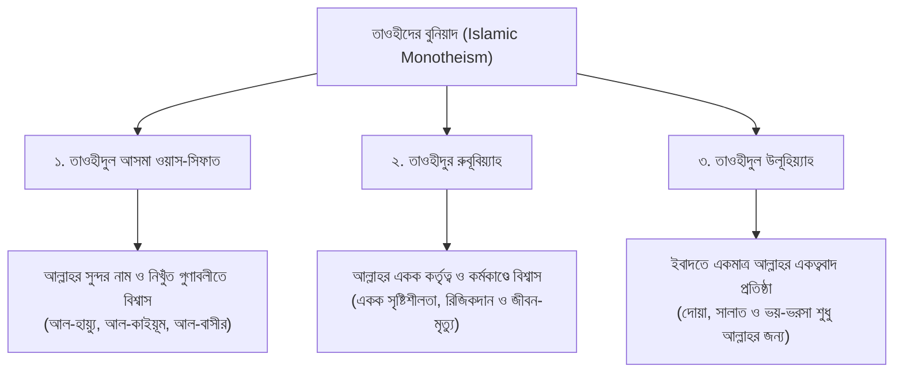

# অধ্যায় ০১: মুসলিম স্বকীয়তা, অন্ধ অনুকরণ বর্জন ও জীবনের বুনিয়াদি আদব

> **মূল বক্তা ও নির্দেশক:** ইঞ্জিনিয়ার মুহাম্মাদ এনামুল হক  
> **আলোচনার স্থান ও প্রেক্ষাপট:** স্কুল ফর কমিউনিটি ডেভেলপমেন্ট (SCD), ঢাকা — শিক্ষার্থী, শিশু-কিশোর ও অভিভাবকদের বুনিয়াদি ইসলাম শিক্ষা দরস  
> **রেকর্ডিং তারিখ:** ১৮ অক্টোবর ২০১৮  
> **মূল অডিও সোর্স:** `Basic_Islam_SCD_Enamul_Haque_2018-10-18.mp3` (দৈর্ঘ্য: ৩৭ মিনিট)  
> **সংকলন ও সম্পাদনা:** প্রমিত বাংলা ভাষায় শিশু-কিশোর ও পরিবারের উপযোগী সাহিত্যিক বিন্যাস ও তাহকীককৃত সংকলন

---

## অধ্যায়ের সূচিপত্র

- [১. ভূমিকা ও পাঠের মূল উদ্দেশ্য](#১-ভূমিকা-ও-পাঠের-মূল-উদ্দেশ্য)
- [২. মুসলিম স্বকীয়তা বনাম বিজাতীয় সংস্কৃতির অন্ধ অনুকরণ](#২-মুসলিম-স্বকীয়তা-বনাম-বিজাতীয়-সংস্কৃতির-অন্ধ-অনুকরণ)
- [৩. ঘরের পবিত্রতা, টয়লেটের শিষ্টাচার ও জিনদের অনিষ্ট থেকে বাঁচার সুন্নাত](#৩-ঘরের-পবিত্রতা-টয়লেটের-শিষ্টাচার-ও-জিনদের-অনিষ্ট-থেকে-বাঁচার-সুন্নাত)
- [৪. মহাবিশ্বের নিখুঁত ডিজাইন ও মহান স্রষ্টার পরিচয়](#৪-মহাবিশ্বের-নিখুঁত-ডিজাইন-ও-মহান-স্রষ্টার-পরিচয়)
  - [৪.১ মরুদ্বীপ ও জনমানবহীন সুসজ্জিত ঘরের দৃষ্টান্ত](#৪১-মরুদ্বীপ-ও-জনমানবহীন-সুসজ্জিত-ঘরের-দৃষ্টান্ত)
  - [৪.২ ১০,০০০ মাইল উড়ে যাওয়া ক্ষুদ্র পাখির বিস্ময়কর জ্ঞান](#৪২-১০০০০-মাইল-উড়ে-যাওয়া-ক্ষুদ্র-পাখির-বিস্ময়কর-জ্ঞান)
  - [৪.৩ বরফ পানিতে ডুব দেওয়া পাখির পালকের অলৌকিক ওয়াটারপ্রুফ ডিজাইন](#৪৩-বরফ-পানিতে-ডুব-দেওয়া-পাখির-পালকের-অলৌকিক-ওয়াটারপ্রুফ-ডিজাইন)
- [৫. তাওহীদের বুনিয়াদি তিনটি স্তম্ভ: আসমা-সিফাত, রুবূবিয়্যাত ও উলূহিয়্যাহ](#৫-তাওহীদের-বুনিয়াদি-তিনটি-স্তম্ভ-আসমা-সিফাত-রুবূবিয়্যাত-ও-উলূহিয়্যাহ)
- [৬. নির্ভরযোগ্য দলীল ও হাদীসের তাখরীজ](#৬-নির্ভরযোগ্য-দলীল-ও-হাদীসের-তাখরীজ)
- [৭. ছোটদের জন্য প্র্যাক্টিক্যাল আমলনামা (Daily Checklist)](#৭-ছোটদের-জন্য-প্র্যাক্টিক্যাল-আমলনামা-daily-checklist)
- [৮. চিন্তা করো ও উত্তর দাও (Classroom Q&A)](#৮-চিন্তা-করো-ও-উত্তর-দাও-classroom-qa)
- [৯. অভিভাবকদের জন্য দিকনির্দেশনা (Parenting Note)](#৯-অভিভাবকদের-জন্য-দিকনির্দেশনা-parenting-note)

---

## ১. ভূমিকা ও পাঠের মূল উদ্দেশ্য

بِسْمِ اللَّهِ الرَّحْمَٰنِ الرَّحِيمِ  
الْحَمْدُ لِلَّهِ رَبِّ الْعَالَمِينَ، وَالصَّلَاةُ وَالسَّلَامُ عَلَى رَسُولِهِ الْكَرِيمِ، أَمَّا بَعْدُ:

মানবজীবনের সবচেয়ে গুরুত্বপূর্ণ সম্পদ হলো ঈমান ও ইসলামী ব্যক্তিত্ব। শৈশব ও কৈশোর থেকেই যদি একটি মুসলিম শিশুর অন্তরে ঈমানের মজবুত বুনিয়াদ গড়ে না ওঠে, তবে আধুনিক সমাজের বহুমুখী ফেতনা, বিজাতীয় অপসংস্কৃতি এবং ভোগবাদী পরিবেশ তার পরিচয়কে গ্রাস করে ফেলে।

স্কুল ফর কমিউনিটি ডেভেলপমেন্ট (SCD)-এর এই বিশেষ শিক্ষা আসরে ইঞ্জিনিয়ার মুহাম্মাদ এনামুল হক শিশুদের সামনে অত্যন্ত সহজ, বাস্তবসম্মত এবং হৃদয়গ্রাহী উপমায় তুলে ধরেছেন:

1. কেন আমরা অন্য কোনো জাতি বা অমুসলিমদের অন্ধ অনুকরণ করব না?
2. আমাদের ঘরের পরিবেশ, টয়লেটের শিষ্টাচার এবং পবিত্রতার ইসলামি ঐতিহ্য কী?
3. কীভাবে ছোট্ট একটি পরিযায়ী পাখির ডানার ভেতর কিংবা মরুদ্বীপের শান্ত বাতাসে মহান আল্লাহর রুবূবিয়্যাত ও অনন্য সৃষ্টির স্বাক্ষর ফুটে ওঠে?
4. তাওহীদের প্রাথমিক তিনটি স্তর শিশুদের অন্তরে কীভাবে গ্রথিত করতে হয়?

---

## ২. মুসলিম স্বকীয়তা বনাম বিজাতীয় সংস্কৃতির অন্ধ অনুকরণ

একজন মুসলিমের নিজস্ব একটি পরিচয় আছে। আল্লাহ তা‘আলা মুসলিম উম্মাহকে মানবজাতির শ্রেষ্ঠ জাতি হিসেবে মনোনীত করেছেন। কিন্তু বর্তমানে মুসলিম সমাজ—বিশেষ করে আমাদের তরুণ প্রজন্ম—অন্যান্য অমুসলিম ও পশ্চিমা সংস্কৃতিকে এমন অন্ধভাবে অনুকরণ করতে শুরু করেছে যে, আমাদের ভাষা, পোশাক, চালচলন, এমনকি ঘরের স্থাপত্যশৈলী পর্যন্ত বদলে গেছে।

রাসূলুল্লাহ ﷺ কঠোরভাবে সতর্ক করে বলেছেন, যে ব্যক্তি যে জাতির সাদৃশ্য অবলম্বন করবে, সে তাদেরই একজন হিসেবে গণ্য হবে।

> **ইঞ্জিনিয়ার এনামুল হকের বক্তব্য:**  
> “আমরা গতদিন আলোচনা করেছিলাম যে অন্য জাতিকে অন্ধ অনুকরণ করা ইসলামে একটি অত্যন্ত গর্হিত ও অপছন্দনীয় কাজ। অনেকে মনে করেন অনুকরণ মানে কেবল পোশাক-আশাক। না! অনুকরণ করতে গিয়ে আমরা আমাদের গোটা জীবনব্যবস্থা ও ঐতিহ্য বদলে ফেলেছি। আমরা ভুলে গেছি যে, আমাদের জন্য কোনটি ভালো আর কোনটি ক্ষতিকর—তা আল্লাহ ও তাঁর রাসূলের চেয়ে বেশি ভালো কেউ জানে না।”

অন্ধ অনুকরণের মারাত্মক কুফল:

- **আত্মমর্যাদাহীনতা:** অন্য জাতিকে দেখে মনে করা যে তাদের সবকিছুই শ্রেষ্ঠ, আর নিজেদের দ্বীনি নিয়মগুলো সেকেলে।
- **ঈমানী দুর্বলতা:** অপসংস্কৃতির রঙে নিজেকে রাঙাতে গিয়ে দ্বীনের মৌলিক হালাল-হারামের সীমারেখা মুছে ফেলা।
- **বিপদ ও রোগব্যাধি ডেকে আনা:** অপবিত্রতা, অপরিচ্ছন্নতা ও অশুভ শক্তির প্রভাব নিজের ঘরে ডেকে আনা।

---

## ৩. ঘরের পবিত্রতা, টয়লেটের শিষ্টাচার ও জিনদের অনিষ্ট থেকে বাঁচার সুন্নাত

মুসলিম সংস্কৃতির চিরাচরিত ঐতিহ্য ছিল ঘরের পরিচ্ছন্নতা ও পবিত্রতাকে সর্বোচ্চ অগ্রাধিকার দেওয়া। প্রাচীনকাল থেকেই মুসলিমদের ঘরবাড়িতে বাথরুম বা টয়লেট থাকত মূল বসবাসের ঘর থেকে কিছুটা দূরে বা পৃথক স্থানে। কিন্তু পশ্চিমা আধুনিক স্থাপত্য অনুকরণ করতে গিয়ে আজ আমরা শোবার ঘরের ঠিক ভেতরেই টয়লেট স্থাপন করছি এবং একই ক্ষুদ্র স্থানে টয়লেট, গোসলখানা ও বেসিন যুক্ত করে ফেলছি।

এর ফলে যে মারাত্মক সমস্যাগুলো তৈরি হচ্ছে:

1. **আল্লাহর নাম স্মরণের অন্তরায়:** টয়লেটের ভেতরে আল্লাহর নাম উচ্চারণ করা বা ‘বিসমিল্লাহ’ বলা নিষিদ্ধ। একই রুমের ভেতর ওযূখানা থাকায় শিশুরা ওযূর শুরুতে পবিত্র ‘বিসমিল্লাহ’ বলতে পারে না।
2. **নাপাকি ও দুর্গন্ধের বিস্তার:** টয়লেটের কমোড থেকে ছিটকে আসা অদৃশ্য নাপাকি ও ক্ষতিকর জীবাণু তোয়ালে ও ব্রাশে ছড়িয়ে পড়ে।
3. **দুষ্ট জিন ও শয়তানের আশ্রয়স্থল:** নোংরা ও নাপাক স্থানে অপবিত্র জিনেরা বসবাস করে। রাসূলুল্লাহ ﷺ শিখিয়েছেন টয়লেটে প্রবেশের পূর্বে আল্লাহর আশ্রয় প্রার্থনা করতে হবে।

> **হাদীসের নির্দেশিকা:**  
> আনাস ইবনু মালিক (রা.) হতে বর্ণিত, নবী করীম ﷺ যখন শৌচাগারে প্রবেশ করতেন, তখন বলতেন:  
> **«اللَّهُمَّ إِنِّي أَعُوذُ بِكَ مِنَ الْخُبُثِ وَالْخَبَائِثِ»**  
> _“হে আল্লাহ! আমি আপনার নিকট অপবিত্র পুরুষ ও নারী শয়তানের অনিষ্ট থেকে আশ্রয় চাই।”_ [সহীহ বুখারী: ১৪২]

এছাড়াও শারীরিক সুস্থতার জন্য স্কোয়াটিং টয়লেট (উবু হয়ে বসা) কমোডের চেয়ে অনেক বেশি স্বাস্থ্যসম্মত, যা পেটের রোগ থেকে মুক্তি দেয়। বিজাতীয় ফ্যাশনের চেয়ে নববী স্বাস্থ্যবিধি ও পবিত্রতার নীতিই সর্বদা সর্বোত্তম।

---

## ৪. মহাবিশ্বের নিখুঁত ডিজাইন ও মহান স্রষ্টার পরিচয়

শিশুদের মনে প্রায়ই প্রশ্ন জাগে: “আমরা তো আল্লাহকে চোখে দেখতে পারি না, তাহলে কীভাবে নিশ্চিত হব যে তিনি আছেন এবং তিনিই আমাদের একমাত্র রব?” ইঞ্জিনিয়ার এনামুল হক এই প্রশ্নের সমাধানে বিজ্ঞান ও যুক্তিনির্ভর তিনটি চমৎকার বাস্তব উদাহরণ তুলে ধরেছেন:

### ৪.১ মরুদ্বীপ ও জনমানবহীন সুসজ্জিত ঘরের দৃষ্টান্ত

ধরা যাক, আপনি সমুদ্রের মাঝে সম্পূর্ণ জনমানবহীন এক নির্জন দ্বীপে গেলেন। সেখানে কোনো প্রাণী নেই, কোনো মানুষ নেই। হঠাৎ সেখানে গিয়ে দেখলেন এক চমৎকার সাজানো ঘর—তাতে সুন্দর খাট-বিছানা পাতা, ফ্যান ঝুলছে, লাইট জ্বলছে, টেবিলে সুস্বাদু খাবার সাজানো!

এখন কোনো বিবেকবান মানুষ কি বিশ্বাস করবে যে কোটি কোটি বছর ধরে বাতাস, পানি আর মাটি আপনা-আপনি ধাক্কা খেয়ে এই ঘরটি বানিয়ে ফেলেছে? কোনো সুস্থ মস্তিষ্কের মানুষ তা কখনোই বলবে না। সে এক মুহূর্তেই বুঝে যাবে—যে ব্যক্তিই হোক না কেন, কোনো একজন বুদ্ধিমান নির্মাতা অত্যন্ত যত্ন সহকারে এই ঘরটি তৈরি ও সুসজ্জিত করেছেন!

তাহলে এই সুবিশাল গ্রহ-নক্ষত্র, সুনীল আকাশ, বাতাস আর জীবন—যা কোনো ইঞ্জিনিয়ারের ঘরের চেয়ে কোটি গুণ জটিল—তা কীভাবে একজন পরম প্রজ্ঞাময় স্রষ্টা ছাড়া নিজে নিজে সৃষ্টি হতে পারে?

### ৪.২ ১০,০০০ মাইল উড়ে যাওয়া ক্ষুদ্র পাখির বিস্ময়কর জ্ঞান

সাইবেরিয়ার প্রচণ্ড শীতের দেশ থেকে ছোট্ট ছোট্ট পরিযায়ী পাখি দল বেঁধে প্রায় **১০,০০০ মাইল** পথ পাড়ি দিয়ে বাংলাদেশ ও উষ্ণ মণ্ডলে চলে আসে।

- সেই ছোট্ট পাখির মস্তিষ্কটি একটি মটরদানার চেয়েও ছোট।
- তাদের কাছে কোনো জিপিএস (GPS), আধুনিক রাডার বা মানচিত্র নেই।
- মহাসমুদ্র ও সুবিশাল পাহাড় পেরিয়ে তারা কখনো পথ হারায় না। ঠিক যেই স্থানে আসার কথা, ঠিক সেখানেই নির্ভুলভাবে এসে পৌঁছায়!

কে এই অবোধ পাখিকে ১০ হাজার মাইল দূরবর্তী পথের নিখুঁত নেভিগেশন ম্যাপ শিখিয়ে দিল? তিনি আর কেউ নন—তিনি আমাদের পরম দয়ালু রব আল্লাহ সুবহানাহু ওয়া তা‘আলা!

### ৪.৩ বরফ পানিতে ডুব দেওয়া পাখির পালকের অলৌকিক ওয়াটারপ্রুফ ডিজাইন

নদীর কিনারায় একটি ছোট পাখি খাবার খুঁজছে, আর আকাশের ওপর থেকে এক বিশাল শিকারী বাজপাখি তাকে শিকার করার জন্য তাকিয়ে আছে। ছোট পাখিটি বাঁচার জন্য বরফশীতল নদীর পানিতে ডুব দেয়। শিকারী পাখি কিন্তু পানিতে নামে না, কারণ সে জানে তার শরীর ওই তীব্র ঠান্ডা পানি সহ্য করতে পারবে না।

কিন্তু ডুবুরি পাখিটি দীর্ঘক্ষণ পানির নিচে থেকেও যখন ওপরে উঠে আসে, তার পালকে কোনো পানি আটকে থাকে না! কারণ আল্লাহ তা‘আলা তার ত্বকে ও পালকের গোড়ায় একটি প্রাকৃতিক তৈলাক্ত গ্রন্থি তৈরি করে দিয়েছেন। ওপরে উঠে শরীরটা কেবল একবার ঝাঁকি দিলেই সব পানি মুক্তোর মতো ঝরে পড়ে যায় এবং পালক সম্পূর্ণ শুকনো থাকে!

> **শিক্ষণীয় উপলব্ধি:**  
> এই যে নিখুঁত বায়োলজিক্যাল ডিজাইন ফ্যাক্টর—কার শরীর কেমন হবে, কাকে কেমন পালক দিতে হবে—এই নিখুঁত নকশা কে করেছেন? তিনি আল্লাহ, যিনি **‘আল-খালিক্ব’** (পরম স্রষ্টা) এবং **‘আল-মুসাওয়ির’** (নিখুঁত রূপদানকারী)।

---

## ৫. তাওহীদের বুনিয়াদি তিনটি স্তম্ভ: আসমা-সিফাত, রুবূবিয়্যাত ও উলূহিয়্যাহ

আল্লাহর পরিচয় পূর্ণাঙ্গরূপে জানতে হলে শিশুদেরকে তাওহীদের তিনটি মূল শাখার সাথে পরিচিত করাতে হবে:

1. **তাওহীদুল আসমা ওয়াস-সিফাত (আল্লাহর নাম ও গুণের একত্ব):**  
   আল্লাহ তা‘আলা আল-কুরআনে নিজের যে সকল সুন্দর নাম (যেমন: আর-রহমান, আল-আলীম, আস-সামী‘, আল-কাদির) ও গুণাবলীর বর্ণনা দিয়েছেন, সেগুলোকে কোনো রূপক বা বিকৃতি ছাড়া খাঁটি মনে বিশ্বাস করা।
2. **তাওহীদুর রুবূবিয়্যাহ (আল্লাহর রবের গুণে একত্ব):**  
   বিশ্বজগতের সমস্ত কিছু একমাত্র তিনিই সৃষ্টি করেছেন, তিনিই পরিচালনা করছেন এবং তিনিই জীবন ও মৃত্যুর মালিক—এ বিশ্বাসে কাউকে অংশীদার না করা।
3. **তাওহীদুল উলূহিয়্যাহ (একমাত্র আল্লাহর ইবাদতের একত্ব):**  
   আমরা কোনো মাজার, পীর, ফেরেশতা বা মানুষের উপাসনা করি না। আমাদের সালাত, রোযা, ভয়, আশা এবং দোয়া একমাত্র মহান আল্লাহর উদ্দেশ্যে নিবেদিত।

---

## ৬. নির্ভরযোগ্য দলীল ও হাদীসের তাখরীজ

### দলীল ০১: বিজাতীয় সংস্কৃতির অন্ধ অনুকরণ নিষেধ

عَنِ ابْنِ عُمَرَ رَضِيَ اللَّهُ عَنْهُمَا قَالَ: قَالَ رَسُولُ اللَّهِ ﷺ:  
**«مَنْ تَشَبَّهَ بِقَوْمٍ فَهُوَ مِنْهُمْ»**

> **অনুবাদ:** আব্দুল্লাহ ইবনু উমর (রা.) থেকে বর্ণিত, রাসূলুল্লাহ ﷺ বলেছেন:  
> _“যে ব্যক্তি কোনো কওম বা সম্প্রদায়ের সাদৃশ্য গ্রহণ করবে (তাদের নীতি-আদর্শ ও অপসংস্কৃতির অনুকরণ করবে), সে তাদেরই অন্তর্ভুক্ত গণ্য হবে।”_  
> **রেফারেন্স:** [সুনান আবূ দাঊদ: ৪০৩১](https://www.hadithbd.com/hadith/detail/?book=12&section=1073&hadith=4031), ইমাম আলবানী একে সহীহ বলেছেন।

### দলীল ০২: প্রকৃতির নিখুঁত সৃষ্টির দিকে দৃষ্টিপাত

قَالَ اللَّهُ تَعَالَى:  
**﴿الَّذِي خَلَقَ سَبْعَ سَمَاوَاتٍ طِبَاقًا مَّا تَرَىٰ فِي خَلْقِ الرَّحْمَٰنِ مِن تَفَاوُتٍ فَارْجِعِ الْبَصَرَ هَلْ تَرَىٰ مِن فُطُورٍ﴾**

> **অনুবাদ:** “যিনি সাত আসমান স্তরে স্তরে সৃষ্টি করেছেন। পরম করুণাময়ের সৃষ্টিতে তুমি কোনো ত্রুটি দেখতে পাবে না; তুমি আবার তাকিয়ে দেখ, কোনো খুঁত দেখতে পাও কি?”  
> **রেফারেন্স:** [সূরা আল-মুলক: ৩](https://quran.com/67/3)

---

## ৭. ছোটদের জন্য প্র্যাক্টিক্যাল আমলনামা (Daily Checklist)

- [ ] **টয়লেটে প্রবেশের আমল:** বাঁ পা দিয়ে ঢোকা এবং প্রবেশের আগে পূর্ণ মনোযোগ দিয়ে পাঠ করা: _“আল্লাহুম্মা ইন্নী আ‘ঊযু বিকা মিনাল খুবুসি ওয়াল খাবায়িস।”_
- [ ] **টয়লেট থেকে বের হওয়ার আমল:** ডান পা দিয়ে বের হওয়া এবং পাঠ করা: _“গুফরানাক।”_
- [ ] **ওযূর শুরু ও সমাপ্তির আদব:** ওযূর শুরুতে পরিষ্কার মনে _“বিসমিল্লাহ”_ বলা এবং কোনো অপবিত্র স্থানে ওযূ না করে পবিত্র স্থানে ওযূ সম্পন্ন করা।
- [ ] **মুসলিম স্বকীয়তা বজায় রাখা:** কার্টুন বা বিজাতীয় চরিত্রের মতো উল্টাপাল্টা ফ্যাশন বা পোশাক বর্জন করে মার্জিত পোশাক পরিধান করা।
- [ ] **পাখির দিকে তাকিয়ে আল্লাহকে স্মরণ:** আকাশে যখন কোনো পাখি উড়তে দেখব, মনে মনে বলব—_“সুবহানাল্লাহ! যিনি তোমাকে আকাশে উড়িয়ে রেখেছেন, তিনিই আমার রব।”_

---

## ৮. চিন্তা করো ও উত্তর দাও (Classroom Q&A)

**প্রশ্ন ১:** নির্জন মরুদ্বীপে সুন্দর একটি ঘর দেখে কোনো মানুষ কেন বলবে না যে এটা নিজে নিজে সৃষ্টি হয়েছে?  
**উত্তর:** কারণ একটি ছোট ঘরেও পরিকল্পনা, ডিজাইন এবং উপকরণের নিখুঁত সমন্বয় থাকে—যা কোনো বুদ্ধিমান নির্মাতা ছাড়া অসম্ভব। একইভাবে এই সুবিশাল নিখুঁত মহাবিশ্ব কখনোই নিজে নিজে সৃষ্টি হতে পারে না; এর পেছনে পরম প্রজ্ঞাময় স্রষ্টা আল্লাহ তা‘আলা রয়েছেন।

**প্রশ্ন ২:** পরিযায়ী পাখিরা কোনো কম্পাস বা জিপিএস ছাড়া কীভাবে ১০ হাজার মাইল পাড়ি দেয়?  
**উত্তর:** মহান আল্লাহ তাদের মস্তিষ্কে সহজাত দিকনির্ণয়ের ইলম ও সংবেদনশীল অনুভূতি দান করেছেন। তিনিই তাদেরকে এই দীর্ঘ পথের পথনির্দেশ প্রদান করেন।

**প্রশ্ন ৩:** টয়লেটে প্রবেশের আগে কেন আমরা দু‘আ পড়ি?  
**উত্তর:** কারণ নোংরা ও অপবিত্র স্থানে দুষ্ট জিন ও শয়তান বসবাস করে। আল্লাহর শেখানো দু‘আ পড়ার মাধ্যমে বান্দা শয়তানের অনিষ্ট থেকে আল্লাহর সুরক্ষা লাভ করে।

---

## ৯. অভিভাবকদের জন্য দিকনির্দেশনা (Parenting Note)

১. **শিশুর সামনে হীনম্মন্যতা প্রকাশ করবেন না:** সন্তানদের বিজাতীয় সংস্কৃতির পোশাক, গ্যাজেট বা কাটতি দিয়ে মুগ্ধ করার পরিবর্তে দ্বীনি মূল্যবোধের প্রতি শ্রদ্ধাশীল হতে উৎসাহিত করুন।  
২. **বাসার ওয়াশরুম ও ওযূখানা যথাসম্ভব আলাদা বা পরিচ্ছন্ন রাখুন:** যদি কমোড ও ওযূখানা একই ঘরে থাকে, তবে ওযূ করার পূর্বে কমোডের ঢাকনা বন্ধ রাখুন এবং বাচ্চাদের বাইরে থেকেই ‘বিসমিল্লাহ’ বলে ওযূ শুরু করার অভ্যাস করান।  
৩. **প্রকৃতি পর্যবেক্ষণ ও আক্বীদা শিক্ষা:** সন্তানকে চিড়িয়াখানায়, পার্কে বা গ্রামে নিয়ে গেলে শুধু বিনোদনের মধ্যে সীমাবদ্ধ না রেখে জীববৈচিত্র্য, পশুপাখির সৃষ্টিশৈলী ও আল্লাহর কুদরত নিয়ে তাদের সাথে প্রশ্নোত্তরের মাধ্যমে আলোচনা করুন।
