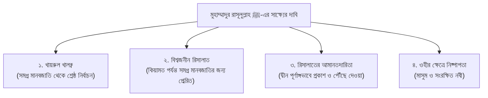

# অধ্যায় ০৪: মুহাম্মাদুর রাসূলুল্লাহ ﷺ-এর হক, বার্থডে কালচার ও রিসালাতের দাবি

> **মূল বক্তা ও নির্দেশক:** ইঞ্জিনিয়ার মুহাম্মাদ এনামুল হক  
> **আলোচনার স্থান ও প্রেক্ষাপট:** স্কুল ফর কমিউনিটি ডেভেলপমেন্ট (SCD), ঢাকা — শিক্ষার্থী, শিশু-কিশোর ও অভিভাবকদের বুনিয়াদি ইসলাম শিক্ষা দরস  
> **রেকর্ডিং তারিখ:** ০৮ নভেম্বর ২০১৮  
> **মূল অডিও সোর্স:** `Basic_Islam_SCD_Enamul_Haque_2018-11-08.mp3` (দৈর্ঘ্য: ৩৪.৫ মিনিট)  
> **সংকলন ও সম্পাদনা:** প্রমিত বাংলা ভাষায় শিশু-কিশোর ও পরিবারের উপযোগী সাহিত্যিক বিন্যাস ও তাহকীককৃত সংকলন

---

## অধ্যায়ের সূচিপত্র

- [১. ভূমিকা ও পাঠের মূল উদ্দেশ্য](#১-ভূমিকা-ও-পাঠের-মূল-উদ্দেশ্য)
- [২. সন্তান প্রতিপালনে আমাদের লক্ষ্য: কুফর ও অপসংস্কৃতি থেকে সুরক্ষা](#২-সন্তান-প্রতিপালনে-আমাদের-লক্ষ্য-কুফর-ও-অপসংস্কৃতি-থেকে-সুরক্ষা)
  - [২.১ জন্মদিনের কেক কাটা ও মোমবাতি জ্বালানোর পৌত্তলিক (প্যাগান) ইতিহাস](#২১-জন্মদিনের-কেক-কাটা-ও-মোমবাতি-জ্বালানোর-পৌত্তলিক-প্যাগান-ইতিহাস)
  - [২.২ মুসলিম পরিবারে বিজাতীয় উৎসবের অনুপ্রবেশ](#২২-মুসলিম-পরিবারে-বিজাতীয়-উৎসবের-অনুপ্রবেশ)
- [৩. জান্নাতের চাবি ও তার দাঁতসমূহ (শাহাদাতের শর্তাবলী)](#৩-জান্নাতের-চাবি-ও-তার-দাঁতসমূহ-শাহাদাতের-শর্তাবলী)
- [৪. ‘মুহাম্মাদুর রাসূলুল্লাহ ﷺ’ সাক্ষ্যের গভীর তাৎপর্য](#৪-মুহাম্মাদুর-রাসূলুল্লাহ--সাক্ষ্যের-গভীর-তাৎপর্য)
  - [৪.১ সমগ্র মানবজাতির ওপর তাঁর শ্রেষ্ঠত্ব ও নির্বাচন](#৪১-সমগ্র-মানবজাতির-ওপর-তাঁর-শ্রেষ্ঠত্ব-ও-নির্বাচন)
  - [৪.২ বিশ্বজনীন রিসালাত (সকল কাল ও সকল মানুষের নবী)](#৪২-বিশ্বজনীন-রিসালাত-সকল-কাল-ও-সকল-মানুষের-নবী)
  - [৪.৩ ওহীর পূর্ণাঙ্গতা ও রিসালাতের আমানতদারিতা](#৪৩-ওহীর-পূর্ণাঙ্গতা-ও-রিসালাতের-আমানতদারিতা)
  - [৪.৪ ওহীর ব্যাপারে নবীর নিষ্পাপতা (ইসমাতে আম্বিয়া)](#৪৪-ওহীর-ব্যাপারে-নবীর-নিষ্পাপতা-ইসমাতে-আম্বিয়া)
- [৫. নির্ভরযোগ্য দলীল ও হাদীসের তাখরীজ](#৫-নির্ভরযোগ্য-দলীল-ও-হাদীসের-তাখরীজ)
- [৬. ছোটদের জন্য প্র্যাক্টিক্যাল আমলনামা (Daily Checklist)](#৬-ছোটদের-জন্য-প্র্যাক্টিক্যাল-আমলনামা-daily-checklist)
- [৭. চিন্তা করো ও উত্তর দাও (Classroom Q&A)](#৭-চিন্তা-করো-ও-উত্তর-দাও-classroom-qa)
- [৮. অভিভাবকদের জন্য দিকনির্দেশনা (Parenting Note)](#৮-অভিভাবকদের-জন্য-দিকনির্দেশনা-parenting-note)

---

## ১. ভূমিকা ও পাঠের মূল উদ্দেশ্য

بِسْمِ اللَّهِ الرَّحْمَٰنِ الرَّحِيمِ  
الْحَمْدُ لِلَّهِ، وَالصَّلَاةُ وَالسَّلَامُ عَلَى نَبِيِّنَا مُحَمَّدٍ وَعَلَى آلِهِ وَأَصْحَابِهِ أَجْمَعِينَ، أَمَّا بَعْدُ:

একটি শিশু যখন ইসলামী মূল্যবোধের পরিবেশে বেড়ে ওঠে, তখন তার সামনে সবচেয়ে বড় চ্যালেঞ্জ হয়ে দাঁড়ায় সমাজের তথাকথিত ‘মডার্ন ট্রেন্ড’ বা ফ্যাশন। আপাতদৃষ্টিতে নির্দোষ মনে হওয়া অনেক আচার-অনুষ্ঠান ও উৎসবের পেছনে লুকিয়ে থাকে প্রাচীন কুফরী ও শিরকী বিশ্বাস।

স্কুল ফর কমিউনিটি ডেভেলপমেন্ট (SCD)-এর এই দরসে ইঞ্জিনিয়ার মুহাম্মাদ এনামুল হক অত্যন্ত সাহসী, বাস্তবমুখী ও দলিলভিত্তিক আলোচনা উপস্থাপন করেছেন:

1. আমরা কেন সন্তানদের প্রচলিত দামি ধর্মনিরপেক্ষ স্কুলে না দিয়ে দ্বীনি পরিবেশে গড়ে তোলার চেষ্টা করছি?
2. আধুনিক ‘বার্থডে পার্টি’ ও কেক কাটার পেছনে লুকিয়ে থাকা পৌত্তলিক (প্যাগান) বিশ্বাসের অন্ধকার ইতিহাস কী?
3. ‘লা ইলাহা ইল্লাল্লাহ’ যদি জান্নাতের চাবি হয়, তবে সেই চাবির খাঁজ বা দাঁতগুলো কী?
4. ‘মুহাম্মাদুর রাসূলুল্লাহ ﷺ’ সাক্ষ্য দেওয়ার মাধ্যমে আমাদের ওপর তাঁর কী কী অপরিহার্য অধিকার অর্পিত হয়?

---

## ২. সন্তান প্রতিপালনে আমাদের লক্ষ্য: কুফর ও অপসংস্কৃতি থেকে সুরক্ষা

বর্তমান সমাজে অধিকাংশ অভিভাবক প্রতিযোগিতা করেন সন্তানকে কত দামি ইংলিশ মিডিয়াম বা আধুনিক স্কুলে পড়ানো যায়। কিন্তু স্কুল ফর কমিউনিটি ডেভেলপমেন্ট (SCD)-এর মতো প্রতিষ্ঠানে যে পরিবারগুলো সন্তানদের নিয়ে এসেছেন, তাদের লক্ষ্য নিছক কোনো দুনিয়াবী ডিগ্রি নয়; বরং সন্তানদের ঈমান ও চরিত্রকে চারপাশের জাহেলিয়াত ও অপসংস্কৃতি থেকে সুরক্ষা করা।

### ২.১ জন্মদিনের কেক কাটা ও মোমবাতি জ্বালানোর পৌত্তলিক (প্যাগান) ইতিহাস

আজকাল অনেক মুসলিম পরিবারেও অত্যন্ত আনন্দের সাথে শিশুর জন্মদিনে গোল কেক কাটা হয়, মোমবাতি জ্বালিয়ে ফুঁ দেওয়া হয় এবং ‘হ্যাপি বার্থডে’ গান গাওয়া হয়। কিন্তু এই প্রথা কোথা থেকে এলো?

> **ইঞ্জিনিয়ার এনামুল হকের বিশ্লেষণ:**  
> “ইতিহাস অনুসন্ধান করলে দেখা যায়, জন্মদিনে গোল কেক বানিয়ে মোমবাতি জ্বালানোর এই প্রথা কোনো সেমেটিক বা একেশ্বরবাদী সংস্কৃতি নয়। প্রাচীন গ্রিসে পৌত্তলিকরা (প্যাগান শয়তান উপাসক) তাদের চন্দ্রদেবী ‘আর্টেমিস’ (Artemis)-এর জন্মদিনে চাঁদকে রূপায়িত করার জন্য গোল পিঠা বা কেক বানাত এবং চাঁদের স্নিগ্ধ আলো ফুটিয়ে তুলতে তার ওপর মোমবাতি জ্বালাত। এরপর ফুঁ দিয়ে মোমবাতি নিভিয়ে মনোবাসনা ব্যক্ত করত, কারণ তারা বিশ্বাস করত মোমবাতির ধোঁয়া তাদের মনের ইচ্ছা চন্দ্রদেবীর কাছে পৌঁছে দেয়!
> যেটির উৎপত্তি সরাসরি শিরক ও মূর্তিপূজার সাথে জড়িত, একজন তাওহীদবাদী মুসলিম কীভাবে নিজের নিষ্পাপ সন্তানের মুখে সেই শিরকী ঐতিহ্যের কেক তুলে দিতে পারে?”

### ২.২ মুসলিম পরিবারে বিজাতীয় উৎসবের অনুপ্রবেশ

অনেকে বলেন, “আমরা তো আর চন্দ্রদেবীর পূজা করছি না, আমরা শুধুই একটু আনন্দ করছি!”  
ইসলামের মূলনীতি হলো: **কোনো ইবাদত বা সংস্কৃতির উৎস যদি কুফর বা শিরক হয়, তবে কেবল নিয়ত ভালো দাবি করে তাকে গ্রহণ করা যায় না।** রাসূলুল্লাহ ﷺ ইরশাদ করেছেন:

> **«مَنْ تَشَبَّهَ بِقَوْمٍ فَهُوَ مِنْهُمْ»**  
> _“যে ব্যক্তি কোনো বিজাতীয় সম্প্রদায়ের সাদৃশ্য গ্রহণ করবে, সে তাদেরই দলভুক্ত গণ্য হবে।”_

একজন মুসলিম শিশুর আনন্দের জন্য রয়েছে আল্লাহর দান করা দুটি শ্রেষ্ঠ উৎসব—ঈদুল ফিতর ও ঈদুল আযহা। আমাদের সন্তানদের এই দুই ঈদের প্রকৃত মর্যাদা ও আনন্দ শেখাতে হবে।

---

## ৩. জান্নাতের চাবি ও তার দাঁতসমূহ (Shahadah Prerequisites)

বিখ্যাত তাবেঈ ইমাম ওয়াহাব ইবনু মুনাব্বিহ (রহ.)-কে একবার জিজ্ঞেস করা হয়েছিল:  
_“‘লা ইলাহা ইল্লাল্লাহ’ কি জান্নাতের চাবি নয়?”_  
তিনি অত্যন্ত সুন্দর উত্তর দিয়েছিলেন:

> **«بَلَى، وَلَكِنْ لَيْسَ مِفْتَاحٌ إِلَّا لَهُ أَسْنَانٌ، فَإِنْ جِئْتَ بِمِفْتَاحٍ لَهُ أَسْنَانٌ فُتِحَ لَكَ، وَإِلَّا لَمْ يُفْتَحْ لَكَ»**  
> _“অবশ্যই এটি জান্নাতের চাবি। কিন্তু প্রতিটি চাবিরই কিছু দাঁত বা খাঁজ থাকে। তুমি যদি দাঁতযুক্ত সঠিক চাবি নিয়ে আসো, তবেই তোমার জন্য জান্নাতের দরজা খোলা হবে; অন্যথায় দরজা খুলবে না!”_ [সহীহ বুখারী: কিতাবুল জানায়েয]

সেই দাঁতগুলোই হলো তাওহীদের মৌলিক শর্তাবলী—যা আমরা পূর্বের অধ্যায়ে আলোচনা করেছি (ইলম, ইয়াকীন, ইখলাস, সত্যবাদিতা, ভালোবাসা, আত্মসমর্পণ ও কবুল করা)।

---

## ৪. ‘মুহাম্মাদুর রাসূলুল্লাহ ﷺ’ সাক্ষ্যের গভীর তাৎপর্য

আমরা যখন মুখে বলি _“আশহাদু আন্না মুহাম্মাদান আবদুহু ওয়া রাসূলুহু”_, তখন আমাদের অন্তরে চারটি মৌলিক আক্বীদা দৃঢ়ভাবে বিশ্বাস করতে হবে:

### ৪.১ সমগ্র মানবজাতির ওপর তাঁর শ্রেষ্ঠত্ব ও নির্বাচন

আল্লাহ তা‘আলা সৃষ্টির শুরু থেকে কিয়ামত পর্যন্ত সমস্ত বনী আদমের মধ্য থেকে সর্বাধিক পবিত্র, সত্যবাদী ও আমানতদার হিসেবে মুহাম্মাদুর রাসূলুল্লাহ ﷺ-কে মনোনীত করেছেন। তিনিই মানবজাতির শ্রেষ্ঠ আদর্শ (সাইয়্যিদুল আম্বিয়া)।

### ৪.২ বিশ্বজনীন রিসালাত (সকল কাল ও সকল মানুষের নবী)

পূর্ববর্তী সকল নবী-রাসূল নির্দিষ্ট কোনো এলাকা, সম্প্রদায় বা সময়ের জন্য প্রেরিত হয়েছিলেন (যেমন মুসা আ. বা ঈসা আ. শুধু বনী ইসরাঈলের প্রতি প্রেরিত হয়েছিলেন)। কিন্তু মুহাম্মাদুর রাসূলুল্লাহ ﷺ-কে আল্লাহ তা‘আলা কিয়ামত পর্যন্ত আগমনকারী পৃথিবীর সকল দেশ, সকল বর্ণ ও সকল মানুষের জন্য ‘রহমাতুল্লিল আলামীন’ হিসেবে পাঠিয়েছেন।

### ৪.৩ ওহীর পূর্ণাঙ্গতা ও রিসালাতের আমানতদারিতা

তিনি তাঁর ওপর অর্পিত দায়িত্বে এক বিন্দু পরিমাণ ঘাটতি বা খিয়ানত করেননি:

- যা প্রকাশ করার নির্দেশ ছিল, তা তিনি অত্যন্ত স্পষ্ট করে উম্মতকে জানিয়ে দিয়েছেন।
- যা নিষেধ করার নির্দেশ ছিল, তা থেকে তিনি উম্মতকে সর্বশক্তি দিয়ে সতর্ক করেছেন।
- বিদায় হজের ভাষণে তিনি উপস্থিত সাহাবীদের জিজ্ঞেস করেছিলেন: _“আমি কি আল্লাহর বার্তা তোমাদের কাছে পৌঁছে দিয়েছি?”_ লাখো সাহাবী একসাথে সমস্বরে সাক্ষ্য দিয়েছিলেন: _“হ্যাঁ, আপনি পূর্ণাঙ্গভাবে পৌঁছে দিয়েছেন এবং নসীহত করেছেন!”_ তখন রাসূলুল্লাহ ﷺ আকাশের দিকে হাত তুলে তিনবার বলেছিলেন: _“হে আল্লাহ! আপনি সাক্ষী থাকুন!”_

### ৪.৪ ওহীর ব্যাপারে নবীর নিষ্পাপতা (ইসমাতে আম্বিয়া)

নবী-রাসূলগণ ওহী প্রচার ও দ্বীনি আদেশের ক্ষেত্রে সম্পূর্ণ নিষ্পাপ ও অভ্রান্ত (Infallible)। তাঁদের মাধ্যমে দ্বীনের কোনো ভুল বার্তা প্রচারিত হতে পারে না।

কখনো কখনো রাসূলুল্লাহ ﷺ-এর মানবীয় স্বভাবসুলভ কোনো অসাবধানতা হয়েছে (যেমন: সালাতে কোনো এক ওয়াক্তে ৪ রাকাতের স্থানে ভুলে ২ রাকাত পড়ে সালাম ফিরিয়ে দেওয়া)। কিন্তু আল্লাহ সুবহানাহু ওয়া তা‘আলা কখনোই কোনো নবীকে সেই ভুলের ওপর বহাল থাকতে দেননি; বরং সাহাবীদের স্মরণ করিয়ে দিয়ে এবং ওহীর মাধ্যমে তাৎক্ষণিকভাবে তা সংশোধন করে দিয়েছেন—যেন তা কিয়ামত পর্যন্ত উম্মতের জন্য ‘সাহু সেজদা’ ও বিধানের দৃষ্টান্ত হয়ে থাকে।

অতএব, রাসূলুল্লাহ ﷺ যা রেখে গেছেন তা-ই নিখুঁত দ্বীন। এরপর কোনো মানুষ যদি দ্বীনের মধ্যে সামান্য কোনো বিদ‘আত বা নতুন প্রথা যুক্ত করে, তবে সে যেন দাবি করে যে নবী ﷺ কোনো কথা বাদ রেখে গেছেন (নাউযুবিল্লাহ)।

---

## ৫. নির্ভরযোগ্য দলীল ও হাদীসের তাখরীজ

### দলীল ০১: বিশ্বজনীন নবীর প্রেরণা

قَالَ اللَّهُ تَعَالَى:  
**﴿وَمَا أَرْسَلْنَاكَ إِلَّا كَافَّةً لِّلنَّاسِ بَشِيرًا وَنَذِيرًا وَلَٰكِنَّ أَكْثَرَ النَّاسِ لَا يَعْلَمُونَ﴾**

> **অনুবাদ:** “আমি আপনাকে সমগ্র মানবজাতির জন্য সুসংবাদদাতা ও সতর্ককারী হিসেবে প্রেরণ করেছি; কিন্তু অধিকাংশ মানুষ তা উপলব্ধি করে না।”  
> **রেফারেন্স:** [সূরা সাবা: ২৮](https://quran.com/34/28)

### দলীল ০২: জান্নাতের চাবির দাঁত সংক্রান্ত আছার

قِيلَ لِوَهْبِ بْنِ مُنَبِّهٍ: أَلَيْسَ «لاَ إِلَهَ إِلَّا اللَّهُ» مِفْتَاحُ الجَنَّةِ؟ قَالَ: «بَلَى، وَلَكِنْ لَيْسَ مِفْتَاحٌ إِلَّا لَهُ أَسْنَانٌ، فَإِنْ جِئْتَ بِمِفْتَاحٍ لَهُ أَسْنَانٌ فُتِحَ لَكَ، وَإِلَّا لَمْ يُفْتَحْ لَكَ».

> **অনুবাদ:** ইমাম ওয়াহাব ইবনু মুনাব্বিহ (রহ.)-কে বলা হলো: “লা ইলাহা ইল্লাল্লাহ কি জান্নাতের চাবি নয়?” তিনি বললেন: “হ্যাঁ, কিন্তু চাবি মাত্রই তো তার কিছু দাঁত থাকে। যদি দাঁতযুক্ত চাবি নিয়ে আসো তবে দরজা খুলবে, অন্যথায় খুলবে না।”  
> **রেফারেন্স:** [সহীহ বুখারী: কিতাবুল জানায়িয, অধ্যায় ১ (মুআল্লাক্ব)](https://www.hadithbd.com/hadith/detail/?book=1&section=23&hadith=1237)

### দলীল ০৩: রাসূলের ﷺ ওপর সালাতে সাহুর ঘটনা

عَنْ أَبِي هُرَيْرَةَ رَضِيَ اللَّهُ عَنْهُ، أَنَّ رَسُولَ اللَّهِ ﷺ انْصَرَفَ مِنِ اثْنَتَيْنِ... فَقَالَ ذُو اليَدَيْنِ: يَا رَسُولَ اللَّهِ، أَقَصُرَتِ الصَّلاَةُ أَمْ نَسِيتَ؟ فَقَالَ: «كُلُّ ذَلِكَ لَمْ يَكُنْ»، فَقَالَ: قَدْ كَانَ بَعْضُ ذَلِكَ... فَصَلَّى رَكْعَتَيْنِ ثُمَّ سَلَّمَ ثُمَّ سَجَدَ سَجْدَتَيِ السَّهْوِ.

> **অনুবাদ:** আবূ হুরায়রা (রা.) হতে বর্ণিত, রাসূলুল্লাহ ﷺ (চার রাকাত সালাতে) দুই রাকাত পড়ে সালাম ফিরালেন... যুল ইয়াদায়ন বললেন: “সালাত কি কমিয়ে দেওয়া হয়েছে নাকি আপনি ভুলে গেছেন?” নবী ﷺ সাহাবীদের কাছে নিশ্চিত হয়ে আরও দুই রাকাত সালাত আদায় করলেন এবং সালাম ফিরিয়ে সাহু সেজদা করলেন।  
> **রেফারেন্স:** [সহীহ বুখারী: ৭১৪](https://www.hadithbd.com/hadith/detail/?book=1&section=10&hadith=714)

---

## ৬. ছোটদের জন্য প্র্যাক্টিক্যাল আমলনামা (Daily Checklist)

- [ ] **বার্থডে পার্টির কুসংস্কার বর্জন:** জন্মদিনে বন্ধুদের সাথে কেক কাটা বা মোমবাতি ফুঁ দেওয়ার মতো প্যাগান সংস্কৃতি বর্জন করা এবং কাউকে উপহার দিতে চাইলে সুন্নাহ সম্মত যেকোনো দিনে ভালোবাসা প্রকাশ করা।
- [ ] **দরূদ শরীফের আমল:** যখনই প্রিয় নবী মুহাম্মাদুর রাসূলুল্লাহ ﷺ-এর পবিত্র নাম শুনব, সাথে সাথে পূর্ণ শ্রদ্ধা ও ভালোবাসায় পাঠ করব: _“সাল্লাল্লাহু আলাইহি ওয়াসাল্লাম”_।
- [ ] **রাসূলের চরিত্র অনুকরণ:** সত্যবাদিতা, মিষ্টি হাসি দিয়ে কথা বলা, মেহমানের যত্ন নেওয়া এবং ছোটদের স্নেহ করার সুন্নাত জীবনে বাস্তবায়ন করা।
- [ ] **বিদ‘আত প্রতিরোধ:** দ্বীনের নামে কেউ মনগড়া কোনো নিয়ম দেখালে নম্রভাবে সুন্নাহর সহীহ হাদীস অনুসন্ধান করা।

---

## ৭. চিন্তা করো ও উত্তর দাও (Classroom Q&A)

**প্রশ্ন ১:** জন্মদিনে গোল কেক কাটা ও মোমবাতি জ্বালানোর পেছনে প্রাচীন গ্রিকদের কী পৌত্তলিক বিশ্বাস ছিল?  
**উত্তর:** প্রাচীন গ্রিক প্যাগানরা চন্দ্রদেবী আর্টেমিসের সন্তুষ্টির জন্য চাঁদের আকৃতির গোল কেক বানাত এবং চাঁদের আলোর প্রতিরূপ হিসেবে মোমবাতি জ্বালাত। তারা বিশ্বাস করত মোমবাতির ধোঁয়া তাদের মনের ইচ্ছা চন্দ্রদেবীর কাছে পৌঁছে দেয়। এটি সরাসরি শিরকী বিশ্বাস।

**প্রশ্ন ২:** ‘লা ইলাহা ইল্লাল্লাহ’ যদি জান্নাতের চাবি হয়, তবে সেই চাবির দাঁত বলতে কী বোঝানো হয়েছে?  
**উত্তর:** দাঁত বলতে কালিমায়ে তাওহীদের অপরিহার্য শর্তাবলী (যেমন: ইলম, একনিষ্ঠতা, সত্যবাদিতা ও শারীরিক আনুগত্য বা সালাত-সৎকাজ) বোঝানো হয়েছে।

**প্রশ্ন ৩:** রাসূলুল্লাহ ﷺ সালাতে ভুলবশত দুই রাকাত পড়ে ফেললে তা কীভাবে উম্মতের জন্য রহমত হলো?  
**উত্তর:** এর মাধ্যমে উম্মত শিক্ষা পেল যে সালাতে কখনো ভুল হলে কী করতে হবে (সাহু সেজদা করতে হবে)। আল্লাহ তা‘আলা তাৎক্ষণিকভাবে সংশোধন করে এটিকে উম্মতের জন্য কিয়ামত পর্যন্ত শরীয়াহর বিধানে পরিণত করলেন।

---

## ৮. অভিভাবকদের জন্য দিকনির্দেশনা (Parenting Note)

১. **জন্মদিন বনাম বয়সের জবাবদিহিতা:** সন্তানের জন্মদিন আসলে তাকে উৎসবের মোহে ডুবিয়ে না দিয়ে একান্তে বসিয়ে জীবনের মূল্যবান এক বছর কমে যাওয়ার কথা স্মরণ করান। তাকে আল্লাহর কাছে শুকরিয়া আদায় করে নেক হায়াত ও দ্বীনের ওপর অবিচল থাকার জন্য দু‘আ করতে শেখান।  
২. **দ্বীনি শিক্ষার অগ্রাধিকার:** সাধারণ প্রাতিষ্ঠানিক শিক্ষার পাশাপাশি সন্তানের অন্তরে যেন শিরক, বিদ‘আত ও বিজাতীয় অনুকরণ সম্পর্কে পরিষ্কার ধারণা থাকে, সেদিকে সজাগ দৃষ্টি রাখুন।  
৩. **নবীপ্রেমে উদ্বুদ্ধকরণ:** ঘরের ভেতর শিশুদের সামনে রাসূলুল্লাহ ﷺ-এর মহিমান্বিত সিরাত, সাহাবীদের আত্মত্যাগ ও নববী ভালোবাসার গল্প নিয়মিত আলোচনা করুন।
