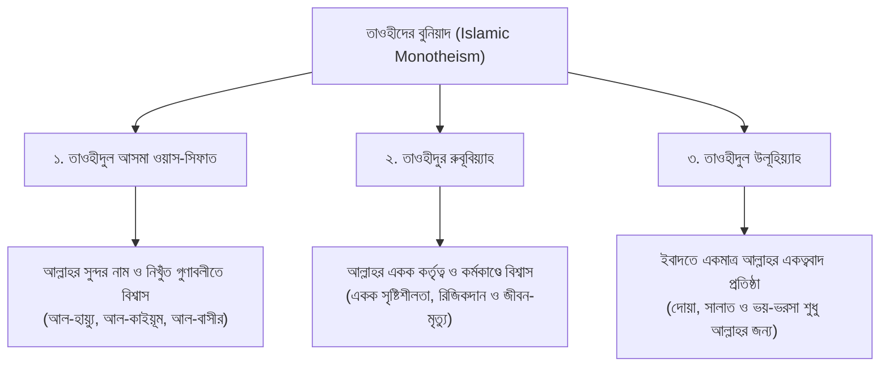
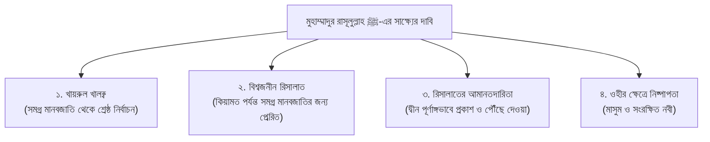

# ছোটদের বুনিয়াদি ইসলাম
### শিশু-কিশোর ও পরিবারের বুনিয়াদি আক্বীদা ও জীবনদর্শন 

> **মূল নির্দেশক ও আলোচক:** ইঞ্জিনিয়ার মুহাম্মাদ এনামুল হক  
> (প্রতিষ্ঠাতা: ইনস্টিটিউট ফর কমিউনিটি ডেভেলপমেন্ট - ICD ও স্কুল ফর কমিউনিটি ডেভেলপমেন্ট - SCD)  
> **সংকলন ও তাহকীক:** আধুনিক প্রকাশনা মানদণ্ড অনুযায়ী পূর্ণাঙ্গ আরবী হরকত, বঙ্গানুবাদ ও নির্ভরযোগ্য তাখরীজসহ সংকলিত।  
> **সংস্করণ:** প্রথম মাস্টার সংস্করণ (পর্ব ০১ – ০৪) — পরবর্তী পর্বসমূহ সহজে সংযোজনযোগ্য মডিউলার আর্কিটেকচার।  

---

## ভূমিকা ও প্রকাশকের নিবেদন

بِسْمِ اللَّهِ الرَّحْمَٰنِ الرَّحِيمِ

الْحَمْدُ لِلَّهِ رَبِّ الْعَالَمِينَ، وَالصَّلَاةُ وَالسَّلَامُ عَلَى نَبِيِّنَا مُحَمَّدٍ خَاتَمِ النَّبِيِّينَ، وَعَلَى آلِهِ وَأَصْحَابِهِ أَجْمَعِينَ.

একটি আদর্শ মুসলিম সমাজ বিনির্মাণের সূচনা হয় একটি মুসলিম পরিবারের ঘর থেকে। আর সেই ঘরের সবচেয়ে অমূল্য সম্পদ হলো আমাদের সন্তান—আমাদের শিশু ও কিশোর প্রজন্ম। আজকের শিশুরা যদি সহীহ আক্বীদা, সঠিক তাওহীদ এবং নববী চরিত্রের ওপর গড়ে না ওঠে, তবে আগামী দিনে তারা আধুনিক সমাজের বহুমুখী অপসংস্কৃতি, নাস্তিক্যবাদী সংশয় এবং বস্তুবাদী অন্ধ অনুকরণের বন্যায় নিজেদের ঈমানী অস্তিত্ব হারিয়ে ফেলবে।

এই পরম সত্যকে হৃদয়ে ধারণ করে রাজধানী ঢাকার অভিজাত পরিবেশে প্রতিষ্ঠিত হয়েছিল **স্কুল ফর কমিউনিটি ডেভেলপমেন্ট (SCD)**—যার মূল স্বপ্ন ছিল আধুনিক প্রাতিষ্ঠানিক শিক্ষার সাথে খাঁটি ইসলামী আক্বীদা ও সুন্নাহর সমন্বয় ঘটানো। সেই স্কুলের শিক্ষার্থী, তরুণ ছাত্রছাত্রী এবং সচেতন অভিভাবকদের বুনিয়াদি দ্বীনি শিক্ষাদানের লক্ষ্যে বিশিষ্ট দাঈ ও চিন্তাবিদ **ইঞ্জিনিয়ার মুহাম্মাদ এনামুল হক** নিয়মিত বিশেষ শিক্ষণীয় আসর পরিচালনা করেন।

তাঁর এই প্রাঞ্জল আলোচনাগুলোর মূল বৈশিষ্ট্য হলো:
১. জটিল দর্শন বা তাত্ত্বিক বাহাসের পরিবর্তে শিশুদের বোধগম্য বাস্তব জীবনের উপমা ও বৈজ্ঞানিক ডিজাইন ফ্যাক্টরের মাধ্যমে তাওহীদের শিক্ষা।  
২. পশ্চিমা ও পৌত্তলিক অপসংস্কৃতির (যেমন বার্থডে পার্টি, কেক কাটা, অন্ধ অনুকরণ) ইতিহাস উন্মোচন করে মুসলিম স্বকীয়তার অহংকার জাগ্রত করা।  
৩. কালিমায়ে শাহাদাতকে নিছক কথার ফুলঝুড়িতে সীমাবদ্ধ না রেখে বাস্তব জীবনে সালাত, ওযূ, তাহারাত ও চরিত্র গঠনের মাধ্যমে জীবন্ত করা।

এই সংকলনে তাঁর প্রদত্ত প্রথম চারটি মৌলিক অডিও দরসকে তাহকীক, তাখরীজ ও আধুনিক প্রকাশনা বিন্যাসে সাজিয়ে একটি পূর্ণাঙ্গ গ্রন্থের রূপ দেওয়া হয়েছে। প্রতিটি অধ্যায়ে রয়েছে মূল আলোচনার হৃদয়গ্রাহী উপস্থাপন, আল-কুরআন ও সহীহ হাদীসের সুস্পষ্ট দলীল, শিশুদের দৈনন্দিন আমলনামা, ক্লাসরুমের কুইজ এবং অভিভাবকদের জন্য বিশেষ দিকনির্দেশনা।

মহান আল্লাহ রাব্বুল আলামীন এই গ্রন্থটিকে আমাদের সন্তানদের সহীহ ঈমানের দিশারী হিসেবে কবুল করুন এবং সংশ্লিষ্ট সকলকে উত্তম প্রতিদান দান করুন। আমীন।

---

## পূর্ণাঙ্গ সূচিপত্র (Table of Contents)

* [অধ্যায় ০১: মুসলিম স্বকীয়তা, অন্ধ অনুকরণ বর্জন ও জীবনের বুনিয়াদি আদব](#অধ্যায়-০১-মুসলিম-স্বকীয়তা-অন্ধ-অনুকরণ-বর্জন-ও-জীবনের-বুনিয়াদি-আদব)
  * [১. মুসলিম স্বকীয়তা বনাম বিজাতীয় সংস্কৃতির অন্ধ অনুকরণ](#২-মুসলিম-স্বকীয়তা-বনাম-বিজাতীয়-সংস্কৃতির-অন্ধ-অনুকরণ)
  * [২. ঘরের পবিত্রতা, টয়লেটের শিষ্টাচার ও জিনদের অনিষ্ট থেকে বাঁচার সুন্নাত](#৩-ঘরের-পবিত্রতা-টয়লেটের-শিষ্টাচার-ও-জিনদের-অনিষ্ট-থেকে-বাঁচার-সুন্নাত)
  * [৩. মহাবিশ্বের নিখুঁত ডিজাইন ও মহান স্রষ্টার পরিচয়](#৪-মহাবিশ্বের-নিখুঁত-ডিজাইন-ও-মহান-স্রষ্টার-পরিচয়)
  * [৪. তাওহীদের বুনিয়াদি তিনটি স্তম্ভ: আসমা-সিফাত, রুবূবিয়্যাত ও উলূহিয়্যাহ](#৫-তাওহীদের-বুনিয়াদি-তিনটি-স্তম্ভ-আসমা-সিফাত-রুবূবিয়্যাত-ও-উলূহিয়্যাহ)
* [অধ্যায় ০২: দ্বীনের পূর্ণতা, সালাফের মানহাজ ও রাসূলের ﷺ নিঃশর্ত আনুগত্য](#অধ্যায়-০২-দ্বীনের-পূর্ণতা-সালাফের-মানহাজ-ও-রাসূলের--নিঃশর্ত-আনুগত্য)
  * [১. দ্বীনে ইসলামে কোনো নতুন কথা নেই: ইসলামের পূর্ণতা](#২-দ্বীনে-ইসলামে-কোনো-নতুন-কথা-নেই-ইসলামের-পূর্ণতা)
  * [২. ইসলামের স্বর্ণযুগ: সালাফে সালেহীনের প্রথম তিন প্রজন্ম](#৩-ইসলামের-স্বর্ণযুগ-সালাফে-সালেহীনের-প্রথম-তিন-প্রজন্ম)
  * [৩. আল্লাহ ও তাঁর রাসূলের ﷺ নির্দেশের প্রতি মুমিনের নিঃশর্ত আত্মসমর্পণ](#৪-আল্লাহ-ও-তাঁর-রাসূলের--নির্দেশের-প্রতি-মুমিনের-নিঃশর্ত-আনুগত্য)
  * [৪. বারীরা (রা.) ও মুগিস (রা.)-এর ঐতিহাসিক ঘটনা ও নববী সুপারিশ](#৪৩-বারীরা-রা-এর-মুক্ত-জীবন-ও-রাসূলের--সুপারিশের-গভীর-পার্থক্য)
* [অধ্যায় ০৩: শাহাদাতের শর্ত, সালাতের বাস্তবায়ন ও ঈমানের মিষ্টতা](#অধ্যায়-০৩-শাহাদাতের-শর্ত-সালাতের-বাস্তবায়ন-ও-ঈমানের-মিষ্টতা)
  * [১. কালিমায়ে শাহাদাতের চতুর্থ শর্ত: ‘আল-ইনক্বিয়াদ’ (শারীরিক আনুগত্য)](#২-কালিমায়ে-শাহাদাতের-চতুর্থ-শর্ত-আল-ইনক্বিয়াদ-শারীরিক-আনুগত্য)
  * [২. সালাত: ঈমানের প্রধান বাস্তব প্রতিফলন ও সমাজে অবহেলার চিত্র](#৩-সালাত-ঈমানের-প্রধান-বাস্তব-প্রতিফলন)
  * [৩. ঈমানের মিষ্টি স্বাদ (হালাওয়াতুল ঈমান) আস্বাদনের পথ](#৪-ঈমানের-মিষ্টি-স্বাদ-হালাওয়াতুল-ঈমান-আস্বাদনের-পথ)
  * [৪. সামাজিক লোকলজ্জা বনাম সুন্নাহর প্রতি খাঁটি ভালোবাসা](#৪২-সামাজিক-লোকলজ্জা-বনাম-সুন্নাহর-প্রতি-খাঁটি-ভালোবাসা)
* [অধ্যায় ০৪: মুহাম্মাদুর রাসূলুল্লাহ ﷺ-এর হক, বার্থডে কালচার ও রিসালাতের দাবি](#অধ্যায়-০৪-মুহাম্মাদুর-রাসূলুল্লাহ--এর-হক-বার্থডে-কালচার-ও-রিসালাতের-দাবি)
  * [১. সন্তান প্রতিপালনে আমাদের লক্ষ্য: কুফর ও অপসংস্কৃতি থেকে সুরক্ষা](#২-সন্তান-প্রতিপালনে-আমাদের-লক্ষ্য-কুফর-ও-অপসংস্কৃতি-থেকে-সুরক্ষা)
  * [২. জন্মদিনের কেক কাটা ও মোমবাতি জ্বালানোর পৌত্তলিক (প্যাগান) ইতিহাস](#২১-জন্মদিনের-কেক-কাটা-ও-মোমবাতি-জ্বালানোর-পৌত্তলিক-প্যাগান-ইতিহাস)
  * [৩. জান্নাতের চাবি ও তার দাঁতসমূহ (শাহাদাতের শর্তাবলী)](#৩-জান্নাতের-চাবি-ও-তার-দাঁতসমূহ-শাহাদাতের-শর্তাবলী)
  * [৪. ‘মুহাম্মাদুর রাসূলুল্লাহ ﷺ’ সাক্ষ্যের গভীর তাৎপর্য ও ওহীর ব্যাপারে নবীর নিষ্পাপতা](#৪-মুহাম্মাদুর-রাসূলুল্লাহ--সাক্ষ্যের-গভীর-তাৎপর্য)

---

# অধ্যায় ০১: মুসলিম স্বকীয়তা, অন্ধ অনুকরণ বর্জন ও জীবনের বুনিয়াদি আদব

> **মূল বক্তা ও নির্দেশক:** ইঞ্জিনিয়ার মুহাম্মাদ এনামুল হক  
> **আলোচনার স্থান ও প্রেক্ষাপট:** স্কুল ফর কমিউনিটি ডেভেলপমেন্ট (SCD), ঢাকা — শিক্ষার্থী, শিশু-কিশোর ও অভিভাবকদের বুনিয়াদি ইসলাম শিক্ষা দরস  
> **রেকর্ডিং তারিখ:** ১৮ অক্টোবর ২০১৮  
> **মূল অডিও সোর্স:** `Basic_Islam_SCD_Enamul_Haque_2018-10-18.mp3` (দৈর্ঘ্য: ৩৭ মিনিট)  
> **সংকলন ও সম্পাদনা:** প্রমিত বাংলা ভাষায় শিশু-কিশোর ও পরিবারের উপযোগী সাহিত্যিক বিন্যাস ও তাহকীককৃত সংকলন  

---

## অধ্যায়ের সূচিপত্র
- [১. ভূমিকা ও পাঠের মূল উদ্দেশ্য](#১-ভূমিকা-ও-পাঠের-মূল-উদ্দেশ্য)
- [২. মুসলিম স্বকীয়তা বনাম বিজাতীয় সংস্কৃতির অন্ধ অনুকরণ](#২-মুসলিম-স্বকীয়তা-বনাম-বিজাতীয়-সংস্কৃতির-অন্ধ-অনুকরণ)
- [৩. ঘরের পবিত্রতা, টয়লেটের শিষ্টাচার ও জিনদের অনিষ্ট থেকে বাঁচার সুন্নাত](#৩-ঘরের-পবিত্রতা-টয়লেটের-শিষ্টাচার-ও-জিনদের-অনিষ্ট-থেকে-বাঁচার-সুন্নাত)
- [৪. মহাবিশ্বের নিখুঁত ডিজাইন ও মহান স্রষ্টার পরিচয়](#৪-মহাবিশ্বের-নিখুঁত-ডিজাইন-ও-মহান-স্রষ্টার-পরিচয়)
  - [৪.১ মরুদ্বীপ ও জনমানবহীন সুসজ্জিত ঘরের দৃষ্টান্ত](#৪১-মরুদ্বীপ-ও-জনমানবহীন-সুসজ্জিত-ঘরের-দৃষ্টান্ত)
  - [৪.২ ১০,০০০ মাইল উড়ে যাওয়া ক্ষুদ্র পাখির বিস্ময়কর জ্ঞান](#৪২-১০০০০-মাইল-উড়ে-যাওয়া-ক্ষুদ্র-পাখির-বিস্ময়কর-জ্ঞান)
  - [৪.৩ বরফ পানিতে ডুব দেওয়া পাখির পালকের অলৌকিক ওয়াটারপ্রুফ ডিজাইন](#৪৩-বরফ-পানিতে-ডুব-দেওয়া-পাখির-পালকের-অলৌকিক-ওয়াটারপ্রুফ-ডিজাইন)
- [৫. তাওহীদের বুনিয়াদি তিনটি স্তম্ভ: আসমা-সিফাত, রুবূবিয়্যাত ও উলূহিয়্যাহ](#৫-তাওহীদের-বুনিয়াদি-তিনটি-স্তম্ভ-আসমা-সিফাত-রুবূবিয়্যাত-ও-উলূহিয়্যাহ)
- [৬. নির্ভরযোগ্য দলীল ও হাদীসের তাখরীজ](#৬-নির্ভরযোগ্য-দলীল-ও-হাদীসের-তাখরীজ)
- [৭. ছোটদের জন্য প্র্যাক্টিক্যাল আমলনামা (Daily Checklist)](#৭-ছোটদের-জন্য-প্র্যাক্টিক্যাল-আমলনামা-daily-checklist)
- [৮. চিন্তা করো ও উত্তর দাও (Classroom Q&A)](#৮-চিন্তা-করো-ও-উত্তর-দাও-classroom-qa)
- [৯. অভিভাবকদের জন্য দিকনির্দেশনা (Parenting Note)](#৯-অভিভাবকদের-জন্য-দিকনির্দেশনা-parenting-note)

---

## ১. ভূমিকা ও পাঠের মূল উদ্দেশ্য

بِسْمِ اللَّهِ الرَّحْمَٰنِ الرَّحِيمِ  
الْحَمْدُ لِلَّهِ رَبِّ الْعَالَمِينَ، وَالصَّلَاةُ وَالسَّلَامُ عَلَى رَسُولِهِ الْكَرِيمِ، أَمَّا بَعْدُ:

মানবজীবনের সবচেয়ে গুরুত্বপূর্ণ সম্পদ হলো ঈমান ও ইসলামী ব্যক্তিত্ব। শৈশব ও কৈশোর থেকেই যদি একটি মুসলিম শিশুর অন্তরে ঈমানের মজবুত বুনিয়াদ গড়ে না ওঠে, তবে আধুনিক সমাজের বহুমুখী ফেতনা, বিজাতীয় অপসংস্কৃতি এবং ভোগবাদী পরিবেশ তার পরিচয়কে গ্রাস করে ফেলে।

স্কুল ফর কমিউনিটি ডেভেলপমেন্ট (SCD)-এর এই বিশেষ শিক্ষা আসরে ইঞ্জিনিয়ার মুহাম্মাদ এনামুল হক শিশুদের সামনে অত্যন্ত সহজ, বাস্তবসম্মত এবং হৃদয়গ্রাহী উপমায় তুলে ধরেছেন:
1. কেন আমরা অন্য কোনো জাতি বা অমুসলিমদের অন্ধ অনুকরণ করব না?
2. আমাদের ঘরের পরিবেশ, টয়লেটের শিষ্টাচার এবং পবিত্রতার ইসলামি ঐতিহ্য কী?
3. কীভাবে ছোট্ট একটি পরিযায়ী পাখির ডানার ভেতর কিংবা মরুদ্বীপের শান্ত বাতাসে মহান আল্লাহর রুবূবিয়্যাত ও অনন্য সৃষ্টির স্বাক্ষর ফুটে ওঠে?
4. তাওহীদের প্রাথমিক তিনটি স্তর শিশুদের অন্তরে কীভাবে গ্রথিত করতে হয়?

---

## ২. মুসলিম স্বকীয়তা বনাম বিজাতীয় সংস্কৃতির অন্ধ অনুকরণ

একজন মুসলিমের নিজস্ব একটি পরিচয় আছে। আল্লাহ তা‘আলা মুসলিম উম্মাহকে মানবজাতির শ্রেষ্ঠ জাতি হিসেবে মনোনীত করেছেন। কিন্তু বর্তমানে মুসলিম সমাজ—বিশেষ করে আমাদের তরুণ প্রজন্ম—অন্যান্য অমুসলিম ও পশ্চিমা সংস্কৃতিকে এমন অন্ধভাবে অনুকরণ করতে শুরু করেছে যে, আমাদের ভাষা, পোশাক, চালচলন, এমনকি ঘরের স্থাপত্যশৈলী পর্যন্ত বদলে গেছে।

রাসূলুল্লাহ ﷺ কঠোরভাবে সতর্ক করে বলেছেন, যে ব্যক্তি যে জাতির সাদৃশ্য অবলম্বন করবে, সে তাদেরই একজন হিসেবে গণ্য হবে।

> **ইঞ্জিনিয়ার এনামুল হকের বক্তব্য:**  
> “আমরা গতদিন আলোচনা করেছিলাম যে অন্য জাতিকে অন্ধ অনুকরণ করা ইসলামে একটি অত্যন্ত গর্হিত ও অপছন্দনীয় কাজ। অনেকে মনে করেন অনুকরণ মানে কেবল পোশাক-আশাক। না! অনুকরণ করতে গিয়ে আমরা আমাদের গোটা জীবনব্যবস্থা ও ঐতিহ্য বদলে ফেলেছি। আমরা ভুলে গেছি যে, আমাদের জন্য কোনটি ভালো আর কোনটি ক্ষতিকর—তা আল্লাহ ও তাঁর রাসূলের চেয়ে বেশি ভালো কেউ জানে না।”

অন্ধ অনুকরণের মারাত্মক কুফল:
* **আত্মমর্যাদাহীনতা:** অন্য জাতিকে দেখে মনে করা যে তাদের সবকিছুই শ্রেষ্ঠ, আর নিজেদের দ্বীনি নিয়মগুলো সেকেলে।
* **ঈমানী দুর্বলতা:** অপসংস্কৃতির রঙে নিজেকে রাঙাতে গিয়ে দ্বীনের মৌলিক হালাল-হারামের সীমারেখা মুছে ফেলা।
* **বিপদ ও রোগব্যাধি ডেকে আনা:** অপবিত্রতা, অপরিচ্ছন্নতা ও অশুভ শক্তির প্রভাব নিজের ঘরে ডেকে আনা।

---

## ৩. ঘরের পবিত্রতা, টয়লেটের শিষ্টাচার ও জিনদের অনিষ্ট থেকে বাঁচার সুন্নাত

মুসলিম সংস্কৃতির চিরাচরিত ঐতিহ্য ছিল ঘরের পরিচ্ছন্নতা ও পবিত্রতাকে সর্বোচ্চ অগ্রাধিকার দেওয়া। প্রাচীনকাল থেকেই মুসলিমদের ঘরবাড়িতে বাথরুম বা টয়লেট থাকত মূল বসবাসের ঘর থেকে কিছুটা দূরে বা পৃথক স্থানে। কিন্তু পশ্চিমা আধুনিক স্থাপত্য অনুকরণ করতে গিয়ে আজ আমরা শোবার ঘরের ঠিক ভেতরেই টয়লেট স্থাপন করছি এবং একই ক্ষুদ্র স্থানে টয়লেট, গোসলখানা ও বেসিন যুক্ত করে ফেলছি।

এর ফলে যে মারাত্মক সমস্যাগুলো তৈরি হচ্ছে:
1. **আল্লাহর নাম স্মরণের অন্তরায়:** টয়লেটের ভেতরে আল্লাহর নাম উচ্চারণ করা বা ‘বিসমিল্লাহ’ বলা নিষিদ্ধ। একই রুমের ভেতর ওযূখানা থাকায় শিশুরা ওযূর শুরুতে পবিত্র ‘বিসমিল্লাহ’ বলতে পারে না।
2. **নাপাকি ও দুর্গন্ধের বিস্তার:** টয়লেটের কমোড থেকে ছিটকে আসা অদৃশ্য নাপাকি ও ক্ষতিকর জীবাণু তোয়ালে ও ব্রাশে ছড়িয়ে পড়ে।
3. **দুষ্ট জিন ও শয়তানের আশ্রয়স্থল:** নোংরা ও নাপাক স্থানে অপবিত্র জিনেরা বসবাস করে। রাসূলুল্লাহ ﷺ শিখিয়েছেন টয়লেটে প্রবেশের পূর্বে আল্লাহর আশ্রয় প্রার্থনা করতে হবে।

> **হাদীসের নির্দেশিকা:**  
> আনাস ইবনু মালিক (রা.) হতে বর্ণিত, নবী করীম ﷺ যখন শৌচাগারে প্রবেশ করতেন, তখন বলতেন:  
> **«اللَّهُمَّ إِنِّي أَعُوذُ بِكَ مِنَ الْخُبُثِ وَالْخَبَائِثِ»**  
> *“হে আল্লাহ! আমি আপনার নিকট অপবিত্র পুরুষ ও নারী শয়তানের অনিষ্ট থেকে আশ্রয় চাই।”* [সহীহ বুখারী: ১৪২]

এছাড়াও শারীরিক সুস্থতার জন্য স্কোয়াটিং টয়লেট (উবু হয়ে বসা) কমোডের চেয়ে অনেক বেশি স্বাস্থ্যসম্মত, যা পেটের রোগ থেকে মুক্তি দেয়। বিজাতীয় ফ্যাশনের চেয়ে নববী স্বাস্থ্যবিধি ও পবিত্রতার নীতিই সর্বদা সর্বোত্তম।

---

## ৪. মহাবিশ্বের নিখুঁত ডিজাইন ও মহান স্রষ্টার পরিচয়

শিশুদের মনে প্রায়ই প্রশ্ন জাগে: “আমরা তো আল্লাহকে চোখে দেখতে পারি না, তাহলে কীভাবে নিশ্চিত হব যে তিনি আছেন এবং তিনিই আমাদের একমাত্র রব?” ইঞ্জিনিয়ার এনামুল হক এই প্রশ্নের সমাধানে বিজ্ঞান ও যুক্তিনির্ভর তিনটি চমৎকার বাস্তব উদাহরণ তুলে ধরেছেন:

### ৪.১ মরুদ্বীপ ও জনমানবহীন সুসজ্জিত ঘরের দৃষ্টান্ত
ধরা যাক, আপনি সমুদ্রের মাঝে সম্পূর্ণ জনমানবহীন এক নির্জন দ্বীপে গেলেন। সেখানে কোনো প্রাণী নেই, কোনো মানুষ নেই। হঠাৎ সেখানে গিয়ে দেখলেন এক চমৎকার সাজানো ঘর—তাতে সুন্দর খাট-বিছানা পাতা, ফ্যান ঝুলছে, লাইট জ্বলছে, টেবিলে সুস্বাদু খাবার সাজানো! 

এখন কোনো বিবেকবান মানুষ কি বিশ্বাস করবে যে কোটি কোটি বছর ধরে বাতাস, পানি আর মাটি আপনা-আপনি ধাক্কা খেয়ে এই ঘরটি বানিয়ে ফেলেছে? কোনো সুস্থ মস্তিষ্কের মানুষ তা কখনোই বলবে না। সে এক মুহূর্তেই বুঝে যাবে—যে ব্যক্তিই হোক না কেন, কোনো একজন বুদ্ধিমান নির্মাতা অত্যন্ত যত্ন সহকারে এই ঘরটি তৈরি ও সুসজ্জিত করেছেন!

তাহলে এই সুবিশাল গ্রহ-নক্ষত্র, সুনীল আকাশ, বাতাস আর জীবন—যা কোনো ইঞ্জিনিয়ারের ঘরের চেয়ে কোটি গুণ জটিল—তা কীভাবে একজন পরম প্রজ্ঞাময় স্রষ্টা ছাড়া নিজে নিজে সৃষ্টি হতে পারে?

### ৪.২ ১০,০০০ মাইল উড়ে যাওয়া ক্ষুদ্র পাখির বিস্ময়কর জ্ঞান
সাইবেরিয়ার প্রচণ্ড শীতের দেশ থেকে ছোট্ট ছোট্ট পরিযায়ী পাখি দল বেঁধে প্রায় **১০,০০০ মাইল** পথ পাড়ি দিয়ে বাংলাদেশ ও উষ্ণ মণ্ডলে চলে আসে। 
* সেই ছোট্ট পাখির মস্তিষ্কটি একটি মটরদানার চেয়েও ছোট।
* তাদের কাছে কোনো জিপিএস (GPS), আধুনিক রাডার বা মানচিত্র নেই।
* মহাসমুদ্র ও সুবিশাল পাহাড় পেরিয়ে তারা কখনো পথ হারায় না। ঠিক যেই স্থানে আসার কথা, ঠিক সেখানেই নির্ভুলভাবে এসে পৌঁছায়!

কে এই অবোধ পাখিকে ১০ হাজার মাইল দূরবর্তী পথের নিখুঁত নেভিগেশন ম্যাপ শিখিয়ে দিল? তিনি আর কেউ নন—তিনি আমাদের পরম দয়ালু রব আল্লাহ সুবহানাহু ওয়া তা‘আলা!

### ৪.৩ বরফ পানিতে ডুব দেওয়া পাখির পালকের অলৌকিক ওয়াটারপ্রুফ ডিজাইন
নদীর কিনারায় একটি ছোট পাখি খাবার খুঁজছে, আর আকাশের ওপর থেকে এক বিশাল শিকারী বাজপাখি তাকে শিকার করার জন্য তাকিয়ে আছে। ছোট পাখিটি বাঁচার জন্য বরফশীতল নদীর পানিতে ডুব দেয়। শিকারী পাখি কিন্তু পানিতে নামে না, কারণ সে জানে তার শরীর ওই তীব্র ঠান্ডা পানি সহ্য করতে পারবে না।

কিন্তু ডুবুরি পাখিটি দীর্ঘক্ষণ পানির নিচে থেকেও যখন ওপরে উঠে আসে, তার পালকে কোনো পানি আটকে থাকে না! কারণ আল্লাহ তা‘আলা তার ত্বকে ও পালকের গোড়ায় একটি প্রাকৃতিক তৈলাক্ত গ্রন্থি তৈরি করে দিয়েছেন। ওপরে উঠে শরীরটা কেবল একবার ঝাঁকি দিলেই সব পানি মুক্তোর মতো ঝরে পড়ে যায় এবং পালক সম্পূর্ণ শুকনো থাকে!

> **শিক্ষণীয় উপলব্ধি:**  
> এই যে নিখুঁত বায়োলজিক্যাল ডিজাইন ফ্যাক্টর—কার শরীর কেমন হবে, কাকে কেমন পালক দিতে হবে—এই নিখুঁত নকশা কে করেছেন? তিনি আল্লাহ, যিনি **‘আল-খালিক্ব’** (পরম স্রষ্টা) এবং **‘আল-মুসাওয়ির’** (নিখুঁত রূপদানকারী)।

---

## ৫. তাওহীদের বুনিয়াদি তিনটি স্তম্ভ: আসমা-সিফাত, রুবূবিয়্যাত ও উলূহিয়্যাহ

আল্লাহর পরিচয় পূর্ণাঙ্গরূপে জানতে হলে শিশুদেরকে তাওহীদের তিনটি মূল শাখার সাথে পরিচিত করাতে হবে:

1. **তাওহীদুল আসমা ওয়াস-সিফাত (আল্লাহর নাম ও গুণের একত্ব):**  
   আল্লাহ তা‘আলা আল-কুরআনে নিজের যে সকল সুন্দর নাম (যেমন: আর-রহমান, আল-আলীম, আস-সামী‘, আল-কাদির) ও গুণাবলীর বর্ণনা দিয়েছেন, সেগুলোকে কোনো রূপক বা বিকৃতি ছাড়া খাঁটি মনে বিশ্বাস করা।
2. **তাওহীদুর রুবূবিয়্যাহ (আল্লাহর রবের গুণে একত্ব):**  
   বিশ্বজগতের সমস্ত কিছু একমাত্র তিনিই সৃষ্টি করেছেন, তিনিই পরিচালনা করছেন এবং তিনিই জীবন ও মৃত্যুর মালিক—এ বিশ্বাসে কাউকে অংশীদার না করা।
3. **তাওহীদুল উলূহিয়্যাহ (একমাত্র আল্লাহর ইবাদতের একত্ব):**  
   আমরা কোনো মাজার, পীর, ফেরেশতা বা মানুষের উপাসনা করি না। আমাদের সালাত, রোযা, ভয়, আশা এবং দোয়া একমাত্র মহান আল্লাহর উদ্দেশ্যে নিবেদিত।

---

## ৬. নির্ভরযোগ্য দলীল ও হাদীসের তাখরীজ

### দলীল ০১: বিজাতীয় সংস্কৃতির অন্ধ অনুকরণ নিষেধ
عَنِ ابْنِ عُمَرَ رَضِيَ اللَّهُ عَنْهُمَا قَالَ: قَالَ رَسُولُ اللَّهِ ﷺ:  
**«مَنْ تَشَبَّهَ بِقَوْمٍ فَهُوَ مِنْهُمْ»**  
> **অনুবাদ:** আব্দুল্লাহ ইবনু উমর (রা.) থেকে বর্ণিত, রাসূলুল্লাহ ﷺ বলেছেন:  
> *“যে ব্যক্তি কোনো কওম বা সম্প্রদায়ের সাদৃশ্য গ্রহণ করবে (তাদের নীতি-আদর্শ ও অপসংস্কৃতির অনুকরণ করবে), সে তাদেরই অন্তর্ভুক্ত গণ্য হবে।”*  
> **রেফারেন্স:** [সুনান আবূ দাঊদ: ৪০৩১](https://www.hadithbd.com/hadith/detail/?book=12&section=1073&hadith=4031), ইমাম আলবানী একে সহীহ বলেছেন।

### দলীল ০২: প্রকৃতির নিখুঁত সৃষ্টির দিকে দৃষ্টিপাত
قَالَ اللَّهُ تَعَالَى:  
**﴿الَّذِي خَلَقَ سَبْعَ سَمَاوَاتٍ طِبَاقًا مَّا تَرَىٰ فِي خَلْقِ الرَّحْمَٰنِ مِن تَفَاوُتٍ فَارْجِعِ الْبَصَرَ هَلْ تَرَىٰ مِن فُطُورٍ﴾**  
> **অনুবাদ:** “যিনি সাত আসমান স্তরে স্তরে সৃষ্টি করেছেন। পরম করুণাময়ের সৃষ্টিতে তুমি কোনো ত্রুটি দেখতে পাবে না; তুমি আবার তাকিয়ে দেখ, কোনো খুঁত দেখতে পাও কি?”  
> **রেফারেন্স:** [সূরা আল-মুলক: ৩](https://quran.com/67/3)

---

## ৭. ছোটদের জন্য প্র্যাক্টিক্যাল আমলনামা (Daily Checklist)

* [ ] **টয়লেটে প্রবেশের আমল:** বাঁ পা দিয়ে ঢোকা এবং প্রবেশের আগে পূর্ণ মনোযোগ দিয়ে পাঠ করা: *“আল্লাহুম্মা ইন্নী আ‘ঊযু বিকা মিনাল খুবুসি ওয়াল খাবায়িস।”*
* [ ] **টয়লেট থেকে বের হওয়ার আমল:** ডান পা দিয়ে বের হওয়া এবং পাঠ করা: *“গুফরানাক।”*
* [ ] **ওযূর শুরু ও সমাপ্তির আদব:** ওযূর শুরুতে পরিষ্কার মনে *“বিসমিল্লাহ”* বলা এবং কোনো অপবিত্র স্থানে ওযূ না করে পবিত্র স্থানে ওযূ সম্পন্ন করা।
* [ ] **মুসলিম স্বকীয়তা বজায় রাখা:** কার্টুন বা বিজাতীয় চরিত্রের মতো উল্টাপাল্টা ফ্যাশন বা পোশাক বর্জন করে মার্জিত পোশাক পরিধান করা।
* [ ] **পাখির দিকে তাকিয়ে আল্লাহকে স্মরণ:** আকাশে যখন কোনো পাখি উড়তে দেখব, মনে মনে বলব—*“সুবহানাল্লাহ! যিনি তোমাকে আকাশে উড়িয়ে রেখেছেন, তিনিই আমার রব।”*

---

## ৮. চিন্তা করো ও উত্তর দাও (Classroom Q&A)

**প্রশ্ন ১:** নির্জন মরুদ্বীপে সুন্দর একটি ঘর দেখে কোনো মানুষ কেন বলবে না যে এটা নিজে নিজে সৃষ্টি হয়েছে?  
**উত্তর:** কারণ একটি ছোট ঘরেও পরিকল্পনা, ডিজাইন এবং উপকরণের নিখুঁত সমন্বয় থাকে—যা কোনো বুদ্ধিমান নির্মাতা ছাড়া অসম্ভব। একইভাবে এই সুবিশাল নিখুঁত মহাবিশ্ব কখনোই নিজে নিজে সৃষ্টি হতে পারে না; এর পেছনে পরম প্রজ্ঞাময় স্রষ্টা আল্লাহ তা‘আলা রয়েছেন।

**প্রশ্ন ২:** পরিযায়ী পাখিরা কোনো কম্পাস বা জিপিএস ছাড়া কীভাবে ১০ হাজার মাইল পাড়ি দেয়?  
**উত্তর:** মহান আল্লাহ তাদের মস্তিষ্কে সহজাত দিকনির্ণয়ের ইলম ও সংবেদনশীল অনুভূতি দান করেছেন। তিনিই তাদেরকে এই দীর্ঘ পথের পথনির্দেশ প্রদান করেন।

**প্রশ্ন ৩:** টয়লেটে প্রবেশের আগে কেন আমরা দু‘আ পড়ি?  
**উত্তর:** কারণ নোংরা ও অপবিত্র স্থানে দুষ্ট জিন ও শয়তান বসবাস করে। আল্লাহর শেখানো দু‘আ পড়ার মাধ্যমে বান্দা শয়তানের অনিষ্ট থেকে আল্লাহর সুরক্ষা লাভ করে।

---

## ৯. অভিভাবকদের জন্য দিকনির্দেশনা (Parenting Note)

১. **শিশুর সামনে হীনম্মন্যতা প্রকাশ করবেন না:** সন্তানদের বিজাতীয় সংস্কৃতির পোশাক, গ্যাজেট বা কাটতি দিয়ে মুগ্ধ করার পরিবর্তে দ্বীনি মূল্যবোধের প্রতি শ্রদ্ধাশীল হতে উৎসাহিত করুন।  
২. **বাসার ওয়াশরুম ও ওযূখানা যথাসম্ভব আলাদা বা পরিচ্ছন্ন রাখুন:** যদি কমোড ও ওযূখানা একই ঘরে থাকে, তবে ওযূ করার পূর্বে কমোডের ঢাকনা বন্ধ রাখুন এবং বাচ্চাদের বাইরে থেকেই ‘বিসমিল্লাহ’ বলে ওযূ শুরু করার অভ্যাস করান।  
৩. **প্রকৃতি পর্যবেক্ষণ ও আক্বীদা শিক্ষা:** সন্তানকে চিড়িয়াখানায়, পার্কে বা গ্রামে নিয়ে গেলে শুধু বিনোদনের মধ্যে সীমাবদ্ধ না রেখে জীববৈচিত্র্য, পশুপাখির সৃষ্টিশৈলী ও আল্লাহর কুদরত নিয়ে তাদের সাথে প্রশ্নোত্তরের মাধ্যমে আলোচনা করুন।

---

# অধ্যায় ০২: দ্বীনের পূর্ণতা, সালাফের মানহাজ ও রাসূলের ﷺ নিঃশর্ত আনুগত্য

> **মূল বক্তা ও নির্দেশক:** ইঞ্জিনিয়ার মুহাম্মাদ এনামুল হক  
> **আলোচনার স্থান ও প্রেক্ষাপট:** স্কুল ফর কমিউনিটি ডেভেলপমেন্ট (SCD), ঢাকা — শিক্ষার্থী, শিশু-কিশোর ও অভিভাবকদের বুনিয়াদি ইসলাম শিক্ষা দরস  
> **রেকর্ডিং তারিখ:** ২৫ অক্টোবর ২০১৮  
> **মূল অডিও সোর্স:** `Basic_Islam_SCD_Enamul_Haque_2018-10-25.mp3` (দৈর্ঘ্য: ৩৮.৫ মিনিট)  
> **সংকলন ও সম্পাদনা:** প্রমিত বাংলা ভাষায় শিশু-কিশোর ও পরিবারের উপযোগী সাহিত্যিক বিন্যাস ও তাহকীককৃত সংকলন  

---

## অধ্যায়ের সূচিপত্র
- [১. ভূমিকা ও পাঠের মূল উদ্দেশ্য](#১-ভূমিকা-ও-পাঠের-মূল-উদ্দেশ্য)
- [২. দ্বীনে ইসলামে কোনো নতুন কথা নেই: ইসলামের পূর্ণতা](#২-দ্বীনে-ইসলামে-কোনো-নতুন-কথা-নেই-ইসলামের-পূর্ণতা)
  - [২.১ বিদায় হজের মহাসত্য ও সূরা আল-মায়েদার ৩য় আয়াত](#২১-বিদায়-হজের-মহাসত্য-ও-সূরা-আল-মায়েদার-৩য়-আয়াত)
  - [২.২ পার্থিব পরিবর্তন বনাম অপরিবর্তনীয় দ্বীন](#২২-পার্থিব-পরিবর্তন-বনাম-অপরিবর্তনীয়-দ্বীন)
- [৩. ইসলামের স্বর্ণযুগ: সালাফে সালেহীনের প্রথম তিন প্রজন্ম](#৩-ইসলামের-স্বর্ণযুগ-সালাফে-সালেহীনের-প্রথম-তিন-প্রজন্ম)
- [৪. আল্লাহ ও তাঁর রাসূলের ﷺ নির্দেশের প্রতি মুমিনের নিঃশর্ত আত্মসমর্পণ](#৪-আল্লাহ-ও-তাঁর-রাসূলের--নির্দেশের-প্রতি-মুমিনের-নিঃশর্ত-আত্মসমর্পণ)
  - [৪.১ ওহীর ফয়সালা বনাম নিজস্ব পছন্দ (সূরা আল-আহযাব: ৩৬)](#৪১-ওহীর-ফয়সালা-বনাম-নিজস্ব-পছন্দ-সূরা-আল-আহযাব-৩৬)
  - [৪.২ যায়েদ ইবনু হারিসা (রা.)-এর ঐতিহাসিক শিক্ষণীয় ঘটনা](#৪২-যায়েদ-ইবনু-হারিসা-রা-এর-ঐতিহাসিক-শিক্ষণীয়-ঘটনা)
  - [৪.৩ বারীরা (রা.)-এর মুক্ত জীবন ও রাসূলের ﷺ সুপারিশের গভীর পার্থক্য](#৪৩-বারীরা-রা-এর-মুক্ত-জীবন-ও-রাসূলের--সুপারিশের-গভীর-পার্থক্য)
- [৫. নির্ভরযোগ্য দলীল ও হাদীসের তাখরীজ](#৫-নির্ভরযোগ্য-দলীল-ও-হাদীসের-তাখরীজ)
- [৬. ছোটদের জন্য প্র্যাক্টিক্যাল আমলনামা (Daily Checklist)](#৬-ছোটদের-জন্য-প্র্যাক্টিক্যাল-আমলনামা-daily-checklist)
- [৭. চিন্তা করো ও উত্তর দাও (Classroom Q&A)](#৭-চিন্তা-করো-ও-উত্তর-দাও-classroom-qa)
- [৮. অভিভাবকদের জন্য দিকনির্দেশনা (Parenting Note)](#৮-অভিভাবকদের-জন্য-দিকনির্দেশনা-parenting-note)

---

## ১. ভূমিকা ও পাঠের মূল উদ্দেশ্য

بِسْمِ اللَّهِ الرَّحْمَٰنِ الرَّحِيمِ  
الْحَمْدُ لِلَّهِ، وَالصَّلَاةُ وَالسَّلَامُ عَلَى رَسُولِ اللَّهِ، أَمَّا بَعْدُ:

একটি শিশু যখন বড় হতে থাকে, তখন চারপাশের সমাজে সে নানা মত, নানা দল এবং নানা তরিকার মানুষের মুখোমুখি হয়। কারো মুখে নতুন নতুন রীতিনীতি, কারো কাছে দ্বীনের নামে নানা মনগড়া আবিষ্কার। এমন বিভ্রান্তিকর পরিস্থিতিতে একজন তরুণ মুসলিম কীভাবে সত্য পথ চিনে নেবে?

স্কুল ফর কমিউনিটি ডেভেলপমেন্ট (SCD)-এর এই দরসে ইঞ্জিনিয়ার মুহাম্মাদ এনামুল হক অত্যন্ত মৌলিক ও গভীর আক্বীদাগত নীতি তুলে ধরেছেন:
1. দ্বীনে ইসলামে নতুন কিছু আবিষ্কার করার কোনো সুযোগ নেই; ইসলাম রাসূলুল্লাহ ﷺ-এর যুগে পূর্ণাঙ্গ হয়ে গেছে।
2. ইসলামকে বুঝতে হবে সাহাবী, তাবেঈ ও তাবে-তাবেঈদের বুঝ অনুযায়ী।
3. যখন আল্লাহ ও তাঁর রাসূলের কোনো স্পষ্ট নির্দেশ আসবে, তখন একজন মুমিনের একমাত্র প্রতিক্রিয়া হবে: *“আমরা শুনলাম এবং নিঃশর্তভাবে মেনে নিলাম।”*

---

## ২. দ্বীনে ইসলামে কোনো নতুন কথা নেই: ইসলামের পূর্ণতা

অনেক মানুষ মনে করে, আধুনিক যুগের সাথে তাল মিলিয়ে ইসলামে নতুন নতুন ইবাদত বা বিধান যোগ-বিয়োগ করা যাবে। এটি একটি মারাত্মক বিভ্রান্তি। ইসলাম কোনো পরিবর্তনশীল মানবিক মতবাদ নয়, বরং এটি নিখুঁত আসমানী ওহী।

### ২.১ বিদায় হজের মহাসত্য ও সূরা আল-মায়েদার ৩য় আয়াত
দশম হিজরীতে আরাফাতের ময়দানে লাখো সাহাবায়ে কেরামের উপস্থিতিতে জুমুআর দিনে মহান আল্লাহ দ্বীন ইসলামের সমাপ্তি ঘোষণা করে অবতীর্ণ করেন:
> **﴿الْيَوْمَ أَكْمَلْتُ لَكُمْ دِينَكُمْ وَأَتْمَمْتُ عَلَيْكُمْ نِعْمَتِي وَرَضِيتُ لَكُمُ الْإِسْلَامَ دِينًا﴾**  
> *“আজ আমি তোমাদের জন্য তোমাদের দ্বীনকে পূর্ণাঙ্গ করে দিলাম, তোমাদের ওপর আমার নিয়ামত সম্পূর্ণ করলাম এবং ইসলামকে তোমাদের দ্বীন হিসেবে মনোনীত করলাম।”* [সূরা আল-মায়েদা: ৩]

ইমাম মালিক (রহ.) অত্যন্ত চমৎকারভাবে বলেছেন:
> “যে ব্যক্তি ইসলামে কোনো নতুন জিনিসকে ভালো মনে করে আবিষ্কার করল (বিদ‘আত প্রবর্তন করল), সে যেন পরোক্ষভাবে দাবি করল যে মুহাম্মাদ ﷺ রিসালাতের দায়িত্বে খিয়ানত করেছেন (নাউযুবিল্লাহ)। কারণ আল্লাহ যা সেদিন পূর্ণাঙ্গ ঘোষণা করেছেন, সেদিন যা দ্বীন ছিল না, আজ তা কখনো দ্বীন হতে পারে না।”

### ২.২ পার্থিব পরিবর্তন বনাম অপরিবর্তনীয় দ্বীন
ইসলামের মধ্যে দুটি ক্ষেত্র সম্পূর্ণ পৃথক:
1. **দুনিয়াবী প্রযুক্তি ও মু‘আমালাত (পার্থিব বিষয়):** রাসূলুল্লাহ ﷺ-এর যুগে যাতায়াতের মাধ্যম ছিল উট বা ঘোড়া, বর্তমানে এসেছে ট্রেন, কার ও বিমান। এ ধরনের আধুনিক প্রযুক্তি ও পার্থিব সুবিধাদি গ্রহণ করা সম্পূর্ণ বৈধ।
2. **ইবাদত ও আক্বীদা (দ্বীনি বিষয়):** সালাতের রাকাত সংখ্যা, ওযূর নিয়ম, হালাল-হারামের বিধান বা আক্বীদার ভিত্তি কিয়ামত পর্যন্ত অপরিবর্তনীয়। এখানে এক চুল পরিমাণ যোগ বা বিয়োগ করার অধিকার কোনো মানুষের নেই।

---

## ৩. ইসলামের স্বর্ণযুগ: সালাফে সালেহীনের প্রথম তিন প্রজন্ম

আমরা ইসলাম কীভাবে বুঝব এবং কার ব্যাখ্যা অনুসরণ করব? নিজস্ব মনগড়া যুক্তি নাকি রাসূলুল্লাহ ﷺ-এর প্রত্যক্ষ ছাত্রদের বুঝ?

রাসূলুল্লাহ ﷺ দ্ব্যর্থহীন ভাষায় জানিয়ে দিয়েছেন:
> **«خَيْرُ النَّاسِ قَرْنِي، ثُمَّ الَّذِينَ يَلُونَهُمْ، ثُمَّ الَّذِينَ يَلُونَهُمْ»**  
> *“সর্বোত্তম মানুষ হলো আমার যুগের মানুষ (সাহাবায়ে কেরাম), অতঃপর তাদের পরবর্তী প্রজন্ম (তাবেঈগণ), অতঃপর তাদের পরবর্তী প্রজন্ম (তাবে-তাবেঈগণ)।”* [সহীহ বুখারী: ২৬৫২, সহীহ মুসলিম: ২৫৩৩]

অতএব, আক্বীদা, ইবাদত এবং কুরআন-হাদীস বোঝার ক্ষেত্রে এই তিন স্বর্ণযুগের মহান মনীষীদের (সালাফে সালেহীন) পথ ও বুঝই হলো সত্যের একমাত্র মাপকাঠি।

---

## ৪. আল্লাহ ও তাঁর রাসূলের ﷺ নির্দেশের প্রতি মুমিনের নিঃশর্ত আত্মসমর্পণ

একজন মুমিনের চরিত্রের সবচেয়ে বড় বৈশিষ্ট্য হলো ‘ইসলাম’—যার অর্থ নিজের ইচ্ছাকে সম্পূর্ণভাবে আল্লাহর হুকুমের কাছে সমর্পণ করা।

### ৪.১ ওহীর ফয়সালা বনাম নিজস্ব পছন্দ (সূরা আল-আহযাব: ৩৬)
আল্লাহ তা‘আলা আল-কুরআনে স্পষ্ট ভাষায় আদেশ করেছেন:
> **﴿وَمَا كَانَ لِمُؤْمِنٍ وَلَا مُؤْمِنَةٍ إِذَا قَضَى اللَّهُ وَرَسُولُهُ أَمْرًا أَن يَكُونَ لَهُمُ الْخِيَرَةُ مِنْ أَمْرِهِمْ ۗ وَمَن يَعْصِ اللَّهَ وَرَسُولَهُ فَقَدْ ضَلَّ ضَلَالًا مُّبِينًا﴾**  
> *“আল্লাহ ও তাঁর রাসূল কোনো বিষয়ে ফয়সালা প্রদান করলে কোনো মুমিন পুরুষ বা মুমিন নারীর সে বিষয়ে নিজস্ব কোনো পছন্দের অধিকার থাকে না। আর যে ব্যক্তি আল্লাহ ও তাঁর রাসূলের অবাধ্য হয়, সে সুস্পষ্ট গোমরাহীতে পতিত হয়।”* [সূরা আল-আহযাব: ৩৬]

### ৪.২ যায়েদ ইবনু হারিসা (রা.)-এর ঐতিহাসিক শিক্ষণীয় ঘটনা
এই আয়াতটি অবতীর্ণ হওয়ার প্রেক্ষাপটে ছিল রাসূলুল্লাহ ﷺ-এর মুক্ত করা প্রিয় দাস যায়েদ ইবনু হারিসা (রা.) এবং কুরাইশের সম্ভ্রান্ত বংশীয়া নারী যায়নাব বিনতে জাহাশ (রা.)-এর বিবাহ। তৎকালীন আরব সমাজে দাস ও স্বাধীন সম্ভ্রান্ত মানুষের মধ্যে বৈবাহিক বৈষম্য ছিল। 

রাসূলুল্লাহ ﷺ সেই বৈষম্য ভেঙে দেওয়ার জন্য আল্লাহর ওহীর ভিত্তিতে যায়নাব (রা.)-কে যায়েদ (রা.)-এর সাথে বিবাহবন্ধনে আবদ্ধ হওয়ার প্রস্তাব দেন। প্রথমে যায়নাব (রা.) ও তাঁর পরিবার দ্বিধাদ্বন্দ্বে পড়েছিলেন। কিন্তু যখনই সূরা আল-আহযাবের ৩৬ নম্বর আয়াত অবতীর্ণ হলো, তখন এক মুহূর্তের জন্যও তারা দ্বিধা করেননি; আল্লাহর নির্দেশের সামনে নিজেদের সমস্ত পছন্দকে বিসর্জন দিয়ে বললেন: *“আমরা আল্লাহর সন্তুষ্টির জন্য এ ফয়সালা মেনে নিলাম।”*

### ৪.৩ বারীরা (রা.)-এর মুক্ত জীবন ও রাসূলের ﷺ সুপারিশের গভীর পার্থক্য
ইঞ্জিনিয়ার এনামুল হক এই ঘটনার পাশাপাশি আরেকটি অত্যন্ত গভীর শিক্ষণীয় হাদীস উল্লেখ করেন—বারীরা (রা.) ও তাঁর স্বামী মুগিস (রা.)-এর ঘটনা।

বারীরা (রা.) ছিলেন একজন দাসী এবং তাঁর স্বামী মুগিস (রা.)-ও ছিলেন ক্রীতদাস। পরবর্তীতে আয়েশা (রা.) বারীরা (রা.)-কে ক্রয় করে মুক্ত করে দেন। ইসলামি শরীয়াহর নিয়ম হলো, কোনো ক্রীতদাসী দাসত্ব থেকে মুক্তি পেলে তার পূর্বের দাস স্বামীর সাথে বৈবাহিক সম্পর্ক রাখা বা বিচ্ছিন্ন করার অধিকার তার নিজের হাতে থাকে। 

বারীরা (রা.) সিদ্ধান্ত নেন যে তিনি আর মুগিস (রা.)-এর সাথে সংসার করবেন না। কিন্তু মুগিস (রা.) বারীরাকে প্রাণ দিয়ে ভালোবাসতেন। তিনি মদীনার গলিতে কেঁদে কেঁদে বারীরার পেছনে ঘুরতেন। এই দৃশ্য দেখে রাসূলুল্লাহ ﷺ-এর মনে দয়া হয়। তিনি বারীরা (রা.)-কে ডেকে বললেন: *“তুমি কি তার কাছে ফিরে যাবে না?”*

তখন বারীরা (রা.) অত্যন্ত বিচক্ষণতার সাথে জিজ্ঞেস করলেন:
> **«يَا رَسُولَ اللَّهِ تَأْمُرُنِي؟»**  
> *“হে আল্লাহর রাসূল! আপনি কি আমাকে (আল্লাহর নবী হিসেবে) কোনো আদেশ করছেন?”*

রাসূলুল্লাহ ﷺ উত্তর দিলেন:
> **«إِنَّمَا أَنَا أَشْفَعُ»**  
> *“না, আমি আদেশ করছি না; আমি শুধু একজন শুভাকাঙ্ক্ষী হিসেবে সুপারিশ করছি।”*

তখন বারীরা (রা.) বিনীতভাবে বললেন: *“তাহলে আমার তার কাছে ফিরে যাওয়ার প্রয়োজন নেই।”* [সহীহ বুখারী: ৫২৮৩]

> **গভীর শিক্ষণীয় তাৎপর্য:**  
> সাহাবায়ে কেরাম নিখুঁতভাবে জানতেন যে রাসূলুল্লাহ ﷺ যখন ওহীর ভিত্তিতে কোনো আদেশ করেন, তখন সেখানে নিজের কোনো যুক্তি বা পছন্দ খাটানোর সুযোগ থাকে না। কিন্তু তিনি যখন ব্যক্তিগত সহানুভূতি থেকে সুপারিশ করেন, তখন শরীয়াহ প্রদত্ত বৈধ অধিকার প্রয়োগ করা যায়। এটি প্রমাণ করে যে দ্বীনের আদেশ চূড়ান্ত ও শিরোধার্য।

---

## ৫. নির্ভরযোগ্য দলীল ও হাদীসের তাখরীজ

### দলীল ০১: বিদায় হজে দ্বীনের পূর্ণতা
قَالَ اللَّهُ تَعَالَى:  
**﴿الْيَوْمَ أَكْمَلْتُ لَكُمْ دِينَكُمْ وَأَتْمَمْتُ عَلَيْكُمْ نِعْمَتِي وَرَضِيتُ لَكُمُ الْإِسْلَامَ دِينًا﴾**  
> **অনুবাদ:** “আজ আমি তোমাদের দ্বীনকে পূর্ণাঙ্গ করলাম এবং আমার নিয়ামত সম্পূর্ণ করলাম...”  
> **রেফারেন্স:** [সূরা আল-মায়েদা: ৩](https://quran.com/5/3)

### দলীল ০২: স্বর্ণযুগের তিন প্রজন্ম
عَنْ عَبْدِ اللَّهِ بْنِ مَسْعُودٍ رَضِيَ اللَّهُ عَنْهُ، عَنِ النَّبِيِّ ﷺ قَالَ:  
**«خَيْرُ النَّاسِ قَرْنِي، ثُمَّ الَّذِينَ يَلُونَهُمْ، ثُمَّ الَّذِينَ يَلُونَهُمْ»**  
> **অনুবাদ:** আব্দুল্লাহ ইবনু মাসউদ (রা.) সূত্রে নবী করীম ﷺ থেকে বর্ণিত, তিনি বলেন:  
> *“সর্বোত্তম মানুষ আমার যুগের মানুষ, অতঃপর তাদের পরের যুগের মানুষ, অতঃপর তাদের পরের যুগের মানুষ।”*  
> **রেফারেন্স:** [সহীহ বুখারী: ২৬৫২](https://www.hadithbd.com/hadith/detail/?book=1&section=48&hadith=2652), [সহীহ মুসলিম: ২৫৩৩](https://www.hadithbd.com/hadith/detail/?book=2&section=110&hadith=2533)

### দলীল ০৩: বারীরা (রা.)-এর ঘটনার বিশুদ্ধ সনদ
عَنِ ابْنِ عَبَّاسٍ رَضِيَ اللَّهُ عَنْهُمَا، أَنَّ زَوْجَ بَرِيرَةَ كَانَ عَبْدًا يُقَالُ لَهُ مُغِيثٌ... فَقَالَ لَهَا النَّبِيُّ ﷺ: «لَوْ رَاجَعْتِهِ» قَالَتْ: يَا رَسُولَ اللَّهِ تَأْمُرُنِي؟ قَالَ: «إِنَّمَا أَنَا أَشْفَعُ»، قَالَتْ: لاَ حَاجَةَ لِي فِيهِ.  
> **অনুবাদ:** ইবনু আব্বাস (রা.) হতে বর্ণিত... নবী ﷺ তাকে বললেন: “তুমি যদি তার কাছে ফিরে যেতে!” তিনি বললেন: “হে আল্লাহর রাসূল! আপনি কি আমাকে আদেশ করছেন?” তিনি বললেন: “আমি তো কেবল সুপারিশ করছি।” তিনি বললেন: “তার ব্যাপারে আমার কোনো আগ্রহ নেই।”  
> **রেফারেন্স:** [সহীহ বুখারী: ৫২৮৩](https://www.hadithbd.com/hadith/detail/?book=1&section=70&hadith=5283)

---

## ৬. ছোটদের জন্য প্র্যাক্টিক্যাল আমলনামা (Daily Checklist)

* [ ] **‘সামি‘না ওয়া আত্বা‘না’ (শুনলাম ও মানলাম):** কুরআনের বা সহীহ হাদীসের কোনো আদেশ শোনার সাথে সাথে কোনো ধরনের ‘কিন্তু’, ‘যদি’ না বলে মেনে নেওয়া।
* [ ] **বিদ‘আত পরিহার:** দ্বীনের মধ্যে নতুন কোনো উদ্ভাবিত প্রথা বা ইবাদত দেখলে তা বর্জন করা এবং নির্ভরযোগ্য আলেমদের থেকে সহীহ দলীল যাচাই করা।
* [ ] **সাহাবীদের জীবনী পাঠ:** সাহাবায়ে কেরাম কীভাবে জীবন দিয়ে রাসূলুল্লাহ ﷺ-এর সুন্নাহকে ভালোবেসেছিলেন, সেই গল্প নিয়মিত পড়া ও শোনা।
* [ ] **পার্থিব উন্নতিতে পিছিয়ে না থাকা:** বিজ্ঞান, গণিত ও আধুনিক শিক্ষায় পারদর্শী হওয়া, তবে দ্বীন ও আক্বীদা যেন সর্বদা খাঁটি থাকে।

---

## ৭. চিন্তা করো ও উত্তর দাও (Classroom Q&A)

**প্রশ্ন ১:** ইসলামে নতুন কোনো ইবাদত আবিষ্কার করা কেন কঠোরভাবে নিষেধ?  
**উত্তর:** কারণ বিদায় হজের দিন মহান আল্লাহ আল-কুরআনে ঘোষণা করে দিয়েছেন যে দ্বীন ইসলাম পূর্ণাঙ্গ হয়ে গেছে। নতুন কিছু আবিষ্কার করা মানে পরোক্ষভাবে ইসলামকে অপূর্ণ দাবি করা, যা কুফরী চিন্তার সমতুল্য।

**প্রশ্ন ২:** ইসলামের সর্বোত্তম তিন প্রজন্ম কারা?  
**উত্তর:** ১. সাহাবায়ে কেরাম (রাসূলুল্লাহ ﷺ-এর সাথীগণ), ২. তাবেঈগণ (সাহাবীদের ছাত্রগণ), এবং ৩. তাবে-তাবেঈগণ।

**প্রশ্ন ৩:** বারীরা (রা.)-এর ঘটনা থেকে আমরা কী গুরুত্বপূর্ণ শিক্ষা পাই?  
**উত্তর:** যখন রাসূলুল্লাহ ﷺ দ্বীনি ওহী হিসেবে কোনো আদেশ প্রদান করেন, তখন কোনো মুমিনের নিজস্ব স্বাধীনতা থাকে না—তা পালন করা ফরয। আর ব্যক্তিগত মানবিক পরামর্শে অধিকার প্রয়োগের অবকাশ থাকে।

---

## ৮. অভিভাবকদের জন্য দিকনির্দেশনা (Parenting Note)

১. **দ্বীন শেখানোর সময় সালাফের বুঝ অনুসরণ করুন:** শিশুদের ছোটবেলা থেকেই কোনো নির্দিষ্ট ব্যক্তির অন্ধ ভক্তি না শিখিয়ে কুরআন, সুন্নাহ ও সাহাবায়ে কেরামের অনুসরণের মানসিকতা তৈরি করুন।  
২. **‘কেন মানব’ প্রশ্নের ইতিবাচক সমাধান:** সন্তান যখন কোনো শরয়ী বিধানের পেছনের কারণ জানতে চাইবে, তাকে স্নেহভরে সুন্দর যৌক্তিক ও বৈজ্ঞানিক উপকারিতা ব্যাখ্যা করুন, পাশাপাশি এটিও স্পষ্ট করুন যে আল্লাহর আদেশ পালন করাই আমাদের জীবনের পরম কর্তব্য।  
৩. **ঘরের ভেতর সুন্নাহর বাস্তব চর্চা:** মা-বাবা নিজেরা যখন আল্লাহ ও রাসূলের আদেশকে নিজের পছন্দ-অপছন্দের ঊর্ধ্বে স্থান দেবেন, সন্তানরা অবচেতনভাবেই সেই আদর্শ অন্তরে ধারণ করবে।

---

# অধ্যায় ০৩: শাহাদাতের শর্ত, সালাতের বাস্তবায়ন ও ঈমানের মিষ্টতা

> **মূল বক্তা ও নির্দেশক:** ইঞ্জিনিয়ার মুহাম্মাদ এনামুল হক  
> **আলোচনার স্থান ও প্রেক্ষাপট:** স্কুল ফর কমিউনিটি ডেভেলপমেন্ট (SCD), ঢাকা — শিক্ষার্থী, শিশু-কিশোর ও অভিভাবকদের বুনিয়াদি ইসলাম শিক্ষা দরস  
> **রেকর্ডিং তারিখ:** ০১ নভেম্বর ২০১৮  
> **মূল অডিও সোর্স:** `Basic_Islam_SCD_Enamul_Haque_2018-11-01.mp3` (দৈর্ঘ্য: ৪২ মিনিট)  
> **সংকলন ও সম্পাদনা:** প্রমিত বাংলা ভাষায় শিশু-কিশোর ও পরিবারের উপযোগী সাহিত্যিক বিন্যাস ও তাহকীককৃত সংকলন  

---

## অধ্যায়ের সূচিপত্র
- [১. ভূমিকা ও পাঠের মূল উদ্দেশ্য](#১-ভূমিকা-ও-পাঠের-মূল-উদ্দেশ্য)
- [২. কালিমায়ে শাহাদাতের চতুর্থ শর্ত: ‘আল-ইনক্বিয়াদ’ (শারীরিক আনুগত্য)](#২-কালিমায়ে-শাহাদাতের-চতুর্থ-শর্ত-আল-ইনক্বিয়াদ-শারীরিক-আনুগত্য)
- [৩. সালাত: ঈমানের প্রধান বাস্তব প্রতিফলন](#৩-সালাত-ঈমানের-প্রধান-বাস্তব-প্রতিফলন)
  - [৩.১ সমাজে সালাতের অবহেলার বাস্তব চিত্র](#৩১-সমাজে-সালাতের-অবহেলার-বাস্তব-চিত্র)
  - [৩.২ প্রাপ্তবয়স্কের ওপর সালাতের অপরিহার্যতা](#৩২-প্রাপ্তবয়স্কের-ওপর-সালাতের-অপরিহার্যতা)
- [৪. ঈমানের মিষ্টি স্বাদ (হালাওয়াতুল ঈমান) আস্বাদনের পথ](#৪-ঈমানের-মিষ্টি-স্বাদ-হালাওয়াতুল-ঈমান-আস্বাদনের-পথ)
  - [৪.১ আল্লাহ ও তাঁর রাসূলকে অন্য সবকিছুর চেয়ে বেশি ভালোবাসা](#৪১-আল্লাহ-ও-তাঁর-রাসূলকে-অন্য-সবকিছুর-চেয়ে-বেশি-ভালোবাসা)
  - [৪.২ সামাজিক লোকলজ্জা বনাম সুন্নাহর প্রতি খাঁটি ভালোবাসা](#৪২-সামাজিক-লোকলজ্জা-বনাম-সুন্নাহর-প্রতি-খাঁটি-ভালোবাসা)
- [৫. নির্ভরযোগ্য দলীল ও হাদীসের তাখরীজ](#৫-নির্ভরযোগ্য-দলীল-ও-হাদীসের-তাখরীজ)
- [৬. ছোটদের জন্য প্র্যাক্টিক্যাল আমলনামা (Daily Checklist)](#৬-ছোটদের-জন্য-প্র্যাক্টিক্যাল-আমলনামা-daily-checklist)
- [৭. চিন্তা করো ও উত্তর দাও (Classroom Q&A)](#৭-চিন্তা-করো-ও-উত্তর-দাও-classroom-qa)
- [৮. অভিভাবকদের জন্য দিকনির্দেশনা (Parenting Note)](#৮-অভিভাবকদের-জন্য-দিকনির্দেশনা-parenting-note)

---

## ১. ভূমিকা ও পাঠের মূল উদ্দেশ্য

بِسْمِ اللَّهِ الرَّحْمَٰنِ الرَّحِيمِ  
الْحَمْدُ لِلَّهِ رَبِّ الْعَالَمِينَ، وَالصَّلَاةُ وَالسَّلَامُ عَلَى نَبِيِّنَا مُحَمَّدٍ، أَمَّا بَعْدُ:

আমরা প্রত্যেকেই প্রতিদিন নামাযে এবং বিভিন্ন উপলক্ষে কালিমায়ে শাহাদাত পাঠ করি: *“আশহাদু আল-লা ইলাহা ইল্লাল্লাহু ওয়া আশহাদু আন্না মুহাম্মাদান আবদুহু ওয়া রাসূলুহু”*। কিন্তু এই সাক্ষ্য কি শুধুই জিহ্বা দিয়ে উচ্চারণ করার মতো কিছু শব্দ? নাকি এর পেছনে রয়েছে গভীর দায়িত্ব ও শর্ত?

স্কুল ফর কমিউনিটি ডেভেলপমেন্ট (SCD)-এর এই দরসে ইঞ্জিনিয়ার মুহাম্মাদ এনামুল হক অত্যন্ত গুরুত্বপূর্ণ প্রশ্ন তুলেছেন:
1. মুখে কালিমা পড়েও কেন মানুষের জীবনে ঈমানের পরিবর্তন আসে না?
2. শাহাদাতের অন্যতম প্রধান শর্ত ‘শারীরিক আনুগত্য’ (ইনক্বিয়াদ) কীভাবে দৈনন্দিন সালাতের মাধ্যমে প্রমাণিত হয়?
3. কীভাবে একজন তরুণ বা কিশোর অন্তরের গভীরে ‘ঈমানের মিষ্টতা’ (হালাওয়াতুল ঈমান) অনুভব করতে পারে?
4. সমাজের অনৈসলামিক চাপ ও উপহাসের মুখে সুন্নাহর ওপর অবিচল থাকার উপায় কী?

---

## ২. কালিমায়ে শাহাদাতের চতুর্থ শর্ত: ‘আল-ইনক্বিয়াদ’ (শারীরিক আনুগত্য)

তাওহীদের কালিমার মোট সাতটি মৌলিক শর্ত রয়েছে (যেমন: ইলম বা জ্ঞান, ইয়াকীন বা দৃঢ় বিশ্বাস, ইখলাস বা একনিষ্ঠতা ইত্যাদি)। এর মধ্যে চতুর্থ শর্তটি হলো আরবী পরিভাষায় **‘আল-ইনক্বিয়াদ’ (الانقياد)**—যার অর্থ হলো:
> **আল্লাহ ও তাঁর রাসূলের নির্দেশের কাছে নিজের ইচ্ছা ও অহংকারকে সমর্পণ করা এবং অঙ্গপ্রত্যঙ্গের মাধ্যমে শারীরিকভাবে দ্বীন পালন করা।**

কেউ যদি মুখে দাবি করে, “আমার অন্তরে খুব ঈমান আছে, আমি আল্লাহকে বিশ্বাস করি”, কিন্তু সে সালাত পড়ে না, রোযা রাখে না, শরীয়াহর নির্দেশ মানে না—তবে তার সেই দাবি সম্পূর্ণ অন্তঃসারশূন্য। কারণ গাছের শিকড় জীবিত থাকলে যেমন ডালে ডালে সবুজ পাতা ও ফল ফুটবে, তেমনি অন্তরে খাঁটি ঈমান থাকলে শরীর দিয়ে সৎকাজের ফুল ফুটবেই।

---

## ৩. সালাত: ঈমানের প্রধান বাস্তব প্রতিফলন

দৈনন্দিন জীবনে কালিমায়ে শাহাদাতের সবচেয়ে স্পষ্ট এবং নিয়মিত শারীরিক পরীক্ষা হলো **পাঁচ ওয়াক্ত সালাত**।

### ৩.১ সমাজে সালাতের অবহেলার বাস্তব চিত্র
ইঞ্জিনিয়ার এনামুল হক একটি বেদনাদায়ক পরিসংখ্যান তুলে ধরে বলেন:
> “আমাদের দেশে প্রায় শতকরা ৯০ ভাগ মানুষ মুসলিম দাবি করলেও বিভিন্ন জরিপে দেখা গেছে নিয়মিত মসজিদে গিয়ে জামা‘আতে সালাত আদায় করেন মাত্র ১ থেকে ২ শতাংশ পুরুষ! আর অনিয়মিতভাবে ঘরে-বাইরে নামায পড়েন খুব স্বল্পসংখ্যক মানুষ। অধিকাংশ মানুষ মনে করে, নামায হলো ইচ্ছাধীন বিষয়—মন চাইলে পড়ব, না চাইলে পড়ব না! নাউযুবিল্লাহ! এই মানসিকতা প্রমাণ করে যে, তারা কালিমায়ে শাহাদাতের কাছে নিজেদের ইচ্ছাকে পুরোপুরি সমর্পণ করতে পারেনি।”

### ৩.২ প্রাপ্তবয়স্কের ওপর সালাতের অপরিহার্যতা
ইসলামে একজন মুসলিম যখন বালেগ বা প্রাপ্তবয়স্ক হয়, তখন তার ওপর পাঁচ ওয়াক্ত সালাত ফরযে আইন হয়ে যায়। জীবনের কোনো অবস্থাতেই সালাত ত্যাগ করার অনুমতি নেই।
* যুদ্ধক্ষেত্রের ভয়াবহ মুহূর্তেও সালাত মাফ নেই (সালাতুল খাওফ পড়তে হয়)।
* কঠিন অসুস্থ অবস্থায় দাঁড়িয়ে পড়তে না পারলে বসে, বসে না পারলে শুয়ে ইশারায় সালাত আদায় করতে হয়।
* সালাত কেবল তখনই রহিত হয় যদি মানুষ পাগল হয়ে যায়, কোমায় চলে যায় বা সম্পূর্ণ জ্ঞান হারিয়ে ফেলে।

অতএব, সুস্থ-সচেতন কোনো মুসলিম যদি অলসতা বা ইচ্ছাকৃতভাবে এক ওয়াক্ত সালাতও ছেড়ে দেয়, তবে সে কুফর ও নিফাকের ভয়াবহ সীমানায় পা রাখে।

---

## ৪. ঈমানের মিষ্টি স্বাদ (হালাওয়াতুল ঈমান) আস্বাদনের পথ

রাসূলুল্লাহ ﷺ বলেছেন, ঈমানের একটি অদ্ভুত মিষ্টতা রয়েছে—যা চিনি বা মধুর মিষ্টতার চেয়েও কোটি গুণ বেশি তৃপ্তিদায়ক। কিন্তু সেই স্বাদ পেতে হলে অন্তরে তিনটি গুণ অর্জন করতে হবে।

### ৪.১ আল্লাহ ও তাঁর রাসূলকে অন্য সবকিছুর চেয়ে বেশি ভালোবাসা
হাদীসে বর্ণিত প্রথম গুণটি হলো:
> **«أَنْ يَكُونَ اللَّهُ وَرَسُولُهُ أَحَبَّ إِلَيْهِ مِمَّا سِوَاهُمَا»**  
> *“আল্লাহ এবং তাঁর রাসূল তার কাছে দুনিয়ার অন্য সবকিছুর চেয়ে বেশি প্রিয় হবেন।”*

এর অর্থ হলো:
* যখন আমার ঘুম বা বিশ্রামের চেয়ে আল্লাহর ফজর সালাতের ডাক বেশি প্রিয় হবে।
* যখন বন্ধুবান্ধবের আড্ডার চেয়ে রাসূলুল্লাহ ﷺ-এর সুন্নাহর অনুসরণ আমার কাছে বেশি দামি হবে।
* যখন সমাজ বা পরিবারের অদ্বীনি চাহিদার চেয়ে আল্লাহ ও তাঁর রাসূলের হুকুম প্রাধান্য পাবে।

### ৪.২ সামাজিক লোকলজ্জা বনাম সুন্নাহর প্রতি খাঁটি ভালোবাসা
ইঞ্জিনিয়ার এনামুল হক একটি বাস্তব অভিজ্ঞতা শেয়ার করেন:
> “আমাদের সমাজে অনেকেই আল্লাহ-রাসূলকে ভালোবাসার দাবি করলেও বাস্তব জীবনে সুন্নাহ পালন করতে ভয় পান। কেউ যদি দাড়ি রাখে বা সুন্নতী পোশাক পরে, তখন অনেক সময় ঘরের মানুষ বা আত্মীয়রাই বলে ওঠে—‘এখনই দাড়ি রাখার কী দরকার ছিল? আরেকটু বয়স হলে রাখতা!’ কিংবা ‘একটু স্মার্ট হয়ে চলো!’ 
> একজন পরিচিত দ্বীনি ভাই তাবলীগের জামা‘আতে হজ শেষে সাউথ আফ্রিকা গিয়েছিলেন মোবাইল ফোনের যুগের আগে। সেখানে পৌঁছে তিনি যখন প্রথমবার দেশে টেলিফোন করলেন, তার স্ত্রী প্রথমেই অভিযোগ করলেন—‘তুমি নাকি দাড়ি রেখে ফেলেছ?’ অথচ একজন মুসলিম পরিবারের চাওয়া উচিত ছিল যে তার স্বামী বা সন্তানকে দেখতে রাসূলুল্লাহ ﷺ-এর আদর্শের মতো লাগবে! আল্লাহ ও তাঁর রাসূলকে দুনিয়ার সবকিছুর চেয়ে বেশি ভালোবাসার অর্থই হলো মানুষের সন্তুষ্টির চেয়ে আল্লাহর সন্তুষ্টিকে নিঃসংকোচে বেছে নেওয়া।”

---

## ৫. নির্ভরযোগ্য দলীল ও হাদীসের তাখরীজ

### দলীল ০১: ঈমানের মিষ্টতা আস্বাদনের তিনটি গুণ
عَنْ أَنَسِ بْنِ مَالِكٍ رَضِيَ اللَّهُ عَنْهُ، عَنِ النَّبِيِّ ﷺ قَالَ:  
**«ثَلَاثٌ مَنْ كُنَّ فِيهِ وَجَدَ حَلَاوَةَ الْإِيمَانِ: أَنْ يَكُونَ اللَّهُ وَرَسُولُهُ أَحَبَّ إِلَيْهِ مِمَّا سِوَاهُمَا، وَأَنْ يُحِبَّ الْمَرْءَ لَا يُحِبُّهُ إِلَّا لِلَّهِ، وَأَنْ يَكْرَهَ أَنْ يَعُودَ فِي الْكُفْرِ كَمَا يَكْرَهُ أَنْ يُقْذَفَ فِي النَّارِ»**  
> **অনুবাদ:** আনাস ইবনু মালিক (রা.) হতে বর্ণিত, নবী করীম ﷺ ইরশাদ করেছেন:  
> *“তিনটি গুণ যার মধ্যে থাকবে, সে ঈমানের মিষ্টতা আস্বাদন করবে:  
> ১. আল্লাহ ও তাঁর রাসূল তার কাছে অন্য সবকিছুর চেয়ে অধিক প্রিয় হওয়া;  
> ২. কোনো মানুষকে ভালোবাসলে তা একমাত্র আল্লাহর জন্যই ভালোবাসা; এবং  
> ৩. কুফরী থেকে মুক্তি পাওয়ার পর পুনরায় কুফরীতে ফিরে যাওয়াকে আগুনে নিক্ষিপ্ত হওয়ার মতো অপছন্দ করা।”*  
> **রেফারেন্স:** [সহীহ বুখারী: ১৬](https://www.hadithbd.com/hadith/detail/?book=1&section=2&hadith=16), [সহীহ মুসলিম: ৪৩](https://www.hadithbd.com/hadith/detail/?book=2&section=1&hadith=43)

### দলীল ০২: সালাত কায়েমের কুরআনী নির্দেশ
قَالَ اللَّهُ تَعَالَى:  
**﴿وَأَقِيمُوا الصَّلَاةَ وَآتُوا الزَّكَاةَ وَأَطِيعُوا الرَّسُولَ لَعَلَّكُمْ تُرْحَمُونَ﴾**  
> **অনুবাদ:** “তোমরা সালাত কায়েম কর, যাকাত দাও এবং রাসূলের আনুগত্য কর, যাতে তোমরা অনুগ্রহপ্রাপ্ত হতে পার।”  
> **রেফারেন্স:** [সূরা আন-নূর: ৫৬](https://quran.com/24/56)

---

## ৬. ছোটদের জন্য প্র্যাক্টিক্যাল আমলনামা (Daily Checklist)

* [ ] **আজানের সাথে সাথে প্রস্তুতি:** আযান শোনা মাত্রই সকল খেলাধুলা বা পড়া বন্ধ করে সুন্দরভাবে ওযূ করে সালাতের জন্য প্রস্তুত হওয়া।
* [ ] **পাঁচ ওয়াক্ত সালাতের ট্র্যাকার:** একটি ডায়েরিতে প্রতিদিনের পাঁচ ওয়াক্ত সালাত (ফজর, যোহর, আসর, মাগরিব, ইশা) আদায় হলো কিনা টিকচিহ্ন দেওয়া।
* [ ] **ছেলেদের জামা‘আতে সালাত:** এলাকার মসজিদে গিয়ে তাকবীরে উলার সাথে জামা‘আতে সালাত পড়ার চেষ্টা করা।
* [ ] **সুন্নাহর প্রতি গর্ববোধ করা:** সুন্নতী পোশাক, টুপি বা চালচলনে কোনো হীনম্মন্যতায় না ভুগে গর্বের সাথে নববী শিষ্টাচার প্রদর্শন করা।
* [ ] **আল্লাহর ভালোবাসায় বন্ধুদের দাওয়াত দেওয়া:** স্কুলের সহপাঠী ও বন্ধুদের মিষ্টি কথায় সালাতের জন্য আহ্বান জানানো।

---

## ৭. চিন্তা করো ও উত্তর দাও (Classroom Q&A)

**প্রশ্ন ১:** কালিমায়ে শাহাদাতের ‘আল-ইনক্বিয়াদ’ শর্তটির অর্থ কী?  
**উত্তর:** ‘আল-ইনক্বিয়াদ’ অর্থ হলো আল্লাহ ও তাঁর রাসূলের হুকুমের কাছে নিজের সমস্ত অহংকার সমর্পণ করা এবং আমল বা শারীরিক অঙ্গপ্রত্যঙ্গের কাজের মাধ্যমে আনুগত্যের প্রমাণ দেওয়া।

**প্রশ্ন ২:** একজন প্রাপ্তবয়স্ক মানুষের জন্য সালাত কি কোনো অবস্থাতেই মাফ আছে?  
**উত্তর:** না, সুস্থ-জ্ঞানসম্পন্ন মানুষের জন্য জীবনের কোনো অবস্থাতেই সালাত মাফ নেই; এমনকি অসুস্থ হলেও বসে বা শুয়ে ইশারায় সালাত আদায় করতে হয়।

**প্রশ্ন ৩:** কীভাবে বুঝব যে আমি আল্লাহ ও তাঁর রাসূলকে সবচেয়ে বেশি ভালোবাসি?  
**উত্তর:** যখন কোনো কাজে আমার নিজের আরাম, বন্ধুদের আড্ডা বা মানুষের কথার চেয়ে আল্লাহ ও তাঁর রাসূলের নির্দেশ পালন করা আমার কাছে বেশি গুরুত্বপূর্ণ হয়ে উঠবে।

---

## ৮. অভিভাবকদের জন্য দিকনির্দেশনা (Parenting Note)

১. **৭ ও ১০ বছর বয়সের নববী দিকনির্দেশনা বাস্তবায়ন করুন:** রাসূলুল্লাহ ﷺ বলেছেন, সন্তান যখন ৭ বছরে পদার্পণ করে তখন তাকে সালাতের নির্দেশ দাও, আর ১০ বছর হলে সালাতের জন্য শাসন করো। ছোটবেলা থেকেই ভালোবাসার সাথে নামাজের অভ্যাস গড়ে তুলুন।  
২. **পারিবারিক জামা‘আতের আয়োজন:** ঘরে থাকলে পরিবারের সবাই মিলে একসাথে জামা‘আতে সালাত আদায় করুন, যাতে শিশুরা জামা‘আতের গুরুত্ব উপলব্ধি করতে পারে।  
৩. **সুন্নাহ পালনে উৎসাহ দিন, উপহাস নয়:** সন্তান যখন দ্বীনি পোশাক, হিজাব বা সুন্নাহর প্রতি আগ্রহী হবে, তখন তাকে মন খুলে প্রশংসা করুন এবং তার পাশে দৃঢ়ভাবে দাঁড়ান।

---

# অধ্যায় ০৪: মুহাম্মাদুর রাসূলুল্লাহ ﷺ-এর হক, বার্থডে কালচার ও রিসালাতের দাবি

> **মূল বক্তা ও নির্দেশক:** ইঞ্জিনিয়ার মুহাম্মাদ এনামুল হক  
> **আলোচনার স্থান ও প্রেক্ষাপট:** স্কুল ফর কমিউনিটি ডেভেলপমেন্ট (SCD), ঢাকা — শিক্ষার্থী, শিশু-কিশোর ও অভিভাবকদের বুনিয়াদি ইসলাম শিক্ষা দরস  
> **রেকর্ডিং তারিখ:** ০৮ নভেম্বর ২০১৮  
> **মূল অডিও সোর্স:** `Basic_Islam_SCD_Enamul_Haque_2018-11-08.mp3` (দৈর্ঘ্য: ৩৪.৫ মিনিট)  
> **সংকলন ও সম্পাদনা:** প্রমিত বাংলা ভাষায় শিশু-কিশোর ও পরিবারের উপযোগী সাহিত্যিক বিন্যাস ও তাহকীককৃত সংকলন  

---

## অধ্যায়ের সূচিপত্র
- [১. ভূমিকা ও পাঠের মূল উদ্দেশ্য](#১-ভূমিকা-ও-পাঠের-মূল-উদ্দেশ্য)
- [২. সন্তান প্রতিপালনে আমাদের লক্ষ্য: কুফর ও অপসংস্কৃতি থেকে সুরক্ষা](#২-সন্তান-প্রতিপালনে-আমাদের-লক্ষ্য-কুফর-ও-অপসংস্কৃতি-থেকে-সুরক্ষা)
  - [২.১ জন্মদিনের কেক কাটা ও মোমবাতি জ্বালানোর পৌত্তলিক (প্যাগান) ইতিহাস](#২১-জন্মদিনের-কেক-কাটা-ও-মোমবাতি-জ্বালানোর-পৌত্তলিক-প্যাগান-ইতিহাস)
  - [২.২ মুসলিম পরিবারে বিজাতীয় উৎসবের অনুপ্রবেশ](#২২-মুসলিম-পরিবারে-বিজাতীয়-উৎসবের-অনুপ্রবেশ)
- [৩. জান্নাতের চাবি ও তার দাঁতসমূহ (শাহাদাতের শর্তাবলী)](#৩-জান্নাতের-চাবি-ও-তার-দাঁতসমূহ-শাহাদাতের-শর্তাবলী)
- [৪. ‘মুহাম্মাদুর রাসূলুল্লাহ ﷺ’ সাক্ষ্যের গভীর তাৎপর্য](#৪-মুহাম্মাদুর-রাসূলুল্লাহ--সাক্ষ্যের-গভীর-তাৎপর্য)
  - [৪.১ সমগ্র মানবজাতির ওপর তাঁর শ্রেষ্ঠত্ব ও নির্বাচন](#৪১-সমগ্র-মানবজাতির-ওপর-তাঁর-শ্রেষ্ঠত্ব-ও-নির্বাচন)
  - [৪.২ বিশ্বজনীন রিসালাত (সকল কাল ও সকল মানুষের নবী)](#৪২-বিশ্বজনীন-রিসালাত-সকল-কাল-ও-সকল-মানুষের-নবী)
  - [৪.৩ ওহীর পূর্ণাঙ্গতা ও রিসালাতের আমানতদারিতা](#৪৩-ওহীর-পূর্ণাঙ্গতা-ও-রিসালাতের-আমানতদারিতা)
  - [৪.৪ ওহীর ব্যাপারে নবীর নিষ্পাপতা (ইসমাতে আম্বিয়া)](#৪৪-ওহীর-ব্যাপারে-নবীর-নিষ্পাপতা-ইসমাতে-আম্বিয়া)
- [৫. নির্ভরযোগ্য দলীল ও হাদীসের তাখরীজ](#৫-নির্ভরযোগ্য-দলীল-ও-হাদীসের-তাখরীজ)
- [৬. ছোটদের জন্য প্র্যাক্টিক্যাল আমলনামা (Daily Checklist)](#৬-ছোটদের-জন্য-প্র্যাক্টিক্যাল-আমলনামা-daily-checklist)
- [৭. চিন্তা করো ও উত্তর দাও (Classroom Q&A)](#৭-চিন্তা-করো-ও-উত্তর-দাও-classroom-qa)
- [৮. অভিভাবকদের জন্য দিকনির্দেশনা (Parenting Note)](#৮-অভিভাবকদের-জন্য-দিকনির্দেশনা-parenting-note)

---

## ১. ভূমিকা ও পাঠের মূল উদ্দেশ্য

بِسْمِ اللَّهِ الرَّحْمَٰنِ الرَّحِيمِ  
الْحَمْدُ لِلَّهِ، وَالصَّلَاةُ وَالسَّلَامُ عَلَى نَبِيِّنَا مُحَمَّدٍ وَعَلَى آلِهِ وَأَصْحَابِهِ أَجْمَعِينَ، أَمَّا بَعْدُ:

একটি শিশু যখন ইসলামী মূল্যবোধের পরিবেশে বেড়ে ওঠে, তখন তার সামনে সবচেয়ে বড় চ্যালেঞ্জ হয়ে দাঁড়ায় সমাজের তথাকথিত ‘মডার্ন ট্রেন্ড’ বা ফ্যাশন। আপাতদৃষ্টিতে নির্দোষ মনে হওয়া অনেক আচার-অনুষ্ঠান ও উৎসবের পেছনে লুকিয়ে থাকে প্রাচীন কুফরী ও শিরকী বিশ্বাস।

স্কুল ফর কমিউনিটি ডেভেলপমেন্ট (SCD)-এর এই দরসে ইঞ্জিনিয়ার মুহাম্মাদ এনামুল হক অত্যন্ত সাহসী, বাস্তবমুখী ও দলিলভিত্তিক আলোচনা উপস্থাপন করেছেন:
1. আমরা কেন সন্তানদের প্রচলিত দামি ধর্মনিরপেক্ষ স্কুলে না দিয়ে দ্বীনি পরিবেশে গড়ে তোলার চেষ্টা করছি?
2. আধুনিক ‘বার্থডে পার্টি’ ও কেক কাটার পেছনে লুকিয়ে থাকা পৌত্তলিক (প্যাগান) বিশ্বাসের অন্ধকার ইতিহাস কী?
3. ‘লা ইলাহা ইল্লাল্লাহ’ যদি জান্নাতের চাবি হয়, তবে সেই চাবির খাঁজ বা দাঁতগুলো কী?
4. ‘মুহাম্মাদুর রাসূলুল্লাহ ﷺ’ সাক্ষ্য দেওয়ার মাধ্যমে আমাদের ওপর তাঁর কী কী অপরিহার্য অধিকার অর্পিত হয়?

---

## ২. সন্তান প্রতিপালনে আমাদের লক্ষ্য: কুফর ও অপসংস্কৃতি থেকে সুরক্ষা

বর্তমান সমাজে অধিকাংশ অভিভাবক প্রতিযোগিতা করেন সন্তানকে কত দামি ইংলিশ মিডিয়াম বা আধুনিক স্কুলে পড়ানো যায়। কিন্তু স্কুল ফর কমিউনিটি ডেভেলপমেন্ট (SCD)-এর মতো প্রতিষ্ঠানে যে পরিবারগুলো সন্তানদের নিয়ে এসেছেন, তাদের লক্ষ্য নিছক কোনো দুনিয়াবী ডিগ্রি নয়; বরং সন্তানদের ঈমান ও চরিত্রকে চারপাশের জাহেলিয়াত ও অপসংস্কৃতি থেকে সুরক্ষা করা।

### ২.১ জন্মদিনের কেক কাটা ও মোমবাতি জ্বালানোর পৌত্তলিক (প্যাগান) ইতিহাস
আজকাল অনেক মুসলিম পরিবারেও অত্যন্ত আনন্দের সাথে শিশুর জন্মদিনে গোল কেক কাটা হয়, মোমবাতি জ্বালিয়ে ফুঁ দেওয়া হয় এবং ‘হ্যাপি বার্থডে’ গান গাওয়া হয়। কিন্তু এই প্রথা কোথা থেকে এলো?

> **ইঞ্জিনিয়ার এনামুল হকের বিশ্লেষণ:**  
> “ইতিহাস অনুসন্ধান করলে দেখা যায়, জন্মদিনে গোল কেক বানিয়ে মোমবাতি জ্বালানোর এই প্রথা কোনো সেমেটিক বা একেশ্বরবাদী সংস্কৃতি নয়। প্রাচীন গ্রিসে পৌত্তলিকরা (প্যাগান শয়তান উপাসক) তাদের চন্দ্রদেবী ‘আর্টেমিস’ (Artemis)-এর জন্মদিনে চাঁদকে রূপায়িত করার জন্য গোল পিঠা বা কেক বানাত এবং চাঁদের স্নিগ্ধ আলো ফুটিয়ে তুলতে তার ওপর মোমবাতি জ্বালাত। এরপর ফুঁ দিয়ে মোমবাতি নিভিয়ে মনোবাসনা ব্যক্ত করত, কারণ তারা বিশ্বাস করত মোমবাতির ধোঁয়া তাদের মনের ইচ্ছা চন্দ্রদেবীর কাছে পৌঁছে দেয়! 
> যেটির উৎপত্তি সরাসরি শিরক ও মূর্তিপূজার সাথে জড়িত, একজন তাওহীদবাদী মুসলিম কীভাবে নিজের নিষ্পাপ সন্তানের মুখে সেই শিরকী ঐতিহ্যের কেক তুলে দিতে পারে?”

### ২.২ মুসলিম পরিবারে বিজাতীয় উৎসবের অনুপ্রবেশ
অনেকে বলেন, “আমরা তো আর চন্দ্রদেবীর পূজা করছি না, আমরা শুধুই একটু আনন্দ করছি!”  
ইসলামের মূলনীতি হলো: **কোনো ইবাদত বা সংস্কৃতির উৎস যদি কুফর বা শিরক হয়, তবে কেবল নিয়ত ভালো দাবি করে তাকে গ্রহণ করা যায় না।** রাসূলুল্লাহ ﷺ ইরশাদ করেছেন:
> **«مَنْ تَشَبَّهَ بِقَوْمٍ فَهُوَ مِنْهُمْ»**  
> *“যে ব্যক্তি কোনো বিজাতীয় সম্প্রদায়ের সাদৃশ্য গ্রহণ করবে, সে তাদেরই দলভুক্ত গণ্য হবে।”*

একজন মুসলিম শিশুর আনন্দের জন্য রয়েছে আল্লাহর দান করা দুটি শ্রেষ্ঠ উৎসব—ঈদুল ফিতর ও ঈদুল আযহা। আমাদের সন্তানদের এই দুই ঈদের প্রকৃত মর্যাদা ও আনন্দ শেখাতে হবে।

---

## ৩. জান্নাতের চাবি ও তার দাঁতসমূহ (Shahadah Prerequisites)

বিখ্যাত তাবেঈ ইমাম ওয়াহাব ইবনু মুনাব্বিহ (রহ.)-কে একবার জিজ্ঞেস করা হয়েছিল:  
*“‘লা ইলাহা ইল্লাল্লাহ’ কি জান্নাতের চাবি নয়?”*  
তিনি অত্যন্ত সুন্দর উত্তর দিয়েছিলেন:  
> **«بَلَى، وَلَكِنْ لَيْسَ مِفْتَاحٌ إِلَّا لَهُ أَسْنَانٌ، فَإِنْ جِئْتَ بِمِفْتَاحٍ لَهُ أَسْنَانٌ فُتِحَ لَكَ، وَإِلَّا لَمْ يُفْتَحْ لَكَ»**  
> *“অবশ্যই এটি জান্নাতের চাবি। কিন্তু প্রতিটি চাবিরই কিছু দাঁত বা খাঁজ থাকে। তুমি যদি দাঁতযুক্ত সঠিক চাবি নিয়ে আসো, তবেই তোমার জন্য জান্নাতের দরজা খোলা হবে; অন্যথায় দরজা খুলবে না!”* [সহীহ বুখারী: কিতাবুল জানায়েয]

সেই দাঁতগুলোই হলো তাওহীদের মৌলিক শর্তাবলী—যা আমরা পূর্বের অধ্যায়ে আলোচনা করেছি (ইলম, ইয়াকীন, ইখলাস, সত্যবাদিতা, ভালোবাসা, আত্মসমর্পণ ও কবুল করা)।

---

## ৪. ‘মুহাম্মাদুর রাসূলুল্লাহ ﷺ’ সাক্ষ্যের গভীর তাৎপর্য

আমরা যখন মুখে বলি *“আশহাদু আন্না মুহাম্মাদান আবদুহু ওয়া রাসূলুহু”*, তখন আমাদের অন্তরে চারটি মৌলিক আক্বীদা দৃঢ়ভাবে বিশ্বাস করতে হবে:

### ৪.১ সমগ্র মানবজাতির ওপর তাঁর শ্রেষ্ঠত্ব ও নির্বাচন
আল্লাহ তা‘আলা সৃষ্টির শুরু থেকে কিয়ামত পর্যন্ত সমস্ত বনী আদমের মধ্য থেকে সর্বাধিক পবিত্র, সত্যবাদী ও আমানতদার হিসেবে মুহাম্মাদুর রাসূলুল্লাহ ﷺ-কে মনোনীত করেছেন। তিনিই মানবজাতির শ্রেষ্ঠ আদর্শ (সাইয়্যিদুল আম্বিয়া)।

### ৪.২ বিশ্বজনীন রিসালাত (সকল কাল ও সকল মানুষের নবী)
পূর্ববর্তী সকল নবী-রাসূল নির্দিষ্ট কোনো এলাকা, সম্প্রদায় বা সময়ের জন্য প্রেরিত হয়েছিলেন (যেমন মুসা আ. বা ঈসা আ. শুধু বনী ইসরাঈলের প্রতি প্রেরিত হয়েছিলেন)। কিন্তু মুহাম্মাদুর রাসূলুল্লাহ ﷺ-কে আল্লাহ তা‘আলা কিয়ামত পর্যন্ত আগমনকারী পৃথিবীর সকল দেশ, সকল বর্ণ ও সকল মানুষের জন্য ‘রহমাতুল্লিল আলামীন’ হিসেবে পাঠিয়েছেন।

### ৪.৩ ওহীর পূর্ণাঙ্গতা ও রিসালাতের আমানতদারিতা
তিনি তাঁর ওপর অর্পিত দায়িত্বে এক বিন্দু পরিমাণ ঘাটতি বা খিয়ানত করেননি:
* যা প্রকাশ করার নির্দেশ ছিল, তা তিনি অত্যন্ত স্পষ্ট করে উম্মতকে জানিয়ে দিয়েছেন।
* যা নিষেধ করার নির্দেশ ছিল, তা থেকে তিনি উম্মতকে সর্বশক্তি দিয়ে সতর্ক করেছেন।
* বিদায় হজের ভাষণে তিনি উপস্থিত সাহাবীদের জিজ্ঞেস করেছিলেন: *“আমি কি আল্লাহর বার্তা তোমাদের কাছে পৌঁছে দিয়েছি?”* লাখো সাহাবী একসাথে সমস্বরে সাক্ষ্য দিয়েছিলেন: *“হ্যাঁ, আপনি পূর্ণাঙ্গভাবে পৌঁছে দিয়েছেন এবং নসীহত করেছেন!”* তখন রাসূলুল্লাহ ﷺ আকাশের দিকে হাত তুলে তিনবার বলেছিলেন: *“হে আল্লাহ! আপনি সাক্ষী থাকুন!”*

### ৪.৪ ওহীর ব্যাপারে নবীর নিষ্পাপতা (ইসমাতে আম্বিয়া)
নবী-রাসূলগণ ওহী প্রচার ও দ্বীনি আদেশের ক্ষেত্রে সম্পূর্ণ নিষ্পাপ ও অভ্রান্ত (Infallible)। তাঁদের মাধ্যমে দ্বীনের কোনো ভুল বার্তা প্রচারিত হতে পারে না। 

কখনো কখনো রাসূলুল্লাহ ﷺ-এর মানবীয় স্বভাবসুলভ কোনো অসাবধানতা হয়েছে (যেমন: সালাতে কোনো এক ওয়াক্তে ৪ রাকাতের স্থানে ভুলে ২ রাকাত পড়ে সালাম ফিরিয়ে দেওয়া)। কিন্তু আল্লাহ সুবহানাহু ওয়া তা‘আলা কখনোই কোনো নবীকে সেই ভুলের ওপর বহাল থাকতে দেননি; বরং সাহাবীদের স্মরণ করিয়ে দিয়ে এবং ওহীর মাধ্যমে তাৎক্ষণিকভাবে তা সংশোধন করে দিয়েছেন—যেন তা কিয়ামত পর্যন্ত উম্মতের জন্য ‘সাহু সেজদা’ ও বিধানের দৃষ্টান্ত হয়ে থাকে।

অতএব, রাসূলুল্লাহ ﷺ যা রেখে গেছেন তা-ই নিখুঁত দ্বীন। এরপর কোনো মানুষ যদি দ্বীনের মধ্যে সামান্য কোনো বিদ‘আত বা নতুন প্রথা যুক্ত করে, তবে সে যেন দাবি করে যে নবী ﷺ কোনো কথা বাদ রেখে গেছেন (নাউযুবিল্লাহ)।

---

## ৫. নির্ভরযোগ্য দলীল ও হাদীসের তাখরীজ

### দলীল ০১: বিশ্বজনীন নবীর প্রেরণা
قَالَ اللَّهُ تَعَالَى:  
**﴿وَمَا أَرْسَلْنَاكَ إِلَّا كَافَّةً لِّلنَّاسِ بَشِيرًا وَنَذِيرًا وَلَٰكِنَّ أَكْثَرَ النَّاسِ لَا يَعْلَمُونَ﴾**  
> **অনুবাদ:** “আমি আপনাকে সমগ্র মানবজাতির জন্য সুসংবাদদাতা ও সতর্ককারী হিসেবে প্রেরণ করেছি; কিন্তু অধিকাংশ মানুষ তা উপলব্ধি করে না।”  
> **রেফারেন্স:** [সূরা সাবা: ২৮](https://quran.com/34/28)

### দলীল ০২: জান্নাতের চাবির দাঁত সংক্রান্ত আছার
قِيلَ لِوَهْبِ بْنِ مُنَبِّهٍ: أَلَيْسَ «لاَ إِلَهَ إِلَّا اللَّهُ» مِفْتَاحُ الجَنَّةِ؟ قَالَ: «بَلَى، وَلَكِنْ لَيْسَ مِفْتَاحٌ إِلَّا لَهُ أَسْنَانٌ، فَإِنْ جِئْتَ بِمِفْتَاحٍ لَهُ أَسْنَانٌ فُتِحَ لَكَ، وَإِلَّا لَمْ يُفْتَحْ لَكَ».  
> **অনুবাদ:** ইমাম ওয়াহাব ইবনু মুনাব্বিহ (রহ.)-কে বলা হলো: “লা ইলাহা ইল্লাল্লাহ কি জান্নাতের চাবি নয়?” তিনি বললেন: “হ্যাঁ, কিন্তু চাবি মাত্রই তো তার কিছু দাঁত থাকে। যদি দাঁতযুক্ত চাবি নিয়ে আসো তবে দরজা খুলবে, অন্যথায় খুলবে না।”  
> **রেফারেন্স:** [সহীহ বুখারী: কিতাবুল জানায়িয, অধ্যায় ১ (মুআল্লাক্ব)](https://www.hadithbd.com/hadith/detail/?book=1&section=23&hadith=1237)

### দলীল ০৩: রাসূলের ﷺ ওপর সালাতে সাহুর ঘটনা
عَنْ أَبِي هُرَيْرَةَ رَضِيَ اللَّهُ عَنْهُ، أَنَّ رَسُولَ اللَّهِ ﷺ انْصَرَفَ مِنِ اثْنَتَيْنِ... فَقَالَ ذُو اليَدَيْنِ: يَا رَسُولَ اللَّهِ، أَقَصُرَتِ الصَّلاَةُ أَمْ نَسِيتَ؟ فَقَالَ: «كُلُّ ذَلِكَ لَمْ يَكُنْ»، فَقَالَ: قَدْ كَانَ بَعْضُ ذَلِكَ... فَصَلَّى رَكْعَتَيْنِ ثُمَّ سَلَّمَ ثُمَّ سَجَدَ سَجْدَتَيِ السَّهْوِ.  
> **অনুবাদ:** আবূ হুরায়রা (রা.) হতে বর্ণিত, রাসূলুল্লাহ ﷺ (চার রাকাত সালাতে) দুই রাকাত পড়ে সালাম ফিরালেন... যুল ইয়াদায়ন বললেন: “সালাত কি কমিয়ে দেওয়া হয়েছে নাকি আপনি ভুলে গেছেন?” নবী ﷺ সাহাবীদের কাছে নিশ্চিত হয়ে আরও দুই রাকাত সালাত আদায় করলেন এবং সালাম ফিরিয়ে সাহু সেজদা করলেন।  
> **রেফারেন্স:** [সহীহ বুখারী: ৭১৪](https://www.hadithbd.com/hadith/detail/?book=1&section=10&hadith=714)

---

## ৬. ছোটদের জন্য প্র্যাক্টিক্যাল আমলনামা (Daily Checklist)

* [ ] **বার্থডে পার্টির কুসংস্কার বর্জন:** জন্মদিনে বন্ধুদের সাথে কেক কাটা বা মোমবাতি ফুঁ দেওয়ার মতো প্যাগান সংস্কৃতি বর্জন করা এবং কাউকে উপহার দিতে চাইলে সুন্নাহ সম্মত যেকোনো দিনে ভালোবাসা প্রকাশ করা।
* [ ] **দরূদ শরীফের আমল:** যখনই প্রিয় নবী মুহাম্মাদুর রাসূলুল্লাহ ﷺ-এর পবিত্র নাম শুনব, সাথে সাথে পূর্ণ শ্রদ্ধা ও ভালোবাসায় পাঠ করব: *“সাল্লাল্লাহু আলাইহি ওয়াসাল্লাম”*।
* [ ] **রাসূলের চরিত্র অনুকরণ:** সত্যবাদিতা, মিষ্টি হাসি দিয়ে কথা বলা, মেহমানের যত্ন নেওয়া এবং ছোটদের স্নেহ করার সুন্নাত জীবনে বাস্তবায়ন করা।
* [ ] **বিদ‘আত প্রতিরোধ:** দ্বীনের নামে কেউ মনগড়া কোনো নিয়ম দেখালে নম্রভাবে সুন্নাহর সহীহ হাদীস অনুসন্ধান করা।

---

## ৭. চিন্তা করো ও উত্তর দাও (Classroom Q&A)

**প্রশ্ন ১:** জন্মদিনে গোল কেক কাটা ও মোমবাতি জ্বালানোর পেছনে প্রাচীন গ্রিকদের কী পৌত্তলিক বিশ্বাস ছিল?  
**উত্তর:** প্রাচীন গ্রিক প্যাগানরা চন্দ্রদেবী আর্টেমিসের সন্তুষ্টির জন্য চাঁদের আকৃতির গোল কেক বানাত এবং চাঁদের আলোর প্রতিরূপ হিসেবে মোমবাতি জ্বালাত। তারা বিশ্বাস করত মোমবাতির ধোঁয়া তাদের মনের ইচ্ছা চন্দ্রদেবীর কাছে পৌঁছে দেয়। এটি সরাসরি শিরকী বিশ্বাস।

**প্রশ্ন ২:** ‘লা ইলাহা ইল্লাল্লাহ’ যদি জান্নাতের চাবি হয়, তবে সেই চাবির দাঁত বলতে কী বোঝানো হয়েছে?  
**উত্তর:** দাঁত বলতে কালিমায়ে তাওহীদের অপরিহার্য শর্তাবলী (যেমন: ইলম, একনিষ্ঠতা, সত্যবাদিতা ও শারীরিক আনুগত্য বা সালাত-সৎকাজ) বোঝানো হয়েছে।

**প্রশ্ন ৩:** রাসূলুল্লাহ ﷺ সালাতে ভুলবশত দুই রাকাত পড়ে ফেললে তা কীভাবে উম্মতের জন্য রহমত হলো?  
**উত্তর:** এর মাধ্যমে উম্মত শিক্ষা পেল যে সালাতে কখনো ভুল হলে কী করতে হবে (সাহু সেজদা করতে হবে)। আল্লাহ তা‘আলা তাৎক্ষণিকভাবে সংশোধন করে এটিকে উম্মতের জন্য কিয়ামত পর্যন্ত শরীয়াহর বিধানে পরিণত করলেন।

---

## ৮. অভিভাবকদের জন্য দিকনির্দেশনা (Parenting Note)

১. **জন্মদিন বনাম বয়সের জবাবদিহিতা:** সন্তানের জন্মদিন আসলে তাকে উৎসবের মোহে ডুবিয়ে না দিয়ে একান্তে বসিয়ে জীবনের মূল্যবান এক বছর কমে যাওয়ার কথা স্মরণ করান। তাকে আল্লাহর কাছে শুকরিয়া আদায় করে নেক হায়াত ও দ্বীনের ওপর অবিচল থাকার জন্য দু‘আ করতে শেখান।  
২. **দ্বীনি শিক্ষার অগ্রাধিকার:** সাধারণ প্রাতিষ্ঠানিক শিক্ষার পাশাপাশি সন্তানের অন্তরে যেন শিরক, বিদ‘আত ও বিজাতীয় অনুকরণ সম্পর্কে পরিষ্কার ধারণা থাকে, সেদিকে সজাগ দৃষ্টি রাখুন।  
৩. **নবীপ্রেমে উদ্বুদ্ধকরণ:** ঘরের ভেতর শিশুদের সামনে রাসূলুল্লাহ ﷺ-এর মহিমান্বিত সিরাত, সাহাবীদের আত্মত্যাগ ও নববী ভালোবাসার গল্প নিয়মিত আলোচনা করুন।

---

