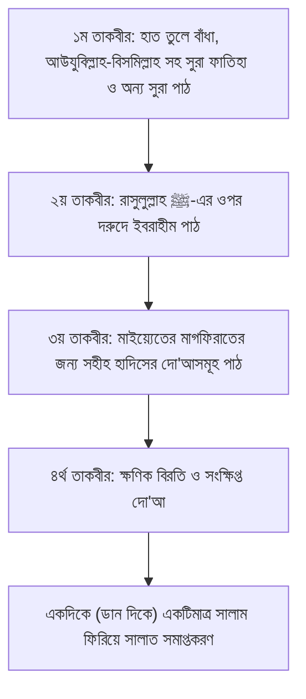
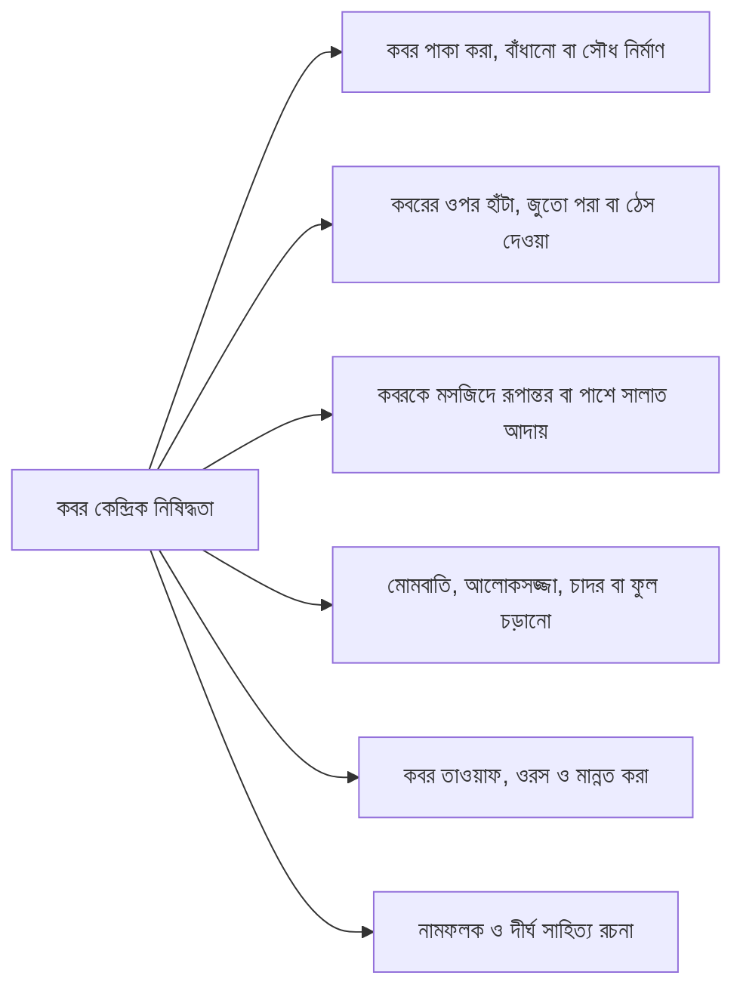

# অধ্যায় ০৮: জানাযার সালাত, দাফন ও কবর সংক্রান্ত বিধান

> **"জানাযার সালাত ও দাফন হলো মাইয়্যেতের জন্য অন্তিম দো‘আ ও সুন্নাহর আমানত; কবরকে শিরক, বিদ‘আত ও লৌকিক প্রদর্শনী থেকে মুক্ত রেখে বিশুদ্ধ পদ্ধতিতে সমাহিত করাই পরকালীন মুক্তির পথ।"**

---

## বক্তার পরিচিতি ও আলোচনার প্রেক্ষাপট

- **বক্তা:** প্রফেসর ড. আবু বকর মুহাম্মাদ যাকারিয়া (حفظه الله)
- **প্রেক্ষাপট:** জুমার খুতবা সিরিজ — _‘মৃত্যু’ (পর্ব-৫-এর শেষাংশ ও পর্ব-৬: জানাযা, দাফন ও কবর সংক্রান্ত মাসায়েল)_
- **মূল বিষয়বস্তু:** জানাযার সালাতের শারঈ হুকুম, ফযিলত ও সুন্নাহসম্মত ধারাবাহিক পদ্ধতি; খাটিয়া বহন ও কবর পর্যন্ত গমনের আদব; দাফন নিষিদ্ধ তিনটি সময়; লাহাদ ও শাক্বক্ব খনন; কবরে লাশ রাখার সুন্নাহ নীতিমালা; কবর বাঁধানো, সৌধ নির্মাণ, আলোকসজ্জা ও মাজার সংস্কৃতির অকাট্য খণ্ডন; কবর স্থানান্তর ও পুনর্খননের শারঈ সীমা এবং দাফন-পরবর্তী প্রচলিত সকল বিদ‘আতের প্রামাণিক নিরসন।

---

## ভূমিকা

মাইয়্যেতের গোসল ও কাফন সমাপ্তির পর সবচেয়ে গুরুত্বপূর্ণ দায়িত্ব হলো—তার মাগফিরাতের জন্য মুসলিম সমাজের পক্ষ থেকে সম্মিলিতভাবে মহান আল্লাহর দরবারে সুপারিশ পেশ করা, যার শরয়ী রূপ হলো ‘সালাতুল জানাযা’। জানাযার সালাত কোনো আনুষ্ঠানিক আনুষ্ঠানিকতা নয়, বরং এটি মৃত ভাই বা বোনের ক্ষমার জন্য একনিষ্ঠ মুনাজাত।

দুর্ভাগ্যবশত, বর্তমান সমাজে জানাযা ও দাফন প্রক্রিয়া চরম অজ্ঞতা, আঞ্চলিক কুসংস্কার এবং বিদ‘আতের অভয়ারণ্যে পরিণত হয়েছে। জানাযার সালাত শেষে বিদ‘আতী দ্বিতীয় মুনাজাত, বারবার মুখ খুলে দেখার বিশৃঙ্খলা, কবরে লাশ নামানোর সময় মনগড়া দো‘আ পাঠ, তথাকথিত তালক্বীনের নামে কবরবাসীকে উত্তর শিখিয়ে দেওয়ার ভিত্তিহীন প্রথা এবং কবরকে কেন্দ্র করে মাজারপূজা ও সৌধ নির্মাণের মতো ভয়াবহ শিরকি কার্যকলাপ আমাদের সমাজে শিকড় গেড়ে বসেছে। শায়খ ড. আবু বকর মুহাম্মাদ যাকারিয়া কুরআন ও সহীহ সুন্নাহর অকাট্য দলীলের ভিত্তিতে জানাযা, খাটিয়া বহন, দাফন ও কবরের প্রতিটি ধাপ সুবিন্যস্তভাবে স্পষ্ট করেছেন, যা প্রতিটি মুসলিমের জেনে রাখা অপরিহার্য।

---

## মূল আলোচনা

### ১. সালাতুল জানাযার শারঈ হুকুম ও ফযিলত

জানাযার সালাত আদায় করা জীবিত মুসলিমদের ওপর ‘ফরযে কিফায়াহ’। সমাজের একাংশ আদায় করলে সবাই দায়িত্বমুক্ত হবে, তবে কেউ আদায় না করলে এলাকার সকলেই গুনাহগার হবে।

#### ক. জানাযায় মুওয়াহহিদ (তাওহীদবাদী) মুসল্লির গুরুত্ব

জানাযার সালাতে মুসল্লির সংখ্যা বেশি হওয়া নিঃসন্দেহে মুস্তাহাব। তবে লোকসংখ্যার চেয়েও অধিক গুরুত্বপূর্ণ হলো মুসল্লিদের ঈমান ও তাওহীদের বিশুদ্ধতা। রাসুলুল্লাহ ﷺ ইরশাদ করেছেন:

> «مَا مِنْ رَجُلٍ مُسْلِمٍ يَمُوتُ، فَيَقُومُ عَلَى جَنَازَتِهِ أَرْبَعُونَ رَجُلًا، لَا يُشْرِكُونَ بِاللَّهِ شَيْئًا، إِلَّا شَفَّعَهُمُ اللَّهُ فِيهِ»  
> **অর্থ:** "কোনো মুসলিম ব্যক্তি মৃত্যুবরণ করলে তার জানাযায় যদি এমন চল্লিশজন লোক দাঁড়ায় যারা আল্লাহর সাথে কাউকে শরীক করে না (খাঁটি তাওহীদবাদী), তবে আল্লাহ তাদের সুপারিশ তার পক্ষে অবশ্যই কবুল করবেন।"  
> — [সহীহ মুসলিম, হাদিস: ৯৪৮](https://www.hadithbd.com/hadith/filter/?book=13&hadith=948)

শায়খ গুরুত্ব দিয়ে উল্লেখ করেন, এমন স্থানে জানাযার ব্যবস্থা করা বা ওসিয়ত করে যাওয়া উচিত যেখানে শিরক-মুক্ত সহীহ আক্বীদার লোকজনের উপস্থিতি বেশি থাকে। কারণ যারা নিজেরাই শিরকে লিপ্ত, তাদের সুপারিশ আল্লাহর দরবারে কবুল হয় না।

#### খ. জানাযার স্থান (খোলা ময়দান বনাম মসজিদ)

- সুন্নাহ হলো জানাযার সালাত মসজিদের বাইরে কোনো উন্মুক্ত ময়দানে বা নির্ধারিত জানাযাগাহে আদায় করা। রাসুলুল্লাহ ﷺ হাবশার বাদশাহ নাজাশীর গায়েবানা জানাযা এবং সাধারণ সাহাবীদের জানাযা মদিনার মসজিদের বাইরের খোলা ময়দানে আদায় করেছিলেন।
- তবে কোনো অসুবিধা বা বৃষ্টির কারণে মসজিদের ভেতরে জানাযা পড়াও সম্পূর্ণ জায়েজ। রাসুলুল্লাহ ﷺ সুহাইল ইবনে বায়দা (رضي الله عنه)-এর জানাযা মসজিদের ভেতরে পড়েছিলেন (সহীহ মুসলিম: ৯৭৩)।

---

### ২. সালাতুল জানাযার সুন্নাহসম্মত ধারাবাহিক পদ্ধতি (ধাপে ধাপে)

মাইয়্যেতকে কিবলা ও ইমামের মাঝখানে রাখতে হবে।

- **ইমামের দাঁড়ানোর অবস্থান:** পুরুষ মাইয়্যেতের ক্ষেত্রে ইমাম দাঁড়াবেন মাইয়্যেতের **মাথা বরাবর**; আর নারী মাইয়্যেতের ক্ষেত্রে ইমাম দাঁড়াবেন খাটিয়ার **কোমর বা মধ্যভাগ বরাবর** (সহীহ বুখারী: ১৩৩১, ১৩৩২)।

#### ১ম তাকবীর (তাকবীরে তাহরীমা ও ক্বিরাআত)

- ইমাম ও মুক্তাদি হাত কাঁধ বা কানের লতি পর্যন্ত উঠিয়ে 'আল্লাহু আকবার' বলবেন এবং ডান হাত বাম হাতের ওপর বুকে বাঁধবেন।
- **ছানা (সুবহানাকা) পড়ার বিধান:** জানাযার সালাতে ছানা পড়ার ব্যাপারে রাসুলুল্লাহ ﷺ থেকে কোনো সহীহ মারফু হাদিস বর্ণিত হয়নি। যদিও কতিপয় সাহাবী ও তাবেঈ থেকে বর্ণিত আছে, তবে রাসুলুল্লাহ ﷺ-এর আমলকে প্রাধান্য দিয়ে ছানা না পড়াই উত্তম।
- এরপর অনুচ্চস্বরে (মনে মনে) আউযুবিল্লাহ ও বিসমিল্লাহ পাঠ করে **সুরা আল-ফাতিহা** পাঠ করবেন।
- সুরা ফাতিহার সাথে অন্য কোনো সুরা বা কয়েকটি আয়াত মিলানো সুন্নাত।
  - তালহা ইবনে আব্দুল্লাহ ইবনে ‘আওফ বর্ণনা করেন:
    > «صَلَّيْتُ خَلْفَ ابْنِ عَبَّاسٍ رَضِيَ اللَّهُ عَنْهُمَا عَلَى جَنَازَةٍ فَقَرَأَ بِفَاتِحَةِ الكِتَابِ وَسُورَةٍ، وَجَهَرَ حَتَّى أَسْمَعَنَا، فَلَمَّا فَرَغَ أَخَذْتُ بِيَدِهِ فَسَأَلْتُهُ، فَقَالَ: لِتَعْلَمُوا أَنَّهَا سُنَّةٌ وَحَقٌّ»  
    > **অর্থ:** "আমি জানাযার সালাতে ইবনে আব্বাস (رضي الله عنهما)-এর পেছনে সালাত আদায় করলাম। তিনি সুরা আল-ফাতিহা ও অন্য একটি সুরা পাঠ করলেন এবং তা উচ্চৈঃস্বরে পড়লেন যাতে আমরা শুনতে পাই। সালাত শেষে আমি তাঁর হাত ধরে জিজ্ঞাসা করলাম। তিনি বললেন: 'আমি উচ্চৈঃস্বরে পড়েছি যাতে তোমরা জানতে পারো যে এটি সুন্নাত ও সত্য'।"  
    > — [সহীহ বুখারী, হাদিস: ১৩৩৫](https://www.hadithbd.com/hadith/filter/?book=12&hadith=1335)

#### ২য় তাকবীর (দরুদ পাঠ)

- দ্বিতীয়বার 'আল্লাহু আকবার' বলে রাসুলুল্লাহ ﷺ-এর ওপর দরুদ পাঠ করবেন। সাধারণ সালাতের শেষ বৈঠকে পঠিত **দরুদে ইবরাহীম**-ই পাঠ করতে হবে। কোনো বানোয়াট বা সমাজে প্রচলিত অতিরিক্ত শব্দযুক্ত দরুদ পড়া যাবে না।

#### ৩য় তাকবীর (মাইয়্যেতের জন্য দো‘আ)

- তৃতীয় তাকবীর দিয়ে অত্যন্ত ইখলাসের সাথে মাইয়্যেতের ক্ষমার জন্য দো‘আ করতে হবে। সহীহ হাদিসে বর্ণিত দো‘আসমূহ:

  > «اللَّهُمَّ اغْفِرْ لِحَيِّنَا وَمَيِّتِنَا، وَشَاهِدِنَا وَغَائِبِنَا، وَصَغِيرِنَا وَكَبِيرِنَا، وَذَكَرِنَا وَأُنْثَانَا، اللَّهُمَّ مَنْ أَحْيَيْتَهُ مِنَّا فَأَحْيِهِ عَلَى الإِسْلَامِ، وَمَنْ تَوَفَّيْتَهُ مِنَّا فَتَوَفَّهُ عَلَى الإِيمَانِ، اللَّهُمَّ لَا تَحْرِمْنَا أَجْرَهُ، وَلَا تُضِلَّنَا بَعْدَهُ»  
  > **অর্থ:** "হে আল্লাহ! আমাদের জীবিত ও মৃত, উপস্থিত ও অনুপস্থিত, ছোট ও বড়, পুরুষ ও নারী সকলকে ক্ষমা করে দিন। হে আল্লাহ! আমাদের মধ্য থেকে যাকে আপনি জীবিত রাখবেন তাকে ইসলামের ওপর জীবিত রাখুন এবং যাকে মৃত্যু দান করবেন তাকে ঈমানের সাথে মৃত্যু দান করুন। হে আল্লাহ! এর সওয়াব থেকে আমাদের বঞ্চিত করবেন না এবং এর পর আমাদের বিভ্রান্ত করবেন না।"  
  > — [সুনান আবু দাউদ, হাদিস: ৩২০১](https://www.hadithbd.com/hadith/filter/?book=14&hadith=3201); শায়খ আলবানী হাদিসটিকে সহীহ বলেছেন।

  আওফ ইবনে মালিক (رضي الله عنه) বর্ণিত রাসুলুল্লাহ ﷺ-এর আরেকটি জামে দো‘আ:

  > «اللَّهُمَّ اغْفِرْ لَهُ وَارْحَمْهُ، وَعَافِهِ وَاعْفُ عَنْهُ، وَأَكْرِمْ نُزُلَهُ، وَوَسِّعْ مُدْخَلَهُ، وَاغْسِلْهُ بِالْمَاءِ وَالثَّلْجِ وَالْبَرَدِ، وَنَقِّهِ مِنَ الْخَطَايَا كَمَا نَقَّيْتَ الثَّوْبَ الْأَبْيَضَ مِنَ الدَّنَسِ...»  
  > **অর্থ:** "হে আল্লাহ! তাকে ক্ষমা করুন, তার ওপর রহম করুন, তাকে নিরাপত্তা দিন ও তার ত্রুটি মার্জনা করুন। তার মেহমানদারি মর্যাদাপূর্ণ করুন, তার কবরকে প্রশস্ত করে দিন। তাকে পানি, বরফ ও শিলা দিয়ে ধুয়ে দিন এবং তাকে গুনাহ থেকে এমনভাবে পরিচ্ছন্ন করুন যেমন সাদা কাপড় ময়লা থেকে পরিচ্ছন্ন করা হয়..."  
  > — [সহীহ মুসলিম, হাদিস: ৯৬৩](https://www.hadithbd.com/hadith/filter/?book=13&hadith=963)

- **নাবালক শিশুর জানাযায় দো‘আ:** শিশু নিষ্পাপ হওয়ায় তার ক্ষেত্রে মাগফিরাতের পরিবর্তে পিতামাতার জন্য পরকালীন সম্পদ ও সুপারিশকারী হওয়ার দো‘আ করা সুন্নাত:
  > «اللَّهُمَّ اجْعَلْهُ لَنَا فَرَطًا، وَسَلَفًا، وَأَجْرًا»  
  > **অর্থ:** "হে আল্লাহ! এ শিশুকে আমাদের জন্য অগ্রগামী পাথেয়, পূর্বগামী সুপারিশকারী এবং মহা প্রতিদান হিসেবে কবুল করুন।"  
  > — [সহীহ বুখারী, কিতাবুল জানায়িয, পরিচ্ছেদ: ৬৫ (মু‘আল্লাক্ব)](https://www.hadithbd.com/hadith/filter/?book=12)

#### ৪র্থ তাকবীর ও সালাম ফিরানো

- চতুর্থ তাকবীর দেওয়ার পর কিছুক্ষণ নীরব থেকে সংক্ষিপ্ত দো‘আ করা রাসুলুল্লাহ ﷺ-এর সুন্নাহ। অনেকে তাকবীর দিয়েই তাড়াহুড়ো করে সালাম ফিরিয়ে দেন, যা অনুচিত।
- **সালাম ফিরানোর পদ্ধতি:** সহীহ সুন্নাহ মোতাবেক জানাযার সালাতে **ডান দিকে একটিমাত্র সালাম** («السَّلَامُ عَلَيْكُمْ وَرَحْمَةُ اللهِ») ফিরিয়ে সালাত সমাপ্ত করতে হবে।
  - আবু হুরায়রা (رضي الله عنه) বর্ণনা করেন:
    > «أَنَّ رَسُولَ اللَّهِ صَلَّى اللهُ عَلَيْهِ وَسَلَّمَ صَلَّى عَلَى جَنَازَةٍ، فَكَبَّرَ عَلَيْهَا أَرْبَعًا، وَسَلَّمَ تَسْلِيمَةً وَاحِدَةً»  
    > **অর্থ:** "রাসুলুল্লাহ ﷺ জানাযার সালাতে চারটি তাকবীর দিয়েছিলেন এবং একটিমাত্র সালাম ফিরিয়েছিলেন।"  
    > — মুস্তাদরাকে হাকিম: ১/৫১3, বায়হাক্বী: ৪/৪৩; শায়খ আলবানী হাদিসটিকে সহীহ বলেছেন (আহকামুল জানায়িয, পৃ. ১৬৩)।
  - শায়খ স্পষ্ট করেন, যদিও হানাফী, শাফেঈ ও মালেকী মাযহাবে দুই সালাম প্রচলিত এবং এর স্বপক্ষে কিছু দুর্বল বর্ণনা রয়েছে বিধায় দুই সালাম ফিরালেও সালাত বাতিল হবে না; তবে বিশুদ্ধতম সুন্নাহ হলো এক সালাম ফিরানো।

---

### ৩. জানাযা সংক্রান্ত কতিপয় বিশেষ মাসায়েল

1. **কাতার বিন্যাস:** জানাযার সালাতে তিনটি কাতার করা মুস্তাহাব। মুক্তাদি কম হলেও তিন কাতারে বিভক্ত হয়ে দাঁড়ানো উত্তম।
2. **একাধিক জানাযা একত্র হলে:** ইমামের সামনে প্রথমে প্রাপ্তবয়স্ক পুরুষদের খাটিয়া, এরপর বালকদের খাটিয়া এবং সবশেষে মহিলাদের খাটিয়া কিবলার দিকে সাজাতে হবে। একটিমাত্র সালাত আদায় করলেই সকলের জানাযা সম্পন্ন হবে।
3. **মাসবূকের বিধান (যার তাকবীর ছুটে গেছে):** জামা‘আতে দেরিতে এসে যে ব্যক্তি ইমামকে কোনো তাকবীরে পাবে, সে তাকবীর দিয়ে জামা‘আতে শামিল হবে। ইমামের সালাম ফিরানোর পর যদি খাটিয়া সঙ্গে সঙ্গে উঠিয়ে নেওয়া হয়, তবে দ্রুত কেবল অবশিষ্ট তাকবীরগুলো বলে সালাম ফিরাবে। আর যদি মাইয়্যেত কিছুক্ষণ উপস্থিত থাকে, তবে পঠিতব্য দো‘আসহ পূর্ণাঙ্গভাবে ছুটে যাওয়া তাকবীর আদায় করে সালাম ফিরাবে।
4. **পরবর্তী তাকবীরগুলোতে রফ‘উল ইয়াদাইন:** প্রথম তাকবীরে হাত তোলা সুন্নাত হওয়ার ব্যাপারে ইজমা রয়েছে। পরবর্তী তাকবীরগুলোতে হাত তোলা রাসুলুল্লাহ ﷺ থেকে মারফু সূত্রে প্রমাণিত না হলেও সাহাবায়ে কেরাম (যেমন ইবনে উমর রা.) থেকে প্রমাণিত। তাই কেউ হাত উঠালে তার বিরোধিতা করা যাবে না।
5. **আত্মহত্যাকারী, সরকারি সম্পদ আত্মসাৎকারী ও বিদ‘আতীর জানাযা:**
   - এদের জানাযা সাধারণ মুসলিমরা আদায় করে দাফন করবে।
   - তবে সমাজের শীর্ষস্থানীয় আলেম ও গণ্যমান্য ব্যক্তিবর্গ এদের জানাযা বর্জন করবেন, যাতে জীবিতরা এহেন মহাপাপ থেকে শিক্ষা গ্রহণ করে। রাসুলুল্লাহ ﷺ তীর বা ছুরি দিয়ে আত্মহত্যাকারীর জানাযা নিজে পড়েননি, কিন্তু সাহাবীদের পড়ার নির্দেশ দিয়েছিলেন (সহীহ মুসলিম: ৯৭৮)।
6. **বেনামাযীর জানাযা:** যে ব্যক্তি সালাত আদায় করত না এবং বেনামাযী অবস্থায় মারা গেছে, তার ওপর জানাযা পড়া সম্পূর্ণ নাজায়েজ। কারণ সালাত পরিত্যাগকারী কাফেরদের অন্তর্ভুক্ত।
7. **গায়েবানা জানাযার শারঈ সীমারেখা:** গায়েবানা জানাযা ঢালাওভাবে প্রতিটি মৃত্যুর ক্ষেত্রে পড়া বিদ‘আত। এটি কেবল সেই মুসলিমের ক্ষেত্রে প্রযোজ্য যিনি এমন স্থানে বা অবস্থায় মৃত্যুবরণ করেছেন যেখানে তার ওপর কোনো জানাযার সালাত আদায় করার মতো কোনো মুসলিম ছিল না (যেমন কাফের দেশে গোপন মুসলিম, সাগরে সলিলসমাধি বা বিমানে ভস্মীভূত হওয়া)। বাদশাহ নাজাশীর ক্ষেত্রে রাসুলুল্লাহ ﷺ এ কারণেই গায়েবানা জানাযা পড়েছিলেন, কারণ হাবশায় তার জানাযা পড়ার মতো কোনো মুমিন ছিল না।

---

### ৪. খাটিয়া বহন ও কবর পর্যন্ত গমনের আদব

#### ক. জানাযার অনুগমনে দুই ক্বীরাত সওয়াব

রাসুলুল্লাহ ﷺ ইরশাদ করেছেন:

> «مَنِ اتَّبَعَ جَنَازَةَ مُسْلِمٍ، إِيمَانًا وَاحْتِسَابًا، وَكَانَ مَعَهُ حَتَّى يُصَلَّى عَلَيْهَا وَيُفْرَغَ مِنْ دَفْنِهَا، فَإِنَّه يَرْجِعُ مِنَ الأَجْرِ بِقِيرَاطَيْنِ، كُلُّ قِيرَاطٍ مِثْلُ أُحُدٍ، وَمَنْ صَلَّى عَلَيْهَا ثُمَّ رَجَعَ قَبْلَ أَنْ تُدْفَنَ، فَإِنَّهُ يَرْجِعُ بِقِيرَاطٍ»  
> **অর্থ:** "যে ব্যক্তি কোনো মুসলিমের জানাযায় ঈমান ও সাওয়াবের আশায় শামিল হয় এবং সালাত আদায় ও দাফন সম্পন্ন হওয়া পর্যন্ত তার সাথে থাকে, সে দুই ক্বীরাত সওয়াব নিয়ে ফিরবে; যার প্রতিটি ক্বীরাত ওহুদ পাহাড়ের সমতুল্য। আর যে ব্যক্তি কেবল জানাযা পড়ে দাফনের পূর্বে ফিরে আসে, সে এক ক্বীরাত সওয়াব পাবে।"  
> — [সহীহ বুখারী, হাদিস: ৪৭](https://www.hadithbd.com/hadith/filter/?book=12&hadith=47); [সহীহ মুসলিম, হাদিস: ৯৪৫](https://www.hadithbd.com/hadith/filter/?book=13&hadith=945)

#### খ. জানাযা দেখে দাঁড়িয়ে যাওয়া

কোনো জানাযা নিয়ে যেতে দেখলে বসা থাকলে উঠে দাঁড়ানো সুন্নাত—এমনকি তা অমুসলিমের লাশ হলেও।

- জাবির ইবনে আব্দুল্লাহ (رضي الله عنهما) বর্ণনা করেন:
  > «مَرَّتْ بِنَا جَنَازَةٌ فَقَامَ لَهَا النَّبِيُّ صَلَّى اللهُ عَلَيْهِ وَسَلَّمَ وَقُمْنَا، فَقُلْنَا: يَا رَسُولَ اللَّهِ، إِنَّهَا جَنَازَةُ يَهُودِيٍّ! قَالَ: إِذَا رَأَيْتُمُ الجَنَازَةَ، فَقُومُوا - وفي رواية: أَلَيْسَتْ نَفْسًا؟»  
  > **অর্থ:** "আমাদের সামনে দিয়ে একটি জানাযা অতিক্রম করছিল, তা দেখে নবী ﷺ দাঁড়িয়ে গেলেন এবং আমরাও দাঁড়ালাম। আমরা বললাম: 'হে আল্লাহর রাসুল! এ তো এক ইহুদির লাশ!' তিনি বললেন: 'যখনই তোমরা জানাযা দেখবে দাঁড়িয়ে যাবে।' অন্য বর্ণনায় রয়েছে: 'সে কি একজন মানুষ নয়?'"  
  > — [সহীহ বুখারী, হাদিস: ১৩১১, ১৩১২](https://www.hadithbd.com/hadith/filter/?book=12&hadith=1311); [সহীহ মুসলিম, হাদিস: ৯৬১](https://www.hadithbd.com/hadith/filter/?book=13&hadith=961)

#### গ. খাটিয়ার পেছনে গমনের সুন্নাহ শিষ্টাচার

1. **হেঁটে চলা উত্তম:** খাটিয়ার সাথে হেঁটে চলা সুন্নাত। পদব্রজীরা খাটিয়ার সামনে-পেছনে ডানে-বামে চলতে পারবে, তবে আরোহীরা পেছনে থাকবে। কবর কাছে হলে কোনো কারণে গাড়িতে না নিয়ে কাঁধে বহন করাই সুন্নাত।
2. **সম্পূর্ণ নীরবতা:** খাটিয়ার সাথে চলার সময় সম্পূর্ণ নীরবতা অবলম্বন করতে হবে। সাহাবায়ে কেরাম এমন নীরব থাকতেন যেন তাদের মাথার ওপর পাখি বসেছে।
3. **চিৎকার ও শব্দ বর্জন:** সমাজে প্রচলিত খাটিয়ার পেছনে উচ্চৈঃস্বরে 'কালিমা শাহাদাত', 'লা ইলাহা ইল্লাল্লাহ' বা তাকবীর দেওয়া স্পষ্ট বিদ‘আত। খাটিয়ার সাথে কোনো আগুন, মোমবাতি বা আলো বহন করাও নিষিদ্ধ।
4. **নারীদের কবরস্থানে গমন নিষেধ:** নারীদের জানাযার পেছনে পেছনে কবরস্থান পর্যন্ত গমন রাসুলুল্লাহ ﷺ কঠোরভাবে নিষেধ করেছেন। তবে মসজিদে উপস্থিত থাকা অবস্থায় জানাযার সালাতে নারীরা শামিল হতে পারবেন।

---

### ৫. দাফন নিষিদ্ধ তিনটি সময়

উক্ববা ইবনে ‘আমের আল-জুহানী (رضي الله عنه) বর্ণনা করেন:

> «ثَلَاثُ سَاعَاتٍ كَانَ رَسُولُ اللَّهِ صَلَّى اللهُ عَلَيْهِ وَسَلَّمَ يَنْهَانَا أَنْ نُصَلِّيَ فِيهِنَّ، أَوْ أَنْ نَقْبُرَ فِيهِنَّ مَوْتَانَا: حِينَ تَطْلُعُ الشَّمْسُ بَازِغَةً حَتَّى تَرْتَفِعَ، وَحِينَ يَقُومُ قَائِمُ الظَّهِيرَةِ حَتَّى تَمِيلَ الشَّمْسُ، وَحِينَ تَضَيَّفُ الشَّمْسُ لِلْغُرُوبِ حَتَّى تَغْرُبَ»  
> **অর্থ:** "তিনটি এমন সময় রয়েছে যেগুলোতে রাসুলুল্লাহ ﷺ আমাদের সালাত আদায় করতে অথবা আমাদের মৃতদের দাফন করতে নিষেধ করতেন:  
> ১. সূর্য উদিত হওয়ার সময় থেকে তা পূর্ণরূপে ওপরে ওঠা পর্যন্ত (ইশরাক্ব পর্যন্ত);  
> ২. ঠিক দ্বিপ্রহরের সময় যতক্ষণ না সূর্য পশ্চিমাকাশে ঢলে পড়ে; এবং  
> ৩. সূর্য অস্তমিত হওয়ার উপক্রম থেকে সম্পূর্ণ ডুবে যাওয়া পর্যন্ত।"  
> — [সহীহ মুসলিম, হাদিস: ৮৩৭](https://www.hadithbd.com/hadith/filter/?book=13&hadith=837)

অতএব, এ তিনটি নির্দিষ্ট ক্ষণ ব্যতীত দিনে বা রাতে যেকোনো সময় মাইয়্যেতকে দাফন করা জায়েজ।

---

### ৬. কবর খনন ও দাফনের সুন্নাহ পদ্ধতি

#### ক. লাহাদ (اللَّحْد) বনাম শাক্বক্ব (الشَّقّ)

- **লাহাদ (বগলী কবর):** কবর বুক সমান সোজা খনন করে নিচের অংশে পশ্চিম (কিবলার) দিকে একটি কুঠুরি বা খাঁজ কাটা। এটি সুন্নাহ ও সর্বাধিক উত্তম পদ্ধতি। সাদ ইবনে আবি ওয়াক্কাস (رضي الله عنه) মৃত্যুর পূর্বে বলেছিলেন:
  > «الْحَدُوا لِي لَحْدًا، وَانْصِبُوا عَلَيَّ اللَّبِنَ نَصْبًا، كَمَا صُنِعَ بِرَسُولِ اللَّهِ صَلَّى اللهُ عَلَيْهِ وَسَلَّمَ»  
  > **অর্থ:** "তোমরা আমার জন্য লাহাদ (বগলী) কবর খনন করো এবং আমার ওপর কাঁচা ইট খাড়া করে দিও, যেমনিভাবে রাসুলুল্লাহ ﷺ-এর ক্ষেত্রে করা হয়েছিল।"  
  > — [সহীহ মুসলিম, হাদিস: ৯৬৬](https://www.hadithbd.com/hadith/filter/?book=13&hadith=966)
- **শাক্বক্ব (সিন্দুকি কবর):** নরম মাটির কারণে যদি লাহাদ ভেঙে পড়ার আশঙ্কা থাকে, তবে সোজা সিন্দুকের মতো গভীর গর্ত করে মাঝখানে লাশ রেখে ওপর দিয়ে আচ্ছাদন দেওয়াও শরীয়তসম্মত।

#### খ. কবরে নামানো ও শায়িত করার নিয়ম

1. কেবলমাত্র পুরুষরাই মাইয়্যেতকে কবরে নামাবে (নারীর ক্ষেত্রেও তার নিকটতম পুরুষ মাহরাম বা অভিভাবক নামাবে)।
2. মাইয়্যেতকে কবরের পায়ের দিক থেকে প্রবেশ করানো সুন্নাত।
3. কবরে লাশ রাখার সময় পাঠ করবে:
   > «بِسْمِ اللَّهِ، وَعَلَى سُنَّةِ رَسُولِ اللَّهِ» (وفي رواية: «وَعَلَى مِلَّةِ رَسُولِ اللَّهِ»)  
   > **অর্থ:** "আল্লাহর নামে এবং রাসুলুল্লাহ ﷺ-এর সুন্নাহ (বা আদর্শ ও দ্বীনের) ওপর (শায়িত করছি)।"  
   > — [সুনান আবু দাউদ, হাদিস: ৩২১২, ৩২-১৩](https://www.hadithbd.com/hadith/filter/?book=14&hadith=3213); শায়খ আলবানী হাদিসটিকে সহীহ বলেছেন।
4. মাইয়্যেতকে ডান কাতে কিবলামুখী করে শোয়াতে হবে। কেবল মুখ নয়, বরং পুরো শরীরকেই কিবলামুখী করে হেলে রাখা সুন্নাত (ঘুমানোর সুন্নাহ পদ্ধতির ন্যায়)।
5. কাফনের চাদরে দেওয়া বাঁধনগুলো কবরে শায়িত করার পর খুলে দিতে হবে।
6. এরপর কাঁচা ইট বা বাঁশের টুকরো দিয়ে কুঠুরি বন্ধ করে মাটি দেওয়া হবে।
7. **নির্দিষ্ট দো‘আ পড়ে তিন মুঠ মাটি দেওয়ার খণ্ডন:** সমাজে প্রচলিত প্রথম মুঠে 'মিনহা খালাক্বনাকুম', দ্বিতীয় মুঠে 'ওয়া ফীহা নু‘ঈদুকুম' এবং তৃতীয় মুঠে 'ওয়া মিনহা নুখরিজুকুম' পড়ার হাদিসটি মুহাদ্দিসগণের সর্বসম্মতিক্রমে অত্যন্ত দুর্বল ও অপ্রমাণিত। অতএব, মনে মনে বিসমিল্লাহ বলে সাধারণভাবেই মাটি ফেলতে হবে।
8. **কবরের উচ্চতা:** কবরকে মাটি থেকে কেবল **এক বিঘত (প্রায় ৪-৯ ইঞ্চি) পরিমাণ উঁচু** করা সুন্নাত এবং উটের পিঠের মতো সামান্য উত্তল (কোঁজাকৃতির) রাখা উত্তম, যাতে এটি কবর হিসেবে চিহ্নিত থাকে। এর অতিরিক্ত মাটি দিয়ে স্তূপ করা শরীয়তে নিষিদ্ধ।

---

### ৭. কবর সংক্রান্ত শরয়ী নিষিদ্ধতা ও শিরক-বিদ‘আতের খণ্ডন

কবরস্থান হলো আখেরাতের স্মারক স্থান; একে কেন্দ্র করে কোনো প্রকার বাড়াবাড়ি (غلو) বা ছাড়াছাড়ি (تفريط) কোনোটাই ইসলাম অনুমোদন করে না।

#### ক. কবর বাঁধানো ও সৌধ নির্মাণ কঠোরভাবে হারাম

রাসুলুল্লাহ ﷺ কবর পাকা করা ও তার ওপর কোনো স্থাপনা নির্মাণ করতে কঠোরভাবে নিষেধ করেছেন:

> «نَهَى رَسُولُ اللَّهِ صَلَّى اللهُ عَلَيْهِ وَسَلَّمَ أَنْ يُجَصَّصَ القَبْرُ، وَأَنْ يُقْعَدَ عَلَيْهِ، وَأَنْ يُبْنَى عَلَيْهِ»  
> **অর্থ:** "রাসুলুল্লাহ ﷺ কবর চুনকাম (পাকা) করতে, তার ওপর বসতে এবং তার ওপর কোনো ইমারত (সৌধ বা গম্বুজ) নির্মাণ করতে নিষেধ করেছেন।"  
> — [সহীহ মুসলিম, হাদিস: ৯৭০](https://www.hadithbd.com/hadith/filter/?book=13&hadith=970)

আলী ইবনে আবি তালিব (رضي الله عنه) আবুল হাইয়্যাজ আল-আসাদীকে বলেছিলেন:

> «أَلَا أَبْعَثُكَ عَلَى مَا بَعَثَنِي عَلَيْهِ رَسُولُ اللَّهِ صَلَّى اللهُ عَلَيْهِ وَسَلَّمَ؟ أَنْ لَا تَدَعَ تِمْثَالًا إِلَّا طَمَسْتَهُ، وَلَا قَبْرًا مُشْرِفًا إِلَّا سَوَّيْتَهُ»  
> **অর্থ:** "আমি কি তোমাকে এমন এক মিশনে পাঠাব না যে মিশনে রাসুলুল্লাহ ﷺ আমাকে পাঠিয়েছিলেন? তা হলো—কোনো প্রতিকৃতি (মূর্তি/ছবি) দেখলে তা নিশ্চিহ্ন করবে এবং কোনো উঁচু কবর দেখলে তা মাটির সমান (এক বিঘতের সুন্নাহ মাপে) করে দেবে।"  
> — [সহীহ মুসলিম, হাদিস: ৯৬৯](https://www.hadithbd.com/hadith/filter/?book=13&hadith=969)

#### খ. জীবিতাবস্থায় নিজের কবর খুঁড়ে রাখা ও কবরে শোয়ার বিদ‘আত

অনেক লোক মৃত্যুর আগেই নিজের জন্য পাকা কবর বানিয়ে রাখে বা কবরের ভেতর শুয়ে জিকির-আযকার করে। এটি দ্বীনের মধ্যে নতুন আবিষ্কৃত নিকৃষ্ট বিদ‘আত। রাসুলুল্লাহ ﷺ বা সাহাবায়ে কেরাম কখনো এ জাতীয় কাজ করেননি।

#### গ. খাটিয়া বা বাক্সসহ কবরে দাফন

মাইয়্যেতকে কাঠের বাক্স বা কফিনসহ কবরে রাখা কাফেরদের প্রথা। শরীর পুড়ে বা গলে না গেলে সাধারণ অবস্থায় কফিনসহ দাফন করা নাজায়েজ।

#### ঘ. কবরের ওপর জুতা পায়ে চলা ও বসা

কবরের ওপর জুতা পায়ে হাঁটা, লাথি দেওয়া বা ঠেস দিয়ে বসা হারাম। রাসুলুল্লাহ ﷺ কবরের ওপর বসা সম্পর্কে বলেছেন, কবরের ওপর বসার চেয়ে আগুনের অঙ্গারের ওপর বসে কাপড় পুড়ে চামড়ায় আগুন লাগা উত্তম (সহীহ মুসলিম: ৯৭১)।

#### ঙ. কবরকে কেন্দ্র করে মাজারপূজা ও শিরকি রসম

1. **কবরে সালাত আদায় ও মসজিদ নির্মাণ:** কবরের পাশে বা কবরকে সামনে রেখে সালাত আদায় করা হারাম। আল্লাহ তা‘আলা আসহাবে কাহাফের ঘটনায় যারা কবরের ওপর মসজিদ নির্মাণ করেছিল তাদের 'বাড়াবাড়িকারী সম্প্রদায়' হিসেবে আখ্যায়িত করেছেন। রাসুলুল্লাহ ﷺ দো‘আ করেছিলেন:
   > «اللَّهُمَّ لَا تَجْعَلْ قَبْرِي وَثَنًا يُعْبَدُ»  
   > **অর্থ:** "হে আল্লাহ! আমার কবরকে এমন প্রতিমা বানাবেন না যার পূজা করা হয়।"  
   > — [মুয়াত্তা মালিক, হাদিস: ৪১৪](https://www.hadithbd.com/hadith/filter/?book=24); শায়খ আলবানী হাদিসটিকে সহীহ বলেছেন।
2. **আলোকসজ্জা, মোমবাতি, চাদর ও ফুল:** কবরে মোমবাতি জ্বালানো, বৈদ্যুতিক লাইটিং করা, গিলাফ বা চাদর চড়ানো এবং ফুল দেওয়া সম্পূর্ণ হারাম ও বিজাতীয় সংস্কৃতি।
3. **কবর তাওয়াফ ও ওরস:** বায়তুল্লাহ ব্যতীত পৃথিবীর কোনো কবর তাওয়াফ করা প্রকাশ্য শিরক। কবরে মৃত ওলীর সন্তুষ্টির উদ্দেশ্যে মান্নত করা, ওরস, বৈসাল বা তথাকথিত খুশরোজের নামে সম্মেলন করা সুস্পষ্ট জাহেলিয়াত ও বিদ‘আত।
4. **নামফলক লেখা:** কবরের ওপর দীর্ঘ কবিতা বা সাহিত্য লেখা সুন্নাহ পরিপন্থী। তবে কবর চেনার জন্য মাথার কাছে কেবল একটি সাধারণ পাথর রেখে দেওয়া সুন্নাত।

---

### ৮. কবর স্থানান্তর ও পুনর্খননের শারঈ নীতিমালা

কোনো মুসলিমের কবর একান্ত শারঈ ওযর ব্যতীত স্থানান্তর করা হারাম। তবে নিম্নোক্ত বিশেষ অবস্থায় কবর স্থানান্তর বা পুনর্খনন জায়েজ:

1. **প্রাকৃতিক দুর্যোগ ও ক্ষয়ক্ষতি:** কবর যদি পানিতে ডুবে যায়, নদীভাঙন বা বন্যার কবলে পড়ে লাশ ভেসে যাওয়ার ঝুঁকি থাকে, তবে দেহাবশেষ তুলে নিরাপদ উঁচু স্থানে স্থানান্তর করা যাবে।
2. **জনকল্যাণমূলক বাধ্যবাধকতা:** বৃহত্তর জনকল্যাণে যদি কোনো অপরিহার্য রাস্তা বা স্থাপনার আওতায় কবর পড়ে যায়, তবে রাষ্ট্রীয় ব্যবস্থাপনায় তা অন্য মুসলিম কবরস্থানে সম্মানের সাথে সরিয়ে নিতে হবে।
3. **কাফেরদের দেশে অবমাননার আশঙ্কা:** অমুসলিম দেশে মুসলিমের কবর অবমাননা বা ধ্বংসের ঝুঁকি থাকলে তা মুসলিম দেশে স্থানান্তর করা জায়েজ।
4. **বিনা গোসলে বা কাফনে দাফন করা হলে:** যদি ভুলবশত কাউকে গোসল না দিয়ে দাফন করা হয়, তবে দেহ নষ্ট হওয়ার পূর্বেই কবর খুলে তাকে বের করে শরয়ী গোসল ও কাফন দিয়ে পুনরায় দাফন করতে হবে।
5. **অন্যের জবরদখলকৃত জমিতে দাফন:** অন্যের জমিতে জবরদখল করে দাফন করা হলে মালিকের দাবির প্রেক্ষিতে লাশ সরিয়ে নেওয়া ওয়াজিব; কারণ অন্যের হক আত্মসাৎ করে পরকালীন মুক্তি সম্ভব নয়।

---

### ৯. দাফন-পরবর্তী সুন্নাহ বনাম বিদ‘আতী কার্যকলাপ

#### ক. সহীহ সুন্নাহ: কবরের পাশে দাঁড়িয়ে ক্ষমার ব্যক্তিগত দো‘আ

দাফন সম্পন্ন হওয়ার পর কবরের পাশে কিছুক্ষণ অবস্থান করা এবং মাইয়্যেতের অবিচলতার জন্য মনে মনে আল্লাহর দরবারে দো‘আ করা সুন্নাত। উসমান ইবনে আফ্ফান (رضي الله عنه) বর্ণনা করেন:

> «كَانَ النَّبِيُّ صَلَّى اللهُ عَلَيْهِ وَسَلَّمَ إِذَا فَرَغَ مِنْ دَفْنِ المَيِّتِ وَقَفَ عَلَيْهِ، فَقَالَ: اسْتَغْفِرُوا لِأَخِيكُمْ، وَسَلُوا لَهُ بِالتَّثْبِيتِ، فَإِنَّهُ الْآنَ يُسْأَلُ»  
> **অর্থ:** "নবী ﷺ যখন মাইয়্যেতের দাফন সম্পন্ন করতেন, তখন কবরের পাশে দাঁড়াতেন এবং বলতেন: 'তোমাদের এই ভাইয়ের জন্য আল্লাহর কাছে ক্ষমা প্রার্থনা করো এবং সে যেন অবিচল থাকে তার জন্য দো‘আ করো; কেননা এখনই তাকে (কবরে) সওয়াল-জওয়াব করা হচ্ছে'।"  
> — [সুনান আবু দাউদ, হাদিস: ৩২২১](https://www.hadithbd.com/hadith/filter/?book=14&hadith=3221); শায়খ আলবানী হাদিসটিকে সহীহ বলেছেন।

এ সময় মুসল্লিগণ প্রত্যেকে নিঃশব্দে ব্যক্তিগতভাবে দো‘আ করবে: "হে আল্লাহ! আপনি তাকে ক্ষমা করে দিন এবং প্রশ্নের সঠিক উত্তরের ওপর অবিচল রাখুন।"

#### খ. বর্জনীয় বিদ‘আতসমূহ

1. **দাফন শেষে সম্মিলিত হাত তুলে মোনাজাত:** রাসুলুল্লাহ ﷺ বা সাহাবায়ে কেরাম কখনো দাফন শেষে হাত তুলে সম্মিলিত মোনাজাত করেননি। এটি পরবর্তী যুগের বানোয়াট প্রথা।
2. **কবরের পাশে দাঁড়িয়ে 'তালক্বীন' পাঠ:** তথাকথিত "হে অমুকের পুত্র অমুক! মনে রেখো তোমার রব আল্লাহ, তোমার দ্বীন ইসলাম..." বলে কবরের পাশে দাঁড়িয়ে উত্তর শিখিয়ে দেওয়ার হাদিসটি মুহাদ্দিসগণের সর্বসম্মতিক্রমে চরম দুর্বল ও মওযু (জাল)। মৃত্যুর পর মৃত ব্যক্তি জীবিতদের এই তালক্বীন দ্বারা কোনো উপকৃত হতে পারে না; বরং কবরে ঈমানের ওপর অবিচলতা সম্পূর্ণ তার দুনিয়ার আমলের ওপর নির্ভরশীল।
3. **কবরে আজান দেওয়া:** মাইয়্যেতকে কবরে নামানোর সময় চার কোণায় বা কবরের পাশে দাঁড়িয়ে আজান দেওয়া সুস্পষ্ট বিদ‘আত। শরীয়তে এর কোনো দলীল নেই।
4. **জানাযার পর লাশ খুলে মুখ প্রদর্শনী:** জানাযার সালাতের পর বারবার কাফন খুলে জনগণকে মুখ দেখানোর হিড়িক সুন্নাহ পরিপন্থী এবং মাইয়্যেতকে কষ্ট দেওয়ার শামিল। আত্মীয়দের দেখতে হলে তা গোসল ও কাফনের পূর্বে বা ঘরেই দেখা শেষ করতে হবে।

---

## ভুল ধারণা ও তার নিরসন

| প্রচলিত ভুল ধারণা                                                                                     | সহীহ সুন্নাহসম্মত বাস্তবতা                                                                                                                                             |
| :---------------------------------------------------------------------------------------------------- | :--------------------------------------------------------------------------------------------------------------------------------------------------------------------- |
| **১. জানাযার সালাত শেষে ইমামের নেতৃত্বে সম্মিলিত হাত তুলে মুনাজাত করা বাধ্যতামূলক।**                  | **সম্পূর্ণ বিদ‘আত।** জানাযার সালাত নিজেই একটি স্বয়ংসম্পূর্ণ দোয়া ও মুনাজাত। সালাতের পর দ্বিতীয় দফা সম্মিলিত দোয়ার কোনো প্রমাণ রাসুলুল্লাহ ﷺ বা সাহাবীদের যুগে নেই। |
| **২. কবরে মাটি দেওয়ার সময় তিন মুঠোয় তিনটি নির্দিষ্ট আয়াত পড়া সুন্নাত।**                          | **অপ্রমাণিত ও দুর্বল।** এ সংক্রান্ত হাদিস অত্যন্ত দুর্বল। বিসমিল্লাহ বলে সাধারণভাবে মাটি দেওয়াই সুন্নাত।                                                              |
| **৩. মৃত ব্যক্তি যাতে সওয়াল-জওয়াবে না ঘাবড়ায়, সেজন্য কবরের পাশে মৌলভী দাঁড়িয়ে তালক্বীন পড়বে।** | **বিদ‘আত।** তালক্বীনের বর্ণিত হাদিস জাল। রাসুলুল্লাহ ﷺ-এর নির্দেশ হলো কবরের পাশে দাঁড়িয়ে তার জন্য ক্ষমা ও সাবেত কদমের ব্যক্তিগত দোয়া করা।                           |
| **৪. কবরে লাশ নামানোর সময় চার কোণায় আজান দিতে হবে।**                                                | **ভিত্তিহীন বিদ‘আত।** ইসলামে কবরে আজান দেওয়ার কোনো বিধান নেই।                                                                                                         |
| **৫. বুজুর্গ বা মা-বাবার কবর বাঁধানো ও গম্বুজ নির্মাণ সম্মান প্রদর্শনের অংশ।**                        | **কঠোরভাবে হারাম।** সহীহ মুসলিমের ৯৭০ ও ৯৬৯ নং হাদিস অনুযায়ী রাসুলুল্লাহ ﷺ কবর পাকা করা ও উঁচু সৌধ নির্মাণ কঠোরভাবে নিষিদ্ধ করেছেন।                                   |
| **৬. একই ব্যক্তির একাধিক স্থানে একাধিকবার জানাযা পড়া বিরাট পুণ্যের কাজ।**                            | **বিদ‘আত।** এক ব্যক্তির জন্য একবারই জানাযা সুন্নাত। লাশ নিয়ে টানাটানি করে বিভিন্ন স্থানে বারবার জানাযা দেওয়া সুন্নাহর পরিপন্থী।                                      |

---

## মূল শিক্ষা সংক্ষেপে

1. **ইখলাস ও তাওহীদ:** জানাযার সুপারিশ কবুল হওয়ার পূর্বশর্ত হলো উপস্থিত মুসল্লিদের খাঁটি তাওহীদবাদী হওয়া।
2. **এক সালামে জানাযা সমাপ্তি:** বিশুদ্ধ হাদিস অনুসারে জানাযার সালাতে ডান দিকে একটিমাত্র সালাম ফিরানোই অগ্রাধিকারযোগ্য সুন্নাত।
3. **কবরের সম্মান ও সাদাসিধা রূপ:** কবরকে বাঁধানো বা পাকা না করে এক বিঘত পরিমাণ উঁচু রাখা এবং কোনো প্রকার মাজার সংস্কৃতিতে জড়িয়ে না পড়া।
4. **দাফন-পরবর্তী অবিচলতা:** কবরের পাশে দাঁড়িয়ে মৃত ভাইয়ের জন্য মাগফিরাত ও সাওয়াল-জওয়াবের অবিচলতার ব্যক্তিগত দো‘আই রাসুলুল্লাহ ﷺ-এর নির্দেশিত পদ্ধতি।

---

## আমল ও করণীয়

- [ ] জানাযার সালাতের ধারাবাহিক তাকবীর, ক্বিরাআত ও সহীহ দো‘আসমূহ মুখস্থ করা ও অর্থ অনুধাবন করা।
- [ ] জানাযার সালাত শেষে বিদ‘আতী দ্বিতীয় মুনাজাত বর্জন করে সরাসরি দাফনের প্রস্তুতি নেওয়া।
- [ ] খাটিয়ার পেছনে চলার সময় অযথা কথা, শ্লোগান বা সমস্বরে জিকির না করে সম্পূর্ণ নীরবতা রক্ষা করে আখেরাতকে স্মরণ করা।
- [ ] নিজের আত্মীয়-স্বজনের কবর পাকা করা থেকে বিরত থাকা এবং পূর্বে পাকা করা থাকলে তা সুন্নাহর আলোকে সংশোধন করা।
- [ ] দাফন সম্পন্ন হওয়ার পর কিছুক্ষণ কবরের পাশে দাঁড়িয়ে মাইয়্যেতের অবিচলতা ও ক্ষমার জন্য একান্তে কাতর হয়ে দো‘আ করা।

---

## শব্দার্থ ও পরিভাষা

- **লাহাদ (اللَّحْد):** বগলী কবর; কবরের তলদেশে পশ্চিম (কিবলার) পাশের দেয়ালে প্রকোষ্ঠ তৈরি করে লাশ শায়িত করার খাঁজ।
- **শাক্বক্ব (الشَّقّ):** সিন্দুকি কবর; সোজা গর্ত করে তলদেশের ঠিক মাঝখানে লাশ রেখে ওপর দিয়ে আচ্ছাদন দেওয়া।
- **ক্বীরাত (قِيرَاط):** পারলৌকিক মহা প্রতিদানের শারঈ পরিমাপ, যার এক একটির ওজন ওহুদ পাহাড়ের সমান।
- **তালক্বীন (تَلْقِين):** মৃত্যুপথযাত্রীকে জীবদ্দশায় লা ইলাহা ইল্লাল্লাহ মনে করিয়ে দেওয়া সুন্নাত; কিন্তু মৃত্যুর পর কবরের পাশে দাঁড়িয়ে উত্তর শিখিয়ে দেওয়া বিদ‘আত।
- **মাসবূক্ব (مَسْبُوق):** জামা‘আতের সালাতে যে ব্যক্তি ইমামের সাথে প্রথম থেকে শামিল হতে পারেনি, বরং কিছু অংশ অতিবাহিত হওয়ার পর যোগ দিয়েছে।

---

## শায়খের পর্যালোচনার জন্য বিশেষ নোট

1. **এক সালামের ফতোয়া:** শায়খ খুতবায় উল্লেখ করেছেন যে, তিনি মসজিদে জানাযার সালাতে এক সালাম ফিরানোর পর অনেকে বিতর্ক তৈরি করেছিল। কিন্তু শায়খ স্পষ্ট করেছেন যে, এক সালামই শক্তিশালী সহীহ সনদে সাব্যস্ত এবং দুই সালামের হাদিস সনদের দিক থেকে দুর্বল। অধ্যায়ে শায়খের এই অবস্থানকে মুহাদ্দিসগণের তাহক্বীক্বসহ সযত্নে সংরক্ষণ করা হয়েছে।
2. **দায়িত্বশীল আলেমদের জানাযা বর্জন:** আত্মহত্যাকারী বা সরকারি সম্পদ আত্মসাৎকারীর ক্ষেত্রে শায়খ নির্দেশ দিয়েছেন যে, সাধারণ মানুষ জানাযা পড়লেও সমাজের বড় আলেম বা ইমামরা তাদের জানাযায় যাবেন না। এটি অত্যন্ত সময়োপযোগী শারঈ প্রতিরোধমূলক দিকনির্দেশনা হিসেবে অধ্যায়ে তুলে ধরা হয়েছে।
3. **কবর স্থানান্তর ও জনস্বার্থ:** জনকল্যাণে রাস্তা বা অন্যান্য কারণে কবর স্থানান্তরের শারঈ যৌক্তিকতা ও শর্তাবলী শায়খের বক্তব্য অনুযায়ী সুবিন্যস্ত করা হয়েছে।
