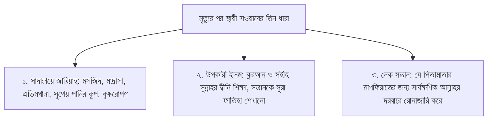

# অধ্যায় ১০: মৃত্যুর সার্বিক প্রস্তুতি, আত্মশুদ্ধি ও তাওহীদের চূড়ান্ত আহবান

> **"পার্থিব সকল উপাধি ও অহমিকার ঊর্ধ্বে 'আল্লাহর দাসত্ব'-ই মানুষের একমাত্র চিরন্তন পরিচয়; কবরের মাটি শক্ত হওয়ার পূর্বেই আখেরাতের পাথেয় সঞ্চয় এবং সুন্নাহর পূর্ণ আনুগত্যই অনন্ত জীবনের রক্ষাকবচ।"**

---

## বক্তার পরিচিতি ও আলোচনার প্রেক্ষাপট

- **বক্তা:** প্রফেসর ড. আবু বকর মুহাম্মাদ যাকারিয়া (حفظه الله)
- **প্রেক্ষাপট:** ঐতিহাসিক ইসলামী সম্মেলন — _ডাকবাংলা বাজার মদিনাতুল উলুম রহমানিয়া ও হাফেজিয়া মাদ্রাসা (বিষয়: মৃত্যু)_
- **মূল বিষয়বস্তু:** পার্থিব মোহ ও ক্ষমতার অন্তঃসারশূন্যতা; ফয়সালার দিনের নিঃসঙ্গতা; কবরের মাটি শক্ত হওয়ার কঠোর বাস্তবতা; মৃত্যুর পর সওয়াবের তিনটি স্থায়ী উৎস (সাদাক্বায়ে জারিয়াহ, ইলমে নাফে' ও নেক সন্তান); মৃত্যুর সার্বক্ষণিক আত্মিক প্রস্তুতি; আল্লাহর অবারিত নেয়ামতের শোকর ও 'হামদ'-এর মহত্ত্ব; আমলের অহংকার বর্জন ও কেবল রহমতের প্রত্যাশা; অর্থলিপ্সা, লোভ ও 'আবদুদ্দুনিয়া' হওয়ার বিরুদ্ধে হুশিয়ারি এবং কবরের তিনটি চিরন্তন প্রশ্নের বাস্তব প্রস্তুতি।

---

## ভূমিকা

মানুষ যখন পৃথিবীতে আসে, তখন তার হাতে কিছু থাকে না; আবার যখন বিদায় নেয়, তখন শুভ্র কাফনের কাপড় ছাড়া পার্থিব ধন-সম্পদ, ক্ষমতা ও অহংকারের কানাকড়িও তার সাথে যায় না। অথচ সেই মানবজাতিই দুনিয়ার ক্ষণস্থায়ী ভোগবিলাসে এমনভাবে মগ্ন হয়ে পড়েছে যেন এই ধরাদামই তার চিরস্থায়ী আবাস! বাড়ি-গাড়ির প্রাচুর্য, ক্ষমতার দাপট, দলীয় উপাধি আর অর্থলিপ্সা মানুষকে মৃত্যুর মতো অপ্রিয় অথচ অনিবার্য সত্য থেকে শতযোজন দূরে সরিয়ে রেখেছে।

এই সমাপনী অধ্যায়ে শায়খ প্রফেসর ড. আবু বকর মুহাম্মাদ যাকারিয়া অত্যন্ত মর্মস্পর্শী ও আবেগঘন ভাষায় এক আধ্যাত্মিক জাগরণী নসীহত পেশ করেছেন। তিনি চোখে আঙুল দিয়ে দেখিয়ে দিয়েছেন যে, ক্বিয়ামতের মাঠে কোনো মন্ত্রী, এমপি, চেয়ারম্যান, প্রফেসর বা চৌধুরীর দুনিয়াবী পদমর্যাদার অস্তিত্ব থাকবে না; সেদিন পরিচয় থাকবে কেবল একটিই—'ঈমানদার' বনাম 'কাফের'। কবরের মাটি শুকিয়ে শক্ত হয়ে যাওয়ার সাথে সাথে রক্তমাংসের সন্তানরাও পিতামাতাকে বিস্মৃতির অতল গহ্বরে ঠেলে দেয়। অতএব, অন্তিম শ্বাস ফুরিয়ে যাওয়ার পূর্বেই কীভাবে একজন মুসলিম নিজের আত্মাকে পরিশুদ্ধ করবে, আল্লাহর দাসত্বকে হৃদয়ে স্থান দেবে এবং সুন্নাহর পূর্ণাঙ্গ অনুসরণের মাধ্যমে কবরের তিনটি প্রশ্নের উত্তর প্রস্তুত রাখবে—এ অধ্যায়ে তারই চূড়ান্ত দিকনির্দেশনা বিধৃত হয়েছে।

---

## মূল আলোচনা

### ১. দাসত্বই মানুষের প্রকৃত পরিচয় ও অহমিকার পরিসমাপ্তি

শায়খ তাঁর আবেগাপ্লুত আলোচনার শুরুতে মানুষের পার্থিব পরিচয় বনাম আধ্যাত্মিক বাস্তবতার তুলনামূলক চিত্র তুলে ধরেন। পৃথিবীতে মানুষ কত পরিচয় নিয়ে গর্ব করে: কেউ সংসদ সদস্য, কেউ মন্ত্রী, কেউ বিশ্ববিদ্যালয়ের অধ্যাপক, কেউ সমাজের প্রভাবশালী চেয়ারম্যান, আবার কেউ বা কোটিপতি ব্যবসায়ী। কিন্তু মহান আল্লাহর দরবারে এই পার্থিব পদবীগুলোর কোনো স্থান নেই।

হাশরের ময়দানে সকল মানুষের সমস্ত জাগতিক উপাধি ধূলিসাৎ হয়ে যাবে। সেখানে বিশ্ববাসীর পরিচয় হবে কেবলমাত্র দুটি:

1. **খাঁটি ঈমানদার (মু'মিন-মুওয়াহহিদ):** যারা এক আল্লাহর একনিষ্ঠ দাসত্ব করেছিল।
2. **কাফের ও মুনাফিক:** যারা আল্লাহর পরিবর্তে নিজেদের প্রবৃত্তি, সম্পদ বা দুনিয়াবী প্রভুদের দাসত্ব করেছিল।

শায়খ বলেন:

> "দাসত্ব (উবূদিয়্যাহ) পরম মূল্যবান এক সম্পদ। আমি আল্লাহর দাস, আপনিও আল্লাহর দাস। এই দাসত্ব প্রতিষ্ঠা করাই জীবনের একমাত্র সাফল্য।"

---

### ২. ফয়সালার দিন (يَوْمُ الفَصْل) ও নিঃসঙ্গ হাশর

ক্বিয়ামতের দিনকে কুরআনে 'ইয়াওমুল ফাসল' বা ফয়সালার দিন আখ্যায়িত করা হয়েছে। আল্লাহ তা‘আলা ইরশাদ করেন:

> ﴿إِنَّ يَوْمَ الْفَصْلِ مِيقَاتُهُمْ أَجْمَعِينَ ۝ يَوْمَ لَا يُغْنِي مَوْلًى عَن مَّوْلًى شَيْئًا وَلَا هُمْ يُنصَرُونَ﴾  
> **অর্থ:** "নিশ্চয় ফয়সালার দিনটি তাদের সকলের জন্য নির্ধারিত সময়। যেদিন কোনো বন্ধু অপর কোনো বন্ধুর সামান্যতম উপকারে আসবে না এবং তারা কোনো সাহায্যও পাবে না।"  
> — [সূরা আদ-দুখান, ৪৪:৪০-৪১](https://quran.com/44/40-41)

সেদিন দুনিয়ার পরম ঘনিষ্ঠ বন্ধু, শ্রদ্ধেয় পিতা, স্নেহের সন্তান বা প্রিয়তমা স্ত্রী—কেউ কারো উপকারে আসবে না। যে সন্তানকে সুখী করার জন্য পিতা সারাজীবন হারাম রুজি উপার্জন করেছিল, সে সন্তানও হাশরের মাঠে নিজের একটিমাত্র নেকির প্রয়োজনে পিতার দিক থেকে মুখ ফিরিয়ে নেবে। সেদিন কেবল মানুষের ঈমান ও নেক আমলই তার উপকারে আসবে।

আল্লাহ তা‘আলা সেই মুত্তাক্বীদের জন্য সুসংবাদ দিয়েছেন:

> ﴿إِنَّ الَّذِينَ آمَنُوا وَعَمِلُوا الصَّالِحَاتِ كَانَتْ لَهُمْ جَنَّاتُ الْفِرْدَوْسِ نُزُلًا﴾  
> **অর্থ:** "নিশ্চয় যারা ঈমান এনেছে এবং সৎকর্ম সম্পাদন করেছে, তাদের আপ্যায়নের জন্য রয়েছে জান্নাতুল ফিরদাউস।"  
> — [সূরা আল-কাহফ, ১৮:১০৭](https://quran.com/18/107)

---

### ৩. কবরের মাটি তাজা বনাম শক্ত: পার্থিব আত্মীয়তার নির্মম বাস্তবতা

শায়খ গ্রামীণ ও সামাজিক বাস্তবতার এক অত্যন্ত হৃদয়স্পর্শী চিত্র ফুটিয়ে তুলে বলেন:

> "কবরের মাটি যতক্ষণ পর্যন্ত তাজা ও ভেজা থাকে, ততক্ষণ পর্যন্ত সন্তান-সন্ততি কবরের পাশে এসে কান্নাকাটি ও দো‘আ করতে থাকে। কিন্তু কবরের মাটি যখন শুকিয়ে শক্ত হয়ে যায়, তখন সন্তানরাও বাবাকে ভুলে যেতে শুরু করে। নাতিরা দাদাকে ভুলে যায়। নাতিরা মনে রাখে না যে দাদার সম্পত্তির ওপর সে সুরম্য অট্টালিকা নির্মাণ করেছে! দুই-তিন প্রজন্ম পেরিয়ে চতুর্থ প্রজন্মে পদার্পণ করলে তো মানুষ তার পরদাদার নামটিও আর স্মরণ করতে পারে না!"

যে সম্পদ ও সন্তানের জন্য মানুষ সারাজীবন হন্যে হয়ে হারাম উপার্জন করল, রাত-দিন এক করে মেধা বিলিয়ে দিল, মৃত্যুর কয়েক বছর পরই সেই সন্তানরা তাকে সম্পূর্ণরূপে বিস্মৃত হয়ে যায়। অতএব, অন্যের ভোগবিলাসের জন্য নিজের আখেরাত ধ্বংস না করে প্রতিটি মানুষের উচিত জীবদ্দশাতেই স্বীয় পরকালের পাথেয় আল্লাহর কাছে পাঠিয়ে দেওয়া।

---

### ৪. মৃত্যুর পর বহমান সওয়াবের তিনটি স্থায়ী ধারা

মৃত্যুর পর মানুষের সকল আমলের দরজা চিরতরে বন্ধ হয়ে যায়। তবে রাসুলুল্লাহ ﷺ জানিয়েছেন, তিনটি আমলের প্রতিদান কবরেও নিরবচ্ছিন্নভাবে জারি থাকে:

#### ক. সাদাক্বায়ে জারিয়াহ (স্থায়ী জনকল্যাণমূলক দান)

এমন দান যার উপকারিতা দীর্ঘকাল স্থায়ী হয়। যেমন মসজিদ নির্মাণ, কুরআন শিক্ষার মাদ্রাসা প্রতিষ্ঠা, এতিমখানা পরিচালনা বা বৃক্ষরোপণ করা। যতদিন সেই প্রতিষ্ঠান চলবে বা গাছের ফল-ছায়া মানুষ ভোগ করবে, কবরে শুয়ে দাতা তার সওয়াব পেতে থাকবে।

#### খ. উপকারী দ্বীনি ইলম (العِلْمُ النَّافِع)

কুরআন ও সুন্নাহর বিশুদ্ধ ইলম মানুষকে শিক্ষা দেওয়া বা প্রচার করা।

- শায়খ মদিনা বিশ্ববিদ্যালয়ে তাঁর এক উস্তাদের অসাধারণ নসীহত উল্লেখ করে বলেন:
  > "তুমি নিজে তোমার সন্তানকে সর্বপ্রথম সূরা আল-ফাতিহা শিক্ষা দেবে। কারণ সালাতে সূরা ফাতিহা পাঠ করা ওয়াজিব; সন্তান যতদিন সালাত আদায় করবে এবং সূরা ফাতিহা পাঠ করবে, তুমি কবরে শুয়ে সেই সালাতের পূর্ণ সওয়াব পেতে থাকবে!"

#### গ. নেক সন্তান যে পিতামাতার জন্য দো‘আ করে

সন্তানকে কেবলমাত্র ডাক্তার বা ইঞ্জিনিয়ার বানিয়ে অঢেল বৈষয়িক সম্পদ রেখে যাওয়াই পিতার দায়িত্ব নয়; বরং সন্তানকে খাঁটি ঈমানদার ও সালাতী মানুষ হিসেবে গড়ে তোলাই আসল সম্পদ।

- আবু হুরায়রা (رضي الله عنه) বর্ণনা করেন, রাসুলুল্লাহ ﷺ ইরশাদ করেছেন:
  > «إِنَّ الرَّجُلَ لَتُرْفَعُ دَرَجَتُهُ فِي الجَنَّةِ، فَيَقُولُ: أَنَّى هَذَا؟ فَيُقَالُ: بِاسْتِغْفَارِ وَلَدِكَ لَكَ»  
  > **অর্থ:** "জান্নাতে কোনো ব্যক্তির মর্যাদা হঠাৎ বহু গুণে বৃদ্ধি করে দেওয়া হবে। তখন সে বিস্মিত হয়ে বলবে: 'হে আমার রব! এ তো আমার আমলের চেয়েও অনেক বেশি, এটা কোত্থেকে আসলো?' তখন তাকে বলা হবে: 'তোমার মৃত্যুর পর তোমার সন্তানের তোমার জন্য ক্ষমা প্রার্থনার (ইস্তিগফারের) কারণে এ মর্যাদা দান করা হয়েছে'।"  
  > — [সুনান ইবনে মাজাহ, হাদিস: ৩৬৬০](https://www.hadithbd.com/hadith/filter/?book=17&hadith=3660); শায়খ আলবানী হাদিসটিকে হাসান বলেছেন।

শায়খ বলেন, সন্তানকে নিজের জন্য 'সাদাক্বা' বানিয়ে যেতে হবে। সন্তান যদি নেককার হয়, তবে সে দুনিয়ার সবচেয়ে বড় সম্পদ; আর সন্তান যদি বেনামাযী ও পাপাচারী হয়, তবে সে পিতামাতার জন্য কবরে আযাবের কারণ হবে।

---

### ৫. মৃত্যুর সার্বক্ষণিক স্মরণ ও আত্মিক প্রস্তুতি

রাসুলুল্লাহ ﷺ ইরশাদ করেছেন:

> «أَكْثِرُوا ذِكْرَ هَاذِمِ اللَّذَّاتِ: المَوْتِ»  
> **অর্থ:** "তোমরা পার্থিব সকল ভোগ-উপভোগকে নিঃশেষ করে দানকারী মৃত্যুকে বেশি বেশি স্মরণ করো।"  
> — [জামে‘ আত-তিরমিযী, হাদিস: ২৩০৭](https://www.hadithbd.com/hadith/filter/?book=16&hadith=2307); শায়খ আলবানী হাদিসটিকে সহীহ বলেছেন।

শায়খ ব্যাখ্যা করেন, মৃত্যুকে স্মরণ করার অর্থ মুখে কেবল 'মৃত্যু মৃত্যু' জপা নয়; বরং প্রতি মুহূর্তে এই অনুভূতি হৃদয়ে জাগ্রত রাখা যে—"আমি হয়তো এই মুহূর্তেই মারা যাব, অথবা আর কিছুক্ষণ পর আমার ডাক আসবে; মৃত্যুর পর কবরের প্রথম রাতে আমার অবস্থা কেমন হবে?"

- **সাহাবায়ে কেরামের অনন্য আদর্শ:** তাবেঈগণ বর্ণনা করেছেন, তাঁরা সাহাবায়ে কেরামকে এমন এক অবস্থায় পেয়েছেন যে, যদি তাদের কাউকে এসে বলা হতো: "আগামীকাল আপনার মৃত্যু হবে", তবে তাদের নতুন করে বাড়তি নেক আমল বৃদ্ধি করার মতো কোনো সুযোগ ছিল না! কারণ তারা জীবনের প্রতিটি ক্ষণই মৃত্যুর পূর্ণ প্রস্তুতির সাথে আল্লাহর ইবাদতে অতিবাহিত করতেন।
- **আল্লাহর সাক্ষাতকে ভালোবাসা:** রাসুলুল্লাহ ﷺ ইরশাদ করেছেন:
  > «مَنْ أَحَبَّ لِقَاءَ اللَّهِ أَحَبَّ اللَّهُ لِقَاءَهُ، وَمَنْ كَرِهَ لِقَاءَ اللَّهِ كَرِهَ اللَّهُ لِقَاءَهُ»  
  > **অর্থ:** "যে ব্যক্তি আল্লাহর সাথে সাক্ষাৎ করাকে পছন্দ করে, আল্লাহও তার সাথে সাক্ষাৎ করাকে ভালোবাসেন। আর যে ব্যক্তি আল্লাহর সাথে সাক্ষাৎকে অপছন্দ করে, আল্লাহও তার সাক্ষাৎ অপছন্দ করেন।"  
  > — [সহীহ বুখারী, হাদিস: ৬৫০৭](https://www.hadithbd.com/hadith/filter/?book=12&hadith=6507); [সহীহ মুসলিম, হাদিস: ২৬৮৪](https://www.hadithbd.com/hadith/filter/?book=13&hadith=2684)

---

### ৬. প্রকৃত সম্পদ বনাম পার্থিব সম্পদের মায়াজাল

মানুষ সারাজীবন "আমার সম্পদ! আমার সম্পত্তি!" বলে চিৎকার করে। কিন্তু রাসুলুল্লাহ ﷺ এর প্রকৃত বাস্তবতা উন্মোচন করেছেন:

- আব্দুল্লাহ ইবনুশ শিখখীর (رضي الله عنه) বর্ণনা করেন, তিনি রাসুলুল্লাহ ﷺ-এর কাছে গেলেন, তখন তিনি সূরা আত-তাকাসুর তেলাওয়াত করছিলেন। রাসুলুল্লাহ ﷺ বললেন:
  > «يَقُولُ ابْنُ آدَمَ: مَالِي مَالِي! وَهَلْ لَكَ يَا ابْنَ آدَمَ مِنْ مَالِكَ إِلَّا مَا أَكَلْتَ فَأَفْنَيْتَ، أَوْ لَبِسْتَ فَأَبْلَيْتَ، أَوْ تَصَدَّقْتَ فَأَمْضَيْتَ؟»  
  > **অর্থ:** "আদম সন্তান বলে: 'আমার সম্পদ, আমার সম্পদ!' অথচ হে বনি আদম! তোমার সম্পদের মধ্য থেকে তোমার জন্য কেবল ততটুকুই রয়েছে—যা তুমি আহার করে নিঃশেষ করে ফেলেছ, কিংবা যা পরিধান করে জীর্ণ করে ফেলেছ, অথবা যা আল্লাহর পথে দান করে আখেরাতের জন্য জমা রেখেছ! এ ছাড়া যা আছে তা অন্যের জন্য রেখে তুমি দুনিয়া থেকে বিদায় নেবে।"  
  > — [সহীহ মুসলিম, হাদিস: ২৯৫৮, ২৯৫৯](https://www.hadithbd.com/hadith/filter/?book=13&hadith=2958)

আল্লাহ সুবহানাহু ওয়া তা‘আলা বলেন:

> ﴿مَا عِندَكُمْ يَنفَدُ ۖ وَمَا عِندَ اللَّهِ بَاقٍ﴾  
> **অর্থ:** "তোমাদের কাছে যা কিছু আছে তা নিঃশেষ হয়ে যাবে; আর যা কিছু আল্লাহর কাছে আছে তা চিরকাল অক্ষয় হয়ে থাকবে।"  
> — [সূরা আন-নাহল, ১৬:৯৬](https://quran.com/16/96)

শায়খ সাম্প্রতিক দুর্নীতির বাস্তবতা তুলে ধরে বলেন, বিদেশে শত শত বিলাসবহুল বাড়ি বা কোটি কোটি টাকার সম্পদ স্তূপ করে মানুষ আসলে নিজের জাহান্নামের আযাবের বোঝাই ভারী করছে। কারণ হাশরের মাঠে প্রতিটি পয়সার দুটি হিসাব দিতে হবে: _কোত্থেকে উপার্জন করেছিলে এবং কোথায় তা ব্যয় করেছিলে?_

---

### ৭. আল্লাহর অবারিত নেয়ামত, শোকর ও 'হামদ'-এর মহত্ত্ব

আল্লাহ তা‘আলা মানবজাতিকে এমন অসংখ্য নেয়ামতের সাগরে ডুবিয়ে রেখেছেন যা মানুষ কল্পনাও করতে পারে না:

> ﴿وَإِن تَعُدُّوا نِعْمَتَ اللَّهِ لَا تُحْصُوهَا ۗ إِنَّ الْإِنسَانَ لَظَلُومٌ كَفَّارٌ﴾  
> **অর্থ:** "আর যদি তোমরা আল্লাহর নেয়ামত গণনা করতে চাও, তবে কখনো তার সংখ্যা নিরূপণ করতে পারবে না। নিশ্চয় মানুষ চরম অত্যাচারী ও অকৃতজ্ঞ।"  
> — [সূরা ইবরাহীম, ১৪:৩৪](https://quran.com/14/34)

- **করোনার বাস্তব শিক্ষা:** করোনা মহামারির সময় মানুষ একটি সিলিন্ডার অক্সিজেনের জন্য লক্ষ লক্ষ টাকা খরচ করেও শ্বাস নিতে পারেনি। অথচ মহান আল্লাহ প্রতিনিয়ত কোনো বিল ছাড়াই কোটি কোটি মানুষকে উন্মুক্ত বিশুদ্ধ বাতাস দিয়ে বাঁচিয়ে রেখেছেন।
- সুপেয় পানি, সুস্থ দেহ, দুটি অক্ষিগোলক, একটি সুস্থ দাঁতের মূল্য মানুষ অসুস্থ না হলে অনুধাবন করতে পারে না।
- **আমলের অহংকার বর্জন ও কেবল রহমতের প্রত্যাশা:**  
  আহলে সুন্নাত ওয়াল জামা‘আতের মৌলিক আকিদা হলো—বান্দা তার কোনো আমল দিয়ে জান্নাত ক্রয় করতে পারবে না; কারণ বান্দার সারা জীবনের সকল নেক আমল একত্রিত করলেও তা আল্লাহর একটি চোখের নেয়ামতের সমমূল্য হবে না!
  - রাসুলুল্লাহ ﷺ ইরশাদ করেছেন:
    > «لَنْ يُدْخِلَ أَحَدًا مِنْكُمْ عَمَلُهُ الجَنَّةَ» قَالُوا: وَلاَ أَنْتَ يَا رَسُولَ اللَّهِ؟ قَالَ: «وَلاَ أَنَا، إِلَّا أَنْ يَتَغَمَّدَنِي اللَّهُ بِمَغْفِرَةٍ وَرَحْمَةٍ»  
    > **অর্থ:** "তোমাদের কারো আমল তাকে জান্নাতে প্রবেশ করাতে পারবে না।' সাহাবীগণ আরয করলেন: 'হে আল্লাহর রাসুল! আপনিও কি নন?' তিনি বললেন: 'না, আমিও না; যদি না আল্লাহ আমাকে তাঁর ক্ষমা ও অপার রহমত দিয়ে আবৃত করে নেন'।"  
    > — [সহীহ বুখারী, হাদিস: ৫৬৭৩](https://www.hadithbd.com/hadith/filter/?book=12&hadith=5673); [সহীহ মুসলিম, হাদিস: ২৮১৬](https://www.hadithbd.com/hadith/filter/?book=13&hadith=2816)
- **উম্মতে মুহাম্মাদীর গৌরব ‘আল-হাম্মাদূন’:**  
  এ কারণেই মুমিনের মুখে সার্বক্ষণিক উচ্চারিত হবে ‘আলহামদুলিল্লাহ’। ক্বিয়ামতের দিন রাসুলুল্লাহ ﷺ-এর পতাকার নাম হবে ‘লিওয়ায়ে হামদ’ (প্রশংসার ঝাণ্ডা), উম্মতের পরিচয় হবে ‘আল-হাম্মাদূন’ (আল্লাহর প্রশংসাকারী জাতি) এবং জান্নাতীদের সর্বশেষ বাক্য হবে:
  > ﴿وَآخِرُ دَعْوَاهُمْ أَنِ الْحَمْدُ لِلَّهِ رَبِّ الْعَالَمِينَ﴾  
  > **অর্থ:** "আর তাদের (জান্নাতীদের) সর্বশেষ নিবেদন ও দো‘আ হবে: 'সকল প্রশংসা নিখিল বিশ্বের প্রতিপালক মহান আল্লাহর জন্য'।"  
  > — [সূরা ইউনুস, ১০:১০](https://quran.com/10/10)

---

### ৮. অর্থলিপ্সা, প্রবৃত্তি পূজা ও 'আবদুদ্দুনিয়া' হওয়ার বিরুদ্ধে হুশিয়ারি

শায়খ অত্যন্ত কঠোর ভাষায় সমাজে প্রচলিত অর্থলিপ্সার নিন্দা করে বলেন, অনেকেই মনে করে টাকা আর ঘুষ ছাড়া জীবন চলে না। কিন্তু রাসুলুল্লাহ ﷺ অর্থলিপ্সুকে চরম অভিশাপ দিয়েছেন:

> «تَعِسَ عَبْدُ الدِّينَارِ، وَعَبْدُ الدِّرْهَمِ، وَعَبْدُ الخَمِيصَةِ، إِنْ أُعْطِيَ رَضِيَ، وَإِنْ لَمْ يُعْطَ سَخِطَ، تَعِسَ وَانْتَكَسَ...»  
> **অর্থ:** "ধ্বংস হোক স্বর্ণমুদ্রার (দিনারের) দাস! ধ্বংস হোক রৌপ্যমুদ্রার (দিরহামের) দাস! ধ্বংস হোক উত্তম পোশাক ও বিলাসিতার দাস! তাকে সম্পদ দেওয়া হলে সে সন্তুষ্ট হয়, আর না দেওয়া হলে ক্ষুব্ধ ও অসন্তুষ্ট হয়। সে ধ্বংস হোক এবং মুখ থুবড়ে নিপতিত হোক...।"  
> — [সহীহ বুখারী, হাদিস: ২৮৮৭](https://www.hadithbd.com/hadith/filter/?book=12&hadith=2887)

মানুষ টাকার সামনে সেজদা না করলেও যখন তার অন্তরে সম্পদের মোহ এমন চরম রূপ ধারণ করে যে সে হালাল-হারামের পরোয়া করে না, ঈমান ও সালাত বিসর্জন দিয়ে সম্পদের পেছনে ছোটে—তখন সে প্রকৃতপক্ষে টাকারই পুজারী ও দাসে পরিণত হয়। আল্লাহ তা‘আলা বলেন:

> ﴿أَفَرَأَيْتَ مَنِ اتَّخَذَ إِلَٰهَهُ هَوَاهُ﴾  
> **অর্থ:** "আপনি কি তাকে দেখেছেন, যে তার প্রবৃত্তিকে নিজের উপাস্য (ইলাহ) বানিয়ে নিয়েছে?"  
> — [সূরা আল-জাসিয়াহ, ৪৫:২৩](https://quran.com/45/23)

---

### ৯. কবরের তিনটি প্রশ্নের সফল উত্তরের বাস্তব প্রস্তুতি

কবরের তিনটি প্রশ্নের উত্তর (রব্বি আল্লাহ, দ্বীনি আল-ইসলাম, নাবিয়্যি মুহাম্মাদ ﷺ) কোনো মৌখিক মুখস্থ বিদ্যার বিষয় নয়। যে ব্যক্তি দুনিয়ায় এগুলোর ওপর বাস্তব জীবন পরিচালনা করবে, মৃত্যুর পর তার মুখ দিয়েই কেবল স্বতঃস্ফূর্তভাবে সঠিক উত্তর উচ্চারিত হবে।

#### ক. প্রথম প্রশ্ন: 'মান রব্বুক?' (তোমার রব কে?)

- আল্লাহকে রব মানার অর্থ হলো—লাভ-ক্ষতি, জীবন-মৃত্যু, রোগ-আরোগ্য এবং আশা-ভরসার একমাত্র কেন্দ্রবিন্দু আল্লাহকে সাব্যস্ত করা।
- কোনো পীর, মাজার, গণক, তাবিজ, এমপি বা মন্ত্রীর দাসত্ব না করে কেবল আল্লাহর সার্বভৌম দাসত্ব হৃদয়ে ধারণ করা।
- সর্বেশ্বরবাদ (সবকিছুর মধ্যেই ঈশ্বর বাস করে—যা ছিল ফেরাউনের আইডিওলজি) বর্জন করে আরশের ওপর সমাসীন এক ও লা-শরীক আল্লাহর তাওহীদের ওপর অবিচল থাকা।

#### খ. দ্বিতীয় প্রশ্ন: 'মান নাবিয়্যুক?' (তোমার নবী কে?)

রাসুলুল্লাহ ﷺ-কে সত্যিকার অর্থে নবী ও রাসুল হিসেবে মানতে হলে **পাঁচটি অপরিহার্য শর্ত** পূরণ করতে হবে:

1. রাসুলুল্লাহ ﷺ অদৃশ্য ও পরকাল সংক্রান্ত যা কিছু সংবাদ দিয়েছেন, তা কোনো সংশয় ব্যতীত পূর্ণ সত্য বলে বিশ্বাস করা (কবরের আযাব, নেয়ামত, পুলসিরাত, মীযান)।
2. তিনি যেসব কাজের আদেশ দিয়েছেন, কোনো প্রকার অজুহাত ব্যতীত তা সানন্দে পালন করা।
3. তিনি যেসব পাপ ও হারাম বর্জন করতে বলেছেন, তা সম্পূর্ণ পরিত্যাগ করা।
4. তিনি যে শরীয়ত ও সুন্নাহ নিয়ে এসেছেন, কেবল সে পদ্ধতিতেই ইবাদত সম্পন্ন করা (মনগড়া বিদ‘আত ও বেশরা তরীকা বর্জন করা)।
5. রাসুলুল্লাহ ﷺ-কে নিজের জীবন, পরিবার ও পৃথিবীর সকল মানুষের চেয়ে অধিক ভালোবাসা এবং তাঁর প্রতিটি সুন্নাহকে (যেমন সালাতে রফ‘উল ইয়াদাইন, কাতারবদ্ধে পায়ে পা মেলানো, তাকদীরের ওপর সন্তুষ্টি) সানন্দে নিজের জীবনে গ্রহণ করা।

#### গ. তৃতীয় প্রশ্ন: 'মা দ্বীনুক?' (তোমার দ্বীন কী?)

- ইসলামকে জীবনের একমাত্র সামগ্রিক বিধান হিসেবে গ্রহণ করা।
- আল্লাহ তা‘আলা দ্ব্যর্থহীন ঘোষণা দিয়েছেন:
  > ﴿إِنَّ الدِّينَ عِندَ اللَّهِ الْإِسْلَامُ﴾  
  > **অর্থ:** "নিশ্চয় আল্লাহর নিকট একমাত্র গ্রহণযোগ্য মনোনীত দ্বীন হলো ইসলাম।"  
  > — [সূরা আলে ইমরান, ৩:১৯](https://quran.com/3/19)
- ইসলামকে বাদ দিয়ে ধর্মনিরপেক্ষতা, গণতন্ত্র, সমাজতন্ত্র বা বিজাতীয় কোনো তন্ত্র-মন্ত্রকে পরকালীন মুক্তির পথ মনে করলে কবরে সে প্রশ্নের কোনো উত্তর দিতে পারবে না।

---

### ১০. অন্তিম সত্যের মুখোমুখি: জীবনের ইতিটান

শায়খ তাঁর আবেগাপ্লুত বক্তব্যের সমাপ্তি টানেন মৃত্যুর সেই অমোঘ ঘোষণার মাধ্যমে:

> ﴿قُلْ إِنَّ الْمَوْتَ الَّذِي تَفِرُّونَ مِنْهُ فَإِنَّهُ مُلَاقِيكُمْ ۖ ثُمَّ تُرَدُّونَ إِلَىٰ عَالِمِ الْغَيْبِ وَالشَّهَادَةِ فَيُنَبِّئُكُم بِمَا كُنتُمْ تَعْمَلُونَ﴾  
> **অর্থ:** "বলুন! তোমরা যে মৃত্যু থেকে পলায়ন করছ, সেই মৃত্যু অবশ্যই তোমাদের মুখোমুখি হবে। অতঃপর তোমাদের ফিরিয়ে নেওয়া হবে অদৃশ্য ও দৃশ্যমান সকল বিষয়ে অবগত আল্লাহর দরবারে; তখন তিনি তোমাদের জানিয়ে দেবেন যা কিছু তোমরা দুনিয়াতে করতে।"  
> — [সূরা আল-জুমু‘আহ, ৬২:৮](https://quran.com/62/8)

মৃত্যুর পর কোনো মানুষ যখন আর্তনাদ করে বলবে: "হে আমার রব! আমাকে আরেকবার পৃথিবীতে ফেরত পাঠান, এবার আমি কেবল সৎকাজই করব!"—আল্লাহ তা‘আলা সাফ জানিয়ে দেবেন: "কখনোই নয়! এটি তার মুখের একটি নিছক কথা মাত্র" (সূরা আল-মুমিনূন: ৯৯-১০০)।

অতএব, যখনই কোনো মুসলিম কারো মৃত্যুর সংবাদ শুনবে, সে যেন কেবল মুখে নয়, হৃদয়ের গভীর থেকে পাঠ করে:

> «إِنَّا لِلَّهِ وَإِنَّا إِلَيْهِ رَاجِعُونَ»  
> **অর্থ:** "নিশ্চয় আমরা সবাই আল্লাহরই জন্য এবং নিশ্চিতভাবেই আমরা সবাই তাঁরই দিকে প্রত্যাবর্তনকারী।"

---

## ভুল ধারণা ও তার নিরসন

| প্রচলিত ভুল ধারণা                                                                                          | সহীহ সুন্নাহসম্মত বাস্তবতা                                                                                                                                                                           |
| :--------------------------------------------------------------------------------------------------------- | :--------------------------------------------------------------------------------------------------------------------------------------------------------------------------------------------------- |
| **১. সন্তান ডাক্তার-ইঞ্জিনিয়ার হয়ে প্রচুর টাকা পাঠালেই পিতা হিসেবে দায়িত্ব শেষ ও কবরে শান্তি নিশ্চিত।** | **ভুল ধারণা।** সন্তান নেককার ও সালাতী না হলে এবং মা-বাবার জন্য নিয়মিত মাগফিরাত প্রার্থনা না করলে সেই টাকা কবরে কোনো উপকারে আসবে না, বরং অবাধ্য সন্তানের পাপের দায় মা-বাবার ওপর বর্তাতে পারে।       |
| **২. অনেক নেক আমল করলেই নিশ্চিত জান্নাতে যাওয়া যাবে, আল্লাহর রহমতের আর দরকার নেই।**                       | **মারাত্মক অহংকার ও বিভ্রান্তি।** সহীহ বুখারীর ৫৬৭৩ নং হাদিস অনুযায়ী, কোনো বান্দাই কেবল নিজ আমল দিয়ে জান্নাতে যেতে পারবে না; রাসুলুল্লাহ ﷺ-ও আল্লাহর রহমত ও ক্ষমা ব্যতীত জান্নাতে প্রবেশ করবেন না। |
| **৩. কবরের তিন প্রশ্নের উত্তর পরীক্ষার মতো মুখে মুখস্থ রাখলেই ফেরেশতাদের সামনে বলা যাবে।**                 | **ভিত্তিহীন।** কবরের উত্তর দেওয়া সম্পূর্ণ অন্তরের ঈমান ও দুনিয়ার বাস্তব আমলের ওপর নির্ভরশীল। মুনাফিক ও কাফেররা মুখস্থ থাকলেও কবরে বলবে: "হায়! আমি কিছুই জানি না!"                                 |
| **৪. আল্লাহ সর্বত্র বিরাজমান এবং সবকিছুর ভেতরেই ঈশ্বর রয়েছে।**                                            | **কুফরি ও সর্বেশ্বরবাদী বিশ্বাস।** এটি প্রাচীন ফেরাউনের আইডিওলজি। কুরআন ও সুন্নাহর দ্ব্যর্থহীন আকিদা হলো—আল্লাহ তা‘আলা তাঁর সত্তায় আরশের ওপর সমুন্নত এবং জ্ঞানের মাধ্যমে সবকিছুর সাথে রয়েছেন।      |
| **৫. সম্পদ বেশি কামানোই জীবনের মূল সাফল্য, যেভাবে হোক টাকা আসলেই হলো।**                                    | **আত্মঘাতী পথ।** রাসুলুল্লাহ ﷺ টাকা ও পোশাকের দাসদের ওপর লানত দিয়েছেন। হালাল পথে অল্প উপার্জনই কবরে শান্তির কারণ, আর হারাম পথে কোটি টাকার পাহাড় জাহান্নামের জ্বালানি।                              |

---

## মূল শিক্ষা সংক্ষেপে

1. **উবূদিয়্যাহ বা দাসত্ব:** মানবজীবনের সর্বোচ্চ সম্মান হলো আল্লাহর খাঁটি গোলাম হওয়া; জাগতিক সকল অহংকার হাশরের মাঠে চূর্ণ হয়ে যাবে।
2. **স্থায়ী বিনিয়োগ:** মসজিদ-মাদ্রাসায় সাদাক্বায়ে জারিয়াহ, দ্বীনি ইলমের প্রচার এবং সন্তানকে সালাতী নেককার বানানোই কবরের অন্ধকার দূর করার চিরন্তন আলো।
3. **আল্লাহর নেয়ামতের হামদ:** প্রতিনিয়ত আল্লাহর নেয়ামতের শোকরগুজারি করা এবং সকল অবস্থায় 'আলহামদুলিল্লাহ' মুখে ও অন্তরে ধারণ করা।
4. **সুন্নাহর আপসহীন আনুগত্য:** রাসুলুল্লাহ ﷺ-এর সুন্নাহকে নিজের প্রাণের চেয়েও বেশি ভালোবাসা এবং কবরের তিন প্রশ্নের জন্য নিজেকে সার্বক্ষণিক প্রস্তুত রাখা।

---

## আমল ও করণীয়

- [ ] নিজের সন্তানকে কুরআন শিক্ষা দেওয়া এবং অন্তত সূরা আল-ফাতিহা নিজে বিশুদ্ধভাবে শিখিয়ে চিরন্তন সওয়াবের ভাগীদার হওয়া।
- [ ] স্থায়ী সাদাক্বায়ে জারিয়াহর নিয়তে মসজিদ, মাদ্রাসা বা কোনো জনকল্যাণমূলক কাজে নিয়মিত সামর্থ্যানুযায়ী দান করা।
- [ ] প্রতি রাতে ঘুমানোর পূর্বে নিজের হিসাব নিজে নেওয়া—যদি আজ রাতে আমার মৃত্যু হয়, তবে আমার আমলনামায় আল্লাহর সন্তুষ্টির কী সম্বল রয়েছে?
- [ ] হারাম উপার্জন, সুদ, ঘুষ ও দুর্নীতি থেকে তওবা করে অল্প হালাল উপার্জনে তুষ্ট থাকার অভ্যাস গড়ে তোলা।
- [ ] পাঁচ ওয়াক্ত সালাতের পর ও দৈনন্দিন জীবনের প্রতিটি পদে 'আলহামদুলিল্লাহ' বলে শোকর আদায় করা।

---

## শব্দার্থ ও পরিভাষা

- **উবূদিয়্যাহ (عُبُودِيَّة):** মহান আল্লাহর পূর্ণ ভালোবাসা, ভয় ও শ্রদ্ধার সাথে নিঃশর্ত আনুগত্য ও দাসত্ব প্রকাশ করা।
- **ইয়াওমুল ফাসল (يَوْمُ الفَصْل):** ফয়সালার দিন; ক্বিয়ামতের সেই সুমহান দিবস যেদিন সত্য ও মিথ্যার চূড়ান্ত বিচার সম্পন্ন হবে।
- **সাদাক্বায়ে জারিয়াহ (صَدَقَة جَارِيَة):** প্রবাহমান দান; এমন জনকল্যাণমূলক দান যার সুফল দাতার মৃত্যুর পরও দীর্ঘকাল চলতে থাকে।
- **আবদুদ্দুনিয়া / আবদুদ্দিনার (عَبْدُ الدُّنْيَا / عَبْدُ الدِّينَارِ):** দুনিয়ার দাস বা অর্থের দাস; যে ব্যক্তি অর্থের লোভে হালাল-হারামের সীমারেখা ভুলে যায়।
- **লিওয়ায়ে হামদ (لِوَاءُ الحَمْد):** প্রশংসার পতাকা; ক্বিয়ামতের দিন রাসুলুল্লাহ ﷺ-এর হাতে যে সুমহান প্রশংসার ঝাণ্ডা অর্পণ করা হবে।
- **আল-হাম্মাদূন (الحَمَّادُون):** উম্মতে মুহাম্মাদীর গৌরবময় উপাধি, যার অর্থ হলো সর্বাবস্থায় মহান আল্লাহর প্রশংসাকারী দল।

---

## শায়খের পর্যালোচনার জন্য বিশেষ নোট

1. **ভাষণের আবেগ ও মাধুর্য সংরক্ষণ:** শায়খ এই সম্মেলনে হাজার হাজার সাধারণ মুসল্লির উদ্দেশ্যে অত্যন্ত দরদমাখা ও প্রাঞ্জল ভাষায় বক্তব্য রেখেছিলেন। অধ্যায়টিতে শায়খের সেই আবেগময় উপস্থাপনার সুর অক্ষুণ্ণ রেখে একটি আন্তর্জাতিক মানের গ্রন্থোপযোগী ভাষায় রূপান্তর করা হয়েছে।
2. **সর্বেশ্বরবাদ বনাম তাওহীদের বিশ্লেষণ:** শায়খ বক্তৃতায় ফেরাউনের দর্শন এবং বাউল/লালন মতবাদের সর্বেশ্বরবাদী বিভ্রান্তির প্রতি কঠোর ইঙ্গিত দিয়েছিলেন। গ্রন্থে বিষয়টি কুরআন ও সুন্নাহর বিশুদ্ধ আকিদার আলোকে স্পষ্টভাবে সন্নিবেশিত করা হয়েছে।
3. **সুরা ফাতিহা শিক্ষার তাৎপর্য:** শায়খের মদিনার উস্তাদের দেওয়া নসীহতটি (সন্তানকে নিজে সুরা ফাতিহা শেখানো) অত্যন্ত সময়োপযোগী এবং হৃদয়গ্রাহী এক আমল হিসেবে অধ্যায়ে বিশেষ গুরুত্ব দিয়ে তুলে ধরা হয়েছে।
