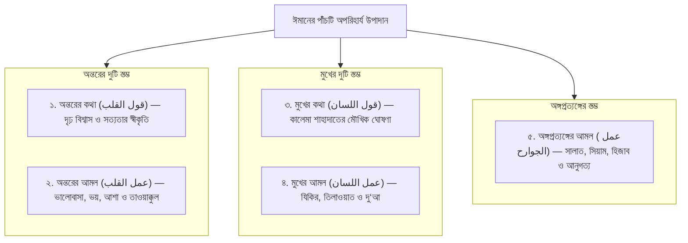
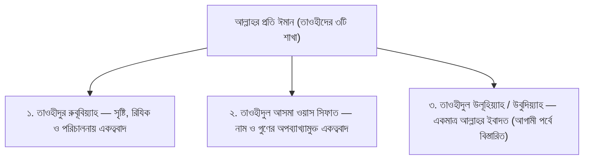

# অধ্যায় ০২: তাকওয়ার স্বরূপ, ক্ষতিকর গ্রন্থ বর্জন ও ঈমানের পাঁচটি স্তম্ভ

> _কণ্টকাকীর্ণ পথে চলার মতো তাকওয়ার বাস্তব রূপ, সংশয় সৃষ্টিকারী বই ও ইলম বর্জন এবং ঈমানের ৫টি অভ্যন্তরীণ উপাদান ও হ্রাস-বৃদ্ধির অকাট্য প্রমাণ।_

---

## বক্তার পরিচিতি ও আলোচনার প্রেক্ষাপট

- **মূল আলোচনা:** প্রফেসর ড. আবু বকর মুহাম্মাদ যাকারিয়া _(حفظه الله)_  
  _(প্রফেসর, আল-ফিকহ ও ইসলামিক স্টাডিজ বিভাগ, ইসলামী বিশ্ববিদ্যালয়, কুষ্টিয়া; মদিনা ইসলামী বিশ্ববিদ্যালয়ের পিএইচডি গবেষক এবং সুবিখ্যাত তাফসির প্রণেতা)_
- **বিষয়শ্রেণী:** ধারাবাহিক জুমার খুতবা — "প্রত্যেক মুসলিমকে যা জানতেই হবে" (২য় পর্ব)।
- **প্রেক্ষাপট:** প্রথম খুতবায় তাকওয়ার ভিত্তি হিসেবে দ্বীনি এলেম অর্জনের গুরুত্ব ব্যাখ্যার পর, এই পর্বে শায়খ তাকওয়ার বাস্তব রূপক চিত্রায়ন করেছেন। একই সাথে সমাজে প্রচলিত বিভিন্ন বিতর্কিত দর্শন ও বিভ্রান্তিকর ধর্মীয় বই পাঠের ক্ষতিকর প্রভাব তুলে ধরেছেন। অতঃপর আহলুস সুন্নাহ ওয়াল জামা‘আতের বিশুদ্ধ আক্বীদা অনুযায়ী ঈমানের পাঁচটি অপরিহার্য উপাদান, ঈমানের হ্রাস-বৃদ্ধি এবং ঈমানের রুকন সাতটি নয় বরং ছয়টি—তা দালিলিকভাবে স্পষ্ট করেছেন।

---

## ভূমিকা: কণ্টকাকীর্ণ পথের পথিক ও তাকওয়ার স্বরূপ

ইসলামে তাকওয়া কেবল তাসবীহ গণনা বা কিছু আনুষ্ঠানিক শব্দোচ্চারণ নয়। সালাফে সালেহীন তাকওয়াকে অত্যন্ত বাস্তবসম্মত ও জীবন্ত একটি উপমার মাধ্যমে সংজ্ঞায়িত করেছেন।

একবার উমর ইবনুল খাত্তাব (রা.) বিশিষ্ট সাহাবী উবাই ইবনু কা‘ব (রা.)-কে জিজ্ঞেস করলেন, _"হে উবাই! তাকওয়া কী?"_ উবাই (রা.) প্রতিউত্তরে বললেন, _"হে আমীরুল মুমিনীন! আপনি কি কখনো দুই পাশে ঘন কাঁটাযুক্ত সরু রাস্তা দিয়ে হেঁটেছেন?"_ উমর (রা.) বললেন, _"হ্যাঁ, হেঁটেছি।"_ উবাই (রা.) জিজ্ঞেস করলেন, _"তখন আপনি কীভাবে হেঁটেছিলেন?"_ উমর (রা.) বললেন, _"আমি আমার গায়ের চাদর ও কাপড় দুই হাতে শক্ত করে গুটিয়ে নিয়েছিলাম এবং অত্যন্ত সন্তর্পণে পা ফেলেছিলাম, যাতে কোনো কাঁটা আমার কাপড়ে আটকে না যায় বা আমার গায়ে বিঁধে না যায়!"_ তখন উবাই (রা.) বললেন, **"এটাই হলো তাকওয়া!"**

**শায়খের প্রাঞ্জল ব্যাখ্যা:**  
এই নশ্বর পার্থিব জীবন হলো কাঁটায় ভরা এক দুর্গম পথ। আর এই পথের প্রতিটি পদক্ষেপে রয়েছে কুফরি, শিরক, বিদ‘আত, হারাম প্রবৃত্তি, লৌকিকতা ও শয়তানী প্ররোচনার বিষাক্ত কাঁটা। একজন মুমিনকে বেঁচে থাকতে হলে ঠিক সেভাবেই কাপড় গুটিয়ে অত্যন্ত সতর্কতার সাথে পা ফেলতে হবে, যেন দুনিয়ার কোনো পাপের কাঁটা তার ঈমানকে ক্ষতবিক্ষত করতে না পারে। আর এই কাঁটাগুলো চিনতে হলে এবং তা এড়িয়ে চলতে হলে সর্বপ্রথম প্রয়োজন সেই 'দ্বীনি এলেম'—যা মানুষকে সঠিক পথ দেখায়।

---

## মূল আলোচনা

### ১. এলেমের প্রকারভেদ: ক্ষতিকর ও বিভ্রান্তিকর গ্রন্থ বর্জন

প্রথম পর্বে আমরা জেনেছি জ্ঞান দুই প্রকার—উপকারী জ্ঞান ও ক্ষতিকর জ্ঞান। যে এলেম মানুষের ঈমান, আক্বীদা ও পরকালের ক্ষতিসাধন করে, তা থেকে দূরে থাকা ওয়াজিব।

রাসূলুল্লাহ ﷺ যে অর্থহীন ও ক্ষতিকর জ্ঞান থেকে পানাহ চাইতেন, তার একটি বাস্তব উদাহরণ হলো—এমন সব গ্রন্থ অধ্যয়ন করা যা অন্তরে সংশয় (শুবুহাত) সৃষ্টি করে। যুগে যুগে হক্কানী আলেমগণ মুসলিম সমাজকে এমন অনেক বই থেকে সতর্ক করেছেন, যেগুলোর ভেতরে দর্শনের অনুপ্রবেশ বা জাল-যয়ীফ বর্ণনার সংমিশ্রণ ঘটেছে।

**ঐতিহাসিক সতর্কতা ও শায়খের পর্যালোচনা:**

1. **ইহয়াউ উলূমিদ্দীন ও কিমিয়ায়ে সাআদাত:** ইমাম গাজ্জালী (রহ.) একজন প্রখ্যাত ব্যক্তিত্ব হওয়া সত্ত্বেও মুহাদ্দিসীন কেরাম তাঁর _'ইহয়াউ উলূমিদ্দীন'_ এবং _'কিমিয়ায়ে সাআদাত'_ গ্রন্থের ব্যাপারে সাধারণ মুসলিমদের অত্যন্ত সতর্ক করেছেন। কারণ এই কিতাবগুলোতে বিপুল পরিমাণ অনির্ভরযোগ্য, বানোয়াট (মাওযূ) ও অতি দুর্বল হাদিসের পাশাপাশি সুফিবাদী দর্শন ঢুকে পড়েছে—যা একজন সাধারণ মুসলিমের আক্বীদাকে বিভ্রান্ত করতে পারে।
2. **কালামশাস্ত্রবিদদের দর্শনভিত্তিক কিতাব:** অনুরূপভাবে ইমাম ফখরুদ্দীন আর-রাযী এবং আবুল ফাতহ আশ-শাহরাস্তানী প্রমুখ কালামশাস্ত্রবিদদের দার্শনিক কিতাবগুলো সাধারণ মানুষের জন্য পাঠ করা সালাফগণ কঠোরভাবে নিষেধ করেছেন। কারণ এসব বই পাঠ করলে অন্তরে সংশয় ঢুকে যায়, যার থেকে সাধারণ মানুষ আর বের হতে পারে না।

যে বই আপনার অন্তরে আল্লাহর নাম ও সিফাত সম্পর্কে সন্দেহ তৈরি করে, যে বই আপনাকে কুরআন-সুন্নাহর সরল পথ থেকে দূরে সরিয়ে জটিল যুক্তিতর্কে নিক্ষেপ করে—তা পাঠ করা সওয়াব তো নয়ই, বরং চরম আত্মঘাতী ও গুনাহর কারণ।

---

### ২. ঈমানের পাঁচটি অপরিহার্য উপাদান (পাঁচটি স্তম্ভ)

আহলুস সুন্নাহ ওয়াল জামা‘আতের বিশুদ্ধ আক্বীদা অনুযায়ী, ঈমান স্রেফ একটি একক অনুভূতির নাম নয়; বরং ঈমান পাঁচটি মৌলিক উপাদানের সমন্বয়ে গঠিত:

#### ১. অন্তরের কথা (قول القلب):

অন্তরে কালেমা শাহাদাতের স্বীকৃতি দেওয়া। মনে মনে এই দৃঢ় প্রত্যয় পোষণ করা যে—আল্লাহ ছাড়া কোনো সত্য মাবুদ নেই এবং মুহাম্মাদ ﷺ আল্লাহর বান্দা ও রাসূল। যাবতীয় গায়িবিয়াত (কবর, হাশর, জান্নাত, জাহান্নাম)-কে মনে প্রাণে সত্য বলে মেনে নেওয়া।

#### ২. অন্তরের আমল (عمل القلب):

অন্তর কেবল বিশ্বাস করেই ক্ষান্ত হয় না, অন্তরের নিজস্ব কিছু আমল রয়েছে। যেমন:

- **খওফ (الخوف):** একমাত্র আল্লাহকে ভয় করা।
- **রজা (الرجاء):** একমাত্র আল্লাহর রহমতের আশা করা।
- **মহব্বত (المحبة):** সবকিছুর চেয়ে আল্লাহ ও তাঁর রাসূলকে বেশি ভালোবাসা।
- **তাওয়াক্কুল (التوكل):** সকল কাজে একমাত্র আল্লাহর ওপর অবিচল ভরসা রাখা।
- **ইখলাস (الإخلاص):** প্রতিটি কাজ একমাত্র আল্লাহর সন্তুষ্টির উদ্দেশ্যে করা।

#### ৩. মুখের কথা (قول اللسان):

সামর্থ্য থাকা সত্ত্বেও যদি কেউ মুখে _'আশহাদু আল্লা ইলাহা ইল্লাল্লাহু ওয়া আশহাদু আন্না মুহাম্মাদান আবদুহু ওয়া রাসূলুহু'_ উচ্চারণ না করে, তবে সে দুনিয়ার বিধান অনুযায়ী মুসলিম বলে গণ্য হবে না।

#### ৪. মুখের আমল (عمل اللسان):

জিহ্বা দ্বারা আল্লাহর সন্তুষ্টিমূলক ইবাদত সম্পাদন করা। যেমন: সুবহানাল্লাহ, আলহামদুলিল্লাহ, আল্লাহু আকবার, লা ইলাহা ইল্লাল্লাহ পাঠ করা, কুরআন তিলাওয়াত করা, সৎকাজের আদেশ ও অসৎকাজে নিষেধ করা এবং সার্বক্ষণিক দো‘আ ও ইস্তিগফারে জিহ্বাকে সিক্ত রাখা।

#### ৫. অঙ্গপ্রত্যঙ্গের আমল (عمل الجوارح):

হাত, পা, চোখ, কান ও শরীরের অন্যান্য অঙ্গ দিয়ে আল্লাহর নির্দেশ পালন করা। যেমন: পাঁচ ওয়াক্ত সালাত প্রতিষ্ঠা করা, রুকূ‘-সিজদা করা, রমযানের সিয়াম পালন করা, পর্দাবিধান মেনে চলা এবং যাবতীয় হারাম স্পর্শ ও দৃষ্টি থেকে অঙ্গপ্রত্যঙ্গকে হেফাযত করা।

> [!IMPORTANT]
> **শায়খের সুস্পষ্ট সিদ্ধান্ত:** এই পাঁচটি উপাদানের সমন্বয়েই কেবল একজন মানুষের ঈমান পূর্ণতা পায়। যদি কোনো ব্যক্তি দাবি করে যে তার অন্তরে বিশ্বাস আছে, কিন্তু মুখে কালেমা পড়ে না কিংবা শরীরে সালাত ও আমলের কোনো চিহ্ন নেই—তবে আহলুস সুন্নাহর ঐকমত্যে তার ঈমান গ্রহণযোগ্য নয়।

---

### ৩. ঈমানের হ্রাস-বৃদ্ধি: সালাফদের অকাট্য আক্বীদা

আমাদের দেশের অনেক মাদরাসায় এবং কিছু কিতাবে ভুলবশত পড়ানো হয় যে, _"ঈমান বাড়েও না, কমেও না।"_ শায়খ এই ধারণাকে কুরআন, সুন্নাহ ও সালাফের ইজমার আলোকে তীব্রভাবে খণ্ডন করেছেন।

#### (ক) কুরআনের সুস্পষ্ট প্রমাণ:

আল্লাহ সুবহানাহু ওয়া তা‘আলা আল-কুরআনের একাধিক আয়াতে ঘোষণা করেছেন যে নেক আমল ও ওহীর মাধ্যমে মুমিনের ঈমান বৃদ্ধি পায়:

> ﴿إِنَّمَا الْمُؤْمِنُونَ الَّذِينَ إِذَا ذُكِرَ اللَّهُ وَجِلَتْ قُلُوبُهُمْ وَإِذَا تُلِيَتْ عَلَيْهِمْ آيَاتُهُ زَادَتْهُمْ إِيمَانًا وَعَلَىٰ رَبِّهِمْ يَتَوَكَّلُونَ﴾  
> **অর্থ:** "প্রকৃত মুমিন তো তারাই, যাদের অন্তর আল্লাহর স্মরণে কেঁপে ওঠে; আর যখন তাদের সামনে তাঁর আয়াতসমূহ তিলাওয়াত করা হয়, তখন তা তাদের **ঈমান বৃদ্ধি করে** এবং তারা তাদের রবের ওপরই ভরসা করে।"  
> — [সূরা আল-আনফাল, ৮:২](https://quran.com/8/2)

অন্য আয়াতে আল্লাহ বলেন:

> ﴿هُوَ الَّذِي أَنزَلَ السَّكِينَةَ فِي قُلُوبِ الْمُؤْمِنِينَ لِيَزْدَادُوا إِيمَانًا مَّعَ إِيمَانِهِمْ﴾  
> **অর্থ:** "তিনিই মুমিনদের অন্তরে প্রশান্তি নাযিল করেছেন, যাতে তাদের **ঈমানের সাথে আরও ঈমান বৃদ্ধি পায়**।"  
> — [সূরা আল-ফাতহ, ৪৮:৪](https://quran.com/48/4)

#### (খ) ইমাম বুখারী (রহ.)-এর অকাট্য মানদণ্ড:

আমীরুল মুমিনীন ফিল হাদিস ইমাম বুখারী (রহ.) তাঁর সহীহ বুখারীতে স্পষ্ট ঘোষণা করেছেন:

> _"আমি এক হাজারেরও বেশি মুহাদ্দিস ও শায়খের সাথে সাক্ষাৎ করে হাদিস লিপিবদ্ধ করেছি। তাঁদের প্রত্যেকেই আহলুস সুন্নাহর অন্তর্ভুক্ত ছিলেন। তাঁদের মধ্যে এমন কোনো আলেম ছিলেন না, যিনি বলতেন না যে—'ঈমান কথা ও কাজের নাম, এবং তা বাড়ে ও কমে।' যে ব্যক্তি বলত 'ঈমান বাড়ে না কমে না', আমি তার কাছ থেকে একটি হাদিসও গ্রহণ করিনি!"_

#### (গ) সহীহ হাদিস ও হানযালা (রা.)-এর ঐতিহাসিক ঘটনা:

মানুষের অন্তরে ঈমানের স্তর সব সময় এক অবস্থায় থাকে না। নেক আমল করলে ঈমান বৃদ্ধি পায়, আর পার্থিব ব্যস্ততা ও অবহেলায় ঈমান হ্রাস পায়।

সহীহ মুসলিমে বর্ণিত হয়েছে, বিশিষ্ট সাহাবী হানযালা আল-উসাইদী (রা.) একবার ক্রন্দনরত অবস্থায় আবু বকর (রা.)-এর সাথে দেখা করে বললেন: _"হানযালা তো মুনাফেক হয়ে গেছে!"_ আবু বকর (রা.) বিস্মিত হয়ে বললেন, _"সুবহানাল্লাহ! আপনি কী বলছেন?"_ হানযালা (রা.) বললেন:

> _"আমরা যখন রাসূলুল্লাহ ﷺ-এর মজলিসে থাকি, তিনি যখন আমাদের জান্নাত ও জাহান্নামের স্মরণ করিয়ে দেন, তখন মনে হয় আমরা তা সরাসরি প্রত্যক্ষ করছি! কিন্তু যখন আমরা বাড়ি ফিরে যাই, স্ত্রী-সন্তান ও ক্ষেত-খামারের কাজে ব্যস্ত হয়ে পড়ি, তখন আমরা অনেক কিছুই ভুলে যাই!"_

আবু বকর (রা.) বললেন, _"আল্লাহর কসম! আমাদেরও তো একই অবস্থা হয়!"_ অতঃপর তাঁরা উভয়ে রাসূলুল্লাহ ﷺ-এর দরবারে গিয়ে বিষয়টি আরজ করলেন। তখন দয়ার নবী ﷺ বললেন:

> «يَا حَنْظَلَةُ، سَاعَةً وَسَاعَةً، وَلَوْ كَانَتْ تَكُونُ قُلُوبُكُمْ كَمَا تَكُونُ عِنْدِي لَصَافَحَتْكُمُ الْمَلَائِكَةُ فِي طُرُقِكُمْ وَعَلَى فُرُشِكُمْ»  
> **অনুবাদ:** "হে হানযালা! শোনো, সময় সব সময় একরকম থাকে না; কিছু সময় (ইবাদতের জন্য) এবং কিছু সময় (পার্থিব প্রয়োজনের জন্য)। যদি তোমাদের অন্তর সর্বদা আমার মজলিসের অবস্থার মতো জাগ্রত থাকত, তবে পথচলতি অবস্থায় এবং তোমাদের বিছানায় এসে ফিরিশতারা তোমাদের সাথে মুসাফাহা (করমর্দন) করত!"  
> — _সহীহ মুসলিম, হাদিস নং ২৭৫০_। [HadithBD লিংক](https://www.hadithbd.com/hadith/filter/?book=2&hadith=2750)

এ হাদিস প্রমাণ করে যে, মানুষের মানসিক ও ঈমানী অবস্থায় জোয়ার-ভাটা আসে। তবে ঈমান যখন নিম্নগামী হয়, তখনো যেন তা কোনো অবস্থাতেই ফরয বর্জন বা হারামে লিপ্ত হওয়ার স্তরে না নেমে যায়।

---

### ৪. ঈমানের রুকন ছয়টি, সাতটি নয়!

আমাদের সমাজে শিশুদের একটি চটি বই বা মুখে মুখে মুখস্থ করানো হয়: _"ঈমানের রুকন সাতটি (আমন্তু বিল্লাহি ওয়া মালাইকাতিহী...)"_।

**শায়খের তাহক্বীক্ব ও সংশোধনী:**  
কুরআন ও বিশুদ্ধ সুন্নাহ অনুযায়ী **ঈমানের রুকন সুস্পষ্টভাবে ৬টি, ৭টি নয়**। বিখ্যাত 'হাদিসে জিবরীল'-এ জিবরীল (আ.) যখন রাসূলুল্লাহ ﷺ-কে ঈমান সম্পর্কে জিজ্ঞেস করেছিলেন, তখন আল্লাহর রাসূল ﷺ স্পষ্ট ভাষায় ৬টি রুকনের কথা উল্লেখ করেছেন:

> «أَنْ تُؤْمِنَ بِاللَّهِ، وَمَلَائِكَتِهِ، وَكُتُبِهِ، وَرُسُلِهِ، وَالْيَوْمِ الْآخِرِ، وَتُؤْمِنَ بِالْقَدَرِ خَيْرِهِ وَشَرِّهِ»  
> **অনুবাদ:** "(ঈমান হলো) তুমি ঈমান আনবে—  
> ১. আল্লাহর ওপর,  
> ২. তাঁর ফিরিশতাদের ওপর,  
> ৩. তাঁর কিতাবসমূহের ওপর,  
> ৪. তাঁর রাসূলগণের ওপর,  
> ৫. শেষ দিবসের (পরকালের) ওপর, এবং  
> ৬. তাকদীরের ভালো ও মন্দের ওপর।"  
> — _সহীহ মুসলিম, হাদিস নং ৮_। [HadithBD লিংক](https://www.hadithbd.com/hadith/filter/?book=2&hadith=8)

তাহলে সমাজে প্রচলিত 'সাতটি' সংখ্যাটি কোত্থেকে এলো? সমাজে মৃত্যুর পর পুনরুত্থানকে (ওয়াল বা‘আসি বা‘দাল মাওত) আলাদা রুকন বানিয়ে ৭টি করা হয়েছে। অথচ মৃত্যুর পর পুনরুত্থান, কবর, হাশর, মীযান—সবকিছুই 'শেষ দিবস' বা আখেরাতের অন্তর্ভুক্ত। একই রুকনকে দুইবার গণনা করে সাতটি বলা সুন্নাহসম্মত নয়।

---

### ৫. প্রথম রুকন: আল্লাহর প্রতি ঈমানের তিনটি মৌল ভিত্তি

ঈমানের ছয়টি রুকনের মধ্যে সর্বপ্রথম ও সর্বপ্রধান হলো **আল-ঈমান বিল্লাহ (আল্লাহর প্রতি ঈমান)**। আর আল্লাহর প্রতি ঈমান আনতে হলে তিনটি তাওহীদের ওপর যথাযথ বিশ্বাস ও স্বীকৃতি থাকতে হবে:

#### (১) তাওহীদুর রুবূবিয়্যাহ (প্রতিপালনে একত্ববাদ):

বিশ্বজগতের একমাত্র স্রষ্টা, রিযিকদাতা, জীবন-মৃত্যুর মালিক এবং সর্বময় ক্ষমতার অধিকারী হলেন আল্লাহ। তবে শুধু এতটুকু বিশ্বাস করলেই একজন ব্যক্তি মুসলিম হতে পারে না; কারণ মক্কার মুশরিকরাও বিশ্বাস করত যে আল্লাহই আসমান-জমিনের স্রষ্টা ও বৃষ্টিবর্ষণকারী।

#### (২) তাওহীদুল আসমা ওয়াস সিফাত (নাম ও গুণের একত্ববাদ):

আল্লাহ তা‘আলা আল-কুরআনে এবং রাসূলুল্লাহ ﷺ সহীহ হাদিসে নিজের জন্য যেসব সুন্দর নাম ও গুণাবলী সাব্যস্ত করেছেন, সেগুলোকে কোনো প্রকার বিকৃতি (তাহরীফ), অর্থহীনকরণ (তা‘তীল), কেমন বা কিরূপ প্রশ্ন (তাকয়ীফ) এবং সৃষ্টির সাথে তুলনা (তামসীল) ব্যতিরেকে হুবহু বিশ্বাস করা।

আল্লাহ বলেন:

> ﴿لَيْسَ كَمِثْلِهِ شَيْءٌ ۖ وَهُوَ السَّمِيعُ الْبَصِيرُ﴾  
> **অর্থ:** "কোনো কিছুই তাঁর সদৃশ নয়; আর তিনি সর্বশ্রোতা, সর্বদ্রষ্টা।"  
> — [সূরা আশ-শূরা, ৪২:১১](https://quran.com/42/11)

**আল্লাহর সিফাতের একটি হৃদয়গ্রাহী দৃষ্টান্ত (রহমত):**  
রাসূলুল্লাহ ﷺ বলেছেন:

> عَنْ أَبِي هُرَيْرَةَ رَضِيَ اللَّهُ عَنْهُ قَالَ: قَالَ رَسُولُ اللَّهِ ﷺ:  
> «إِنَّ اللَّهَ خَلَقَ الرَّحْمَةَ يَوْمَ خَلَقَهَا مِائَةَ رَحْمَةٍ، فَأَمْسَكَ عِنْدَهُ تِسْعًا وَتِسْعِينَ رَحْمَةً، وَأَرْسَلَ فِي خَلْقِهِ كُلِّهِمْ رَحْمَةً وَاحِدَةً، فَبِهَا يَتَرَاحَمُ الْخَلْقُ، حَتَّى تَرْفَعَ الدَّابَّةُ حَافِرَهَا عَنْ وَلَدِهَا خَشْيَةَ أَنْ تُصِيبَهُ»  
> **অনুবাদ:** আবু হুরায়রা (রা.) থেকে বর্ণিত, রাসূলুল্লাহ ﷺ বলেছেন: "আল্লাহ যেদিন রহমত সৃষ্টি করেছেন, সেদিন তিনি একশতটি রহমত সৃষ্টি করেছেন। তন্মধ্যে নিরানব্বইটি রহমত তিনি নিজের কাছে রেখে দিয়েছেন এবং সমগ্র সৃষ্টির মাঝে মাত্র একটি রহমত অবতীর্ণ করেছেন। সেই একটিমাত্র রহমতের কারণেই জগতের সমস্ত সৃষ্টি একে অপরের প্রতি দয়া প্রদর্শন করে; এমনকি একটি চতুষ্পদ জন্তুও (গাভী/ঘোড়া) দুধ পান করানোর সময় তার পা তুলে রাখে এই ভয়ে—পাছে তার বাচ্চার ওপর পা না পড়ে যায়!"  
> — _সহীহ বুখারী, হাদিস নং ৬৪৬৯; সহীহ মুসলিম, হাদিস নং ২৭৫২_। [HadithBD লিংক](https://www.hadithbd.com/hadith/filter/?book=1&hadith=6469)

শায়খ বলেন, এই পার্থিব জগতের সমস্ত মাতৃত্বের মমতা ও সৃষ্টির পরস্পরের ভালোবাসা যদি সেই একভাগ রহমতের ফল হয়, তবে কিয়ামতের ভয়াবহ দিনে মহান রবের কাছে অবশিষ্ট নিরানব্বই ভাগ রহমত মুমিনদের জন্য কেমন পরম আশ্রয়ের হবে—তা কল্পনাও করা যায় না!

#### (৩) তাওহীদুল উলূহিয়্যাহ বা উবুদিয়্যাহ:

সমস্ত ইবাদত—সালাত, দু‘আ, কুরবানী, মানত, তাওয়াক্কুল ও ভয়—একমাত্র আল্লাহর জন্য নিবেদিত করা। এই গুরুত্বপূর্ণ শাখাটিই তাওহীদের মূল প্রাণ এবং এর ওপরই আগামী পর্বে বিস্তারিত আলোচনা হবে, ইনশাআল্লাহ।

---

## প্রশ্নোত্তর ও গুরুত্বপূর্ণ ফিক্বহী মাসআলা

### প্রশ্ন ১: যদি কারও অন্তরে ক্ষণে ক্ষণে ঈমানী দুর্বলতা অনুভূত হয় এবং সে নিজেকে অপরাধী মনে করে, তবে সে কি মুনাফেক হয়ে গেছে?

**শায়খের উত্তর:**  
না, সে মুনাফেক নয়। স্বয়ং সাহাবায়ে কেরামের মধ্যেও এই অনুভূতি হয়েছিল, যেমনটি হানযালা (রা.)-এর সাথে ঘটেছিল। রাসূলুল্লাহ ﷺ জানিয়েছেন যে, দ্বীনি মজলিস বা একাকী ইবাদতের সময় অন্তরের যে সর্বোচ্চ কোমলতা থাকে, পার্থিব রুটি-রুজির ব্যস্ততায় তা কিছুটা কমে যাওয়া স্বাভাবিক মানবিক বৈশিষ্ট্য। তবে শর্ত হলো—এই শিথিলতার সুযোগে যেন কোনো ফরয ওয়াজিব ছুটে না যায় এবং কোনো হারাম কাজ সংঘটিত না হয়। নিজেকে অপরাধী মনে করা বরং অন্তরে জীবিত ঈমান থাকারই সুস্পষ্ট লক্ষণ।

### প্রশ্ন ২: দর্শনের কিতাব বা বিভ্রান্তিকর তাফসির ও সুফি গ্রন্থ পাঠের বিষয়ে শরয়ী হুকুম কী?

**শায়খের উত্তর:**  
যাদের কুরআন, সুন্নাহ ও সালাফদের আক্বীদার ওপর গভীর ও মজবুত ভিত্তি প্রতিষ্ঠিত হয়নি, তাদের জন্য তথাকথিত দর্শনশাস্ত্র এবং সংশয়যুক্ত কিতাব পাঠ করা হারাম। কারণ মানুষের অন্তর অত্যন্ত দুর্বল, আর সংশয়গুলো বিষাক্ত তীরের মতো অন্তরে বিঁধে যায়। সালাফে সালেহীন এমনকি ভ্রান্ত মতবাদের অনুসারীদের সাথে সাধারণ বিতর্কে বসতেও নিষেধ করতেন। আগে কুরআন, সহীহ হাদিস ও সালাফের বিশুদ্ধ আক্বীদা নিজের অন্তরে বদ্ধমূল করতে হবে।

---

## বাস্তব জীবনে আমল ও দিকনির্দেশনা (Actionable Takeaways)

1. **তাকওয়ার সচেতন অনুশীলন:**  
   প্রতিটি কথা বলার আগে এবং প্রতিটি পদক্ষেপ নেওয়ার আগে ভাবুন—এখানে কি কোনো পাপ, গীবত বা অসত্যের কাঁটা রয়েছে? নিজেকে চাদর গুটিয়ে চলার মতো পাপমুক্ত রাখুন।
2. **ঈমানের উপাদানগুলোর নিয়মিত মূল্যায়ন:**  
   আমার অন্তরে কি আল্লাহর প্রতি যথার্থ ভয় ও আশা আছে? আমার জিহ্বা কি অনর্থক কথার বদলে যিকিরে অভ্যস্ত? আমার অঙ্গপ্রত্যঙ্গ কি আল্লাহর অবাধ্যতায় ব্যবহার হচ্ছে? প্রতিদিন রাতে ঘুমানোর আগে নিজের এই ৫টি উপাদানের হিসাব নিন।
3. **সংশয়পূর্ণ বই ও মিডিয়া বর্জন:**  
   সোশ্যাল মিডিয়া বা বইমেলায় প্রাপ্ত তথাকথিত দার্শনিক বিতর্ক, সংশয়বাদী পোস্ট ও অনির্ভরযোগ্য ধর্মীয় বই পড়া থেকে সম্পূর্ণ বিরত থাকুন।
4. **আল্লাহর প্রশস্ত রহমতের আশা ও ইবাদত:**  
   গুনাহ হয়ে গেলে কখনোই আল্লাহর রহমত থেকে নিরাশ হবেন না। যিনি সৃষ্টির জন্য শতভাগের নিরানব্বই ভাগ রহমত রিজার্ভ রেখেছেন, তাঁর দরবারে আন্তরিক তাওবা করে ফিরে আসুন।

---

## সারসংক্ষেপ

তাকওয়া হলো কাঁটাযুক্ত পথে সন্তর্পণে নিজেকে বাঁচিয়ে চলার মতো পাপমুক্ত জীবন পরিচালনা করা। ক্ষতিকর দর্শন ও সংশয়যুক্ত ধর্মীয় গ্রন্থ বর্জন করে বিশুদ্ধ কুরআন-সুন্নাহর জ্ঞান অর্জন করা প্রতিটি মুমিনের আত্মরক্ষার প্রধান ঢাল। আহলুস সুন্নাহ ওয়াল জামা‘আতের ঐকমত্য অনুযায়ী ঈমান হলো অন্তরের কথা ও আমল, মুখের কথা ও আমল এবং অঙ্গপ্রত্যঙ্গের আমলের সমষ্টি। ঈমান স্থির কোনো বস্তু নয়; নেক আমলে তা বৃদ্ধি পায় এবং পাপে তা হ্রাস পায়। ঈমানের রুকন সুস্পষ্টভাবে ছয়টি, এবং তার ভিত্তি স্থাপিত হয়েছে রুবূবিয়্যাহ, আসমা ওয়াস সিফাত ও উলূহিয়্যাহ—এই ত্রিমুখী তাওহীদের সুদৃঢ় ভিত্তির ওপর।

---

## শায়খের জন্য সম্পাদকের নোট (Review Notes for the Shaykh)

1. **ইমামদের গ্রন্থ সম্পর্কিত সতর্কবার্তা:**
   - খুতবায় শায়খ ইমাম গাজ্জালীর _'ইহয়াউ উলূমিদ্দীন'_ ও _'কিমিয়ায়ে সাআদাত'_ এবং ফখরুদ্দীন আর-রাযী ও শাহরাস্তানীর দর্শনভিত্তিক বই থেকে সালাফদের সতর্কতার যে কথা উল্লেখ করেছিলেন, তা প্রামাণিক ও সতর্কতামূলক ভাষায় হুবহু সংরক্ষণ করা হয়েছে।
2. **ঈমানের রুকন সংখ্যা (৬ বনাম ৭):**
   - সমাজে প্রচলিত সাতটি রুকনের বিভ্রান্তি নিরসনে সহীহ মুসলিমের 'হাদিসে জিবরীল' উদ্ধৃত করে শায়খের তাহক্বীক্ব অক্ষুণ্ণ রাখা হয়েছে।
3. **রহমতের ১০০ ভাগের হাদিস:**
   - সহীহ বুখারী (৬৪৬৯) ও সহীহ মুসলিম (২৭৫২)-এর মূল পাঠ ও নম্বরসহ হাদিসটির পূর্ণাঙ্গ তাখরীজ যুক্ত করা হয়েছে।
4. **পরবর্তী সংযোগ:**
   - আগামী খুতবায় (পর্ব ০৩) তাওহীদুল উলূহিয়্যাহ বা ইবাদতে একত্ববাদ এবং আল্লাহকে শুধু রব মানলেই কেন মুক্তি পাওয়া যায় না—সে বিষয়ে আলোচনা বিস্তারিত হবে।
