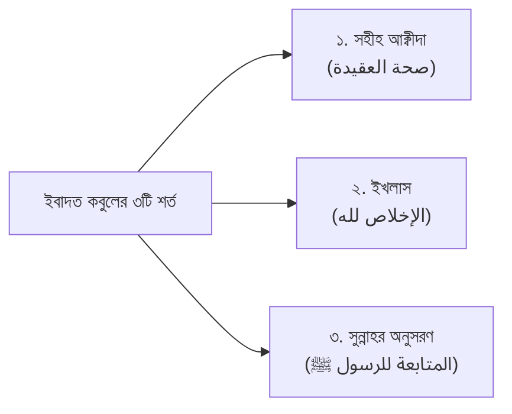

# অধ্যায় ০৩: তাওহীদুল উলূহিয়্যাহ, ইবাদতের শর্ত ও অনুবাদকদের খিয়ানত

> _তাকওয়ার তিনটি স্তর, আল্লাহকে শুধু 'রব' মানার চরম বিভ্রান্তি, তাওহীদুল উলূহিয়্যাহর স্বরূপ এবং ইবাদত কবুলের ৩টি শর্ত ও ৩টি রুকন।_

---

## বক্তার পরিচিতি ও আলোচনার প্রেক্ষাপট

- **মূল আলোচনা:** প্রফেসর ড. আবু বকর মুহাম্মাদ যাকারিয়া _(حفظه الله)_  
  _(প্রফেসর, আল-ফিকহ ও ইসলামিক স্টাডিজ বিভাগ, ইসলামী বিশ্ববিদ্যালয়, কুষ্টিয়া; মদিনা ইসলামী বিশ্ববিদ্যালয়ের পিএইচডি গবেষক এবং সুবিখ্যাত তাফসির প্রণেতা)_
- **বিষয়শ্রেণী:** ধারাবাহিক জুমার খুতবা — "প্রত্যেক মুসলিমকে যা জানতেই হবে" (৩য় পর্ব)।
- **প্রেক্ষাপট:** পূর্ববর্তী পর্বে তাওহীদের জ্ঞানগত দিক (তাওহীদুর রুবূবিয়্যাহ ও আসমা ওয়াস সিফাত) উপস্থাপনের পর, এই পর্বে শায়খ তাওহীদের সবচেয়ে সংবেদনশীল ও বাস্তবমুখী দিক—'তাওহীদুল উলূহিয়্যাহ' বা ইবাদতের একত্ববাদ উন্মোচন করেছেন। আধুনিক অনেক মোটিভেশনাল স্পিকারের ভ্রান্তি, বিভ্রান্ত ফেরকাসমূহের তাওহীদ সংক্রান্ত বিকৃতি এবং বাংলা বাজারে প্রচলিত ইসলামিক কিতাবের অনুবাদকদের মারাত্মক আক্বীদাগত খিয়ানতের মুখোশ উন্মোচন করে ইবাদত কবুলের পূর্বশর্তগুলো সুস্পষ্ট করেছেন।

---

## ভূমিকা: তাকওয়ার তিনটি স্তর ও ফরযে আইন এলেম

দুনিয়া ও আখেরাতে প্রকৃত সফলতা অর্জন করতে হলে তাকওয়ার কোনো বিকল্প নেই। কুরআন ও সুন্নাহর গভীর পর্যালোচনার মাধ্যমে সালাফে সালেহীন তাকওয়াকে প্রধান তিনটি স্তরে বিভক্ত করেছেন:

1. **প্রথম স্তর (মুসলিম স্তর — ন্যূনতম তাকওয়া):**  
   আল্লাহ তা‘আলা বান্দার ওপর যে সমস্ত বিধানকে 'ফরযে আইন' করেছেন (যেমন: বিশুদ্ধ ঈমান, পাঁচ ওয়াক্ত সালাত, ওযুর ফরজ, সিয়াম) তা যথাযথভাবে পালন করা এবং সমস্ত প্রকাশ্য হারাম ও কবীরা গুনাহ থেকে বেঁচে থাকা। এটি হলো তাকওয়ার সর্বনিম্ন স্তর, যা না থাকলে কোনো মানুষ মুসলিম হিসেবে টিকে থাকতে পারে না।
2. **দ্বিতীয় স্তর (মুমিন স্তর — মধ্যম তাকওয়া):**  
   ফরযে আইনের পাশাপাশি ওয়াজিবাত ও সুন্নাতসমূহ যত্নসহকারে আদায় করা, মাকরূহাত ও সন্দেহযুক্ত বিষয়সমূহ (মুশাবাহাত) থেকে সতর্কতার সাথে নিজেকে বাঁচিয়ে রাখা। এই স্তরের বান্দাদের জন্য আল্লাহ তা‘আলা জাহান্নাম থেকে চিরমুক্তি ও জান্নাতের সুসংবাদ দান করেছেন।
3. **তৃতীয় স্তর (মুহসিন স্তর — সর্বোচ্চ তাকওয়া / ইহসান):**  
   আল্লাহকে এমনভাবে ইবাদত করা যেন বান্দা তাঁকে সরাসরি দেখতে পাচ্ছে; আর যদি দেখতে না পায়, তবে এই দৃঢ় অনুভূতি রাখা যে আল্লাহ তাকে দেখছেন। এই স্তরের ব্যক্তিরা নফল ইবাদতের পরাকাষ্ঠা অর্জন করেন এবং আখেরাতে নবী, সিদ্দীক্বীন, শুহাদা ও সালেহীনদের সাথে সর্বোচ্চ জান্নাতুল ফিরদাউসে অবস্থানের সৌভাগ্য লাভ করবেন।

একজন সাধারণ মানুষের জন্য অন্তত প্রথম স্তরের তাকওয়া অর্জন করতে হলে যে মৌলিক এলেমটি জানতেই হবে, তা হলো তাওহীদের সঠিক স্বরূপ।

---

## মূল আলোচনা

### ১. শুধু আল্লাহকে 'রব' মানার বিভ্রান্তি ও মোটিভেশনাল স্পিকারদের ভুল

আজকের সমাজে একদল আধুনিক বক্তা ও তথাকথিত 'মোটিভেশনাল স্পিকার' আবির্ভূত হয়েছেন, যারা সারাজীবন মানুষকে শুধু এটুকু বোঝাতেই ব্যস্ত থাকেন যে—"আল্লাহ একজন আছেন, আল্লাহই আমাদের সৃষ্টি করেছেন, তিনিই আমাদের রিযিক দিচ্ছেন!"

**শায়খের কঠোর ও প্রামাণিক খণ্ডন:**  
আল্লাহকে এক ও অদ্বিতীয় স্রষ্টা বা রিযিকদাতা মানার নাম হলো 'তাওহীদুর রুবূবিয়্যাহ'। কিন্তু কুরআনুল কারীমের সুস্পষ্ট ঘোষণা হলো—**শুধু আল্লাহকে রব ও স্রষ্টা মানলেই কোনো ব্যক্তি মুমিন বা জান্নাতী হতে পারে না!**

এর অকাট্য প্রমাণ:

- **মক্কার মুশরিকদের স্বীকৃতি:** আবু জাহেল, আবু লাহাব ও মক্কার কাফেররা নির্দ্বিধায় বিশ্বাস করত যে আল্লাহই আকাশ-জমিনের স্রষ্টা এবং তিনিই তাদের জীবন-মৃত্যুর নিয়ন্ত্রক। আল্লাহ তা‘আলা আল-কুরআনে বলেন:
  > ﴿وَلَئِن سَأَلْتَهُم مَّنْ خَلَقَهُمْ لَيَقُولُنَّ اللَّهُ ۖ فَأَنَّىٰ يُؤْفَكُونَ﴾  
  > **অর্থ:** "আর আপনি যদি তাদেরকে জিজ্ঞেস করেন, কে তাদেরকে সৃষ্টি করেছে? তবে তারা অবশ্যই বলবে—'আল্লাহ'। তবুও তারা কোথায় ফিরে যাচ্ছে?"  
  > — [সূরা আয-যুখরুফ, ৪৩:৮৭](https://quran.com/43/87)
- **ইবলিসের স্বীকৃতি:** ইবলিস সরাসরি আল্লাহকে নিজের রব বলে সম্বোধন করেছে: `قَالَ رَبِّ بِمَا أَغْوَيْتَنِي` (সে বলল: হে আমার রব! আপনি যে আমাকে পথভ্রষ্ট করলেন... — সূরা আল-হিজর, ১৫:৩৯)।

সুতরাং, আল্লাহকে এক স্রষ্টা মানার পরও যদি আবু জাহেল ও ইবলিস চিরস্থায়ী জাহান্নামী কাফের হয়, তবে কোনো মুসলিম যদি শুধু রুবূবিয়্যাতে বিশ্বাস রেখে বসে থাকে, তবে সে কীভাবে জান্নাতে যাওয়ার আশা করতে পারে?

রুবূবিয়্যাহ ও আসমা ওয়াস সিফাত হলো জ্ঞানগত দিক (العلم والإقرار); কিন্তু জান্নাতে যেতে হলে এর সাথে যোগ করতে হবে কর্ম ও আনুগত্যমূলক দিক—যাকে শরীয়তের পরিভাষায় বলা হয় **'তাওহীদুল উলূহিয়্যাহ' (توحيد الألوهية) বা তাওহীদুল ইবাদাহ**।

---

### ২. বিভ্রান্ত ফেরকাসমূহের তাওহীদ সংক্রান্ত বিকৃতি

তাওহীদুল উলূহিয়্যাহ বা ইবাদতের ক্ষেত্রে এসে ইসলামের অধিকাংশ দল ও বিদ‘আতী ফেরকা পথভ্রষ্ট হয়েছে; কেবল 'আহলুস সুন্নাহ ওয়াল জামা‘আত' হকের ওপর অবিচল রয়েছে।

শায়খ তৎকালীন ও সমকালীন বিভিন্ন ভ্রান্ত মতবাদের মুখোশ উন্মোচন করেন:

- **মু‘তাযিলা ও দার্শনিকদের বিভ্রান্তি:** তারা মনে করে আল্লাহর 'জাত' (অস্তিত্ব) মেনে নেওয়াই তাওহীদ; এবং এই করতে গিয়ে তারা আল্লাহর সুন্দর সুন্দর নাম ও সিফাতকে অস্বীকার করেছে।
- **আশ‘আরী ও মাতুরিদীদের সীমাবদ্ধতা:** তারা আল্লাহর অগণিত সিফাত থেকে মাত্র কয়েকটি বুদ্ধিভিত্তিক সিফাত (যেমন: জীবন, জ্ঞান, ক্ষমতা ইত্যাদি) স্বীকার করে বাকিগুলোকে রূপক ব্যাখ্যা (তাওয়ীল) করে ফেলেছে।
- **সুফি ও বেদান্তবাদী সর্বেশ্বরবাদ (ওয়াহদাতুল উজূদ):** একদল বিভ্রান্ত সুফি দাবি করে যে স্রষ্টা ও সৃষ্টি একাকার হয়ে গেছে (নাউযুবিল্লাহ); যা চরম কুফরি ও শির্ক।

এরা মুখে মুসলিমের দাবি করলেও তাওহীদের মূল প্রাণ ধ্বংস করে দিয়েছে। তাই প্রতিটি মুসলিমের দায়িত্ব হলো সালাফে সালেহীনের বিশুদ্ধ আক্বীদা আঁকড়ে ধরা।

---

### ৩. ইসলামিক বইয়ের বাজারে অনুবাদকদের মারাত্মক খিয়ানত

শায়খ অত্যন্ত ক্ষোভ ও উদ্বেগের সাথে সমকালীন বাংলা প্রকাশনী ও বাণিজ্যিক অনুবাদকদের আক্বীদাগত খিয়ানতের বাস্তব দৃষ্টান্ত তুলে ধরেন। ব্যবসায়িক উদ্দেশ্যে বহু অযোগ্য ও বাতিল আক্বীদার লোক আরব শায়খদের সহীহ আক্বীদার বই অনুবাদ করতে গিয়ে সালাফী মূলনীতিকে বিকৃত করে দিচ্ছে।

**শায়খের উন্মোচিত দুটি মারাত্মক দৃষ্টান্ত:**

1. **ড. আয়েয আল-ক্বারনীর 'লা তাহযান' বইয়ের অনুবাদ:**  
   শায়খ উল্লেখ করেন, এক ব্যক্তি তাঁর কাছে 'লা তাহযান' (হতাশ হবেন না)-এর একটি জনপ্রিয় বাংলা অনুবাদ নিয়ে আসে। সেখানে অনুবাদক নিজের পক্ষ থেকে লিখে দিয়েছে: _"আল্লাহর কুদরতি হাত ও কুদরতি পায়ে সেজদা করতে হবে!"_  
   শায়খ বলেন: _"আরবের কোনো সালাফী শায়খের মুখ দিয়ে এমন শিরকী ও তাশবীহযুক্ত কথা কখনো বের হতে পারে না! কারণ আরবরা বিশ্বাস করে আল্লাহ আরশের ওপর সমুন্নত, তাঁর হাত-পা কোনো সৃষ্টির মতো নয় এবং কোনো সিফাতকে আলাদা করে সেজদা করার বিধান ইসলামে নেই। আমি মূল আরবি কিতাব মিলিয়ে দেখলাম, সেখানে দূরদূরান্তেও এমন কোনো শব্দ নেই! অনুবাদক মনগড়াভাবে এই বিভ্রান্তি ঢুকিয়ে দিয়েছে।"_
2. **ড. সাঈদ আল-ক্বাহত্বানীর দো‘আর কিতাবের অনুবাদ:**  
   প্রখ্যাত শায়খ ড. সাঈদ ইবনু ওয়াহফ আল-ক্বাহত্বানী (রহ.)-এর কিতাবে _'লা ইলাহা ইল্লাল্লাহ'_ কালিমার অনুবাদে অনুবাদক বারবার লিখেছে: _"আল্লাহ ছাড়া কোনো সার্বভৌমত্বের অধিকারী নেই!"_  
   শায়খ বলেন: _"সার্বভৌমত্ব তো রুবূবিয়্যাতের অংশ! লা ইলাহা ইল্লাল্লাহর মূল অর্থ হলো—একমাত্র আল্লাহ ছাড়া সত্য কোনো মাবুদ নেই। যদি সার্বভৌমত্ব মানাই কালিমার অর্থ হতো, তবে আবু জাহেলও তা মানত। ইলাহের জায়গায় রবের অর্থ বসিয়ে দিয়ে এরা মানুষকে তাওহীদুল উলূহিয়্যাহ থেকে গাফেল করে রাখছে।"_

---

### ৪. ইবাদতের সর্বজনীন সংজ্ঞা ও পরিধি

শায়খুল ইসলাম ইমাম ইবনে তাইমিয়্যাহ (রহ.) তাঁর অমর গ্রন্থ _'আল-উবুদিয়্যাহ'_-তে ইবাদতের যে অনন্য ও সর্বজনীন সংজ্ঞা দিয়েছেন, শায়খ তা উল্লেখ করেন:

> «العِبَادَةُ: اسْمٌ جَامِعٌ لِكُلِّ مَا يُحِبُّهُ اللَّهُ وَيَرْضَاهُ، مِنَ الْأَقْوَالِ وَالأَعْمَالِ، البَاطِنَةِ وَالظَّاهِرَةِ»  
> **অনুবাদ:** "আল্লাহ যা কিছু ভালোবাসেন এবং পছন্দ করেন—তা প্রকাশ্য বা গোপন কথা ও কাজ—সবকিছুর এক সমন্বিত সামষ্টিক নাম হলো 'ইবাদত'।"

ইবাদত কেবল নামায, রোযা বা তসবিহতেই সীমাবদ্ধ নয়। একজন মুমিনের অন্তরের ভয়, আশা, তাওয়াক্কুল যেমন ইবাদত; তেমনি সত্য কথা বলা, পিতা-মাতার সেবা করা, ইনসাফ কায়েম করা, হালাল রুজি অন্বেষণ করা এবং যিকির-তিলাওয়াত করাও ইবাদতের অন্তর্ভুক্ত।

---

### ৫. ইবাদত কবুলের তিনটি অলঙ্ঘনীয় শর্ত (شروط قبول العبادة)

কোনো আমল আল্লাহর দরবারে গ্রহণযোগ্য হওয়ার জন্য তিনটি শর্ত পূরণ হওয়া অপরিহার্য:

#### ১. বিশুদ্ধ আক্বীদা (صحة العقيدة):

শায়খ এই শর্তটির ওপর সবচেয়ে বেশি জোর দিয়েছেন। অনেকে মনে করেন শুধু নিয়ত সহীহ হলে আর রাসুলের পদ্ধতিতে নামায পড়লেই ইবাদত কবুল হয়ে যাবে। কিন্তু শায়খ বলেন:

> _"যদি কোনো ব্যক্তির আক্বীদা নষ্ট থাকে—সে যদি ভাগ্য বা তাকদীর অস্বীকার করে, কিংবা মাজারে গিয়ে সেজদা দেয়, অথবা বিশ্বাস করে যে অমুক পীর সাহেব গায়েবের খবর জানেন—তবে সে সারারাত কেঁদে কেঁদে তাহাজ্জুদ পড়লেও এবং মক্কার হারামে গিয়ে রাসূলের পদ্ধতিতে নামায পড়লেও তার একটি আমলও আল্লাহর কাছে কবুল হবে না! কারণ শিরক ও বাতিল আক্বীদা সমস্ত আমলকে ভস্মীভূত করে দেয়।"_

#### ২. আল-ইখলাস (الإخلاص):

আমলটি একমাত্র আল্লাহ সুবহানাহু ওয়া তা‘আলার সন্তুষ্টির উদ্দেশ্যে হতে হবে। এতে লোক দেখানো মনোভাব (রিয়া) বা মানুষের প্রশংসা পাওয়ার বিন্দুমাত্র কামনা থাকা যাবে না।

#### ৩. আল-মুতাবা‘আহ (المتابعة للرسول ﷺ):

আমলটি হুবহু মুহাম্মাদুর রাসূলুল্লাহ ﷺ-এর প্রদর্শিত সুন্নাহ অনুযায়ী হতে হবে। মনগড়া বা সমাজে প্রচলিত কোনো বিদ‘আতী তরিকায় ইবাদত করলে তা প্রত্যাখ্যাত হবে। রাসূলুল্লাহ ﷺ বলেছেন:

> «مَنْ عَمِلَ عَمَلًا لَيْسَ عَلَيْهِ أَمْرُنَا فَهُوَ رَدٌّ»  
> **অর্থ:** "যে ব্যক্তি এমন কোনো আমল করল যাতে আমাদের কোনো নির্দেশনা নেই, তা সরাসরি প্রত্যাখ্যাত।" _(সহীহ মুসলিম, ১৭১৮)_।

---

### ৬. ইবাদতের তিনটি রুকন বা স্তম্ভ (أركان العبادة)

আল্লাহর ইবাদত মূলত তিনটি আত্মিক স্তম্ভের ওপর প্রতিষ্ঠিত:

1. **আল-মহব্বত (المحبة — পরম ভালোবাসা):**  
   আল্লাহকে জগতের সবকিছুর চেয়ে বেশি ভালোবেসে তাঁর ইবাদত করা।
2. **আল-খওফ (الخوف — ভয়):**  
   আল্লাহর আযাব, জাহান্নামের আগুন এবং তাঁর অসন্তুষ্টিকে অন্তরের অন্তস্তল থেকে ভয় করা।
3. **আর-রজা (الرجاء — আশা):**  
   নিজের গুনাহ সত্ত্বেও আল্লাহর অপার ক্ষমা ও জান্নাতের অবিচল আশা পোষণ করা।

**সালাফদের সুবিখ্যাত মূলনীতি:**  
সালাফে সালেহীন একটি যুগান্তকারী মূলনীতির মাধ্যমে সতর্ক করেছেন:

> _"যে ব্যক্তি শুধুমাত্র আল্লাহর ভালোবাসার ওপর ভর করে ইবাদত করে (ভয় ও আশা ছাড়া), সে ভণ্ড সুফি ও যিন্দীক্ব (ধর্মত্যাগী); যে ব্যক্তি কেবল ভয়ের ওপর ভর করে ইবাদত করে, সে চরমপন্থী খারেজী (যে সামান্য পাপে মানুষকে কাফের বানায় এবং আল্লাহর রহমত থেকে নিরাশ হয়); আর যে ব্যক্তি কেবল আশার ওপর ভর করে ইবাদত করে, সে চরম শিথিলতাবাদী মুরজিয়া (যে মনে করে আমল না করলেও ঈমান ঠিক থাকে)। কিন্তু একজন খাঁটি মুমিন একটি পাখির মতো—যার মাথা হলো ভালোবাসা, আর দুটি ডানা হলো ভয় ও আশা। এই দুই ডানার ভারসাম্যেই সে আল্লাহর সান্নিধ্যে উড়ে চলে!"_

---

### ৭. শায়খুল ইসলাম মুহাম্মাদ ইবনু আব্দুল ওয়াহহাবের 'থালাথাতুল উসূল' পাঠের আহবান

খুতবার শেষাংশে শায়খ অত্যন্ত গুরুত্বের সাথে সমস্ত মুসলিমকে শায়খুল ইসলাম মুহাম্মাদ ইবনু আব্দুল ওয়াহহাব (রহ.)-এর জগদ্বিখ্যাত পুস্তিকা **'থালাথাতুল উসূল' (ثلاثة الأصول — তিনটি মূলনীতি)** গভীরভাবে পড়ার নসিহত করেন।

কবরে যে তিনটি প্রশ্ন করা হবে:

1. তোমার রব কে? (مَن رَبُّكَ؟)
2. তোমার দ্বীন কী? (مَا دِينُكَ؟)
3. তোমার নবী কে? (مَن نَبِيُّكَ؟)

এই তিনটি মৌলিক প্রশ্নের পুঙ্খানুপুঙ্খ দালিলিক উত্তর এবং ইবাদতের বিভিন্ন শাখা (দো‘আ, তাওয়াক্কুল, রগবত, রহবত, খুশু, ইস্তিজাহ, কুরবানী, মানত) একমাত্র আল্লাহর জন্য কীভাবে নিবেদিত করতে হয়—তা জানতে হলে এই কিতাবটি প্রতিটি মুসলিমের আত্মস্থ করা ওয়াজিব।

---

## প্রশ্নোত্তর ও গুরুত্বপূর্ণ ফিক্বহী মাসআলা

### প্রশ্ন ১: বর্তমান যুগের মোটিভেশনাল স্পিকারদের বক্তব্য শুনে কি দ্বীন শেখা যাবে?

**শায়খের উত্তর:**  
কখনোই নয়, যদি না তারা কুরআন ও সুন্নাহর বিশুদ্ধ আক্বীদার ওপর প্রতিষ্ঠিত হন। সমকালীন মোটিভেশনাল স্পিকাররা প্রায়শই মানুষকে দুনিয়াবী সাফল্য, পজিটিভ থিংকিং এবং আল্লাহকে নিছক এক 'কল্যাণময় মহাজাগতিক শক্তি' হিসেবে উপস্থাপন করেন। তারা মানুষকে তাওহীদুল উলূহিয়্যাহ, কবরের আযাব ও শিরকের ভয়াবহতা শেখায় না। ফলে তাদের শ্রোতারা মুখে ধার্মিক হলেও বাস্তবে শিরক ও বিদ‘আতে নিমজ্জিত থাকে। দ্বীন শিখতে হবে সালাফদের অনুসারী হক্কানী আলেমদের কিতাব ও দারস থেকে।

### প্রশ্ন ২: কোনো বইয়ের অনুবাদে যদি আক্বীদাগত ভুল থাকে, তবে সাধারণ পাঠকের করণীয় কী?

**শায়খের উত্তর:**  
সাধারণ পাঠকের পক্ষে সব সময় ভুল ধরা সম্ভব নয়। এজন্য বই কেনার আগেই নির্ভরযোগ্য আলেমের পরামর্শ নেওয়া উচিত। যে প্রকাশনী বা অনুবাদক সালাফী আক্বীদার পরিপন্থী কিংবা বিকৃত অনুবাদ করে, তাদের বই বর্জন করতে হবে। অনুবাদকদেরও আল্লাহর ভয় করা উচিত; কারণ দ্বীনি কিতাবের বিকৃত অনুবাদ করা এক প্রকার আমানতের জঘন্য খেয়ানত।

---

## বাস্তব জীবনে আমল ও দিকনির্দেশনা (Actionable Takeaways)

1. **আমল কবুলের তিন শর্তের হিসাব নেওয়া:**  
   যেকোনো ইবাদত করার আগে নিশ্চিত হোন—(১) আমার আক্বীদা কি শিরকমুক্ত? (২) আমার নিয়ত কি কেবল আল্লাহর জন্য? (৩) পদ্ধতিটি কি রাসূলুল্লাহ ﷺ-এর সুন্নাহসম্মত?
2. **ভয় ও আশার ভারসাম্য রক্ষা:**  
   একাকী নির্জনে আল্লাহর আযাবের ভয় করুন যাতে পাপ থেকে বাঁচা যায়; আর নেক আমলের পর এবং অসুস্থতা-মৃত্যুর সময় আল্লাহর রহমতের আশা প্রবল রাখুন।
3. **'থালাথাতুল উসূল' কিতাবটি সংগ্রহ ও অধ্যয়ন:**  
   পরিবারসহ কবরের তিন প্রশ্নের ওপর রচিত 'থালাথাতুল উসূল' কিতাবটি নিজে পড়ুন এবং সন্তানদের শেখান।
4. **সতর্কতার সাথে দ্বীনি বই নির্বাচন:**  
   বাজারে প্রচলিত চটকদার নামের বই না কিনে নির্ভরযোগ্য সালাফী গবেষক ও আলেমদের তাহক্বীক্বকৃত কিতাব পাঠ করুন।

---

## সারসংক্ষেপ

তাকওয়ার তিনটি স্তরের মধ্যে প্রথম স্তর হলো ফরযে আইন পালন ও হারাম বর্জন। আল্লাহকে কেবল স্রষ্টা ও রব মানলেই জাহান্নাম থেকে মুক্তি পাওয়া যায় না; আবু জাহেল ও ইবলিসও আল্লাহকে স্রষ্টা মানত। মুক্তির জন্য তাওহীদুল উলূহিয়্যাহ বা একমাত্র আল্লাহর ইবাদত কায়েম করা অপরিহার্য। বাণিজ্যিক অনুবাদকদের বিকৃত অনুবাদ থেকে সতর্ক থাকতে হবে। কোনো ইবাদত কবুল হতে হলে সহীহ আক্বীদা, ইখলাস ও রাসূলুল্লাহ ﷺ-এর সুন্নাহর অনুকরণ বাধ্যতামূলক। আর ইবাদতের ভিত্তি স্থাপিত হতে হবে ভালোবাসা, ভয় ও আশার ত্রিমুখী ভারসাম্যের ওপর।

---

## শায়খের জন্য সম্পাদকের নোট (Review Notes for the Shaykh)

1. **অনুবাদকদের খিয়ানতের প্রসঙ্গ:**
   - খুতবায় শায়খ 'লা তাহযান' এবং ড. সাঈদ আল-ক্বাহত্বানীর দো‘আর বইয়ের যে দুটি সুনির্দিষ্ট অনুবাদের অসঙ্গতি ব্যক্তিগত পর্যবেক্ষণের ভিত্তিতে তুলে ধরেছিলেন, তা হুবহু মূল আলোচনায় সংরক্ষিত রাখা হয়েছে।
2. **ইবাদত কবুলের ৩য় শর্ত (আক্বীদা বিশুদ্ধ হওয়া):**
   - সচরাচর কিতাবগুলোতে ইখলাস ও সুন্নাহর অনুসরণ—এই দুটি শর্তের কথা বলা হলেও, শায়খ যেভাবে 'সহীহ আক্বীদা'কে প্রথম শর্ত হিসেবে গুরুত্ব দিয়েছেন, তা অত্যন্ত তাৎপর্যপূর্ণভাবে ফুটিয়ে তোলা হয়েছে।
3. **ইবাদতের রুকনসমূহ:**
   - ভালোবাসা, ভয় ও আশার ব্যাপারে সালাফদের সুবিখ্যাত পাখি ও তার ডানার উপমাটি প্রাসঙ্গিক দলীলসহ উপস্থাপন করা হয়েছে।
4. **পরবর্তী সংযোগ:**
   - আগামী পর্বে (পর্ব ০৪) কবরের তিন প্রশ্ন, ঈমানের পরিচয় ও ঈমান ভঙ্গকারী মারাত্মক কারণসমূহ (নাওয়াকিদুল ঈমান) বিশদভাবে আলোচিত হবে।
