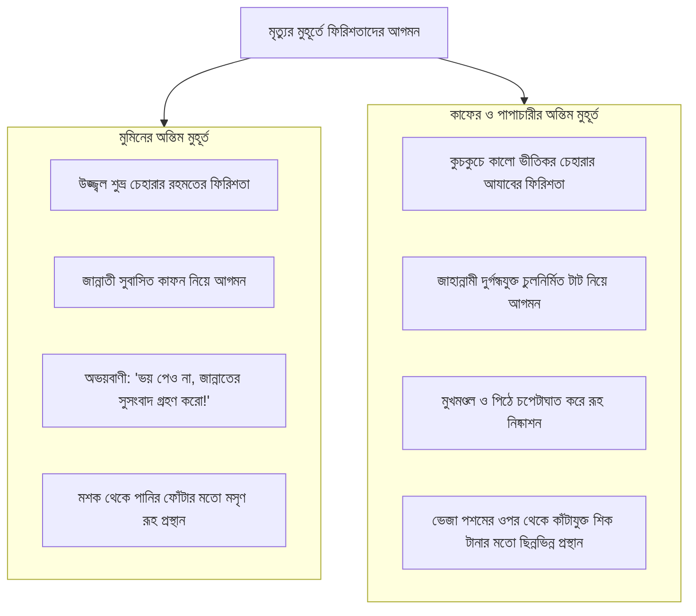

# অধ্যায় ০৬: মানবজীবনে ফিরিশতাদের ভূমিকা ও দায়িত্বসমূহ

> মাতৃগর্ভ থেকে কবর পর্যন্ত মানুষের সাথে ফিরিশতাদের ওতপ্রোত সম্পর্ক, কিরামান কাতিবীন, মালাকুল মাউত এবং রহমত লাভের প্রতিবন্ধকতাসমূহ।

---

## বক্তার পরিচিতি ও আলোচনার প্রেক্ষাপট

- **মূল আলোচনা:** প্রফেসর ড. আবু বকর মুহাম্মাদ যাকারিয়া (حفظه الله)  
  (প্রফেসর, আল-ফিকহ ও ইসলামিক স্টাডিজ বিভাগ, ইসলামী বিশ্ববিদ্যালয়, কুষ্টিয়া; মদিনা ইসলামী বিশ্ববিদ্যালয়ের পিএইচডি গবেষক এবং সুবিখ্যাত তাফসির প্রণেতা)
- **বিষয়শ্রেণী:** ধারাবাহিক জুমার খুতবা — "প্রত্যেক মুসলিমকে যা জানতেই হবে" (৬ষ্ঠ পর্ব)।
- **প্রেক্ষাপট:** পূর্ববর্তী পর্বে ফিরিশতাদের সৃষ্টিতত্ত্ব ও অনন্য গুণাবলী ব্যাখ্যার পর, এই পর্বে শায়খ মানুষের প্রাত্যহিক ও আত্মিক জীবনের সাথে ফিরিশতাদের প্রত্যক্ষ সংযোগ উন্মোচন করেছেন। মাতৃগর্ভে চার মাস বয়সে তাকদীর লেখা থেকে শুরু করে আমলনামা লিপিবদ্ধকরণ, বিপদাপদ থেকে হেফাযত, মৃত্যুর মুহূর্তে রূহ কবজ, কবরের প্রশ্ন এবং রহমতের ফিরিশতাদের বরকত লাভের উপায় নিয়ে এই পূর্ণাঙ্গ অধ্যায়টি সাজানো হয়েছে।

---

## ভূমিকা: মানুষের সাথে ফিরিশতাকুলের নিরবচ্ছিন্ন সম্পর্ক

আল্লাহ সুবহানাহু ওয়া তা‘আলা মানুষকে পৃথিবীতে বেহুদা বা উদ্দেশ্যহীনভাবে ছেড়ে দেননি। মানুষের প্রতিটি শ্বাস-প্রশ্বাস, প্রতিটি কথা, প্রতিটি পদক্ষেপের সাথে অদৃশ্য জগতের পুতপবিত্র ফিরিশতাকুলকে গভীরভাবে সম্পৃক্ত রেখেছেন।

যখন আদি পিতা আদম (আ.)-কে সৃষ্টি করা হয়েছিল, তখন ফিরিশতাদের মাধ্যমেই তাঁকে সম্মান প্রদর্শন করা হয়েছিল। আদম (আ.) যখন সৃষ্টি হয়ে সর্বপ্রথম ফিরিশতাদের সালাম দিলেন—«আসসালামু আলাইকুম», ফিরিশতারা প্রত্যুত্তরে বললেন—«ওয়ালাইকুমুস সালামু ওয়া রাহমাতুল্লাহ»; আর আল্লাহ ঘোষণা করলেন: এটিই হলো তোমার ও তোমার ভবিষ্যৎ বংশধরদের সার্বজনীন অভিবাদন। আদম (আ.)-এর ওফাতের পর স্বয়ং ফিরিশতারা এসে তাঁকে গোসল করিয়ে কাফন-দাফনের নিয়ম শিখিয়ে দিয়েছিলেন।

মাতৃগর্ভে ভ্রূণের সৃষ্টি থেকে শুরু করে মৃত্যুর পর কবরের সওয়াল-জওয়াব এবং কিয়ামতের হাশর পর্যন্ত প্রতিটি বাঁকে মানুষের সাথে ফিরিশতাদের অত্যন্ত সুনির্দিষ্ট ও সুশৃঙ্খল দায়িত্ব অর্পিত রয়েছে।

---

## মূল আলোচনা

### ১. মাতৃগর্ভ ও মানুষের আজীবন ভাগ্যের ফয়সালা

মানুষ যখন মাতৃগর্ভে অবস্থান করে, তখন থেকেই তার সাথে ফিরিশতার দায়িত্ব শুরু হয়। আব্দুল্লাহ ইবনু মাসউদ (রা.) বর্ণিত বিখ্যাত হাদিসে রাসূলুল্লাহ ﷺ মানব সৃষ্টির এই অলৌকিক পরিক্রমা বর্ণনা করেছেন:

> عَنْ عَبْدِ اللَّهِ بْنِ مَسْعُودٍ رَضِيَ اللَّهُ عَنْهُ قَالَ: حَدَّثَنَا رَسُولُ اللَّهِ ﷺ:  
> «إِنَّ أَحَدَكُمْ يُجْمَعُ خَلْقُهُ فِي بَطْنِ أُمِّهِ أَرْبَعِينَ يَوْمًا، ثُمَّ يَكُونُ عَلَقَةً مِثْلَ ذَلِكَ، ثُمَّ يَكُونُ مُضْغَةً مِثْلَ ذَلِكَ، ثُمَّ يَبْعَثُ اللَّهُ مَلَكًا فَيُؤْمَرُ بِأَرْبَعِ كَلِمَاتٍ، وَيُقَالُ لَهُ: اكْتُبْ عَمَلَهُ، وَرِزْقَهُ، وَأَجَلَهُ، وَشَقِيٌّ أَوْ سَعِيدٌ، ثُمَّ يُنْفَخُ فِيهِ الرُّوحُ»  
> **অনুবাদ:** আব্দুল্লাহ ইবনু মাসউদ (রা.) থেকে বর্ণিত, রাসূলুল্লাহ ﷺ বলেছেন: "তোমাদের প্রত্যেকের সৃষ্টির উপাদান তার মায়ের পেটে চল্লিশ দিন পর্যন্ত শুক্রবিন্দু হিসেবে জমা থাকে। অতঃপর পরবর্তী চল্লিশ দিনে তা জমাট রক্তে পরিণত হয়। অতঃপর পরবর্তী চল্লিশ দিনে তা মাংসপিণ্ডে রূপ নেয়। এরপর আল্লাহ একজন ফিরিশতা পাঠান এবং তাঁকে চারটি বিষয় লিপিবদ্ধ করার নির্দেশ দেওয়া হয়:  
> ১. তার আমল,  
> ২. তার রিযিক,  
> ৩. তার আয়ু (মৃত্যুকাল), এবং  
> ৪. সে কি দুর্ভাগ্যবান (জাহান্নামী) হবে নাকি সৌভাগ্যবান (জান্নাতী) হবে?  
> অতঃপর তার মধ্যে রূহ ফুঁকে দেওয়া হয়।"  
> — সহীহ বুখারী, হাদিস নং ৩২০৮; সহীহ মুসলিম, হাদিস নং ২৬৪৩। [HadithBD লিংক](URLTEMP0)

অর্থাৎ একশত বিশ দিন (চার মাস) বয়সে ফিরিশতা মাতৃগর্ভে এসে রূহ সঞ্চার করেন এবং সেই বান্দার আজীবন তাকদীরের খসড়া লিপিবদ্ধ করে দেন।

---

### ২. সার্বক্ষণিক প্রহরী ও আমল লেখক ফিরিশতাকুল

#### (ক) মু‘আক্কিবাত (পাহারাদার ফিরিশতা):

প্রতিটি মানুষের সাথে দিন ও রাতে পালাক্রমে একদল ফিরিশতা নিয়োজিত থাকেন, যাঁরা আল্লাহর হুকুমে মানুষকে বিভিন্ন আকস্মিক বিপদ-আপদ থেকে রক্ষা করেন:

> ﴿لَهُ مُعَقِّبَاتٌ مِّن بَيْنِ يَدَيْهِ وَمِنْ خَلْفِهِ يَحْفَظُونَهُ مِنْ أَمْرِ اللَّهِ﴾  
> **অর্থ:** "মানুষের জন্য তার সামনে ও পেছনে একের পর এক আগমনকারী প্রহরী দল (ফিরিশতা) রয়েছে, যারা আল্লাহর আদেশে তাকে হেফাযত করে।"  
> — [সূরা আর-রাদ, ১৩:১১](URLTEMP1)

আল্লাহর নির্ধারিত তাকদীরের কোনো বিপদ যখন আসার সময় হয়, তখন এই ফিরিশতারা সরে যান এবং ফয়সালা বাস্তবায়িত হয়।

#### (খ) কিরামান কাতিবীন (সম্মানিত আমল লেখকদ্বয়):

মানুষের ভালো ও মন্দ সমস্ত কর্মকাণ্ড সূক্ষ্মাতিসূক্ষ্মভাবে লিপিবদ্ধ করার জন্য দুইজন সম্মানিত ফিরিশতা সর্বদা উপস্থিত রয়েছেন:

> ﴿مَّا يَلْفِظُ مِن قَوْلٍ إِلَّا لَدَيْهِ رَقِيبٌ عَتِيدٌ﴾  
> **অর্থ:** "মানুষ যে কথাই মুখ দিয়ে উচ্চারণ করে, তা লিপিবদ্ধ করার জন্য সদা প্রস্তুত অতন্দ্র প্রহরী তার নিকটেই রয়েছে।"  
> — [সূরা ক্বাফ, ৫০:১৮](URLTEMP2)

ডান কাঁধের ফিরিশতা নেক আমল লিপিবদ্ধ করেন এবং বাম কাঁধের ফিরিশতা গুনাহ লিপিবদ্ধ করেন। বান্দা যখন কোনো গুনাহ করে ফেলে, তখন নেকির ফিরিশতা গুনাহের ফিরিশতাকে বলেন: "কিছুক্ষণ অপেক্ষা করো, হয়তো সে অনুতপ্ত হয়ে তাওবা ও ইস্তিগফার করবে!" মহান রবের রহমত কত অপার!

#### (গ) অন্তরে কল্যাণের ডাক (লাম্মাতুল মালাক):

রাসূলুল্লাহ ﷺ জানিয়েছেন, মানুষের অন্তরে দুটি প্রভাব কাজ করে—একটি শয়তানের কুমন্ত্রণা (লাম্মাতুশ শায়ত্বান), যা মানুষকে পাপে উৎসাহিত করে এবং সত্যকে অস্বীকার করতে বলে; আরেকটি হলো ফিরিশতার পবিত্র অনুপ্রেরণা (লাম্মাতুল মালাক), যা মানুষের অন্তরে ন্যায়, দানশীলতা ও আল্লাহর আনুগত্যের তাগিদ জাগ্রত করে (সুনান আত-তিরমিযী, হাদিস নং ২৯৮৮)।

---

### ৩. মুমিনের সাহায্য ও শত্রুর হাত থেকে সুরক্ষা

বদর ও খন্দকের যুদ্ধে আল্লাহ তা‘আলা হাজার হাজার ফিরিশতা পাঠিয়ে মুমিনদের পদযুগল সুদৃঢ় করেছিলেন এবং কাফেরদের ঘাড়ে আঘাত হেনেছিলেন (সূরা আলে ইমরান, ৩:১২৪-১২৫)।

ব্যক্তিজীবনেও আল্লাহ তাঁর খাস বান্দাদের ফিরিশতাদের মাধ্যমে রক্ষা করেন। এর একটি চমৎকার দৃষ্টান্ত সহীহ মুসলিমে বর্ণিত হয়েছে:

> মক্কায় একবার চরম শত্রু আবু জাহেল ঘোষণা করল: "মুহাম্মদ যদি আমার সামনে কাবা চত্বরে সিজদা দেয়, তবে আমি তার ঘাড়ে পা দিয়ে তাকে মাটিতে পিষে ফেলব!"  
> রাসূলুল্লাহ ﷺ সালাতে সিজদায় গেলে আবু জাহেল তাঁর দিকে ধেয়ে গেল; কিন্তু কাছে গিয়েই সে ভয়ে দুই হাত তুলে পিছিয়ে আসতে লাগল এবং তার মুখ ফ্যাকাসে হয়ে গেল! লোকেরা জিজ্ঞেস করল, "তোমার কী হয়েছে?" আবু জাহেল কাঁপতে কাঁপতে বলল: "মুহাম্মদ ও আমার মাঝে এক ভয়াবহ আগুনের পরিখা এবং ভয়ংকর ডানাওয়ালা প্রাণীদের দেখতে পেয়েছি!"  
> তখন আল্লাহর রাসূল ﷺ বললেন:  
> «لَوْ دَنَا مِنِّي لَاخْتَطَفَتْهُ الْمَلَائِكَةُ عُضْوًا عُضْوًا»  
> **অর্থ:** "সে যদি আমার আরেকটু নিকটবর্তী হতো, তবে ফিরিশতারা তার দেহের একটি একটি অঙ্গ ছিঁড়ে টুকরো টুকরো করে বাতাসে উড়িয়ে দিত!" (সহীহ মুসলিম, হাদিস নং ২৭৯৭)।

---

### ৪. অন্তিম মুহূর্ত: রূহ কবজ ও মালাকুল মাউত

মৃত্যুর সময় মানুষের সামনে উপস্থিত হন মালাকুল মাউত (মৃত্যুর ফিরিশতা) এবং তাঁর সহযোগী একদল ফিরিশতা।

মুমিনের মৃত্যুর সময় ফিরিশতারা এসে অত্যন্ত কোমল কণ্ঠে আহ্বান জানান:

> ﴿يَا أَيَّتُهَا النَّفْسُ الْمُطْمَئِنَّةُ ۝ ارْجِعِي إِلَىٰ رَبِّكِ رَاضِيَةً مَّرْضِيَّةً ۝ فَادْخُلِي فِي عِبَادِي ۝ وَادْخُلِي جَنَّتِي﴾  
> **অর্থ:** "হে প্রশান্ত আত্মা! তুমি তোমার রবের নিকট সন্তুষ্ট ও সন্তোষভাজন হয়ে ফিরে এসো। অতঃপর আমার প্রিয় বান্দাদের অন্তর্ভুক্ত হও এবং আমার জান্নাতে প্রবেশ করো।"  
> — [সূরা আল-ফাজর, ৮৯:২৭-৩০](URLTEMP3)

পক্ষান্তরে কাফের ও পাপাচারীদের রূহ কবজ করার সময় ফিরিশতারা তাদের ওপর আঘাত হানেন:

> ﴿وَلَوْ تَرَىٰ إِذْ يَتَوَفَّى الَّذِينَ كَفَرُوا ۙ الْمَلَائِكَةُ يَضْرِبُونَ وُجُوهَهُمْ وَأَدْبَارَهُمْ وَذُوقُوا عَذَابَ الْحَرِيقِ﴾  
> **অর্থ:** "আর আপনি যদি দেখতে পেতেন যখন ফিরিশতারা কাফেরদের প্রাণ হরণ করছিল—তারা তাদের মুখমণ্ডলে ও পিঠে আঘাত করছিল এবং বলছিল: আস্বাদন করো দহনযন্ত্রণা!"  
> — [সূরা আল-আনফাল, ৮:৫০](URLTEMP4)

#### মূসা (আ.) ও মালাকুল মাউতের সহীহ ঘটনা:

সাধারণ মানুষের ক্ষেত্রে ফিরিশতারা বিনা অনুমতিতে জান কবজ করেন; কিন্তু আম্বিয়ায়ে কেরামের ক্ষেত্রে দুনিয়াতে আরও বেঁচে থাকার ইচ্ছা আছে কি না—তার অনুমতি নেওয়া হতো।

সহীহ বুখারী ও মুসলিমে এসেছে, মালাকুল মাউত যখন মানববেশে মূসা (আ.)-এর কাছে এসে হঠাৎ বলেছিলেন: "আপনার রবের ডাকে সাড়া দিন!" মূসা (আ.) তাঁকে অচেনা আক্রমণকারী মনে করে একটি চপেটাঘাত করেছিলেন, যার ফলে তাঁর চোখের সুরত নষ্ট হয়ে যায়। ফিরিশতা আল্লাহর কাছে ফিরে গিয়ে বললেন, "আপনি আমাকে এমন বান্দার কাছে পাঠিয়েছেন যে মরতে চায় না!" আল্লাহ ফিরিশতার চোখ সুস্থ করে দিলেন এবং পুনরায় বললেন: "মূসাকে বলুন বলদের পিঠে হাত রাখতে; হাতের নিচে যত পশম পড়বে তত বছর তাকে আয়ু দেওয়া হবে।" মূসা (আ.) জিজ্ঞেস করলেন: "হে রব! তারপর কী?" আল্লাহ বললেন: "তারপর মৃত্যু।" মূসা (আ.) বললেন: "তবে এখনই হোক!"

শায়খ বলেন: যারা বস্তুবাদী বুদ্ধি দিয়ে এই হাদিস অস্বীকার করতে চায়, তারা গোমরাহ। কারণ ফিরিশতা এসেছিলেন মানব সুরতে, আর মানুষের চোখে আঘাত লাগলে তা ক্ষতিগ্রস্ত হওয়া আল্লাহর নির্ধারিত দুনিয়াবী কানূনের স্বাভাবিক রূপ।

---

### ৫. কবরের সওয়াল-জওয়াব ও মুনকার-নাকীর

দাফনের পর যখন আত্মীয়-স্বজন প্রস্থান করে, তখন নীল-কালো বর্ণের অত্যন্ত ভয়াল চেহারার দুইজন ফিরিশতা আগমন করেন, যাঁদের নাম **মুনকার (المنكر) ও নাকীর (النكير)**। তাঁরা মৃত ব্যক্তিকে বসিয়ে সেই চূড়ান্ত তিন প্রশ্ন করেন:

1. তোমার রব কে?
2. তোমার দ্বীন কী?
3. এই ব্যক্তি (মুহাম্মাদ ﷺ) কে, যাঁকে তোমাদের নিকট প্রেরণ করা হয়েছিল?

মুমিন নির্ভীক চিত্তে উত্তর দেবে: "আমার রব আল্লাহ, আমার দ্বীন ইসলাম এবং আমার নবী মুহাম্মাদ ﷺ।" তখন আসমান থেকে ঘোষণা আসবে: "আমার বান্দা সত্য বলেছে! তার জন্য জান্নাতের বিছানা বিছিয়ে দাও এবং জান্নাতের দিকে একটি দরজা খুলে দাও!" আর মুনাফিক ও কাফের দিশেহারা হয়ে বলবে: "হায়! আফসোস! আমি কিছু জানি না; লোকেরা যা বলত আমিও তা-ই শুনতাম!" তখন তাকে লোহার মুগুর দিয়ে এমন প্রচণ্ড আঘাত করা হবে যে বিকট চিৎকারে জ্বিন ও ইনসান ব্যতীত সমগ্র সৃষ্টিজগত তা শুনতে পাবে (সহীহ বুখারী, হাদিস নং ১৩৭৪)।

---

### ৬. মানবজীবনে ফিরিশতাদের আরও কিছু বিশেষ বরকত

1. **জুমার সালাতের রেজিস্ট্রি:** জুমার দিন মসজিদের দরজায় ফিরিশতারা খাতা নিয়ে দাঁড়িয়ে যান এবং ক্রমানুসারে আগে আসা মুসল্লিদের নাম লেখেন। খতিব যখন মিম্বরে ওঠেন, ফিরিশতারা খাতা গুটিয়ে খুতবা শুনতে বসে যান (সহীহ বুখারী, ৩২১১)।
2. **ফজর ও আসরের শিফটিং:** প্রতিদিন ফজর ও আসরের সালাতে আসমান ও জমিনের ফিরিশতারা একত্রিত হন। আল্লাহ তাঁদের জিজ্ঞেস করেন: "আমার বান্দাদের কেমন অবস্থায় রেখে এলে?" তাঁরা বলেন: "আমরা যখন গিয়েছি তারা সালাতরত ছিল, আর যখন ফিরে এসেছি তখনও তারা সালাত আদায় করছিল।" (সহীহ বুখারী, ৭৪২৯)।
3. **কুরআন তিলাওয়াতের সময় সাকীনা নাযিল হওয়া:** সাহাবী উসাইদ ইবনু হুযাইর (রা.) যখন রাতে সূরা আল-কাহফ তিলাওয়াত করছিলেন, তখন আসমান থেকে ঝুলন্ত প্রদীপের মতো জ্যোতির্ময় শামিয়ানা নেমে এসেছিল। নবী ﷺ নিশ্চিত করেছিলেন যে—তাঁরা ছিলেন তিলাওয়াত শুনতে আসা ফিরিশতাকুল (সহীহ বুখারী, ৫০১৮)।
4. **আল্লাহর জন্য ভালোবাসা পোষণকারীর কাছে সুসংবাদ:** এক ব্যক্তি অন্য গ্রামের এক দ্বীনি ভাইকে স্রেফ আল্লাহর সন্তুষ্টির উদ্দেশ্যে দেখতে যাচ্ছিলেন। পথে এক ফিরিশতা মানুষের বেশে এসে জিজ্ঞেস করলেন: "তোমার কি তার সাথে কোনো স্বার্থের লেনদেন আছে?" লোকটি বলল: "না, আমি কেবল আল্লাহর ওয়াস্তে তাকে ভালোবাসি।" ফিরিশতা বললেন: "আমি আল্লাহর দূত হয়ে তোমাকে জানাতে এসেছি—তুমি যেমন তাকে আল্লাহর জন্য ভালোবাসো, আল্লাহও তোমাকে ঠিক তেমনই ভালোবাসেন!" (সহীহ মুসলিম, ২৫৬৭)।
5. **ইলমের মজলিস বেষ্টন করে রাখা:** যেখানেই আল্লাহর দ্বীনের ইলম ও যিকিরের আলোচনা হয়, সেখানে ফিরিশতারা ডানা বিছিয়ে দেন এবং উপস্থিত বান্দাদের জন্য রহমত ও মাগফিরাতের দো‘আ করতে থাকেন (সহীহ মুসলিম, ২৬৮৯)।

---

### ৭. যে কারণে ঘরে রহমতের ফিরিশতা প্রবেশ করেন না!

যেসব মুমিন নিজেদের ঘরে ফিরিশতাদের বরকত ও শান্তি কামনা করেন, তাঁদেরকে রাসূলুল্লাহ ﷺ-এর এই কঠোর সতর্কবার্তা সর্বদা মনে রাখতে হবে:

> عَنْ عَائِشَةَ رَضِيَ اللَّهُ عَنْهَا قَالَتْ: قَالَ رَسُولُ اللَّهِ ﷺ:  
> «لَا تَدْخُلُ الْمَلَائِكَةُ بَيْتًا فِيهِ كَلْبٌ وَلَا صُورَةُ تَمَاثِيلَ»  
> **অনুবাদ:** আয়িশা (রা.) থেকে বর্ণিত, রাসূলুল্লাহ ﷺ বলেছেন: "সেই ঘরে রহমতের ফিরিশতা প্রবেশ করেন না, যে ঘরে কোনো কুকুর থাকে কিংবা কোনো প্রাণীর ছবি বা মূর্তি ঝুলানো থাকে।"  
> — সহীহ বুখারী, হাদিস নং ৩২২৭; সহীহ মুসলিম, হাদিস নং ২১০৬। [HadithBD লিংক](URLTEMP5)

আজকের মুসলিম সমাজ নিজেদের ড্রয়িংরুমে, দেয়ালে জীবজন্তুর ও মানুষের ছবি বাঁধিয়ে রাখে; ঘরের ভেতরে শখের বশে অপবিত্র কুকুর লালন-পালন করে। ফলে রহমতের ফিরিশতারা সেই ঘর পরিত্যাগ করেন এবং শয়তান ও দুষ্ট জ্বিনদের অবাধ অভয়ারণ্যে পরিণত হয়।

---

## প্রশ্নোত্তর ও গুরুত্বপূর্ণ ফিক্বহী মাসআলা

### প্রশ্ন ১: মালাকুল মাউত কি একাই পৃথিবীর সমস্ত মানুষের জান কবজ করেন, নাকি তাঁর কোনো সহকারী আছেন?

**শায়খের উত্তর:**  
মূল দায়িত্ব মালাকুল মাউতের (যাঁকে কুরআনে 'মালাকুল মাউত' বলা হয়েছে; আজরাঈল নামটি বিশুদ্ধ কোনো হাদিসে আসেনি, এটি ইসরাঈলী বর্ণনা)। তবে তাঁর অধীনে অসংখ্য সহকারী ফিরিশতা রয়েছেন। সূরা আন-নাযি‘আতে তাঁদের বিবরণ এসেছে—কাফেরদের জন্য অত্যন্ত কর্কশভাবে আত্মা ছিনিয়ে নেওয়া ফিরিশতা (`وَالنَّازِعَاتِ غَرْقًا`) এবং মুমিনদের জন্য অত্যন্ত কোমলভাবে রূহ নির্গমনকারী ফিরিশতা (`وَالنَّاشِطَاتِ نَشْطًا`)। তাঁরা রূহকে বের করে মালাকুল মাউতের হাতে সমর্পণ করেন।

### প্রশ্ন ২: ডিজিটাল ডিভাইসে (মোবাইল বা কম্পিউটারে) সংরক্ষিত ছবি থাকলে কি ঘরে ফিরিশতা প্রবেশে বাধা হবে?

**শায়খের উত্তর:**  
আধুনিক উলামায়ে কেরামের তাহক্বীক্ব অনুযায়ী, ডিভাইসের মেমোরিতে ইলেকট্রনিক সিগন্যাল হিসেবে থাকা ছবি যতক্ষণ ডিসপ্লেতে উন্মুক্ত না থাকে বা দেয়ালে বাঁধিয়ে ঝুলিয়ে না রাখা হয়, ততক্ষণ তা ঘরে ফিরিশতা প্রবেশের ক্ষেত্রে সরাসরি বাধা তৈরি করে না। তবে অপ্রয়োজনে অপ্রয়োজনীয় প্রাণীর ছবি ধারণ ও প্রদর্শন থেকে বিরত থাকা তাকওয়ার দাবি।

---

## বাস্তব জীবনে আমল ও দিকনির্দেশনা (Actionable Takeaways)

1. **ঘরকে ছবি ও কুকুরমুক্ত রাখা:**  
   ঘরের দেয়াল, শোকেস বা টেবিল থেকে যেকোনো প্রাণীর মূর্তি, শোপিস ও বাঁধানো ছবি অবিলম্বে সরিয়ে ফেলুন, যাতে রহমতের ফিরিশতাদের আগমন অবাধ হয়।
2. **ফজর ও আসরের সালাতের জামা‘আত রক্ষা:**  
   যেহেতু ফজর ও আসরে আল্লাহর কাছে উপস্থিতির রিপোর্ট পেশ করা হয়, তাই এই দুই সালাত যেন কোনো অবস্থাতেই ছুটে না যায়।
3. **জুমার দিন সকাল সকাল মসজিদে গমন:**  
   ফিরিশতাদের খাতা বন্ধ হওয়ার পূর্বেই জুমার মসজিদে প্রবেশ করুন, যাতে তাঁদের রেজিস্ট্রি খাতায় প্রথম সারির নাম হিসেবে নিজের নাম লিপিবদ্ধ হয়।
4. **অশ্লীলতা ও নির্জন পাপাচার বর্জন:**  
   লজ্জাশীল ফিরিশতারা সর্বদা আপনার সাথে আছেন এবং কিরামান কাতিবীন প্রতিটি শব্দ লিখছেন—এই অনুভূতি অন্তরে জাগ্রত রেখে একাকীত্বের গুনাহ থেকে বেঁচে থাকুন।

---

## সারসংক্ষেপ

মানুষের পুরো জীবনকাল ফিরিশতাদের দ্বারা পরিবেষ্টিত। মাতৃগর্ভে চার মাস বয়সে তাকদীর লেখা থেকে শুরু করে সার্বক্ষণিক হেফাযত, ভালো কাজের প্রেরণা দেওয়া এবং আমলনামা লেখার দায়িত্বে তাঁরা নিয়োজিত। বদর ও খন্দকে তাঁরা মুমিনদের পাশে দাঁড়িয়েছেন। মৃত্যুর কঠিন মুহূর্তে মুমিনের জন্য জান্নাতী সুসংবাদ আর কাফেরের জন্য অবর্ণনীয় আযাবের বার্তা নিয়ে আসেন। কবরে মুনকার-নাকীরের তিনটি প্রশ্নই মানুষের চিরস্থায়ী ভাগ্য নির্ধারণ করে। যে ঘরে কুকুর বা ছবি-মূর্তি থাকে, সেখানে রহমতের ফিরিশতারা প্রবেশ করেন না। ফিরিশতাদের এই সার্বক্ষণিক উপস্থিতির অনুভূতি একজন মুমিনকে সদা জাগ্রত ও তাকওয়াবান বান্দায় পরিণত করে।

---

## শায়খের জন্য সম্পাদকের নোট (Review Notes for the Shaykh)

1. **মালাকুল মাউতের নাম সংক্রান্ত বিশ্লেষণ:**
   - সমাজে প্রচলিত 'আজরাঈল' নামটি কুরআন ও সহীহ হাদিস দ্বারা প্রমাণিত নয়; কুরআনের শব্দ 'মালাকুল মাউত' হিসেবেই শায়খের তাহক্বীক্ব সংরক্ষণ করা হয়েছে।
2. **মূসা (আ.) ও মালাকুল মাউতের সহীহ হাদিস:**
   - সহীহ বুখারী (৩৪০৭) ও সহীহ মুসলিমের বরাতে হাদিসটি উল্লেখ করে আধুনিক যুক্তিবাদীদের সংশয় খণ্ডন করা হয়েছে।
3. **আমানত ও দায়িত্বের তালিকা:**
   - মাতৃগর্ভের চার ফয়সালা, মু‘আক্কিবাত, কিরামান কাতিবীন ও কবরের সওয়াল-জওয়াব ধারাবাহিকভাবে প্রামাণিক রেফারেন্সসহ সন্নিবেশিত হয়েছে।
4. **পরবর্তী সংযোগ:**
   - আগামী পর্বে (পর্ব ০৭) ঈমানের ৩য় রুকন: 'আসমানী কিতাবসমূহের প্রতি ঈমান' এবং পূর্ববর্তী কিতাবসমূহ রহিত হওয়ার বিধান বিশদভাবে আলোচিত হবে।
