# অধ্যায় ০৮: আল-কুরআনের হক, কালামুল্লাহর আক্বীদা ও ইলমুল কালামের খণ্ডন

> কুরআন আল্লাহর অবিনশ্বর কালাম (সৃষ্টি নয়), কালামশাস্ত্রবিদদের মারাত্মক বিভ্রান্তি নিরসন, কুরআনের প্রধান ১০টি বৈশিষ্ট্য এবং কুরআন বর্জনের ভয়াবহ পরিণতি।

---

## বক্তার পরিচিতি ও আলোচনার প্রেক্ষাপট

- **মূল আলোচনা:** প্রফেসর ড. আবু বকর মুহাম্মাদ যাকারিয়া (حفظه الله)  
  (প্রফেসর, আল-ফিকহ ও ইসলামিক স্টাডিজ বিভাগ, ইসলামী বিশ্ববিদ্যালয়, কুষ্টিয়া; মদিনা ইসলামী বিশ্ববিদ্যালয়ের পিএইচডি গবেষক এবং সুবিখ্যাত তাফসির প্রণেতা)
- **বিষয়শ্রেণী:** ধারাবাহিক জুমার খুতবা — "প্রত্যেক মুসলিমকে যা জানতেই হবে" (৮ম পর্ব)।
- **প্রেক্ষাপট:** পূর্ববর্তী পর্বে আসমানী কিতাবসমূহের সাধারণ পরিচয় ও আল-কুরআনের হেফাযত পর্যালোচনার পর, এই পর্বে শায়খ আল-কুরআনের সত্তাগত মর্যাদা—অর্থাৎ কুরআন যে 'কালামুল্লাহ গাইরু মাখলূক্ব' (আল্লাহর অবিনশ্বর কালাম, সৃষ্টি নয়)—তা নিয়ে সালাফদের অকাট্য আক্বীদা প্রতিষ্ঠা করেছেন। একই সাথে আহলুল কালাম, মু‘তাযিলা, জাহমিয়া ও আশ‘আরী-মাতুরিদীদের জটিল বিভ্রান্তির মুখোশ উন্মোচন করে কুরআনের ১০টি প্রধান বৈশিষ্ট্য এবং কুরআনকে জীবনের একমাত্র সংবিধান হিসেবে গ্রহণের অপরিহার্যতা বিশদ করেছেন।

---

## ভূমিকা: কুরআন কি সৃষ্টি নাকি আল্লাহর অবিনশ্বর কালাম?

মুসলিম উম্মাহর ইতিহাসের সবচেয়ে বড় ফিতনাহ ছিল দ্বিতীয় ও তৃতীয় হিজরী শতকের 'খালক্বুল কুরআন' (কুরআন সৃষ্টির) ফিতনাহ। আব্বাসীয় খলীফাদের আমলে মু‘তাযিলা দার্শনিকরা দাবি করেছিল যে কুরআন আল্লাহর কালাম নয়, বরং এটি একটি সৃষ্ট বস্তু (মাখলূক্ব)। তখন ইমামু আহলিস সুন্নাহ ইমাম আহমাদ ইবনু হাম্বল (রহ.) নিজের জীবন বাজি রেখে জেল-জুলুম ও চাবুকের আঘাত সহ্য করে সাহাবায়ে কেরামের সেই বিশুদ্ধ আক্বীদা রক্ষা করেছিলেন: **"আল-কুরআনু কালামুল্লাহি গাইরু মাখলূক্ব" (কুরআন আল্লাহর অবিনশ্বর বাণী, এটি কোনো সৃষ্টি নয়)**।

আল্লাহ সুবহানাহু ওয়া তা‘আলা স্বকণ্ঠে তাঁর কালাম উচ্চারণ করেছেন। তিনি শব্দ ও হরফসহ কথা বলেছেন। আদম (আ.) আল্লাহর কথা সরাসরি শুনেছেন (`قُلْنَا يَا آدَمُ اسْكُنْ`), মূসা (আ.) তুর পাহাড়ে আল্লাহর কথা সরাসরি কান দিয়ে শুনেছেন (`وَكَلَّمَ اللَّهُ مُوسَىٰ تَكْلِيمًا`), জিবরীল (আ.) আল্লাহর কথা শুনে তা নিয়ে বিশ্বনবী মুহাম্মাদুর রাসূলুল্লাহ ﷺ-এর অন্তরে অবতীর্ণ করেছেন।

অতএব, কুরআন কোনো সৃষ্টির কথা নয়; এটি মহাবিশ্বের মহান স্রষ্টা রাব্বুল আলামীনের নিজস্ব শাশ্বত বাণী।

---

## মূল আলোচনা

### ১. আহলুল কালাম ও দার্শনিকদের মারাত্মক বিভ্রান্তি খণ্ডন

শায়খ অত্যন্ত স্পষ্টভাবে সমকালীন বহু প্রতিষ্ঠান ও কিতাবে অনুপ্রবেশকারী কালামশাস্ত্রীয় বিভ্রান্তির অকাট্য খণ্ডন করেন।

#### (ক) জাহমিয়া ও মু‘তাযিলাদের কুফরি:

তারা দাবি করে যে আল্লাহর কোনো কথা বলার সিফাত নেই, আল্লাহ কোনো কথা বলেন না; বরং তিনি কোনো গাছে বা বাতাসে একটি শব্দ সৃষ্টি করেছিলেন, সেটাই মূসা শুনেছেন! (নাউযুবিল্লাহ)। তাদের মতে কুরআন সৃষ্ট। বর্তমানে শিয়ারাও মু‘তাযিলাদের এই বাতিল আক্বীদা পুরোপুরি ধারণ করে আছে।

#### (খ) আশ‘আরী ও মাতুরিদীদের জটিল কুহক (কালামে নাফসী):

তারা মু‘তাযিলাদের মতো সরাসরি 'সৃষ্টি' না বললেও দাবি করে যে, আল্লাহর আসল কালাম হলো তাঁর সত্তার ভেতরের এক নীরব অনুভূতি (কালামে নাফসী—الكلام النفسي), যাতে কোনো শব্দ নেই, কোনো আওয়াজ নেই, কোনো হরফ নেই! আর আমাদের হাতে যে কুরআন রয়েছে তা নাকি সেই অনুভূতির এক সৃষ্ট রূপ!  
এমনকি কোনো কোনো পথভ্রষ্ট কালামবিদ কুরআনের আয়াত `وَكَلَّمَ اللَّهُ مُوسَىٰ` (আল্লাহ মূসার সাথে কথা বলেছেন)-এর অপব্যাখ্যা করে দাবি করেছে—'কাল্লামা' মানে কথা বলা নয়, বরং কালামশাস্ত্রের জটিল প্যাঁচে ফেলে বলেছে 'জখম করা' (নাউযুবিল্লাহ)!

**শায়খের সুস্পষ্ট আক্বীদাগত তাহক্বীক্ব:**

> "আহলুস সুন্নাহ ওয়াল জামা‘আতের দ্ব্যর্থহীন বিশ্বাস হলো—আল্লাহ তা‘আলা কথা বলেছেন, এখনো কথা বলেন এবং কিয়ামতের দিনও বান্দার সাথে সরাসরি কথা বলবেন। রাসূলুল্লাহ ﷺ বলেছেন: «তোমাদের প্রত্যেকের সাথেই কিয়ামতের দিন তার রব সরাসরি কথা বলবেন, যার মাঝে কোনো অনুবাদক বা দোভাষী থাকবে না!» (সহীহ বুখারী, ৭৫৩৯)। আল্লাহর কথার মধ্যে শব্দ রয়েছে, হরফ রয়েছে এবং আওয়াজ রয়েছে; তবে তাঁর কথা বলার ধরন কোনো সৃষ্টির মতো নয়। আমাদের লিখিত মাসহাফের পাতা ও কালি সৃষ্ট, কিন্তু যা লেখা হয়েছে তা মহান আল্লাহরই চিরন্তন কালাম।"

---

### ২. আল-কুরআনের ১০টি মহিমান্বিত বৈশিষ্ট্য

```mermaid
flowchart TD
    Quran["আল-কুরআনের ১০টি মহিমান্বিত বৈশিষ্ট্য"]

    Q1["১. কিতাবুল্লাহ (সরাসরি আল্লাহর বাণী)"]
    Q2["২. মু‘জিযা (অজেয় অলৌকিক চ্যালেঞ্জ)"]
    Q3["৩. কিতাবুল হুদা (অন্ধকার থেকে আলোর দিশারী)"]
    Q4["৪. সহজ ও বোধগম্য (তাদাব্বুরের জন্য উন্মুক্ত)"]
    Q5["৫. সার্বজনীন কিতাব (সমগ্র মানবজাতির জন্য)"]
    Q6["৬. অপরিবর্তনীয় ও অবিনশ্বর (কখনো রহিত হবে না)"]
    Q7["৭. সমাজে ইনসাফ ও ন্যায়বিচার প্রতিষ্ঠাকারী"]
    Q8["৮. পরামর্শভিত্তিক সমাজ ব্যবস্থার দিকনির্দেশক"]
    Q9["৯. অন্তরের যাবতীয় ব্যাধির মহৌষধ (শিফা)"]
    Q10["১০. আখেরাতে নাজাতের পরম সুপারিশকারী"]

    Quran --> Q1
    Quran --> Q2
    Quran --> Q3
    Quran --> Q4
    Quran --> Q5
    Quran --> Q6
    Quran --> Q7
    Quran --> Q8
    Quran --> Q9
    Quran --> Q10
```

#### ১. কিতাবুল্লাহ (كتاب الله):

আল্লাহ তা‘আলা স্বয়ং নিজের দিকে এর সম্বন্ধ করেছেন। তিনি বলেছেন:

> ﴿تَنزِيلُ الْكِتَابِ مِنَ اللَّهِ الْعَزِيزِ الْحَكِيمِ﴾  
> **অর্থ:** "এই কিতাব নাযিল হয়েছে পরাক্রমশালী, প্রজ্ঞাময় আল্লাহর পক্ষ থেকে।"  
> — [সূরা আয-যুমার, ৩৯:১](URLTEMP0)

#### ২. মু‘জিযা ও চ্যালেঞ্জ:

কুরআনের কোনো একটি সূরার মতো সূরাও সমগ্র বিশ্ব তৈরি করতে অক্ষম। এর সুর, ভাষা, তথ্য ও ভবিষ্যৎবাণীর গভীরতা মানুষের ক্ষমতার বহু ঊর্ধ্বে।

#### ৩. অন্ধকার থেকে আলোর দিশারী:

আল্লাহ তা‘আলা রাসূলুল্লাহ ﷺ-কে উদ্দেশ্য করে বলেন:

> ﴿الر ۚ كِتَابٌ أَنزَلْنَاهُ إِلَيْكَ لِتُخْرِجَ النَّاسَ مِنَ الظُّلُمَاتِ إِلَى النُّورِ بِإِذْنِ رَبِّهِمْ إِلَىٰ صِرَاطِ الْعَزِيزِ الْحَمِيدِ﴾  
> **অর্থ:** "আলিফ-লাম-রা; এটি এমন এক কিতাব, যা আমি আপনার প্রতি নাযিল করেছি—যাতে আপনি মানবজাতিকে তাদের রবের অনুমতিক্রমে অন্ধকারসমূহ থেকে আলোর দিকে বের করে আনতে পারেন..."  
> — [সূরা ইবরাহীম, ১৪:১](URLTEMP1)

জাহেলিয়াত, কুফর, শিরক ও অন্ধ কুসংস্কারের গাঢ় অন্ধকার থেকে মানুষকে বের করে একত্ববাদের আলোতে আনার একমাত্র পথ হলো আল-কুরআন।

#### ৪. সহজ ও বোধগম্য কিতাব:

আল্লাহ তা‘আলা ঘোষণা করেন:

> ﴿وَلَقَدْ يَسَّرْنَا الْقُرْآنَ لِلذِّكْرِ فَهَلْ مِن مُّدَّكِرٍ﴾  
> **অর্থ:** "আর আমি অবশ্যই কুরআনকে উপদেশ গ্রহণের জন্য সহজ করে দিয়েছি; অতএব কোনো উপদেশ গ্রহণকারী আছে কি?"  
> — [সূরা আল-ক্বামার, ৫৪:১৭](URLTEMP2)

কুরআন কোনো জটিল হেঁয়ালি নয়; একজন সাধারণ মানুষও যদি আন্তরিকতার সাথে অর্থ বুঝে পড়তে চায়, আল্লাহ তার জন্য হেদায়াতের দুয়ার উন্মুক্ত করে দেন।

#### ৫. সমগ্র বিশ্বজগতের জন্য সার্বজনীন কিতাব:

কুরআন কোনো নির্দিষ্ট জাতি, ভূখণ্ড বা ভাষার জন্য আবদ্ধ নয়:

> ﴿تَبَارَكَ الَّذِي نَزَّلَ الْفُرْقَانَ عَلَىٰ عَبْدِهِ لِيَكُونَ لِلْعَالَمِينَ نَذِيرًا﴾  
> **অর্থ:** "পরম বরকতময় তিনি, যিনি তাঁর বান্দার ওপর ফুরক্বান নাযিল করেছেন, যাতে তা সমগ্র বিশ্বজগতের জন্য সতর্ককারী হতে পারে।"  
> — [সূরা আল-ফুরক্বান, ২৫:১](URLTEMP3)

#### ৬. সর্বকালের জন্য অক্ষুণ্ণ ও চিরস্থায়ী বিধান:

পূর্ববর্তী সমস্ত শরীয়ত রহিত হলেও কুরআন কিয়ামত পর্যন্ত কখনোই রহিত হবে না। বর্তমান কাল তো বটেই, কিয়ামত পর্যন্ত আগত সমস্ত আধুনিক যুগ ও সভ্যতার প্রতিটি সমস্যার সমাধান আল-কুরআনেই নিহিত রয়েছে।

#### ৭. সমাজে ইনসাফ ও সুবিচার কায়েমকারী:

কুরআন কেবল তাসবীহ পাঠের বই নয়; সমাজে জুলুম, দুর্নীতি ও অপরাধ দমনে আল্লাহ তা‘আলা কুরআনে সুনির্দিষ্ট দণ্ডবিধি (হুদূদ ও ক্বিসাস) নাযিল করেছেন। চুরি, ব্যভিচার, খুন ও অপবাদের বিচার আল্লাহর কুরআন অনুযায়ী না হলে সমাজে কখনো শান্তি প্রতিষ্ঠিত হতে পারে না।

#### ৮. পরামর্শভিত্তিক সমাজ ব্যবস্থার ভিত্তি:

কুরআন একনায়কতন্ত্রের অবসান ঘটিয়ে ন্যায়ভিত্তিক পরামর্শের (শূরা) নীতি শিক্ষা দিয়েছে:

> ﴿وَأَمْرُهُمْ شُورَىٰ بَيْنَهُمْ﴾  
> **অর্থ:** "এবং তাদের যাবতীয় কর্ম পারস্পরিক পরামর্শের ভিত্তিতে সম্পন্ন হয়।"  
> — [সূরা আশ-শূরা, ৪২:৩৮](URLTEMP4)

#### ৯. অন্তরের যাবতীয় ব্যাধির মহৌষধ (শিফা):

আল্লাহ তা‘আলা বলেন:

> ﴿وَنُنَزِّلُ مِنَ الْقُرْآنِ مَا هُوَ شِفَاءٌ وَرَحْمَةٌ لِّلْمُؤْمِنِينَ﴾  
> **অর্থ:** "আর আমি কুরআন থেকে এমন বিষয় নাযিল করি যা মুমিনদের জন্য আরোগ্য ও রহমত..."  
> — [সূরা আল-ইসরা, ১৭:৮২](URLTEMP5)

অন্তরের হিংসা, অহংকার, রিয়া, মুনাফিক্বি এবং শারীরিক দূরারোগ্য ব্যাধি—সবকিছুর শিফা হলো কুরআন।

#### ১০. হাশরের ময়দানে নাজাতের পরম সুপারিশকারী:

রাসূলুল্লাহ ﷺ বলেছেন:

> «اقْرَءُوا الْقُرْآنَ فَإِنَّهُ يَأْتِي يَوْمَ الْقِيَامَةِ شَفِيعًا لِأَصْحَابِهِ»  
> **অনুবাদ:** "তোমরা কুরআন তিলাওয়াত করো; কেননা কিয়ামতের দিন তা তার পাঠকারীর জন্য সুপারিশকারী হিসেবে আগমন করবে।"  
> — সহীহ মুসলিম, হাদিস নং ৮০৪। [HadithBD লিংক](URLTEMP6)

সূরা আল-বাকারা এবং সূরা আলে ইমরান কিয়ামতের দিন দুই খণ্ড সাদা মেঘের মতো এসে নিজ তিলাওয়াতকারীর ওপর ছায়া দান করবে।

---

### ৩. বান্দার ওপর আল-কুরআনের পাঁচটি মৌলিক হক

একটি আসমানী কিতাব হিসেবে প্রতিটি মুসলিমের ওপর আল-কুরআনের পাঁচটি সুনির্দিষ্ট হক রয়েছে:

1. **আল-ঈমানু বিহী (الإيمان به):** কুরআন যে আল্লাহর অবিকৃত ও শাশ্বত কালাম, তা মনেপ্রাণে বিশ্বাস করা।
2. **তিলাওয়াতুহূ (تلاوته):** বিশুদ্ধ তাজবীদের সাথে প্রত্যহ কুরআন তিলাওয়াত করা।
3. **তাদাব্বুরুহূ (تدبره):** কুরআনের অর্থ, প্রেক্ষাপট ও তাফসির নিয়ে গভীরভাবে চিন্তা-গবেষণা করা।
4. **আল-আমালু বিহী (العمل به):** কুরআনের প্রতিটি আদেশ পালন করা এবং প্রতিটি নিষেধ থেকে বেঁচে থাকা।
5. **তাহকীমুহূ (تحكيمه):** ব্যক্তিগত জীবন থেকে শুরু করে সমাজ ও রাষ্ট্রের প্রতিটি ক্ষেত্রে কুরআনকে বিচারক ও সংবিধান হিসেবে গ্রহণ করা।

---

### ৪. কুরআন পরিত্যাগের ভয়াবহ পরিণতি ও রাসূলের নালিশ!

আজকের মুসলিম সমাজ কুরআনকে মৃত ব্যক্তির জন্য বখশানোর কিতাব বানিয়ে ফেলেছে, কাপড়ে পেঁচিয়ে ড্রয়ারের ওপর রেখে দিয়েছে কিংবা ঘরের বরকতের জন্য ব্যবহার করছে; কিন্তু কুরআনের সাথে কোনো জীবন্ত সম্পর্ক নেই।

কিয়ামতের দিন স্বয়ং বিশ্বনবী মুহাম্মাদুর রাসূলুল্লাহ ﷺ আল্লাহর দরবারে নিজের এই গাফেল উম্মতের বিরুদ্ধে এক ভয়ংকর অভিযোগ দায়ের করবেন:

> ﴿وَقَالَ الرَّسُولُ يَا رَبِّ إِنَّ قَوْمِي اتَّخَذُوا هَٰذَا الْقُرْآنَ مَهْجُورًا﴾  
> **অর্থ:** "আর রাসূল সেদিন বলবেন: হে আমার রব! নিশ্চয়ই আমার এই কওম এই কুরআনকে সম্পূর্ণ পরিত্যক্ত করে রেখেছিল!"  
> — [সূরা আল-ফুরক্বান, ২৫:৩০](URLTEMP7)

ইমাম ইবনুল কাইয়্যিম (রহ.) বলেন, কুরআন পরিত্যাগ কয়েকভাবে হয়: তিলাওয়াত না করা, অর্থ না বুঝা, এর মাধ্যমে চিকিৎসা না নেওয়া, একে বিচারক না মানা এবং এর ওপর ঈমান না রাখা। যে ব্যক্তি এসব থেকে গাফেল থাকবে, সে এই ভয়ংকর আয়াতের আওতাভুক্ত হবে।

#### কিয়ামতের পূর্বে কুরআন তুলে নেওয়ার ভীতিপ্রদ সংবাদ:

শায়খ এক করুণ বাস্তবতা স্মরণ করিয়ে দেন। কিয়ামতের পূর্বে এমন এক যুগ আসবে যখন মানুষ কুরআন থেকে সম্পূর্ণ গাফেল হয়ে যাবে। তখন এক রাতের আঁধারে আল্লাহ তা‘আলা পৃথিবী থেকে তাঁর কালাম প্রত্যাহার করে নেবেন:

> «يُسْرَى عَلَى كِتَابِ اللَّهِ عَزَّ وَجَلَّ فِي لَيْلَةٍ، فَلَا يَبْقَى فِي الْأَرْضِ مِنْهُ آيَةٌ، وَلَا فِي قَلْبِ أَحَدٍ»  
> **অনুবাদ:** "এক রাতের মধ্যে আল্লাহর কিতাবকে তুলে নেওয়া হবে; ফলে জমিনের কোনো মাসহাফে একটি আয়াতও অবশিষ্ট থাকবে না এবং কারো অন্তরেও একটি আয়াত থাকবে না!"  
> — সুনান ইবনু মাজাহ, হাদিস নং ৪০৪৯; সহীহ (সিলসিলাহ সহীহাহ, ৮৭)। [HadithBD লিংক](URLTEMP8)

সেই মহা দুর্যোগ আসার পূর্বেই মুমিনের উচিত কুরআনকে বক্ষে জড়িয়ে ধরে নিজের জীবনকে গড়ে তোলা।

---

## প্রশ্নোত্তর ও গুরুত্বপূর্ণ ফিক্বহী মাসআলা

### প্রশ্ন ১: কুরআন কি সৃষ্টির কোনো অংশে পরিণত হতে পারে?

**শায়খের উত্তর:**  
কখনোই নয়। কুরআন আল্লাহর কালাম, আর আল্লাহর কালাম হলো তাঁর একটি অনাদি ও অনন্ত সিফাত (সিফাতুল্লাহ)। আল্লাহর কোনো সিফাত কখনো সৃষ্টি (মাখলূক্ব) হতে পারে না। যে ব্যক্তি বলবে কুরআন সৃষ্টি, সে প্রকারান্তরে আল্লাহর সিফাতকে নশ্বর ও সৃষ্টি দাবি করে, যা স্পষ্ট গোমরাহী।

### প্রশ্ন ২: কোনো ব্যক্তি যদি কুরআন তিলাওয়াত করতে না জানে, তবে সে কীভাবে কুরআনের হক আদায় করবে?

**শায়খের উত্তর:**  
প্রথম কর্তব্য হলো যেকোনো মূল্যে একজন যোগ্য শিক্ষকের কাছে সহীহভাবে হরফ ও তিলাওয়াত শেখা। রাসুলুল্লাহ ﷺ বলেছেন, যে ব্যক্তি কষ্ট করে তোতলে তোতলে কুরআন পড়ে, তার জন্য দ্বিগুণ সওয়াব (সহীহ বুখারী, ৪৯৩৭)। আর পাশাপাশি অনুবাদ ও নির্ভরযোগ্য তাফসির পাঠ করে কুরআনের মর্মার্থ অনুধাবনের চেষ্টা চালিয়ে যেতে হবে।

---

## বাস্তব জীবনে আমল ও দিকনির্দেশনা (Actionable Takeaways)

1. **দৈনিক কুরআনী ওয়াক্ত নির্ধারণ:**  
   প্রতিদিন ফজর বা এশার পর অন্তত ২০ মিনিট কুরআন তিলাওয়াত ও বাংলা তাফসির পাঠের জন্য ফিক্সড করুন।
2. **সালাতে তিলাওয়াতকৃত সূরার অর্থ বুঝা:**  
   ছোট ছোট যে সূরাগুলো দিয়ে সালাত আদায় করেন (সূরা ফীল থেকে সূরা নাস), সেগুলোর শব্দভিত্তিক অর্থ ও শিক্ষা মুখস্থ করে নিন।
3. **কুরআনের সাথে সম্পর্কহীনতা বর্জন:**  
   ঘরে কুরআনকে শুধু শোভা বর্ধনের জন্য সাজিয়ে রাখবেন না; ঘরের প্রতিটি সদস্য যেন প্রতিদিন কুরআন পাঠ করে তা নিশ্চিত করুন।
4. **কুরআনী ফয়সালা মেনে নেওয়া:**  
   ব্যক্তিগত বিবাদ বা পারিবারিক সমস্যায় কুরআন যা বিধান দেয় (উত্তরাধিকার বণ্টন, বৈবাহিক বিধান), তা বিনা দ্বিধায় মেনে নেওয়ার মানসিকতা তৈরি করুন।

---

## সারসংক্ষেপ

আল-কুরআন আল্লাহর অবিনশ্বর কালাম; এটি কোনো সৃষ্টি নয়। কালামশাস্ত্রবিদ ও দার্শনিকদের জটিল অপব্যাখ্যা বর্জন করে সালাফদের মতো বিশ্বাস করতে হবে যে আল্লাহ স্বকণ্ঠে তাঁর কালাম উচ্চারণ করেছেন। কুরআন হলো এক শাশ্বত মু‘জিযা, হেদায়াতের আলোকবর্তিকা এবং মানবজাতির পরম ইনসাফের সংবিধান। এই কিতাব অন্তরের ব্যাধির মহৌষধ এবং কিয়ামতের ময়দানে সুপারিশকারী। কুরআনের হক হলো তিলাওয়াত, তাদাব্বুর ও বাস্তব জীবনে এর বিধান কায়েম করা। কিয়ামতের পূর্বে কুরআন তুলে নেওয়ার আগেই এই ঐশী বাণীকে জীবনের অবিচ্ছেদ্য সঙ্গী বানানোই প্রতিটি মুমিনের মুক্তির একমাত্র পথ।

---

## শায়খের জন্য সম্পাদকের নোট (Review Notes for the Shaykh)

1. **'কালামুল্লাহ গাইরু মাখলূক্ব' আক্বীদার দৃঢ় উপস্থাপন:**
   - ইমাম আহমাদ ইবনু হাম্বল (রহ.)-এর সালাফী মূলনীতি ও সমকালীন আশ‘আরী-মাতুরিদী কালামী বিভ্রান্তির খণ্ডন শায়খের বিশ্লেষণ অনুযায়ী সংরক্ষণ করা হয়েছে।
2. **কুরআন প্রত্যাহারের সহীহ হাদিস:**
   - সুনান ইবনু মাজাহর ৪০৪৯ নম্বর হাদিসের বিশুদ্ধ রেফারেন্স ও সিলসিলাহ সহীহাহর নম্বরসহ তাখরীজ যুক্ত করা হয়েছে।
3. **কুরআনের ১০টি বৈশিষ্ট্য ও হক:**
   - খুতবায় বর্ণিত পয়েন্টগুলোকে একটি সুশৃঙ্খল চার্ট ও ডায়াগ্রামের মাধ্যমে পাঠকদের জন্য অত্যন্ত সহজবোধ্য করা হয়েছে।
4. **দ্বিতীয় পর্বের সমাপ্তি:**
   - এর মাধ্যমে বইটির **পর্ব ২: ঈমান বিল্লাহ ও গায়িবের জগৎ (অধ্যায় ০৫ থেকে ০৮)** সফলভাবে সমাপ্ত হলো। পরবর্তী অধ্যায় (অধ্যায় ০৯) থেকে **পর্ব ৩: রিসালাত ও নবুওয়াতের পূর্ণতা** শুরু হবে, ইনশাআল্লাহ।
