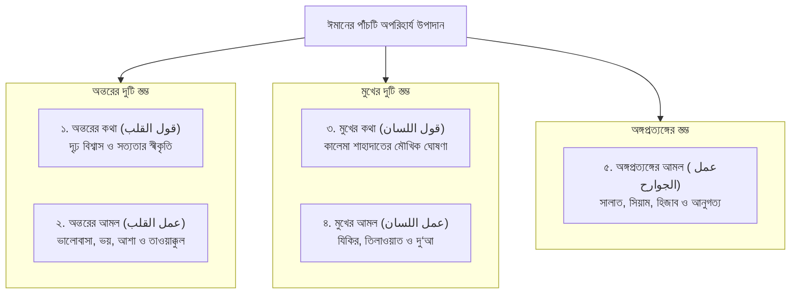
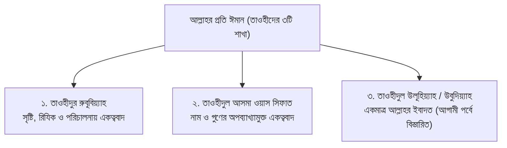
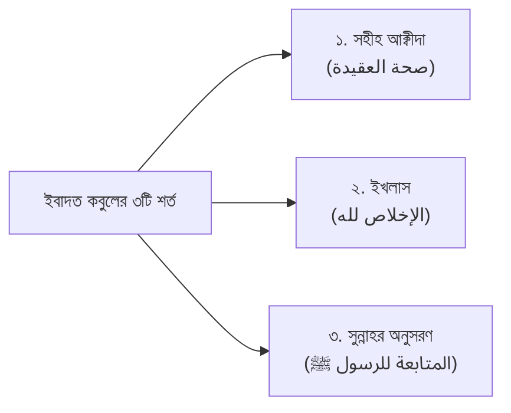
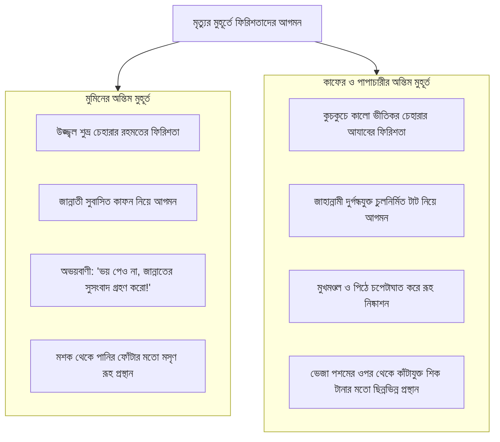

# প্রত্যেক মুসলিমকে যা জানতেই হবে
### দ্বীনের ভিত্তি ও ঈমানিয়াত (আক্বীদার ফরযে আইন শিক্ষা)

> **মূল আলোচক:** প্রফেসর ড. আবু বকর মুহাম্মাদ যাকারিয়া *(حفظه الله)*  
> (আন্তর্জাতিক খ্যাতিসম্পন্ন ইসলামী চিন্তাবিদ, গবেষক, প্রফেসর - আল-ফিকহ অ্যান্ড লিগ্যাল স্টাডিজ বিভাগ, ইসলামী বিশ্ববিদ্যালয়, কুষ্টিয়া; মদীনা ইসলামিক বিশ্ববিদ্যালয়ের ডক্টরেট ও তাফসীরে তাওযীহুল কুরআনের প্রণেতা)  
> **সংকলন ও সম্পাদনা:** আধুনিক প্রকাশনা মানদণ্ড অনুযায়ী পূর্ণাঙ্গ তাহকীক, তাখরীজ ও নির্ঘণ্টসহ সংকলিত।  
> **সংস্করণ:** প্রথম মাস্টার সংস্করণ (পর্ব ০১ – ১৮: ঈমানিয়াত পর্বের সম্পূর্ণ সংকলন)

---

## ভূমিকা ও সম্পাদকের আরয

بِسْمِ اللَّهِ الرَّحْمَٰنِ الرَّحِيمِ

إِنَّ الْحَمْدَ لِلَّهِ، نَحْمَدُهُ وَنَسْتَعِينُهُ وَنَسْتَغْفِرُهُ، وَنَعُوذُ بِاللَّهِ مِنْ شُرُورِ أَنْفُسِنَا وَمِنْ سَيِّئَاتِ أَعْمَالِنَا، مَنْ يَهْدِهِ اللَّهُ فَلَا مُضِلَّ لَهُ، وَمَنْ يُضْلِلْ فَلَا هَادِيَ لَهُ، وَأَشْهَدُ أَنْ لَا إِلٰهَ إِلَّا اللَّهُ وَحْدَهُ لَا شَرِيكَ لَهُ، وَأَشْهَدُ أَنَّ مُحَمَّدًا عَبْدُهُ وَرَسُولُهُ.

যাবতীয় প্রশংসা একমাত্র মহান রাব্বুল আলামীনের জন্য, যিনি সমগ্র মানবজাতিকে একনিষ্ঠভাবে তাঁরই তাওহীদ প্রতিষ্ঠার নিমিত্তে সৃষ্টি করেছেন। সালাত ও সালাম বর্ষিত হোক মানবতার মুক্তির দিশারী, সাইয়্যিদিল মুরসালীন, খাতামুন নাবিয়্যীন মুহাম্মাদুর রাসূলুল্লাহ ﷺ-এর ওপর, তাঁর পরিবারবর্গ, সাহাবায়ে কেরাম এবং কিয়ামত পর্যন্ত খাঁটি তাওহীদ ও সুন্নাহর অনুসারী সকল মুমিনের ওপর।

প্রতিটি মুসলিম নর-নারীর ওপর দ্বীনের সেই পরিমাণ এলেম শিক্ষা করা ব্যক্তিগতভাবে ফরয (ফরযে আইন)—যা না জানলে নিজের ঈমানকে শির্ক ও কুফর থেকে মুক্ত রাখা যায় না এবং আল্লাহর ইবাদত বিশুদ্ধভাবে সম্পন্ন করা যায় না। কিন্তু অত্যন্ত পরিতাপের বিষয় হলো, আধুনিক শিক্ষার চরম উৎকর্ষের যুগেও মুসলিম সমাজের একটি বিরাট অংশ দ্বীনের প্রাথমিক ও অপরিহার্য আক্বীদা সম্পর্কে চরম অজ্ঞতা ও উদাসীনতায় নিমজ্জিত। সমাজের আনাচে-কানাচে কবর-পূজা, মাজার-পূজা, কুফরী মতবাদ, বিদ‘আত এবং জাহেলিয়াতের বিস্তার ঘটছে অবাধে।

এই চরম শূন্যতা পূরণে বর্তমান বাংলা ভাষাভাষী মুসলিম বিশ্বের অন্যতম শ্রেষ্ঠ হাদীস ও ফিকহ বিশারদ, বরেণ্য গবেষক **প্রফেসর ড. আবু বকর মুহাম্মাদ যাকারিয়া *(حفظه الله)*** ধারাবাহিকভাবে জুমু‘আর খুতবায় যে জ্ঞানগর্ভ আলোচনা উপহার দিয়েছেন, তারই প্রামাণ্য রূপরেখা হলো **“প্রত্যেক মুসলিমকে যা জানতেই হবে”**।

### এই গ্রন্থের সংকলন ও সম্পাদনার মানদণ্ড:
১. **মূল ভাব ও মানহাজ সংরক্ষণ:** শায়খের বক্তব্যের প্রতিটি মূল বিষয়, দলীল ও ফতোয়াকে অবিকল সংরক্ষণ করা হয়েছে।  
২. **বিশুদ্ধ তাহকীক ও তাখরীজ:** প্রতিটি কুরআনিক আয়াতের পূর্ণাঙ্গ আরবী হরকত ও বাংলা অনুবাদ এবং `quran.com`-এর সরাসরি রেফারেন্স প্রদান করা হয়েছে। প্রতিটি হাদীসের ক্ষেত্রে মূল কিতাবের নাম, হাদীস নম্বর, মান (সহীহ/হাসান) এবং `hadithbd.com`-এর সরাসরি লিংক যুক্ত করা হয়েছে।  
৩. **দার্শনিক ও সমকালীন বিভ্রান্তি খণ্ডন:** ইলমুল কালাম, মু‘তাযিলা, আশ‘আরী-মাতুরিদী, কাদারিয়্যা, জাবারিয়্যা, মাজার-পূজা, ফানাফিল্লাহ এবং ধর্মনিরপেক্ষ সংবিধানবাদের অকাট্য খণ্ডন দলীলসহ সন্নিবেশিত করা হয়েছে।  
৪. **মডুলার ও বর্ধনশীল রূপরেখা:** এই গ্রন্থে শায়খের ‘ঈমানিয়াত’ (আক্বীদার ফরযে আইন) বিষয়ক প্রথম ১৮টি অধ্যায় সম্পূর্ণ করা হলো। ভবিষ্যতে শায়খের এই সিরিজের পরবর্তী পর্বসমূহ (ইসলামিয়াত: সালাত, যাকাত, সিয়াম ও হজ) সংযোজনের জন্য এই কাঠামোকে সম্পূর্ণ মডুলার রাখা হয়েছে।

আমরা মহান আল্লাহর শাহী দরবারে কায়মনোবাক্যে প্রার্থনা করি—তিনি যেন এই গ্রন্থটিকে প্রস্তুতকারী, পাঠক, প্রচারক এবং মূল আলোচক শায়খ ড. আবু বকর মুহাম্মাদ যাকারিয়াসহ সংশ্লিষ্ট সকলের নাজাতের উসীলা ও সাদাকায়ে জারিয়া হিসেবে কবুল করে নেন। আমীন, ইয়া রাব্বাল আলামীন!

---

## পূর্ণাঙ্গ গ্রন্থ সূচিপত্র (Master Table of Contents)

### পর্ব ১: দ্বীনের ভিত্তি ও ফরযে আইন এলেম (অধ্যায় ০১ - ০৪)
* [অধ্যায় ০১: তাকওয়ার ভিত্তি, দ্বীনি এলেম ও ঈমানের প্রকৃত স্বরূপ](#অধ্যায়-০১-তাকওয়ার-ভিত্তি-দ্বীনি-এলেম-ও-ঈমানের-প্রকৃত-স্বরূপ)
* [অধ্যায় ০২: তাকওয়ার স্বরূপ, ক্ষতিকর গ্রন্থ বর্জন ও ঈমানের পাঁচটি স্তম্ভ](#অধ্যায়-০২-তাকওয়ার-স্বরূপ-ক্ষতিকর-গ্রন্থ-বর্জন-ও-ঈমানের-পাঁচটি-স্তম্ভ)
* [অধ্যায় ০৩: তাওহীদুল উলূহিয়্যাহ, ইবাদতের শর্ত ও অনুবাদকদের খিয়ানত](#অধ্যায়-০৩-তাওহীদুল-উলূহিয়্যাহ-ইবাদতের-শর্ত-ও-অনুবাদকদের-খিয়ানত)
* [অধ্যায় ০৪: কবরের তিন প্রশ্ন, ঈমানের অন্তরায় ও আশুরার বিদ‘আত](#অধ্যায়-০৪-কবরের-তিন-প্রশ্ন-ঈমানের-অন্তরায়-ও-আশুরার-বিদআত)

### পর্ব ২: ঈমান বিল্লাহ ও গায়িবের জগৎ (অধ্যায় ০৫ - ০৮)
* [অধ্যায় ০৫: ঈমানের ২য় রুকন: ফিরিশতাদের প্রতি ঈমান, সৃষ্টি ও বৈশিষ্ট্য](#অধ্যায়-০৫-ঈমানের-২য়-রুকন-ফিরিশতাদের-প্রতি-ঈমান-সৃষ্টি-ও-বৈশিষ্ট্য)
* [অধ্যায় ০৬: মানবজীবনে ফিরিশতাদের ভূমিকা ও দায়িত্বসমূহ](#অধ্যায়-০৬-মানবজীবনে-ফিরিশতাদের-ভূমিকা-ও-দায়িত্বসমূহ)
* [অধ্যায় ০৭: আসমানী কিতাবসমূহের প্রতি ঈমান ও আল-কুরআনের হেফাযত](#অধ্যায়-০৭-আসমানী-কিতাবসমূহের-প্রতি-ঈমান-ও-আল-কুরআনের-হেফাযত)
* [অধ্যায় ০৮: আল-কুরআনের হক, কালামুল্লাহর আক্বীদা ও ইলমুল কালামের খণ্ডন](#অধ্যায়-০৮-আল-কুরআনের-হক-কালামুল্লাহর-আক্বীদা-ও-ইলমুল-কালামের-খণ্ডন)

### পর্ব ৩: রিসালাত ও নবুওয়াতের পূর্ণতা (অধ্যায় ০৯ - ১২)
* [অধ্যায় ০৯: নবী ও রাসূলগণের প্রতি ঈমান, মৌলিক পার্থক্য ও মর্যাদা](#অধ্যায়-০৯-নবী-ও-রাসূলগণের-প্রতি-ঈমান-মৌলিক-পার্থক্য-ও-মর্যাদা)
* [অধ্যায় ১০: নবীগণের মর্যাদা, সংখ্যা ও উলুল আযম রাসূলগণ](#অধ্যায়-১০-নবীগণের-মর্যাদা-সংখ্যা-ও-উলুল-আযম-রাসূলগণ)
* [অধ্যায় ১১: খাতামুন নাবিয়্যীন মুহাম্মাদুর রাসূলুল্লাহ ﷺ-এর রিসালাতের পূর্ণতা](#অধ্যায়-১১-খাতামুন-নাবিয়্যীন-মুহাম্মাদুর-রাসূলুল্লাহ-ﷺ-এর-রিসালাতের-পূর্ণতা)
* [অধ্যায় ১২: নবী-রাসূলদের দেখানো পথে সমাজ ও সংবিধান পরিচালনা](#অধ্যায়-১২-নবী-রাসূলদের-দেখানো-পথে-সমাজ-ও-সংবিধান-পরিচালনা)

### পর্ব ৪: পরকাল ও কিয়ামত (অধ্যায় ১৩ - ১৬)
* [অধ্যায় ১৩: আখেরাতের ওপর ঈমান, রুহের স্বরূপ ও হুসনুল খাতিমার পাথেয়](#অধ্যায়-১৩-আখেরাতের-ওপর-ঈমান-রুহের-স্বরূপ-ও-হুসনুল-খাতিমার-পাথেয়)
* [অধ্যায় ১৪: কিয়ামত অবধারিত, সময় গোপন ও অতীত আলামতসমূহ](#অধ্যায়-১৪-কিয়ামত-অবধারিত-সময়-গোপন-ও-অতীত-আলামতসমূহ)
* [অধ্যায় ১৫: কিয়ামতের চলমান ও সমসাময়িক ছোট আলামতসমূহ](#অধ্যায়-১৫-কিয়ামতের-চলমান-ও-সমসাময়িক-ছোট-আলামতসমূহ)
* [অধ্যায় ১৬: কিয়ামতের দশটি মহা-আলামত, দাজ্জালের ফিতনা ও আত্মরক্ষা](#অধ্যায়-১৬-কিয়ামতের-দশটি-মহা-আলামত-দাজ্জালের-ফিতনা-ও-আত্মরক্ষা)

### পর্ব ৫: তাকদীরের ওপর ঈমান ও ঈমানিয়াতের পূর্ণতা (অধ্যায় ১৭ - ১৮)
* [অধ্যায় ১৭: তাকদীরের ওপর ঈমান, চারটি স্তর ও বিভ্রান্তি নিরসন](#অধ্যায়-১৭-তাকদীরের-ওপর-ঈমান-চারটি-স্তর-ও-ভ্রান্তি-নিরসন)
* [অধ্যায় ১৮: তাকদীর বনাম বান্দার আমল এবং ঈমানিয়াতের পূর্ণতা](#অধ্যায়-১৮-তাকদীর-বনাম-বান্দার-আমল-এবং-ঈমানিয়াতের-পূর্ণতা)

---


<div style="page-break-before: always;"></div>

---

# অধ্যায় ০১: তাকওয়ার ভিত্তি, দ্বীনি এলেম অর্জন ও ঈমানের প্রকৃত স্বরূপ

> _প্রত্যেক মুসলিমের ওপর ফরযে আইন এলেমের অপরিহার্যতা, তাকওয়ার পূর্বশর্ত এবং ঈমানের বিশুদ্ধ অর্থ ও সার্বক্ষণিক নবায়ন।_

---

## বক্তার পরিচিতি ও আলোচনার প্রেক্ষাপট

- **মূল আলোচনা:** প্রফেসর ড. আবু বকর মুহাম্মাদ যাকারিয়া _(حفظه الله)_  
  _(প্রফেসর, আল-ফিকহ ও ইসলামিক স্টাডিজ বিভাগ, ইসলামী বিশ্ববিদ্যালয়, কুষ্টিয়া; মদিনা ইসলামী বিশ্ববিদ্যালয়ের পিএইচডি গবেষক এবং সুবিখ্যাত তাফসির প্রণেতা)_
- **বিষয়শ্রেণী:** ধারাবাহিক জুমার খুতবা — "প্রত্যেক মুসলিমকে যা জানতেই হবে" (১ম পর্ব)।
- **প্রেক্ষাপট:** আধুনিক ভোগবাদী সভ্যতার প্রভাবে মুসলিম সমাজ পার্থিব বিদ্যা ও পেশাগত দক্ষতায় উৎকর্ষ অর্জন করলেও পরকাল এবং দ্বীনের মৌলিক 'ফরযে আইন' জ্ঞান সম্পর্কে মারাত্মক অজ্ঞতায় নিমজ্জিত। ঈমানকে স্রেফ কিছু মানসিক 'বিশ্বাস' মনে করে শিরক, বিদ‘আত ও কুফরিতে লিপ্ত হওয়ার যে ব্যাধি তৈরি হয়েছে, তা দূর করে তাকওয়ার প্রকৃত স্বরূপ ও দ্বীনি এলেম অর্জনের আবশ্যকতা উন্মোচনের উদ্দেশ্যেই শায়খ এই মৌলিক ধারাবাহিক খুতবার সূচনা করেন।

---

## ভূমিকা: তাকওয়া ও দ্বীনি জ্ঞানের অবিচ্ছেদ্য সম্পর্ক

মানবজীবনের একমাত্র চূড়ান্ত লক্ষ্য হলো মহান রবের সন্তুষ্টি অর্জন করে জাহান্নামের ভয়াবহ আযাব থেকে মুক্তি পাওয়া এবং জান্নাতের চিরস্থায়ী নেয়ামত লাভ করা। আর জান্নাতে প্রবেশের অনিবার্য শর্ত হলো 'তাকওয়া' (আল্লাহভীতি ও পরহেযগারিতা)।

কিন্তু তাকওয়া কোনো বাহ্যিক লেবাস, বাজার থেকে কিনে গায়ে জড়ানোর কোনো পোশাক কিংবা শুধু আনুষ্ঠানিক কান্নাকাটির নাম নয়। তাকওয়ার প্রথম ও প্রধান পূর্বশর্ত হলো—যিনি আমার রব, তাঁকে সঠিকভাবে জানা এবং তিনি বান্দার ওপর কী নির্দেশ করেছেন আর কী নিষেধ করেছেন, তা পুঙ্খানুপুঙ্খভাবে অবগত হওয়া। যে ব্যক্তি জানে না আল্লাহ কী চান, সে কখনো আল্লাহর নির্দেশ পালন করতে পারবে না; আর যে ব্যক্তি জানে না কোন কাজে আল্লাহ অসন্তুষ্ট হন, সে কখনো হারাম ও গুনাহ থেকে নিজেকে রক্ষা করতে পারবে না।

ফলস্বরূপ, সঠিক জ্ঞানের অনুপস্থিতিতে মানুষ এমন কাজে লিপ্ত হয়ে পড়ে যা তার গোটা জীবনের নেক আমল ধ্বংস করে দেয়—যেমন শিরক, কুফর, বিদ‘আত ও নিফাক্ব। এজন্যই ইসলামে তাকওয়ার ভিত্তি স্থাপিত হয়েছে বিশুদ্ধ দ্বীনি এলেমের ওপর।

---

## মূল আলোচনা

### ১. অহীর সূচনা ও এলেম অর্জনের ঐশী নির্দেশ

আল্লাহ সুবহানাহু ওয়া তা‘আলা বিশ্বমানবতার মুক্তির দিশারী হিসেবে সর্বশেষ নবী মুহাম্মাদুর রাসূলুল্লাহ ﷺ-এর ওপর যখন প্রথম অহী নাযিল করেন, তখন সালাত, সাওম, হজ কিংবা জিহাদের নির্দেশ দেননি; বরং প্রথম যে শব্দটি জিবরীল (আ.)-এর মাধ্যমে অবতীর্ণ হয়েছিল, তা হলো—**"ইক্বরা" (পাঠ করুন/জ্ঞান অর্জন করুন)**।

> ﴿اقْرَأْ بِاسْمِ رَبِّكَ الَّذِي خَلَقَ ۝ خَلَقَ الْإِنسَانَ مِنْ عَلَقٍ ۝ اقْرَأْ وَرَبُّكَ الْأَكْرَمُ ۝ الَّذِي عَلَّمَ بِالْقَلَمِ ۝ عَلَّمَ الْإِنسَانَ مَا لَمْ يَعْلَمْ﴾  
> **অর্থ:** "পাঠ করুন আপনার রবের নামে, যিনি সৃষ্টি করেছেন। তিনি মানুষকে সৃষ্টি করেছেন জমাট রক্তপিন্ড থেকে। পাঠ করুন! আর আপনার রব মহামহিমান্বিত, যিনি কলমের সাহায্যে শিক্ষা দিয়েছেন। তিনি মানুষকে শিক্ষা দিয়েছেন যা সে জানত না।"  
> — [সূরা আল-আলাক্ব, ৯৬:১-৫](https://quran.com/96/1-5)

**শায়খের তাৎপর্যপূর্ণ বিশ্লেষণ:**  
আল্লাহ তা‘আলা শুধু পড়তে বলেননি, বলেছেন _'আপনার রবের নামে পাঠ করুন'_। আল্লাহর নামে কেবলমাত্র সেই জ্ঞানই অর্জন করা যায় এবং সেই বিষয়ই অধ্যয়ন করা যায়, যা আল্লাহ তা‘আলা অনুমোদন করেছেন। যা কিছু হারাম, ক্ষতিকর ও ঈমানবিনাশী, তা কখনো আল্লাহর নামে হতে পারে না। প্রথম নির্দেশই স্পষ্ট করে দেয় যে, মানুষের প্রথম কাজ হলো রবের কালাম বুঝা, নবীর সুন্নাহ জানা এবং যা দুনিয়া ও আখেরাতে বান্দার উপকারে আসবে সেই জ্ঞান অর্জন করা।

---

### ২. ইসলামে এলেম ও আলেমের অনন্য মর্যাদা

ইসলামে জ্ঞানবান ব্যক্তির মর্যাদা সাধারণ মানুষের চেয়ে বহু ঊর্ধ্বে নির্ধারণ করা হয়েছে। কুরআনুল কারীমে আল্লাহ তা‘আলা সুস্পষ্ট ভাষায় জানিয়ে দিয়েছেন যে, জ্ঞানবান ও অজ্ঞ ব্যক্তি কখনো সমান হতে পারে না:

> ﴿قُلْ هَلْ يَسْتَوِي الَّذِينَ يَعْلَمُونَ وَالَّذِينَ لَا يَعْلَمُونَ ۗ إِنَّمَا يَتَذَكَّرُ أُولُو الْأَلْبَابِ﴾  
> **অর্থ:** "বলুন: যারা জানে এবং যারা জানে না তারা কি সমান হতে পারে? কেবল বোধশক্তি সম্পন্ন ব্যক্তিরাই উপদেশ গ্রহণ করে।"  
> — [সূরা আয-যুমার, ৩৯:৯](https://quran.com/39/9)

আল্লাহ তা‘আলা তাঁর প্রিয় হাবীব ﷺ-কে দুনিয়ার কোনো সম্পদ বা প্রতিপত্তি বৃদ্ধির প্রার্থনা করতে নির্দেশ দেননি; একমাত্র এলেম বৃদ্ধির জন্যই দো‘আ করার আদেশ দিয়েছেন:

> ﴿وَقُل رَّبِّ زِدْنِي عِلْمًا﴾  
> **অর্থ:** "এবং আপনি বলুন: হে আমার রব! আমার জ্ঞান বৃদ্ধি করে দিন।"  
> — [সূরা ত্ব-হা, ২০:১১৪](https://quran.com/20/114)

রসূলুল্লাহ ﷺ-কে যদি জ্ঞান বৃদ্ধির প্রার্থনা করতে হয়, তবে আমাদের মতো সাধারণ মুসলিমের দ্বীন শেখার জন্য কত অধিক ব্যাকুল ও সচেষ্ট হওয়া আবশ্যক! অন্য আয়াতে আল্লাহ তা‘আলা ঘোষণা করেছেন:

> ﴿يَرْفَعِ اللَّهُ الَّذِينَ آمَنُوا مِنكُمْ وَالَّذِينَ أُوتُوا الْعِلْمَ دَرَجَاتٍ﴾  
> **অর্থ:** "তোমাদের মধ্যে যারা ঈমান এনেছে এবং যাদেরকে জ্ঞান দান করা হয়েছে, আল্লাহ তাদেরকে মর্যাদায় বহু স্তরে সমুন্নত করবেন।"  
> — [সূরা আল-মুজাদালাহ, ৫৮:১১](https://quran.com/58/11)

আর প্রকৃত আল্লাহভীতি কার অন্তরে জাগ্রত হয়, তা স্পষ্ট করে আল্লাহ বলেন:

> ﴿إِنَّمَا يَخْشَى اللَّهَ مِنْ عِبَادِهِ الْعُلَمَاءُ﴾  
> **অর্থ:** "নিশ্চয়ই আল্লাহর বান্দাদের মধ্যে কেবল আলেমরাই (জ্ঞানীরাই) তাঁকে যথার্থ ভয় করে।"  
> — [সূরা ফাতির, ৩৫:২৮](https://quran.com/35/28)

অতএব, খাঁটি 'খাশিয়াতুল্লাহ' (আল্লাহভীতি) এবং তাকওয়া অর্জনের জন্য শরয়ী এলেমের কোনো বিকল্প নেই।

---

### ৩. সহীহ সুন্নাহর আলোকে জ্ঞান অন্বেষণের ফযীলত

#### (ক) প্রত্যেক মুসলিমের ওপর এলেম অর্জন ফরয:

> عَنْ أَنَسِ بْنِ مَالِكٍ رَضِيَ اللَّهُ عَنْهُ قَالَ: قَالَ رَسُولُ اللَّهِ ﷺ:  
> «طَلَبُ الْعِلْمِ فَرِيضَةٌ عَلَى كُلِّ مُسْلِمٍ»  
> **অনুবাদ:** আনাস ইবনু মালিক (রা.) থেকে বর্ণিত, রাসূলুল্লাহ ﷺ বলেছেন: "জ্ঞান অন্বেষণ করা প্রত্যেক মুসলিমের ওপর ফরয।"  
> — _সুনান ইবনু মাজাহ, হাদিস নং ২২৪; সহীহ (সহীহ আত-তারগীব, ৭২)_। [HadithBD লিংক](https://www.hadithbd.com/hadith/filter/?book=14&hadith=224)

শায়খ উল্লেখ করেন, আরবি ব্যাকরণে 'মুসলিম' শব্দটি নর-নারী নির্বিশেষে প্রত্যেক ঈমানদার ব্যক্তিকে অন্তর্ভুক্ত করে। অর্থাৎ প্রতিটি প্রাপ্তবয়স্ক মুসলিম নর-নারীর ওপর দ্বীনের ফরযে আইন জ্ঞান শিক্ষা করা অলঙ্ঘনীয় কর্তব্য।

#### (খ) দ্বীনি এলেম অর্জনের পথ—জান্নাতের পথ:

> عَنْ أَبِي هُرَيْرَةَ رَضِيَ اللَّهُ عَنْهُ قَالَ: قَالَ رَسُولُ اللَّهِ ﷺ:  
> «مَنْ سَلَكَ طَرِيقًا يَلْتَمِسُ فِيهِ عِلْمًا، سَهَّلَ اللَّهُ لَهُ بِهِ طَرِيقًا إِلَى الْجَنَّةِ»  
> **অনুবাদ:** আবু হুরায়রা (রা.) থেকে বর্ণিত, রাসূলুল্লাহ ﷺ বলেছেন: "যে ব্যক্তি জ্ঞান অন্বেষণের উদ্দেশ্যে কোনো পথ অবলম্বন করে, আল্লাহ তার জন্য জান্নাতের পথ সহজ করে দেন।"  
> — _সহীহ মুসলিম, হাদিস নং ২৬৯৯_। [HadithBD লিংক](https://www.hadithbd.com/hadith/filter/?book=2&hadith=2699)

মসজিদে ইলমের হালাকায় বসা, দ্বীনি দারস শোনা, খুতবা মনোযোগ দিয়ে অনুধাবন করা কিংবা কোনো দ্বীনি শিক্ষাপ্রতিষ্ঠানে সহযোগিতা করা—সবই জান্নাতের পথে চলার অন্তর্ভুক্ত।

#### (গ) আবেদের ওপর আলেমের শ্রেষ্ঠত্ব:

> عَنْ أَبِي الدَّرْدَاءِ رَضِيَ اللَّهُ عَنْهُ قَالَ: سَمِعْتُ رَسُولَ اللَّهِ ﷺ يَقُولُ:  
> «وَإِنَّ فَضْلَ الْعَالِمِ عَلَى الْعَابِدِ كَفَضْلِ الْقَمَرِ لَيْلَةَ الْبَدْرِ عَلَى سَائِرِ الْكَوَاكِبِ»  
> **অনুবাদ:** আবু দারদা (রা.) থেকে বর্ণিত, তিনি বলেন, আমি রাসূলুল্লাহ ﷺ-কে বলতে শুনেছি: "নিশ্চয়ই একজন আবেদের (সাধারণ ইবাদতকারীর) ওপর আলেমের শ্রেষ্ঠত্ব ঠিক তেমনই, যেমন পূর্ণিমার রাতের চাঁদের শ্রেষ্ঠত্ব সমস্ত তারকারাজির ওপর।"  
> — _সুনান আবু দাউদ, হাদিস নং ৩৬৪১; সুনান আত-তিরমিযী, হাদিস নং ২৬৮২; সহীহ_। [HadithBD লিংক](https://www.hadithbd.com/hadith/filter/?book=4&hadith=3641)

**শায়খের গভীর পর্যবেক্ষণ:**  
নক্ষত্রের নিজস্ব আলো থাকলেও তা পৃথিবীকে আলোকিত করতে পারে না, কিন্তু পূর্ণিমার চাঁদ গোটা জগৎকে আলোকিত করে। আবেদ শুধু নিজের মুক্তির জন্য আমল করে, কিন্তু একজন আলেম সমগ্র জাতিকে সঠিক পথ দেখিয়ে আলোর দিশা দেন। এজন্যই রাসূলুল্লাহ ﷺ আলেমদের স্থান এত উচ্চে স্থাপন করেছেন।

#### (ঘ) আল্লাহর বিশেষ কল্যাণের মানদণ্ড:

> عَنْ مُعَاوِيَةَ رَضِيَ اللَّهُ عَنْهُ قَالَ: قَالَ رَسُولُ اللَّهِ ﷺ:  
> «مَنْ يُرِدِ اللَّهُ بِهِ خَيْرًا يُفَقِّهْهُ فِي الدِّينِ»  
> **অনুবাদ:** মুয়াবিয়া (রা.) থেকে বর্ণিত, রাসূলুল্লাহ ﷺ বলেছেন: "আল্লাহ যার কল্যাণ চান, তাকে দ্বীনের গভীর জ্ঞান ও প্রজ্ঞা দান করেন।"  
> — _সহীহ বুখারী, হাদিস নং ৭১; সহীহ মুসলিম, হাদিস নং ১০৩৭; মুত্তাফাক্ব আলাইহ_। [HadithBD লিংক](https://www.hadithbd.com/hadith/filter/?book=1&hadith=71)

এ হাদিসের বিপরীত মর্ম (মাক্বহূমুল মুখালাফাহ) হলো—আল্লাহ যার কোনো কল্যাণ চান না, সে দ্বীনি এলেম অর্জন থেকে বঞ্চিত থেকে যায়।

---

### ৪. এলেম বনাম জিহাদ: কুরআনের অগ্রাধিকারের শিক্ষা

অনেক সময় মানুষ মনে করে জিহাদই ইসলামের সর্বোচ্চ আমল। কিন্তু আল্লাহ সুবহানাহু ওয়া তা‘আলা আল-কুরআনে স্পষ্ট জানিয়ে দিয়েছেন যে, এলেম অর্জন কখনো কখনো জিহাদের চেয়েও অগ্রাধিকারপ্রাপ্ত। আল্লাহ তা‘আলা বলেন:

> ﴿وَمَا كَانَ الْمُؤْمِنُونَ لِيَنفِرُوا كَافَّةً ۚ فَلَوْلَا نَفَرَ مِن كُلِّ فِرْقَةٍ مِّنْهُمْ طَائِفَةٌ لِّيَتَفَقَّهُوا فِي الدِّينِ وَلِيُنذِرُوا قَوْمَهُمْ إِذَا رَجَعُوا إِلَيْهِمْ لَعَلَّهُمْ يَحْذَرُونَ﴾  
> **অর্থ:** "আর মুমিনদের সবার একসাথে অভিযানে বের হওয়া সমীচীন নয়। সুতরাং তাদের প্রত্যেক দলের একটি অংশ কেন বের হয় না—যাতে তারা দ্বীনের গভীর জ্ঞান অর্জন করতে পারে এবং তাদের সম্প্রদায় যখন তাদের নিকট ফিরে আসবে, তখন যেন তাদেরকে সতর্ক করতে পারে, যাতে তারা বেঁচে থাকতে পারে?"  
> — [সূরা আত-তাওবাহ, ৯:১২২](https://quran.com/9/122)

যুদ্ধক্ষেত্রে যারা যায়, তারা বীরত্বের সাথে যুদ্ধ করতে গিয়েও শরয়ী ভুলের শিকার হতে পারে। তাই একটি দলের দ্বীনের গভীর জ্ঞান অর্জন করা অপরিহার্য, যেন মুজাহিদ দল ফিরে এলে তারা তাদেরকে হালাল-হারাম ও আল্লাহর বিধানের সঠিক পথনির্দেশ দিতে পারেন। সালাফে সালেহীন ও বহু মুহাদ্দিস বলেছেন: _"দ্বীনি এলেম অর্জনকে যদি জিহাদের সমতুল্য বা তার চেয়েও শ্রেষ্ঠ মর্যাদা না দেওয়া হয়, তবে মানুষ এলেমের মাহাত্ম্যই বুঝবে না।"_

---

### ৫. এলেমের প্রকারভেদ: উপকারী জ্ঞান বনাম অপকারী অনর্থক জ্ঞান

দুনিয়াতে জ্ঞানের বহু শাখা-প্রশাখা রয়েছে। তবে ইসলামে জ্ঞান মূলত দুই প্রকার:

1. **উপকারী জ্ঞান (العلم النافع):** যা মানুষের ঈমান মজবুত করে, আল্লাহ ও তাঁর রাসূল ﷺ-এর পরিচয় করিয়ে দেয়, জান্নাতের পথ সুগম করে এবং আখেরাতে নাজাতের মাধ্যম হয়।
2. **অনর্থক বা ক্ষতিকর জ্ঞান (علم لا ينفع):** যা মানুষের সময় নষ্ট করে, বিভ্রান্তি সৃষ্টি করে, কিংবা অন্তরে সংশয় ও কুফরি দর্শন ঢুকিয়ে দেয়।

রাসূলুল্লাহ ﷺ অপকারী জ্ঞান থেকে আল্লাহর কাছে আশ্রয় প্রার্থনা করতেন:

> عَنْ زَيْدِ بْنِ أَرْقَمَ رَضِيَ اللَّهُ عَنْهُ: كَانَ رَسُولُ اللَّهِ ﷺ يَقُولُ:  
> «اللَّهُمَّ إِنِّي أَعُوذُ بِكَ مِنْ عِلْمٍ لَا يَنْفَعُ، وَمِنْ قَلْبٍ لَا يَخْشَعُ، وَمِنْ نَفْسٍ لَا تَشْبَعُ، وَمِنْ دَعْوَةٍ لَا يُسْتَجَابُ لَهَا»  
> **অনুবাদ:** যায়েদ ইবনু আরকাম (রা.) থেকে বর্ণিত, রাসূলুল্লাহ ﷺ এই দো‘আ করতেন: "হে আল্লাহ! আমি আপনার নিকট এমন এলেম থেকে আশ্রয় চাই যা কোনো উপকারে আসে না; এমন অন্তর থেকে আশ্রয় চাই যা ভীত হয় না; এমন প্রবৃত্তি থেকে যা কখনো তৃপ্ত হয় না এবং এমন দো‘আ থেকে যা কবুল হয় না।"  
> — _সহীহ মুসলিম, হাদিস নং ২৭২২_। [HadithBD লিংক](https://www.hadithbd.com/hadith/filter/?book=2&hadith=2722)

**ঐতিহাসিক দৃষ্টান্ত:**  
উমর ইবনুল খাত্তাব (রা.)-এর খেলাফতকালে একবার এক ব্যক্তিকে নিয়ে এসে বলা হলো, "ইনি একজন আল্লামা (মস্তবড় পণ্ডিত)!" উমর (রা.) জিজ্ঞেস করলেন, "তিনি কিসের আলেম?" উপস্থিত লোকেরা বলল, "তিনি মানুষের আদি থেকে অনন্তকাল পর্যন্ত সমস্ত বংশলতিকা মুখস্থ জানেন!"  
তখন উমর (রা.) বললেন: _"বংশলতিকা তো কেবল অতটুকুই জানা দরকার, যা দিয়ে মানুষ আত্মীয়তার সম্পর্ক রক্ষা করতে পারে। আদম (আ.) পর্যন্ত বংশ মুখস্থ করে সময় নষ্ট করার কোনো ফায়দা নেই।"_

অর্থাৎ যে বিদ্যা মানুষের বাস্তব জীবনে বা পরকালে কোনো উপকারে আসে না, তা নিয়ে জীবন নষ্ট করা কোনো বিবেকবান মুমিনের কাজ নয়। বিশেষ করে তথাকথিত বস্তুবাদী ও নাস্তিক্যবাদী দর্শনশাস্ত্র যা মানুষের ঈমান হরণ করে, তা থেকে দূরে থাকা ফরয।

---

### ৬. ফরযে আইন বনাম ফরযে কিফায়াহ এলেম

ইসলামী শরীয়াহ অনুযায়ী দ্বীনি এলেম দুই ভাগে বিভক্ত:

| এলেমের প্রকার                    | শরয়ী সংজ্ঞা                                                                                                       | উদাহরণ ও পরিধি                                                                                                                                                        |
| :------------------------------- | :----------------------------------------------------------------------------------------------------------------- | :-------------------------------------------------------------------------------------------------------------------------------------------------------------------- |
| **১. ফরযে আইন (فرض عين)**        | এমন জ্ঞান যা প্রতিটি মুসলিমের ব্যক্তিগতভাবে জানা বাধ্যতামূলক। না জানলে সে গুনাহগার হবে এবং তার আমল বরবাদ হতে পারে। | তাওহীদ ও ঈমানের সঠিক অর্থ, শিরক ও কুফর থেকে বাঁচার উপায়, সালাতের বিশুদ্ধ পদ্ধতি, ওযুর ফরজসমূহ, নিজের অর্জিত সম্পদের যাকাত, হালাল-হারাম খাদ্য ও রোজগারের মৌলিক জ্ঞান। |
| **২. ফরযে কিফায়াহ (فرض كفاية)** | এমন উচ্চতর জ্ঞান যা সমাজের একটি দল অর্জন করলেই সবার পক্ষ থেকে দায়িত্ব আদায় হয়ে যায়।                            | জটিল উত্তরাধিকার আইন (ইলমুল ফারায়িয)-এর খুঁটিনাটি সমাধান, কুরআন ও হাদিসের গভীর গবেষণা, মুফতি ও বিচারক (ক্বাযী) হওয়ার উপযোগী ফিক্বহী ব্যুৎপত্তি।                     |

শায়খ দুঃখ প্রকাশ করে বলেন: আজকে মানুষ ব্যবসা-বাণিজ্য, প্রযুক্তি আর দুনিয়াবী আইনের ক্ষেত্রে হাজারো বই পড়ে বিশেষজ্ঞ হচ্ছে, অথচ যে সালাত প্রতিদিন পাঁচবার পড়ছে, সেই সালাতের ভেতরে কী পড়ছে তার অর্থটুকু জানে না! কবরে যখন প্রশ্ন করা হবে, তখন কি কোনো ইঞ্জিনিয়ার বা ডাক্তারের পেশাগত সনদ কাজে লাগবে?

---

### ৭. পার্থিব জ্ঞানের আধিক্য বনাম আখেরাতের গাফলত

আল্লাহ তা‘আলা আল-কুরআনে আধুনিক বস্তুবাদী সমাজের এক ভয়াবহ রোগ উন্মোচন করে দিয়েছেন:

> ﴿يَعْلَمُونَ ظَاهِرًا مِّنَ الْحَيَاةِ الدُّنْيَا وَهُمْ عَنِ الْآخِرَةِ هُمْ غَافِلُونَ﴾  
> **অর্থ:** "তারা পার্থিব জীবনের বাহ্যিক রূপটি খুব ভালোভাবেই জানে, অথচ আখেরাতের ব্যাপারে তারা সম্পূর্ণ গাফেল ও উদাসীন।"  
> — [সূরা আর-রূম, ৩০:৭](https://quran.com/30/7)

আজকে আমাদের সেক্যুলার শিক্ষা ব্যবস্থায় দ্বীনি শিক্ষাকে দিন দিন সংকুচিত করা হচ্ছে। অনেকে দ্বীনি শিক্ষাকে 'আনপ্রোডাক্টিভ' (অনুৎপাদনশীল) বলে অপবাদ দেয়। শায়খ ক্ষোভ প্রকাশ করে বলেন:

> _"যে শিক্ষা মানুষকে কবরে নাজাত দেবে না, যে শিক্ষা তাকে আল্লাহর আযাব থেকে বাঁচাবে না, তাকে আপনি উৎপাদনশীল বলছেন? মানুষ যদি হাজার বছরও বেঁচে থাকে, তবু তো তাকে এই দেহ মাটিতে ফেলে কবরে চলে যেতে হবে! দেহটাকে আপনি যত খাবার দিয়েই মোটাতাজা করুন না কেন, কবরে তা কীটের খাদ্যে পরিণত হবে। যে এলেম অনন্ত আখেরাতে কাজে আসবে না, সেই এলেম নিয়ে যারা মত্ত হয়ে দ্বীন ভুলে আছে, তারা নিজেদের পায়ে নিজেরাই কুড়াল মারছে।"_

---

### ৮. ঈমানের প্রকৃত অর্থ: ঈমান মানে শুধু 'বিশ্বাস' নয়!

আমাদের সমাজে সবচেয়ে মারাত্মক বিভ্রান্তি ছড়িয়েছে একটি ভুল অনুবাদের মাধ্যমে। প্রায় সব প্রচলিত বাংলা বই-পুস্তকে লেখা হয়: _"ঈমান অর্থ বিশ্বাস।"_

**শায়খের সুস্পষ্ট তাহক্বীক্ব ও খণ্ডন:**  
আরবি ভাষায় 'বিশ্বাস' এর প্রতিশব্দ হলো 'তাসদীক্ব' (التصديق)। কিন্তু ঈমান (الإيمان) শব্দটি এসেছে 'আম্‌ন' (أمن) ধাতু থেকে, যার পারিভাষিক অর্থ হলো: **স্বীকৃতি দেওয়া, মেনে নেওয়া এবং পূর্ণ আনুগত্যের সাথে আত্মসমর্পণ করা (الإقرار والاعتراف والإذعان)**।

শুধু 'বিশ্বাস' কখনো ঈমান হতে পারে না। এর সুস্পষ্ট দলীল:

1. **ইবলিসের অবস্থা:** ইবলিস কি আল্লাহকে বিশ্বাস করত না? সে তো সরাসরি আল্লাহর সাথে কথা বলেছে, আল্লাহকে রব বলে ডেকেছে (`قَالَ رَبِّ فَأَنظِرْنِي`). সে কি জান্নাত ও জাহান্নামে বিশ্বাস করত না? নিশ্চিতভাবেই করত! কিন্তু ইবলিস কি মুমিন হতে পেরেছে? না! সে চিরস্থায়ী কাফের ও অভিশপ্ত হয়েছে; কারণ সে আল্লাহর নির্দেশের সামনে আনুগত্য ও স্বীকৃতি দেয়নি।
2. **মক্কার মুশরিকদের অবস্থা:** আবু জাহেল ও আবু লাহাবও বিশ্বাস করত যে আল্লাহই আসমান-জমিন ও মানবজাতির স্রষ্টা (সূরা যুখরুফ, ৪৩:৮৭)। কিন্তু তারা যখন মূর্তিপূজা ত্যাগ করে একমাত্র আল্লাহর উলূহিয়্যাত মেনে নিতে অস্বীকার করল, তখন তাদের সেই বিশ্বাস কোনো কাজে আসেনি।
3. **মুনাফিকদের মুখে উচ্চারণ:** মুনাফিকরা মুখে 'লা ইলাহা ইল্লাল্লাহ' বলত, কিন্তু অন্তরে তার কোনো স্বীকৃতি ছিল না। আল্লাহ তাদের সরাসরি মিথ্যাবাদী ঘোষণা করেছেন।

আল্লাহ তা‘আলা এজন্যই বলেন:

> ﴿فَاعْلَمْ أَنَّهُ لَا إِلَٰهَ إِلَّا اللَّهُ وَاسْتَغْفِرْ لِذَنبِكَ﴾  
> **অর্থ:** "অতএব আপনি জেনে নিন যে, নিশ্চয়ই আল্লাহ ব্যতীত কোনো সত্য ইলাহ নেই; এবং ক্ষমা প্রার্থনা করুন আপনার ত্রুটির জন্য..."  
> — [সূরা মুহাম্মাদ, ৪৭:১৯](https://quran.com/47/19)

আল্লাহ মুখস্থ উচ্চারণ করতে বলেননি; বলেছেন: **'ফা‘লাম' (আগে জানুন ও বুঝুন)**। ঈমান হলো তিনটি বিষয়ের অবিচ্ছেদ্য সমন্বয়:

- অন্তরে দৃঢ় বিশ্বাস ও আন্তরিক স্বীকৃতি।
- মুখে অকপট ঘোষণা।
- অঙ্গপ্রত্যঙ্গের মাধ্যমে আমল ও পূর্ণ আনুগত্যের প্রতিফলন।

---

### ৯. ঈমানের সার্বক্ষণিক আবশ্যকতা ও আত্মরক্ষা

সালাতের বিধান আসে নির্ধারিত সময়ে। ওযু ভঙ্গ হলে পুনরায় ওযু করা যায়। কিন্তু **ঈমান এমন এক জিনিস, যা মানুষের প্রতিটি মুহূর্তে, প্রতি শ্বাসে-প্রশ্বাসে জীবিত রাখতে হয়**। এক পলকের জন্যও ঈমানের গণ্ডির বাইরে যাওয়ার অবকাশ কোনো মুসলিমের নেই।

কোনো মানুষ যদি এক মুহূর্তের জন্য শিরক বা কুফরিতে লিপ্ত হয়, তবে সেই মুহূর্তেই সে ইসলাম থেকে খারিজ হয়ে যেতে পারে। এজন্যই রাসূলুল্লাহ ﷺ সার্বক্ষণিক আল্লাহর কাছে অন্তরের স্থায়িত্বের জন্য আকুল প্রার্থনা করতেন:

> عَنْ أَنَسٍ رَضِيَ اللَّهُ عَنْهُ قَالَ: كَانَ رَسُولُ اللَّهِ ﷺ يُكْثِرُ أَنْ يَقُولَ:  
> «يَا مُقَلِّبَ الْقُلُوبِ ثَبِّتْ قَلْبِي عَلَى دِينِكَ»  
> **অনুবাদ:** আনাস (রা.) থেকে বর্ণিত, রাসূলুল্লাহ ﷺ এই দো‘আটি সবচেয়ে বেশি পাঠ করতেন: "হে অন্তরসমূহের পরিবর্তনকারী! আমার অন্তরকে আপনার দ্বীনের ওপর অবিচল ও দৃঢ় রাখুন।"  
> — _সুনান আত-তিরমিযী, হাদিস নং ২১৪০; সহীহ_। [HadithBD লিংক](https://www.hadithbd.com/hadith/filter/?book=3&hadith=2140)

তিনি আরও দো‘আ করতেন, যেন আল্লাহ তাঁকে চোখের পলকের জন্যও নিজের নফসের ওপর ছেড়ে না দেন:

> «يَا حَيُّ يَا قَيُّومُ بِرَحْمَتِكَ أَسْتَغِيثُ، أَصْلِحْ لِي شَأْنِي كُلَّهُ، وَلَا تَكِلْنِي إِلَى نَفْسِي طَرْفَةَ عَيْنٍ»  
> **অনুবাদ:** "হে চিরঞ্জীব! হে সর্বসত্তার ধারক ও পরিচালক! আপনার রহমতের উসিলায় আমি সাহায্য প্রার্থনা করছি; আপনি আমার সকল বিষয় সংশোধন করে দিন এবং চোখের পলক ফেলার মতো সময়ের জন্যও আমাকে আমার নিজের কাছে সোপর্দ করবেন না।"  
> — _মুসতাদরাকে হাকিম, হাদিস নং ২০০০; সহীহ আত-তারগীব, হাদিস নং ৬৫৪; হাসান-সহীহ_। [HadithBD লিংক](https://www.hadithbd.com/hadith/filter/?book=18&hadith=654)

এমনকি রাতে ঘুমানোর সময়ও রাসুলুল্লাহ ﷺ ঈমান নবায়ন করে ঘুমাতে শিখিয়েছেন (যেমন: সূরা আল-বাকারার শেষ দুই আয়াত তিলাওয়াত করা, যেখানে ঈমানের ছয়টি রুকনের অকুণ্ঠ স্বীকৃতি রয়েছে)।

---

### ১০. পরিবার ও সন্তানদের ঈমান শিক্ষা দেওয়ার আমানত

ঈমান হলো মহান রবের পক্ষ থেকে বান্দার কাছে রক্ষিত সবচেয়ে পবিত্র 'আমানত'। যে পিতা-মাতা তার সন্তানকে ভালো স্কুল-কলেজে পড়াল, ক্যারিয়ার গড়ে দিল, কিন্তু ঈমানের সহীহ অর্থ এবং ফরযে আইন জ্ঞান শিক্ষা দিল না—সে আল্লাহর দরবারে সবচেয়ে বড় আমানতের খেয়ানতকারী হিসেবে দাঁড়াবে।

শায়খ অত্যন্ত ব্যথিত কণ্ঠে সতর্ক করেন:

> _"দুনিয়ার কর্মক্ষেত্রে আপনার সন্তান কিছুটা পিছিয়ে পড়লে কোনো চিরস্থায়ী ক্ষতি হবে না; কিন্তু যদি সে ঈমানহীন হয়ে মৃত্যুবরণ করে, তবে সে চিরকালের জন্য জাহান্নামী হবে এবং আপনিও তার অভিভাবক হিসেবে আল্লাহর পাকড়াওয়ের মুখোমুখি হবেন। সুতরাং নিজের পরিবার ও সন্তানদের ঈমান শিক্ষা দেওয়া আপনার ওপর ফরয।"_

---

## প্রশ্নোত্তর ও গুরুত্বপূর্ণ ফিক্বহী মাসআলা

### প্রশ্ন ১: কোনো ব্যক্তি যদি জীবনে কখনো দ্বীনি জ্ঞান অর্জন না করে স্রেফ পৈতৃক সূত্রে মুসলিম পরিচয়ে ভালো মানুষ হিসেবে জীবন কাটায়, তবে তার ঈমান কি আল্লাহর কাছে গ্রহণযোগ্য হবে?

**শায়খের উত্তর:**  
না জেনে ইসলাম পালন করা যায় না। একজন মানুষ ডাক্তার বা ইঞ্জিনিয়ার না হয়ে বাঁচতে পারে, কিন্তু দ্বীনের ফরযে আইন জ্ঞান (রবের পরিচয়, ঈমানের অর্থ, কবরের তিন প্রশ্নের উত্তর, সালাত ও হালাল-হারামের সীমারেখা) না জেনে সে প্রকৃত মুসলিম হতে পারে না। অন্ধভাবে বাপ-দাদার অনুকরণ করে ইসলাম মানাকে কুরআন কঠোরভাবে প্রত্যাখ্যান করেছে। অজ্ঞতার অজুহাতে শিরক বা কুফরে লিপ্ত হলে আখেরাতে কোনো ছাড় মিলবে না; কারণ জ্ঞান অন্বেষণ করা প্রত্যেক ব্যক্তির ওপর ব্যক্তিগতভাবে ফরয করা হয়েছিল।

### প্রশ্ন ২: অনেকেই বলেন, "আমার মন পরিষ্কার আছে, কাজে-কর্মে যাই হোক অন্তরে আল্লাহ ও রাসূলের প্রতি গভীর বিশ্বাস আছে"—এর শরয়ী ভিত্তি কী?

**শায়খের উত্তর:**  
এটি একটি সুস্পষ্ট শয়তানী ধোঁকা ও অজ্ঞতাপ্রসূত কথা। ইবলিস ও আবু জাহেলের অন্তরেও বিশ্বাস ছিল যে আল্লাহ সত্য। কিন্তু বিশ্বাস যখন মুখে স্বীকৃতি ও অঙ্গপ্রত্যঙ্গের আনুগত্যে (সালাত, হালাল-হারাম বর্জন) রূপ নেয় না, তখন তা ইসলামে গ্রহণযোগ্য নয়। আহলুস সুন্নাহ ওয়াল জামা‘আতের ঐকমত্য অনুযায়ী, আমলবিহীন নিছক কাল্পনিক বিশ্বাস কখনোই ঈমান নয়; বরং তা মুরজিয়াদের বাতিল আক্বীদা।

---

## বাস্তব জীবনে আমল ও দিকনির্দেশনা (Actionable Takeaways)

1. **নিয়মিত দ্বীনি জ্ঞান অর্জনের রুটিন তৈরি:**  
   প্রতিদিন অন্তত ১৫-৩০ মিনিট কুরআন তরজমা, সহীহ হাদিস ও বিশুদ্ধ আক্বীদার নির্ভরযোগ্য কিতাব পাঠ করার অভ্যাস গড়ে তুলুন।
2. **সালাতের অর্থ অনুধাবন:**  
   সালাতের ভেতর যা কিছু তিলাওয়াত ও দো‘আ করা হয় (সূরা ফাতিহা, রুকূ‘ ও সিজদার তাসবীহ, তাশাহহুদ, দরূদ ও দো‘আ মাসূরা)-এর বাংলা অর্থ মুখস্থ করে বুঝে বুঝে সালাত আদায় করুন।
3. **প্রতিদিন ঈমান নবায়নের দো‘আ:**  
   সকাল ও সন্ধ্যায় রাসূলুল্লাহ ﷺ-এর শেখানো সেই আকুল দো‘আটি অন্তরের গভীর থেকে পাঠ করুন:  
   _«يَا حَيُّ يَا قَيُّومُ بِرَحْمَتِكَ أَسْتَغِيثُ، أَصْلِحْ لِي شَأْنِي كُلَّهُ، وَلَا تَكِلْنِي إِلَى نَفْسِي طَرْفَةَ عَيْنٍ»_
4. **অন্তর অবিচল রাখার দো‘আ সার্বক্ষণিক মুখে রাখা:**  
   _«يَا مُقَلِّبَ الْقُلُوبِ ثَبِّتْ قَلْبِي عَلَى دِينِكَ»_ — দো‘আটি সালাতের সিজদায় ও শেষ বৈঠকে নিয়মিত পাঠ করা।
5. **পরিবারের জন্য দ্বীনি পাঠচক্র:**  
   সন্তান ও স্ত্রীদের নিয়ে সপ্তাহে অন্তত একদিন আক্বীদা, ঈমানের রুকন ও হালাল-হারামের ওপর পারিবারিক তালিম বা আলোচনার ব্যবস্থা করা।

---

## সারসংক্ষেপ

তাকওয়া অর্জনের একমাত্র চাবিকাঠি হলো বিশুদ্ধ দ্বীনি এলেম। এলেম ছাড়া কোনো মানুষ মুত্তাকী হতে পারে না। ইসলামে জ্ঞান অর্জন কেবল অতিরিক্ত কোনো সওয়াবের কাজ নয়, বরং প্রতিটি মুসলিমের জন্য ফরযে আইন। ঈমান মানে কোনো অন্ধ বা নিষ্ক্রিয় বিশ্বাস নয়; বরং অন্তরের প্রত্যয়, মুখের স্বীকৃতি ও আনুগত্যমূলক আমলের সমন্বয়ে সার্বক্ষণিক রবের নির্দেশের কাছে আত্মসমর্পণ। প্রতি মুহূর্তে ঈমানের ওপর অবিচল থাকার জন্য দো‘আ করা এবং পরিবার-পরিজনকে ঈমানহীনতার আগুন থেকে বাঁচানোই প্রতিটি মুমিনের জীবনের সর্বোচ্চ অগ্রাধিকার।

---

## শায়খের জন্য সম্পাদকের নোট (Review Notes for the Shaykh)

1. **হাদিসের পাঠ ও রেফারেন্স যাচাই:**
   - খুতবায় উল্লেখিত _«طَلَبُ الْعِلْمِ فَرِيضَةٌ عَلَى كُلِّ مُسْلِمٍ»_ হাদিসটি সুনান ইবনু মাজাহর ২২৪ নম্বর হাদিস থেকে মূল আরবি হরকতসহ সন্নিবেশ করা হয়েছে।
   - _«يَا حَيُّ يَا قَيُّومُ... طَرْفَةَ عَيْنٍ»_ দো‘আটির পূর্ণাঙ্গ পাঠ মুসতাদরাকে হাকিম ও সুনানুন নাসাঈর বরাতে হাদিস নম্বরসহ সাজানো হয়েছে।
2. **'ঈমান' শব্দের বিশ্লেষণ:**
   - শায়খ খুতবায় স্পষ্টভাবে 'ঈমান অর্থ শুধু বিশ্বাস নয়'—এ বিষয়ে যে জোরালো ভাষ্য ও দলীল উপস্থাপন করেছেন, তা হুবহু মূল আলোচনায় অক্ষুণ্ণ রাখা হয়েছে।
3. **উমর (রা.)-এর ঐতিহাসিক আসার:**
   - বংশলতিকা মুখস্থকারী আল্লামা সংক্রান্ত উমর (রা.)-এর উক্তিটির মূল ভাব অক্ষুণ্ণ রেখে প্রাসঙ্গিক শিক্ষণীয় বিষয় হিসেবে তুলে ধরা হয়েছে।
4. **পরবর্তী সংযোগ:**
   - আগামী খুতবায় (পর্ব ০২) তাকওয়ার খুঁটিনাটি ও কীভাবে শিরক-বিদ‘আত থেকে বেঁচে জীবন পরিচালনা করতে হয়, সে বিষয়ে আলোচনা সম্প্রসারিত হবে।

<div style="page-break-before: always;"></div>

---

# অধ্যায় ০২: তাকওয়ার স্বরূপ, ক্ষতিকর গ্রন্থ বর্জন ও ঈমানের পাঁচটি স্তম্ভ

> _কণ্টকাকীর্ণ পথে চলার মতো তাকওয়ার বাস্তব রূপ, সংশয় সৃষ্টিকারী বই ও ইলম বর্জন এবং ঈমানের ৫টি অভ্যন্তরীণ উপাদান ও হ্রাস-বৃদ্ধির অকাট্য প্রমাণ।_

---

## বক্তার পরিচিতি ও আলোচনার প্রেক্ষাপট

- **মূল আলোচনা:** প্রফেসর ড. আবু বকর মুহাম্মাদ যাকারিয়া _(حفظه الله)_  
  _(প্রফেসর, আল-ফিকহ ও ইসলামিক স্টাডিজ বিভাগ, ইসলামী বিশ্ববিদ্যালয়, কুষ্টিয়া; মদিনা ইসলামী বিশ্ববিদ্যালয়ের পিএইচডি গবেষক এবং সুবিখ্যাত তাফসির প্রণেতা)_
- **বিষয়শ্রেণী:** ধারাবাহিক জুমার খুতবা — "প্রত্যেক মুসলিমকে যা জানতেই হবে" (২য় পর্ব)।
- **প্রেক্ষাপট:** প্রথম খুতবায় তাকওয়ার ভিত্তি হিসেবে দ্বীনি এলেম অর্জনের গুরুত্ব ব্যাখ্যার পর, এই পর্বে শায়খ তাকওয়ার বাস্তব রূপক চিত্রায়ন করেছেন। একই সাথে সমাজে প্রচলিত বিভিন্ন বিতর্কিত দর্শন ও বিভ্রান্তিকর ধর্মীয় বই পাঠের ক্ষতিকর প্রভাব তুলে ধরেছেন। অতঃপর আহলুস সুন্নাহ ওয়াল জামা‘আতের বিশুদ্ধ আক্বীদা অনুযায়ী ঈমানের পাঁচটি অপরিহার্য উপাদান, ঈমানের হ্রাস-বৃদ্ধি এবং ঈমানের রুকন সাতটি নয় বরং ছয়টি—তা দালিলিকভাবে স্পষ্ট করেছেন।

---

## ভূমিকা: কণ্টকাকীর্ণ পথের পথিক ও তাকওয়ার স্বরূপ

ইসলামে তাকওয়া কেবল তাসবীহ গণনা বা কিছু আনুষ্ঠানিক শব্দোচ্চারণ নয়। সালাফে সালেহীন তাকওয়াকে অত্যন্ত বাস্তবসম্মত ও জীবন্ত একটি উপমার মাধ্যমে সংজ্ঞায়িত করেছেন।

একবার উমর ইবনুল খাত্তাব (রা.) বিশিষ্ট সাহাবী উবাই ইবনু কা‘ব (রা.)-কে জিজ্ঞেস করলেন, _"হে উবাই! তাকওয়া কী?"_ উবাই (রা.) প্রতিউত্তরে বললেন, _"হে আমীরুল মুমিনীন! আপনি কি কখনো দুই পাশে ঘন কাঁটাযুক্ত সরু রাস্তা দিয়ে হেঁটেছেন?"_ উমর (রা.) বললেন, _"হ্যাঁ, হেঁটেছি।"_ উবাই (রা.) জিজ্ঞেস করলেন, _"তখন আপনি কীভাবে হেঁটেছিলেন?"_ উমর (রা.) বললেন, _"আমি আমার গায়ের চাদর ও কাপড় দুই হাতে শক্ত করে গুটিয়ে নিয়েছিলাম এবং অত্যন্ত সন্তর্পণে পা ফেলেছিলাম, যাতে কোনো কাঁটা আমার কাপড়ে আটকে না যায় বা আমার গায়ে বিঁধে না যায়!"_ তখন উবাই (রা.) বললেন, **"এটাই হলো তাকওয়া!"**

**শায়খের প্রাঞ্জল ব্যাখ্যা:**  
এই নশ্বর পার্থিব জীবন হলো কাঁটায় ভরা এক দুর্গম পথ। আর এই পথের প্রতিটি পদক্ষেপে রয়েছে কুফরি, শিরক, বিদ‘আত, হারাম প্রবৃত্তি, লৌকিকতা ও শয়তানী প্ররোচনার বিষাক্ত কাঁটা। একজন মুমিনকে বেঁচে থাকতে হলে ঠিক সেভাবেই কাপড় গুটিয়ে অত্যন্ত সতর্কতার সাথে পা ফেলতে হবে, যেন দুনিয়ার কোনো পাপের কাঁটা তার ঈমানকে ক্ষতবিক্ষত করতে না পারে। আর এই কাঁটাগুলো চিনতে হলে এবং তা এড়িয়ে চলতে হলে সর্বপ্রথম প্রয়োজন সেই 'দ্বীনি এলেম'—যা মানুষকে সঠিক পথ দেখায়।

---

## মূল আলোচনা

### ১. এলেমের প্রকারভেদ: ক্ষতিকর ও বিভ্রান্তিকর গ্রন্থ বর্জন

প্রথম পর্বে আমরা জেনেছি জ্ঞান দুই প্রকার—উপকারী জ্ঞান ও ক্ষতিকর জ্ঞান। যে এলেম মানুষের ঈমান, আক্বীদা ও পরকালের ক্ষতিসাধন করে, তা থেকে দূরে থাকা ওয়াজিব।

রাসূলুল্লাহ ﷺ যে অর্থহীন ও ক্ষতিকর জ্ঞান থেকে পানাহ চাইতেন, তার একটি বাস্তব উদাহরণ হলো—এমন সব গ্রন্থ অধ্যয়ন করা যা অন্তরে সংশয় (শুবুহাত) সৃষ্টি করে। যুগে যুগে হক্কানী আলেমগণ মুসলিম সমাজকে এমন অনেক বই থেকে সতর্ক করেছেন, যেগুলোর ভেতরে দর্শনের অনুপ্রবেশ বা জাল-যয়ীফ বর্ণনার সংমিশ্রণ ঘটেছে।

**ঐতিহাসিক সতর্কতা ও শায়খের পর্যালোচনা:**

1. **ইহয়াউ উলূমিদ্দীন ও কিমিয়ায়ে সাআদাত:** ইমাম গাজ্জালী (রহ.) একজন প্রখ্যাত ব্যক্তিত্ব হওয়া সত্ত্বেও মুহাদ্দিসীন কেরাম তাঁর _'ইহয়াউ উলূমিদ্দীন'_ এবং _'কিমিয়ায়ে সাআদাত'_ গ্রন্থের ব্যাপারে সাধারণ মুসলিমদের অত্যন্ত সতর্ক করেছেন। কারণ এই কিতাবগুলোতে বিপুল পরিমাণ অনির্ভরযোগ্য, বানোয়াট (মাওযূ) ও অতি দুর্বল হাদিসের পাশাপাশি সুফিবাদী দর্শন ঢুকে পড়েছে—যা একজন সাধারণ মুসলিমের আক্বীদাকে বিভ্রান্ত করতে পারে।
2. **কালামশাস্ত্রবিদদের দর্শনভিত্তিক কিতাব:** অনুরূপভাবে ইমাম ফখরুদ্দীন আর-রাযী এবং আবুল ফাতহ আশ-শাহরাস্তানী প্রমুখ কালামশাস্ত্রবিদদের দার্শনিক কিতাবগুলো সাধারণ মানুষের জন্য পাঠ করা সালাফগণ কঠোরভাবে নিষেধ করেছেন। কারণ এসব বই পাঠ করলে অন্তরে সংশয় ঢুকে যায়, যার থেকে সাধারণ মানুষ আর বের হতে পারে না।

যে বই আপনার অন্তরে আল্লাহর নাম ও সিফাত সম্পর্কে সন্দেহ তৈরি করে, যে বই আপনাকে কুরআন-সুন্নাহর সরল পথ থেকে দূরে সরিয়ে জটিল যুক্তিতর্কে নিক্ষেপ করে—তা পাঠ করা সওয়াব তো নয়ই, বরং চরম আত্মঘাতী ও গুনাহর কারণ।

---

### ২. ঈমানের পাঁচটি অপরিহার্য উপাদান (পাঁচটি স্তম্ভ)

আহলুস সুন্নাহ ওয়াল জামা‘আতের বিশুদ্ধ আক্বীদা অনুযায়ী, ঈমান স্রেফ একটি একক অনুভূতির নাম নয়; বরং ঈমান পাঁচটি মৌলিক উপাদানের সমন্বয়ে গঠিত:



#### ১. অন্তরের কথা (قول القلب):

অন্তরে কালেমা শাহাদাতের স্বীকৃতি দেওয়া। মনে মনে এই দৃঢ় প্রত্যয় পোষণ করা যে—আল্লাহ ছাড়া কোনো সত্য মাবুদ নেই এবং মুহাম্মাদ ﷺ আল্লাহর বান্দা ও রাসূল। যাবতীয় গায়িবিয়াত (কবর, হাশর, জান্নাত, জাহান্নাম)-কে মনে প্রাণে সত্য বলে মেনে নেওয়া।

#### ২. অন্তরের আমল (عمل القلب):

অন্তর কেবল বিশ্বাস করেই ক্ষান্ত হয় না, অন্তরের নিজস্ব কিছু আমল রয়েছে। যেমন:

- **খওফ (الخوف):** একমাত্র আল্লাহকে ভয় করা।
- **রজা (الرجاء):** একমাত্র আল্লাহর রহমতের আশা করা।
- **মহব্বত (المحبة):** সবকিছুর চেয়ে আল্লাহ ও তাঁর রাসূলকে বেশি ভালোবাসা।
- **তাওয়াক্কুল (التوكل):** সকল কাজে একমাত্র আল্লাহর ওপর অবিচল ভরসা রাখা।
- **ইখলাস (الإخلاص):** প্রতিটি কাজ একমাত্র আল্লাহর সন্তুষ্টির উদ্দেশ্যে করা।

#### ৩. মুখের কথা (قول اللسان):

সামর্থ্য থাকা সত্ত্বেও যদি কেউ মুখে _'আশহাদু আল্লা ইলাহা ইল্লাল্লাহু ওয়া আশহাদু আন্না মুহাম্মাদান আবদুহু ওয়া রাসূলুহু'_ উচ্চারণ না করে, তবে সে দুনিয়ার বিধান অনুযায়ী মুসলিম বলে গণ্য হবে না।

#### ৪. মুখের আমল (عمل اللسان):

জিহ্বা দ্বারা আল্লাহর সন্তুষ্টিমূলক ইবাদত সম্পাদন করা। যেমন: সুবহানাল্লাহ, আলহামদুলিল্লাহ, আল্লাহু আকবার, লা ইলাহা ইল্লাল্লাহ পাঠ করা, কুরআন তিলাওয়াত করা, সৎকাজের আদেশ ও অসৎকাজে নিষেধ করা এবং সার্বক্ষণিক দো‘আ ও ইস্তিগফারে জিহ্বাকে সিক্ত রাখা।

#### ৫. অঙ্গপ্রত্যঙ্গের আমল (عمل الجوارح):

হাত, পা, চোখ, কান ও শরীরের অন্যান্য অঙ্গ দিয়ে আল্লাহর নির্দেশ পালন করা। যেমন: পাঁচ ওয়াক্ত সালাত প্রতিষ্ঠা করা, রুকূ‘-সিজদা করা, রমযানের সিয়াম পালন করা, পর্দাবিধান মেনে চলা এবং যাবতীয় হারাম স্পর্শ ও দৃষ্টি থেকে অঙ্গপ্রত্যঙ্গকে হেফাযত করা।

> [!IMPORTANT]
> **শায়খের সুস্পষ্ট সিদ্ধান্ত:** এই পাঁচটি উপাদানের সমন্বয়েই কেবল একজন মানুষের ঈমান পূর্ণতা পায়। যদি কোনো ব্যক্তি দাবি করে যে তার অন্তরে বিশ্বাস আছে, কিন্তু মুখে কালেমা পড়ে না কিংবা শরীরে সালাত ও আমলের কোনো চিহ্ন নেই—তবে আহলুস সুন্নাহর ঐকমত্যে তার ঈমান গ্রহণযোগ্য নয়।

---

### ৩. ঈমানের হ্রাস-বৃদ্ধি: সালাফদের অকাট্য আক্বীদা

আমাদের দেশের অনেক মাদরাসায় এবং কিছু কিতাবে ভুলবশত পড়ানো হয় যে, _"ঈমান বাড়েও না, কমেও না।"_ শায়খ এই ধারণাকে কুরআন, সুন্নাহ ও সালাফের ইজমার আলোকে তীব্রভাবে খণ্ডন করেছেন।

#### (ক) কুরআনের সুস্পষ্ট প্রমাণ:

আল্লাহ সুবহানাহু ওয়া তা‘আলা আল-কুরআনের একাধিক আয়াতে ঘোষণা করেছেন যে নেক আমল ও ওহীর মাধ্যমে মুমিনের ঈমান বৃদ্ধি পায়:

> ﴿إِنَّمَا الْمُؤْمِنُونَ الَّذِينَ إِذَا ذُكِرَ اللَّهُ وَجِلَتْ قُلُوبُهُمْ وَإِذَا تُلِيَتْ عَلَيْهِمْ آيَاتُهُ زَادَتْهُمْ إِيمَانًا وَعَلَىٰ رَبِّهِمْ يَتَوَكَّلُونَ﴾  
> **অর্থ:** "প্রকৃত মুমিন তো তারাই, যাদের অন্তর আল্লাহর স্মরণে কেঁপে ওঠে; আর যখন তাদের সামনে তাঁর আয়াতসমূহ তিলাওয়াত করা হয়, তখন তা তাদের **ঈমান বৃদ্ধি করে** এবং তারা তাদের রবের ওপরই ভরসা করে।"  
> — [সূরা আল-আনফাল, ৮:২](https://quran.com/8/2)

অন্য আয়াতে আল্লাহ বলেন:

> ﴿هُوَ الَّذِي أَنزَلَ السَّكِينَةَ فِي قُلُوبِ الْمُؤْمِنِينَ لِيَزْدَادُوا إِيمَانًا مَّعَ إِيمَانِهِمْ﴾  
> **অর্থ:** "তিনিই মুমিনদের অন্তরে প্রশান্তি নাযিল করেছেন, যাতে তাদের **ঈমানের সাথে আরও ঈমান বৃদ্ধি পায়**।"  
> — [সূরা আল-ফাতহ, ৪৮:৪](https://quran.com/48/4)

#### (খ) ইমাম বুখারী (রহ.)-এর অকাট্য মানদণ্ড:

আমীরুল মুমিনীন ফিল হাদিস ইমাম বুখারী (রহ.) তাঁর সহীহ বুখারীতে স্পষ্ট ঘোষণা করেছেন:

> _"আমি এক হাজারেরও বেশি মুহাদ্দিস ও শায়খের সাথে সাক্ষাৎ করে হাদিস লিপিবদ্ধ করেছি। তাঁদের প্রত্যেকেই আহলুস সুন্নাহর অন্তর্ভুক্ত ছিলেন। তাঁদের মধ্যে এমন কোনো আলেম ছিলেন না, যিনি বলতেন না যে—'ঈমান কথা ও কাজের নাম, এবং তা বাড়ে ও কমে।' যে ব্যক্তি বলত 'ঈমান বাড়ে না কমে না', আমি তার কাছ থেকে একটি হাদিসও গ্রহণ করিনি!"_

#### (গ) সহীহ হাদিস ও হানযালা (রা.)-এর ঐতিহাসিক ঘটনা:

মানুষের অন্তরে ঈমানের স্তর সব সময় এক অবস্থায় থাকে না। নেক আমল করলে ঈমান বৃদ্ধি পায়, আর পার্থিব ব্যস্ততা ও অবহেলায় ঈমান হ্রাস পায়।

সহীহ মুসলিমে বর্ণিত হয়েছে, বিশিষ্ট সাহাবী হানযালা আল-উসাইদী (রা.) একবার ক্রন্দনরত অবস্থায় আবু বকর (রা.)-এর সাথে দেখা করে বললেন: _"হানযালা তো মুনাফেক হয়ে গেছে!"_ আবু বকর (রা.) বিস্মিত হয়ে বললেন, _"সুবহানাল্লাহ! আপনি কী বলছেন?"_ হানযালা (রা.) বললেন:

> _"আমরা যখন রাসূলুল্লাহ ﷺ-এর মজলিসে থাকি, তিনি যখন আমাদের জান্নাত ও জাহান্নামের স্মরণ করিয়ে দেন, তখন মনে হয় আমরা তা সরাসরি প্রত্যক্ষ করছি! কিন্তু যখন আমরা বাড়ি ফিরে যাই, স্ত্রী-সন্তান ও ক্ষেত-খামারের কাজে ব্যস্ত হয়ে পড়ি, তখন আমরা অনেক কিছুই ভুলে যাই!"_

আবু বকর (রা.) বললেন, _"আল্লাহর কসম! আমাদেরও তো একই অবস্থা হয়!"_ অতঃপর তাঁরা উভয়ে রাসূলুল্লাহ ﷺ-এর দরবারে গিয়ে বিষয়টি আরজ করলেন। তখন দয়ার নবী ﷺ বললেন:

> «يَا حَنْظَلَةُ، سَاعَةً وَسَاعَةً، وَلَوْ كَانَتْ تَكُونُ قُلُوبُكُمْ كَمَا تَكُونُ عِنْدِي لَصَافَحَتْكُمُ الْمَلَائِكَةُ فِي طُرُقِكُمْ وَعَلَى فُرُشِكُمْ»  
> **অনুবাদ:** "হে হানযালা! শোনো, সময় সব সময় একরকম থাকে না; কিছু সময় (ইবাদতের জন্য) এবং কিছু সময় (পার্থিব প্রয়োজনের জন্য)। যদি তোমাদের অন্তর সর্বদা আমার মজলিসের অবস্থার মতো জাগ্রত থাকত, তবে পথচলতি অবস্থায় এবং তোমাদের বিছানায় এসে ফিরিশতারা তোমাদের সাথে মুসাফাহা (করমর্দন) করত!"  
> — _সহীহ মুসলিম, হাদিস নং ২৭৫০_। [HadithBD লিংক](https://www.hadithbd.com/hadith/filter/?book=2&hadith=2750)

এ হাদিস প্রমাণ করে যে, মানুষের মানসিক ও ঈমানী অবস্থায় জোয়ার-ভাটা আসে। তবে ঈমান যখন নিম্নগামী হয়, তখনো যেন তা কোনো অবস্থাতেই ফরয বর্জন বা হারামে লিপ্ত হওয়ার স্তরে না নেমে যায়।

---

### ৪. ঈমানের রুকন ছয়টি, সাতটি নয়!

আমাদের সমাজে শিশুদের একটি চটি বই বা মুখে মুখে মুখস্থ করানো হয়: _"ঈমানের রুকন সাতটি (আমন্তু বিল্লাহি ওয়া মালাইকাতিহী...)"_।

**শায়খের তাহক্বীক্ব ও সংশোধনী:**  
কুরআন ও বিশুদ্ধ সুন্নাহ অনুযায়ী **ঈমানের রুকন সুস্পষ্টভাবে ৬টি, ৭টি নয়**। বিখ্যাত 'হাদিসে জিবরীল'-এ জিবরীল (আ.) যখন রাসূলুল্লাহ ﷺ-কে ঈমান সম্পর্কে জিজ্ঞেস করেছিলেন, তখন আল্লাহর রাসূল ﷺ স্পষ্ট ভাষায় ৬টি রুকনের কথা উল্লেখ করেছেন:

> «أَنْ تُؤْمِنَ بِاللَّهِ، وَمَلَائِكَتِهِ، وَكُتُبِهِ، وَرُسُلِهِ، وَالْيَوْمِ الْآخِرِ، وَتُؤْمِنَ بِالْقَدَرِ خَيْرِهِ وَشَرِّهِ»  
> **অনুবাদ:** "(ঈমান হলো) তুমি ঈমান আনবে—  
> ১. আল্লাহর ওপর,  
> ২. তাঁর ফিরিশতাদের ওপর,  
> ৩. তাঁর কিতাবসমূহের ওপর,  
> ৪. তাঁর রাসূলগণের ওপর,  
> ৫. শেষ দিবসের (পরকালের) ওপর, এবং  
> ৬. তাকদীরের ভালো ও মন্দের ওপর।"  
> — _সহীহ মুসলিম, হাদিস নং ৮_। [HadithBD লিংক](https://www.hadithbd.com/hadith/filter/?book=2&hadith=8)

তাহলে সমাজে প্রচলিত 'সাতটি' সংখ্যাটি কোত্থেকে এলো? সমাজে মৃত্যুর পর পুনরুত্থানকে (ওয়াল বা‘আসি বা‘দাল মাওত) আলাদা রুকন বানিয়ে ৭টি করা হয়েছে। অথচ মৃত্যুর পর পুনরুত্থান, কবর, হাশর, মীযান—সবকিছুই 'শেষ দিবস' বা আখেরাতের অন্তর্ভুক্ত। একই রুকনকে দুইবার গণনা করে সাতটি বলা সুন্নাহসম্মত নয়।

---

### ৫. প্রথম রুকন: আল্লাহর প্রতি ঈমানের তিনটি মৌল ভিত্তি

ঈমানের ছয়টি রুকনের মধ্যে সর্বপ্রথম ও সর্বপ্রধান হলো **আল-ঈমান বিল্লাহ (আল্লাহর প্রতি ঈমান)**। আর আল্লাহর প্রতি ঈমান আনতে হলে তিনটি তাওহীদের ওপর যথাযথ বিশ্বাস ও স্বীকৃতি থাকতে হবে:



#### (১) তাওহীদুর রুবূবিয়্যাহ (প্রতিপালনে একত্ববাদ):

বিশ্বজগতের একমাত্র স্রষ্টা, রিযিকদাতা, জীবন-মৃত্যুর মালিক এবং সর্বময় ক্ষমতার অধিকারী হলেন আল্লাহ। তবে শুধু এতটুকু বিশ্বাস করলেই একজন ব্যক্তি মুসলিম হতে পারে না; কারণ মক্কার মুশরিকরাও বিশ্বাস করত যে আল্লাহই আসমান-জমিনের স্রষ্টা ও বৃষ্টিবর্ষণকারী।

#### (২) তাওহীদুল আসমা ওয়াস সিফাত (নাম ও গুণের একত্ববাদ):

আল্লাহ তা‘আলা আল-কুরআনে এবং রাসূলুল্লাহ ﷺ সহীহ হাদিসে নিজের জন্য যেসব সুন্দর নাম ও গুণাবলী সাব্যস্ত করেছেন, সেগুলোকে কোনো প্রকার বিকৃতি (তাহরীফ), অর্থহীনকরণ (তা‘তীল), কেমন বা কিরূপ প্রশ্ন (তাকয়ীফ) এবং সৃষ্টির সাথে তুলনা (তামসীল) ব্যতিরেকে হুবহু বিশ্বাস করা।

আল্লাহ বলেন:

> ﴿لَيْسَ كَمِثْلِهِ شَيْءٌ ۖ وَهُوَ السَّمِيعُ الْبَصِيرُ﴾  
> **অর্থ:** "কোনো কিছুই তাঁর সদৃশ নয়; আর তিনি সর্বশ্রোতা, সর্বদ্রষ্টা।"  
> — [সূরা আশ-শূরা, ৪২:১১](https://quran.com/42/11)

**আল্লাহর সিফাতের একটি হৃদয়গ্রাহী দৃষ্টান্ত (রহমত):**  
রাসূলুল্লাহ ﷺ বলেছেন:

> عَنْ أَبِي هُرَيْرَةَ رَضِيَ اللَّهُ عَنْهُ قَالَ: قَالَ رَسُولُ اللَّهِ ﷺ:  
> «إِنَّ اللَّهَ خَلَقَ الرَّحْمَةَ يَوْمَ خَلَقَهَا مِائَةَ رَحْمَةٍ، فَأَمْسَكَ عِنْدَهُ تِسْعًا وَتِسْعِينَ رَحْمَةً، وَأَرْسَلَ فِي خَلْقِهِ كُلِّهِمْ رَحْمَةً وَاحِدَةً، فَبِهَا يَتَرَاحَمُ الْخَلْقُ، حَتَّى تَرْفَعَ الدَّابَّةُ حَافِرَهَا عَنْ وَلَدِهَا خَشْيَةَ أَنْ تُصِيبَهُ»  
> **অনুবাদ:** আবু হুরায়রা (রা.) থেকে বর্ণিত, রাসূলুল্লাহ ﷺ বলেছেন: "আল্লাহ যেদিন রহমত সৃষ্টি করেছেন, সেদিন তিনি একশতটি রহমত সৃষ্টি করেছেন। তন্মধ্যে নিরানব্বইটি রহমত তিনি নিজের কাছে রেখে দিয়েছেন এবং সমগ্র সৃষ্টির মাঝে মাত্র একটি রহমত অবতীর্ণ করেছেন। সেই একটিমাত্র রহমতের কারণেই জগতের সমস্ত সৃষ্টি একে অপরের প্রতি দয়া প্রদর্শন করে; এমনকি একটি চতুষ্পদ জন্তুও (গাভী/ঘোড়া) দুধ পান করানোর সময় তার পা তুলে রাখে এই ভয়ে—পাছে তার বাচ্চার ওপর পা না পড়ে যায়!"  
> — _সহীহ বুখারী, হাদিস নং ৬৪৬৯; সহীহ মুসলিম, হাদিস নং ২৭৫২_। [HadithBD লিংক](https://www.hadithbd.com/hadith/filter/?book=1&hadith=6469)

শায়খ বলেন, এই পার্থিব জগতের সমস্ত মাতৃত্বের মমতা ও সৃষ্টির পরস্পরের ভালোবাসা যদি সেই একভাগ রহমতের ফল হয়, তবে কিয়ামতের ভয়াবহ দিনে মহান রবের কাছে অবশিষ্ট নিরানব্বই ভাগ রহমত মুমিনদের জন্য কেমন পরম আশ্রয়ের হবে—তা কল্পনাও করা যায় না!

#### (৩) তাওহীদুল উলূহিয়্যাহ বা উবুদিয়্যাহ:

সমস্ত ইবাদত—সালাত, দু‘আ, কুরবানী, মানত, তাওয়াক্কুল ও ভয়—একমাত্র আল্লাহর জন্য নিবেদিত করা। এই গুরুত্বপূর্ণ শাখাটিই তাওহীদের মূল প্রাণ এবং এর ওপরই আগামী পর্বে বিস্তারিত আলোচনা হবে, ইনশাআল্লাহ।

---

## প্রশ্নোত্তর ও গুরুত্বপূর্ণ ফিক্বহী মাসআলা

### প্রশ্ন ১: যদি কারও অন্তরে ক্ষণে ক্ষণে ঈমানী দুর্বলতা অনুভূত হয় এবং সে নিজেকে অপরাধী মনে করে, তবে সে কি মুনাফেক হয়ে গেছে?

**শায়খের উত্তর:**  
না, সে মুনাফেক নয়। স্বয়ং সাহাবায়ে কেরামের মধ্যেও এই অনুভূতি হয়েছিল, যেমনটি হানযালা (রা.)-এর সাথে ঘটেছিল। রাসূলুল্লাহ ﷺ জানিয়েছেন যে, দ্বীনি মজলিস বা একাকী ইবাদতের সময় অন্তরের যে সর্বোচ্চ কোমলতা থাকে, পার্থিব রুটি-রুজির ব্যস্ততায় তা কিছুটা কমে যাওয়া স্বাভাবিক মানবিক বৈশিষ্ট্য। তবে শর্ত হলো—এই শিথিলতার সুযোগে যেন কোনো ফরয ওয়াজিব ছুটে না যায় এবং কোনো হারাম কাজ সংঘটিত না হয়। নিজেকে অপরাধী মনে করা বরং অন্তরে জীবিত ঈমান থাকারই সুস্পষ্ট লক্ষণ।

### প্রশ্ন ২: দর্শনের কিতাব বা বিভ্রান্তিকর তাফসির ও সুফি গ্রন্থ পাঠের বিষয়ে শরয়ী হুকুম কী?

**শায়খের উত্তর:**  
যাদের কুরআন, সুন্নাহ ও সালাফদের আক্বীদার ওপর গভীর ও মজবুত ভিত্তি প্রতিষ্ঠিত হয়নি, তাদের জন্য তথাকথিত দর্শনশাস্ত্র এবং সংশয়যুক্ত কিতাব পাঠ করা হারাম। কারণ মানুষের অন্তর অত্যন্ত দুর্বল, আর সংশয়গুলো বিষাক্ত তীরের মতো অন্তরে বিঁধে যায়। সালাফে সালেহীন এমনকি ভ্রান্ত মতবাদের অনুসারীদের সাথে সাধারণ বিতর্কে বসতেও নিষেধ করতেন। আগে কুরআন, সহীহ হাদিস ও সালাফের বিশুদ্ধ আক্বীদা নিজের অন্তরে বদ্ধমূল করতে হবে।

---

## বাস্তব জীবনে আমল ও দিকনির্দেশনা (Actionable Takeaways)

1. **তাকওয়ার সচেতন অনুশীলন:**  
   প্রতিটি কথা বলার আগে এবং প্রতিটি পদক্ষেপ নেওয়ার আগে ভাবুন—এখানে কি কোনো পাপ, গীবত বা অসত্যের কাঁটা রয়েছে? নিজেকে চাদর গুটিয়ে চলার মতো পাপমুক্ত রাখুন।
2. **ঈমানের উপাদানগুলোর নিয়মিত মূল্যায়ন:**  
   আমার অন্তরে কি আল্লাহর প্রতি যথার্থ ভয় ও আশা আছে? আমার জিহ্বা কি অনর্থক কথার বদলে যিকিরে অভ্যস্ত? আমার অঙ্গপ্রত্যঙ্গ কি আল্লাহর অবাধ্যতায় ব্যবহার হচ্ছে? প্রতিদিন রাতে ঘুমানোর আগে নিজের এই ৫টি উপাদানের হিসাব নিন।
3. **সংশয়পূর্ণ বই ও মিডিয়া বর্জন:**  
   সোশ্যাল মিডিয়া বা বইমেলায় প্রাপ্ত তথাকথিত দার্শনিক বিতর্ক, সংশয়বাদী পোস্ট ও অনির্ভরযোগ্য ধর্মীয় বই পড়া থেকে সম্পূর্ণ বিরত থাকুন।
4. **আল্লাহর প্রশস্ত রহমতের আশা ও ইবাদত:**  
   গুনাহ হয়ে গেলে কখনোই আল্লাহর রহমত থেকে নিরাশ হবেন না। যিনি সৃষ্টির জন্য শতভাগের নিরানব্বই ভাগ রহমত রিজার্ভ রেখেছেন, তাঁর দরবারে আন্তরিক তাওবা করে ফিরে আসুন।

---

## সারসংক্ষেপ

তাকওয়া হলো কাঁটাযুক্ত পথে সন্তর্পণে নিজেকে বাঁচিয়ে চলার মতো পাপমুক্ত জীবন পরিচালনা করা। ক্ষতিকর দর্শন ও সংশয়যুক্ত ধর্মীয় গ্রন্থ বর্জন করে বিশুদ্ধ কুরআন-সুন্নাহর জ্ঞান অর্জন করা প্রতিটি মুমিনের আত্মরক্ষার প্রধান ঢাল। আহলুস সুন্নাহ ওয়াল জামা‘আতের ঐকমত্য অনুযায়ী ঈমান হলো অন্তরের কথা ও আমল, মুখের কথা ও আমল এবং অঙ্গপ্রত্যঙ্গের আমলের সমষ্টি। ঈমান স্থির কোনো বস্তু নয়; নেক আমলে তা বৃদ্ধি পায় এবং পাপে তা হ্রাস পায়। ঈমানের রুকন সুস্পষ্টভাবে ছয়টি, এবং তার ভিত্তি স্থাপিত হয়েছে রুবূবিয়্যাহ, আসমা ওয়াস সিফাত ও উলূহিয়্যাহ—এই ত্রিমুখী তাওহীদের সুদৃঢ় ভিত্তির ওপর।

---

## শায়খের জন্য সম্পাদকের নোট (Review Notes for the Shaykh)

1. **ইমামদের গ্রন্থ সম্পর্কিত সতর্কবার্তা:**
   - খুতবায় শায়খ ইমাম গাজ্জালীর _'ইহয়াউ উলূমিদ্দীন'_ ও _'কিমিয়ায়ে সাআদাত'_ এবং ফখরুদ্দীন আর-রাযী ও শাহরাস্তানীর দর্শনভিত্তিক বই থেকে সালাফদের সতর্কতার যে কথা উল্লেখ করেছিলেন, তা প্রামাণিক ও সতর্কতামূলক ভাষায় হুবহু সংরক্ষণ করা হয়েছে।
2. **ঈমানের রুকন সংখ্যা (৬ বনাম ৭):**
   - সমাজে প্রচলিত সাতটি রুকনের বিভ্রান্তি নিরসনে সহীহ মুসলিমের 'হাদিসে জিবরীল' উদ্ধৃত করে শায়খের তাহক্বীক্ব অক্ষুণ্ণ রাখা হয়েছে।
3. **রহমতের ১০০ ভাগের হাদিস:**
   - সহীহ বুখারী (৬৪৬৯) ও সহীহ মুসলিম (২৭৫২)-এর মূল পাঠ ও নম্বরসহ হাদিসটির পূর্ণাঙ্গ তাখরীজ যুক্ত করা হয়েছে।
4. **পরবর্তী সংযোগ:**
   - আগামী খুতবায় (পর্ব ০৩) তাওহীদুল উলূহিয়্যাহ বা ইবাদতে একত্ববাদ এবং আল্লাহকে শুধু রব মানলেই কেন মুক্তি পাওয়া যায় না—সে বিষয়ে আলোচনা বিস্তারিত হবে।

<div style="page-break-before: always;"></div>

---

# অধ্যায় ০৩: তাওহীদুল উলূহিয়্যাহ, ইবাদতের শর্ত ও অনুবাদকদের খিয়ানত

> _তাকওয়ার তিনটি স্তর, আল্লাহকে শুধু 'রব' মানার চরম বিভ্রান্তি, তাওহীদুল উলূহিয়্যাহর স্বরূপ এবং ইবাদত কবুলের ৩টি শর্ত ও ৩টি রুকন।_

---

## বক্তার পরিচিতি ও আলোচনার প্রেক্ষাপট

- **মূল আলোচনা:** প্রফেসর ড. আবু বকর মুহাম্মাদ যাকারিয়া _(حفظه الله)_  
  _(প্রফেসর, আল-ফিকহ ও ইসলামিক স্টাডিজ বিভাগ, ইসলামী বিশ্ববিদ্যালয়, কুষ্টিয়া; মদিনা ইসলামী বিশ্ববিদ্যালয়ের পিএইচডি গবেষক এবং সুবিখ্যাত তাফসির প্রণেতা)_
- **বিষয়শ্রেণী:** ধারাবাহিক জুমার খুতবা — "প্রত্যেক মুসলিমকে যা জানতেই হবে" (৩য় পর্ব)।
- **প্রেক্ষাপট:** পূর্ববর্তী পর্বে তাওহীদের জ্ঞানগত দিক (তাওহীদুর রুবূবিয়্যাহ ও আসমা ওয়াস সিফাত) উপস্থাপনের পর, এই পর্বে শায়খ তাওহীদের সবচেয়ে সংবেদনশীল ও বাস্তবমুখী দিক—'তাওহীদুল উলূহিয়্যাহ' বা ইবাদতের একত্ববাদ উন্মোচন করেছেন। আধুনিক অনেক মোটিভেশনাল স্পিকারের ভ্রান্তি, বিভ্রান্ত ফেরকাসমূহের তাওহীদ সংক্রান্ত বিকৃতি এবং বাংলা বাজারে প্রচলিত ইসলামিক কিতাবের অনুবাদকদের মারাত্মক আক্বীদাগত খিয়ানতের মুখোশ উন্মোচন করে ইবাদত কবুলের পূর্বশর্তগুলো সুস্পষ্ট করেছেন।

---

## ভূমিকা: তাকওয়ার তিনটি স্তর ও ফরযে আইন এলেম

দুনিয়া ও আখেরাতে প্রকৃত সফলতা অর্জন করতে হলে তাকওয়ার কোনো বিকল্প নেই। কুরআন ও সুন্নাহর গভীর পর্যালোচনার মাধ্যমে সালাফে সালেহীন তাকওয়াকে প্রধান তিনটি স্তরে বিভক্ত করেছেন:

1. **প্রথম স্তর (মুসলিম স্তর — ন্যূনতম তাকওয়া):**  
   আল্লাহ তা‘আলা বান্দার ওপর যে সমস্ত বিধানকে 'ফরযে আইন' করেছেন (যেমন: বিশুদ্ধ ঈমান, পাঁচ ওয়াক্ত সালাত, ওযুর ফরজ, সিয়াম) তা যথাযথভাবে পালন করা এবং সমস্ত প্রকাশ্য হারাম ও কবীরা গুনাহ থেকে বেঁচে থাকা। এটি হলো তাকওয়ার সর্বনিম্ন স্তর, যা না থাকলে কোনো মানুষ মুসলিম হিসেবে টিকে থাকতে পারে না।
2. **দ্বিতীয় স্তর (মুমিন স্তর — মধ্যম তাকওয়া):**  
   ফরযে আইনের পাশাপাশি ওয়াজিবাত ও সুন্নাতসমূহ যত্নসহকারে আদায় করা, মাকরূহাত ও সন্দেহযুক্ত বিষয়সমূহ (মুশাবাহাত) থেকে সতর্কতার সাথে নিজেকে বাঁচিয়ে রাখা। এই স্তরের বান্দাদের জন্য আল্লাহ তা‘আলা জাহান্নাম থেকে চিরমুক্তি ও জান্নাতের সুসংবাদ দান করেছেন।
3. **তৃতীয় স্তর (মুহসিন স্তর — সর্বোচ্চ তাকওয়া / ইহসান):**  
   আল্লাহকে এমনভাবে ইবাদত করা যেন বান্দা তাঁকে সরাসরি দেখতে পাচ্ছে; আর যদি দেখতে না পায়, তবে এই দৃঢ় অনুভূতি রাখা যে আল্লাহ তাকে দেখছেন। এই স্তরের ব্যক্তিরা নফল ইবাদতের পরাকাষ্ঠা অর্জন করেন এবং আখেরাতে নবী, সিদ্দীক্বীন, শুহাদা ও সালেহীনদের সাথে সর্বোচ্চ জান্নাতুল ফিরদাউসে অবস্থানের সৌভাগ্য লাভ করবেন।

একজন সাধারণ মানুষের জন্য অন্তত প্রথম স্তরের তাকওয়া অর্জন করতে হলে যে মৌলিক এলেমটি জানতেই হবে, তা হলো তাওহীদের সঠিক স্বরূপ।

---

## মূল আলোচনা

### ১. শুধু আল্লাহকে 'রব' মানার বিভ্রান্তি ও মোটিভেশনাল স্পিকারদের ভুল

আজকের সমাজে একদল আধুনিক বক্তা ও তথাকথিত 'মোটিভেশনাল স্পিকার' আবির্ভূত হয়েছেন, যারা সারাজীবন মানুষকে শুধু এটুকু বোঝাতেই ব্যস্ত থাকেন যে—"আল্লাহ একজন আছেন, আল্লাহই আমাদের সৃষ্টি করেছেন, তিনিই আমাদের রিযিক দিচ্ছেন!"

**শায়খের কঠোর ও প্রামাণিক খণ্ডন:**  
আল্লাহকে এক ও অদ্বিতীয় স্রষ্টা বা রিযিকদাতা মানার নাম হলো 'তাওহীদুর রুবূবিয়্যাহ'। কিন্তু কুরআনুল কারীমের সুস্পষ্ট ঘোষণা হলো—**শুধু আল্লাহকে রব ও স্রষ্টা মানলেই কোনো ব্যক্তি মুমিন বা জান্নাতী হতে পারে না!**

এর অকাট্য প্রমাণ:

- **মক্কার মুশরিকদের স্বীকৃতি:** আবু জাহেল, আবু লাহাব ও মক্কার কাফেররা নির্দ্বিধায় বিশ্বাস করত যে আল্লাহই আকাশ-জমিনের স্রষ্টা এবং তিনিই তাদের জীবন-মৃত্যুর নিয়ন্ত্রক। আল্লাহ তা‘আলা আল-কুরআনে বলেন:
  > ﴿وَلَئِن سَأَلْتَهُم مَّنْ خَلَقَهُمْ لَيَقُولُنَّ اللَّهُ ۖ فَأَنَّىٰ يُؤْفَكُونَ﴾  
  > **অর্থ:** "আর আপনি যদি তাদেরকে জিজ্ঞেস করেন, কে তাদেরকে সৃষ্টি করেছে? তবে তারা অবশ্যই বলবে—'আল্লাহ'। তবুও তারা কোথায় ফিরে যাচ্ছে?"  
  > — [সূরা আয-যুখরুফ, ৪৩:৮৭](https://quran.com/43/87)
- **ইবলিসের স্বীকৃতি:** ইবলিস সরাসরি আল্লাহকে নিজের রব বলে সম্বোধন করেছে: `قَالَ رَبِّ بِمَا أَغْوَيْتَنِي` (সে বলল: হে আমার রব! আপনি যে আমাকে পথভ্রষ্ট করলেন... — সূরা আল-হিজর, ১৫:৩৯)।

সুতরাং, আল্লাহকে এক স্রষ্টা মানার পরও যদি আবু জাহেল ও ইবলিস চিরস্থায়ী জাহান্নামী কাফের হয়, তবে কোনো মুসলিম যদি শুধু রুবূবিয়্যাতে বিশ্বাস রেখে বসে থাকে, তবে সে কীভাবে জান্নাতে যাওয়ার আশা করতে পারে?

রুবূবিয়্যাহ ও আসমা ওয়াস সিফাত হলো জ্ঞানগত দিক (العلم والإقرار); কিন্তু জান্নাতে যেতে হলে এর সাথে যোগ করতে হবে কর্ম ও আনুগত্যমূলক দিক—যাকে শরীয়তের পরিভাষায় বলা হয় **'তাওহীদুল উলূহিয়্যাহ' (توحيد الألوهية) বা তাওহীদুল ইবাদাহ**।

---

### ২. বিভ্রান্ত ফেরকাসমূহের তাওহীদ সংক্রান্ত বিকৃতি

তাওহীদুল উলূহিয়্যাহ বা ইবাদতের ক্ষেত্রে এসে ইসলামের অধিকাংশ দল ও বিদ‘আতী ফেরকা পথভ্রষ্ট হয়েছে; কেবল 'আহলুস সুন্নাহ ওয়াল জামা‘আত' হকের ওপর অবিচল রয়েছে।

শায়খ তৎকালীন ও সমকালীন বিভিন্ন ভ্রান্ত মতবাদের মুখোশ উন্মোচন করেন:

- **মু‘তাযিলা ও দার্শনিকদের বিভ্রান্তি:** তারা মনে করে আল্লাহর 'জাত' (অস্তিত্ব) মেনে নেওয়াই তাওহীদ; এবং এই করতে গিয়ে তারা আল্লাহর সুন্দর সুন্দর নাম ও সিফাতকে অস্বীকার করেছে।
- **আশ‘আরী ও মাতুরিদীদের সীমাবদ্ধতা:** তারা আল্লাহর অগণিত সিফাত থেকে মাত্র কয়েকটি বুদ্ধিভিত্তিক সিফাত (যেমন: জীবন, জ্ঞান, ক্ষমতা ইত্যাদি) স্বীকার করে বাকিগুলোকে রূপক ব্যাখ্যা (তাওয়ীল) করে ফেলেছে।
- **সুফি ও বেদান্তবাদী সর্বেশ্বরবাদ (ওয়াহদাতুল উজূদ):** একদল বিভ্রান্ত সুফি দাবি করে যে স্রষ্টা ও সৃষ্টি একাকার হয়ে গেছে (নাউযুবিল্লাহ); যা চরম কুফরি ও শির্ক।

এরা মুখে মুসলিমের দাবি করলেও তাওহীদের মূল প্রাণ ধ্বংস করে দিয়েছে। তাই প্রতিটি মুসলিমের দায়িত্ব হলো সালাফে সালেহীনের বিশুদ্ধ আক্বীদা আঁকড়ে ধরা।

---

### ৩. ইসলামিক বইয়ের বাজারে অনুবাদকদের মারাত্মক খিয়ানত

শায়খ অত্যন্ত ক্ষোভ ও উদ্বেগের সাথে সমকালীন বাংলা প্রকাশনী ও বাণিজ্যিক অনুবাদকদের আক্বীদাগত খিয়ানতের বাস্তব দৃষ্টান্ত তুলে ধরেন। ব্যবসায়িক উদ্দেশ্যে বহু অযোগ্য ও বাতিল আক্বীদার লোক আরব শায়খদের সহীহ আক্বীদার বই অনুবাদ করতে গিয়ে সালাফী মূলনীতিকে বিকৃত করে দিচ্ছে।

**শায়খের উন্মোচিত দুটি মারাত্মক দৃষ্টান্ত:**

1. **ড. আয়েয আল-ক্বারনীর 'লা তাহযান' বইয়ের অনুবাদ:**  
   শায়খ উল্লেখ করেন, এক ব্যক্তি তাঁর কাছে 'লা তাহযান' (হতাশ হবেন না)-এর একটি জনপ্রিয় বাংলা অনুবাদ নিয়ে আসে। সেখানে অনুবাদক নিজের পক্ষ থেকে লিখে দিয়েছে: _"আল্লাহর কুদরতি হাত ও কুদরতি পায়ে সেজদা করতে হবে!"_  
   শায়খ বলেন: _"আরবের কোনো সালাফী শায়খের মুখ দিয়ে এমন শিরকী ও তাশবীহযুক্ত কথা কখনো বের হতে পারে না! কারণ আরবরা বিশ্বাস করে আল্লাহ আরশের ওপর সমুন্নত, তাঁর হাত-পা কোনো সৃষ্টির মতো নয় এবং কোনো সিফাতকে আলাদা করে সেজদা করার বিধান ইসলামে নেই। আমি মূল আরবি কিতাব মিলিয়ে দেখলাম, সেখানে দূরদূরান্তেও এমন কোনো শব্দ নেই! অনুবাদক মনগড়াভাবে এই বিভ্রান্তি ঢুকিয়ে দিয়েছে।"_
2. **ড. সাঈদ আল-ক্বাহত্বানীর দো‘আর কিতাবের অনুবাদ:**  
   প্রখ্যাত শায়খ ড. সাঈদ ইবনু ওয়াহফ আল-ক্বাহত্বানী (রহ.)-এর কিতাবে _'লা ইলাহা ইল্লাল্লাহ'_ কালিমার অনুবাদে অনুবাদক বারবার লিখেছে: _"আল্লাহ ছাড়া কোনো সার্বভৌমত্বের অধিকারী নেই!"_  
   শায়খ বলেন: _"সার্বভৌমত্ব তো রুবূবিয়্যাতের অংশ! লা ইলাহা ইল্লাল্লাহর মূল অর্থ হলো—একমাত্র আল্লাহ ছাড়া সত্য কোনো মাবুদ নেই। যদি সার্বভৌমত্ব মানাই কালিমার অর্থ হতো, তবে আবু জাহেলও তা মানত। ইলাহের জায়গায় রবের অর্থ বসিয়ে দিয়ে এরা মানুষকে তাওহীদুল উলূহিয়্যাহ থেকে গাফেল করে রাখছে।"_

---

### ৪. ইবাদতের সর্বজনীন সংজ্ঞা ও পরিধি

শায়খুল ইসলাম ইমাম ইবনে তাইমিয়্যাহ (রহ.) তাঁর অমর গ্রন্থ _'আল-উবুদিয়্যাহ'_-তে ইবাদতের যে অনন্য ও সর্বজনীন সংজ্ঞা দিয়েছেন, শায়খ তা উল্লেখ করেন:

> «العِبَادَةُ: اسْمٌ جَامِعٌ لِكُلِّ مَا يُحِبُّهُ اللَّهُ وَيَرْضَاهُ، مِنَ الْأَقْوَالِ وَالأَعْمَالِ، البَاطِنَةِ وَالظَّاهِرَةِ»  
> **অনুবাদ:** "আল্লাহ যা কিছু ভালোবাসেন এবং পছন্দ করেন—তা প্রকাশ্য বা গোপন কথা ও কাজ—সবকিছুর এক সমন্বিত সামষ্টিক নাম হলো 'ইবাদত'।"

ইবাদত কেবল নামায, রোযা বা তসবিহতেই সীমাবদ্ধ নয়। একজন মুমিনের অন্তরের ভয়, আশা, তাওয়াক্কুল যেমন ইবাদত; তেমনি সত্য কথা বলা, পিতা-মাতার সেবা করা, ইনসাফ কায়েম করা, হালাল রুজি অন্বেষণ করা এবং যিকির-তিলাওয়াত করাও ইবাদতের অন্তর্ভুক্ত।

---

### ৫. ইবাদত কবুলের তিনটি অলঙ্ঘনীয় শর্ত (شروط قبول العبادة)

কোনো আমল আল্লাহর দরবারে গ্রহণযোগ্য হওয়ার জন্য তিনটি শর্ত পূরণ হওয়া অপরিহার্য:



#### ১. বিশুদ্ধ আক্বীদা (صحة العقيدة):

শায়খ এই শর্তটির ওপর সবচেয়ে বেশি জোর দিয়েছেন। অনেকে মনে করেন শুধু নিয়ত সহীহ হলে আর রাসুলের পদ্ধতিতে নামায পড়লেই ইবাদত কবুল হয়ে যাবে। কিন্তু শায়খ বলেন:

> _"যদি কোনো ব্যক্তির আক্বীদা নষ্ট থাকে—সে যদি ভাগ্য বা তাকদীর অস্বীকার করে, কিংবা মাজারে গিয়ে সেজদা দেয়, অথবা বিশ্বাস করে যে অমুক পীর সাহেব গায়েবের খবর জানেন—তবে সে সারারাত কেঁদে কেঁদে তাহাজ্জুদ পড়লেও এবং মক্কার হারামে গিয়ে রাসূলের পদ্ধতিতে নামায পড়লেও তার একটি আমলও আল্লাহর কাছে কবুল হবে না! কারণ শিরক ও বাতিল আক্বীদা সমস্ত আমলকে ভস্মীভূত করে দেয়।"_

#### ২. আল-ইখলাস (الإخلاص):

আমলটি একমাত্র আল্লাহ সুবহানাহু ওয়া তা‘আলার সন্তুষ্টির উদ্দেশ্যে হতে হবে। এতে লোক দেখানো মনোভাব (রিয়া) বা মানুষের প্রশংসা পাওয়ার বিন্দুমাত্র কামনা থাকা যাবে না।

#### ৩. আল-মুতাবা‘আহ (المتابعة للرسول ﷺ):

আমলটি হুবহু মুহাম্মাদুর রাসূলুল্লাহ ﷺ-এর প্রদর্শিত সুন্নাহ অনুযায়ী হতে হবে। মনগড়া বা সমাজে প্রচলিত কোনো বিদ‘আতী তরিকায় ইবাদত করলে তা প্রত্যাখ্যাত হবে। রাসূলুল্লাহ ﷺ বলেছেন:

> «مَنْ عَمِلَ عَمَلًا لَيْسَ عَلَيْهِ أَمْرُنَا فَهُوَ رَدٌّ»  
> **অর্থ:** "যে ব্যক্তি এমন কোনো আমল করল যাতে আমাদের কোনো নির্দেশনা নেই, তা সরাসরি প্রত্যাখ্যাত।" _(সহীহ মুসলিম, ১৭১৮)_।

---

### ৬. ইবাদতের তিনটি রুকন বা স্তম্ভ (أركان العبادة)

আল্লাহর ইবাদত মূলত তিনটি আত্মিক স্তম্ভের ওপর প্রতিষ্ঠিত:

1. **আল-মহব্বত (المحبة — পরম ভালোবাসা):**  
   আল্লাহকে জগতের সবকিছুর চেয়ে বেশি ভালোবেসে তাঁর ইবাদত করা।
2. **আল-খওফ (الخوف — ভয়):**  
   আল্লাহর আযাব, জাহান্নামের আগুন এবং তাঁর অসন্তুষ্টিকে অন্তরের অন্তস্তল থেকে ভয় করা।
3. **আর-রজা (الرجاء — আশা):**  
   নিজের গুনাহ সত্ত্বেও আল্লাহর অপার ক্ষমা ও জান্নাতের অবিচল আশা পোষণ করা।

**সালাফদের সুবিখ্যাত মূলনীতি:**  
সালাফে সালেহীন একটি যুগান্তকারী মূলনীতির মাধ্যমে সতর্ক করেছেন:

> _"যে ব্যক্তি শুধুমাত্র আল্লাহর ভালোবাসার ওপর ভর করে ইবাদত করে (ভয় ও আশা ছাড়া), সে ভণ্ড সুফি ও যিন্দীক্ব (ধর্মত্যাগী); যে ব্যক্তি কেবল ভয়ের ওপর ভর করে ইবাদত করে, সে চরমপন্থী খারেজী (যে সামান্য পাপে মানুষকে কাফের বানায় এবং আল্লাহর রহমত থেকে নিরাশ হয়); আর যে ব্যক্তি কেবল আশার ওপর ভর করে ইবাদত করে, সে চরম শিথিলতাবাদী মুরজিয়া (যে মনে করে আমল না করলেও ঈমান ঠিক থাকে)। কিন্তু একজন খাঁটি মুমিন একটি পাখির মতো—যার মাথা হলো ভালোবাসা, আর দুটি ডানা হলো ভয় ও আশা। এই দুই ডানার ভারসাম্যেই সে আল্লাহর সান্নিধ্যে উড়ে চলে!"_

---

### ৭. শায়খুল ইসলাম মুহাম্মাদ ইবনু আব্দুল ওয়াহহাবের 'থালাথাতুল উসূল' পাঠের আহবান

খুতবার শেষাংশে শায়খ অত্যন্ত গুরুত্বের সাথে সমস্ত মুসলিমকে শায়খুল ইসলাম মুহাম্মাদ ইবনু আব্দুল ওয়াহহাব (রহ.)-এর জগদ্বিখ্যাত পুস্তিকা **'থালাথাতুল উসূল' (ثلاثة الأصول — তিনটি মূলনীতি)** গভীরভাবে পড়ার নসিহত করেন।

কবরে যে তিনটি প্রশ্ন করা হবে:

1. তোমার রব কে? (مَن رَبُّكَ؟)
2. তোমার দ্বীন কী? (مَا دِينُكَ؟)
3. তোমার নবী কে? (مَن نَبِيُّكَ؟)

এই তিনটি মৌলিক প্রশ্নের পুঙ্খানুপুঙ্খ দালিলিক উত্তর এবং ইবাদতের বিভিন্ন শাখা (দো‘আ, তাওয়াক্কুল, রগবত, রহবত, খুশু, ইস্তিজাহ, কুরবানী, মানত) একমাত্র আল্লাহর জন্য কীভাবে নিবেদিত করতে হয়—তা জানতে হলে এই কিতাবটি প্রতিটি মুসলিমের আত্মস্থ করা ওয়াজিব।

---

## প্রশ্নোত্তর ও গুরুত্বপূর্ণ ফিক্বহী মাসআলা

### প্রশ্ন ১: বর্তমান যুগের মোটিভেশনাল স্পিকারদের বক্তব্য শুনে কি দ্বীন শেখা যাবে?

**শায়খের উত্তর:**  
কখনোই নয়, যদি না তারা কুরআন ও সুন্নাহর বিশুদ্ধ আক্বীদার ওপর প্রতিষ্ঠিত হন। সমকালীন মোটিভেশনাল স্পিকাররা প্রায়শই মানুষকে দুনিয়াবী সাফল্য, পজিটিভ থিংকিং এবং আল্লাহকে নিছক এক 'কল্যাণময় মহাজাগতিক শক্তি' হিসেবে উপস্থাপন করেন। তারা মানুষকে তাওহীদুল উলূহিয়্যাহ, কবরের আযাব ও শিরকের ভয়াবহতা শেখায় না। ফলে তাদের শ্রোতারা মুখে ধার্মিক হলেও বাস্তবে শিরক ও বিদ‘আতে নিমজ্জিত থাকে। দ্বীন শিখতে হবে সালাফদের অনুসারী হক্কানী আলেমদের কিতাব ও দারস থেকে।

### প্রশ্ন ২: কোনো বইয়ের অনুবাদে যদি আক্বীদাগত ভুল থাকে, তবে সাধারণ পাঠকের করণীয় কী?

**শায়খের উত্তর:**  
সাধারণ পাঠকের পক্ষে সব সময় ভুল ধরা সম্ভব নয়। এজন্য বই কেনার আগেই নির্ভরযোগ্য আলেমের পরামর্শ নেওয়া উচিত। যে প্রকাশনী বা অনুবাদক সালাফী আক্বীদার পরিপন্থী কিংবা বিকৃত অনুবাদ করে, তাদের বই বর্জন করতে হবে। অনুবাদকদেরও আল্লাহর ভয় করা উচিত; কারণ দ্বীনি কিতাবের বিকৃত অনুবাদ করা এক প্রকার আমানতের জঘন্য খেয়ানত।

---

## বাস্তব জীবনে আমল ও দিকনির্দেশনা (Actionable Takeaways)

1. **আমল কবুলের তিন শর্তের হিসাব নেওয়া:**  
   যেকোনো ইবাদত করার আগে নিশ্চিত হোন—(১) আমার আক্বীদা কি শিরকমুক্ত? (২) আমার নিয়ত কি কেবল আল্লাহর জন্য? (৩) পদ্ধতিটি কি রাসূলুল্লাহ ﷺ-এর সুন্নাহসম্মত?
2. **ভয় ও আশার ভারসাম্য রক্ষা:**  
   একাকী নির্জনে আল্লাহর আযাবের ভয় করুন যাতে পাপ থেকে বাঁচা যায়; আর নেক আমলের পর এবং অসুস্থতা-মৃত্যুর সময় আল্লাহর রহমতের আশা প্রবল রাখুন।
3. **'থালাথাতুল উসূল' কিতাবটি সংগ্রহ ও অধ্যয়ন:**  
   পরিবারসহ কবরের তিন প্রশ্নের ওপর রচিত 'থালাথাতুল উসূল' কিতাবটি নিজে পড়ুন এবং সন্তানদের শেখান।
4. **সতর্কতার সাথে দ্বীনি বই নির্বাচন:**  
   বাজারে প্রচলিত চটকদার নামের বই না কিনে নির্ভরযোগ্য সালাফী গবেষক ও আলেমদের তাহক্বীক্বকৃত কিতাব পাঠ করুন।

---

## সারসংক্ষেপ

তাকওয়ার তিনটি স্তরের মধ্যে প্রথম স্তর হলো ফরযে আইন পালন ও হারাম বর্জন। আল্লাহকে কেবল স্রষ্টা ও রব মানলেই জাহান্নাম থেকে মুক্তি পাওয়া যায় না; আবু জাহেল ও ইবলিসও আল্লাহকে স্রষ্টা মানত। মুক্তির জন্য তাওহীদুল উলূহিয়্যাহ বা একমাত্র আল্লাহর ইবাদত কায়েম করা অপরিহার্য। বাণিজ্যিক অনুবাদকদের বিকৃত অনুবাদ থেকে সতর্ক থাকতে হবে। কোনো ইবাদত কবুল হতে হলে সহীহ আক্বীদা, ইখলাস ও রাসূলুল্লাহ ﷺ-এর সুন্নাহর অনুকরণ বাধ্যতামূলক। আর ইবাদতের ভিত্তি স্থাপিত হতে হবে ভালোবাসা, ভয় ও আশার ত্রিমুখী ভারসাম্যের ওপর।

---

## শায়খের জন্য সম্পাদকের নোট (Review Notes for the Shaykh)

1. **অনুবাদকদের খিয়ানতের প্রসঙ্গ:**
   - খুতবায় শায়খ 'লা তাহযান' এবং ড. সাঈদ আল-ক্বাহত্বানীর দো‘আর বইয়ের যে দুটি সুনির্দিষ্ট অনুবাদের অসঙ্গতি ব্যক্তিগত পর্যবেক্ষণের ভিত্তিতে তুলে ধরেছিলেন, তা হুবহু মূল আলোচনায় সংরক্ষিত রাখা হয়েছে।
2. **ইবাদত কবুলের ৩য় শর্ত (আক্বীদা বিশুদ্ধ হওয়া):**
   - সচরাচর কিতাবগুলোতে ইখলাস ও সুন্নাহর অনুসরণ—এই দুটি শর্তের কথা বলা হলেও, শায়খ যেভাবে 'সহীহ আক্বীদা'কে প্রথম শর্ত হিসেবে গুরুত্ব দিয়েছেন, তা অত্যন্ত তাৎপর্যপূর্ণভাবে ফুটিয়ে তোলা হয়েছে।
3. **ইবাদতের রুকনসমূহ:**
   - ভালোবাসা, ভয় ও আশার ব্যাপারে সালাফদের সুবিখ্যাত পাখি ও তার ডানার উপমাটি প্রাসঙ্গিক দলীলসহ উপস্থাপন করা হয়েছে।
4. **পরবর্তী সংযোগ:**
   - আগামী পর্বে (পর্ব ০৪) কবরের তিন প্রশ্ন, ঈমানের পরিচয় ও ঈমান ভঙ্গকারী মারাত্মক কারণসমূহ (নাওয়াকিদুল ঈমান) বিশদভাবে আলোচিত হবে।

<div style="page-break-before: always;"></div>

---

# অধ্যায় ০৪: কবরের তিন প্রশ্ন, ঈমানের অন্তরায় ও আশুরার বিদ‘আত

> _কবরের তিন প্রশ্নের বিস্তারিত প্রস্তুতি, তাওয়াক্কুলের একক দাবি, মাজার সংস্কৃতির অন্ধত্ব এবং মহররম-আশুরার শোক ও তাযিয়ার জাহেলিয়াত বর্জন।_

---

## বক্তার পরিচিতি ও আলোচনার প্রেক্ষাপট

- **মূল আলোচনা:** প্রফেসর ড. আবু বকর মুহাম্মাদ যাকারিয়া _(حفظه الله)_  
  _(প্রফেসর, আল-ফিকহ ও ইসলামিক স্টাডিজ বিভাগ, ইসলামী বিশ্ববিদ্যালয়, কুষ্টিয়া; মদিনা ইসলামী বিশ্ববিদ্যালয়ের পিএইচডি গবেষক এবং সুবিখ্যাত তাফসির প্রণেতা)_
- **বিষয়শ্রেণী:** ধারাবাহিক জুমার খুতবা — "প্রত্যেক মুসলিমকে যা জানতেই হবে" (৪র্থ পর্ব)।
- **প্রেক্ষাপট:** পূর্ববর্তী পর্বগুলোতে তাকওয়া, এলেম ও তাওহীদুল উলূহিয়্যাহর মূলনীতি ব্যাখ্যার পর, এই পর্বে শায়খ ফরযে আইন এলেমের বাস্তব ময়দান উন্মোচন করেছেন। কবরে যে তিনটি প্রশ্নের মুখোমুখি প্রতিটি মানুষকে হতে হবে, তার প্রস্তুতি এবং দ্বীন শিক্ষা থেকে মুখ ফিরিয়ে নেওয়ার ভয়াবহ কুফরি (কুফরুল ই‘রাদ) আলোচনা করেছেন। একই সাথে তাওয়াক্কুলের গুরুত্ব এবং খুতবার সমসাময়িক প্রেক্ষাপটে মহররম-আশুরাকে কেন্দ্র করে শিয়া প্রভাবিত তাযিয়া, মাতম ও শোক পালনের জাহেলী রসমের দালিলিক নিরসন করেছেন।

---

## ভূমিকা: কবরের তিন প্রশ্নই ফরযে আইন এলেমের কেন্দ্রবিন্দু

রাসূলুল্লাহ ﷺ যখন ঘোষণা করেছেন: _«জ্ঞান অন্বেষণ করা প্রত্যেক মুসলিমের ওপর ফরয»_, তখন কোন জ্ঞানকে তিনি ফরয করেছেন? দুনিয়াবী জাগতিক শিক্ষা অর্জন মানুষের রুটি-রুজির জন্য মুবাহ বা অনুমোদিত হতে পারে, কিন্তু তা কখনোই সেই ফরযে আইন নয় যার জন্য আখেরাতে জান্নাত বা জাহান্নাম নির্ধারিত হবে।

ফরযে আইন এলেম হলো কেবলমাত্র কুরআন ও সুন্নাহ থেকে প্রাপ্ত সেই শরয়ী জ্ঞান—যা মানুষকে তার রব সম্পর্কে জানায়, দ্বীন সম্পর্কে অবহিত করে এবং তার নবী ﷺ-এর সাথে পরিচয় করিয়ে দেয়। প্রতিটি আদম সন্তানকে কবরে শোয়ানোর পর মুনকার ও নাকীর ফিরিশতাদ্বয় ঠিক এই তিনটি প্রশ্নই করবেন:

1. **মَن رَبُّكَ؟** (তোমার রব কে?)
2. **مَا دِينُكَ؟** (তোমার দ্বীন কী?)
3. **مَن نَبِيُّكَ؟** (তোমার নবী কে?)

কবরে কোনো মানুষের বিএসসি, এমএসসি, পিএইচডি বা ডাক্তারি-ইঞ্জিনিয়ারিংয়ের সনদপত্র চাওয়া হবে না। এই তিনটি মৌলিক প্রশ্নের সঠিক উত্তর দেওয়ার জন্য যে এলেম ও আমল প্রয়োজন, সেটাই হলো 'ফরযে আইন এলেম'। যে ব্যক্তি এই জ্ঞান অর্জন না করে গাফেল অবস্থায় মৃত্যুবরণ করল, সে নিজের ওপর সবচেয়ে বড় অবিচার করল।

---

## মূল আলোচনা

### ১. দ্বীন শিক্ষা থেকে বিমুখ থাকা: ঈমান বিনষ্টকারী কুফরি

অনেকে মনে করে—"আমি দ্বীন শিখলাম না, জানলাম না, ব্যস দায়মুক্ত থাকলাম!" এটি এক চরম আত্মঘাতী শয়তানী ভ্রান্তি। ইসলামী শরীয়াহর অকাট্য মূলনীতি অনুযায়ী: **দ্বীন শিক্ষা করা এবং তা মানা থেকে সম্পূর্ণ মুখ ফিরিয়ে রাখা নিজেই একটি ঈমান বিনষ্টকারী কুফরি (কুফরুল ই‘রাদ — كفر الإعراض)**।

আল্লাহ সুবহানাহু ওয়া তা‘আলা আল-কুরআনে কঠোর হুঁশিয়ারি উচ্চারণ করে বলেন:

> ﴿وَمَنْ أَظْلَمُ مِمَّن ذُكِّرَ بِآيَاتِ رَبِّهِ ثُمَّ أَعْرَضَ عَنْهَا ۚ إِنَّا مِنَ الْمُجْرِمِينَ مُنتَقِمُونَ﴾  
> **অর্থ:** "আর তার চেয়ে বড় যালেম আর কে হতে পারে, যাকে তার রবের আয়াতসমূহ দ্বারা উপদেশ দেওয়া হয়, অতঃপর সে তা থেকে মুখ ফিরিয়ে নেয়? নিশ্চয়ই আমি অপরাধীদের থেকে কঠোর প্রতিশোধ গ্রহণ করব।"  
> — [সূরা আস-সাজদাহ, ৩২:২২](https://quran.com/32/22)

কুরআন ও হাদিসের দাওয়াত আসার পরও যারা অলসতা বা অহংকারবশত দ্বীন শেখে না, আমল করে না এবং পরিবারকেও শেখায় না—আল্লাহ তাদেরকে সরাসরি 'মুজরিম' (চরম অপরাধী) আখ্যা দিয়েছেন এবং তাদের থেকে প্রতিশোধ নেওয়ার ঘোষণা দিয়েছেন। অতএব দ্বীন শেখা কোনো ঐচ্ছিক শখ নয়, এটি প্রতিটি মুসলিমের আত্মরক্ষার বাধ্যতামূলক শর্ত।

---

### ২. বাংলাদেশে প্রচলিত মাজার সংস্কৃতি ও শিরকের বাস্তব চিত্র

শায়খ অত্যন্ত ব্যথিত চিত্তে সমকালীন বাংলাদেশের শিরক ও কুফরির বাস্তব চিত্র তুলে ধরেন। তিনি বলেন:

> _"আজ যদি আপনি বাংলাদেশের এক প্রান্ত থেকে অন্য প্রান্তে ঘুরে দেখেন, তবে সর্বত্র শির্কের ভয়াবহ ছড়াছড়ি দেখতে পাবেন! কবর ও মাজারগুলোতে গিয়ে মানুষ মৃত ব্যক্তিদের কাছে সন্তান চাইছে, রোগমুক্তি চাইছে, সিজদা লুটিয়ে পড়ছে! কোথাও কোথাও মানুষ পুকুরের কুমিরকে মানত দিচ্ছে, কোথাও কচ্ছপ বা বানরের কাছে আরজি পেশ করছে, এমনকি কোনো কোনো জায়গায় বটগাছকে জড়িয়ে ধরে কল্যাণ কামনা করছে! এর চেয়ে বড় জাহেলিয়াত আর কী হতে পারে?"_

আল্লাহ সুবহানাহু ওয়া তা‘আলা সুস্পষ্ট নির্দেশ দিয়েছেন যে, কল্যাণ ও অকল্যাণের একমাত্র মালিক তিনি। মৃত ব্যক্তি কবরে নিজে নিজের কোনো উপকার বা অপকার করতে পারে না, সে কীভাবে আরেকজন জীবিত মানুষের ভাগ্য পরিবর্তন করবে? এই জাতীয় মাজারপূজা ও পীরপূজা সম্পূর্ণ শিরকে আকবার (বড় শিরক), যা একজন মানুষের জীবনের সমস্ত সালাত, রোযা ও হজকে মুহূর্তের মধ্যে জ্বালিয়ে ছারখার করে দেয়।

---

### ৩. তাওয়াক্কুল (التوكل): একচ্ছত্র তাওহীদের অনন্য দাবি

ইবাদতের বিভিন্ন প্রকারের মধ্যে এমন কিছু সূক্ষ্ম আত্মিক ইবাদত রয়েছে যা একমাত্র আল্লাহর জন্যই নির্দিষ্ট। এর মধ্যে সবচেয়ে স্পর্শকাতর ও গুরুত্বপূর্ণ হলো **'তাওয়াক্কুল' (একমাত্র আল্লাহর ওপর পূর্ণ ভরসা করা)**।

শায়খ চমৎকার একটি সূক্ষ্ম পার্থক্য বিশ্লেষণ করেন:  
ভালোবাসা বা ভয়ের ক্ষেত্রে একটি স্বাভাবিক মানবিক পর্যায় রয়েছে—যেমন মানুষ নিজের সন্তানকে ভালোবাসে, স্ত্রীকে ভালোবাসে, বা হিংস্র প্রাণীকে ভয় পায়। এতে শিরক হয় না যদি না তা আল্লাহর চেয়ে বেশি হয় বা গায়েবী ক্ষমতার ভয়ে হয়। **কিন্তু তাওয়াক্কুল এমন এক ইবাদত, যা আল্লাহ ছাড়া বিশ্বের কোনো সৃষ্টির ওপর করা সামান্যতমও জায়েজ নেই!**

আল্লাহ তা‘আলা মুমিনের অপরিহার্য শর্ত হিসেবে তাওয়াক্কুলকে ঘোষণা করেছেন:

> ﴿وَعَلَى اللَّهِ فَتَوَكَّلُوا إِن كُنتُم مُّؤْمِنِينَ﴾  
> **অর্থ:** "আর তোমরা যদি প্রকৃত মুমিন হয়ে থাকো, তবে একমাত্র আল্লাহর ওপরই ভরসা করো।"  
> — [সূরা আল-মায়েদাহ, ৫:২৩](https://quran.com/5/23)

অন্য আয়াতে মহান রব ঘোষণা করেন:

> ﴿وَمَن يَتَوَكَّلْ عَلَى اللَّهِ فَهُوَ حَسْبُهُ﴾  
> **অর্থ:** "আর যে ব্যক্তি আল্লাহর ওপর ভরসা করে, তার জন্য তিনিই যথেষ্ট।"  
> — [সূরা আত-তালাক্ব, ৬৫:৩](https://quran.com/65/3)

**লক্ষণীয় ভাষাগত শিরক:**  
শায়খ সমাজের প্রচলিত একটি মারাত্মক কথার ব্যাপারে সতর্ক করেন। অনেকে বলে ফেলে: _"আপনি আমার ওপর ভরসা রাখুন!"_ কিংবা _"চাকরিটার ওপর ভরসা করে আছি!"_  
শায়খ বলেন: কোনো সৃষ্টির ওপর ভরসা করা যায় না। একজন মানুষ আপনার মাধ্যম (সবব) হতে পারে, কিন্তু ভরসার একমাত্র স্থান হলেন আরশের অধিপতি আল্লাহ। সবব গ্রহণ করতে হবে, কিন্তু ভরসা রাখতে হবে কেবল মুসাব্বিবুল আসবাব (আল্লাহর) ওপর।

---

### ৪. রাগবাত, রাহবাত ও খুশূ‘: আম্বিয়ায়ে কেরামের আত্মিক বৈশিষ্ট্য

আল্লাহ সুবহানাহু ওয়া তা‘আলা আল-কুরআনে শ্রেষ্ঠ নবীগণের একটি অনন্য গুণ বর্ণনা করেছেন—যা প্রতিটি মুমিনের অন্তরে ধারণ করা ফরয:

> ﴿إِنَّهُمْ كَانُوا يُسَارِعُونَ فِي الْخَيْرَاتِ وَيَدْعُونَنَا رَغَبًا وَرَهَبًا ۖ وَكَانُوا لَنَا خَاشِعِينَ﴾  
> **অর্থ:** "নিশ্চয়ই তারা সৎকাজে প্রতিযোগিতা করত এবং তারা আমাকে ডাকত অনুরাগে (প্রবল আশায়) ও ভয়ে; আর তারা ছিল আমার প্রতি অত্যন্ত বিনয়ী ও ভীত।"  
> — [সূরা আল-আম্বিয়া, ২১:৯০](https://quran.com/21/90)

এখানে তিনটি মৌল ইবাদতের কথা এসেছে:

1. **রাগবাত (الرغبة):** আল্লাহর সন্তুষ্টি ও রহমত পাওয়ার জন্য ব্যাকুল অনুরাগ।
2. **রাহবাত (الرهبة):** আল্লাহর আযাব ও অসন্তুষ্টির ভয়াবহ পরিণতির সার্বক্ষণিক শঙ্কা।
3. **খুশূ‘ (الخشوع):** মহান রবের শ্রেষ্ঠত্বের সামনে নিজের অন্তর ও অঙ্গপ্রত্যঙ্গের চরম বিনম্র আত্মসমর্পণ।

---

### ৫. আশুরা ও মহররমের বিদ‘আত ও শোকের জাহেলিয়াত বর্জন

খুতবাটি মহররম মাসে প্রদত্ত হওয়ায় শায়খ সমকালীন একটি মারাত্মক ব্যাধির বিষয়ে উম্মাহকে সতর্ক করেন। ইসলামের সম্মানিত চারটি হারাম মাসের অন্যতম হলো মহররম (`إِنَّ عِدَّةَ الشُّهُورِ عِندَ اللَّهِ اثْنَا عَشَرَ شَهْرًا... مِنْهَا أَرْبَعَةٌ حُرُمٌ`)। এই মাসে আশুরার (১০ই মহররম) একমাত্র শরয়ী আমল হলো সিয়াম পালন করা।

#### (ক) আশুরার সুন্নাহ আমল:

রাসূলুল্লাহ ﷺ আশুরার দিনে সিয়াম পালন করেছেন। পূর্বে এটি ফরয ছিল, পরবর্তীতে রমযানের সিয়াম নাযিল হওয়ার পর তা নফল (মুস্তাহাব) হিসেবে রাখা হয়। তবে ইহুদিদের সাদৃশ্য বর্জন করার জন্য রাসূলুল্লাহ ﷺ জীবনের শেষ প্রান্তে ঘোষণা করেছিলেন:

> عَنْ عَبْدِ اللَّهِ بْنِ عَبَّاسٍ رَضِيَ اللَّهُ عَنْهُمَا قَالَ: قَالَ رَسُولُ اللَّهِ ﷺ:  
> «لَئِنْ بَقِيتُ إِلَى قَابِلٍ لَأَصُومَنَّ التَّاسِعَ»  
> **অনুবাদ:** আব্দুল্লাহ ইবনু আব্বাস (রা.) থেকে বর্ণিত, রাসূলুল্লাহ ﷺ বলেছেন: "আমি যদি আগামী বছর বেঁচে থাকি, তবে অবশ্যই (আশুরার ১০ তারিখের সাথে) ৯ তারিখও সিয়াম পালন করব।"  
> — _সহীহ মুসলিম, হাদিস নং ১১৩৪_। [HadithBD লিংক](https://www.hadithbd.com/hadith/filter/?book=2&hadith=1134)

অতএব সুন্নাহ হলো ৯ ও ১০ই মহররম সিয়াম পালন করা (অথবা ১০ ও ১১ তারিখ)।

#### (খ) সমাজে প্রচলিত বানোয়াট কাহিনী ও ভ্রান্ত বিশ্বাস:

আমাদের সমাজে বিভিন্ন ওয়াজ ও চটি বইয়ে প্রচার করা হয় যে—আশুরার দিনই নাকি আদম (আ.)-এর তাওবা কবুল হয়েছিল, নূহ (আ.)-এর কিশতি জুদী পাহাড়ে ভিড়েছিল, ইবরাহীম (আ.) আগুন থেকে মুক্তি পেয়েছিলেন ইত্যাদি।
**শায়খের সুস্পষ্ট অভিমত:** এই সব কাহিনীর কোনো বিশুদ্ধ ঐতিহাসিক বা শরয়ী সনদ নেই; এগুলো বানোয়াট ও ইসরাঈলী বর্ণনা। অনুরূপভাবে আশুরার দিন ভালো খাবার খেলে সারা বছর ভালো খাবার মিলবে—এ সংক্রান্ত হাদিসগুলোও মুহাক্বিক্ব মুহাদ্দিসগণের মতে জাল ও বাতিল।

#### (গ) শিয়া প্রভাবিত তাযিয়া, মাতম ও শোকের জাহেলিয়াত:

আশুরার দিনে কারবালার ট্র্যাজেডিকে কেন্দ্র করে যে তাযিয়া মিছিল বের করা হয়, বুকে পিঠে ছুরি ও জিঞ্জির মেরে রক্ত ঝরানো হয়, কালো কাপড় পরে মাতম করা হয় এবং 'হায় হোসাইন' বলে আর্তনাদ করা হয়—তা **চরম হারাম, বিদ‘আত এবং জাহেলী কুসংস্কার**।

রাসূলুল্লাহ ﷺ শোক প্রকাশের ক্ষেত্রে জাহেলী প্রথাকে কঠোরভাবে নিষিদ্ধ করেছেন:

> «لَيْسَ مِنَّا مَنْ لَطَمَ الْخُدُودَ، وَشَقَّ الْجُيُوبَ، وَدَعَا بِدَعْوَى الْجَاهِلِيَّةِ»  
> **অনুবাদ:** "যে ব্যক্তি (কারো মৃত্যুতে) গালে চপেটাঘাত করে, জামার কলার ছিঁড়ে ফেলে এবং জাহেলিয়াতের মতো বিলাপ করে চিৎকার করে—সে আমাদের দলভুক্ত নয়।"  
> — _সহীহ বুখারী, হাদিস নং ১২৯৭; সহীহ মুসলিম, হাদিস নং ১০৩_। [HadithBD লিংক](https://www.hadithbd.com/hadith/filter/?book=1&hadith=1297)

#### (ঘ) ইসলামে শোক পালনের শরয়ী সীমা (সর্বোচ্চ ৩ দিন):

ইসলামে কারো মৃত্যুর পর শোক পালনের সর্বোচ্চ সীমা হলো **মাত্র ৩ দিন**। কেবল স্ত্রী তার স্বামীর মৃত্যুর পর 'ইদ্দত' হিসেবে ৪ মাস ১০ দিন শোক পালন করতে পারে। এর বাইরে যুগ যুগ ধরে কোনো ব্যক্তির জন্য শোক দিবস পালন করা শরীয়তে সম্পূর্ণ নিষিদ্ধ।

**সাহাবী উম্মু হাবীবা (রা.)-এর ঐতিহাসিক দৃষ্টান্ত:**  
উম্মুল মুমিনীন উম্মু হাবীবা (রা.)-এর ভাই যখন ইয়ারমুকের যুদ্ধে শহীদ হন, তখন তিনি তিন দিন শোক পালন করেন। অতঃপর চতুর্থ দিনে তিনি সুগন্ধি ও সুরমা আনিয়ে নিজের শরীরে মাখলেন এবং বললেন: _"আমার সুগন্ধি মাখার কোনো ব্যক্তিগত প্রয়োজন ছিল না; কিন্তু আমি রাসূলুল্লাহ ﷺ-কে বলতে শুনেছি: 'যে নারী আল্লাহ ও আখেরাতে ঈমান রাখে, তার জন্য কোনো মৃতের ওপর তিন দিনের বেশি শোক পালন করা বৈধ নয়, কেবল স্বামীর ক্ষেত্রে চার মাস দশ দিন ব্যতীত।' আমি রাসুলের এই সুন্নাহকে জীবিত করতেই আজ সুগন্ধি ব্যবহার করলাম!"_ _(সহীহ বুখারী, হাদিস নং ১২৮০)_।

**শায়খের যৌক্তিক প্রশ্ন:**  
হোসাইন (রা.)-এর শাহাদাত নিঃসন্দেহে মুসলিম উম্মাহর জন্য এক বেদনাদায়ক অধ্যায়। কিন্তু উম্মাহর সর্বশ্রেষ্ঠ ব্যক্তিত্বগণের শাহাদাত কি হোসাইন (রা.)-এর চেয়ে মর্যাদাবান ছিল না?

- ইসলামের চতুর্থ খলীফা এবং হোসাইন (রা.)-এর পিতা আলী (রা.) মসজিদে সিজদারত অবস্থায় শহীদ হয়েছিলেন; তাঁর জন্য কি সাহাবায়ে কেরাম এমন তাযিয়া বা মাতম করেছিলেন?
- তৃতীয় খলীফা যুন-নূরাইন উসমান (রা.) কুরআন তিলাওয়াতরত অবস্থায় চরম নির্মমভাবে শহীদ হয়েছিলেন; তাঁর জন্য কি মাতম করা হয়?
- দ্বিতীয় খলীফা ফারূকে আযম উমর (রা.) ফজরের সালাতে শহীদ হয়েছিলেন; তাঁর জন্যও কি শোক মিছিল হয়?
- স্বয়ং বিশ্বনবী মুহাম্মাদুর রাসূলুল্লাহ ﷺ-এর ওফাতের দিনেও কি ইসলামে কোনো মাতম মিছিলের নির্দেশ আছে?

যদি সর্বশ্রেষ্ঠ নবী ও খোলাফায়ে রাশেদীনের জন্য ইসলামে কোনো শোক মিছিল বা মাতমের অস্তিত্ব না থাকে, তবে হোসাইন (রা.)-এর নামে তাজিয়া ও রক্ত ঝরানো স্পষ্টত শিয়াদের উদ্ভাবিত বিদ‘আত ও হারাম ছাড়া আর কিছুই নয়।

---

## প্রশ্নোত্তর ও গুরুত্বপূর্ণ ফিক্বহী মাসআলা

### প্রশ্ন ১: কোনো ব্যক্তি যদি বিপদে পড়ে চিকিৎসকের কাছে যায় বা পুলিশের সাহায্য নেয়, তবে কি তাওয়াক্কুলের পরিপন্থী হবে?

**শায়খের উত্তর:**  
না, কখনোই নয়। পার্থিব বৈধ সবব বা উপায় গ্রহণ করা শরীয়তের নির্দেশ। রাসূলুল্লাহ ﷺ নিজেও অসুস্থতায় মধু, কালোজিরা ও শিঙা ব্যবহার করেছেন এবং যুদ্ধের ময়দানে বর্ম পরিধান করেছেন। তবে অন্তরের ভরসা চিকিৎসকের ওপর বা ওষুধের ওপর রাখা যাবে না; অন্তরের ভরসা রাখতে হবে শেফাদানকারী আল্লাহর ওপর। চিকিৎসক কেবল একটি উসিলা মাত্র।

### প্রশ্ন ২: ১০ই মহররম কেবল একটি সিয়াম রাখলে কি আদায় হবে?

**শায়খের উত্তর:**  
সিয়াম আদায় হয়ে যাবে এবং আশুরার সওয়াব পাওয়া যাবে। তবে কেবল ১০ তারিখ সিয়াম রাখলে ইহুদিদের সাথে সাদৃশ্য ঘটে যায়, যা মাকরূহে তানযীহী। সুন্নাহর পরিপূর্ণ অনুসরণ করতে হলে ৯ ও ১০ই মহররম সিয়াম রাখা সবচেয়ে উত্তম।

---

## বাস্তব জীবনে আমল ও দিকনির্দেশনা (Actionable Takeaways)

1. **কবরের তিন প্রশ্নের প্রস্তুতির মূল্যায়ন:**  
   প্রতি সপ্তাহে নিজেকে প্রশ্ন করুন—আমার রব, আমার দ্বীন এবং আমার নবী ﷺ সম্পর্কে আমি কতটুকু জেনেছি ও মেনেছি?
2. **মুখের ভাষা সংশোধন (তাওয়াক্কুলের ক্ষেত্রে):**  
   কথাবার্তায় কখনো "আমার ওপর ভরসা রাখুন" বা "অমুকের ওপর ভরসা করে আছি" বলবেন না। সর্বদা বলুন—"আল্লাহর ওপর ভরসা করছি, আর মানুষ হিসেবে আপনি একটি মাধ্যম।"
3. **মাজার ও কুসংস্কারযুক্ত স্থান বর্জন:**  
   যেসব দরগা বা মাজারে সেজদা, মানত ও শিরক হয়, সেখানে পর্যটন বা কোনো উদ্দেশ্যেও কখনো পা দেবেন না এবং অন্যদের সতর্ক করুন।
4. **আশুরার বিশুদ্ধ সুন্নাহ পালন:**  
   মহররমের ৯ ও ১০ তারিখে সিয়াম পালন করুন এবং যেকোনো ধরনের তাজিয়া, খিচুড়ি বিতরণ বা মাতম অনুষ্ঠান কঠোরভাবে বর্জন করুন।

---

## সারসংক্ষেপ

কবরের তিন প্রশ্নের উত্তর দেওয়াই প্রতিটি মানুষের জন্য ফরযে আইন এলেমের মূল উদ্দেশ্য। দ্বীন শিক্ষা থেকে বিমুখ থাকা এক মারাত্মক কুফরি। বাংলাদেশে প্রচলিত মাজারপূজা ও প্রাণীর কাছে চাওয়া শিরকে আকবার। তাওয়াক্কুল একমাত্র আল্লাহর ওপর করতে হয় এবং আল্লাহ ছাড়া কারও ওপর ভরসা করা জায়েজ নেই। মহররম মাসে আশুরার একমাত্র শরয়ী আমল হলো ৯ ও ১০ তারিখের সিয়াম পালন। ইসলামে কোনো ব্যক্তির জন্য তিন দিনের বেশি শোক পালন নিষিদ্ধ। শিয়া প্রভাবিত তাজিয়া মিছিল, রক্ত ঝরানো ও মাতম করা স্পষ্ট জাহেলিয়াত ও বিদ‘আত।

---

## শায়খের জন্য সম্পাদকের নোট (Review Notes for the Shaykh)

1. **কুফরুল ই‘রাদ (দ্বীন থেকে বিমুখতা):**
   - সূরা আস-সাজদাহর ২২ নম্বর আয়াতের আলোকে শায়খ যে দ্বীন শিক্ষা থেকে বিমুখ থাকাকে অপরাধ ও ঈমান বিনষ্টকারী হিসেবে দেখিয়েছেন, তা স্পষ্টভাবে সাজানো হয়েছে।
2. **আশুরার ঐতিহাসিক পর্যালোচনা:**
   - ৯ ও ১০ই মহররমের সিয়ামের সুন্নাহর পাশাপাশি প্রচলিত বানোয়াট কিচ্ছা এবং শিয়াদের তাজিয়া-মাতমের বিরুদ্ধে শায়খের অকাট্য যুক্তিগুলো (উমর, উসমান ও আলী (রা.)-এর শাহাদাতের তুলনা) হুবহু সংকলন করা হয়েছে।
3. **উম্মু হাবীবা (রা.)-এর আসার:**
   - সহীহ বুখারীর ১২৮০ নম্বর হাদিস থেকে উম্মুল মুমিনীন উম্মু হাবীবা (রা.)-এর শোক বর্জন ও সুগন্ধি ব্যবহারের ঐতিহাসিক বর্ণনাটি সনদসহ যুক্ত করা হয়েছে।
4. **পরবর্তী খণ্ডের সংযোগ:**
   - এর মাধ্যমে বইটির প্রথম পর্ব (পর্ব ১: দ্বীনের ভিত্তি ও ফরযে আইন এলেম) সফলভাবে সমাপ্ত হলো। পরবর্তী অধ্যায় (অধ্যায় ০৫) থেকে 'পর্ব ২: ঈমান বিল্লাহ ও গায়িবের জগৎ' শুরু হবে, ইনশাআল্লাহ।

<div style="page-break-before: always;"></div>

---

# অধ্যায় ০৫: ঈমানের ২য় রুকন — ফিরিশতাদের প্রতি ঈমান (সৃষ্টিজগৎ ও মূল বৈশিষ্ট্য)
> *নূর থেকে সৃষ্টি, আকৃতি ও ক্ষমতা, জিবরীল (আ.)-এর ভয় ও মর্যাদা, এবং হারূত-মারূত সংক্রান্ত ইসরাঈলী কল্পকাহিনীর অকাট্য খণ্ডন।*

---

## বক্তার পরিচিতি ও আলোচনার প্রেক্ষাপট
* **মূল আলোচনা:** প্রফেসর ড. আবু বকর মুহাম্মাদ যাকারিয়া *(حفظه الله)*  
  *(প্রফেসর, আল-ফিকহ ও ইসলামিক স্টাডিজ বিভাগ, ইসলামী বিশ্ববিদ্যালয়, কুষ্টিয়া; মদিনা ইসলামী বিশ্ববিদ্যালয়ের পিএইচডি গবেষক এবং সুবিখ্যাত তাফসির প্রণেতা)*
* **বিষয়শ্রেণী:** ধারাবাহিক জুমার খুতবা — "প্রত্যেক মুসলিমকে যা জানতেই হবে" (৫ম পর্ব)।
* **প্রেক্ষাপট:** ঈমানের প্রথম রুকন 'আল-ঈমান বিল্লাহ' (আল্লাহর প্রতি ঈমান) সমাপ্ত করার পর শায়খ ঈমানের দ্বিতীয় রুকন 'আল-ঈমান বিল মালাইকাহ' (ফিরিশতাদের ওপর ঈমান)-এর ওপর এই মৌলিক আলোচনা শুরু করেন। গায়েবের অদৃশ্য জগতের এক মহান সৃষ্টি ফিরিশতাকুল। তাদের সৃষ্টিতত্ত্ব, শারীরিক ও চারিত্রিক গুণাবলী, আল্লাহর প্রতি তাদের চরম ভয় এবং সমাজে প্রচলিত হারূত-মারূত সংক্রান্ত মনগড়া কাহিনীর বিভ্রান্তি নিরসনে এই খুতবাটি এক অতুলনীয় আকর।

---

## ভূমিকা: ঈমান বিল মালাইকার অপরিহার্যতা
ইসলামের বিশুদ্ধ আক্বীদা অনুযায়ী, ঈমানের ছয়টি রুকনের প্রতিটি রুকন অপরটির সাথে অবিচ্ছেদ্য শিকলের মতো যুক্ত। কোনো ব্যক্তি যদি আল্লাহর ওপর ঈমান আনে কিন্তু ফিরিশতাদের অস্তিত্ব বা তাঁদের কোনো একজন প্রধান ফিরিশতাকে অস্বীকার করে, তবে সে সর্বসম্মতভাবে ইসলাম থেকে খারিজ ও কাফের হয়ে যাবে। আল্লাহ সুবহানাহু ওয়া তা‘আলা বলেন:

> ﴿وَمَن يَكْفُرْ بِاللَّهِ وَمَلَائِكَتِهِ وَكُتُبِهِ وَرُسُلِهِ وَالْيَوْمِ الْآخِرِ فَقَدْ ضَلَّ ضَلَالًا بَعِيدًا﴾  
> **অর্থ:** "আর যে ব্যক্তি আল্লাহ, তাঁর ফিরিশতাগণ, তাঁর কিতাবসমূহ, তাঁর রাসূলগণ এবং শেষ দিবসকে অস্বীকার করে, সে চরম পথভ্রষ্টতায় নিমজ্জিত হলো।"  
> — [সূরা আন-নিসা, ৪:১৩৬](https://quran.com/4/136)

'মালাইকা' (الملائكة) শব্দটি এসেছে আরবি ধাতু 'আলুকা' (الألوكة) থেকে, যার আভিধানিক অর্থ হলো 'দূতিয়ালি করা' বা 'বার্তা পৌঁছে দেওয়া'। পরিভাষায় মালাইকা হলেন আল্লাহর এমন এক সম্মানিত ও পবিত্র অদৃশ্য সৃষ্টি—যাঁরা সম্পূর্ণরূপে নমনীয় ও অনুগত, আল্লাহর নির্দেশের বাইরে যাঁদের বিন্দুমাত্র নিজস্ব কোনো প্রবৃত্তি নেই।

---

## মূল আলোচনা

### ১. ফিরিশতাদের সৃষ্টিতত্ত্ব ও সৃষ্টির সময়কাল
আল্লাহ তা‘আলা সমগ্র সৃষ্টিজগতকে বিভিন্ন উপাদান দ্বারা সৃষ্টি করেছেন। যেমন মানুষকে সৃষ্টি করেছেন মাটি থেকে, জিন জাতিকে সৃষ্টি করেছেন ধোঁয়াহীন আগুনের শিখা থেকে, আর ফিরিশতাদের সৃষ্টি করেছেন 'নূর' (আলো) দ্বারা।

> عَنْ عَائِشَةَ رَضِيَ اللَّهُ عَنْهَا قَالَتْ: قَالَ رَسُولُ اللَّهِ ﷺ:  
> «خُلِقَتِ الْمَلَائِكَةُ مِنْ نُورٍ، وَخُلِقَ الْجَانُّ مِنْ مَارِجٍ مِنْ نَارٍ، وَخُلِقَ آدَمُ مِمَّا وُصِفَ لَكُمْ»  
> **অনুবাদ:** আয়িশা (রা.) থেকে বর্ণিত, রাসূলুল্লাহ ﷺ বলেছেন: "ফিরিশতাদেরকে নূর (আলো) দ্বারা সৃষ্টি করা হয়েছে, জিন জাতিকে সৃষ্টি করা হয়েছে বিশুদ্ধ আগুনের শিখা দ্বারা, আর আদমকে সৃষ্টি করা হয়েছে সেই মাটি থেকে যার বিবরণ তোমাদের নিকট দেওয়া হয়েছে।"  
> — *সহীহ মুসলিম, হাদিস নং ২৯৯৬*। [HadithBD লিংক](https://www.hadithbd.com/hadith/filter/?book=2&hadith=2996)

**শায়খের গুরুত্বপূর্ণ আক্বীদাগত তাহক্বীক্ব:**  
ফিরিশতাদের সৃষ্টি যে 'নূর' দিয়ে, তা হলো আল্লাহর **'সৃষ্ট নূর' (নূরুন মাখলূক্ব)**। এটি আল্লাহর নিজস্ব জাতী নূর নয়। কেউ যদি মনে করে ফিরিশতারা বা আমাদের নবী ﷺ আল্লাহর জাতী নূরের অংশ, তবে সে স্পষ্ট শিরক ও পথভ্রষ্টতায় নিপতিত হবে। আল্লাহ خالق (স্রষ্টা) এবং নূরসহ সমগ্র বিশ্বজগত مخلوق (সৃষ্টি)।

**সৃষ্টির সময়কাল:**  
মানবজাতির আদি পিতা আদম (আ.)-এর বহু পূর্বে আল্লাহ তা‘আলা ফিরিশতাকুলকে সৃষ্টি করেছেন। এর সুস্পষ্ট দলীল হলো আদম সৃষ্টির পূর্বে আল্লাহর ঘোষণা:

> ﴿وَإِذْ قَالَ رَبُّكَ لِلْمَلَائِكَةِ إِنِّي جَاعِلٌ فِي الْأَرْضِ خَلِيفَةً﴾  
> **অর্থ:** "আর স্মরণ করুন, যখন আপনার রব ফিরিশতাদের বলেছিলেন: নিশ্চয়ই আমি পৃথিবীতে প্রতিনিধি (পরম্পরায় বসবাসকারী এক নতুন জাতি) সৃষ্টি করতে যাচ্ছি..."  
> — [সূরা আল-বাকারা, ২:৩০](https://quran.com/2/30)

---

### ২. মালাইকাদের প্রধান শারীরিক ও চারিত্রিক গুণাবলী

#### (ক) নিখুঁত আনুগত্য ও নিষ্পাপ চরিত্র:
ফিরিশতাদের মধ্যে কোনো পাপের প্রবৃত্তি বা নফস নেই। তাঁরা শতভাগ আল্লাহর আদেশের অনুগত:
> ﴿لَّا يَعْصُونَ اللَّهَ مَا أَمَرَهُمْ وَيَفْعَلُونَ مَا يُؤْمَرُونَ﴾  
> **অর্থ:** "আল্লাহ তাদেরকে যে নির্দেশ দেন, তারা তার বিন্দুমাত্র অবাধ্যতা করে না; বরং তারা যা আদিষ্ট হয় হুবহু তা-ই সম্পাদন করে।"  
> — [সূরা আত-তাহরীম, ৬৬:৬](https://quran.com/66/6)

#### (খ) পানাহার, নিদ্রা ও বংশবৃদ্ধি থেকে মুক্ত:
ফিরিশতাদের ক্ষুধা-তৃষ্ণা নেই, তাঁরা খাবার খান না এবং নিদ্রা যান না। ইবরাহীম (আ.)-এর কাছে যখন মানববেশে মেহমান ফিরিশতারা এসেছিলেন এবং তিনি তাঁদের সামনে ভুনা বাছুর পেশ করেছিলেন, তখন তাঁরা তা স্পর্শও করেননি (সূরা হূদ, ১১:৭০)। তাঁদের মাঝে পুরুষ বা নারী বিভাজন নেই। মক্কার মুশরিকরা দাবি করত—ফিরিশতারা আল্লাহর কন্যা (নাউযুবিল্লাহ); আল্লাহ তাদের এই কুফরি দাবিকে চরমভাবে ধিক্কার দিয়েছেন (সূরা আয-যুখরুফ, ৪৩:১৯)।

#### (গ) ডানা বা পক্ষবিশিষ্ট সৃষ্টি ও জিবরীল (আ.)-এর বিশালত্ব:
আল্লাহ তা‘আলা ফিরিশতাদের ডানা দান করেছেন:
> ﴿الْحَمْدُ لِلَّهِ فَاطِرِ السَّمَاوَاتِ وَالْأَرْضِ جَاعِلِ الْمَلَائِكَةِ رُسُلًا أُولِي أَجْنِحَةٍ مَّثْنَىٰ وَثُلَاثَ وَرُبَاعَ ۚ يَزِيدُ فِي الْخَلْقِ مَا يَشَاءُ﴾  
> **অর্থ:** "সমস্ত প্রশংসা আল্লাহর, যিনি আসমান ও জমিনের স্রষ্টা এবং ফিরিশতাদেরকে বার্তাবাহক বানিয়েছেন—যারা দুই দুই, তিন তিন ও চার চার ডানাবিশিষ্ট; তিনি তাঁর সৃষ্টিতে যা ইচ্ছা বৃদ্ধি করেন..."  
> — [সূরা ফাতির, ৩৫:১](https://quran.com/35/1)

রাসূলুল্লাহ ﷺ জিবরীল (আ.)-কে তাঁর আসল আকৃতিতে দুইবার প্রত্যক্ষ করেছেন। তাঁর **ছয়শত (৬০০) ডানা** ছিল, এবং তাঁর একটি ডানা প্রসারিত করলেই পূর্ব থেকে পশ্চিমের সমগ্র দিগন্ত ঢেকে যেত (সহীহ বুখারী, হাদিস নং ৩২৩২)।

#### (ঘ) চমৎকার আকৃতি ধারণের ক্ষমতা:
আল্লাহর অনুমতিক্রমে ফিরিশতারা মানুষের রূপ ধারণ করতে পারেন। তবে তাঁরা কখনোই কোনো অপছন্দনীয়, কদাকার বা ভীতিকর রূপ ধারণ করেন না; বরং অত্যন্ত সুদর্শন পুরুষের রূপ ধারণ করেন।  
- 'হাদিসে জিবরীল'-এ তিনি ধবধবে সাদা পোশাক ও কুচকুচে কালো চুলের এক অপরূপ যুবকের বেশে সাহাবায়ে কেরামের সামনে এসেছিলেন।  
- বনী ইসরাঈলের তিন ব্যক্তি (কুষ্ঠরোগী, টেকো ও অন্ধ)-এর পরীক্ষার সময়ও ফিরিশতা মানুষের সুরত ধরে গিয়েছিলেন (সহীহ বুখারী, হাদিস নং ৩৪৬৪)।

#### (ঙ) আলোর চেয়েও কোটি গুণ দ্রুত গতি:
আল্লাহর নির্দেশে কয়েক মুহূর্তের মধ্যে সাত আসমান ভেদ করে জমিনে নেমে আসা এবং পুনরায় আরশে ফিরে যাওয়ার অকল্পনীয় গতি আল্লাহ তাঁদের দান করেছেন—যা পার্থিব পদার্থবিজ্ঞানের কোনো গতিবিদ্যার পরিমাপে আবদ্ধ করা অসম্ভব।

#### (চ) ফিরিশতাদের অন্যতম সৌন্দর্য: চরম লজ্জাশীলতা
ফিরিশতারা অত্যন্ত লজ্জাশীল সৃষ্টি। হযরত উসমান (রা.)-এর অনন্য মর্যাদা প্রকাশ করে রাসূলুল্লাহ ﷺ বলেছিলেন:
> «أَلَا أَسْتَحِي مِنْ رَجُلٍ تَسْتَحِي مِنْهُ الْمَلَائِكَةُ»  
> **অনুবাদ:** "আমি কি এমন এক ব্যক্তির প্রতি লজ্জা করব না, যাঁকে দেখে স্বয়ং ফিরিশতারাও লজ্জা পান?"  
> — *সহীহ মুসলিম, হাদিস নং ২৪০১*। [HadithBD লিংক](https://www.hadithbd.com/hadith/filter/?book=2&hadith=2401)

যেখানে নির্লজ্জতা ও অশ্লীলতা থাকে, সেখান থেকে ফিরিশতারা দূরে সরে যান।

---

### ৩. আল্লাহর শ্রেষ্ঠত্বের সামনে ফিরিশতাদের চরম ভয় ও কম্পন
মানুষ অজ্ঞতাবশত আল্লাহর ভয়ে উদাসীন থাকে, কিন্তু যে ফিরিশতারা আল্লাহর কুদরত ও মহিমাকে সবচেয়ে কাছাকাছি প্রত্যক্ষ করেন, আল্লাহর ভয়ে তাঁদের অন্তরের অবস্থা কেমন হয়—তা সহীহ হাদিসে বর্ণিত হয়েছে।

#### (ক) ওহী নাযিলের সময় আসমানে ভীতিকর শব্দ:
রাসূলুল্লাহ ﷺ বর্ণনা করেছেন:
> عَنْ أَبِي هُرَيْرَةَ رَضِيَ اللَّهُ عَنْهُ، أَنَّ نَبِيَّ اللَّهِ ﷺ قَالَ:  
> «إِذَا قَضَى اللَّهُ الْأَمْرَ فِي السَّمَاءِ ضَرَبَتِ الْمَلَائِكَةُ بِأَجْنِحَتِهَا خُضْعَانًا لِقَوْلِهِ، كَأَنَّهُ سِلْسِلَةٌ عَلَى صَفْوَانٍ، فَإِذَا فُزِّعَ عَنْ قُلُوبِهِمْ قَالُوا: مَاذَا قَالَ رَبُّكُمْ؟ قَالُوا لِلَّذِي قَالَ: الْحَقَّ، وَهُوَ الْعَلِيُّ الْكَبِيرُ»  
> **অনুবাদ:** আবু হুরায়রা (রা.) থেকে বর্ণিত, নবী ﷺ বলেছেন: "আল্লাহ যখন আসমানে কোনো ফয়সালা জারি করেন, তখন তাঁর কথার ভয়ে ও বিনম্র আনুগত্যে ফিরিশতারা তাঁদের ডানা ঝাপটান; যার শব্দ পাথরের ওপর ভারী লোহার শিকল টানার মতো ধ্বনিত হয়! অতঃপর যখন তাঁদের অন্তর থেকে ভয় দূর করা হয়, তখন তাঁরা পরস্পরে জিজ্ঞেস করেন: তোমাদের রব কী বলেছেন? তখন অগ্রবর্তী ফিরিশতা বলেন: তিনি যা বলেছেন তা চিরসত্য, এবং তিনি সর্বোচ্চ, সর্বমহান!"  
> — *সহীহ বুখারী, হাদিস নং ৪৭০১*। [HadithBD লিংক](https://www.hadithbd.com/hadith/filter/?book=1&hadith=4701)

#### (খ) জীর্ণ কম্বলের মতো জিবরীল (আ.)-এর লুটিয়ে পড়া:
সৃষ্টিজগতের সর্বশ্রেষ্ঠ ও শক্তিশালী ফিরিশতা সাইয়্যিদুনা জিবরীল (আ.), যাঁর এক ডানার আঘাতে লূত (আ.)-এর কওমের আস্ত শহর উল্টে গিয়েছিল—মহান আল্লাহর ভয়ে তাঁর অবস্থা কেমন ছিল?
> عَنْ جَابِرِ بْنِ عَبْدِ اللَّهِ رَضِيَ اللَّهُ عَنْهُمَا قَالَ: قَالَ رَسُولُ اللَّهِ ﷺ:  
> «مَرَرْتُ لَيْلَةَ أُسْرِيَ بِي بِالْمَلَإِ الْأَعْلَى، وَجِبْرِيلُ كَالْحِلْسِ الْبَالِي مِنْ خَشْيَةِ اللَّهِ عَزَّ وَجَلَّ»  
> **অনুবাদ:** জাবের ইবনু আব্দুল্লাহ (রা.) থেকে বর্ণিত, রাসূলুল্লাহ ﷺ বলেছেন: "মি‘রাজের রাতে যখন আমি ঊর্ধ্বাকাশের মালাউল আ‘লার ওপর দিয়ে অতিক্রম করছিলাম, তখন আমি জিবরীলকে আল্লাহর ভয়ে মাটিতে লুটিয়ে থাকা একটি জীর্ণ ও পুরনো বিছানার মতো পড়ে থাকতে দেখেছি!"  
> — *আল-মু‘জামুল আওসাত্ব লিত-তাবারানী; সহীহুত তারগীব, হাদিস নং ১৮১৪; আলবানী (সহীহাহ, ২২৮৯)*।

শায়খ আবেগাপ্লুত হয়ে বলেন: *"যাঁর শক্তি এত বেশি, যিনি আল্লাহর নিকটবর্তী ও ওহীর আমীন, তিনি যদি মহান রবের ভয়ে জীর্ণ কম্বলের মতো লুটিয়ে পড়েন—তবে হে বনী আদম! যে গুনাহে নিমজ্জিত হয়ে রবের সামনে বুক ফুলিয়ে হেঁটে বেড়ায়, তার কত বেশি আল্লাহকে ভয় করা উচিত?"*

---

### ৪. হারূত-মারূত ও যুহরা তারকার বিভ্রান্তিকর কিচ্ছার খণ্ডন

আমাদের দেশের বহু ওয়াজ মাহফিলে এবং অনির্ভরযোগ্য তাফসির গ্রন্থে একটি অতি নির্লজ্জ ও বানোয়াট কাহিনী প্রচার করা হয়। বলা হয়: *"হারূত ও মারূত নামক দুই ফিরিশতা মানুষের মতো জৈবিক চাহিদা চেয়ে নিয়ে দুনিয়াতে নেমে এসেছিল। অতঃপর তারা মদ পান করে যুহরা নামক এক রূপসী নারীর সাথে ব্যভিচার করে এবং মানুষ হত্যা করে। পরবর্তীতে সেই নারী আকাশে উড়ে গিয়ে 'যুহরা' (শুক্র গ্রহ) তারকায় পরিণত হয়েছে এবং ঐ দুই ফিরিশতাকে বাবেলে উল্টো করে ঝুলিয়ে আযাব দেওয়া হচ্ছে!"* (নাউযুবিল্লাহ)।

**শায়খের দ্ব্যর্থহীন তাহক্বীক্ব ও খণ্ডন:**  
শায়খ অত্যন্ত স্পষ্টভাবে ঘোষণা করেন: **এই সম্পূর্ণ ঘটনাটি একটি জঘন্য মিথ্যাচার, কুফরি আক্বীদা এবং বাতিল ইহুদিদের ইসরাঈলী রটনা!**

1. **কুরআনের সাথে স্পষ্ট সংঘাত:** আল্লাহ তা‘আলা আল-কুরআনে সাক্ষ্য দিয়েছেন যে ফিরিশতারা কখনো আল্লাহর অবাধ্যতা করেন না (`لَا يَعْصُونَ اللَّهَ مَا أَمَرَهُمْ`)। যে ফিরিশতাদের কোনো কামভাব নেই, ক্ষুধা নেই, মদ ও জেনার চিন্তা নেই—তাঁরা ব্যভিচার ও হত্যা করবেন, এ কথা কোনো ঈমানদার বিশ্বাস করতে পারে না।
2. **আকাশের গ্রহ-নক্ষত্র সৃষ্টির বিধান:** আকাশের যুহরা (Venus/ভেনাস) গ্রহ আল্লাহ তা‘আলা মানব সৃষ্টির বহু কোটি বছর পূর্বে সৃষ্টি করেছেন। কোনো ব্যভিচারী নারী আকাশে উড়ে গিয়ে সৌরজগতের গ্রহ হয়ে গেছে—এটি চরম মূর্খতা ও পৌত্তলিক রূপকথা।
3. **কুরআনের প্রকৃত ঘটনা:** সূরা আল-বাকারার ১০২ নম্বর আয়াতে বাবেল শহরের হারূত ও মারূতের যে ঘটনা এসেছে, তা ছিল মূলত মানুষের জন্য একটি **পরীক্ষা (ফিতনাহ)**। তাঁরা কাউকে যাদু শেখাতেন না যতক্ষণ না এই স্পষ্ট সতর্কবার্তা দিতেন:  
   > ﴿إِنَّمَا نَحْنُ فِتْنَةٌ فَلَا تَكْفُرْ﴾  
   > **অর্থ:** "নিশ্চয়ই আমরা কেবল একটি পরীক্ষাস্বরূপ; অতএব তোমরা যাদু শিখে কাফের হয়ো না।"  
   > — [সূরা আল-বাকারা, ২:১০২](https://quran.com/2/102)

তাঁরা আল্লাহর অনুগত থেকেই পরীক্ষার দায়িত্ব পালন করেছিলেন, কোনো পাপাচারে লিপ্ত হননি। কোনো মুসলিমের জন্য এই ইসরাঈলী নোংরা কাহিনী বিশ্বাস করা সম্পূর্ণ হারাম।

---

## প্রশ্নোত্তর ও গুরুত্বপূর্ণ ফিক্বহী মাসআলা

### প্রশ্ন ১: ফিরিশতাদের ওপর ঈমান আনার বাস্তব ফল একজন মুমিনের জীবনে কী হতে পারে?
**শায়খের উত্তর:**  
প্রথমত, আল্লাহর অসীম কুদরত ও মহিমা উপলব্ধি করা; কারণ সৃষ্টির মহত্ত্ব স্রষ্টার মহত্ত্ব প্রমাণ করে। দ্বিতীয়ত, নিজের অহংকার চূর্ণ হওয়া; কারণ মানুষের চেয়ে কোটি গুণ শক্তিশালী ফিরিশতারা অহংকারহীনভাবে আল্লাহর ইবাদতে রত আছেন। তৃতীয়ত, আল্লাহর প্রতি কৃতজ্ঞতা প্রকাশ করা; কারণ তিনি আমাদের হেফাযত ও বিভিন্ন উপকারে এই পুতপবিত্র ফিরিশতাকুলকে নিযুক্ত রেখেছেন।

### প্রশ্ন ২: কোনো ব্যক্তি যদি বলে—"আমাদের নবীজী আল্লাহর নূর দিয়ে তৈরি এবং ফিরিশতারাও আল্লাহর নূর থেকে সৃষ্টি"—এর বিধান কী?
**শায়খের উত্তর:**  
এটি একটি সুস্পষ্ট বাতিল ও পথভ্রষ্ট আক্বীদা। নবীজী ﷺ মাটির মানুষ ছিলেন, তিনি আদম সন্তান ছিলেন (সূরা কাহফ, ১৮:১১০)। আর ফিরিশতাদের 'নূর' হলো আল্লাহর সৃষ্ট নূর (নূরুন মাখলূক্ব)। আল্লাহর জাতী নূর থেকে কোনো সৃষ্টি তৈরি হতে পারে না; স্রষ্টা ও সৃষ্টির সত্তা সম্পূর্ণ পৃথক।

---

## বাস্তব জীবনে আমল ও দিকনির্দেশনা (Actionable Takeaways)

1. **গোপনে ও প্রকাশ্যে লজ্জাশীলতা বজায় রাখা:**  
   যেহেতু ফিরিশতারা মানুষের সাথে থাকেন এবং তাঁরা চরম লজ্জাশীল, তাই নির্জন ঘরেও অশ্লীলতা, নগ্নতা ও নোংরা কাজ থেকে নিজেকে বাঁচিয়ে রাখুন।
2. **আল্লাহর ভয়ে অন্তরে কম্পন তৈরি করা:**  
   জিবরীল (আ.)-এর মতো শক্তিশালী সৃষ্টি যদি আল্লাহর ভয়ে জীর্ণ কম্বলের মতো লুটিয়ে পড়েন, তবে প্রতিদিন আল্লাহর মহিমা স্মরণ করে নিজের গুনাহের জন্য ক্রন্দন করুন।
3. **ইসরাঈলী রূপকথা বর্জন:**  
   হারূত-মারূত বা কোনো নবী-ফিরিশতা সম্পর্কে চটকদার ও অবমাননাকর ওয়াজ-কিচ্ছা শুনলে তা বিশ্বাস করবেন না এবং সাধারণ মানুষকে সত্য আক্বীদা জানান।
4. **সকাল-সন্ধ্যায় আল্লাহর তাসবীহ পাঠ:**  
   ফিরিশতারা অহর্নিশ ক্লান্ত না হয়ে আল্লাহর তাসবীহ পাঠ করেন (`يُسَبِّحُونَ اللَّيْلَ وَالنَّهَارَ لَا يَفْتُرُونَ`); তাঁদের সাথে সুর মিলিয়ে সকাল-সন্ধ্যায় যিকির ও তাসবীহে লিপ্ত থাকুন।

---

## সারসংক্ষেপ
ঈমানের দ্বিতীয় রুকন হলো ফিরিশতাদের প্রতি দৃঢ় বিশ্বাস। তাঁরা আল্লাহর সৃষ্ট নূর দ্বারা তৈরি এক পুতপবিত্র ও নিষ্পাপ সৃষ্টি। তাঁদের কোনো পানাহার, নিদ্রা, কামপ্রবৃত্তি বা বংশবৃদ্ধি নেই। জিবরীল (আ.) ছয়শত ডানাবিশিষ্ট এক বিশাল সৃষ্টি হওয়া সত্ত্বেও আল্লাহর ভয়ে সর্বদা বিনম্র থাকেন। হারূত ও মারূত ফিরিশতাদ্বয়কে নিয়ে সমাজে প্রচলিত ব্যভিচার ও যুহরা তারকার কাহিনী সর্বৈব মিথ্যা ইসরাঈলী রূপকথা। ফিরিশতাদের প্রতি বিশুদ্ধ ঈমান একজন মুমিনকে অহংকারমুক্ত, লজ্জাশীল ও সদা আল্লাহর ভয়ে ভীত জীবন পরিচালনায় অনুপ্রাণিত করে।

---

## শায়খের জন্য সম্পাদকের নোট (Review Notes for the Shaykh)

1. **সৃষ্ট নূর বনাম জাতী নূর:**  
   - খুতবায় শায়খ ফিরিশতাদের 'সৃষ্ট নূর' সংক্রান্ত যে সূক্ষ্ম তাওহীদী পার্থক্য তুলে ধরেছিলেন, তা আক্বীদাগত গুরুত্বসহকারে সংরক্ষণ করা হয়েছে।
2. **হারূত-মারূতের বিভ্রান্তি খণ্ডন:**  
   - বাবেলের ঘটনার কুরআনিক সত্যতা (সূরা বাকারার ১০২ আয়াতের দলীল) এবং ইসরাঈলী কিচ্ছার মিথ্যাচারকে আলাদা করে স্পষ্টভাবে সাজানো হয়েছে।
3. **জিবরীল (আ.)-এর 'হালিসুল বালী' সংক্রান্ত হাদিস:**  
   - তাবারানীর বরাতে শায়খ উল্লেখিত হাদিসটির বিশুদ্ধ রেফারেন্স ও সিলসিলাহ সহীহাহর নম্বর (২২৮৯) যুক্ত করা হয়েছে।
4. **পরবর্তী সংযোগ:**  
   - আগামী পর্বে (পর্ব ০৬) মানুষের জীবনের সাথে ওতপ্রোতভাবে জড়িত ফিরিশতাদের কার্যাবলী (আমল লেখক, প্রহরী ফিরিশতা ও মালাকুল মাউত) আলোচিত হবে।

<div style="page-break-before: always;"></div>

---

# অধ্যায় ০৬: মানবজীবনে ফিরিশতাদের ভূমিকা ও দায়িত্বসমূহ
> *মাতৃগর্ভ থেকে কবর পর্যন্ত মানুষের সাথে ফিরিশতাদের ওতপ্রোত সম্পর্ক, কিরামান কাতিবীন, মালাকুল মাউত এবং রহমত লাভের প্রতিবন্ধকতাসমূহ।*

---

## বক্তার পরিচিতি ও আলোচনার প্রেক্ষাপট
* **মূল আলোচনা:** প্রফেসর ড. আবু বকর মুহাম্মাদ যাকারিয়া *(حفظه الله)*  
  *(প্রফেসর, আল-ফিকহ ও ইসলামিক স্টাডিজ বিভাগ, ইসলামী বিশ্ববিদ্যালয়, কুষ্টিয়া; মদিনা ইসলামী বিশ্ববিদ্যালয়ের পিএইচডি গবেষক এবং সুবিখ্যাত তাফসির প্রণেতা)*
* **বিষয়শ্রেণী:** ধারাবাহিক জুমার খুতবা — "প্রত্যেক মুসলিমকে যা জানতেই হবে" (৬ষ্ঠ পর্ব)।
* **প্রেক্ষাপট:** পূর্ববর্তী পর্বে ফিরিশতাদের সৃষ্টিতত্ত্ব ও অনন্য গুণাবলী ব্যাখ্যার পর, এই পর্বে শায়খ মানুষের প্রাত্যহিক ও আত্মিক জীবনের সাথে ফিরিশতাদের প্রত্যক্ষ সংযোগ উন্মোচন করেছেন। মাতৃগর্ভে চার মাস বয়সে তাকদীর লেখা থেকে শুরু করে আমলনামা লিপিবদ্ধকরণ, বিপদাপদ থেকে হেফাযত, মৃত্যুর মুহূর্তে রূহ কবজ, কবরের প্রশ্ন এবং রহমতের ফিরিশতাদের বরকত লাভের উপায় নিয়ে এই পূর্ণাঙ্গ অধ্যায়টি সাজানো হয়েছে।

---

## ভূমিকা: মানুষের সাথে ফিরিশতাকুলের নিরবচ্ছিন্ন সম্পর্ক
আল্লাহ সুবহানাহু ওয়া তা‘আলা মানুষকে পৃথিবীতে বেহুদা বা উদ্দেশ্যহীনভাবে ছেড়ে দেননি। মানুষের প্রতিটি শ্বাস-প্রশ্বাস, প্রতিটি কথা, প্রতিটি পদক্ষেপের সাথে অদৃশ্য জগতের পুতপবিত্র ফিরিশতাকুলকে গভীরভাবে সম্পৃক্ত রেখেছেন। 

যখন আদি পিতা আদম (আ.)-কে সৃষ্টি করা হয়েছিল, তখন ফিরিশতাদের মাধ্যমেই তাঁকে সম্মান প্রদর্শন করা হয়েছিল। আদম (আ.) যখন সৃষ্টি হয়ে সর্বপ্রথম ফিরিশতাদের সালাম দিলেন—*«আসসালামু আলাইকুম»*, ফিরিশতারা প্রত্যুত্তরে বললেন—*«ওয়ালাইকুমুস সালামু ওয়া রাহমাতুল্লাহ»*; আর আল্লাহ ঘোষণা করলেন: এটিই হলো তোমার ও তোমার ভবিষ্যৎ বংশধরদের সার্বজনীন অভিবাদন। আদম (আ.)-এর ওফাতের পর স্বয়ং ফিরিশতারা এসে তাঁকে গোসল করিয়ে কাফন-দাফনের নিয়ম শিখিয়ে দিয়েছিলেন। 

মাতৃগর্ভে ভ্রূণের সৃষ্টি থেকে শুরু করে মৃত্যুর পর কবরের সওয়াল-জওয়াব এবং কিয়ামতের হাশর পর্যন্ত প্রতিটি বাঁকে মানুষের সাথে ফিরিশতাদের অত্যন্ত সুনির্দিষ্ট ও সুশৃঙ্খল দায়িত্ব অর্পিত রয়েছে।

---

## মূল আলোচনা

### ১. মাতৃগর্ভ ও মানুষের আজীবন ভাগ্যের ফয়সালা
মানুষ যখন মাতৃগর্ভে অবস্থান করে, তখন থেকেই তার সাথে ফিরিশতার দায়িত্ব শুরু হয়। আব্দুল্লাহ ইবনু মাসউদ (রা.) বর্ণিত বিখ্যাত হাদিসে রাসূলুল্লাহ ﷺ মানব সৃষ্টির এই অলৌকিক পরিক্রমা বর্ণনা করেছেন:

> عَنْ عَبْدِ اللَّهِ بْنِ مَسْعُودٍ رَضِيَ اللَّهُ عَنْهُ قَالَ: حَدَّثَنَا رَسُولُ اللَّهِ ﷺ:  
> «إِنَّ أَحَدَكُمْ يُجْمَعُ خَلْقُهُ فِي بَطْنِ أُمِّهِ أَرْبَعِينَ يَوْمًا، ثُمَّ يَكُونُ عَلَقَةً مِثْلَ ذَلِكَ، ثُمَّ يَكُونُ مُضْغَةً مِثْلَ ذَلِكَ، ثُمَّ يَبْعَثُ اللَّهُ مَلَكًا فَيُؤْمَرُ بِأَرْبَعِ كَلِمَاتٍ، وَيُقَالُ لَهُ: اكْتُبْ عَمَلَهُ، وَرِزْقَهُ، وَأَجَلَهُ، وَشَقِيٌّ أَوْ سَعِيدٌ، ثُمَّ يُنْفَخُ فِيهِ الرُّوحُ»  
> **অনুবাদ:** আব্দুল্লাহ ইবনু মাসউদ (রা.) থেকে বর্ণিত, রাসূলুল্লাহ ﷺ বলেছেন: "তোমাদের প্রত্যেকের সৃষ্টির উপাদান তার মায়ের পেটে চল্লিশ দিন পর্যন্ত শুক্রবিন্দু হিসেবে জমা থাকে। অতঃপর পরবর্তী চল্লিশ দিনে তা জমাট রক্তে পরিণত হয়। অতঃপর পরবর্তী চল্লিশ দিনে তা মাংসপিণ্ডে রূপ নেয়। এরপর আল্লাহ একজন ফিরিশতা পাঠান এবং তাঁকে চারটি বিষয় লিপিবদ্ধ করার নির্দেশ দেওয়া হয়:  
> ১. তার আমল,  
> ২. তার রিযিক,  
> ৩. তার আয়ু (মৃত্যুকাল), এবং  
> ৪. সে কি দুর্ভাগ্যবান (জাহান্নামী) হবে নাকি সৌভাগ্যবান (জান্নাতী) হবে?  
> অতঃপর তার মধ্যে রূহ ফুঁকে দেওয়া হয়।"  
> — *সহীহ বুখারী, হাদিস নং ৩২০৮; সহীহ মুসলিম, হাদিস নং ২৬৪৩*। [HadithBD লিংক](https://www.hadithbd.com/hadith/filter/?book=1&hadith=3208)

অর্থাৎ একশত বিশ দিন (চার মাস) বয়সে ফিরিশতা মাতৃগর্ভে এসে রূহ সঞ্চার করেন এবং সেই বান্দার আজীবন তাকদীরের খসড়া লিপিবদ্ধ করে দেন।

---

### ২. সার্বক্ষণিক প্রহরী ও আমল লেখক ফিরিশতাকুল

#### (ক) মু‘আক্কিবাত (পাহারাদার ফিরিশতা):
প্রতিটি মানুষের সাথে দিন ও রাতে পালাক্রমে একদল ফিরিশতা নিয়োজিত থাকেন, যাঁরা আল্লাহর হুকুমে মানুষকে বিভিন্ন আকস্মিক বিপদ-আপদ থেকে রক্ষা করেন:
> ﴿لَهُ مُعَقِّبَاتٌ مِّن بَيْنِ يَدَيْهِ وَمِنْ خَلْفِهِ يَحْفَظُونَهُ مِنْ أَمْرِ اللَّهِ﴾  
> **অর্থ:** "মানুষের জন্য তার সামনে ও পেছনে একের পর এক আগমনকারী প্রহরী দল (ফিরিশতা) রয়েছে, যারা আল্লাহর আদেশে তাকে হেফাযত করে।"  
> — [সূরা আর-রাদ, ১৩:১১](https://quran.com/13/11)

আল্লাহর নির্ধারিত তাকদীরের কোনো বিপদ যখন আসার সময় হয়, তখন এই ফিরিশতারা সরে যান এবং ফয়সালা বাস্তবায়িত হয়।

#### (খ) কিরামান কাতিবীন (সম্মানিত আমল লেখকদ্বয়):
মানুষের ভালো ও মন্দ সমস্ত কর্মকাণ্ড সূক্ষ্মাতিসূক্ষ্মভাবে লিপিবদ্ধ করার জন্য দুইজন সম্মানিত ফিরিশতা সর্বদা উপস্থিত রয়েছেন:
> ﴿مَّا يَلْفِظُ مِن قَوْلٍ إِلَّا لَدَيْهِ رَقِيبٌ عَتِيدٌ﴾  
> **অর্থ:** "মানুষ যে কথাই মুখ দিয়ে উচ্চারণ করে, তা লিপিবদ্ধ করার জন্য সদা প্রস্তুত অতন্দ্র প্রহরী তার নিকটেই রয়েছে।"  
> — [সূরা ক্বাফ, ৫০:১৮](https://quran.com/50/18)

ডান কাঁধের ফিরিশতা নেক আমল লিপিবদ্ধ করেন এবং বাম কাঁধের ফিরিশতা গুনাহ লিপিবদ্ধ করেন। বান্দা যখন কোনো গুনাহ করে ফেলে, তখন নেকির ফিরিশতা গুনাহের ফিরিশতাকে বলেন: *"কিছুক্ষণ অপেক্ষা করো, হয়তো সে অনুতপ্ত হয়ে তাওবা ও ইস্তিগফার করবে!"* মহান রবের রহমত কত অপার!

#### (গ) অন্তরে কল্যাণের ডাক (লাম্মাতুল মালাক):
রাসূলুল্লাহ ﷺ জানিয়েছেন, মানুষের অন্তরে দুটি প্রভাব কাজ করে—একটি শয়তানের কুমন্ত্রণা (লাম্মাতুশ শায়ত্বান), যা মানুষকে পাপে উৎসাহিত করে এবং সত্যকে অস্বীকার করতে বলে; আরেকটি হলো ফিরিশতার পবিত্র অনুপ্রেরণা (লাম্মাতুল মালাক), যা মানুষের অন্তরে ন্যায়, দানশীলতা ও আল্লাহর আনুগত্যের তাগিদ জাগ্রত করে (সুনান আত-তিরমিযী, হাদিস নং ২৯৮৮)।

---

### ৩. মুমিনের সাহায্য ও শত্রুর হাত থেকে সুরক্ষা
বদর ও খন্দকের যুদ্ধে আল্লাহ তা‘আলা হাজার হাজার ফিরিশতা পাঠিয়ে মুমিনদের পদযুগল সুদৃঢ় করেছিলেন এবং কাফেরদের ঘাড়ে আঘাত হেনেছিলেন (সূরা আলে ইমরান, ৩:১২৪-১২৫)। 

ব্যক্তিজীবনেও আল্লাহ তাঁর খাস বান্দাদের ফিরিশতাদের মাধ্যমে রক্ষা করেন। এর একটি চমৎকার দৃষ্টান্ত সহীহ মুসলিমে বর্ণিত হয়েছে:
> মক্কায় একবার চরম শত্রু আবু জাহেল ঘোষণা করল: *"মুহাম্মদ যদি আমার সামনে কাবা চত্বরে সিজদা দেয়, তবে আমি তার ঘাড়ে পা দিয়ে তাকে মাটিতে পিষে ফেলব!"*  
> রাসূলুল্লাহ ﷺ সালাতে সিজদায় গেলে আবু জাহেল তাঁর দিকে ধেয়ে গেল; কিন্তু কাছে গিয়েই সে ভয়ে দুই হাত তুলে পিছিয়ে আসতে লাগল এবং তার মুখ ফ্যাকাসে হয়ে গেল! লোকেরা জিজ্ঞেস করল, *"তোমার কী হয়েছে?"* আবু জাহেল কাঁপতে কাঁপতে বলল: *"মুহাম্মদ ও আমার মাঝে এক ভয়াবহ আগুনের পরিখা এবং ভয়ংকর ডানাওয়ালা প্রাণীদের দেখতে পেয়েছি!"*  
> তখন আল্লাহর রাসূল ﷺ বললেন:  
> «لَوْ دَنَا مِنِّي لَاخْتَطَفَتْهُ الْمَلَائِكَةُ عُضْوًا عُضْوًا»  
> **অর্থ:** "সে যদি আমার আরেকটু নিকটবর্তী হতো, তবে ফিরিশতারা তার দেহের একটি একটি অঙ্গ ছিঁড়ে টুকরো টুকরো করে বাতাসে উড়িয়ে দিত!" *(সহীহ মুসলিম, হাদিস নং ২৭৯৭)*।

---

### ৪. অন্তিম মুহূর্ত: রূহ কবজ ও মালাকুল মাউত
মৃত্যুর সময় মানুষের সামনে উপস্থিত হন মালাকুল মাউত (মৃত্যুর ফিরিশতা) এবং তাঁর সহযোগী একদল ফিরিশতা।



মুমিনের মৃত্যুর সময় ফিরিশতারা এসে অত্যন্ত কোমল কণ্ঠে আহ্বান জানান:
> ﴿يَا أَيَّتُهَا النَّفْسُ الْمُطْمَئِنَّةُ ۝ ارْجِعِي إِلَىٰ رَبِّكِ رَاضِيَةً مَّرْضِيَّةً ۝ فَادْخُلِي فِي عِبَادِي ۝ وَادْخُلِي جَنَّتِي﴾  
> **অর্থ:** "হে প্রশান্ত আত্মা! তুমি তোমার রবের নিকট সন্তুষ্ট ও সন্তোষভাজন হয়ে ফিরে এসো। অতঃপর আমার প্রিয় বান্দাদের অন্তর্ভুক্ত হও এবং আমার জান্নাতে প্রবেশ করো।"  
> — [সূরা আল-ফাজর, ৮৯:২৭-৩০](https://quran.com/89/27-30)

পক্ষান্তরে কাফের ও পাপাচারীদের রূহ কবজ করার সময় ফিরিশতারা তাদের ওপর আঘাত হানেন:
> ﴿وَلَوْ تَرَىٰ إِذْ يَتَوَفَّى الَّذِينَ كَفَرُوا ۙ الْمَلَائِكَةُ يَضْرِبُونَ وُجُوهَهُمْ وَأَدْبَارَهُمْ وَذُوقُوا عَذَابَ الْحَرِيقِ﴾  
> **অর্থ:** "আর আপনি যদি দেখতে পেতেন যখন ফিরিশতারা কাফেরদের প্রাণ হরণ করছিল—তারা তাদের মুখমণ্ডলে ও পিঠে আঘাত করছিল এবং বলছিল: আস্বাদন করো দহনযন্ত্রণা!"  
> — [সূরা আল-আনফাল, ৮:৫০](https://quran.com/8/50)

#### মূসা (আ.) ও মালাকুল মাউতের সহীহ ঘটনা:
সাধারণ মানুষের ক্ষেত্রে ফিরিশতারা বিনা অনুমতিতে জান কবজ করেন; কিন্তু আম্বিয়ায়ে কেরামের ক্ষেত্রে দুনিয়াতে আরও বেঁচে থাকার ইচ্ছা আছে কি না—তার অনুমতি নেওয়া হতো। 

সহীহ বুখারী ও মুসলিমে এসেছে, মালাকুল মাউত যখন মানববেশে মূসা (আ.)-এর কাছে এসে হঠাৎ বলেছিলেন: *"আপনার রবের ডাকে সাড়া দিন!"* মূসা (আ.) তাঁকে অচেনা আক্রমণকারী মনে করে একটি চপেটাঘাত করেছিলেন, যার ফলে তাঁর চোখের সুরত নষ্ট হয়ে যায়। ফিরিশতা আল্লাহর কাছে ফিরে গিয়ে বললেন, *"আপনি আমাকে এমন বান্দার কাছে পাঠিয়েছেন যে মরতে চায় না!"* আল্লাহ ফিরিশতার চোখ সুস্থ করে দিলেন এবং পুনরায় বললেন: *"মূসাকে বলুন বলদের পিঠে হাত রাখতে; হাতের নিচে যত পশম পড়বে তত বছর তাকে আয়ু দেওয়া হবে।"* মূসা (আ.) জিজ্ঞেস করলেন: *"হে রব! তারপর কী?"* আল্লাহ বললেন: *"তারপর মৃত্যু।"* মূসা (আ.) বললেন: *"তবে এখনই হোক!"* 

শায়খ বলেন: যারা বস্তুবাদী বুদ্ধি দিয়ে এই হাদিস অস্বীকার করতে চায়, তারা গোমরাহ। কারণ ফিরিশতা এসেছিলেন মানব সুরতে, আর মানুষের চোখে আঘাত লাগলে তা ক্ষতিগ্রস্ত হওয়া আল্লাহর নির্ধারিত দুনিয়াবী কানূনের স্বাভাবিক রূপ।

---

### ৫. কবরের সওয়াল-জওয়াব ও মুনকার-নাকীর
দাফনের পর যখন আত্মীয়-স্বজন প্রস্থান করে, তখন নীল-কালো বর্ণের অত্যন্ত ভয়াল চেহারার দুইজন ফিরিশতা আগমন করেন, যাঁদের নাম **মুনকার (المنكر) ও নাকীর (النكير)**। তাঁরা মৃত ব্যক্তিকে বসিয়ে সেই চূড়ান্ত তিন প্রশ্ন করেন:
1. *তোমার রব কে?*
2. *তোমার দ্বীন কী?*
3. *এই ব্যক্তি (মুহাম্মাদ ﷺ) কে, যাঁকে তোমাদের নিকট প্রেরণ করা হয়েছিল?*

মুমিন নির্ভীক চিত্তে উত্তর দেবে: *"আমার রব আল্লাহ, আমার দ্বীন ইসলাম এবং আমার নবী মুহাম্মাদ ﷺ।"* তখন আসমান থেকে ঘোষণা আসবে: *"আমার বান্দা সত্য বলেছে! তার জন্য জান্নাতের বিছানা বিছিয়ে দাও এবং জান্নাতের দিকে একটি দরজা খুলে দাও!"* আর মুনাফিক ও কাফের দিশেহারা হয়ে বলবে: *"হায়! আফসোস! আমি কিছু জানি না; লোকেরা যা বলত আমিও তা-ই শুনতাম!"* তখন তাকে লোহার মুগুর দিয়ে এমন প্রচণ্ড আঘাত করা হবে যে বিকট চিৎকারে জ্বিন ও ইনসান ব্যতীত সমগ্র সৃষ্টিজগত তা শুনতে পাবে (সহীহ বুখারী, হাদিস নং ১৩৭৪)।

---

### ৬. মানবজীবনে ফিরিশতাদের আরও কিছু বিশেষ বরকত

1. **জুমার সালাতের রেজিস্ট্রি:** জুমার দিন মসজিদের দরজায় ফিরিশতারা খাতা নিয়ে দাঁড়িয়ে যান এবং ক্রমানুসারে আগে আসা মুসল্লিদের নাম লেখেন। খতিব যখন মিম্বরে ওঠেন, ফিরিশতারা খাতা গুটিয়ে খুতবা শুনতে বসে যান (সহীহ বুখারী, ৩২১১)।
2. **ফজর ও আসরের শিফটিং:** প্রতিদিন ফজর ও আসরের সালাতে আসমান ও জমিনের ফিরিশতারা একত্রিত হন। আল্লাহ তাঁদের জিজ্ঞেস করেন: *"আমার বান্দাদের কেমন অবস্থায় রেখে এলে?"* তাঁরা বলেন: *"আমরা যখন গিয়েছি তারা সালাতরত ছিল, আর যখন ফিরে এসেছি তখনও তারা সালাত আদায় করছিল।"* (সহীহ বুখারী, ৭৪২৯)।
3. **কুরআন তিলাওয়াতের সময় সাকীনা নাযিল হওয়া:** সাহাবী উসাইদ ইবনু হুযাইর (রা.) যখন রাতে সূরা আল-কাহফ তিলাওয়াত করছিলেন, তখন আসমান থেকে ঝুলন্ত প্রদীপের মতো জ্যোতির্ময় শামিয়ানা নেমে এসেছিল। নবী ﷺ নিশ্চিত করেছিলেন যে—তাঁরা ছিলেন তিলাওয়াত শুনতে আসা ফিরিশতাকুল (সহীহ বুখারী, ৫০১৮)।
4. **আল্লাহর জন্য ভালোবাসা পোষণকারীর কাছে সুসংবাদ:** এক ব্যক্তি অন্য গ্রামের এক দ্বীনি ভাইকে স্রেফ আল্লাহর সন্তুষ্টির উদ্দেশ্যে দেখতে যাচ্ছিলেন। পথে এক ফিরিশতা মানুষের বেশে এসে জিজ্ঞেস করলেন: *"তোমার কি তার সাথে কোনো স্বার্থের লেনদেন আছে?"* লোকটি বলল: *"না, আমি কেবল আল্লাহর ওয়াস্তে তাকে ভালোবাসি।"* ফিরিশতা বললেন: *"আমি আল্লাহর দূত হয়ে তোমাকে জানাতে এসেছি—তুমি যেমন তাকে আল্লাহর জন্য ভালোবাসো, আল্লাহও তোমাকে ঠিক তেমনই ভালোবাসেন!"* (সহীহ মুসলিম, ২৫৬৭)।
5. **ইলমের মজলিস বেষ্টন করে রাখা:** যেখানেই আল্লাহর দ্বীনের ইলম ও যিকিরের আলোচনা হয়, সেখানে ফিরিশতারা ডানা বিছিয়ে দেন এবং উপস্থিত বান্দাদের জন্য রহমত ও মাগফিরাতের দো‘আ করতে থাকেন (সহীহ মুসলিম, ২৬৮৯)।

---

### ৭. যে কারণে ঘরে রহমতের ফিরিশতা প্রবেশ করেন না!
যেসব মুমিন নিজেদের ঘরে ফিরিশতাদের বরকত ও শান্তি কামনা করেন, তাঁদেরকে রাসূলুল্লাহ ﷺ-এর এই কঠোর সতর্কবার্তা সর্বদা মনে রাখতে হবে:

> عَنْ عَائِشَةَ رَضِيَ اللَّهُ عَنْهَا قَالَتْ: قَالَ رَسُولُ اللَّهِ ﷺ:  
> «لَا تَدْخُلُ الْمَلَائِكَةُ بَيْتًا فِيهِ كَلْبٌ وَلَا صُورَةُ تَمَاثِيلَ»  
> **অনুবাদ:** আয়িশা (রা.) থেকে বর্ণিত, রাসূলুল্লাহ ﷺ বলেছেন: "সেই ঘরে রহমতের ফিরিশতা প্রবেশ করেন না, যে ঘরে কোনো কুকুর থাকে কিংবা কোনো প্রাণীর ছবি বা মূর্তি ঝুলানো থাকে।"  
> — *সহীহ বুখারী, হাদিস নং ৩২২৭; সহীহ মুসলিম, হাদিস নং ২১০৬*। [HadithBD লিংক](https://www.hadithbd.com/hadith/filter/?book=1&hadith=3227)

আজকের মুসলিম সমাজ নিজেদের ড্রয়িংরুমে, দেয়ালে জীবজন্তুর ও মানুষের ছবি বাঁধিয়ে রাখে; ঘরের ভেতরে শখের বশে অপবিত্র কুকুর লালন-পালন করে। ফলে রহমতের ফিরিশতারা সেই ঘর পরিত্যাগ করেন এবং শয়তান ও দুষ্ট জ্বিনদের অবাধ অভয়ারণ্যে পরিণত হয়।

---

## প্রশ্নোত্তর ও গুরুত্বপূর্ণ ফিক্বহী মাসআলা

### প্রশ্ন ১: মালাকুল মাউত কি একাই পৃথিবীর সমস্ত মানুষের জান কবজ করেন, নাকি তাঁর কোনো সহকারী আছেন?
**শায়খের উত্তর:**  
মূল দায়িত্ব মালাকুল মাউতের (যাঁকে কুরআনে 'মালাকুল মাউত' বলা হয়েছে; আজরাঈল নামটি বিশুদ্ধ কোনো হাদিসে আসেনি, এটি ইসরাঈলী বর্ণনা)। তবে তাঁর অধীনে অসংখ্য সহকারী ফিরিশতা রয়েছেন। সূরা আন-নাযি‘আতে তাঁদের বিবরণ এসেছে—কাফেরদের জন্য অত্যন্ত কর্কশভাবে আত্মা ছিনিয়ে নেওয়া ফিরিশতা (`وَالنَّازِعَاتِ غَرْقًا`) এবং মুমিনদের জন্য অত্যন্ত কোমলভাবে রূহ নির্গমনকারী ফিরিশতা (`وَالنَّاشِطَاتِ نَشْطًا`)। তাঁরা রূহকে বের করে মালাকুল মাউতের হাতে সমর্পণ করেন।

### প্রশ্ন ২: ডিজিটাল ডিভাইসে (মোবাইল বা কম্পিউটারে) সংরক্ষিত ছবি থাকলে কি ঘরে ফিরিশতা প্রবেশে বাধা হবে?
**শায়খের উত্তর:**  
আধুনিক উলামায়ে কেরামের তাহক্বীক্ব অনুযায়ী, ডিভাইসের মেমোরিতে ইলেকট্রনিক সিগন্যাল হিসেবে থাকা ছবি যতক্ষণ ডিসপ্লেতে উন্মুক্ত না থাকে বা দেয়ালে বাঁধিয়ে ঝুলিয়ে না রাখা হয়, ততক্ষণ তা ঘরে ফিরিশতা প্রবেশের ক্ষেত্রে সরাসরি বাধা তৈরি করে না। তবে অপ্রয়োজনে অপ্রয়োজনীয় প্রাণীর ছবি ধারণ ও প্রদর্শন থেকে বিরত থাকা তাকওয়ার দাবি।

---

## বাস্তব জীবনে আমল ও দিকনির্দেশনা (Actionable Takeaways)

1. **ঘরকে ছবি ও কুকুরমুক্ত রাখা:**  
   ঘরের দেয়াল, শোকেস বা টেবিল থেকে যেকোনো প্রাণীর মূর্তি, শোপিস ও বাঁধানো ছবি অবিলম্বে সরিয়ে ফেলুন, যাতে রহমতের ফিরিশতাদের আগমন অবাধ হয়।
2. **ফজর ও আসরের সালাতের জামা‘আত রক্ষা:**  
   যেহেতু ফজর ও আসরে আল্লাহর কাছে উপস্থিতির রিপোর্ট পেশ করা হয়, তাই এই দুই সালাত যেন কোনো অবস্থাতেই ছুটে না যায়।
3. **জুমার দিন সকাল সকাল মসজিদে গমন:**  
   ফিরিশতাদের খাতা বন্ধ হওয়ার পূর্বেই জুমার মসজিদে প্রবেশ করুন, যাতে তাঁদের রেজিস্ট্রি খাতায় প্রথম সারির নাম হিসেবে নিজের নাম লিপিবদ্ধ হয়।
4. **অশ্লীলতা ও নির্জন পাপাচার বর্জন:**  
   লজ্জাশীল ফিরিশতারা সর্বদা আপনার সাথে আছেন এবং কিরামান কাতিবীন প্রতিটি শব্দ লিখছেন—এই অনুভূতি অন্তরে জাগ্রত রেখে একাকীত্বের গুনাহ থেকে বেঁচে থাকুন।

---

## সারসংক্ষেপ
মানুষের পুরো জীবনকাল ফিরিশতাদের দ্বারা পরিবেষ্টিত। মাতৃগর্ভে চার মাস বয়সে তাকদীর লেখা থেকে শুরু করে সার্বক্ষণিক হেফাযত, ভালো কাজের প্রেরণা দেওয়া এবং আমলনামা লেখার দায়িত্বে তাঁরা নিয়োজিত। বদর ও খন্দকে তাঁরা মুমিনদের পাশে দাঁড়িয়েছেন। মৃত্যুর কঠিন মুহূর্তে মুমিনের জন্য জান্নাতী সুসংবাদ আর কাফেরের জন্য অবর্ণনীয় আযাবের বার্তা নিয়ে আসেন। কবরে মুনকার-নাকীরের তিনটি প্রশ্নই মানুষের চিরস্থায়ী ভাগ্য নির্ধারণ করে। যে ঘরে কুকুর বা ছবি-মূর্তি থাকে, সেখানে রহমতের ফিরিশতারা প্রবেশ করেন না। ফিরিশতাদের এই সার্বক্ষণিক উপস্থিতির অনুভূতি একজন মুমিনকে সদা জাগ্রত ও তাকওয়াবান বান্দায় পরিণত করে।

---

## শায়খের জন্য সম্পাদকের নোট (Review Notes for the Shaykh)

1. **মালাকুল মাউতের নাম সংক্রান্ত বিশ্লেষণ:**  
   - সমাজে প্রচলিত 'আজরাঈল' নামটি কুরআন ও সহীহ হাদিস দ্বারা প্রমাণিত নয়; কুরআনের শব্দ 'মালাকুল মাউত' হিসেবেই শায়খের তাহক্বীক্ব সংরক্ষণ করা হয়েছে।
2. **মূসা (আ.) ও মালাকুল মাউতের সহীহ হাদিস:**  
   - সহীহ বুখারী (৩৪০৭) ও সহীহ মুসলিমের বরাতে হাদিসটি উল্লেখ করে আধুনিক যুক্তিবাদীদের সংশয় খণ্ডন করা হয়েছে।
3. **আমানত ও দায়িত্বের তালিকা:**  
   - মাতৃগর্ভের চার ফয়সালা, মু‘আক্কিবাত, কিরামান কাতিবীন ও কবরের সওয়াল-জওয়াব ধারাবাহিকভাবে প্রামাণিক রেফারেন্সসহ সন্নিবেশিত হয়েছে।
4. **পরবর্তী সংযোগ:**  
   - আগামী পর্বে (পর্ব ০৭) ঈমানের ৩য় রুকন: 'আসমানী কিতাবসমূহের প্রতি ঈমান' এবং পূর্ববর্তী কিতাবসমূহ রহিত হওয়ার বিধান বিশদভাবে আলোচিত হবে।

<div style="page-break-before: always;"></div>

---

# অধ্যায় ০৭: আসমানী কিতাবসমূহের প্রতি ঈমান ও আল-কুরআনের হেফাযত
> *পূর্ববর্তী আসমানী কিতাবের স্বরূপ ও বিকৃতি, আল-কুরআনের চিরন্তন চ্যালেঞ্জ, অক্ষুণ্ণতার ঐশী গ্যারান্টি এবং বায়তুল মাকদিসের পবিত্রতা।*

---

## বক্তার পরিচিতি ও আলোচনার প্রেক্ষাপট
* **মূল আলোচনা:** প্রফেসর ড. আবু বকর মুহাম্মাদ যাকারিয়া *(حفظه الله)*  
  *(প্রফেসর, আল-ফিকহ ও ইসলামিক স্টাডিজ বিভাগ, ইসলামী বিশ্ববিদ্যালয়, কুষ্টিয়া; মদিনা ইসলামী বিশ্ববিদ্যালয়ের পিএইচডি গবেষক এবং সুবিখ্যাত তাফসির প্রণেতা)*
* **বিষয়শ্রেণী:** ধারাবাহিক জুমার খুতবা — "প্রত্যেক মুসলিমকে যা জানতেই হবে" (৭ম পর্ব)।
* **প্রেক্ষাপট:** ঈমানের দ্বিতীয় রুকন সমাপ্তির পর এই পর্বে শায়খ ঈমানের তৃতীয় রুকন 'আল-ঈমান বিল কুতুব' (আসমানী কিতাবসমূহের প্রতি ঈমান) আলোচনা করেছেন। যুগে যুগে মানবজাতিকে সঠিক পথ দেখাতে আল্লাহ তা‘আলা যে সমস্ত আসমানী গ্রন্থ নাযিল করেছেন, সেগুলোর ওপর বিশ্বাসের নীতিমালা, পূর্ববর্তী কিতাবসমূহের বিকৃতি ও রহিতকরণ এবং সর্বশেষ ও সর্বশ্রেষ্ঠ আসমানী কিতাব আল-কুরআনের অলৌকিক মু‘জিযা ও সংরক্ষণের ঐশী বিধান আলোচনা করা হয়েছে। পাশাপাশি খুতবার সমসাময়িক প্রেক্ষাপটে ফিলিস্তিনের বায়তুল মাকদিসের ওপর মুসলিম উম্মাহর ঐতিহাসিক অধিকার ও ইহুদি আগ্রাসনের বিরুদ্ধে শায়খের প্রামাণিক অবস্থান তুলে ধরা হয়েছে।

---

## ভূমিকা: আসমানী কিতাবসমূহের ওপর ঈমানের অপরিহার্যতা
আল্লাহ সুবহানাহু ওয়া তা‘আলা মানবজাতিকে অন্ধকার থেকে আলোর পথে পরিচালিত করার জন্য যুগে যুগে যেমন নবী ও রাসূলদের পাঠিয়েছেন, তেমনি তাঁদের সাথে প্রেরণ করেছেন আসমানী কিতাব ও ওহীর বাণী। আল্লাহ তা‘আলা বলেন:

> ﴿لَقَدْ أَرْسَلْنَا رُسُلَنَا بِالْبَيِّنَاتِ وَأَنزَلْنَا مَعَهُمُ الْكِتَابَ وَالْمِيزَانَ لِيَقُومَ النَّاسُ بِالْقِسْطِ﴾  
> **অর্থ:** "নিশ্চয়ই আমি আমার রাসূলগণকে সুস্পষ্ট প্রমাণাদিসহ প্রেরণ করেছি এবং তাঁদের সাথে নাযিল করেছি কিতাব ও পাল্লা (ন্যায়বিচারের মানদণ্ড), যাতে মানুষ ন্যায়বিচার প্রতিষ্ঠা করে।"  
> — [সূরা আল-হাদীদ, ৫৭:২৫](https://quran.com/57/25)

ঈমানের তৃতীয় মৌলিক রুকন হলো—আল্লাহ তা‘আলা অতীতে যেসব কিতাব ও সহীফা নাযিল করেছিলেন এবং সর্বশেষ মুহাম্মাদুর রাসূলুল্লাহ ﷺ-এর ওপর যে আল-কুরআন নাযিল করেছেন, সেগুলোর ওপর নিঃশর্ত ঈমান পোষণ করা। রাসূলুল্লাহ ﷺ এবং সকল মুমিনের অন্যতম বৈশিষ্ট্য হলো:

> ﴿آمَنَ الرَّسُولُ بِمَا أُنزِلَ إِلَيْهِ مِن رَّبِّهِ وَالْمُؤْمِنُونَ ۚ كُلٌّ آمَنَ بِاللَّهِ وَمَلَائِكَتِهِ وَكُتُبِهِ وَرُسُلِهِ لَا نُفَرِّقُ بَيْنَ أَحَدٍ مِّن رُّسُلِهِ﴾  
> **অর্থ:** "রাসূল তাঁর রবের পক্ষ থেকে যা কিছু তাঁর প্রতি নাযিল হয়েছে তার ওপর ঈমান এনেছেন এবং মুমিনগণও। তাঁরা প্রত্যেকেই ঈমান এনেছেন আল্লাহর ওপর, তাঁর ফিরিশতাদের ওপর, তাঁর কিতাবসমূহের ওপর এবং তাঁর রাসূলগণের ওপর। তাঁরা বলেন: আমরা তাঁর রাসূলগণের কারো মধ্যে কোনো তারতম্য করি না..."  
> — [সূরা আল-বাকারা, ২:২৮৫](https://quran.com/2/285)

---

## মূল আলোচনা

### ১. প্রধান আসমানী কিতাব ও সহীফাসমূহ
কুরআন ও সহীহ সুন্নাহর ভাষ্য অনুযায়ী, আল্লাহ তা‘আলা বিভিন্ন যুগে বিভিন্ন নবীর ওপর কিতাব নাযিল করেছেন:

| কিতাব / সহীফা | যার ওপর অবতীর্ণ হয়েছিল | বিশেষ বিবরণ ও কুরআনিক দলীল |
| :--- | :--- | :--- |
| **১. তাওরাত (التوراة)** | মূসা (আ.) | তক্তা বা ফলকে লিখিত আকারে সরাসরি দেওয়া হয়েছিল। *(সূরা আল-আ‘রাফ, ৭:১৪৫)* |
| **২. যাবূর (الزبور)** | দাঊদ (আ.) | আল্লাহ বলেন: `وَآتَيْنَا دَاوُودَ زَبُورًا` — "আমি দাঊদকে যাবূর দিয়েছিলাম।" *(সূরা আন-নিসা, ৪:১৬৩)* |
| **৩. ইঞ্জীল (الإنجيل)** | ঈসা (আ.) | আল্লাহ বলেন: `وَآتَيْنَاهُ الْإِنجِيلَ فِيهِ هُدًى وَنُورٌ` — "তাতে ছিল হেদায়াত ও আলো।" *(সূরা আল-মায়েদাহ, ৫:৪৬)* |
| **৪. সহীফাসমূহ (الصحف)** | ইবরাহীম ও মূসা (আ.) | আল্লাহ বলেন: `صُحُفِ إِبْرَاهِيمَ وَمُوسَىٰ` — "ইবরাহীম ও মূসার সহীফাসমূহ।" *(সূরা আল-আ‘লা, ৮৭:১৯)* |
| **৫. আল-কুরআন (القرآن)** | মুহাম্মাদ ﷺ | সর্বশেষ, সর্বশ্রেষ্ঠ ও মানবজাতির কিয়ামত পর্যন্ত একমাত্র পথপ্রদর্শক মহাকিতাব। |

---

### ২. পূর্ববর্তী কিতাবসমূহের বিকৃতি (তাহরীফ) ও রহিতকরণ
আমাদেরকে বিশ্বাস করতে হবে যে, অতীতে যখন তাওরাত, যাবূর ও ইঞ্জীল নাযিল হয়েছিল, তখন সেগুলো ছিল আল্লাহর নিখাদ ওহী। কিন্তু কালক্রমে সেই কিতাবগুলো মানুষের হাতে বিকৃত হয়ে গেছে।

**কেন পূর্ববর্তী কিতাব বিকৃত হলো?**  
আল্লাহ সুবহানাহু ওয়া তা‘আলা পূর্ববর্তী কিতাবসমূহ সংরক্ষণের দায়িত্ব স্বয়ং নিজের হাতে নেননি; বরং সেই কিতাব সংরক্ষণের দায়িত্ব অর্পণ করেছিলেন সংশ্লিষ্ট জাতির উলামা, দরবেশ ও রাব্বানীদের ওপর:
> ﴿بِمَا اسْتُحْفِظُوا مِن كِتَابِ اللَّهِ وَكَانُوا عَلَيْهِ شُهَدَاءَ﴾  
> **অর্থ:** "...যেহেতু তাদেরকে আল্লাহর কিতাব সংরক্ষণের দায়িত্ব দেওয়া হয়েছিল এবং তারা ছিল এর ওপর সাক্ষী।"  
> — [সূরা আল-মায়েদাহ, ৫:৪৪](https://quran.com/5/44)

কিন্তু ইহুদি ও খ্রিস্টান পণ্ডিতরা সামান্য পার্থিব লোভ-লালসা, খেয়াল-খুশি ও হিংসার বশবর্তী হয়ে আল্লাহর কিতাবের ভেতর নিজেদের কথা ঢুকিয়ে দেয়, বহু বিধান গোপন করে এবং শব্দ পরিবর্তন করে বিকৃত (তাহরীফ) করে ফেলে।

**আল-কুরআনের মাধ্যমে পূর্ববর্তী কিতাব রহিতকরণ (নাসখ):**  
সর্বশেষ নবী মুহাম্মাদুর রাসূলুল্লাহ ﷺ-এর ওপর আল-কুরআন অবতীর্ণ হওয়ার পর পূর্ববর্তী সমস্ত কিতাবের শরীয়ত রহিত (মানসূখ) হয়ে গেছে। এখন তাওরাত, যাবূর বা ইঞ্জীলের ওপর আমল করার কোনো শরয়ী সুযোগ নেই। স্বয়ং মূসা (আ.) বা ঈসা (আ.) যদি আজ জীবিত থাকতেন, তবে তাঁদেরও কুরআন ও মুহাম্মাদ ﷺ-এর আনুগত্য করা বাধ্যতামূলক হতো (মুসনাদে আহমাদ, ১৫১৫৬)।

---

### ৩. আল-কুরআনের চিরন্তন মু‘জিযা ও অক্ষুণ্ণতার ঐশী গ্যারান্টি
পূর্ববর্তী কিতাবগুলোর সাথে আল-কুরআনের মৌলিক পার্থক্য হলো—**কুরআন সংরক্ষণের দায়িত্ব আল্লাহ কোনো মানুষের হাতে দেননি; স্বয়ং রাব্বুল আলামীন নিজের পবিত্র সত্তায় এর সার্বক্ষণিক হেফাযতের দায়িত্ব গ্রহণ করেছেন:**

> ﴿إِنَّا نَحْنُ نَزَّلْنَا الذِّكْرَ وَإِنَّا لَهُ لَحَافِظُونَ﴾  
> **অর্থ:** "নিশ্চয়ই আমিই এই যিকির (আল-কুরআন) নাযিল করেছি এবং অবশ্যই আমি নিজেই এর পরম সংরক্ষক!"  
> — [সূরা আল-হিজর, ১৫:৯](https://quran.com/15/9)

এই মহাজাগতিক ঐশী প্রতিশ্রুতির কারণে চৌদ্দশত বছর পেরিয়ে গেলেও কুরআনের একটি আয়াত, একটি হরফ, এমনকি একটি যবর-যেরও কেউ পরিবর্তন করতে পারেনি এবং কিয়ামত পর্যন্ত কেউ তা পরিবর্তন করতে পারবে না। বিশ্বের সমস্ত ছাপা কুরআন যদি পুড়িয়েও ফেলা হয়, তবুও লক্ষ লক্ষ হাফেযে কুরআনের বক্ষের ভেতর এই কুরআন যেমন ছিল ঠিক তেমনই সংরক্ষিত থাকবে।

---

### ৪. আল-কুরআনের অজেয় চ্যালেঞ্জ
মক্কার কাফেররা যখন দাবি করেছিল যে এটি মানুষের রচিত কাব্য, তখন আল্লাহ সুবহানাহু ওয়া তা‘আলা সমগ্র সৃষ্টিজগতকে এক উন্মুক্ত চ্যালেঞ্জ ছুড়ে দিয়েছিলেন:

> ﴿وَإِن كُنتُمْ فِي رَيْبٍ مِّمَّا نَزَّلْنَا عَلَىٰ عَبْدِنَا فَأْتُوا بِسُورَةٍ مِّن مِّثْلِهِ وَادْعُوا شُهَدَاءَكُم مِّن دُونِ اللَّهِ إِن كُنتُمْ صَادِقِينَ﴾  
> **অর্থ:** "আর আমি আমার বান্দার ওপর যা নাযিল করেছি, তাতে যদি তোমরা কোনো সন্দেহে থাকো, তবে এর সদৃশ একটি মাত্র সূরা রচনা করে নিয়ে আসো; আর আল্লাহ ব্যতীত তোমাদের সমস্ত সাহায্যকারীদের ডাকো, যদি তোমরা সত্যবাদী হয়ে থাকো!"  
> — [সূরা আল-বাকারা, ২:২৩](https://quran.com/2/23)

অন্য আয়াতে আল্লাহ চ্যালেঞ্জের পরিসর উন্মুক্ত করে ঘোষণা করেন:
> ﴿قُل لَّئِنِ اجْتَمَعَتِ الْإِنسُ وَالْجِنُّ عَلَىٰ أَن يَأْتُوا بِمِثْلِ هَٰذَا الْقُرْآنِ لَا يَأْتُونَ بِمِثْلِهِ وَلَوْ كَانَ بَعْضُهُمْ لِبَعْضٍ ظَهِيرًا﴾  
> **অর্থ:** "বলুন: সমগ্র মানবজাতি ও জিনজাতি যদি এই কুরআনের অনুরূপ রচনা করার জন্য একত্রিত হয়, তবুও তারা এর অনুরূপ আনতে পারবে না—যদিও তারা একে অপরের সহযোগী হয়!"  
> — [সূরা আল-ইসরা, ১৭:৮৮](https://quran.com/17/88)

**শায়খের তাৎপর্যপূর্ণ পর্যবেক্ষণ:**  
আল্লাহ তা‘আলা এক অক্ষরের বা এক আয়াতের চ্যালেঞ্জ দেননি; কারণ 'ক্বাফ' বা 'সোয়াদ'-এর মতো একক হরফ মানুষও বলতে পারে। আল্লাহ চ্যালেঞ্জ দিয়েছেন ন্যূনতম একটি পূর্ণাঙ্গ সূরার (যেমন সূরা আল-কাওসার বা সূরা আল-ইখলাস)। দীর্ঘ চৌদ্দশত বছরেও আরবের সেরা সেরা ভাষাবিদ কবিরা এই চ্যালেঞ্জের সামনে মস্তক অবনত করতে বাধ্য হয়েছে, একটি লাইনও রচনা করতে পারেনি।

---

### ৫. কুরআনের একটি অনুপম নাম: 'আল-ফুরক্বান' (হক-বাতিলের মাপকাঠি)
আল্লাহ সুবহানাহু ওয়া তা‘আলা কুরআনের একাধিক নাম উল্লেখ করেছেন—আল-কিতাব, আয-যিকর, আন-নূর, আশ-শিফা। এর মধ্যে অন্যতম প্রধান নাম হলো **'আল-ফুরক্বান' (الفرقان)**।

> ﴿تَبَارَكَ الَّذِي نَزَّلَ الْفُرْقَانَ عَلَىٰ عَبْدِهِ لِيَكُونَ لِلْعَالَمِينَ نَذِيرًا﴾  
> **অর্থ:** "পরম কল্যাণময় তিনি, যিনি তাঁর বান্দার ওপর নাযিল করেছেন 'আল-ফুরক্বান' (হক ও বাতিলের সুস্পষ্ট পার্থক্যকারী), যাতে তিনি সমগ্র বিশ্বজগতের জন্য সতর্ককারী হতে পারেন।"  
> — [সূরা আল-ফুরক্বান, ২৫:১](https://quran.com/25/1)

**শায়খের প্রজ্ঞাপূর্ণ বিশ্লেষণ:**  
'ফুরক্বান' হলো সেই মানদণ্ড, যা হক ও বাতিলকে সম্পূর্ণ পৃথক করে দেয়। যখন সমাজে ফেতনার ঘনঘটা নেমে আসে, তখন অধিকাংশ মানুষ বিভ্রান্ত হয়ে ভুল পথে চলে যায়। কিন্তু যে ব্যক্তি কুরআন ও সহীহ হাদিসকে নিজের জীবনের দিশারী বানায়, আল্লাহ তার অন্তরে এমন এক অন্তর্দৃষ্টি ও ফুরক্বান দান করেন যে, সে দূর থেকেই বুঝতে পারে ফেতনার মূল উৎস কোথায় এবং হকের অবস্থান কোথায়। সে আবেগে ভেসে যায় না, বরং ওহীর আলোয় পথ চলে।

---

### ৬. অতিউৎসাহী 'বিজ্ঞান দিয়ে কুরআন প্রমাণের' বিভ্রান্তি
শায়খ বর্তমান যুগের একটি ভ্রান্ত মানসিকতার বিরুদ্ধে কঠোর সতর্কবার্তা দেন। অনেকে আধুনিক বস্তুবাদী বিজ্ঞানীদের কোনো কাঁচা হাইপোথিসিস বা পরিবর্তনশীল বৈজ্ঞানিক তত্ত্বকে কুরআনের ওপর চাপিয়ে দিয়ে প্রমাণ করতে চায় যে—"কুরআন কত বড় বিজ্ঞানময়!"

**শায়খের সুস্পষ্ট অভিমত:**  
কুরআন কোনো বিজ্ঞানের বই নয়, কুরআন হলো 'আয়াত' ও হেদায়াতের ঐশী কিতাব। বিজ্ঞান সর্বদা পরিবর্তনশীল; আজ বিজ্ঞান যা আবিষ্কার বলে দাবি করে, পঞ্চাশ বছর পর নতুন গবেষণায় তা ভুল প্রমাণিত হয়। কিন্তু কুরআনের কোনো কথা কখনো পরিবর্তন হয় না। পরিবর্তনশীল বিজ্ঞানকে এনে অপরিবর্তনশীল কুরআনের ওপর চাপিয়ে দেওয়া মারাত্মক অজ্ঞতা। কুরআন স্বয়ংসম্পূর্ণ সত্য, বিজ্ঞানের মুখাপেক্ষী হয়ে তার সত্যতা প্রমাণের কোনো প্রয়োজন নেই।

---

### ৭. সমকালীন প্রেক্ষাপট: বায়তুল মাকদিস ও মুসলিম উম্মাহর ক্রান্তিলগ্ন
খুতবা প্রদানের সমসাময়িক দিনগুলোতে ফিলিস্তিনের গাজায় নিরীহ মুসলিমদের ওপর এবং বিশেষ করে হাসপাতালে বর্বর ইহুদিবাদী আগ্রাসন চলছিল। শায়খ অত্যন্ত ব্যথিত ও দীপ্ত কণ্ঠে ফিলিস্তিনের ঐতিহাসিক ও আক্বীদাগত গুরুত্ব তুলে ধরেন।

1. **মসজিদুল আক্বসার মর্যাদা:** মসজিদুল আক্বসা (বায়তুল মাকদিস) মুসলিম উম্মাহর প্রথম কিবলা এবং রাসূলুল্লাহ ﷺ-এর ঐতিহাসিক ইসরা ও মি‘রাজের পবিত্র স্থান। এখানে সালাত আদায় করলে পাঁচশত গুণ সালাতের সওয়াব লাভ হয় (সহীহ বুখারী ও মুসলিম)।
2. **ঐতিহাসিক অধিকার:** বায়তুল মাকদিস কোনো দখলদার গোষ্ঠীর জায়গা নয়; এটি মুসলিম উম্মাহর পরম পবিত্র উত্তরাধিকার। আমিরুল মুমিনীন উমর ইবনুল খাত্তাব (রা.) রক্তপাতহীনভাবে বায়তুল মাকদিস বিজয় করে মুসলিমদের ওয়াকফ সম্পত্তি হিসেবে কায়েম করেছিলেন।
3. **শায়খের আন্তরিক প্রার্থনা ও অবস্থান:** শায়খ বিশ্ব মুসলিম নেতৃবৃন্দ ও শাসকদেরকে মজলুম ফিলিস্তিনি ভাইদের পাশে সর্বাত্মকভাবে দাঁড়ানোর আহ্বান জানান এবং আল্লাহর কাছে কায়মনোবাক্যে দো‘আ করেন—যেন তিনি নিজ কুদরতে প্রথম কিবলাকে মুক্ত করে দেন এবং আগ্রাসী যালেমদের ধ্বংস করে দেন।

---

## প্রশ্নোত্তর ও গুরুত্বপূর্ণ ফিক্বহী মাসআলা

### প্রশ্ন ১: পূর্ববর্তী কোনো আসমানী কিতাব (যেমন বর্তমান বাইবেল বা তাওরাত) কি একজন সাধারণ মুসলিমের পক্ষে তিলাওয়াত করা বা আমল করা জায়েজ আছে?
**শায়খের উত্তর:**  
কখনোই নয়। সাধারণ মুসলিমদের জন্য বিকৃত ও রহিত কিতাব পাঠ করা সম্পূর্ণ নিষিদ্ধ। সহীহ হাদিসে এসেছে, উমর ইবনুল খাত্তাব (রা.) একবার তাওরাতের একটি পৃষ্ঠা নিয়ে এসে নবীজী ﷺ-এর সামনে পাঠ করছিলেন। তা দেখে রাসূলুল্লাহ ﷺ-এর চেহারা মোবারক ক্রোধে রক্তিম হয়ে যায় এবং তিনি বলেন:  
> *«হে খাত্তাবের পুত্র! তোমরা কি দ্বীনের ব্যাপারে বিভ্রান্তিতে আছ? যার হাতে আমার প্রাণ, তাঁর কসম! আমি তোমাদের কাছে এক উজ্জ্বল ও শুভ্র দ্বীন নিয়ে এসেছি। মূসাও যদি আজ জীবিত থাকতেন, তবে আমার অনুসরণ ছাড়া তাঁর কোনো উপায় থাকত না!»* *(মুসনাদে আহমাদ, ১৫১৫৬; হাসান)*।

### প্রশ্ন ২: পূর্ববর্তী কিতাবসমূহের কোনো বর্ণনার সাথে যদি আমাদের কুরআনের মিল থাকে, তবে তার শরয়ী মর্যাদা কী?
**শায়খের উত্তর:**  
সালাফদের মূলনীতি অনুযায়ী, পূর্ববর্তী কিতাবের (ইসরাঈলী রেওয়ায়েত) তিনটি অবস্থা রয়েছে:  
১. যা আমাদের কুরআন-সুন্নাহর সাথে হুবহু মিলে যায়—তা সত্য বলে গৃহীত হবে।  
২. যা আমাদের কুরআন-সুন্নাহর সুস্পষ্ট বিরোধী—তা নিশ্চিতভাবে মিথ্যা ও বানোয়াট হিসেবে বর্জন করতে হবে।  
৩. যা সম্পর্কে কুরআন-সুন্নাহ নীরব রয়েছে—তা বিশ্বাসও করা যাবে না, অস্বীকারও করা যাবে না; আমলও করা যাবে না।

---

## বাস্তব জীবনে আমল ও দিকনির্দেশনা (Actionable Takeaways)

1. **কুরআনকে জীবনের চূড়ান্ত ফয়সালাকারী মানা:**  
   পারিবারিক, সামাজিক বা রাজনৈতিক কোনো মতভেদ দেখা দিলে নিজের খেয়াল-খুশি নয়, বরং কুরআনের ফয়সালাকে চূড়ান্ত হিসেবে মেনে নিন।
2. **নিয়মিত কুরআন তিলাওয়াত ও অর্থ বুঝা:**  
   কুরআন যেহেতু আল্লাহর কালাম ও অক্ষুণ্ণ সত্য, তাই প্রতিদিন অন্তত একটি রুকূ‘ অর্থসহ তাদাব্বুর (গভীর চিন্তা) করে পাঠ করুন।
3. **দ্বীনি ফুরক্বান অর্জন করা:**  
   সোশ্যাল মিডিয়ার চটকদার ফেতনায় গা ভাসিয়ে না দিয়ে কুরআন ও হাদিসের জ্ঞানে গভীরতা অর্জন করুন, যেন হক ও বাতিলের সুস্পষ্ট ফারাক বুঝতে পারেন।
4. **মজলুম ফিলিস্তিন ও উম্মাহর জন্য নিয়মিত দু‘আ:**  
   বায়তুল মাকদিসের হেফাযত এবং নির্যাতিত মুসলিমদের জন্য প্রতিদিনের সালাতের সিজদায় ও শেষ বৈঠকে কুনূতে নাযেলাহ ও খাস দু‘আ অব্যাহত রাখুন।

---

## সারসংক্ষেপ
আসমানী কিতাবসমূহের ওপর ঈমান আনা ঈমানের তৃতীয় রুকন। তাওরাত, যাবূর ও ইঞ্জীল পূর্বে নাযিল হলেও মানুষের হাতে তা বিকৃত হয়ে গেছে এবং আল-কুরআনের মাধ্যমে পূর্ববর্তী সমস্ত বিধান রহিত হয়ে গেছে। আল-কুরআন আল্লাহর অবিকৃত ও চিরন্তন কালাম, যার সংরক্ষণের দায়িত্ব স্বয়ং আল্লাহ গ্রহণ করেছেন। কুরআনের অলৌকিক মু‘জিযার সামনে সমগ্র বিশ্ব চ্যালেঞ্জের মুখে ব্যর্থ হয়েছে। কুরআন হলো হক-বাতিলের চূড়ান্ত ফুরক্বান। আর বায়তুল মাকদিস হলো মুসলিম উম্মাহর ঈমানী সম্পদ, যার সাথে সমগ্র মুসলিম বিশ্বের হৃদয়ের অবিচ্ছেদ্য বন্ধন বিদ্যমান।

---

## শায়খের জন্য সম্পাদকের নোট (Review Notes for the Shaykh)

1. **কুরআন সংরক্ষণের ঐশী প্রতিশ্রুতি:**  
   - সূরা আল-হিজরের ৯ নম্বর আয়াত এবং বনী ইসরাঈলের কিতাব বিকৃতির সাথে আল-কুরআনের পার্থক্যের বিশ্লেষণ স্পষ্টভাবে তুলে ধরা হয়েছে।
2. **এক সূরার চ্যালেঞ্জের হিকমত:**  
   - শায়খ খুতবায় যেভাবে এক আয়াতের বদলে পূর্ণ এক সূরার চ্যালেঞ্জের যৌক্তিকতা (কাফ/সোয়াদের দৃষ্টান্ত) ব্যাখ্যা করেছিলেন, তা হুবহু সংরক্ষিত রয়েছে।
3. **ফিলিস্তিন ও বায়তুল মাকদিসের প্রসঙ্গ:**  
   - খুতবার তৎকালীন গাজা আগ্রাসনের ঐতিহাসিক প্রেক্ষাপটে উমর (রা.)-এর বায়তুল মাকদিস বিজয় ও ইসরা-মি‘রাজের মর্যাদা আক্বীদাগত গুরুত্বসহকারে সংযোজিত হয়েছে।
4. **পরবর্তী সংযোগ:**  
   - আগামী পর্বে (পর্ব ০৮) বান্দার ওপর আল-কুরআনের হক এবং কুরআনকে জীবনের সংবিধান হিসেবে গ্রহণের বিস্তারিত বিশ্লেষণ পরিবেশিত হবে।

<div style="page-break-before: always;"></div>

---

# অধ্যায় ০৮: আল-কুরআনের হক, কালামুল্লাহর আক্বীদা ও ইলমুল কালামের খণ্ডন
> *কুরআন আল্লাহর অবিনশ্বর কালাম (সৃষ্টি নয়), কালামশাস্ত্রবিদদের মারাত্মক বিভ্রান্তি নিরসন, কুরআনের প্রধান ১০টি বৈশিষ্ট্য এবং কুরআন বর্জনের ভয়াবহ পরিণতি।*

---

## বক্তার পরিচিতি ও আলোচনার প্রেক্ষাপট
* **মূল আলোচনা:** প্রফেসর ড. আবু বকর মুহাম্মাদ যাকারিয়া *(حفظه الله)*  
  *(প্রফেসর, আল-ফিকহ ও ইসলামিক স্টাডিজ বিভাগ, ইসলামী বিশ্ববিদ্যালয়, কুষ্টিয়া; মদিনা ইসলামী বিশ্ববিদ্যালয়ের পিএইচডি গবেষক এবং সুবিখ্যাত তাফসির প্রণেতা)*
* **বিষয়শ্রেণী:** ধারাবাহিক জুমার খুতবা — "প্রত্যেক মুসলিমকে যা জানতেই হবে" (৮ম পর্ব)।
* **প্রেক্ষাপট:** পূর্ববর্তী পর্বে আসমানী কিতাবসমূহের সাধারণ পরিচয় ও আল-কুরআনের হেফাযত পর্যালোচনার পর, এই পর্বে শায়খ আল-কুরআনের সত্তাগত মর্যাদা—অর্থাৎ কুরআন যে 'কালামুল্লাহ গাইরু মাখলূক্ব' (আল্লাহর অবিনশ্বর কালাম, সৃষ্টি নয়)—তা নিয়ে সালাফদের অকাট্য আক্বীদা প্রতিষ্ঠা করেছেন। একই সাথে আহলুল কালাম, মু‘তাযিলা, জাহমিয়া ও আশ‘আরী-মাতুরিদীদের জটিল বিভ্রান্তির মুখোশ উন্মোচন করে কুরআনের ১০টি প্রধান বৈশিষ্ট্য এবং কুরআনকে জীবনের একমাত্র সংবিধান হিসেবে গ্রহণের অপরিহার্যতা বিশদ করেছেন।

---

## ভূমিকা: কুরআন কি সৃষ্টি নাকি আল্লাহর অবিনশ্বর কালাম?
মুসলিম উম্মাহর ইতিহাসের সবচেয়ে বড় ফিতনাহ ছিল দ্বিতীয় ও তৃতীয় হিজরী শতকের 'খালক্বুল কুরআন' (কুরআন সৃষ্টির) ফিতনাহ। আব্বাসীয় খলীফাদের আমলে মু‘তাযিলা দার্শনিকরা দাবি করেছিল যে কুরআন আল্লাহর কালাম নয়, বরং এটি একটি সৃষ্ট বস্তু (মাখলূক্ব)। তখন ইমামু আহলিস সুন্নাহ ইমাম আহমাদ ইবনু হাম্বল (রহ.) নিজের জীবন বাজি রেখে জেল-জুলুম ও চাবুকের আঘাত সহ্য করে সাহাবায়ে কেরামের সেই বিশুদ্ধ আক্বীদা রক্ষা করেছিলেন: **"আল-কুরআনু কালামুল্লাহি গাইরু মাখলূক্ব" (কুরআন আল্লাহর অবিনশ্বর বাণী, এটি কোনো সৃষ্টি নয়)**।

আল্লাহ সুবহানাহু ওয়া তা‘আলা স্বকণ্ঠে তাঁর কালাম উচ্চারণ করেছেন। তিনি শব্দ ও হরফসহ কথা বলেছেন। আদম (আ.) আল্লাহর কথা সরাসরি শুনেছেন (`قُلْنَا يَا آدَمُ اسْكُنْ`), মূসা (আ.) তুর পাহাড়ে আল্লাহর কথা সরাসরি কান দিয়ে শুনেছেন (`وَكَلَّمَ اللَّهُ مُوسَىٰ تَكْلِيمًا`), জিবরীল (আ.) আল্লাহর কথা শুনে তা নিয়ে বিশ্বনবী মুহাম্মাদুর রাসূলুল্লাহ ﷺ-এর অন্তরে অবতীর্ণ করেছেন। 

অতএব, কুরআন কোনো সৃষ্টির কথা নয়; এটি মহাবিশ্বের মহান স্রষ্টা রাব্বুল আলামীনের নিজস্ব শাশ্বত বাণী।

---

## মূল আলোচনা

### ১. আহলুল কালাম ও দার্শনিকদের মারাত্মক বিভ্রান্তি খণ্ডন
শায়খ অত্যন্ত স্পষ্টভাবে সমকালীন বহু প্রতিষ্ঠান ও কিতাবে অনুপ্রবেশকারী কালামশাস্ত্রীয় বিভ্রান্তির অকাট্য খণ্ডন করেন।

#### (ক) জাহমিয়া ও মু‘তাযিলাদের কুফরি:
তারা দাবি করে যে আল্লাহর কোনো কথা বলার সিফাত নেই, আল্লাহ কোনো কথা বলেন না; বরং তিনি কোনো গাছে বা বাতাসে একটি শব্দ সৃষ্টি করেছিলেন, সেটাই মূসা শুনেছেন! (নাউযুবিল্লাহ)। তাদের মতে কুরআন সৃষ্ট। বর্তমানে শিয়ারাও মু‘তাযিলাদের এই বাতিল আক্বীদা পুরোপুরি ধারণ করে আছে।

#### (খ) আশ‘আরী ও মাতুরিদীদের জটিল কুহক (কালামে নাফসী):
তারা মু‘তাযিলাদের মতো সরাসরি 'সৃষ্টি' না বললেও দাবি করে যে, আল্লাহর আসল কালাম হলো তাঁর সত্তার ভেতরের এক নীরব অনুভূতি (কালামে নাফসী—الكلام النفسي), যাতে কোনো শব্দ নেই, কোনো আওয়াজ নেই, কোনো হরফ নেই! আর আমাদের হাতে যে কুরআন রয়েছে তা নাকি সেই অনুভূতির এক সৃষ্ট রূপ!  
এমনকি কোনো কোনো পথভ্রষ্ট কালামবিদ কুরআনের আয়াত `وَكَلَّمَ اللَّهُ مُوسَىٰ` (আল্লাহ মূসার সাথে কথা বলেছেন)-এর অপব্যাখ্যা করে দাবি করেছে—'কাল্লামা' মানে কথা বলা নয়, বরং কালামশাস্ত্রের জটিল প্যাঁচে ফেলে বলেছে 'জখম করা' (নাউযুবিল্লাহ)!

**শায়খের সুস্পষ্ট আক্বীদাগত তাহক্বীক্ব:**  
> *"আহলুস সুন্নাহ ওয়াল জামা‘আতের দ্ব্যর্থহীন বিশ্বাস হলো—আল্লাহ তা‘আলা কথা বলেছেন, এখনো কথা বলেন এবং কিয়ামতের দিনও বান্দার সাথে সরাসরি কথা বলবেন। রাসূলুল্লাহ ﷺ বলেছেন: «তোমাদের প্রত্যেকের সাথেই কিয়ামতের দিন তার রব সরাসরি কথা বলবেন, যার মাঝে কোনো অনুবাদক বা দোভাষী থাকবে না!» (সহীহ বুখারী, ৭৫৩৯)। আল্লাহর কথার মধ্যে শব্দ রয়েছে, হরফ রয়েছে এবং আওয়াজ রয়েছে; তবে তাঁর কথা বলার ধরন কোনো সৃষ্টির মতো নয়। আমাদের লিখিত মাসহাফের পাতা ও কালি সৃষ্ট, কিন্তু যা লেখা হয়েছে তা মহান আল্লাহরই চিরন্তন কালাম।"*

---

### ২. আল-কুরআনের ১০টি মহিমান্বিত বৈশিষ্ট্য

```mermaid
flowchart TD
    Quran["আল-কুরআনের ১০টি মহিমান্বিত বৈশিষ্ট্য"]
    
    Q1["১. কিতাবুল্লাহ (সরাসরি আল্লাহর বাণী)"]
    Q2["২. মু‘জিযা (অজেয় অলৌকিক চ্যালেঞ্জ)"]
    Q3["৩. কিতাবুল হুদা (অন্ধকার থেকে আলোর দিশারী)"]
    Q4["৪. সহজ ও বোধগম্য (তাদাব্বুরের জন্য উন্মুক্ত)"]
    Q5["৫. সার্বজনীন কিতাব (সমগ্র মানবজাতির জন্য)"]
    Q6["৬. অপরিবর্তনীয় ও অবিনশ্বর (কখনো রহিত হবে না)"]
    Q7["৭. সমাজে ইনসাফ ও ন্যায়বিচার প্রতিষ্ঠাকারী"]
    Q8["৮. পরামর্শভিত্তিক সমাজ ব্যবস্থার দিকনির্দেশক"]
    Q9["৯. অন্তরের যাবতীয় ব্যাধির মহৌষধ (শিফা)"]
    Q10["১০. আখেরাতে নাজাতের পরম সুপারিশকারী"]
    
    Quran --> Q1
    Quran --> Q2
    Quran --> Q3
    Quran --> Q4
    Quran --> Q5
    Quran --> Q6
    Quran --> Q7
    Quran --> Q8
    Quran --> Q9
    Quran --> Q10
```



#### ১. কিতাবুল্লাহ (كتاب الله):
আল্লাহ তা‘আলা স্বয়ং নিজের দিকে এর সম্বন্ধ করেছেন। তিনি বলেছেন:  
> ﴿تَنزِيلُ الْكِتَابِ مِنَ اللَّهِ الْعَزِيزِ الْحَكِيمِ﴾  
> **অর্থ:** "এই কিতাব নাযিল হয়েছে পরাক্রমশালী, প্রজ্ঞাময় আল্লাহর পক্ষ থেকে।"  
> — [সূরা আয-যুমার, ৩৯:১](https://quran.com/39/1)

#### ২. মু‘জিযা ও চ্যালেঞ্জ:
কুরআনের কোনো একটি সূরার মতো সূরাও সমগ্র বিশ্ব তৈরি করতে অক্ষম। এর সুর, ভাষা, তথ্য ও ভবিষ্যৎবাণীর গভীরতা মানুষের ক্ষমতার বহু ঊর্ধ্বে।

#### ৩. অন্ধকার থেকে আলোর দিশারী:
আল্লাহ তা‘আলা রাসূলুল্লাহ ﷺ-কে উদ্দেশ্য করে বলেন:
> ﴿الر ۚ كِتَابٌ أَنزَلْنَاهُ إِلَيْكَ لِتُخْرِجَ النَّاسَ مِنَ الظُّلُمَاتِ إِلَى النُّورِ بِإِذْنِ رَبِّهِمْ إِلَىٰ صِرَاطِ الْعَزِيزِ الْحَمِيدِ﴾  
> **অর্থ:** "আলিফ-লাম-রা; এটি এমন এক কিতাব, যা আমি আপনার প্রতি নাযিল করেছি—যাতে আপনি মানবজাতিকে তাদের রবের অনুমতিক্রমে অন্ধকারসমূহ থেকে আলোর দিকে বের করে আনতে পারেন..."  
> — [সূরা ইবরাহীম, ১৪:১](https://quran.com/14/1)

জাহেলিয়াত, কুফর, শিরক ও অন্ধ কুসংস্কারের গাঢ় অন্ধকার থেকে মানুষকে বের করে একত্ববাদের আলোতে আনার একমাত্র পথ হলো আল-কুরআন।

#### ৪. সহজ ও বোধগম্য কিতাব:
আল্লাহ তা‘আলা ঘোষণা করেন:
> ﴿وَلَقَدْ يَسَّرْنَا الْقُرْآنَ لِلذِّكْرِ فَهَلْ مِن مُّدَّكِرٍ﴾  
> **অর্থ:** "আর আমি অবশ্যই কুরআনকে উপদেশ গ্রহণের জন্য সহজ করে দিয়েছি; অতএব কোনো উপদেশ গ্রহণকারী আছে কি?"  
> — [সূরা আল-ক্বামার, ৫৪:১৭](https://quran.com/54/17)

কুরআন কোনো জটিল হেঁয়ালি নয়; একজন সাধারণ মানুষও যদি আন্তরিকতার সাথে অর্থ বুঝে পড়তে চায়, আল্লাহ তার জন্য হেদায়াতের দুয়ার উন্মুক্ত করে দেন।

#### ৫. সমগ্র বিশ্বজগতের জন্য সার্বজনীন কিতাব:
কুরআন কোনো নির্দিষ্ট জাতি, ভূখণ্ড বা ভাষার জন্য আবদ্ধ নয়:
> ﴿تَبَارَكَ الَّذِي نَزَّلَ الْفُرْقَانَ عَلَىٰ عَبْدِهِ لِيَكُونَ لِلْعَالَمِينَ نَذِيرًا﴾  
> **অর্থ:** "পরম বরকতময় তিনি, যিনি তাঁর বান্দার ওপর ফুরক্বান নাযিল করেছেন, যাতে তা সমগ্র বিশ্বজগতের জন্য সতর্ককারী হতে পারে।"  
> — [সূরা আল-ফুরক্বান, ২৫:১](https://quran.com/25/1)

#### ৬. সর্বকালের জন্য অক্ষুণ্ণ ও চিরস্থায়ী বিধান:
পূর্ববর্তী সমস্ত শরীয়ত রহিত হলেও কুরআন কিয়ামত পর্যন্ত কখনোই রহিত হবে না। বর্তমান কাল তো বটেই, কিয়ামত পর্যন্ত আগত সমস্ত আধুনিক যুগ ও সভ্যতার প্রতিটি সমস্যার সমাধান আল-কুরআনেই নিহিত রয়েছে।

#### ৭. সমাজে ইনসাফ ও সুবিচার কায়েমকারী:
কুরআন কেবল তাসবীহ পাঠের বই নয়; সমাজে জুলুম, দুর্নীতি ও অপরাধ দমনে আল্লাহ তা‘আলা কুরআনে সুনির্দিষ্ট দণ্ডবিধি (হুদূদ ও ক্বিসাস) নাযিল করেছেন। চুরি, ব্যভিচার, খুন ও অপবাদের বিচার আল্লাহর কুরআন অনুযায়ী না হলে সমাজে কখনো শান্তি প্রতিষ্ঠিত হতে পারে না।

#### ৮. পরামর্শভিত্তিক সমাজ ব্যবস্থার ভিত্তি:
কুরআন একনায়কতন্ত্রের অবসান ঘটিয়ে ন্যায়ভিত্তিক পরামর্শের (শূরা) নীতি শিক্ষা দিয়েছে:
> ﴿وَأَمْرُهُمْ شُورَىٰ بَيْنَهُمْ﴾  
> **অর্থ:** "এবং তাদের যাবতীয় কর্ম পারস্পরিক পরামর্শের ভিত্তিতে সম্পন্ন হয়।"  
> — [সূরা আশ-শূরা, ৪২:৩৮](https://quran.com/42/38)

#### ৯. অন্তরের যাবতীয় ব্যাধির মহৌষধ (শিফা):
আল্লাহ তা‘আলা বলেন:
> ﴿وَنُنَزِّلُ مِنَ الْقُرْآنِ مَا هُوَ شِفَاءٌ وَرَحْمَةٌ لِّلْمُؤْمِنِينَ﴾  
> **অর্থ:** "আর আমি কুরআন থেকে এমন বিষয় নাযিল করি যা মুমিনদের জন্য আরোগ্য ও রহমত..."  
> — [সূরা আল-ইসরা, ১৭:৮২](https://quran.com/17/82)

অন্তরের হিংসা, অহংকার, রিয়া, মুনাফিক্বি এবং শারীরিক দূরারোগ্য ব্যাধি—সবকিছুর শিফা হলো কুরআন।

#### ১০. হাশরের ময়দানে নাজাতের পরম সুপারিশকারী:
রাসূলুল্লাহ ﷺ বলেছেন:
> «اقْرَءُوا الْقُرْآنَ فَإِنَّهُ يَأْتِي يَوْمَ الْقِيَامَةِ شَفِيعًا لِأَصْحَابِهِ»  
> **অনুবাদ:** "তোমরা কুরআন তিলাওয়াত করো; কেননা কিয়ামতের দিন তা তার পাঠকারীর জন্য সুপারিশকারী হিসেবে আগমন করবে।"  
> — *सहীহ মুসলিম, হাদিস নং ৮০৪*। [HadithBD লিংক](https://www.hadithbd.com/hadith/filter/?book=2&hadith=804)

সূরা আল-বাকারা এবং সূরা আলে ইমরান কিয়ামতের দিন দুই খণ্ড সাদা মেঘের মতো এসে নিজ তিলাওয়াতকারীর ওপর ছায়া দান করবে।

---

### ৩. বান্দার ওপর আল-কুরআনের পাঁচটি মৌলিক হক

একটি আসমানী কিতাব হিসেবে প্রতিটি মুসলিমের ওপর আল-কুরআনের পাঁচটি সুনির্দিষ্ট হক রয়েছে:
1. **আল-ঈমানু বিহী (الإيمان به):** কুরআন যে আল্লাহর অবিকৃত ও শাশ্বত কালাম, তা মনেপ্রাণে বিশ্বাস করা।
2. **তিলাওয়াতুহূ (تلاوته):** বিশুদ্ধ তাজবীদের সাথে প্রত্যহ কুরআন তিলাওয়াত করা।
3. **তাদাব্বুরুহূ (تدبره):** কুরআনের অর্থ, প্রেক্ষাপট ও তাফসির নিয়ে গভীরভাবে চিন্তা-গবেষণা করা।
4. **আল-আমালু বিহী (العمل به):** কুরআনের প্রতিটি আদেশ পালন করা এবং প্রতিটি নিষেধ থেকে বেঁচে থাকা।
5. **তাহকীমুহূ (تحكيمه):** ব্যক্তিগত জীবন থেকে শুরু করে সমাজ ও রাষ্ট্রের প্রতিটি ক্ষেত্রে কুরআনকে বিচারক ও সংবিধান হিসেবে গ্রহণ করা।

---

### ৪. কুরআন পরিত্যাগের ভয়াবহ পরিণতি ও রাসূলের নালিশ!
আজকের মুসলিম সমাজ কুরআনকে মৃত ব্যক্তির জন্য বখশানোর কিতাব বানিয়ে ফেলেছে, কাপড়ে পেঁচিয়ে ড্রয়ারের ওপর রেখে দিয়েছে কিংবা ঘরের বরকতের জন্য ব্যবহার করছে; কিন্তু কুরআনের সাথে কোনো জীবন্ত সম্পর্ক নেই। 

কিয়ামতের দিন স্বয়ং বিশ্বনবী মুহাম্মাদুর রাসূলুল্লাহ ﷺ আল্লাহর দরবারে নিজের এই গাফেল উম্মতের বিরুদ্ধে এক ভয়ংকর অভিযোগ দায়ের করবেন:

> ﴿وَقَالَ الرَّسُولُ يَا رَبِّ إِنَّ قَوْمِي اتَّخَذُوا هَٰذَا الْقُرْآنَ مَهْجُورًا﴾  
> **অর্থ:** "আর রাসূল সেদিন বলবেন: হে আমার রব! নিশ্চয়ই আমার এই কওম এই কুরআনকে সম্পূর্ণ পরিত্যক্ত করে রেখেছিল!"  
> — [সূরা আল-ফুরক্বান, ২৫:৩০](https://quran.com/25/30)

ইমাম ইবনুল কাইয়্যিম (রহ.) বলেন, কুরআন পরিত্যাগ কয়েকভাবে হয়: তিলাওয়াত না করা, অর্থ না বুঝা, এর মাধ্যমে চিকিৎসা না নেওয়া, একে বিচারক না মানা এবং এর ওপর ঈমান না রাখা। যে ব্যক্তি এসব থেকে গাফেল থাকবে, সে এই ভয়ংকর আয়াতের আওতাভুক্ত হবে।

#### কিয়ামতের পূর্বে কুরআন তুলে নেওয়ার ভীতিপ্রদ সংবাদ:
শায়খ এক করুণ বাস্তবতা স্মরণ করিয়ে দেন। কিয়ামতের পূর্বে এমন এক যুগ আসবে যখন মানুষ কুরআন থেকে সম্পূর্ণ গাফেল হয়ে যাবে। তখন এক রাতের আঁধারে আল্লাহ তা‘আলা পৃথিবী থেকে তাঁর কালাম প্রত্যাহার করে নেবেন:
> «يُسْرَى عَلَى كِتَابِ اللَّهِ عَزَّ وَجَلَّ فِي لَيْلَةٍ، فَلَا يَبْقَى فِي الْأَرْضِ مِنْهُ آيَةٌ، وَلَا فِي قَلْبِ أَحَدٍ»  
> **অনুবাদ:** "এক রাতের মধ্যে আল্লাহর কিতাবকে তুলে নেওয়া হবে; ফলে জমিনের কোনো মাসহাফে একটি আয়াতও অবশিষ্ট থাকবে না এবং কারো অন্তরেও একটি আয়াত থাকবে না!"  
> — *সুনান ইবনু মাজাহ, হাদিস নং ৪০৪৯; সহীহ (সিলসিলাহ সহীহাহ, ৮৭)*। [HadithBD লিংক](https://www.hadithbd.com/hadith/filter/?book=14&hadith=4049)

সেই মহা দুর্যোগ আসার পূর্বেই মুমিনের উচিত কুরআনকে বক্ষে জড়িয়ে ধরে নিজের জীবনকে গড়ে তোলা।

---

## প্রশ্নোত্তর ও গুরুত্বপূর্ণ ফিক্বহী মাসআলা

### প্রশ্ন ১: কুরআন কি সৃষ্টির কোনো অংশে পরিণত হতে পারে?
**শায়খের উত্তর:**  
কখনোই নয়। কুরআন আল্লাহর কালাম, আর আল্লাহর কালাম হলো তাঁর একটি অনাদি ও অনন্ত সিফাত (সিফাতুল্লাহ)। আল্লাহর কোনো সিফাত কখনো সৃষ্টি (মাখলূক্ব) হতে পারে না। যে ব্যক্তি বলবে কুরআন সৃষ্টি, সে প্রকারান্তরে আল্লাহর সিফাতকে নশ্বর ও সৃষ্টি দাবি করে, যা স্পষ্ট গোমরাহী।

### প্রশ্ন ২: কোনো ব্যক্তি যদি কুরআন তিলাওয়াত করতে না জানে, তবে সে কীভাবে কুরআনের হক আদায় করবে?
**শায়খের উত্তর:**  
প্রথম কর্তব্য হলো যেকোনো মূল্যে একজন যোগ্য শিক্ষকের কাছে সহীহভাবে হরফ ও তিলাওয়াত শেখা। রাসুলুল্লাহ ﷺ বলেছেন, যে ব্যক্তি কষ্ট করে তোতলে তোতলে কুরআন পড়ে, তার জন্য দ্বিগুণ সওয়াব (সহীহ বুখারী, ৪৯৩৭)। আর পাশাপাশি অনুবাদ ও নির্ভরযোগ্য তাফসির পাঠ করে কুরআনের মর্মার্থ অনুধাবনের চেষ্টা চালিয়ে যেতে হবে।

---

## বাস্তব জীবনে আমল ও দিকনির্দেশনা (Actionable Takeaways)

1. **দৈনিক কুরআনী ওয়াক্ত নির্ধারণ:**  
   প্রতিদিন ফজর বা এশার পর অন্তত ২০ মিনিট কুরআন তিলাওয়াত ও বাংলা তাফসির পাঠের জন্য ফিক্সড করুন।
2. **সালাতে তিলাওয়াতকৃত সূরার অর্থ বুঝা:**  
   ছোট ছোট যে সূরাগুলো দিয়ে সালাত আদায় করেন (সূরা ফীল থেকে সূরা নাস), সেগুলোর শব্দভিত্তিক অর্থ ও শিক্ষা মুখস্থ করে নিন।
3. **কুরআনের সাথে সম্পর্কহীনতা বর্জন:**  
   ঘরে কুরআনকে শুধু শোভা বর্ধনের জন্য সাজিয়ে রাখবেন না; ঘরের প্রতিটি সদস্য যেন প্রতিদিন কুরআন পাঠ করে তা নিশ্চিত করুন।
4. **কুরআনী ফয়সালা মেনে নেওয়া:**  
   ব্যক্তিগত বিবাদ বা পারিবারিক সমস্যায় কুরআন যা বিধান দেয় (উত্তরাধিকার বণ্টন, বৈবাহিক বিধান), তা বিনা দ্বিধায় মেনে নেওয়ার মানসিকতা তৈরি করুন।

---

## সারসংক্ষেপ
আল-কুরআন আল্লাহর অবিনশ্বর কালাম; এটি কোনো সৃষ্টি নয়। কালামশাস্ত্রবিদ ও দার্শনিকদের জটিল অপব্যাখ্যা বর্জন করে সালাফদের মতো বিশ্বাস করতে হবে যে আল্লাহ স্বকণ্ঠে তাঁর কালাম উচ্চারণ করেছেন। কুরআন হলো এক শাশ্বত মু‘জিযা, হেদায়াতের আলোকবর্তিকা এবং মানবজাতির পরম ইনসাফের সংবিধান। এই কিতাব অন্তরের ব্যাধির মহৌষধ এবং কিয়ামতের ময়দানে সুপারিশকারী। কুরআনের হক হলো তিলাওয়াত, তাদাব্বুর ও বাস্তব জীবনে এর বিধান কায়েম করা। কিয়ামতের পূর্বে কুরআন তুলে নেওয়ার আগেই এই ঐশী বাণীকে জীবনের অবিচ্ছেদ্য সঙ্গী বানানোই প্রতিটি মুমিনের মুক্তির একমাত্র পথ।

---

## শায়খের জন্য সম্পাদকের নোট (Review Notes for the Shaykh)

1. **'কালামুল্লাহ গাইরু মাখলূক্ব' আক্বীদার দৃঢ় উপস্থাপন:**  
   - ইমাম আহমাদ ইবনু হাম্বল (রহ.)-এর সালাফী মূলনীতি ও সমকালীন আশ‘আরী-মাতুরিদী কালামী বিভ্রান্তির খণ্ডন শায়খের বিশ্লেষণ অনুযায়ী সংরক্ষণ করা হয়েছে।
2. **কুরআন প্রত্যাহারের সহীহ হাদিস:**  
   - সুনান ইবনু মাজাহর ৪০৪৯ নম্বর হাদিসের বিশুদ্ধ রেফারেন্স ও সিলসিলাহ সহীহাহর নম্বরসহ তাখরীজ যুক্ত করা হয়েছে।
3. **কুরআনের ১০টি বৈশিষ্ট্য ও হক:**  
   - খুতবায় বর্ণিত পয়েন্টগুলোকে একটি সুশৃঙ্খল চার্ট ও ডায়াগ্রামের মাধ্যমে পাঠকদের জন্য অত্যন্ত সহজবোধ্য করা হয়েছে।
4. **দ্বিতীয় পর্বের সমাপ্তি:**  
   - এর মাধ্যমে বইটির **পর্ব ২: ঈমান বিল্লাহ ও গায়িবের জগৎ (অধ্যায় ০৫ থেকে ০৮)** সফলভাবে সমাপ্ত হলো। পরবর্তী অধ্যায় (অধ্যায় ০৯) থেকে **পর্ব ৩: রিসালাত ও নবুওয়াতের পূর্ণতা** শুরু হবে, ইনশাআল্লাহ।

<div style="page-break-before: always;"></div>

---

# অধ্যায় ০৯: নবী ও রাসূলগণের প্রতি ঈমান (১ম ভাগ: মৌলিক পরিচয় ও পার্থক্য)
> *নবী ও রাসূলের মধ্যকার সূক্ষ্ম শরয়ী তারতম্য, একত্ববাদের একক দাওয়াত, একজন নবীকে অস্বীকার করার ভয়াবহতা এবং বৈষম্যহীন ঈমানের অপরিহার্যতা।*

---

## বক্তার পরিচিতি ও আলোচনার প্রেক্ষাপট
* **মূল আলোচনা:** প্রফেসর ড. আবু বকর মুহাম্মাদ যাকারিয়া *(حفظه الله)*  
  *(প্রফেসর, আল-ফিকহ ও ইসলামিক স্টাডিজ বিভাগ, ইসলামী বিশ্ববিদ্যালয়, কুষ্টিয়া; মদিনা ইসলামী বিশ্ববিদ্যালয়ের পিএইচডি গবেষক এবং সুবিখ্যাত তাফসির প্রণেতা)*
* **বিষয়শ্রেণী:** ধারাবাহিক জুমার খুতবা — "প্রত্যেক মুসলিমকে যা জানতেই হবে" (৯ম পর্ব)।
* **প্রেক্ষাপট:** আসমানী কিতাবসমূহের আলোচনার পর শায়খ ঈমানের চতুর্থ রুকন 'আল-ঈমান বির রুসুল' (নবী ও রাসূলগণের ওপর ঈমান)-এর ওপর এই গভীর তাত্ত্বিক ও ব্যবহারিক আলোচনা শুরু করেন। নবী ও রাসূলের মধ্যকার আভিধানিক ও পারিভাষিক পার্থক্য, তাঁদের প্রতি বৈষম্যহীন ঈমানের বিধান, এবং যে কোনো একজন নবীকে অস্বীকার করলে কেন সমস্ত নবীকে অস্বীকার করার কুফরি সাব্যস্ত হয়—তা কুরআনিক দলীলের আলোকে এই অধ্যায়ে প্রতিষ্ঠিত করা হয়েছে।

---

## ভূমিকা: রিসালাতের প্রতি ঈমানের অপরিহার্যতা
আল্লাহ সুবহানাহু ওয়া তা‘আলার একত্ববাদের ওপর ঈমান আনার পর যে রুকনটি মানুষের নাজাতের একমাত্র পথ তৈরি করে, তা হলো নবী ও রাসূলগণের ওপর অটল বিশ্বাস স্থাপন করা। 

আল্লাহ সুবহানাহু ওয়া তা‘আলা সৃষ্টিজগতের হেদায়াতের জন্য সরাসরি কোনো মানুষের সাথে কথা বলেননি; বরং মানুষের মধ্য থেকেই শ্রেষ্ঠ ও নিষ্পাপ ব্যক্তিত্বদের মনোনীত করে তাঁদের নিকট জিবরীল (আ.)-এর মাধ্যমে অহী প্রেরণ করেছেন। এই মহান দূতগণই হলেন নবী ও রাসূল। কোনো ব্যক্তি যদি আল্লাহকে মানে, কিতাব মানে, কিন্তু রাসূলদের প্রেরণের অপরিহার্যতাকে অস্বীকার করে, তবে সে নিশ্চিতভাবে কাফের। আল্লাহ তা‘আলা বলেন:

> ﴿وَمَا قَدَرُوا اللَّهَ حَقَّ قَدْرِهِ إِذْ قَالُوا مَا أَنزَلَ اللَّهُ عَلَىٰ بَشَرٍ مِّن شَيْءٍ﴾  
> **অর্থ:** "তারা আল্লাহকে তাঁর যথার্থ মর্যাদা দিয়ে উপলব্ধি করতে পারেনি, যখন তারা বলেছিল: আল্লাহ কোনো মানুষের ওপর কখনো কিছুই নাযিল করেননি!"  
> — [সূরা আল-আন‘আম, ৬:৯১](https://quran.com/6/91)

অতএব, আল্লাহ তা‘আলা মানবজাতির পথপ্রদর্শনের জন্য নবী-রাসূল পাঠিয়েছেন—এ বিশ্বাস পোষণ করা আল্লাহর রুবূবিয়্যাত ও হিকমতের ওপর ঈমানের এক অপরিহার্য দাবি।

---

## মূল আলোচনা

### ১. 'নবী' ও 'রাসূল'-এর মধ্যে কি কোনো পার্থক্য আছে?
আমাদের সমাজে অনেকে মনে করেন 'নবী' ও 'রাসূল' একই অর্থের দুটি শব্দ, এদের মাঝে কোনো পার্থক্য নেই। কিন্তু কুরআনুল কারীমের সুস্পষ্ট ভাষ্য প্রমাণ করে যে—নবী এবং রাসূল এক জিনিস নয়; তাঁদের মাঝে সূক্ষ্ম শরয়ী তারতম্য রয়েছে।

আল্লাহ সুবহানাহু ওয়া তা‘আলা আল-কুরআনে বলেন:
> ﴿وَمَا أَرْسَلْنَا مِن قَبْلِكَ مِن رَّسُولٍ وَلَا نَبِيٍّ إِلَّا إِذَا تَمَنَّىٰ أَلْقَى الشَّيْطَانُ فِي أُمْنِيَّتِهِ﴾  
> **অর্থ:** "আর আমি আপনার পূর্বে এমন কোনো **রাসূল** কিংবা কোনো **নবী** প্রেরণ করিনি—যার তিলাওয়াত বা আকাঙ্ক্ষায় শয়তান কোনো সংশয় নিক্ষেপ করেনি..."  
> — [সূরা আল-হজ, ২২:৫২](https://quran.com/22/52)

এখানে আরবি ব্যাকরণের 'আতফ' (عطف) বা সংযোজক অব্যয় 'ওয়াও' (و) দিয়ে 'রাসূল' এবং 'নবী'কে আলাদা করে উল্লেখ করা হয়েছে। ব্যাকরণগত মূলনীতি অনুযায়ী: সংযোজক দ্বারা দুটি শব্দকে পৃথক করার অর্থই হলো উভয়ের সত্তা বা পরিচয়ে ভিন্নতা বিদ্যমান।

#### (ক) আভিধানিক অর্থ:
* **নবী (النبي):** শব্দটি এসেছে 'নাবা' (النبأ) থেকে, যার অর্থ হলো—'বিশেষ ও গুরুত্বপূর্ণ গায়েবী সংবাদ'। অর্থাৎ নবী হলেন এমন এক ব্যক্তিত্ব, যাঁকে আল্লাহর পক্ষ থেকে অহীর মাধ্যমে অদৃশ্য জগতের এমন বিশেষ সংবাদ জানিয়ে দেওয়া হয় যা সাধারণ মানুষের পক্ষে জানা অসম্ভব।  
  যেমন রাসূলুল্লাহ ﷺ-এর কোনো এক গোপন কথা যখন প্রকাশ হয়ে গিয়েছিল, তিনি তাঁর স্ত্রীকে জিজ্ঞেস করেছিলেন: তোমরা কীভাবে জানলে? স্ত্রী অবাক হয়ে বললেন: *«مَنْ أَنبَأَكَ هَٰذَا»* (আপনাকে এটি কে জানিয়ে দিল?)। তখন নবী ﷺ উত্তর দিলেন: *«نَبَّأَنِيَ الْعَلِيمُ الْخَبِيرُ»* (আমাকে সেই সত্তা জানিয়ে দিয়েছেন, যিনি সর্বজ্ঞ ও সর্ববিষয়ে সম্যক অবগত — সূরা আত-তাহরীম, ৬৬:৩)।
* **রাসূল (الرسول):** শব্দটি এসেছে 'রিসালাত' (الرسالة) থেকে, যার অর্থ হলো—'বার্তা, পয়গাম বা চিঠি'। যিনি কোনো বিশেষ দায়িত্ব বা কিতাবী বিধান নিয়ে কোনো নির্দিষ্ট কওমের কাছে প্রেরিত হন, তিনিই হলেন রাসূল।

#### (খ) পারিভাষিক পার্থক্য (শায়খুল ইসলামের তাহক্বীক্ব):
অনেকে দাবি করেন—যিনি নতুন কিতাব পেয়েছেন তিনি রাসূল, আর যিনি পাননি তিনি নবী। কিন্তু শায়খ বলেন, এই পার্থক্যটি সম্পূর্ণ সহীহ নয়; কারণ আল্লাহ তা‘আলা হাতে গোনা কয়েকটি কিতাব ব্যতীত বেশিরভাগ নবী-রাসূলকে বড় কোনো কিতাব দেননি, সহীফাসমূহ ছিল মাত্র এক-দুই পৃষ্ঠার চিঠি সদৃশ।

শায়খুল ইসলাম ইমাম ইবনে তাইমিয়্যাহ (রহ.)-এর অকাট্য তাহক্বীক্ব অনুযায়ী বিশুদ্ধ পার্থক্য হলো:
1. **রাসূল (الرسول):** যাঁকে এমন এক বিদ্রোহী, অবিশ্বাসী বা বিরোধী জাতির কাছে প্রেরণ করা হয় যারা তাওহীদ বা আল্লাহর শরীয়ত অস্বীকার করেছে; যাতে তিনি তাদের সামনে আল্লাহর প্রমাণ (হুজ্জাত) কায়েম করতে পারেন (যেমন: নূহ, হূদ, সালেহ, মূসা, ঈসা ও মুহাম্মাদ ﷺ)।
2. **নবী (النبي):** যিনি মূলত পূর্ববর্তী রাসূলের প্রতিষ্ঠিত কিতাব ও শরীয়তকে রক্ষা করতে এবং তা পুনরুজ্জীবিত করতে এক অনুগত বা বিশ্বাসী জাতির সংস্কারক হিসেবে দায়িত্বপ্রাপ্ত হন (যেমন: মূসা আ.-এর পর বনী ইসরাঈলের অসংখ্য নবী তাওরাতের আইন অনুযায়ী বিচার পরিচালনা করতেন)।

> [!NOTE]
> **শরয়ী মূলনীতি:** *«كُلُّ رَسُولٍ نَبِيٌّ، وَلَيْسَ كُلُّ نَبِيٍّ رَسُولًا»* — **"প্রত্যেক রাসূলই একজন নবী, কিন্তু প্রত্যেক নবী রাসূল নন।"** রাসূলের মর্যাদা নবীর চেয়েও উচ্চতর ও ব্যাপক।

---

### ২. সকল নবী-রাসূলের দাওয়াত ছিল এক ও অভিন্ন (তাওহীদ)
মানব ইতিহাসের সূচনালগ্ন থেকে কিয়ামত পর্যন্ত যত নবী-রাসূল এসেছেন, তাঁদের প্রত্যেকের মূল দাওয়াত ছিল হুবহু এক—আর তা হলো **তাওহীদুল উলূহিয়্যাহ বা এক আল্লাহর ইবাদত এবং তাগূত বর্জন**।

আল্লাহ সুবহানাহু ওয়া তা‘আলা বলেন:
> ﴿وَلَقَدْ بَعَثْنَا فِي كُلِّ أُمَّةٍ رَّسُولًا أَنِ اعْبُدُوا اللَّهَ وَاجْتَنِبُوا الطَّاغُوتَ﴾  
> **অর্থ:** "আর নিশ্চয়ই আমি প্রত্যেক জাতির মধ্যেই একজন রাসূল প্রেরণ করেছি এই মর্মে যে—তোমরা একমাত্র আল্লাহর ইবাদত করো এবং তাগূতকে (আল্লাহ ছাড়া যারই ইবাদত বা দাসত্ব করা হয়) বর্জন করো!"  
> — [সূরা আন-নাহল, ১৬:৩৬](https://quran.com/16/36)

অন্য আয়াতে আল্লাহ বলেন:
> ﴿وَمَا أَرْسَلْنَا مِن قَبْلِكَ مِن رَّسُولٍ إِلَّا نُوحِي إِلَيْهِ أَنَّهُ لَا إِلَٰهَ إِلَّا أَنَا فَاعْبُدُونِ﴾  
> **অর্থ:** "আর আপনার পূর্বে আমি এমন কোনো রাসূল প্রেরণ করিনি যার নিকট এই অহী অবতীর্ণ করিনি যে—নিশ্চয়ই আমি ব্যতীত কোনো সত্য ইলাহ নেই; অতএব কেবল আমারই ইবাদত করো!"  
> — [সূরা আল-আম্বিয়া, ২১:২৫](https://quran.com/21/25)

নামাযের রাকাত সংখ্যা, সিয়ামের দিন বা যাকাতের পরিমাণের মতো প্রায়োগিক শরীয়তের শাখায় যুগোপযোগী কিছুটা বৈচিত্র্য থাকলেও, **আক্বীদা ও তাওহীদের ক্ষেত্রে আদম (আ.) থেকে মুহাম্মাদ ﷺ পর্যন্ত কোনো মতভেদ ছিল না**। রাসূলুল্লাহ ﷺ বলেছেন: *«নবীগণ হলেন পরস্পর সৎভাইয়ের মতো; তাঁদের মা (শরীয়ত) ভিন্ন হলেও তাঁদের মূল দ্বীন (তাওহীদ) এক!»* (সহীহ বুখারী, হাদিস নং ৩৪৪৩)।

---

### ৩. কোনো একজন নবীকে অস্বীকার করা = সমস্ত নবীকে অস্বীকার করা!

ইসলামের এক অলঙ্ঘনীয় আক্বীদাগত মূলনীতি হলো—কোনো ব্যক্তি যদি অতীতে আগত কোনো একজন সত্য নবীকেও মিথ্যা প্রতিপন্ন করে, তবে সে গোটা নবুওয়াত ব্যবস্থার বিরুদ্ধে কুফরি করল এবং সমস্ত নবী-রাসূলকে অস্বীকারকারী কাফের হিসেবে গণ্য হবে।

আল্লাহ সুবহানাহু ওয়া তা‘আলা আল-কুরআনে অতীত ধ্বংসপ্রাপ্ত জাতিদের ইতিহাস তুলে ধরে বলেন:

> ﴿كَذَّبَتْ قَوْمُ نُوحٍ الْمُرْسَلِينَ﴾  
> **অর্থ:** "নূহের কওম **সকল রাসূলগণকে** মিথ্যা প্রতিপন্ন করেছিল।"  
> — [সূরা আশ-শু‘আরা, ২৬:১০৫](https://quran.com/26/105)

অনুরূপভাবে আল্লাহ বলেছেন: `كَذَّبَتْ عَادٌ الْمُرْسَلِينَ` (আদ জাতি সকল রাসূলকে মিথ্যা বলেছে — ২৬:১২৩), `كَذَّبَتْ ثَمُودُ الْمُرْسَلِينَ` (সামূদ জাতি সকল রাসূলকে মিথ্যা বলেছে — ২৬:১৪১)।

**শায়খের গভীর পর্যবেক্ষণ:**  
নূহ (আ.)-এর যুগে তো পৃথিবীতে অন্য কোনো রাসূল ছিলেন না; তিনি ছিলেন মানবজাতির প্রথম রাসূল! তবে আল্লাহ কেন বহুবচনে 'আল-মুরসালীন' (সকল রাসূলগণকে অস্বীকার করেছে) বললেন?  
কারণ নূহ (আ.) যে তাওহীদের বার্তা নিয়ে এসেছিলেন, পরবর্তীতে ইবরাহীম, মূসা ও মুহাম্মাদ ﷺ-ও একই বার্তা নিয়ে এসেছেন। সুতরাং যে ব্যক্তি নূহকে অস্বীকার করল, সে যেন সমস্ত নবী-রাসূলকেই অস্বীকার করল!

#### রাসূলদের মাঝে বৈষম্যকারীদের সম্পর্কে কুরআনের চূড়ান্ত ফয়সালা:
ইহুদিরা মূসা (আ.)-কে মানে কিন্তু ঈসা ও মুহাম্মাদ ﷺ-কে অস্বীকার করে; খ্রিস্টানরা ঈসা (আ.)-কে মানে কিন্তু মুহাম্মাদ ﷺ-কে অস্বীকার করে। আর অনেকেই বলে: "আমরা অমুক নবীকে মানব, অমুককে মানব না।" আল্লাহ তাদের সম্পর্কে আল-কুরআনে দ্ব্যর্থহীন ঘোষণা দিয়েছেন:

> ﴿إِنَّ الَّذِينَ يَكْفُرُونَ بِاللَّهِ وَرُسُلِهِ وَيُرِيدُونَ أَن يُفَرِّقُوا بَيْنَ اللَّهِ وَرُسُلِهِ وَيَقُولُونَ نُؤْمِنُ بِبَعْضٍ وَنَكْفُرُ بِبَعْضٍ وَيُرِيدُونَ أَن يَتَّخِذُوا بَيْنَ ذَٰلِكَ سَبِيلًا ۝ أُولَٰئِكَ هُمُ الْكَافِرُونَ حَقًّا ۚ وَأَعْتَدْنَا لِلْكَافِرِينَ عَذَابًا مُّهِينًا﴾  
> **অর্থ:** "নিশ্চয়ই যারা আল্লাহ ও তাঁর রাসূলগণের সাথে কুফরি করে, এবং আল্লাহ ও তাঁর রাসূলগণের মধ্যে তারতম্য করতে চায়, আর বলে—'আমরা কতককে বিশ্বাস করি এবং কতককে অস্বীকার করি', আর তারা এর মাঝামাঝি কোনো পথ অবলম্বন করতে চায়; **তারাই প্রকৃত ও আসল কাফের!** আর আমি কাফেরদের জন্য প্রস্তুত রেখেছি লাঞ্ছনাদায়ক শাস্তি।"  
> — [সূরা আন-নিসা, ৪:১৫০-১৫১](https://quran.com/4/150-151)

অতএব, একজন মুমিনের ঈমান তখনই গ্রহণযোগ্য হবে যখন সে সমস্ত নবী-রাসূলকে সত্য ও নিষ্পাপ নবী হিসেবে বিশ্বাস করবে (`لَا نُفَرِّقُ بَيْنَ أَحَدٍ مِّن رُّسُلِهِ`)।

---

### ৪. নবী ও রাসূলগণের সংখ্যা ও কুরআনে উল্লেখিত ২৫ জন নবী

নবী ও রাসূলগণের সঠিক সংখ্যা কত? এ বিষয়ে সালাফে সালেহীনের মাঝে দীর্ঘ তাহক্বীক্ব রয়েছে।

#### (ক) কুরআনে উল্লেখিত ২৫ জন নবীর তালিকা:
কুরআনুল কারীমে আল্লাহ সুবহানাহু ওয়া তা‘আলা নাম ধরে মোট ২৫ জন নবী ও রাসূলের কথা উল্লেখ করেছেন:
> আদম, ইদরীস, নূহ, হূদ, সালেহ, ইবরাহীম, লূত, ইসমাঈল, ইসহাক্ব, ইয়াকূব, ইউসুফ, আইয়ূব, শু‘আইব, মূসা, হারূন, যুলকিফ্ল, দাঊদ, সুলাইমান, ইলইয়াস, আল-ইয়াসা‘, ইউনুস, যাকারিয়্যা, ইয়াহইয়া, ঈসা এবং সর্বশেষ ও সর্বশ্রেষ্ঠ নবী মুহাম্মাদুর রাসূলুল্লাহ ﷺ।

আল্লাহ তা‘আলা সূরা আল-আন‘আমের ৮৩ থেকে ৮৬ নম্বর আয়াতে একসাথে ১৮ জন নবীর নাম উল্লেখ করেছেন এবং অন্যান্য সূরায় বাকিদের নাম এনেছেন।

#### (খ) ১ লক্ষ ২৪ হাজার নবীর হাদিসের তাহক্বীক্ব:
মুসনাদে আহমাদে আবু যার (রা.) থেকে একটি রেওয়ায়েত বর্ণিত হয়েছে যে, নবী ﷺ-কে নবীদের সংখ্যা জিজ্ঞেস করা হলে তিনি বলেছিলেন: *"এক লক্ষ চব্বিশ হাজার (১,২৪,০০০) পয়গম্বর, তন্মধ্যে তিনশত পনেরো (৩১৫) জন ছিলেন রাসূল।"*

**শায়খের নিরপেক্ষ মুহাদ্দিসসুলভ তাহক্বীক্ব:**  
শায়খ আলবানী (রহ.) এই হাদিসটিকে তাঁর কোনো কোনো কিতাবে সহীহ বললেও, আল-মুহাদ্দিসীনগণের সংখ্যাগরিষ্ঠ জামা‘আত (যেমন ইমাম বুখারী, যাহাবী, ইবনে কাসীর) এই হাদিসের সনদে দুর্বলতা (ইনক্বিতা ও রাবীর দুর্বলতা) নির্দেশ করেছেন।  
শায়খ বলেন:  
> *"হাদিসটি যদি সহীহ হয়, তবে আলহামদুলিল্লাহ। কিন্তু যদি এটি সনদের দিক থেকে য‘ঈফ হয়, তবে কোনো সুনির্দিষ্ট সংখ্যায় আবদ্ধ না হয়ে আল্লাহ তা‘আলা কুরআনে যেভাবে বলেছেন সেভাবেই বিশ্বাস করাই সবচেয়ে নিরাপদ ও বিশুদ্ধ আক্বীদা।"*

আল্লাহ তা‘আলা সূরা গাফিরে বলেছেন:
> ﴿وَلَقَدْ أَرْسَلْنَا رُسُلًا مِّن قَبْلِكَ مِنْهُم مَّن قَصَصْنَا عَلَيْكَ وَمِنْهُم مَّن لَّمْ نَقْصُصْ عَلَيْكَ﴾  
> **অর্থ:** "আর আমি আপনার পূর্বে বহু রাসূল প্রেরণ করেছি; তাঁদের কারো কারো ঘটনা আমি আপনার নিকট বর্ণনা করেছি, আবার কারো কারো ঘটনা আপনার নিকট বর্ণনা করিনি..."  
> — [সূরা গাফির, ৪০:৭৮](https://quran.com/40/78)

অর্থাৎ আল্লাহ অগণিত নবী ও রাসূল পাঠিয়েছেন, যাদের সঠিক সংখ্যা কেবল আল্লাহই ভালো জানেন।

---

## প্রশ্নোত্তর ও গুরুত্বপূর্ণ ফিক্বহী মাসআলা

### প্রশ্ন ১: খিজির (আ.) এবং লোকমান হাকীম কি নবী ছিলেন নাকি ওলী ছিলেন?
**শায়খের উত্তর:**  
অধিকাংশ মুহাক্বিক্ব আলেমের মতে, খিজির (আ.) একজন নবী ছিলেন। কারণ সূরা কাহফে তিনি যেসব গায়েবী ফয়সালা করেছিলেন (নৌকা ছিদ্র করা, বালক হত্যা, প্রাচীর নির্মাণ), তা কোনো সাধারণ ওলীর খেয়াল-খুশিতে হতে পারে না; স্বয়ং খিজির (আ.) বলেছিলেন: `وَمَا فَعَلْتُهُ عَنْ أَمْرِي` (আমি নিজের কোনো আদেশে এ কাজ করিনি, বরং আল্লাহর ওহীতে করেছি)। পক্ষান্তরে লোকমান হাকীম ও মারইয়াম (আলাইহাস সালাম) নবী ছিলেন না; তাঁরা ছিলেন আল্লাহর পরম প্রিয় সত্যবাদী ওলী (সিদ্দীক্বাহ)।

### প্রশ্ন ২: কোনো ব্যক্তি যদি বলে—"আমি আল্লাহকে বিশ্বাস করি কিন্তু কোনো নবী-রাসূলকে প্রয়োজন মনে করি না"—তার শরয়ী বিধান কী?
**শায়খের উত্তর:**  
সে ব্যক্তি সর্বসম্মতভাবে কাফের এবং ইসলামের গণ্ডি থেকে সম্পূর্ণ বহির্ভূত। কারণ রাসূলদের মাধ্যম ছাড়া মানুষ জানতে পারত না তার স্রষ্টার আদেশ-নিষেধ কী, কীভাবে নামায পড়তে হবে এবং কী করলে মুক্তি পাওয়া যাবে। নবুওয়াত অস্বীকার করা সরাসরি আল্লাহর হেদায়াতকে অস্বীকার করার নামান্তর।

---

## বাস্তব জীবনে আমল ও দিকনির্দেশনা (Actionable Takeaways)

1. **সকল নবীর প্রতি সমমর্যাদা ও শ্রদ্ধা পোষণ:**  
   মুসা (আ.) বা ঈসা (আ.)-এর নাম শুনলে যেমন ভক্তি ও শ্রদ্ধার সাথে ‘আলাইহিস সালাম’ বলবেন, তেমনি কোনো নবীর চরিত্র নিয়ে কোনো অবমাননাকর মন্তব্য সহ্য করবেন না।
2. **রাসূলুল্লাহ ﷺ-এর আনীত শরীয়তের শ্রেষ্ঠত্ব স্বীকার:**  
   পূর্ববর্তী সমস্ত নবীর শরীয়ত এখন রহিত; তাই একমাত্র মুহাম্মাদ ﷺ-এর সুন্নাহকে জীবনের প্রতিটি ক্ষেত্রে মাপকাঠি বানান।
3. **কুরআনে বর্ণিত নবীদের জীবনীর তাফসির পাঠ:**  
   কুরআনে যে ২৫ জন নবীর কাহিনী এসেছে, তাঁদের ত্যাগ, তাওহীদের সংগ্রাম ও চরিত্র পরিবারসহ অধ্যয়ন করুন।
4. **নবী-রাসূলদের নিয়ে অতিরঞ্জন ও গুলূ বর্জন:**  
   নবীগণ মানুষ ছিলেন, আল্লাহর বান্দা ছিলেন; কোনো নবীকে আল্লাহর কোনো সিফাত (যেমন: গায়েব জানা বা সৃষ্টিকে সন্তান দেওয়া)-এর অংশীদার মনে করবেন না।

---

## সারসংক্ষেপ
নবী ও রাসূলগণের ওপর ঈমান আনা ঈমানের চতুর্থ স্তম্ভ। নবী হলেন যিনি আল্লাহর পক্ষ থেকে ওহীর গায়েবী সংবাদ পান এবং অনুগত জাতিকে সংস্কার করেন; আর রাসূল হলেন যিনি অবাধ্য জাতির নিকট আল্লাহর বার্তা ও হুজ্জাত কায়েম করতে প্রেরিত হন। প্রত্যেক রাসূলই নবী, কিন্তু প্রত্যেক নবী রাসূল নন। সমস্ত নবীর মূল দাওয়াত ছিল একত্ববাদ ও তাগূত বর্জন। কোনো একজন নবীকে অস্বীকার করা সমগ্র নবুওয়াত ব্যবস্থাকে অস্বীকার করার নামান্তর। কুরআনে ২৫ জন নবীর নাম স্পষ্টভাবে এসেছে। নবীগণের প্রতি বৈষম্যহীন ঈমান এবং শেষ নবী মুহাম্মাদ ﷺ-এর আনুগত্যই মুক্তির একমাত্র পথ।

---

## শায়খের জন্য সম্পাদকের নোট (Review Notes for the Shaykh)

1. **নবী ও রাসূলের সংজ্ঞায়ন:**  
   - কিতাব প্রাপ্তি বনাম অবিশ্বাসী কওমের নিকট প্রেরণের যে আধুনিক ও সালাফী পর্যালোচনা শায়খ পেশ করেছিলেন, তা শায়খুল ইসলাম ইবনে তাইমিয়্যাহর তাহক্বীক্ব অনুযায়ী প্রামাণিকভাবে বিন্যস্ত করা হয়েছে।
2. **নূহের কওম ও 'আল-মুরসালীন' শব্দচয়ন:**  
   - সূরা শু‘আরার ১০৫ নম্বর আয়াতের আলোকে একজনকে অস্বীকার করলে সবাইকে অস্বীকারের যে অলৌকিক কুরআনিক প্রজ্ঞা শায়খ তুলে ধরেছেন, তা সুস্পষ্টভাবে সংরক্ষিত রয়েছে।
3. **১ লক্ষ ২৪ হাজার নবীর হাদিস:**  
   - আবু যার (রা.)-এর হাদিসের সনদগত দুর্বলতা ও সূরা গাফিরের ৭৮ নম্বর আয়াতের আলোকে সংখ্যা নির্ধারণ না করার শায়খের অবস্থান অক্ষুণ্ণ রাখা হয়েছে।
4. **পরবর্তী সংযোগ:**  
   - আগামী পর্বে (পর্ব ১০) উলুল আযম রাসূলগণের মর্যাদা এবং নবীগণের ক্ষেত্রে বাড়াবাড়ি ও শৈথিল্যবাদের প্রান্তিকতা খণ্ডন করা হবে।

<div style="page-break-before: always;"></div>

---

# অধ্যায় ১০: নবীগণের মর্যাদা, সংখ্যা, আরব নবী ও খাযির (আ.)-এর প্রকৃত স্বরূপ

> **মূল আলোচক:** প্রফেসর ড. আবু বকর মুহাম্মাদ যাকারিয়া *(حفظه الله)*  
> **বিষয়:** ঈমান বির-রুসুল (রাসূলগণের প্রতি ঈমান) — দ্বিতীয় পর্ব: নবী-রাসূলদের সংখ্যাতাত্ত্বিক পর্যালোচনা, কুরআনে বর্ণিত ২৫ জন নবী, চারজন আরব নবী, আসবাত, খাযির (আ.)-এর নবুওয়াত ও জীবদ্দশা সংক্রান্ত ভ্রান্তির অপনোদন।  
> **গ্রন্থনা ও সম্পাদনা:** আধুনিক প্রকাশনা মানদণ্ড অনুযায়ী পূর্ণাঙ্গ তাহকীক ও তাখরীজসহ সংকলিত।

---

## সূচিপত্র
1. [ভূমিকা ও তাকওয়ার অপরিহার্যতা](#১-ভূমিকা-ও-তাকওয়ার-অপরিহার্যতা)
2. [নবী ও রাসূলগণের সংখ্যা: কুরআন ও সহীহ সুন্নাহর মানদণ্ড](#২-নবী-ও-রাসূলগণের-সংখ্যা-কুরআন-ও-সহীহ-সুন্নাহর-মানদণ্ড)
3. [পবিত্র কুরআনে নাম উল্লেখিত ২৫ জন নবী ও রাসূল](#৩-পবিত্র-কুরআনে-নাম-উল্লেখিত-২৫-জন-নবী-ও-রাসূল)
   - ৩.১ [কুরআনে এককভাবে ও ভিন্ন ভিন্ন সূরায় বর্ণিত ৮ জন নবী](#৩১-কুরআনে-এককভাবে-ও-ভিন্ন-ভিন্ন-সূরায়-বর্ণিত-৮-জন-নবী)
   - ৩.২ [সূরা আল-আন‘আম-এ ১৮ জন নবীর সমাহার](#৩২-সূরা-আল-আনআম-এ-১৮-জন-নবীর-সমাহার)
4. [মানবজাতির আদি পিতা আদম (আ.) ও বিবর্তনবাদের ভ্রষ্টতা](#৪-মানবজাতির-আদি-পিতা-আদম-আ-ও-বিবর্তনবাদের-ভ্রষ্টতা)
5. [চারজন সুপরিচিত 'আরব নবী' ও ভাষাগত তাৎপর্য](#৫-চারজন-সুপরিচিত-আরব-নবী-ও-ভাষাগত-তাৎপর্য)
6. [আল-আসবাত (الأَسْبَاط): ইয়াকূব (আ.)-এর বংশধরগণ](#৬-আল-আসবাত-الأَسْبَاط-ইয়াকূব-আ-এর-বংশধরগণ)
7. [সুন্নাহ ও ইতিহাসে বর্ণিত অন্যান্য ব্যক্তিত্বের মর্যাদা নিরূপণ](#৭-সুন্নাহ-ও-ইতিহাসে-বর্ণিত-অন্যান্য-ব্যক্তিত্বের-মর্যাদা-নিরূপণ)
   - ৭.১ [শীষ (আ.)-এর নবুওয়াত ও সহীফা](#৭১-শীষ-আ-এর-নবুওয়াত-ও-সহীফা)
   - ৭.২ [ইউশা‘ ইবনু নূন (আ.) এবং সূর্য স্থগিতকরণের মু‘জিযা](#৭২-ইউশা-ইবনু-নূন-আ-এবং-সূর্য-স্থগিতকরণের-মুজিযা)
   - ৭.৩ [যুলকারনাইন ও তুব্বা‘ কি নবী ছিলেন?](#৭৩-যুলকারনাইন-ও-তুব্বা-কি-নবী-ছিলেন)
8. [খাযির (আ.)-এর স্বরূপ উন্মোচন: ওলী নাকি নবী?](#৮-খাযির-আ-এর-স্বরূপ-উন্মোচন-ওলী-নাকি-নবী)
   - ৮.১ [খাযির (আ.) নবী হওয়ার অকাট্য চার দলিল](#৮১-খাযির-আ-নবী-হওয়ার-অকাট্য-চার-দলিল)
   - ৮.২ [ভ্রান্ত ‘ইলমে লাদুন্নী’ ধারণার অপনোদন](#৮২-ভ্রান্ত-ইলমে-লাদুন্নী-ধারণার-অপনোদন)
   - ৮.৩ [খাযির (আ.) কি আজও জীবিত? সুফীবাদের মিথ্যা রটনা খণ্ডন](#৮৩-খাযির-আ-কি-আজও-জীবিত-সুফীবাদের-মিথ্যা-রটনা-খণ্ডন)
9. [একজন রাসূলকে অস্বীকার করা = সকল রাসূলকে অস্বীকার করা](#৯-একজন-রাসূলকে-অস্বীকার-করা--সকল-রাসূলকে-অস্বীকার-করা)
10. [সন্তানদের নামকরণে নবীগণের নামের ব্যবহার ও ইসরাঈলী নাম বর্জন](#১০-সন্তানদের-নামকরণে-নবীগণের-নামের-ব্যবহার-ও-ইসরাঈলী-নাম-বর্জন)
11. [প্রশ্নোত্তর পর্ব](#১১-প্রশ্নোত্তর-পর্ব)
12. [দৈনন্দিন জীবনে আমলযোগ্য শিক্ষা ও চেকলিস্ট](#১২-দৈনন্দিন-জীবনে-আমলযোগ্য-শিক্ষা-ও-চেকলিস্ট)
13. [অধ্যায় সংক্ষেপ ও শায়খের পর্যালোচনা নোট](#১৩-অধ্যায়-সংক্ষেপ-ও-শায়খের-পর্যালোচনা-নোট)

---

## ১. ভূমিকা ও তাকওয়ার অপরিহার্যতা

إِنَّ الْحَمْدَ لِلَّهِ، نَحْمَدُهُ وَنَسْتَعِينُهُ وَنَسْتَغْفِرُهُ، وَنَعُوذُ بِاللَّهِ مِنْ شُرُورِ أَنْفُسِنَا وَمِنْ سَيِّئَاتِ أَعْمَالِنَا، مَنْ يَهْدِهِ اللَّهُ فَلَا مُضِلَّ لَهُ، وَمَنْ يُضْلِلْ فَلَا هَادِيَ لَهُ، وَأَشْهَدُ أَنْ لَا إِلٰهَ إِلَّا اللَّهُ وَحْدَهُ لَا شَرِيكَ لَهُ، وَأَشْهَدُ أَنَّ مُحَمَّدًا عَبْدُهُ وَرَسُولُهُ.

আম্মাবাদ, সমস্ত প্রশংসা একমাত্র আল্লাহ রাব্বুল ‘আলামীনের জন্য। মানবজীবনের প্রতিটি পদক্ষেপে মুমিনের একমাত্র পাথেয় হলো 'তাকওয়া' (আল্লাহভীতি ও পরহেযগারী)। তাকওয়ার পরিমাপক দ্বারাই আল্লাহর দরবারে বান্দার জান্নাত নির্ধারণ হবে। যে ব্যক্তি তাকওয়ার ভূষণে ভূষিত হতে পারল না, সে কখনোই জান্নাতের সুশীতল ছায়ায় প্রবেশাধিকার পাবে না। 

আর তাকওয়া অর্জনের জন্য বিশুদ্ধ ঈমানের কোনো বিকল্প নেই। ঈমানের অন্যতম প্রধান স্তম্ভ হলো আল্লাহর প্রেরিত নবী ও রাসূলগণের ওপর যথাযথ ও নির্ভেজাল ঈমান আনয়ন করা। গত অধ্যায়ে আমরা নবী ও রাসূলের মধ্যকার মৌলিক পার্থক্য, নবুওয়াতের শর্তাবলি এবং তাঁদের নিষ্পাপতা ও মানবিক গুণাবলি সম্পর্কে জেনেছি। বর্তমান অধ্যায়ে আমরা কুরআন ও সুন্নাহর আলোকে নবী-রাসূলদের সংখ্যা, তাঁদের বংশমর্যাদা, আরবের চারজন নবী, আসবাত এবং সমাজমানসে প্রচলিত খাযির (আ.) সংক্রান্ত ভয়াবহ বিভ্রান্তিসমূহের দলীলভিত্তিক সমাধান উপস্থাপন করব ইনশাআল্লাহ।

---

## ২. নবী ও রাসূলগণের সংখ্যা: কুরআন ও সহীহ সুন্নাহর মানদণ্ড

সমাজ ও ওয়াজ মাহফিলে প্রায়ই জোর গলায় বলা হয় যে, আল্লাহ তা‘আলা পৃথিবীতে ১ লক্ষ ২৪ হাজার বা ২ লক্ষ ২৪ হাজার নবী এবং ৩১৩ বা ৩১৫ জন রাসূল প্রেরণ করেছেন। কিন্তু হাদীসশাস্ত্রীয় গবেষণায় এ সংখ্যার সত্যতা কতটুকু?

### হাদীসের সনদ পর্যালোচনা
আবু যার গিফারী (রা.) থেকে বর্ণিত একটি বর্ণনায় ১ লক্ষ ২৪ হাজার নবী এবং ৩১৩ জন রাসূলের কথা এসেছে:
- ইমাম ইবনু হিব্বান (রহ.) এটি তাঁর সহীহ গ্রন্থে সংকলন করেছেন।
- আধুনিক যুগের অন্যতম মুহাদ্দিস শায়খ আলবানী (রহ.) হাদীসটিকে বিভিন্ন সনদের সমন্বয়ে *'হাসান লি গাইরিহী'* (অন্যান্য প্রমাণের ভিত্তিতে গ্রহণযোগ্য) বলে মত দিয়েছেন।
- পক্ষান্তরে, জমহুর প্রাচীন মুহাদ্দিস ও ইমামগণের মতে— এই বর্ণনার সনদে দুর্বলতা এবং বিচ্ছিন্নতা রয়েছে। ফলে তাঁরা একে দুর্বল (যঈফ) বলে গণ্য করেছেন।

> **আহলে সুন্নাত ওয়াল জামা‘আতের সিদ্ধান্ত:**  
> যেহেতু সংখ্যা সম্পর্কিত বর্ণনাটি মুহাদ্দিসীনদের নিকট চূড়ান্ত মুতাওয়াতির বা সর্বসম্মত সহীহ নয়, তাই আমরা নিশ্চিতভাবে নবী-রাসূলদের সংখ্যাকে নির্দিষ্ট (১,২৪,০০০ বা ২,২৪,০০০) করে আক্বীদা বানাব না। বরং আমরা কুরআনুল কারীমের নীতির ওপর অটল থাকব। আল্লাহ তা‘আলা বলেন:
> 
> <div align="center">
> 
> وَلَقَدْ أَرْسَلْنَا رُسُلًا مِّن قَبْلِكَ مِنْهُم مَّن قَصَصْنَا عَلَيْكَ وَمِنْهُم مَّن لَّمْ نَقْصُصْ عَلَيْكَ
> 
> </div>
> 
> **অর্থ:** *“আর আমি আপনার পূর্বে অনেক রাসূল প্রেরণ করেছি; তাদের কারো কারো বৃত্তান্ত আপনার কাছে বর্ণনা করেছি এবং কারো কারো বৃত্তান্ত আপনার কাছে বর্ণনা করিনি।”*  
> — [সূরা গাফির (৪০): ৭৮](https://quran.com/40/78)

অতএব, আমাদের ঈমান হলো: আল্লাহ তা‘আলা মানবজাতির পথপ্রদর্শনের জন্য অসংখ্য নবী ও রাসূল পাঠিয়েছেন। তাঁদের মধ্যে যাঁদের নাম আল্লাহ জানিয়েছেন, তাঁদের প্রতি নামভিত্তিক ঈমান রাখা ফরয; আর যাঁদের নাম জানাননি, তাঁদের অস্তিত্ব ও রিসালাতের প্রতি সামগ্রিক (ইজমালী) ঈমান রাখা ফরয।

---

## ৩. পবিত্র কুরআনে নাম উল্লেখিত ২৫ জন নবী ও রাসূল

পবিত্র কুরআনুল কারীমে আল্লাহ সুবহানাহু ওয়া তা‘আলা সর্বমোট **২৫ জন** নবী ও রাসূলের নাম স্পষ্টভাবে উল্লেখ করেছেন। এই ২৫ জনের মধ্যে ৮ জনের নাম কুরআনের বিভিন্ন সূরায় ভিন্ন ভিন্নভাবে এসেছে এবং বাকি ১৮ জনের নাম একটি বিশেষ স্থানে (সূরা আল-আন‘আম-এ) ধারাবাহিকভাবে এসেছে।

### ৩.১ কুরআনে এককভাবে ও ভিন্ন ভিন্ন সূরায় বর্ণিত ৮ জন নবী
যে আটজন মহান নবীর নাম কুরআনের বিভিন্ন সূরায় স্বতন্ত্রভাবে আলোচিত হয়েছে:
1. **হযরত আদম (আ.)**: মানবজাতির আদি পিতা ও প্রথম নবী।
2. **হযরত হূদ (আ.)**: ‘আদ জাতির প্রতি প্রেরিত নবী।
3. **হযরত সালেহ (আ.)**: সামূদ জাতির প্রতি প্রেরিত নবী।
4. **হযরত শু‘আইব (আ.)**: মাদইয়ান ও আসহাবুল আইকার প্রতি প্রেরিত রাসূল।
5. **হযরত ইসমা‘ঈল (আ.)**: ইবরাহীম (আ.)-এর জ্যেষ্ঠ পুত্র ও জবীহুল্লাহ।
6. **হযরত ইদরীস (আ.)**: পূর্ববর্তী এক মর্যাদাবান নবী।
7. **হযরত যুল-কিফ্‌ল (আ.)**: ধৈর্যশীল নবীগণের অন্তর্ভুক্ত।
8. **সাইয়্যিদুনা মুহাম্মাদ রাসূলুল্লাহ ﷺ**: সর্বশেষ ও সর্বশ্রেষ্ঠ রাসূল।

### ৩.২ সূরা আল-আন‘আম-এ ১৮ জন নবীর সমাহার
সূরা আল-আন‘আম-এর ৮৩ থেকে ৮৬ নম্বর আয়াত পর্যন্ত আল্লাহ তা‘আলা ১৮ জন নবী-রাসূলের নাম একত্রে উল্লেখ করে অনন্য নজির স্থাপন করেছেন:

<div align="center">

وَتِلْكَ حُجَّتُنَا آتَيْنَاهَا إِبْرَاهِيمَ عَلَىٰ قَوْمِهِ ۚ نَرْفَعُ دَرَجَاتٍ مَّن نَّشَاءُ ۗ إِنَّ رَبَّكَ حَكِيمٌ عَلِيمٌ ﴿٨٣﴾ وَوَهَبْنَا لَهُ إِسْحَاقَ وَيَعْقُوبَ ۚ كُلًّا هَدَيْنَا ۚ وَنُوحًا هَدَيْنَا مِن قَبْلُ ۖ وَمِن ذُرِّيَّتِهِ دَاوُودَ وَسُلَيْمَانَ وَأَيُّوبَ وَيُوسُفَ وَمُوسَىٰ وَهَارُونَ ۚ وَكَذَٰلِكَ نَجْزِي الْمُحْسِنِينَ ﴿٨٤﴾ وَزَكَرِيَّا وَيَحْيَىٰ وَعِيسَىٰ وَإِلْيَاسَ ۖ كُلٌّ مِّنَ الصَّالِحِينَ ﴿٨٥﴾ وَإِسْمَاعِيلَ وَالْيَسَعَ وَيُونُسَ وَلُوطًا ۚ وَكُلًّا فَضَّلْنَا عَلَى الْعَالَمِينَ ﴿٨٦﴾

</div>

**অর্থ:**  
*(৮৩) আর এটি আমার যুক্তি-প্রমাণ, যা আমি ইবরাহীমকে তার কওমের বিরুদ্ধে প্রদান করেছিলাম। আমি যাকে ইচ্ছা মর্যাদায় সমুন্নত করি। নিশ্চয় আপনার রব পরম প্রজ্ঞাময়, সর্বজ্ঞ।*  
*(৮৪) আর আমি তাকে দান করেছিলাম ইসহাক ও ইয়াকূব; প্রত্যেককেই আমি হিদায়াত দিয়েছিলাম। আর ইতিপূর্বে আমি নূহকেও হিদায়াত দিয়েছিলাম এবং তার বংশধরদের মধ্য থেকে দাঊদ, সুলাইমান, আইয়ূব, ইউসুফ, মূসা ও হারূনকে হিদায়াত দিয়েছিলাম। আর এভাবেই আমি সৎকর্মশীলদের পুরস্কৃত করি।*  
*(৮৫) এবং যাকারিয়্যা, ইয়াহইয়া, ঈসা ও ইলইয়াসকেও; তারা সকলেই ছিল সৎকর্মপরায়ণ।*  
*(৮৬) এবং ইসমাঈল, আল-ইয়াসা‘, ইউনুস ও লূতকেও; আর আমি তাদের প্রত্যেককেই সমগ্র সৃষ্টিজগতের ওপর শ্রেষ্ঠত্ব দান করেছিলাম।*  
— [সূরা আল-আন‘আম (৬): ৮৩-৮৬](https://quran.com/6/83-86)

> [!NOTE]
> ২৫ জনের মধ্যে কেবল **আদম (আ.)** ব্যতীত বাকি ২৪ জনই ছিলেন সরাসরি 'রাসূল'। কারণ আদম (আ.) প্রেরিত হয়েছিলেন তাঁর নিজের ঈমানদার পরিবারের নিকট, যেখানে কোনো শিরক বা কুফর ছিল না। আর বাকি রাসূলগণ কাফের-মুশরিক কওমের নিকট তাওহীদের দাওয়াত নিয়ে প্রেরিত হয়েছিলেন।

---

## ৪. মানবজাতির আদি পিতা আদম (আ.) ও বিবর্তনবাদের ভ্রষ্টতা

মহান আল্লাহ মানবজাতির সৃষ্টি ও মর্যাদা সম্পর্কে ঘোষণা করেন:

<div align="center">

إِنَّ اللَّهَ اصْطَفَىٰ آدَمَ وَنُوحًا وَآلَ إِبْرَاهِيمَ وَآلَ عِمْرَانَ عَلَى الْعَالَمِينَ

</div>

**অর্থ:** *“নিশ্চয় আল্লাহ আদম, নূহ, ইবরাহীমের বংশধর এবং ইমরানের বংশধরকে সমগ্র সৃষ্টিজগতের ওপর মনোনীত করেছেন।”*  
— [সূরা আলে ইমরান (৩): ৩৩](https://quran.com/3/33)

### ডারউইনের বিবর্তনবাদের অসারতা
আজকের নাস্তিক্যবাদী ও ধর্মহীন শিক্ষাব্যবস্থা শেখায়— মানুষ নাকি একসময় বানর, উল্লুক বা ব্যাঙাচি ছিল এবং ক্রমবিবর্তনের মাধ্যমে মানুষ রূপ নিয়েছে।
- **ইসলামের স্পষ্ট ফায়সালা:** যে ব্যক্তি বিশ্বাস করবে যে তার পূর্বপুরুষ বানর ছিল, সে ইসলামের গণ্ডি থেকে খারিজ হয়ে স্পষ্ট **কাফের** হয়ে যাবে।
- আল্লাহ তা‘আলা আমাদের আদি পিতা আদম (আ.)-কে নিজ দুই হাত মোবারক দ্বারা পূর্ণাঙ্গ মানবরূপে সরাসরি কাদামাটি থেকে সৃষ্টি করেছেন:

<div align="center">

قَالَ يَا إِبْلِيسُ مَا مَنَعَكَ أَن تَسْجُدَ لِمَا خَلَقْتُ بِيَدَيَّ

</div>

**অর্থ:** *“আল্লাহ বললেন, ‘হে ইবলীস! আমি যাকে নিজ দু'হাতে সৃষ্টি করেছি, তার প্রতি সিজদা করতে তোমাকে কিসে বাধা দিল?’”*  
— [সূরা ছোয়াদ (৩৮): ৭৫](https://quran.com/38/75)

আদম (আ.) ছিলেন শারীরিক, মানসিক, ভাষাগত ও আত্মিক দিক থেকে নিখুঁত পূর্ণাঙ্গ মানব এবং প্রথম নবী। তাঁর ওপর কোনো হীনতা বা আদিম জানোয়ারের বৈশিষ্ট্য আরোপ করা স্পষ্ট কুফরী।

---

## ৫. চারজন সুপরিচিত 'আরব নবী' ও ভাষাগত তাৎপর্য

অনেকের মনে প্রশ্ন জাগে, সকল নবী কি কেবল বনী ইসরাঈল বা আরবেই এসেছেন? বিষয়টি তা নয়। পৃথিবীর বিভিন্ন অঞ্চলে বিভিন্ন ভাষায় নবী পাঠানো হয়েছে। তবে কুরআনে উল্লিখিত ২৫ জন নবীর মধ্যে সুনির্দিষ্টভাবে **চারজন** ছিলেন আরব নবী।

হাদীসে এসেছে, রাসূলুল্লাহ ﷺ আবু যার (রা.)-কে লক্ষ্য করে ইরশাদ করেন:
> *"নবীগণের মধ্যে চারজন হলেন আরবীয়: হূদ, সালেহ, শু‘আইব এবং তোমার এই নবী (মুহাম্মাদ ﷺ)।”*  
> — (ইবনু হিব্বান ৩৬১, বায়হাক্বী শু‘আবুল ঈমান ৪৭৪৬)

### আরব নবীদের বংশীয় বিন্যাস:
```
                      আরব নবীগণ (الأَنبِيَاءُ العَرَب)
                                    │
       ┌────────────────────────────┼────────────────────────────┐
       │                            │                            │
   আরবে বায়েদাহ                আরবে ‘আরেবাহ               আরবে মুস্তা‘রাবাহ
 (العَرَبُ البَائِدَة)         (العَرَبُ العَارِبَة)         (العَرَبُ المُسْتَعْرَبَة)
  [বিলুপ্ত প্রাচীন আরব]         [বিশুদ্ধ মৌলিক আরব]         [আরবে এসে আরবিভাষী]
       │                            │                            │
 ├─ হূদ (আ.)                     └─ শু‘আইব (আ.)               └─ মুহাম্মাদ ﷺ
 └─ সালেহ (আ.)                                              (ইসমাঈল আ.-এর বংশধর)
```

1. **হূদ ও সালেহ (আ.) — ‘আরবে বায়েদাহ (বিলুপ্ত আরব):**  
   হূদ (আ.) গিয়েছিলেন ‘আদ জাতির কাছে এবং সালেহ (আ.) গিয়েছিলেন সামূদ জাতির কাছে। এরা ছিল প্রাচীনতম আরব, যাদের আল্লাহ আযাব দিয়ে সমূলে ধ্বংস করে দিয়েছেন।  
   - ‘আদ জাতির ধ্বংসাবশেষ বর্তমান সৌদি আরবের সুবিশাল মরুভূমি 'রুব‘উল খালী' (ربع الخالي)-তে অবস্থিত।
   - সামূদ জাতির এলাকা বর্তমান 'মাদায়েনে সালেহ' (আল-‘উলা অঞ্চল)। রাসূলুল্লাহ ﷺ নির্দেশ দিয়েছেন, আযাবপ্রাপ্ত জাতির ধ্বংসাবশেষ পরিদর্শনে আনন্দ ভ্রমণ করা হারাম; সেখানে কান্না ও আল্লাহর ভীতি নিয়ে প্রবেশ করতে হবে।
2. **শু‘আইব (আ.) — ‘আরবে ‘আরেবাহ (বিশুদ্ধ আরব):**  
   তিনি ছিলেন মাদইয়ান ও আসহাবুল আইকার প্রতি প্রেরিত রাসূল। তাঁর এলাকা লোহিত সাগরের উপকূলবর্তী বর্তমান দুবা (Duba) অঞ্চলের 'মাগায়ের শু‘আইব'।
3. **মুহাম্মাদুর রাসূলুল্লাহ ﷺ — ‘আরবে মুস্তা‘রাবাহ (পরবর্তী আরব):**  
   ইবরাহীম (আ.) ছিলেন ইরাকের বাবেল অঞ্চলের মানুষ। তাঁর পুত্র ইসমা‘ঈল (আ.) মক্কার জুরহুম গোত্রে বিবাহবন্ধনে আবদ্ধ হয়ে আরবি ভাষা শেখেন। তাঁরই পবিত্র বংশধারা থেকে সর্বশ্রেষ্ঠ আরব মুহাম্মাদুর রাসূলুল্লাহ ﷺ-এর আগমন।

> [!TIP]
> **আরবি ব্যাকরণিক (নাহু) চমৎকারিত্ব:**  
> কুরআনে উল্লিখিত ২৫ জন নবীর নামের মধ্যে কেবল এই চারজন আরব নবী (হূদ, সালেহ, শু‘আইব, মুহাম্মাদ)—এর নাম হলো **মুনসারিফ** (مُنْصَرِف - যা তানভীন ও কাসরা গ্রহণ করে, যেমন: هُودٌ، صَالِحٌ، شُعَيْبٌ، مُحَمَّدٌ)। বাকি অনারব নবীদের নামগুলো অনারবী ‘আলমিয়াত’ হওয়ার কারণে **গায়রে মুনসারিফ** (غَيْرُ مُنْصَرِف - তানভীন বা কাসরা গ্রহণ করে না, যেমন: إِبْرَاهِيمُ، إِسْمَاعِيلُ، مُوسَىٰ)।

---

## ৬. আল-আসবাত (الأَسْبَاط): ইয়াকূব (আ.)-এর বংশধরগণ

পবিত্র কুরআনের বহু আয়াতে অন্যান্য নবীদের পাশাপাশি 'আসবাত'-এর কথা বলা হয়েছে:

<div align="center">

قُولُوا آمَنَّا بِاللَّهِ وَمَا أُنزِلَ إِلَيْنَا وَمَا أُنزِلَ إِلَىٰ إِبْرَاهِيمَ وَإِسْمَاعِيلَ وَإِسْحَاقَ وَيَعْقُوبَ وَالأَسْبَاطِ

</div>

**অর্থ:** *“তোমরা বল, ‘আমরা আল্লাহর ওপর ঈমান এনেছি এবং যা আমাদের প্রতি নাযিল করা হয়েছে এবং যা নাযিল করা হয়েছে ইবরাহীম, ইসমা‘ঈল, ইসহাক, ইয়াকূব ও আসবাতের প্রতি...’।”*  
— [সূরা আল-বাক্বারাহ (২): ১৩৬](https://quran.com/2/136)

**আসবাত কারা?**  
- ‘আসবাত’ (الأسباط) শব্দটি ‘সিবত’ (سبط)-এর বহুবচন। বনী ইসরাঈলে আসবাত বলতে ইয়াকূব (আ.)-এর বারো পুত্রের বংশধর বা বারোটি গোত্রকে বোঝায়।
- এই আসবাতের মধ্যে আল্লাহ তা‘আলা বহু নবী প্রেরণ করেছিলেন এবং তাঁদের ওপর বিভিন্ন সময়ে দিক-নির্দেশনামূলক সহীফা নাযিল করেছিলেন। তাঁদের প্রতিও মুমিন হিসেবে আমাদের সামগ্রিক ঈমান রাখা ওয়াজিব।

---

## ৭. সুন্নাহ ও ইতিহাসে বর্ণিত অন্যান্য ব্যক্তিত্বের মর্যাদা নিরূপণ

কুরআনে বর্ণিত ২৫ জন ছাড়াও হাদীসে এমন কিছু ব্যক্তিত্বের বিবরণ পাওয়া যায়, যাঁদের নবুওয়াতের ব্যাপারে পর্যালোচনা অপরিহার্য:

### ৭.১ শীষ (আ.)-এর নবুওয়াত ও সহীফা
আদম (আ.)-এর পুত্র শীষ (شِيث عَلَيْهِ السَّلَام)-এর নাম কুরআনে আসেনি। তবে ইবনু হিব্বানে আবু যার (রা.) থেকে বর্ণিত হাদীসে এসেছে যে, আল্লাহ তা‘আলা তাঁর ওপর ৫০টি সহীফা নাযিল করেছিলেন।  
- মুহাদ্দিসগণের মতে হাদীসটির সনদে কথা থাকায় আহলে সুন্নাতের অবস্থান হলো: আমরা শীষ (আ.)-কে দৃঢ়ভাবে অস্বীকারও করব না, আবার দ্ব্যর্থহীনভাবে ঈমানের আবশ্যকীয় শর্তও বানাব না। তিনি নবী ছিলেন—এই বক্তব্য সুন্নাহ ও পূর্ববর্তী আসমানী কিতাবের ঐতিহাসিক ধারা অনুযায়ী প্রসিদ্ধ।

### ৭.২ ইউশা‘ ইবনু নূন (আ.) এবং সূর্য স্থগিতকরণের মু‘জিযা
মূসা (আ.)-এর খাদেম ও সহচর ছিলেন ইউশা‘ ইবনু নূন (আ.)। মূসা ও হারূন (আ.) তিহ প্রান্তরে মৃত্যুবরণ করার পর বনী ইসরাঈলের এক নতুন প্রজন্মের নেতৃত্বে আসেন ইউশা‘ (আ.)।  
তিনি বাইতুল মাকদিস বিজয়ের জন্য শুক্রবারে আক্রমণ পরিচালনা করেন। যুদ্ধ সমাপ্তির আগেই আসরের সময় পেরিয়ে সূর্যাস্তের উপক্রম হয়। পরদিন শনিবার হওয়ায় তাওরাতের বিধানমতে যুদ্ধ পরিচালনা নিষিদ্ধ ছিল। তখন ইউশা‘ (আ.) সূর্যের দিকে তাকিয়ে বললেন:

<div align="center">

إِنَّكِ مَأْمُورَةٌ وَأَنَا مَأْمُورٌ، اللَّهُمَّ احْبِسْهَا عَلَيْنَا

</div>

> **অর্থ:** *“নিশ্চয় তুমি আল্লাহর আদেশের অধীন, আমিও আদেশের অধীন। হে আল্লাহ! আমাদের বিজয় অর্জিত না হওয়া পর্যন্ত সূর্যকে থামিয়ে রাখুন!”*  
> — [সহীহ বুখারী: ৩১২৪](https://hadithbd.com/hadith/detail/?book=12&hadith=3124), সহীহ মুসলিম: ১৭৪৭

আল্লাহ তা‘আলা তাঁর দোয়ায় সূর্যকে আকাশে স্থির রেখেছিলেন। রাসূলুল্লাহ ﷺ স্পষ্ট বলেছেন:  
**“ইউশা‘ ইবনু নূন ব্যতীত পৃথিবীর কোনো মানুষের জন্য সূর্যকে কখনো স্থগিত রাখা হয়নি।”**  
অতএব, শিয়া-রাফেযীদের দাবি যে হযরত আলী (রা.)-এর জন্য সূর্য আবার ফিরে এসেছিল—তা সম্পূর্ণ মিথ্যা, বানোয়াট ও বাতিল বর্ণনা।

### ৭.৩ যুলকারনাইন ও তুব্বা‘ কি নবী ছিলেন?
কুরআনে বাদশাহ যুলকারনাইন এবং ইয়ামানের বাদশাহ তুব্বা‘-এর কথা শ্রদ্ধার সাথে স্মরণ করা হয়েছে।  
- রাসূলুল্লাহ ﷺ ইরশাদ করেছেন:  
  *“আমি জানি না তুব্বা‘ কি নবী ছিলেন নাকি ছিলেন না; আমি জানি না যুলকারনাইন নবী ছিলেন নাকি ছিলেন না।”* (সুনানে আবু দাঊদ: ৪৬৭৪)।  
- জমহুর ওলামায়ে কেরামের বিশুদ্ধ মতানুযায়ী: যুলকারনাইন এবং তুব্বা‘ নবী ছিলেন না; বরং তাঁরা ছিলেন আল্লাহর সৎকর্মশীল, ন্যায়পরায়ণ ও একনিষ্ঠ মুমিন বাদশাহ।

---

## ৮. খাযির (আ.)-এর স্বরূপ উন্মোচন: ওলী নাকি নবী?

আমাদের সমাজে সুফীবাদী, পীর-পূজারী ও দরবারী চক্র খাযির (আ.)-কে কেন্দ্র করে সবচেয়ে জঘন্য আক্বীদাগত বিভ্রান্তি ছড়িয়ে রেখেছে। তাদের দাবি: খাযির নাকি একজন ওলী ছিলেন, ওলীদের কাছে নবীদের অজানা ইলম থাকে, আর খাযির আজও সবুজ জামা পরে জীবিত ঘুরে বেড়ান!

শায়খ ড. আবু বকর মুহাম্মাদ যাকারিয়া কুরআন ও সুন্নাহর অকাট্য দলীলের মাধ্যমে এই ভ্রান্তির মূলোৎপাটন করেছেন।

### ৮.১ খাযির (আ.) নবী হওয়ার অকাট্য চার দলিল
অধিকাংশ বিভ্রান্ত সূফী খাযিরকে ‘ওলী’ বানিয়ে প্রমাণ করতে চায় যে, ওলী মুসার চেয়ে বড় জ্ঞানী ছিল! নাউযুবিল্লাহ। আহলে সুন্নাত ওয়াল জামা‘আতের সিদ্ধান্ত হলো: **খাযির (আ.) কোনো ওলী ছিলেন না, তিনি ছিলেন একজন পূর্ণাঙ্গ নবী।** এর অকাট্য চার প্রমাণ:

```
                  খাযির (আ.) নবী হওয়ার চার অকাট্য দলিল
                                    │
   ┌───────────────────┬────────────┴───────┬───────────────────┐
   │                   │                    │                   │
১. বিশেষ 'আবদ' সম্বোধন  ২. ওহীর জ্ঞান দান   ৩. বালক হত্যা কেবল    ৪. "নিজ থেকে কিছু
(عَبْدًا مِّنْ عِبَادِنَا) (وَعَلَّمْنَاهُ     ওহী অনুসারেই সম্ভব  করিনি" (وَمَا فَعَلْتُهُ
                       مِن لَّدُنَّا عِلْمًا)                      عَنْ أَمْرِي)
```

1. **আল্লাহর বিশেষ 'আবদ' সম্বোধন:**  
   আল্লাহ বলেন: *“অতঃপর তারা আমার বান্দাদের মধ্যে এমন এক বান্দার সাক্ষাৎ পেল...”* [কাহফ: ৬৫]। কুরআনে বিশেষ প্রশংসাসূচক স্থানে 'আবদ' শব্দটি কেবল নবী-রাসূলদের জন্যই আল্লাহ ব্যবহার করেছেন।
2. **লাদুন্নী ইলম বা ওহীর জ্ঞান:**  
   আল্লাহ তাঁকে বিশেষ ওহীর জ্ঞান দিয়েছেন। এক নবীর কাছে আরেক উলুল আযম নবী (মূসা আ.) কেবল তখনই ইলম অর্জন করতে যেতে পারেন, যখন তা অপর নবীর নিকট সরাসরি আল্লাহর পক্ষ থেকে ওহী আকারে প্রেরিত হয়।
3. **নিষ্পাপ বালককে হত্যা করার বিধান:**  
   খাযির (আ.) একটি কিশোরকে হত্যা করেছিলেন কারণ সে ভবিষ্যতে কাফের ও অবাধ্য হবে। কোনো ওলী বা বুযুর্গ কি ইলহামের দোহাই দিয়ে কোনো মানুষকে হত্যা করতে পারে? কখনোই না! ইলহাম শরীয়তের দলীল নয়। জীবনসংহারের মতো চূড়ান্ত ফায়সালা কেবল নবীদের নিকট আগত সরাসরি আল্লাহর ওহীর মাধ্যমেই সম্ভব।
4. **তাঁর চূড়ান্ত স্বীকারোক্তি:**  
   ঘটনার ব্যাখ্যা শেষে খাযির (আ.) মূসা (আ.)-কে সুস্পষ্টভাবে বলেছিলেন:
   
   <div align="center">
   
   وَمَا فَعَلْتُهُ عَنْ أَمْرِي ۚ ذَٰلِكَ تَأْوِيلُ مَا لَمْ تَسْطِع عَّلَيْهِ صَبْرًا
   
   </div>
   
   **অর্থ:** *“আর আমি নিজ ইচ্ছায় এগুলোর কোনো কিছুই করিনি। আপনি যে ব্যাপারে ধৈর্য ধারণ করতে পারেননি, এটিই তার প্রকৃত রহস্য।”*  
   — [সূরা আল-কাহফ (১৮): ৮২](https://quran.com/18/82)
   
   "নিজ ইচ্ছায় করিনি" এর দ্ব্যর্থহীন অর্থ— আমি আল্লাহর ওহী ও নির্দেশ মোতাবেক করেছি। আর ওহীপ্রাপ্ত ব্যক্তিই হলেন নবী।

### ৮.২ ভ্রান্ত ‘ইলমে লাদুন্নী’ ধারণার অপনোদন
বেদাতীরা সূরা কাহফের আয়াত *“ওয়া ‘আল্লামনাহু মিল্লাদুন্না ‘ইলমা”* থেকে তথাকথিত ‘ইলমে লাদুন্নী’ বা বাতেনী জ্ঞানের দাবি তোলে। তারা প্রচার করে, শরীয়তের জাহের এক জিনিস আর বাতেন আরেক জিনিস!  
- **প্রকৃত বাস্তবতা:** ইলমে লাদুন্নী কোনো গুপ্ত বা শরীয়ত-বিরোধী বিদ্যা নয়। লাদুন্নী মানে আল্লাহর পক্ষ থেকে সরাসরি প্রদত্ত বিশেষ জ্ঞান (ওহী)। আল্লাহ নবীদের ওহীর ইলম দিয়েছেন, আবার সাধারণ মানুষকেও দ্বীনের এলেম দান করেছেন। রাসূলুল্লাহ ﷺ-এর আনীত প্রকাশ্য দ্বীনই একমাত্র পরিপূর্ণ সত্য। তথাকথিত কোনো বাতেনী ইলম দিয়ে হালালকে হারাম কিংবা হারামকে হালাল করার সুযোগ নেই।

### ৮.৩ খাযির (আ.) কি আজও জীবিত? সুফীবাদের মিথ্যা রটনা খণ্ডন
পীর-ফকিররা মুরীদদের ধোঁকা দেয় যে, অমুক পীর সাহেবের সাথে খাযির (আ.)-এর মোলাকাত হয়, খাযির নাকি 'আবে হায়াত' (অমরত্বের পানি) পান করে কেয়ামত পর্যন্ত বেঁচে আছেন!

> [!CAUTION]
> **খাযির (আ.) শতভাগ মৃত্যুবরণ করেছেন। তিনি আজ বেঁচে নেই। এর দলীলসমূহ:**
> 1. **কুরআনের অকাট্য আয়াত:**  
>    আল্লাহ সুবহানাহু ওয়া তা‘আলা তাঁর হাবীব ﷺ-কে স্পষ্ট জানিয়ে দেন:  
>    <div align="center">
>    
>    وَمَا جَعَلْنَا لِبَشَرٍ مِّن قَبْلِكَ الْخُلْدَ ۖ أَفَإِن مِّتَّ فَهُمُ الْخَالِدُونَ
>    
>    </div>
>    
>    *“আর আপনার পূর্বেও আমি কোনো মানুষকে চিরস্থায়ী জীবন দান করিনি। সুতরাং আপনার মৃত্যু হলে তারা কি চিরঞ্জীব থাকবে?”* [সূরা আল-আম্বিয়া (২১): ৩৪]। খাযির যদি মানুষ হয়ে থাকেন, তবে তিনি কুরআনের সাধারণ নিয়মানুযায়ী মারা গেছেন।
> 2. **রাসূলুল্লাহ ﷺ-এর আনুগত্যের আবশ্যকতা:**  
>    রাসূলুল্লাহ ﷺ ইরশাদ করেছেন: *“সেই সত্তার শপথ যাঁর হাতে আমার প্রাণ! যদি আজ মূসাও জীবিত থাকতেন, তবে আমার অনুসরণ করা ছাড়া তাঁর কোনো উপায় থাকত না।”* (মুসনাদে আহমাদ: ১৪৬৩১)। খাযির যদি মুহাম্মদ ﷺ-এর যামানায় জীবিত থাকতেন, তবে তাঁর ওপর রাসূলের নিকট এসে বাই‘আত গ্রহণ করা এবং বদর-ওহুদে তরবারি নিয়ে কাফেরদের বিরুদ্ধে জিহাদ করা ফরযে আইন ছিল।
> 3. **বদর প্রান্তরে নববী ক্রন্দন ও দু‘আ:**  
>    বদর যুদ্ধের রাতে রাসূলুল্লাহ ﷺ অশ্রুসজল নয়নে দু‘আ করেছিলেন: *“হে আল্লাহ! যদি এই ছোট্ট মুসলিম কাফেলাটি আজ ধ্বংস হয়ে যায়, তবে কিয়ামতের দিন পর্যন্ত যমীনে তোমার ইবাদত করার মতো আর কোনো মানুষ বেঁচে থাকবে না।”* (সহীহ মুসলিম: ১৭৬৩)। খাযির যদি বেঁচে থাকতেন, তবে তিনি কোথায় ছিলেন? রাসূলের দু‘আ কি অপূর্ণ ছিল? কখনোই নয়।
> 4. **মৃত্যুর এক মাস পূর্বের ভবিষ্যৎবাণী:**  
>    রাসূলুল্লাহ ﷺ ওফাতের এক মাস পূর্বে সাহাবীদের উদ্দেশ্য করে ঘোষণা করেছিলেন: *“তোমরা কি আজকের এই রাতটির দিকে লক্ষ্য করছ? আজকের রাত থেকে একশত বছর পর এই যমীনে বর্তমানে জীবিত একজন মানুষও আর বেঁচে থাকবে না।”* (সহীহ মুসলিম: ২৫৩৭)। 

অতএব, খাযির (আ.) মুহাম্মাদুর রাসূলুল্লাহ ﷺ-এর বহু শতাব্দী পূর্বেই স্বাভাবিক মৃত্যুবরণ করেছেন। পীর-দরবারে যারা সবুজ পোশাকধারী কাউকে খাযির দেখার দাবি করে, তারা মূলত খাযিরকে দেখে না; তারা দেখে প্রকাশ্য শয়তান ও খবীস জিনদের। এমন মুহূর্তে আয়াতুল কুরসী পাঠ করলে শয়তান লেজ গুটিয়ে পালাতে বাধ্য হবে।

---

## ৯. একজন রাসূলকে অস্বীকার করা = সকল রাসূলকে অস্বীকার করা

ইসলামের অন্যতম মৌলিক আক্বীদা হলো: যদি কোনো ব্যক্তি একজন নবী বা রাসূলের নবুওয়াতকে অস্বীকার করে, তবে সে মূলত সমগ্র মানবজাতির সকল নবী ও রাসূলকেই অস্বীকার করল এবং স্পষ্ট কাফেরে পরিণত হলো।

আল্লাহ তা‘আলা পবিত্র কুরআনে এই নীতি বারবার তুলে ধরেছেন:
- **কওমে নূহের ক্ষেত্রে:**  
  <div align="center">
  
  كَذَّبَتْ قَوْمُ نُوحٍ الْمُرْسَلِينَ
  
  </div>
  
  *“নূহের কওম রাসূলগণকে মিথ্যারোপ করেছিল।”* — [সূরা আশ-শু‘আরা (২৬): ১০৫](https://quran.com/26/105)  
  *(অথচ তাদের নিকট কেবল একজন রাসূল—নূহ আ. গিয়েছিলেন। কিন্তু তাঁকে অস্বীকার করায় আল্লাহ সবাইকে অস্বীকার করার অপরাধে অভিযুক্ত করেছেন।)*
- **‘আদ জাতির ক্ষেত্রে:**  
  <div align="center">
  
  كَذَّبَتْ عَادٌ الْمُرْسَلِينَ
  
  </div>
  
  *“‘আদ জাতি রাসূলগণকে মিথ্যারোপ করেছিল।”* — [সূরা আশ-শু‘আরা (২৬): ১২৩](https://quran.com/26/123)  
  *(তারা কেবল হূদ আ.-কে অস্বীকার করেছিল।)*
- **সামূদ ও লূতের কওমের ক্ষেত্রেও:**  
  আল্লাহ বলেছেন— তারা সকল রাসূলকে মিথ্যারোপ করেছে [সূরা আশ-শু‘আরা: ১৪১, ১৬০]।

### কারণ ও হিকমত:
সকল নবী-রাসূলের দাওয়াতের মূল বাণী ছিল একটিই: **“একমাত্র আল্লাহর ইবাদত কর এবং তাগূতকে বর্জন কর।”** সুতরাং মূল বিশ্বাসে সকল নবী এক ও অভিন্ন। একজন নবীকে মানা এবং অন্য নবীকে অস্বীকার করা হলো কুফর। ইহুদিরা ঈসা (আ.) ও মুহাম্মাদ ﷺ-কে অস্বীকার করে কাফের হয়েছে। খ্রিস্টানরা মুহাম্মাদ ﷺ-কে অস্বীকার করে কাফের হয়েছে। একমাত্র মুসলিম উম্মাহই আদম (আ.) থেকে মুহাম্মাদ ﷺ পর্যন্ত সকল নবীর প্রতি পরিপূর্ণ শ্রদ্ধা ও ঈমান পোষণ করে।

---

## ১০. সন্তানদের নামকরণে নবীগণের নামের ব্যবহার ও ইসরাঈলী নাম বর্জন

মুসলমানের অন্যতম ফরয দায়িত্ব হলো সন্তানের সুন্দর, অর্থবহ ও ইসলামী নাম রাখা। 
1. **সুন্নাহসম্মত পদ্ধতি:**  
   আল্লাহর নিকট সবচেয়ে প্রিয় নাম হলো 'আব্দুল্লাহ' ও 'আব্দুর রহমান'। এরপরই নবী-রাসূলগণের নামে এবং সাহাবায়ে কেরামের নামে নাম রাখা সর্বোত্তম ও মুস্তাহাব।
2. **ইসরাঈলী ও অনৈসলামিক নাম বর্জন:**  
   বর্তমানে অনেক মুসলিম না জেনে তাদের সন্তানদের নাম ইহুদি ও খ্রিস্টানদের আসমানী কিতাব বিকৃত করে রাখা নামের আদলে রাখছে (যেমন: ড্যানিয়েল/দানিয়াল, এযিকিয়েল/হেযকীল, জেরেমি ইত্যাদি)।  
   - যেহেতু কুরআন ও বিশুদ্ধ হাদীসে এ সমস্ত নামের কোনো নির্ভুল সনদ বা স্বীকৃতি আসেনি, তাই এ জাতীয় সন্দেহযুক্ত ও অনৈসলামিক নামের প্রভাব থেকে মুসলিম সমাজকে সম্পূর্ণরূপে বিরত থাকতে হবে।

---

## ১১. প্রশ্নোত্তর পর্ব

**প্রশ্ন ১: আবু যার (রা.) বর্ণিত ১,২৪,০০০ নবীর সংখ্যাটি যদি দুর্বল হয়, তবে কি আমরা এই সংখ্যা প্রচার করতে পারব?**  
**উত্তর:** না, আক্বীদার কোনো বিষয় দুর্বল বা অনির্ভরযোগ্য হাদীসের ওপর ভিত্তি করে চূড়ান্তভাবে বিশ্বাস করা বা প্রচার করা জায়েজ নেই। আহলে সুন্নাতের নীতি হলো: আমরা বলব— আল্লাহ বহু নবী-রাসূল পাঠিয়েছেন, যার সঠিক সংখ্যা কেবল তিনিই জানেন। কুরআনে ২৫ জনের নাম এসেছে, তাঁদের ওপর নামভিত্তিক ঈমান রাখা আমাদের ওপর ফরয।

**প্রশ্ন ২: কেউ যদি বলে, "মুসা (আ.) খাযিরের কাছে হাতজোড় করে বাতেনী জ্ঞান শিখেছেন, সুতরাং পীরের কাছে শরীয়তের বাইরের বাতেন শিখতে হবে"—তার এই কথার হুকুম কী?**  
**উত্তর:** এটি স্পষ্ট গোমরাহী এবং নবী অবমাননাকর কুফরী আকিদা। খাযির কোনো সাধারণ পীর ছিলেন না, তিনি ছিলেন ওহীপ্রাপ্ত নবী। মূসা (আ.) উলুল আযম রাসূল হিসেবে আল্লাহর নির্দেশে খাযিরের নিকট গিয়েছিলেন দুটি স্বতন্ত্র ওহীভিত্তিক নলেজের সমন্বয় প্রদর্শনের জন্য। মুহাম্মাদুর রাসূলুল্লাহ ﷺ-এর আগমনের পর সমগ্র শরীয়ত পরিপূর্ণ হয়ে গেছে। এখন দ্বীনের সবকিছু প্রকাশ্য; কোনো বাতেনী অন্ধকূপ ইসলামের অংশ নয়।

**প্রশ্ন ৩: অমুসলিমদের সাথে সম্প্রীতি রক্ষা করতে গিয়ে তাদেরকে কি "ভাই" বলে সম্বোধন করা যাবে?**  
**উত্তর:** যদি অমুসলিম ব্যক্তি রক্তের বা বংশের ভাই হয় (যেমন: আপন ভাই বা চাচাতো ভাই), তবে দুনিয়াবী রক্ত সম্পর্কের দিক থেকে ভাই বলা যাবে। কিন্তু দ্বীনি ও ধর্মীয় দিক থেকে কোনো অমুসলিমকে "ভাই" সম্বোধন করা হারাম। কুরআনের অকাট্য নীতি: *“মুমিনরা তো কেবল পরস্পর ভাই ভাই”* (সূরা হুজুরাত: ১০)।

---

## ১২. দৈনন্দিন জীবনে আমলযোগ্য শিক্ষা ও চেকলিস্ট

- [ ] **আদম (আ.)-এর সৃষ্টিতে পূর্ণ ঈমান:** বিবর্তনবাদ ও বানর থেকে মানুষের আগমন সম্পর্কিত কুফরী মতবাদ থেকে পরিবার ও সন্তানদের মুক্ত রাখা।
- [ ] **সুন্নাহ নির্দেশিত সতর্কতা:** মাদায়েনে সালেহ বা গজবপ্রাপ্ত কোনো ধ্বংসাবশেষে পিকনিক বা বিনোদন পরিহার করা; ঐতিহাসিক প্রয়োজনে গেলে রোদন ও ভীতি প্রদর্শন করা।
- [ ] **খাযির (আ.) সংক্রান্ত কুসংস্কার বর্জন:** তথাকথিত আবে-হায়াত পানকারী খাযিরের অমরত্ব বিশ্বাস ত্যাগ করা এবং পীরদের খাযির দেখার মিথ্যাচার থেকে সাবধান থাকা।
- [ ] **নামকরণে সতর্কতা:** সন্তানদের নাম দানিয়াল, হেযকীল জাতীয় নাম না রেখে কুরআন-সুন্নাহর পরিচিত নবী ও সাহাবীদের নামে রাখা।
- [ ] **সকল নবীর প্রতি সম্মান:** পূর্ববর্তী সকল সত্য নবীর পবিত্রতা ও মর্যাদার প্রতি অন্তরে গভীর শ্রদ্ধা ও বিশ্বাস পোষণ করা।

---

## ১৩. অধ্যায় সংক্ষেপ ও শায়খের পর্যালোচনা নোট

### অধ্যায় সংক্ষেপ:
নবী-রাসূলগণের সুনির্দিষ্ট সংখ্যা নির্ধারণের চেয়ে তাঁদের মৌলিক দাওয়াত (তাওহীদ)-এর ওপর ঈমান আনয়ন করাই ঈমানের শর্ত। কুরআনে উল্লেখিত ২৫ জন নবী ও রাসূলের মধ্যে আদম (আ.) প্রথম মানুষ ও নবী, যাঁকে আল্লাহ নিজ হাতে সৃষ্টি করেছেন। আরবের চারজন নবী হলেন হূদ, সালেহ, শু‘আইব ও মুহাম্মাদ ﷺ। ঐতিহাসিক ব্যক্তিত্বের মধ্যে ইউশা‘ ইবনু নূন (আ.) অন্যতম নবী যাঁর জন্য সূর্য স্থির রাখা হয়েছিল। খাযির (আ.) ওলী ছিলেন না, তিনি আল্লাহর নবী ছিলেন এবং বহু শতাব্দী পূর্বেই স্বাভাবিক মৃত্যুবরণ করেছেন। একজন রাসূলকে অস্বীকার করা সমগ্র রিসালাতকে অস্বীকার করার নামান্তর।

### শায়খের পর্যালোচনা নোট:
1. **আক্বীদা সতর্কতা:** সমাজ থেকে খাযির জিন্দা থাকা এবং সূফীদের বাতেনী এলমের দাবি উপড়ে ফেলতে হবে। এটি সাধারণ কোনো বিচ্যুতি নয়, বরং কুরআন অস্বীকারকারী এক ভয়ানক বিদ‘আত।
2. **তাহকীক নোট:** সূরা আল-আন‘আম-এর ৮৩-৮৬ আয়াত মুখস্থ করা সাধারণ মুসল্লিদের জন্য অত্যন্ত উপকারী, কারণ এতে ১৮ জন মহান নবীর নাম একস্থানে সুন্দরভাবে গ্রন্থিত রয়েছে।

*(আলহামদুলিল্লাহ, দশম অধ্যায় সমাপ্ত)*

<div style="page-break-before: always;"></div>

---

# অধ্যায় ১১: রিসালাতের আবশ্যকতা, আকল বনাম ওহী এবং মুহাম্মাদুর রাসূলুল্লাহ ﷺ-এর শ্রেষ্ঠত্ব

> **মূল আলোচক:** প্রফেসর ড. আবু বকর মুহাম্মাদ যাকারিয়া *(حفظه الله)*  
> **বিষয়:** ঈমান বির-রুসুল (রাসূলগণের প্রতি ঈমান) — তৃতীয় পর্ব: মানবজাতির জন্য নবী প্রেরণের ৭টি অপরিহার্য হিকমত, হুলুল-ইত্তিহাদের কুফর, বিবেক ও ওহীর সম্পর্ক, আধুনিক সেকুলারিজম খণ্ডন এবং খাতামুন নাবিয়্যীন ﷺ-এর অনন্য মর্যাদা।  
> **গ্রন্থনা ও সম্পাদনা:** আধুনিক প্রকাশনা মানদণ্ড অনুযায়ী পূর্ণাঙ্গ তাহকীক ও তাখরীজসহ সংকলিত।

---

## সূচিপত্র
1. [ভূমিকা: তাকওয়া ও শ্রেষ্ঠ মুত্তাকীগণের পথ](#১-ভূমিকা-তাকওয়া-ও-শ্রেষ্ঠ-মুত্তাকীগণের-পথ)
2. [আল্লাহর প্রতি ঈমানের অবিচ্ছেদ্য অংশ: রিসালাতে বিশ্বাস](#২-আল্লাহর-প্রতি-ঈমানের-অবিচ্ছেদ্য-অংশ-রিসালাতে-বিশ্বাস)
3. [মানবজাতির জন্য নবী-রাসূল প্রেরণের ৭টি মৌলিক হিকমত](#৩-মানবজাতির-জন্য-নবী-রাসূল-প্রেরণের-৭টি-মৌলিক-হিকমত)
   - ৩.১ [১ম কারণ: আল্লাহ ও সৃষ্টির মাঝে বার্তাবাহক বা সাফীর](#৩১-১ম-কারণ-আল্লাহ-ও-সৃষ্টির-মাঝে-বার্তাবাহক-বা-সাফীর)
   - ৩.২ [হুলুল ও ইত্তিহাদের কুফরী আকিদা এবং আল্লাহর আজমত](#৩১২-হুলুল-ও-ইত্তিহাদের-কুফরী-আকিদা-এবং-আল্লাহর-আজমত)
   - ৩.৩ [২য় কারণ: মানব বিবেক ও অন্তঃকরণকে ওহীর আলো দান](#৩৩-২য়-কারণ-মানব-বিবেক-ও-অন্তঃকরণকে-ওহীর-আলো-দান)
   - ৩.৪ [৩য় কারণ: জীবনের প্রকৃত উদ্দেশ্য ও ইবাদতের স্বরূপ নিরূপণ](#৩৪-৩য়-কারণ-জীবনের-প্রকৃত-উদ্দেশ্য-ও-ইবাদতের-স্বরূপ-নিরূপণ)
   - ৩.৫ [৪র্থ কারণ: জাহেলিয়াত ও পাপের সাগরে ঈমান রক্ষা](#৩৫-৪র্থ-কারণ-জাহেলিয়াত-ও-পাপের-সাগরে-ঈমান-রক্ষা)
   - ৩.৬ [৫ম কারণ: অনন্ত আখেরাত ও জান্নাত-জাহান্নামের সঠিক রূপরেখা](#৩৬-৫ম-কারণ-অনন্ত-আখেরাত-ও-জান্নাত-জাহান্নামের-সঠিক-রূপরেখা)
   - ৩.৭ [৬ষ্ঠ কারণ: আত্মার সার্বক্ষণিক সুস্থতায় সুন্নাহর প্রেসক্রিপশন](#৩৭-৬ষ্ঠ-কারণ-আত্মার-সার্বক্ষণিক-সুস্থতায়-সুন্নাহর-প্রেসক্রিপশন)
   - ৩.৮ [৭ম কারণ: আকল বনাম ওহী — রিকশা চালক ও বিশেষজ্ঞ ডাক্তারের উপমা](#৩৮-৭ম-কারণ-আকল-বনাম-ওহী--রিকশা-চালক-ও-বিশেষজ্ঞ-ডাক্তারের-উপমা)
4. [কুরআনে বর্ণিত ওহীর তিনটি রূপক উপমা](#৪-কুরআনে-বর্ণিত-ওহীর-তিনটি-রূপক-উপমা)
5. [আধুনিক কুফরী মতবাদ (সেকুলারিজম ও মানব রচিত সংবিধান) খণ্ডন](#৫-আধুনিক-কুফরী-মতবাদ-সেকুলারিজম-ও-মানব-রচিত-সংবিধান-খণ্ডন)
6. [সাইয়্যিদুল মুরসালীন মুহাম্মাদুর রাসূলুল্লাহ ﷺ-এর একক শ্রেষ্ঠত্ব](#৬-সাইয়্যিদুল-মুরসালীন-মুহাম্মাদুর-রাসূলুল্লাহ--এর-একক-শ্রেষ্ঠত্ব)
   - ৬.১ [উমর (রা.)-এর তাওরাত পাঠ ও নববী ক্রোধ](#৬১-উমর-রা-এর-তাওরাত-পাঠ-ও-নববী-ক্রোধ)
   - ৬.২ [অন্যান্য নবীদের ওপর মর্যাদাগত শ্রেষ্ঠত্ব বনাম কাউকে অবমাননা না করা](#৬২-অন্যান্য-নবীদের-ওপর-মর্যাদাগত-শ্রেষ্ঠত্ব-বনাম-কাউকে-অবমাননা-না-করা)
7. [ঈমানের স্থায়িত্বে দৈনন্দিন নববী মাসনূন দু‘আ](#৭-ঈমানের-স্থায়িত্বে-দৈনন্দিন-নববী-মাসনূন-দুআ)
8. [প্রশ্নোত্তর পর্ব](#৮-প্রশ্নোত্তর-পর্ব)
9. [দৈনন্দিন জীবনে আমলযোগ্য শিক্ষা ও চেকলিস্ট](#৯-দৈনন্দিন-জীবনে-আমলযোগ্য-শিক্ষা-ও-চেকলিস্ট)
10. [অধ্যায় সংক্ষেপ ও শায়খের পর্যালোচনা নোট](#১০-অধ্যায়-সংক্ষেপ-ও-শায়খের-পর্যালোচনা-নোট)

---

## ১. ভূমিকা: তাকওয়া ও শ্রেষ্ঠ মুত্তাকীগণের পথ

إِنَّ الْحَمْدَ لِلَّهِ، نَحْمَدُهُ وَنَسْتَعِينُهُ وَنَسْتَغْفِرُهُ، وَنَعُوذُ بِاللَّهِ مِنْ شُرُورِ أَنْفُسِنَا وَمِنْ سَيِّئَاتِ أَعْمَالِنَا، مَنْ يَهْدِهِ اللَّهُ فَلَا مُضِلَّ لَهُ، وَمَنْ يُضْلِلْ فَلَا هَادِيَ لَهُ، وَأَشْهَدُ أَنْ لَا إِلٰهَ إِلَّا اللَّهُ وَحْدَهُ لَا شَرِيكَ لَهُ، وَأَشْهَدُ أَنَّ مُحَمَّدًا عَبْدُهُ وَرَسُولُهُ.

আম্মাবাদ, সকল প্রশংসা কেবলই আল্লাহ সুবহানাহু ওয়া তা‘আলার। আমি আমার নিজেকে এবং উপস্থিত সকল মুমিন ভাইকে আল্লাহর তাকওয়া (পরহেযগারী) অবলম্বন করার উদাত্ত আহ্বান জানাচ্ছি। তাকওয়াই হলো সেই একমাত্র সম্পদ, যা অর্জন করতে পারলে মানবজীবন দুনিয়া ও আখেরাতে ধন্য হতে পারে। দুনিয়ার জীবনে যে ব্যক্তি তাকওয়ার ওপর অটল থাকবে, সে আল্লাহর সন্তুষ্টির ওপর পরিচালিত হবে। আর আখেরাতে তাকওয়াবানদের একমাত্র প্রতিদান হলো জান্নাতুল ফিরদাউস। আল্লাহ তা‘আলা ঘোষণা করেন:

<div align="center">

تِلْكَ الْجَنَّةُ الَّتِي نُورِثُ مِنْ عِبَادِنَا مَن كَانَ تَقِيًّا

</div>

**অর্থ:** *“এ হচ্ছে সেই জান্নাত, আমি যার ওয়ারিস বানাব আমার বান্দাদের মধ্যে এমন ব্যক্তিকে, যে মুত্তাকী।”*  
— [সূরা মারইয়াম (১৯): ৬৩](https://quran.com/19/63)

দুনিয়ার বুকে তাকওয়ার সর্বশ্রেষ্ঠ ধারক-বাহক ও বাস্তব নমুনা হলেন আল্লাহর প্রেরিত নবী ও রাসূলগণ। তাঁদের নির্দেশিত পথ ব্যতীত নিজের মনগড়া তরীকায় কেউ কখনো মুত্তাকী হতে পারে না।

---

## ২. আল্লাহর প্রতি ঈমানের অবিচ্ছেদ্য অংশ: রিসালাতে বিশ্বাস

ইসলামী আক্বীদার একটি গভীর ও মৌলিক দিক হলো: **নবী ও রাসূলগণের প্রতি ঈমান আনয়ন মূলত স্বয়ং আল্লাহর প্রতি ঈমানেরই অবিচ্ছেদ্য অংশ।** কারণ আল্লাহ সুবহানাহু ওয়া তা‘আলা এমন নন যে তিনি মানবজাতিকে উদ্দেশ্যহীনভাবে সৃষ্টি করে কোনো দিক-নির্দেশনা ব্যতীত ছেড়ে দেবেন। 

যারা মনে করে যে মানুষ সৃষ্টির পর তাদের হিদায়াতের জন্য কোনো রাসূলের প্রয়োজন নেই, তারা মূলত আল্লাহ তা‘আলাকেই যথোচিত মর্যাদা দিতে চরমভাবে ব্যর্থ হয়েছে। আল্লাহ তা‘আলা বলেন:

<div align="center">

وَمَا قَدَرُوا اللَّهَ حَقَّ قَدْرِهِ إِذْ قَالُوا مَا أَنزَلَ اللَّهُ عَلَىٰ بَشَرٍ مِّن شَيْءٍ

</div>

**অর্থ:** *“আর তারা আল্লাহকে যথোচিত সম্মান প্রদর্শন করেনি যখন তারা বলল, ‘আল্লাহ কোনো মানুষের ওপর কিছুই নাযিল করেননি!’”*  
— [সূরা আল-আন‘আম (৬): ৯১](https://quran.com/6/91)

অতএব, নবী ও রাসূলগণ হলেন এই ধরণীর শ্রেষ্ঠ মানুষ। তাঁদের দেখানো পথনির্দেশই হলো সর্বকালের ও সর্বযুগের শ্রেষ্ঠ পথ। এই পৃথিবীতে যারা নবীগণের দেখানো নীতি ও সুন্নাহর সবচেয়ে নিকটবর্তী থাকবে, কিয়ামতের দিন তারাই জান্নাতে নবীদের সবচেয়ে কাছে অবস্থান করবে।

---

## ৩. মানবজাতির জন্য নবী-রাসূল প্রেরণের ৭টি মৌলিক হিকমত

মানুষের মনে কখনো কখনো দার্শনিক প্রশ্ন জাগতে পারে: আল্লাহ তা‘আলা কি মানুষকে বিবেক দেননি? তবে কেন নবী ও রাসূলদের প্রেরণ অপরিহার্য হলো? শায়খ ড. আবু বকর মুহাম্মাদ যাকারিয়া কুরআন ও সহীহ সুন্নাহর আলোকে মানবজাতির জন্য রাসূল প্রেরণের **সাতটি অকাট্য হিকমত** সুস্পষ্টভাবে ব্যাখ্যা করেছেন:

```
                    রাসূল প্রেরণের ৭টি অপরিহার্য হিকমত
                                    │
       ┌───────────┬───────────┬────┴──────┬───────────┬───────────┐
       │           │           │           │           │           │
১. আল্লাহর দূত ২. বিবেককে   ৩. জীবনের  ৪. পাপের সাগরে ৫. আখেরাতের ৬. আত্মিক   ৭. আকলের
 (সাফীর) হিসেবে ওহীর আলো   উদ্দেশ্য ও   ঈমান রক্ষা ও   সুস্পষ্ট    রোগের সার্বক্ষণিক সীমাবদ্ধতা দূর
   বাণী পৌঁছানো   দান       ইবাদত জ্ঞান হিদায়াত সন্ধান রূপরেখা    চিকিৎসা     (ডাক্তার ও রিকশা)
```

### ৩.১ ১ম কারণ: আল্লাহ ও সৃষ্টির মাঝে বার্তাবাহক বা সাফীর
আল্লাহ সুবহানাহু ওয়া তা‘আলা এবং তাঁর বান্দাদের মাঝে ওহী ও শরীয়তের বিধানাবলি পৌঁছে দেওয়ার জন্য মধ্যবর্তী দূত বা বার্তাবাহক (السَّفِير) হিসেবে রাসূলগণের আগমন অপরিহার্য। 

বুদ্ধিবৃত্তিকভাবে স্রষ্টার সাথে সৃষ্টির যোগাযোগের তিনটি সম্ভাবনা হতে পারে:
1. **প্রথম সম্ভাবনা:** আল্লাহ তা‘আলা মানবজাতির ভেতর থেকে বিশেষ বান্দাদের মনোনীত করে তাঁদের কাছে ওহী পাঠাবেন এবং তাঁরা মানুষের কাছে তা পৌঁছে দেবেন। **(এটিই একমাত্র সত্য ও বাস্তব পদ্ধতি, যার ওপর আমরা ঈমান আনি)।**
2. **দ্বিতীয় সম্ভাবনা:** আল্লাহ কাউকে কোনো কিতাব বা বার্তাবাহক পাঠাবেন না, মানুষ যা ইচ্ছা তা-ই করবে। এটি আল্লাহর প্রজ্ঞা ও হেকমতের চরম পরিপন্থী; কোনো প্রজ্ঞাবান স্রষ্টা তাঁর সৃষ্টিকে এভাবে লক্ষ্যহীন ছেড়ে দিতে পারেন না।
3. **তৃতীয় সম্ভাবনা:** আল্লাহ নিজেই সশরীরে মানুষের রূপ ধারণ করে পৃথিবীতে নেমে আসবেন (নাউযুবিল্লাহ!)। এটি সুস্পষ্ট শিরক ও কুফরী আকিদা।

### ৩.২ হুলুল ও ইত্তিহাদের কুফরী আকিদা এবং আল্লাহর আজমত
হিন্দুদের অবতারবাদ এবং খ্রিস্টানদের ত্রিত্ববাদের মতো মুসলিম সমাজের কিছু পথভ্রষ্ট সুফী (যেমন: মনসুর হাল্লাজ, ইবনুল আরাবী প্রমুখ) দাবি করে যে, আল্লাহ নাকি মানুষের ভেতরে প্রবিষ্ট হন (হুলুল - حلول) অথবা সৃষ্টি ও স্রষ্টা এক হয়ে যায় (ওয়াহদাতুল উজূদ বা ইত্তিহাদ - اتحاد)। তারা দাবি করে পীর-ফকিরদের মধ্যে নাকি খোদা ভর করে! নাউযুবিল্লাহ!

> [!CAUTION]
> **স্রষ্টার মহত্ত্ব ও আজমত সম্পর্কে অজ্ঞতাই এই কুফরির মূল:**  
> আল্লাহ সুবহানাহু ওয়া তা‘আলা কত মহান ও বিশাল! কুরআনে ইরশাদ হয়েছে:
> 
> <div align="center">
> 
> وَمَا قَدَرُوا اللَّهَ حَقَّ قَدْرِهِ وَالأَرْضُ جَمِيعًا قَبْضَتُهُ يَوْمَ الْقِيَامَةِ وَالسَّمَاوَاتُ مَطْوِيَّاتٌ بِيَمِينِهِ
> 
> </div>
> 
> **অর্থ:** *“তারা আল্লাহকে তাঁর যথার্থ মর্যাদা দেয়নি; কিয়ামতের দিন সমগ্র পৃথিবী থাকবে তাঁর হাতের মুষ্টিতে এবং আসমানসমূহ তাঁর ডান হাতে ভাঁজ করা থাকবে।”*  
> — [সূরা আয-যুমার (৩৯): ৬৭](https://quran.com/39/67)
> 
> হাদীসে এসেছে, আল্লাহ তা‘আলার আরশ বহনকারী ফিরিশতাদের একজনের কানের লতি থেকে ঘাড় পর্যন্ত দূরত্ব দ্রুতগামী পাখির ৭০০ বছরের পথের দূরত্বের সমান! যে মহান রব সাত আসমান ও আরশের ঊর্ধ্বে সমুন্নত, তিনি কোনো নশ্বর মানুষের দেহে নেমে আসবেন—এমন চিন্তা কেবল পথভ্রষ্ট কাফেররাই করতে পারে। আল্লাহ সৃষ্টির বহু ঊর্ধ্বে পবিত্র।

### ৩.৩ ২য় কারণ: মানব বিবেক ও অন্তঃকরণকে ওহীর আলো দান
বিবেক মানুষকে সঠিক চিন্তা করতে সহায়তা করে সত্য, কিন্তু বিবেক কখনোই স্বাবলম্বী নয়। মানুষের চোখের ভেতরে দৃষ্টিশক্তি থাকলেও বাইরের আলো (সূর্য বা প্রদীপ) ছাড়া চোখ যেমন অন্ধ, ঠিক তেমনি মানুষের অন্তরের বিবেকও আসমানী ওহীর আলো ব্যতীত সঠিক দিশা পেতে পারে না। নবীদের ওহীই হলো বিবেকের সেই চালিকাশক্তি।

### ৩.৪ ৩য় কারণ: জীবনের প্রকৃত উদ্দেশ্য ও ইবাদতের স্বরূপ নিরূপণ
আল্লাহ মানুষ ও জিন জাতিকে সৃষ্টি করেছেন কেবল তাঁরই ইবাদতের জন্য:
<div align="center">

وَمَا خَلَقْتُ الْجِنَّ وَالإِنسَ إِلَّا لِيَعْبُدُونِ

</div>

*“আর আমি জিন ও মানবজাতিকে কেবল আমারই ইবাদতের জন্য সৃষ্টি করেছি।”* [সূরা আয-যারিয়াত: ৫৬]।  
কিন্তু আল্লাহকে কীভাবে সন্তুষ্ট করতে হবে, নামাযের পদ্ধতি কী, যাকাতের পরিমাণ কত, কী হালাল আর কী হারাম—তা কোনো দার্শনিক বা বিজ্ঞানী ল্যাবরেটরিতে গবেষণা করে আবিষ্কার করতে পারে না। একমাত্র নবী-রাসূলগণই ইবাদতের বাস্তব তরীকা শিখিয়েছেন।

### ৩.৫ ৪র্থ কারণ: জাহেলিয়াত ও পাপের সাগরে ঈমান রক্ষা
বর্তমান যুগে রাস্তাঘাট, বাজার, মোবাইল ফোন ও মিডিয়ার মাধ্যমে চতুর্দিকে হারামের সয়লাব সৃষ্টি হয়েছে। এই সর্বগ্রাসী ফিতনার যুগে কেবল মানুষের বুদ্ধিবৃত্তি দিয়ে চরিত্র ও ঈমান রক্ষা করা অসম্ভব। নবীগণের আনীত সুন্নাহর দৃঢ় নোঙরই মুমিনকে পাপের স্রোত থেকে রক্ষা করে তওবার পথ দেখায়।

### ৩.৬ ৫ম কারণ: অনন্ত আখেরাত ও জান্নাত-জাহান্নামের সঠিক রূপরেখা
কবরের ভেতরে কী ঘটবে? মুনকার-নাকীরের তিনটি প্রশ্ন কী হবে? হাশরের ময়দানের ৫০ হাজার বছরের তীব্র সংকট, মীযান, হাওযে কাওসার ও জাহান্নামের ওপর স্থাপিত ধারালো পুলসিরাত পার হওয়ার নিয়ম কী?—এসব গায়িবের খবর কোনো মানুষ নিজ থেকে জানতে পারে না। একমাত্র নবী ও রাসূলগণই এই অনন্ত জীবনের নির্ভুল মানচিত্র মানুষের সামনে উন্মুক্ত করেছেন।

### ৩.৭ ৬ষ্ঠ কারণ: আত্মার সার্বক্ষণিক সুস্থতায় সুন্নাহর প্রেসক্রিপশন
শারীরিক সুস্থতার জন্য মানুষের হয়তো কয়েক মাস বা বছরে একবার ডাক্তারের কাছে যেতে হয়। কিন্তু ঈমান ও আত্মার সুস্থতার জন্য একজন মুমিনের **প্রতিটি সেকেন্ডে, প্রতিটি নিঃশ্বাসে** নবী-রাসূলদের হেদায়েত ও সুন্নাহর প্রেসক্রিপশন অপরিহার্য। যে কোনো মুহূর্তে অন্তর বিভ্রান্ত হয়ে ঈমানহারা হয়ে যেতে পারে। তাই রাসূলুল্লাহ ﷺ প্রতিনিয়ত দু‘আ করতেন:
> **"يَا مُقَلِّبَ الْقُلُوبِ ثَبِّتْ قَلْبِي عَلَى دِينِكَ"**  
> *(হে অন্তরসমূহের পরিবর্তনকারী! আমার অন্তরকে তোমার দ্বীনের ওপর অবিচল রাখো।)*  
> — [জামে‘ আত-তিরমিযী: ২১৪০](https://hadithbd.com/hadith/detail/?book=14&hadith=2140), সহীহ।

### ৩.৮ ৭ম কারণ: আকল বনাম ওহী — রিকশা চালক ও বিশেষজ্ঞ ডাক্তারের উপমা
শায়খ আবু বকর মুহাম্মাদ যাকারিয়া মানব বিবেক (আকল) এবং ঐশী ওহীর চমৎকার একটি বাস্তবমুখী উপমা উপস্থাপন করেছেন:
> *"মনে করুন, আপনার সন্তান গুরুতর অসুস্থ। আপনি মফস্বল থেকে ঢাকায় এসে একটি রিকশা নিয়ে রিকশাওয়ালাকে বললেন— 'ভাই, আমাকে শহরের সবচেয়ে সেরা বিশেষজ্ঞ ডাক্তারের চেম্বারে নিয়ে চলুন।' রিকশাওয়ালা আপনাকে পথ দেখিয়ে সরাসরি বিশেষজ্ঞ ডাক্তারের চেম্বারে নিয়ে গেল।*  
> *ডাক্তার সাহেব রোগী দেখে বললেন— 'বাচ্চাকে প্রচুর পানি ও স্যালাইন খাওয়ান।' কিন্তু চেম্বার থেকে বের হওয়ার পর রিকশাওয়ালা বলতে লাগল— 'না না, ডাক্তার ভুল বলেছে, পানি খাওয়ালে আপনার বাচ্চার ক্ষতি হবে, পানি খাওয়াবেন না!'*  
> *এখন আপনি কার কথা শুনবেন? বিশেষজ্ঞ ডাক্তারের কথা, নাকি রিকশাওয়ালার কথা? যিনি রিকশাওয়ালার পরামর্শে বাচ্চাকে পানি থেকে বঞ্চিত করবেন, তিনি নিজের সন্তানকে নিশ্চিত মৃত্যুর মুখে ঠেলে দেবেন।*  
> **ঠিক তেমনি, মানব বিবেক হলো ওই রিকশাওয়ালার মতো। বিবেকের কাজ হলো মানুষকে নবীর দরবারে ও ওহীর কিতাবের কাছে পৌঁছে দেওয়া। কিন্তু ওহীর ফয়সালা আসার পর বিবেক যদি ওহীর ওপর নিজের মতামত চাপাতে চায়, তবে সে ব্যক্তি ধ্বংস হয়ে কুফরিতে নিমজ্জিত হবে।”**

---

## ৪. কুরআনে বর্ণিত ওহীর তিনটি রূপক উপমা

আল্লাহ সুবহানাহু ওয়া তা‘আলা পবিত্র কুরআনে ওহীর তাৎপর্য বোঝাতে তিনটি অনুপম রূপক উদাহরণ ব্যবহার করেছেন:

```
                      কুরআনে ওহীর তিনটি রূপক উপমা
                                   │
      ┌────────────────────────────┼────────────────────────────┐
      │                            │                            │
 ১. নূর (الـنُّـور - আলো)      ২. রূহ (الـرُّوح - জীবনবায়ু)   ৩. বৃষ্টি ও আগুন
(যা অন্ধকারকে দূরীভূত করে)     (যা আত্মাকে পুনরুজ্জীবিত করে)  (যা খাদমুক্ত করে সত্য প্রকাশ করে)
```

1. **নূর (আলো):**  
   আল্লাহ বলেন: *“যে ব্যক্তি মৃত ছিল, অতঃপর আমি তাকে জীবিত করলাম এবং তার জন্য এমন এক নূর তৈরি করে দিলাম, যা নিয়ে সে মানুষের মাঝে চলাফেরা করে—সে কি ওই ব্যক্তির মতো হতে পারে, যে অন্ধকারের মধ্যে পড়ে আছে এবং তা থেকে বের হতে পারছে না?”* [সূরা আল-আন‘আম: ১২২]। কুফর হলো পুঞ্জীভূত অন্ধকার আর ওহী হলো উজ্জ্বল নূর।
2. **রূহ (জীবন):**  
   আল্লাহ বলেন: *“আর এভাবেই আমি আপনার প্রতি আমার নির্দেশ থেকে এক 'রূহ' (ওহী) নাযিল করেছি; আপনি জানতেন না কিতাব কী আর ঈমান কী...”* [সূরা আশ-শূরা: ৫২]। মানুষের দেহ যেমন আত্মা ছাড়া লাশ, ওহীর হিদায়াত ছাড়াও একটি মানুষ জীবিত থেকেও আল্লাহর দৃষ্টিতে মৃত লাশের সমতুল্য।
3. **বৃষ্টি ও আগুন (পরিশোধনকারী):**  
   সূরা আর-রা‘দ-এর ১৭ নম্বর আয়াতে আল্লাহ আকাশ থেকে বৃষ্টি বর্ষণ এবং ধাতুকে আগুনে পুড়িয়ে খাঁটি সোনা নিষ্কাশনের উদাহরণ দিয়েছেন। ওহী মানুষের অন্তরে প্রবেশ করে পাপ ও কুসংস্কারের আবর্জনা পুড়িয়ে তাওহীদের খাঁটি ঈমানকে উদ্ভাসিত করে।

---

## ৫. আধুনিক কুফরী মতবাদ (সেকুলারিজম ও মানব রচিত সংবিধান) খণ্ডন

শায়খ ড. আবু বকর মুহাম্মাদ যাকারিয়া দ্ব্যর্থহীন কণ্ঠে আধুনিক রাষ্ট্রব্যবস্থা ও চিন্তাধারার অসারতা তুলে ধরেন:

### ধর্মনিরপেক্ষতাবাদ (Secularism) একটি স্পষ্ট কুফরী মতবাদ
- সেকুলারিজম বা ধর্মনিরপেক্ষতার মূল ভিত্তি হলো— ধর্ম কেবল ব্যক্তি বা উপাসনালয়ের চার দেয়ালে থাকবে, রাজনীতি, আইন, আদালত, বিচার ও সংবিধানে আল্লাহর কোনো বিধান থাকতে পারবে না।
- **ইসলামের দ্ব্যর্থহীন ফয়সালা:** যে ব্যক্তি বিশ্বাস করে যে রাষ্ট্র ও সমাজ পরিচালনার জন্য আল্লাহর কুরআনের আইন যথেষ্ট নয়, বরং মানবরচিত ধর্মনিরপেক্ষ সংবিধান উত্তম—সে ব্যক্তি সালাত আদায় করলেও, হজ করলেও এবং মুখে মুসলিম দাবি করলেও **স্পষ্ট কাফের** হয়ে যাবে।
- আল্লাহ তা‘আলা মুনাফিক ও কাফেরদের এই দ্বিমুখী নীতির কঠোর নিন্দা করে বলেন:
  
<div align="center">

أَفَتُؤْمِنُونَ بِبَعْضِ الْكِتَابِ وَتَكْفُرُونَ بِبَعْضٍ ۚ فَمَا جَزَاءُ مَن يَفْعَلُ ذَٰلِكَ مِنكُمْ إِلَّا خِزْيٌ فِي الْحَيَاةِ الدُّنْيَا ۖ وَيَوْمَ الْقِيَامَةِ يُرَدُّونَ إِلَىٰ أَشَدِّ الْعَذَابِ

</div>

**অর্থ:** *“তবে কি তোমরা কিতাবের কিছু অংশে ঈমান আনবে আর কিছু অংশকে অস্বীকার করবে? তোমাদের মধ্যে যারা এরূপ করে, পার্থিব জীবনে তাদের একমাত্র প্রতিফল চরম লাঞ্ছনা এবং কিয়ামতের দিন তাদেরকে নিক্ষেপ করা হবে কঠোরতম শাস্তিতে।”*  
— [সূরা আল-বাক্বারাহ (২): ৮৫](https://quran.com/2/85)

### মানবরচিত সংবিধান বনাম ওহীর সংবিধান
শতকরা ৯০ ভাগ মুসলিমের দেশে মানুষের জীবনের আইন যদি পশ্চিমা কাফেরদের ফেলে দেওয়া ডাস্টবিন থেকে ধার করা আইন দ্বারা চলে, তবে তা উম্মাহর জন্য চরম লজ্জাজনক। আমাদের রয়েছে রাসূলুল্লাহ ﷺ এবং খোলাফায়ে রাশেদীনের শাসনব্যবস্থার সোনালী ঐতিহ্য ও কুরআনী সংবিধান। বিশ্ববিদ্যালয়গুলোতে নাস্তিক্যবাদী দর্শন ও বিবর্তনবাদের পরিবর্তে কুরআন, হাদীস ও ইসলামী ফিকহ বাধ্যতামূলক করা প্রতিটি মুসলিমের ঈমানী দাবি।

---

## ৬. সাইয়্যিদুল মুরসালীন মুহাম্মাদুর রাসূলুল্লাহ ﷺ-এর একক শ্রেষ্ঠত্ব

আল্লাহ সুবহানাহু ওয়া তা‘আলা সাইয়্যিদুল আম্বিয়া ওয়াল মুরসালীন মুহাম্মাদুর রাসূলুল্লাহ ﷺ-কে সমগ্র সৃষ্টিজগতের ওপর শ্রেষ্ঠত্ব দান করেছেন।

রাসূলুল্লাহ ﷺ নিজেই তাঁর সুউচ্চ মর্যাদা ঘোষণা করে ইরশাদ করেন:

<div align="center">

أَنَا سَيِّدُ وَلَدِ آدَمَ يَوْمَ الْقِيَامَةِ وَلَا فَخْرَ، وَبِيَدِي لِوَاءُ الْحَمْدِ وَلَا فَخْرَ

</div>

> **অর্থ:** *“কিয়ামতের দিন আমি হব সমগ্র আদম সন্তানের নেতা (সাইয়্যিদ), এতে কোনো অহংকার নেই। আর আমার হাতেই থাকবে প্রশংসার পতাকা (লিওয়ায়ুল হামদ), এতে কোনো অহংকার নেই।”*  
> — [জামে‘ আত-তিরমিযী: ৩১৪৮](https://hadithbd.com/hadith/detail/?book=14&hadith=3148), সহীহ।

### ৬.১ উমর (রা.)-এর তাওরাত পাঠ ও নববী ক্রোধ
একদিন উমর ইবনুল খাত্তাব (রা.) আহলে কিতাবদের থেকে প্রাপ্ত তাওরাতের একটি লিখিত অংশ নিয়ে রাসূলুল্লাহ ﷺ-এর সামনে পাঠ করতে লাগলেন। তা দেখে রাসূলুল্লাহ ﷺ-এর চেহারা মোবারক চরম ক্রোধে রক্তিম হয়ে গেল। আবু বকর (রা.) উমরকে সতর্ক করলেন। উমর (রা.) লজ্জিত হয়ে ক্ষমা প্রার্থনা করলেন। তখন রাসূলুল্লাহ ﷺ বজ্রকণ্ঠে ঘোষণা করলেন:

<div align="center">

أَمُتَهَوِّكُونَ فِيهَا يَا ابْنَ الْخَطَّابِ؟! وَالَّذِي نَفْسِي بِيَدِهِ لَوْ أَنَّ مُوسَى كَانَ حَيًّا مَا وَسِعَهُ إِلَّا أَنْ يَتَّبِعَنِي

</div>

> **অর্থ:** *“হে খাত্তাবের পুত্র! তোমরা কি এখনো দ্বীনের ব্যাপারে বিভ্রান্তিতে ঘুরপাক খাচ্ছ?! সেই সত্তার শপথ যাঁর হাতে আমার প্রাণ! আজ যদি মূসাও জীবিত থাকতেন, তবে আমার অনুসরণ করা ছাড়া তাঁর আর কোনো উপায় থাকত না!”*  
> — [মুসনাদে আহমাদ: ১৫১৫৬](https://hadithbd.com/hadith/detail/?book=2&hadith=15156), হাসান।

এটি প্রমাণ করে যে, মুহাম্মাদ ﷺ-এর আগমনের পর পূর্ববর্তী সকল শরীয়ত চিরতরে রহিত (মানসূখ) হয়ে গেছে। এখন মুক্তির একমাত্র চাবিকাঠি হলো কেবল মুহাম্মাদ ﷺ-এর প্রদর্শিত সুন্নাহর নিঃশর্ত অনুসরণ।

### ৬.২ অন্যান্য নবীদের ওপর মর্যাদাগত শ্রেষ্ঠত্ব বনাম কাউকে অবমাননা না করা
হাদীসে এক ইহুদির সাথে সাহাবীর বিতর্কের প্রেক্ষাপটে রাসূলুল্লাহ ﷺ বিনম্রভাবে বলেছিলেন: *“তোমরা আমাকে ইউনুস ইবনু মাত্তার ওপর শ্রেষ্ঠত্ব দিও না।”* (সহীহ বুখারী: ৩৪১৫)।  
- মুহাদ্দিসীনগণ ব্যাখ্যা করেছেন: রাসূলুল্লাহ ﷺ নিঃসন্দেহে সকল নবীর সাইয়্যিদ ও শ্রেষ্ঠ। তবে এই নিষেধাজ্ঞা ছিল দুটি কারণে—  
  ১. অহংকার বা গর্বের বশবর্তী হয়ে শ্রেষ্ঠত্ব দাবি করা নিষেধ।  
  ২. কোনো নবীকে খাটো বা অবমাননা করার উদ্দেশ্যে শ্রেষ্ঠত্বের তুলনা করা সম্পূর্ণরূপে হারাম। একজন মুমিন সকল নবীর নিষ্পাপতা ও মর্যাদার প্রতি সর্বোচ্চ সম্মান বজায় রাখবে।

---

## ৭. ঈমানের স্থায়িত্বে দৈনন্দিন নববী মাসনূন দু‘আ

শায়খ আবু বকর মুহাম্মাদ যাকারিয়া আলোচনা সমাপ্ত করতে গিয়ে আমাদের দৈনন্দিন জীবনে ঈমান ও আকিদা তাজা রাখার জন্য একটি বিশেষ নববী দু‘আ সর্বদা পাঠ করার তাগিদ দিয়েছেন।

রাসূলুল্লাহ ﷺ ইরশাদ করেছেন, যে ব্যক্তি সকাল ও সন্ধ্যায় তিনবার এই দু‘আটি পাঠ করবে, কিয়ামতের দিন আল্লাহ তা‘আলা তাকে সন্তুষ্ট করতে বাধ্য থাকবেন:

<div align="center">

رَضِيتُ بِاللَّهِ رَبًّا، وَبِالإِسْلامِ دِينًا، وَبِمُحَمَّدٍ صَلَّى اللَّهُ عَلَيْهِ وَسَلَّمَ رَسُولاً

</div>

> **উচ্চারণ:** *“রাদীতু বিল্লাহি রাব্বা, ওয়া বিল-ইসলামি দীনা, ওয়া বি-মুহাম্মাদিন সাল্লাল্লাহু ‘আলাইহি ওয়া সাল্লামা রাসূলা।”*  
> **অর্থ:** *“আমি সন্তুষ্টচিত্তে আল্লাহকে একমাত্র রব হিসেবে, ইসলামকে একমাত্র দ্বীন হিসেবে এবং মুহাম্মাদ ﷺ-কে একমাত্র রাসূল হিসেবে মেনে নিয়েছি।”*  
> — [সুনানে আবু দাঊদ: ৫০৭২](https://hadithbd.com/hadith/detail/?book=13&hadith=5072), সহীহ।

অনুরূপভাবে যখন মুয়াযযিন আযানে *“আশহাদু আন্না মুহাম্মাদার রাসূলুল্লাহ”* বলবে, তখনও মনে-প্রাণে এই কালেমা পাঠ করা সুন্নাত।

---

## ৮. প্রশ্নোত্তর পর্ব

**প্রশ্ন ১: মানব বিবেক কি সম্পূর্ণ অকেজো? কেন আকলকে শরীয়তের উৎস বলা যাবে না?**  
**উত্তর:** আকল অকেজো নয়; আকলের ভূমিকা অত্যন্ত তাৎপর্যপূর্ণ কিন্তু তা অধীনস্থ, নিয়ন্ত্রক নয়। আকল মানুষকে স্রষ্টার অস্তিত্বের সন্ধান দেয় এবং ওহীর সত্যায়ন করতে বাধ্য করে। তবে শরীয়তের হালাল-হারাম ও গায়িবের বিষয়াদি নির্ধারণের ক্ষমতা আকলের নেই। রিকশাওয়ালা যেমন যাত্রীকে ডাক্তারের দরজায় পৌঁছে দেয়, কিন্তু রোগের চিকিৎসা দিতে পারে না; আকলও তেমনি মানুষকে নবীর দরবারে পৌঁছে দেয়, কিন্তু চিকিৎসা দেয় ওহী।

**প্রশ্ন ২: মুসলিম সমাজে যারা ধর্মনিরপেক্ষতাবাদ বা সেকুলারিজমকে আধুনিকতার প্রতীক মনে করে সমর্থন দেয়, তাদের ঈমানী অবস্থান কী?**  
**উত্তর:** সেকুলারিজম স্পষ্টভাবে আল্লাহ তা‘আলার উলূহিয়্যাহ ও হাকিমিয়াত (সার্বভৌমত্ব)-এর বিরোধী। যারা জেনে-বুঝে বিশ্বাস করে যে ধর্মীয় অনুশাসন রাষ্ট্র বা সংবিধানে থাকা উচিত নয়, তারা মূলত কুরআনের বিধানকে অচল মনে করল। এটি স্পষ্ট কুফর আল-আকবার (বড় কুফর)। তওবা না করে এই আক্বীদা নিয়ে মৃত্যুবরণ করলে সে চিরস্থায়ী জাহান্নামী হবে।

**প্রশ্ন ৩: সুফীদের ‘হুলুল ও ইত্তিহাদ’ (আল্লাহ বান্দার ভেতরে প্রবেশ করা) কেন ভয়াবহ কুফর?**  
**উত্তর:** এটি আল্লাহর একত্ববাদ ও সুউচ্চ মর্যাদাকে ধূলিসাৎ করে দেয়। আল্লাহ সুবহানাহু ওয়া তা‘আলা তাঁর আরশের ওপর সমুন্নত এবং সমগ্র সৃষ্টিজগত থেকে সম্পূর্ণ পৃথক ও পবিত্র। নশ্বর, মলমূত্র বহনকারী মানুষের দেহে আল্লাহ প্রবেশ করেন—এমন বিশ্বাস আল্লাহর সত্তা ও গুণাবলির প্রতি চরম অবমাননা।

---

## ৯. দৈনন্দিন জীবনে আমলযোগ্য শিক্ষা ও চেকলিস্ট

- [ ] **সকাল-সন্ধ্যার ঈমানী স্বীকৃতি:** প্রতিদিন সকালে ও সন্ধ্যায় ৩ বার এবং আযানের সময় *“রাদীতু বিল্লাহি রাব্বা, ওয়া বিল-ইসলামি দীনা, ওয়া বি-মুহাম্মাদিন সাল্লাল্লাহু ‘আলাইহি ওয়া সাল্লামা রাসূলা”* পাঠ করা।
- [ ] **অন্তর পরিবর্তনের ভীতি:** অহংকার ত্যাগ করে রাসূলের শেখানো দু‘আ *“ইয়া মুকাল্লিবাল কুলূব ছাব্বিত কালবী ‘আলা দ্বীনিক”* সালাতের সাজদায় ও শেষ বৈঠকে পাঠ করা।
- [ ] **কুফরী মতবাদ বর্জন:** সেকুলারিজম, সমাজতন্ত্র ও ডারউইনের নাস্তিক্যবাদী দর্শনকে অন্তর থেকে ঘৃণাভরে প্রত্যাখ্যান করা।
- [ ] **সুন্নাহর অগ্রাধিকার:** মানব বুদ্ধির ওপর ওহী ও সহীহ সুন্নাহর ফয়সালাকে নিঃশর্তভাবে অগ্রাধিকার প্রদান করা।
- [ ] **পীরপূজা ও হুলুল বর্জন:** কোনো মানুষ বা পীরের মধ্যে ঐশী গুণাবলি বিশ্বাস না করে একমাত্র আল্লাহর দাসত্বে জীবন পরিচালনা করা।

---

## ১০. অধ্যায় সংক্ষেপ ও শায়খের পর্যালোচনা নোট

### অধ্যায় সংক্ষেপ:
নবী-রাসূলগণের আগমন মানবজাতির প্রতি আল্লাহর সর্বশ্রেষ্ঠ অনুগ্রহ। বুদ্ধিবৃত্তিক ও বাস্তবতার দিক থেকে ওহীর প্রয়োজনীয়তা অনস্বীকার্য; কারণ বিবেক আলো ছাড়া দেখতে পায় না এবং আকলের জ্ঞান সীমাবদ্ধ। সুফীদের ভ্রান্ত হুলুল-ইত্তিহাদ আল্লাহর আজমতের পরিপন্থী। আধুনিক যুগে সেকুলারিজম ও মানব রচিত সংবিধানের মাধ্যমে আল্লাহর দ্বীনকে পরাস্ত করার ষড়যন্ত্র চলছে, যা স্পষ্ট কুফর। সর্বশেষ রাসূল মুহাম্মাদ ﷺ সমগ্র সৃষ্টিজগতের সাইয়্যিদ; তাঁর আগমনের পর তাওরাত-ইনজীলসহ সকল পূর্ববর্তী শরীয়ত রহিত হয়ে গেছে।

### শায়খের পর্যালোচনা নোট:
1. **শিক্ষা ও সমাজ সংস্কার:** সন্তানদেরকে কেবল পার্থিব শিক্ষার পেছনে না ছুটিয়ে দ্বীন, আক্বীদা ও সুন্নাহর গভীর শিক্ষায় শিক্ষিত করতে হবে। বিশ্ববিদ্যালয়গুলোতে দ্বীনি শিক্ষার সুযোগ সৃষ্টি না হলে সমাজ ঈমানহীন মেধাবীদের দ্বারা ক্ষতিগ্রস্ত হবে।
2. **আক্বীদা সুরক্ষা:** ঈমানের জন্য মৃত্যুর পূর্বমুহূর্ত পর্যন্ত সদা কম্পিত অন্তরে আল্লাহর দরবারে অবিচলতার দু‘আ অব্যাহত রাখতে হবে।

*(আলহামদুলিল্লাহ, একাদশ অধ্যায় সমাপ্ত)*

<div style="page-break-before: always;"></div>

---

# অধ্যায় ১২: নবী-রাসূলদের দেখানো পথে সমাজ ও সংবিধান পরিচালনা এবং তাগূত বর্জন

> **মূল আলোচক:** প্রফেসর ড. আবু বকর মুহাম্মাদ যাকারিয়া *(حفظه الله)*  
> **বিষয়:** ঈমান বির-রুসুল (রাসূলগণের প্রতি ঈমান) — চতুর্থ পর্ব: নবী প্রেরণের রাজনৈতিক ও সামাজিক প্রভাব, ইসলামী সংবিধান বনাম মানবরচিত কুফর, তাগূতের পরিচয়, কবরপূজা ও মাজার সংস্কৃতির মূলোৎপাটন এবং সূরা সাবার আলোকে শিরকের খণ্ডন।  
> **গ্রন্থনা ও সম্পাদনা:** আধুনিক প্রকাশনা মানদণ্ড অনুযায়ী পূর্ণাঙ্গ তাহকীক ও তাখরীজসহ সংকলিত।

---

## সূচিপত্র
1. [ভূমিকা ও আদর্শিক সংকটের রূপরেখা](#১-ভূমিকা-ও-আদর্শিক-সংকটের-রূপরেখা)
2. [রাসূল প্রেরণের মৌলিক উদ্দেশ্য: মানবজাতির ওজর নিঃশেষকরণ](#২-রাসূল-প্রেরণের-মৌলিক-উদ্দেশ্য-মানবজাতির-ওজর-নিঃশেষকরণ)
   - ২.১ [হুজ্জাত কায়েম ও শাস্তি প্রদানের মূলনীতি](#২১-হুজ্জাত-কায়েম-ও-শাস্তি-প্রদানের-মূলনীতি)
   - ২.২ [আহলে ফাতরাত ও হাশরের ময়দানে পরীক্ষা](#২২-আহলে-ফাতরাত-ও-হাশরের-ময়দানে-পরীক্ষা)
   - ২.৩ [উপমহাদেশে নবী আগমনের প্রেক্ষাপট ও ইতিহাস বিকৃতি](#২৩-উপমহাদেশে-নবী-আগমনের-প্রেক্ষাপট-ও-ইতিহাস-বিকৃতি)
3. [নবী-রাসূলগণের দাওয়াতের অবিচ্ছেদ্য দুই ভিত্তি](#৩-নবী-রাসূলগণের-দাওয়াতের-অবিচ্ছেদ্য-দুই-ভিত্তি)
   - ৩.১ [একমাত্র আল্লাহর ইবাদত (أَنِ اعْبُدُوا اللَّهَ)](#৩১-একমাত্র-আল্লাহর-ইবাদত-أن-اعبدوا-الله)
   - ৩.২ [তাগূত বর্জন (وَاجْتَنِبُوا الطَّاغُوتَ) ও তাগূতের সুনির্দিষ্ট সংজ্ঞা](#৩২-তাগূত-বর্জন-واجتنبوا-الطاغوت-ও-তাগূতের-সুনির্দিষ্ট-সংজ্ঞা)
4. [রাষ্ট্র, সমাজ ও সংবিধান পরিচালনায় নববী আদর্শের বাস্তবায়ন](#৪-রাষ্ট্র-সমাজ-ও-সংবিধান-পরিচালনায়-নববী-আদর্শের-বাস্তবায়ন)
   - ৪.১ [কুরআন-সুন্নাহ ভিত্তিক সংবিধান বনাম মানবরচিত কুফরী আইন](#৪১-কুরআন-সুন্নাহ-ভিত্তিক-সংবিধান-বনাম-মানবরচিত-কুফরী-আইন)
   - ৪.২ [খারাপ নীতি চালু করার অনন্তকালীন পাপ](#৪২-খারাপ-নীতি-চালু-করার-অনন্তকালীন-পাপ)
   - ৪.৩ [রাষ্ট্রপ্রধান ও আলেম সমাজের দায়িত্বের সীমানা](#৪৩-রাষ্ট্রপ্রধান-ও-আলেম-সমাজের-দায়িত্বের-সীমানা)
5. [কবরপূজা ও দরগাহ সংস্কৃতির মূলোৎপাটন](#৫-কবরপূজা-ও-দরগাহ-সংস্কৃতির-মূলোৎপাটন)
   - ৫.১ [আলী (রা.)-এর প্রতি নববী ফরমান: উঁচু কবর সমান করা](#৫১-আলী-রা-এর-প্রতি-নববী-ফরমান-উঁচু-কবর-সমান-করা)
   - ৫.২ [তথাকথিত ‘পাগলা মসজিদ’ ও মাজারের অন্ধ কুসংস্কার](#৫২-তথাকথিত-পাগলা-মসজিদ-ও-মাজারের-অন্ধ-কুসংস্কার)
6. [সূরা সাবার আলোকে শিরকের মূল উৎপাটন](#৬-সূরা-সাবার-আলোকে-শিরকের-মূল-উৎপাটন)
7. [প্রশ্নোত্তর পর্ব](#৭-প্রশ্নোত্তর-পর্ব)
8. [দৈনন্দিন জীবনে আমলযোগ্য শিক্ষা ও চেকলিস্ট](#৮-দৈনন্দিন-জীবনে-আমলযোগ্য-শিক্ষা-ও-চেকলিস্ট)
9. [অধ্যায় সংক্ষেপ ও শায়খের পর্যালোচনা নোট](#৯-অধ্যায়-সংক্ষেপ-ও-শায়খের-পর্যালোচনা-নোট)

---

## ১. ভূমিকা ও আদর্শিক সংকটের রূপরেখা

إِنَّ الْحَمْدَ لِلَّهِ، نَحْمَدُهُ وَنَسْتَعِينُهُ وَنَسْتَغْفِرُهُ، وَنَعُوذُ بِاللَّهِ مِنْ شُرُورِ أَنْفُسِنَا وَمِنْ سَيِّئَاتِ أَعْمَالِنَا، مَنْ يَهْدِهِ اللَّهُ فَلَا مُضِلَّ لَهُ، وَمَنْ يُضْلِلْ فَلَا هَادِيَ لَهُ، وَأَشْهَدُ أَنْ لَا إِلٰهَ إِلَّا اللَّهُ وَحْدَهُ لَا شَرِيكَ لَهُ، وَأَشْهَدُ أَنَّ مُحَمَّدًا عَبْدُهُ وَرَسُولُهُ.

আম্মাবাদ, সমস্ত প্রশংসা একমাত্র আল্লাহর। বর্তমান বিশ্বে মুসলিম উম্মাহর সবচেয়ে বড় সংকট হলো **‘আদর্শের সংকট’**। মানবজাতি যখনই আল্লাহর প্রেরিত নবী ও রাসূলগণের উজ্জ্বল আদর্শ থেকে মুখ ফিরিয়ে নিয়েছে, তখনই তারা বিভিন্ন মানব রচিত কুফরী মতবাদের নিকৃষ্ট দাসত্বে শৃঙ্খলিত হয়েছে। 

পিতা-মাতার প্রধান দায়িত্ব হলো ছোটবেলা থেকেই সন্তানদের মুহাম্মাদুর রাসূলুল্লাহ ﷺ-এর সুন্নাহর ওপর গড়ে তোলা। কারণ কিয়ামতের দিন যে ব্যক্তি রাসূলুল্লাহ ﷺ-এর আদর্শের ওপর প্রতিষ্ঠিত থাকবে, সে-ই জান্নাতের অধিকারী হবে। পক্ষান্তরে, যে ব্যক্তি রাসূলের আদর্শ বাদ দিয়ে দুনিয়ার কোনো দার্শনিক, সমাজচিন্তক বা রাজনৈতিক নেতার অন্ধ অনুসরণ করবে, সে নিশ্চিত ধ্বংসের মুখোমুখি হবে।

---

## ২. রাসূল প্রেরণের মৌলিক উদ্দেশ্য: মানবজাতির ওজর নিঃশেষকরণ

আল্লাহ সুবহানাহু ওয়া তা‘আলা কেন যুগে যুগে অসংখ্য নবী ও রাসূল প্রেরণ করলেন? এর অন্যতম প্রধান হিকমত হলো— **কিয়ামতের ময়দানে মানুষ যেন আল্লাহর দরবারে কোনো অজুহাত বা ওজর পেশ করতে না পারে।**

### ২.১ হুজ্জাত কায়েম ও শাস্তি প্রদানের মূলনীতি
আল্লাহ তা‘আলা মানুষকে বিবেক দিয়েছেন সত্য, কিন্তু নিছক বিবেকের ওপর ভিত্তি করে আল্লাহ কাউকে জাহান্নামের আযাব দেন না; যতক্ষণ না তিনি রাসূল পাঠিয়ে সত্য-মিথ্যার পার্থক্য স্পষ্টভাবে উন্মোচিত করেন। আল্লাহ তা‘আলা ঘোষণা করেন:

<div align="center">

رُّسُلًا مُّبَشِّرِينَ وَمُنذِرِينَ لِئَلَّا يَكُونَ لِلنَّاسِ عَلَى اللَّهِ حُجَّةٌ بَعْدَ الرُّسُلِ ۚ وَكَانَ اللَّهُ عَزِيزًا حَكِيمًا

</div>

**অর্থ:** *“সুসংবাদদাতা ও সতর্ককারী রাসূলগণকে প্রেরণ করেছি, যাতে রাসূলগণ আসার পর আল্লাহর বিরুদ্ধে মানুষের কোনো অজুহাত (হুজ্জাত) না থাকে। আর আল্লাহ মহাপরাক্রমশালী, পরম প্রজ্ঞাময়।”*  
— [সূরা আন-নিসা (৪): ১৬৫](https://quran.com/4/165)

অন্য আয়াতে মহান রব ইরশাদ করেন:

<div align="center">

وَمَا كُنَّا مُعَذِّبِينَ حَتَّىٰ نَبْعَثَ رَسُولًا

</div>

**অর্থ:** *“আর আমি কোনো রাসূল না পাঠানো পর্যন্ত কাউকেই শাস্তি প্রদানকারী নই।”*  
— [সূরা আল-ইসরা (১৭): ১৫](https://quran.com/17/15)

যদি আল্লাহ রাসূল না পাঠাতেন, তবে কিয়ামতের দিন পাপিষ্ঠরা বলত: *“হে আমাদের রব! আপনি কেন আমাদের কাছে কোনো রাসূল পাঠাননি? তাহলে তো লাঞ্ছিত ও অপমানিত হওয়ার পূর্বেই আমরা আপনার আয়াতসমূহের অনুসরণ করতাম!”* [সূরা ত্বাহা: ১৩৪]। আল্লাহ মানুষের মুখের সেই ওজর চিরতরে বন্ধ করে দিয়েছেন।

### ২.২ আহলে ফাতরাত ও হাশরের ময়দানে পরীক্ষা
প্রশ্ন জাগতে পারে, যাদের কাছে নবী বা রাসূলের দাওয়াত পৌঁছেনি, কিংবা যারা বোধশক্তিহীন অবস্থায় মারা গেছে, তাদের বিচার কীভাবে হবে?

ইমাম তাবারানী (রহ.) তাঁর *আল-মু‘জাম আল-কাবীর*-এ আসওয়াদ ইবনু সারী‘ (রা.) থেকে মারফূ সূত্রে বর্ণনা করেন:
> রাসূলুল্লাহ ﷺ ইরশাদ করেছেন: কিয়ামতের দিন চার শ্রেণীর মানুষ আল্লাহর দরবারে নিজেদের অক্ষমতা প্রকাশ করবে:
> 1. **বধির ব্যক্তি:** যে কিছুই শুনতে পেত না।
> 2. **জন্মান্ধ বা বিকৃত মস্তিষ্ক (পাগল):** যার চিন্তা করার বুদ্ধি ছিল না।
> 3. **চরম বার্ধক্যে পতিত স্মৃতিভ্রষ্ট বৃদ্ধ:** যার বোঝার বয়স ছিল না।
> 4. **ফাতরাতের যুগের মানুষ:** দুই নবীর মধ্যবর্তী যুগে যাদের কাছে দাওয়াত পৌঁছেনি।  
> তখন আল্লাহ তা‘আলা তাদের কাছ থেকে আনুগত্যের অঙ্গীকার নেবেন এবং তাঁদের পরীক্ষার জন্য জাহান্নামের একটি অগ্নিকুণ্ড সৃষ্টি করে বলবেন— *‘এর ভেতরে ঝাঁপ দাও।’* যে ব্যক্তি আনুগত্য করে ঝাঁপ দেবে, তার জন্য আগুন শীতল ও শান্তিদায়ক হয়ে যাবে এবং সে জান্নাতে প্রবেশ করবে। আর যে ব্যক্তি অবাধ্য হয়ে পিছিয়ে যাবে, তাকে জাহান্নামে টেনে নেওয়া হবে।  
> — [মুসনাদে আহমাদ: ১৬৩০২](https://hadithbd.com/hadith/detail/?book=2&hadith=16302), সহীহ সনদে বর্ণিত।

> [!NOTE]
> তবে যে ব্যক্তি প্রকাশ্য শিরকে লিপ্ত অবস্থায় মারা গেছে, সে কোনো অবস্থাতেই ক্ষমার সুযোগ পাবে না। কারণ শিরকের অসারতা মানুষের সহজাত স্বভাব (ফিতরাত) ও সাধারণ বিবেক দিয়েই উপলব্ধি করা যায়।

### ২.৩ উপমহাদেশে নবী আগমনের প্রেক্ষাপট ও ইতিহাস বিকৃতি
অনেকে প্রশ্ন তোলেন: ভারতবর্ষ বা বাংলায় কি কোনো নবী এসেছিলেন?  
- কুরআনের অকাট্য ঘোষণা:  
  <div align="center">
  
  وَإِن مِّنْ أُمَّةٍ إِلَّا خَلَا فِيهَا نَذِيرٌ
  
  </div>
  
  *“আর এমন কোনো জাতি নেই, যার কাছে কোনো সতর্ককারী (নবী/রাসূল) প্রেরিত হয়নি।”* [সূরা ফাতির: ২৪]।  
- সুতরাং এই ভূখণ্ডেও হয়তো আল্লাহ তা‘আলা নবী প্রেরণ করেছিলেন অথবা নবীদের প্রতিনিধি পাঠিয়েছিলেন। কিন্তু উপমহাদেশের মানুষের প্রধান রোগ হলো— **‘চরম বাড়াবাড়ি ও চরম ছাড়াছাড়ি’** (الإفراط والتفريط)। তারা মধ্যপন্থায় থাকতে পারেনি; হয় সত্যের প্রচারককে উপাস্য বা অবতার বানিয়ে পূজা করেছে, না হয় তাঁকে নির্মমভাবে হত্যা করে তাঁর ইতিহাস মুছে দিয়েছে। ইতিহাসবিদ শায়খ আব্দুল হাই লাখনবী (রহ.) যথার্থই বলেছেন: ভারতবর্ষের ইতিহাস যারা লিখেছে, তারা অধিকাংশই মনগড়া গল্প ও পৌরাণিক কল্পকাহিনী রচনা করেছে, বস্তুনিষ্ঠ সত্য তুলে ধরেনি।

---

## ৩. নবী-রাসূলগণের দাওয়াতের অবিচ্ছেদ্য দুই ভিত্তি

কুরআনুল কারীমে আল্লাহ সুবহানাহু ওয়া তা‘আলা সকল নবী ও রাসূলের দাওয়াতকে দুটি প্রধান স্তম্ভের ওপর সংজ্ঞায়িত করেছেন:

<div align="center">

وَلَقَدْ بَعَثْنَا فِي كُلِّ أُمَّةٍ رَّسُولًا أَنِ اعْبُدُوا اللَّهَ وَاجْتَنِبُوا الطَّاغُوتَ

</div>

**অর্থ:** *“আর নিশ্চয় আমি প্রতিটি জাতির মধ্যেই রাসূল প্রেরণ করেছি এই নির্দেশ দিয়ে যে, ‘তোমরা একমাত্র আল্লাহর ইবাদত কর এবং তাগূতকে সম্পূর্ণরূপে বর্জন কর’।”*  
— [সূরা আন-নাহল (১৬): ৩৬](https://quran.com/16/36)

```
                    রিসালাতের চিরন্তন দাওয়াতের ভিত্তি
                                   │
      ┌────────────────────────────┴────────────────────────────┐
      │                                                         │
১. তাওহীদুল ইবাদাহ (أَنِ اعْبُدُوا اللَّهَ)       ২. তাগূত বর্জন (وَاجْتَنِبُوا الطَّاغُوتَ)
  [একমাত্র আল্লাহর আনুগত্য ও উপাসনা]               [আল্লাহর বিধানবিরোধী সর্বশক্তিকে প্রত্যাখ্যান]
```

### ৩.১ একমাত্র আল্লাহর ইবাদত (أَنِ اعْبُدُوا اللَّهَ)
‘ইবাদত’ কেবল মসজিদের চার দেয়ালে সালাত ও তাসবীহ পাঠের নাম নয়। মানবজীবনের প্রতিটি ক্ষেত্র—ব্যক্তিগত, পারিবারিক, সামাজিক, অর্থনৈতিক ও রাষ্ট্রীয় ফায়সালা—আল্লাহর নির্দেশের অধীন করার নামই হলো ইবাদত। মুমিনের প্রতিটি নিঃশ্বাস হবে আল্লাহর জন্য:

<div align="center">

قُلْ إِنَّ صَلَاتِي وَنُسُكِي وَمَحْيَايَ وَمَمَاتِي لِلَّهِ رَبِّ الْعَالَمِينَ

</div>

**অর্থ:** *“বলুন, ‘নিশ্চয় আমার সালাত, আমার কোরবানি, আমার জীবন এবং আমার মৃত্যু—সবকিছুই সমগ্র সৃষ্টিজগতের রব আল্লাহর জন্য’।”*  
— [সূরা আল-আন‘আম (৬): ১৬২](https://quran.com/6/162)

### ৩.২ তাগূত বর্জন (وَاجْتَنِبُوا الطَّاغُوتَ) ও তাগূতের সুনির্দিষ্ট সংজ্ঞা
শায়খ ড. আবু বকর মুহাম্মাদ যাকারিয়া তাগূতের সবচেয়ে তাত্ত্বিক ও স্পষ্ট পরিচয় তুলে ধরেছেন:

> **তাগূতের শরয়ী সংজ্ঞা:**  
> আল্লাহ সুবহানাহু ওয়া তা‘আলার রুবূবিয়্যাত (সার্বভৌম কর্তৃত্ব), আসমা ওয়া সিফাত (ঐশী নাম ও গুণাবলি) অথবা উলূহিয়্যাত (একক ইবাদত ও নিঃশর্ত আনুগত্য)-এর কোনো একটি বৈশিষ্ট্যে যদি কোনো ব্যক্তি, বস্তু, নেতা, কবর, সংবিধান বা মতবাদকে আল্লাহর সমান্তরালে বা আল্লাহর বিপরীতে স্থান দেওয়া হয়, তবে তাকে **‘তাগূত’** (الطَّاغُوت) বলা হয়।

- **তাগূতের বিভিন্ন রূপ:**
  1. **ব্যক্তি বা শাসক:** যে ব্যক্তি আল্লাহর আইনকে পরিবর্তন করে নিজের আইন দ্বারা দেশ পরিচালনা করে এবং মানুষকে তার আনুগত্য করতে বাধ্য করে।
  2. **সংবিধান বা আইনগ্রন্থ:** যা আল্লাহর কুরআন ও সুন্নাহর বিধানকে অস্বীকার করে রচিত হয়।
  3. **কবর বা মাজার:** যেখানে আল্লাহর মতো ভক্তি, মান্নত, কুরবানি ও প্রার্থনা নিবেদন করা হয়।
  4. **রাজনৈতিক দলীয় অন্ধত্ব:** যেখানে নেতার সন্তুষ্টিকে আল্লাহর সন্তুষ্টির চেয়ে বড় মনে করা হয়।

> [!WARNING]
> খ্রিস্টানরা ঈসা (আ.)-কে খোদা বানিয়ে তাগূতে পরিণত করেছে। ঈসা (আ.) নিজে কখনো তাগূত নন, কারণ তিনি এর অনুমোদন দেননি। কিন্তু যারা জেনে-শুনে মানুষের পূজা বা বিধান গ্রহণ করে সন্তুষ্ট থাকে, সে নিজেই প্রত্যক্ষ তাগূত (ইমাম ইবনুল কাইয়্যিম রহ.)।

---

## ৪. রাষ্ট্র, সমাজ ও সংবিধান পরিচালনায় নববী আদর্শের বাস্তবায়ন

ইসলাম নিছক কোনো ধর্ম নয়, ইসলাম হলো একটি পূর্ণাঙ্গ জীবনবিধান। রাসূলুল্লাহ ﷺ কেবল একজন আধ্যাত্মিক প্রচারক ছিলেন না; তিনি ছিলেন মদিনা ইসলামী রাষ্ট্রের রাষ্ট্রপ্রধান, প্রধান বিচারপতি এবং সেনাপতি।

### ৪.১ কুরআন-সুন্নাহ ভিত্তিক সংবিধান বনাম মানবরচিত কুফরী আইন
শায়খ যাকারিয়া গভীর ক্ষোভ ও দরদের সাথে দেশের নীতিনির্ধারকদের সতর্ক করে বলেন:
- একটি শতকরা ৯০ ভাগ মুসলিম সংখ্যাগরিষ্ঠ দেশে পশ্চিমা কাফেরদের ধার করা আইন দ্বারা সংবিধান রচিত হওয়া চরম দুর্ভাগ্যজনক।
- ঈমানদারদের দ্ব্যর্থহীন দাবি: সংবিধানের প্রতিটি ধারা হতে হবে কুরআন ও সুন্নাহর অনুগত। রাসূলুল্লাহ ﷺ এবং খোলাফায়ে রাশেদীনের শাসননীতিই হলো ইনসাফ ও শান্তির একমাত্র রূপরেখা।
- যারা আল্লাহর আইনকে পাশ কাটিয়ে পশ্চিমা সেকুলার আইন বা কুফরী সংবিধান রচনা করে, তারা মূলত ফেরাউন, নমরূদ ও আবু জাহেলের নীতিকেই অনুসরণ করছে।

### ৪.২ খারাপ নীতি চালু করার অনন্তকালীন পাপ
যারা সমাজে ও রাষ্ট্রে শিরক, কুফর, অশ্লীলতা ও অনৈসলামিক আইন চালু করে যায়, তারা মৃত্যুর পর কবরে শুয়ে থেকেও কিয়ামত পর্যন্ত অব্যাহত গুনাহের ভাগীদার হতে থাকবে।

রাসূলুল্লাহ ﷺ ইরশাদ করেছেন:
<div align="center">

مَنْ سَنَّ فِي الإِسْلامِ سُنَّةً سَيِّئَةً، كَانَ عَلَيْهِ وِزْرُهَا وَوِزْرُ مَنْ عَمِلَ بِهَا مِنْ بَعْدِهِ، مِنْ غَيْرِ أَنْ يَنْقُصَ مِنْ أَوْزَارِهِمْ شَيْءٌ

</div>

> **অর্থ:** *“যে ব্যক্তি ইসলামে কোনো খারাপ রীতির প্রবর্তন করবে, তার ওপর সেই কাজের গুনাহ বর্তাবে এবং পরবর্তীতে যারা সেই খারাপ কাজ করবে তাদের গুনাহও তার ওপর বর্তাবে; এতে তাদের পাপের কোনো কমতি হবে না।”*  
> — [সহীহ মুসলিম: ১০১৭](https://hadithbd.com/hadith/detail/?book=3&hadith=1017)

রাসূলুল্লাহ ﷺ আরও ইরশাদ করেন: পৃথিবীর বুকে যত অন্যায় রক্তপাত ও হত্যাকাণ্ড ঘটবে, তার প্রতিটি খুনের একটি অংশ আদম (আ.)-এর প্রথম পুত্র কাবিলের আমলনামায় যোগ হবে; কারণ সে-ই পৃথিবীতে প্রথম হত্যার পথ উন্মোচন করেছিল (সহীহ বুখারী: ৩৩৩৫)।  
অতএব, যারা দেশে সিনেমা হল, মদের বার, মাজার বা কুফরী আইনের প্রবর্তন করে, তারা কবরে গিয়েও চিরকাল আযাবের আগুনে জ্বলতে থাকবে।

### ৪.৩ রাষ্ট্রপ্রধান ও আলেম সমাজের দায়িত্বের সীমানা
ইসলামে দায়িত্বের স্পষ্ট বিভাজন রয়েছে:
- **আলেম সমাজের দায়িত্ব:** দাওয়াত, তাবলীগ, কুরআন তেলাওয়াত ও হাদীসের সহীহ ব্যাখ্যা (বয়ান) মানুষের কাছে পৌঁছে দেওয়া এবং সৎ কাজের আদেশ ও অসৎ কাজের নিষেধ করা। আলেম সমাজ ফতোয়া দেবেন, কিন্তু নিজ হাতে বিচার বা আইন প্রয়োগের ক্ষমতা তুলে নেবেন না।
- **রাষ্ট্রপ্রধান ও প্রশাসকদের দায়িত্ব:** রাষ্ট্রে আল্লাহর নির্দেশিত হুদূদ ও কেসাস কায়েম করা (চোরের হাত কাটা, ব্যভিচারী ও সমকামীদের মৃত্যুদণ্ড/বেত্রাঘাত, মাদকাসক্তদের কঠোর শাস্তি প্রদান) এবং শিক্ষা কারিকুলাম থেকে কুফরী দর্শন ও বিবর্তনবাদ উপড়ে ফেলে প্রতিটি বিশ্ববিদ্যালয়ে বাধ্যতামূলকভাবে কুরআন, হাদীস ও ফিকহ বিভাগ প্রতিষ্ঠা করা।

---

## ৫. কবরপূজা ও দরগাহ সংস্কৃতির মূলোৎপাটন

নবী ও রাসূলগণের আগমনের অন্যতম প্রধান উদ্দেশ্য ছিল সমাজ থেকে কবরপূজা ও মাজার সংস্কৃতির মূলোৎপাটন করা। কারণ ইতিহাসের প্রথম শিরক শুরু হয়েছিল কওমে নূহের যুগে নেককার বুযুর্গদের (ওয়াদ্দ, সুওয়া‘, ইয়াগূস, ইয়া‘ঊক, নাসর) কবর পাকা করা ও স্মৃতিস্তম্ভ নির্মাণের মাধ্যমে।

### ৫.১ আলী (রা.)-এর প্রতি নববী ফরমান: উঁচু কবর সমান করা
হযরত আবুল হাইয়াজ আল-আসাদী (রহ.) বলেন, আমীরুল মুমিনীন আলী ইবনু আবী তালিব (রা.) আমাকে বললেন:
> *"আমি কি তোমাকে এমন এক মিশনে পাঠাব না, যে মিশনে রাসূলুল্লাহ ﷺ আমাকে পাঠিয়েছিলেন?*  
> **১. কোনো ছবি বা মূর্তি দেখলে তা চূর্ণ-বিচূর্ণ না করে ছাড়বে না,**  
> **২. এবং কোনো উঁচু কবর দেখলে তা মাটির সাথে সমান করে না দিয়ে ছাড়বে না!”**  
> — [সহীহ মুসলিম: ৯৬৯](https://hadithbd.com/hadith/detail/?book=3&hadith=969)

### কবর সম্পর্কিত শরীয়তের অকাট্য বিধিবিধান:
```
                      কবর জিয়ারত ও সংরক্ষণের নববী নীতি
                                     │
       ┌─────────────────────────────┴─────────────────────────────┐
       │                                                           │
   সুন্নাত ও মুস্তাহাব                                     হারাম ও বিদ‘আত
 ├─ মাটির সাথে সমান রাখা (সর্বোচ্চ ১ বিঘত উঁচু)           ├─ ইট-সিমেন্ট দিয়ে কবর পাকা ও বাঁধাই করা
 ├─ আখেরাতের স্মরণে পুরুষদের কবর জিয়ারত                  ├─ কবরের ওপর গম্বুজ বা দরগাহ নির্মাণ করা
 └─ মাইয়েতের মাগফিরাতের জন্য দু‘আ করা                    ├─ কবরে নামফলক, চাদর বা আলোকসজ্জা করা
                                                          ├─ কবরের দিকে মুখ করে সালাত বা দু‘আ করা
                                                          └─ কবরে সেজদা, চুমু দেওয়া বা সাহায্য চাওয়া (শিরক)
```

### ৫.২ তথাকথিত ‘পাগলা মসজিদ’ ও মাজারের অন্ধ কুসংস্কার
শায়খ ড. আবু বকর মুহাম্মাদ যাকারিয়া বাংলাদেশের তথাকথিত 'পাগলা মসজিদ' ও বিভিন্ন ওরস-দরগাহের জঘন্য শিরক ও চাঁদাবাজির তীব্র নিন্দা জানান:
- কিশোরগঞ্জের তথাকথিত পাগলা মসজিদে প্রতি মাসে কোটি কোটি টাকার দানবাক্স খোলা হয়। 
- **শরয়ী বিধান:** কোনো মানুষ যদি বিশ্বাস করে যে পাগলার মাজারে মান্নত করলে সন্তান হবে, রোগমুক্তি মিলবে বা ব্যবসা সফল হবে—তবে সে ব্যক্তি **মুশরিকে আকবর** হয়ে যাবে। তার পূর্বের সকল নামায, রোযা ও হজ মুহূর্তের মধ্যে ধ্বংস হয়ে যাবে।
- জেলা প্রশাসন ও ক্ষমতাসীনরা এই কোটি কোটি টাকার ভাগ পায় বলেই তারা এই শিরকী আস্তানাকে লালন-পালন ও নিরাপত্তা দিয়ে থাকে। কোনো মুমিনের জন্য এ সমস্ত ভণ্ড মাজারে এক পয়সা দান করাও হারাম।

---

## ৬. সূরা সাবার আলোকে শিরকের মূল উৎপাটন

মুশরিক ও কবরপূজারীদের সমস্ত ভ্রান্ত আশার মূলোৎপাটন করে আল্লাহ সুবহানাহু ওয়া তা‘আলা সূরা সাবার ২২ ও ২৩ নম্বর আয়াতে চারটি অকাট্য যুক্তি তুলে ধরেছেন:

<div align="center">

قُلِ ادْعُوا الَّذِينَ زَعَمْتُم مِّن دُونِ اللَّهِ ۖ لَا يَمْلِكُونَ مِثْقَالَ ذَرَّةٍ فِي السَّمَاوَاتِ وَلَا فِي الْأَرْضِ وَمَا لَهُمْ فِيهِمَا مِن شِرْكٍ وَمَا لَهُ مِنْهُم مِّن ظَهِيرٍ ﴿٢٢﴾ وَلَا تَنفَعُ الشَّفَاعَةُ عِندَهُ إِلَّا لِمَنْ أَذِنَ لَهُ

</div>

**অর্থ:**  
*(২২) বলুন, ‘তোমরা আল্লাহ ছাড়া যাদেরকে উপাস্য মনে করতে তাদেরকে ডাকো; তারা আকাশমন্ডলী ও পৃথিবীর মধ্যে অণু পরিমাণ কিছুরও মালিক নয়, এ দুটিতে তাদের কোনো অংশীদারিত্বও নেই এবং তাদের মধ্য থেকে কেউ আল্লাহর সাহায্যকারীও নয়।*  
*(২৩) আর আল্লাহর নিকট কারও সুপারিশ ফলপ্রসূ হবে না, কেবল তার ব্যতীত যাকে তিনি অনুমতি দেবেন...’।*  
— [সূরা সাবা (৩৪): ২২-২৩](https://quran.com/34/22-23)

```
             কুরআনের অকাট্য চার যুক্তিতে শিরকের অবসান
                                │
    ┌───────────────────────────┼───────────────────────────┐
    │                           │                           │
১. মালিকানা শূন্য          ২. অংশীদারিত্ব শূন্য        ৩. সাহায্যকারী শূন্য      ৪. সুপারিশের শর্ত
(তারা অণু পরিমাণ কিছুরও     (আল্লাহর রাজত্বে কারো      (আল্লাহর কাউকে সহযোগীর    (আল্লাহর অনুমতি ও
    মালিক নয়)                 অংশ নেই)               প্রয়োজন হয় না)         সন্তুষ্টি ছাড়া কেউ
                                                                                সুপারিশ করতে পারবে না)
```

অতএব, তথাকথিত পাগলা, শাহজালাল, শাহপরান কিংবা স্বয়ং সাইয়্যিদুল খালক মুহাম্মাদ ﷺ—ওফাতের পর বরযখের জীবনে জীবিত থাকলেও দুনিয়ার মানুষের রোগ মুক্তি বা বিপদ দূর করার বিন্দুমাত্র ক্ষমতা তাঁদের নেই। রাসূলের কাছেও সরাসরি দু‘আ করা যাবে না; চাইতে হবে একমাত্র আল্লাহর কাছে।

---

## ৭. প্রশ্নোত্তর পর্ব

**প্রশ্ন ১: সংবিধানে যদি মানুষের মতামতের ওপর ভিত্তি করে আইন তৈরি করা হয়, তবে সমস্যা কোথায়?**  
**উত্তর:** সমস্যার মূল হলো— হালাল ও হারাম নির্ধারণের একক অধিকার কেবল আল্লাহর। মানুষ যখন আল্লাহর হালালকৃত বিষয়কে হারাম কিংবা আল্লাহর হারামকৃত বিষয়কে (যেমন: মদ, সূদ, ব্যভিচার) লাইসেন্স দিয়ে হালাল করে, তখন সে নিজেকে আল্লাহর সমকক্ষ বিধাতা বানিয়ে নেয়। এটি স্পষ্ট শিরক ফি তাতবীক্ব আশ-শারীয়াহ।

**প্রশ্ন ২: কবর জিয়ারতের সহীহ সুন্নাহ পদ্ধতি কী?**  
**উত্তর:** কবরের কাছে গিয়ে আখেরাতের স্মরণ ও মৃত্যুর ভীতি অন্তরে আনা এবং দাঁড়িয়ে রাসূলের শেখানো মাসনূন সালাম ও দু‘আ পাঠ করা: *“আসসালামু ‘আলাইকুম দারা কাওমিম মু’মিনীন...”*। কবরের কাছে হাত তুলে কোনো কিছু চাওয়া যাবে না; বরং মাইয়েতের ক্ষমার জন্য কেবল আল্লাহর কাছে হাত তুলে দু‘আ করা যাবে।

**প্রশ্ন ৩: মাজারের খাদেমরা যে বিভিন্ন কেরামতির দাবি করে, এর বাস্তবতা কী?**  
**উত্তর:** এর ৯০ ভাগই মিথ্যা প্রতারণা আর বাকি ১০ ভাগ হলো শয়তান ও দুষ্ট জিনদের কারসাজি। শয়তান মুশরিকদের শিরকের ওপর অবিচল রাখার জন্য বিভিন্ন দৃশ্য বা অস্বাভাবিক ঘটনা ঘটিয়ে বিভ্রান্ত করে থাকে।

---

## ৮. দৈনন্দিন জীবনে আমলযোগ্য শিক্ষা ও চেকলিস্ট

- [ ] **আদর্শিক সতর্কতা:** পরিবারে সন্তানদের কোনো নাস্তিক্যবাদী মতবাদের অনুসারী না বানিয়ে নববী আদর্শে গড়ে তোলা।
- [ ] **মাজার ও ওরস বর্জন:** দেশের সকল মাজার, দরগাহ ও তথাকথিত পাগলা মসজিদে মান্নত ও দান করা থেকে সম্পূর্ণরূপে বিরত থাকা।
- [ ] **তাগূতের বিরুদ্ধে অবস্থান:** জীবনের সকল ক্ষেত্রে আল্লাহর বিধানের শ্রেষ্ঠত্ব মনে-প্রাণে বিশ্বাস করা এবং মানবরচিত কুফরকে ঘৃণা করা।
- [ ] **কবরের সুন্নাহ রক্ষা:** পরিবারে কেউ মারা গেলে কবর পাকা না করা, নামফলক না বসানো এবং মাটির সাথে সমান রাখা।
- [ ] **একমাত্র আল্লাহর নিকট প্রার্থনা:** যাবতীয় কল্যাণ লাভ ও বিপদ মুক্তির জন্য পীর-মাযারের কাছে না গিয়ে তাহাজ্জুদে আল্লাহর দরবারে ক্রন্দন করা।

---

## ৯. অধ্যায় সংক্ষেপ ও শায়খের পর্যালোচনা নোট

### অধ্যায় সংক্ষেপ:
মানবজাতির ওজর বন্ধ করতেই আল্লাহ যুগে যুগে রাসূল পাঠিয়েছেন। সকল নবীর মৌলিক দাওয়াত ছিল তাওহীদের কায়েম ও তাগূতের বর্জন। রাজনীতি, সমাজ ও সংবিধানের একমাত্র পথনির্দেশ হতে হবে কুরআন ও সুন্নাহ। যে ব্যক্তি সমাজে কুফরী ও অন্যায়ের পথ উন্মুক্ত করে, সে কবরে বসেও সেই পাপের অংশীদার হবে। কবর বাঁধাই করা, উঁচু করা এবং মাজারপূজা স্পষ্ট শিরক। সূরা সাবার অকাট্য চার দলীল দ্বারা প্রমাণ হয় যে, আল্লাহ ব্যতীত কোনো পীর বা বুযুর্গ অণু পরিমাণ ক্ষমতারও মালিক নয়।

### শায়খের পর্যালোচনা নোট:
1. **রাষ্ট্রীয় সংস্কার:** ইসলামী আন্দোলনের কর্মীদের আবেগের বদলে বিশুদ্ধ আক্বীদা ও সুন্নাহর ভিত্তিতে রাষ্ট্র ও সংবিধান পুনর্গঠনের বাস্তবভিত্তিক এলেম অর্জন করতে হবে।
2. **মাজার প্রতিরোধ:** প্রশাসন ও সাধারণ মুসলিমদের যৌথভাবে মাজারভিত্তিক শিরক ও অর্থ কেলেঙ্কারি বন্ধে আইনগত ও দাওয়াতী পদক্ষেপ গ্রহণ করা অপরিহার্য।

*(আলহামদুলিল্লাহ, দ্বাদশ অধ্যায় সমাপ্ত)*

<div style="page-break-before: always;"></div>

---

# অধ্যায় ১৩: আখেরাতের ওপর ঈমান, রুহের স্বরূপ ও হুসনুল খাতিমার পাথেয়

> **মূল আলোচক:** প্রফেসর ড. আবু বকর মুহাম্মাদ যাকারিয়া *(حفظه الله)*  
> **বিষয়:** ঈমান বিল-ইয়াওমিল আখের (আখেরাতের প্রতি ঈমান) — ১ম পর্ব: আখেরাতের সূচনা, রুহের সৃষ্ট স্বরূপ বনাম বেদাতী দর্শন, বিভিন্ন শ্রেণীর রুহের বরযখী অবস্থান, মৃত্যুর হেকমত, হুসনুল খাতিমার ১০টি আমল এবং সুউল খাতিমার ১৫টি কারণ।  
> **গ্রন্থনা ও সম্পাদনা:** আধুনিক প্রকাশনা মানদণ্ড অনুযায়ী পূর্ণাঙ্গ তাহকীক ও তাখরীজসহ সংকলিত।

---

## সূচিপত্র
1. [ভূমিকা ও তাকওয়ার অনিবার্য তাগিদ](#১-ভূমিকা-ও-তাকওয়ার-অনিবার্য-তাগিদ)
2. [আখেরাতের সংজ্ঞা ও সূচনা: মৃত্যু থেকেই কিয়ামত](#২-আখেরাতের-সংজ্ঞা-ও-সূচনা-মৃত্যু-থেকেই-কিয়ামত)
3. [রুহের (আত্মার) স্বরূপ ও দার্শনিক ভ্রান্তি নিরসন](#৩-রুহের-আত্মার-স্বরূপ-ও-দার্শনিক-ভ্রান্তি-নিরসন)
   - ৩.১ [রুহ একটি সৃষ্ট সত্তা (مَخْلُوق)](#৩১-রুহ-একটি-সৃষ্ট-সত্তা-مخلوق)
   - ৩.২ [বস্তুবাদী, হিন্দু-বৌদ্ধ এবং সুফীদের ফানাফিল্লাহ কুফরির খণ্ডন](#৩১২-বস্তুবাদী-হিন্দু-বৌদ্ধ-এবং-সুফীদের-ফানাফিল্লাহ-কুফরির-খণ্ডন)
   - ৩.৩ [নফসের তিনটি স্তর (আম্মারাহ, লাউওয়ামাহ ও মুত্বমাইন্নাহ)](#৩৩-নফসের-তিনটি-স্তর-আম্মারাহ-লাউওয়ামাহ-ও-মুত্বমাইন্নাহ)
4. [মৃত্যুর পর বিভিন্ন শ্রেণীর মানুষের রুহের অবস্থান](#৪-মৃত্যুর-পর-বিভিন্ন-শ্রেণীর-মানুষের-রুহের-অবস্থান)
   - ৪.১ [নবী-রাসূল ও শহীদগণের রুহ](#৪১-নবী-রাসূল-ও-শহীদগণের-রুহ)
   - ৪.২ [নেককার মুমিনগণের রুহ ও ঋণের ভয়াবহ প্রতিবন্ধকতা](#৪২-নেককার-মুমিনগণের-রুহ-ও-ঋণের-ভয়াবহ-প্রতিবন্ধকতা)
   - ৪.৩ [পাপী ও কাফেরদের রুহ: বরযখের প্রাথমিক শাস্তি](#৪৩-পাপী-ও-কাফেরদের-রুহ-বরযখের-প্রাথমিক-শাস্তি)
5. [কবরের আযাব ও পুনরুত্থান: দেহ ও আত্মার সমন্বিত বিচার](#৫-কবরের-আযাব-ও-পুনরুত্থান-দেহ-ও-আত্মার-সমন্বিত-বিচার)
6. [আল্লাহ মানবজাতির জন্য মৃত্যু কেন সৃষ্টি করলেন? (৬টি হিকমত)](#৬-আল্লাহ-মানবজাতির-জন্য-মৃত্যু-কেন-সৃষ্টি-করলেন-৬টি-হিকমত)
7. [হুসনুল খাতিমা (উত্তম পরিণতি) লাভের ১০টি দিকনির্দেশনা](#৭-হুসনুল-খাতিমা-উত্তম-পরিণতি-লাভের-১০টি-দিকনির্দেশনা)
8. [সুউল খাতিমা (খারাপ পরিণতি)-র ১৫টি সর্বনাশা কারণ](#৮-সুউল-খাতিমা-খারাপ-পরিণতি-র-১৫টি-সর্বনাশা-কারণ)
9. [প্রশ্নোত্তর পর্ব](#৯-প্রশ্নোত্তর-পর্ব)
10. [দৈনন্দিন জীবনে আমলযোগ্য শিক্ষা ও চেকলিস্ট](#১০-দৈনন্দিন-জীবনে-আমলযোগ্য-শিক্ষা-ও-চেকলিস্ট)
11. [অধ্যায় সংক্ষেপ ও শায়খের পর্যালোচনা নোট](#১১-অধ্যায়-সংক্ষেপ-ও-শায়খের-পর্যালোচনা-নোট)

---

## ১. ভূমিকা ও তাকওয়ার অনিবার্য তাগিদ

إِنَّ الْحَمْدَ لِلَّهِ، نَحْمَدُهُ وَنَسْتَعِينُهُ وَنَسْتَغْفِرُهُ، وَنَعُوذُ بِاللَّهِ مِنْ شُرُورِ أَنْفُسِنَا وَمِنْ سَيِّئَاتِ أَعْمَالِنَا، مَنْ يَهْدِهِ اللَّهُ فَلَا مُضِلَّ لَهُ، وَمَنْ يُضْلِلْ فَلَا هَادِيَ لَهُ، وَأَشْهَدُ أَنْ لَا إِلٰهَ إِلَّا اللَّهُ وَحْدَهُ لَا شَرِيكَ لَهُ، وَأَشْهَدُ أَنَّ مُحَمَّدًا عَبْدُهُ وَرَسُولُهُ.

আম্মাবাদ, সকল প্রশংসা একমাত্র আল্লাহর। আমি আমার নিজেকে এবং উপস্থিত সকল মুমিন ভাইকে আল্লাহর তাকওয়া অবলম্বনের অনুরোধ জানাচ্ছি। তাকওয়াই হলো সেই একমাত্র চাবিকাঠি, যা অর্জিত হলে বান্দা দুনিয়া ও আখেরাতে চূড়ান্ত সফলতা লাভ করতে পারে এবং জাহান্নামের ভয়াবহ পরিণতি থেকে মুক্তি পেতে পারে।

আমরা আলোচনা করছিলাম দ্বীনের সেই সকল মৌলিক বিষয় নিয়ে—যা প্রত্যেক মুসলিমকে জানতেই হবে। এর আগে আমরা আল্লাহর প্রতি ঈমান, ফিরিশতাদের প্রতি ঈমান, আসমানী কিতাবসমূহের প্রতি ঈমান এবং নবী ও রাসূলগণের প্রতি ঈমান সম্পর্কে বিস্তারিত জেনেছি। আজকের অধ্যায় থেকে আমরা ঈমানের পঞ্চম রুকন: **‘ঈমান বিল-ইয়াওমিল আখের’** বা পরকালের প্রতি ঈমানের গভীর ও জীবনঘনিষ্ঠ আলোচনা শুরু করছি।

---

## ২. আখেরাতের সংজ্ঞা ও সূচনা: মৃত্যু থেকেই কিয়ামত

সাধারণ মানুষের ধারণা, কিয়ামত বা আখেরাত হয়তো দূর ভবিষ্যতের কোনো ঘটনা, যা সমগ্র মহাবিশ্ব ধ্বংস হওয়ার পর শুরু হবে। কিন্তু হাদীসের গভীর বিশ্লেষণে আখেরাতের রূপরেখা অত্যন্ত স্পষ্ট ও নিকটবর্তী।

হাদীসে এসেছে, গ্রাম্য বেদুইনরা প্রায়ই রাসূলুল্লাহ ﷺ-এর খেদমতে এসে জিজ্ঞাসা করত: *“হে আল্লাহর রাসূল! কিয়ামত কবে সংঘটিত হবে?”* রাসূলুল্লাহ ﷺ তখন সেখানে উপস্থিত কোনো ফুটফুটে অল্পবয়সী শিশুকে দেখিয়ে বলতেন:
> **"إِنْ يَعِشْ هَذَا الْغُلَامُ لَا يُدْرِكْهُ الْهَرَمُ حَتَّى تَقُومَ عَلَيْكُمْ سَاعَتُكُمْ"**  
> **অর্থ:** *“এই শিশুটি বেঁচে থেকে বার্ধক্যে পৌঁছানোর পূর্বেই তোমাদের ওপর তোমাদের কিয়ামত এসে পড়বে।”*  
> — [সহীহ বুখারী: ৬৫৩৬](https://hadithbd.com/hadith/detail/?book=12&hadith=6536), সহীহ মুসলিম: ২৯৫২

> [!NOTE]
> মুহাদ্দিসীনগণ ব্যাখ্যা করেছেন: রাসূলুল্লাহ ﷺ এখানে ‘কিয়ামতে সুগরা’ (ছোট কিয়ামত) অর্থাৎ মানুষের মৃত্যুর কথা বুঝিয়েছেন। ওলামায়ে কেরামের সর্বসম্মত সিদ্ধান্ত হলো: **“مَنْ مَاتَ فَقَدْ قَامَتْ قِيَامَتُهُ”** (যে ব্যক্তি মৃত্যুবরণ করল, মূলত তার কিয়ামত তখনই শুরু হয়ে গেল)। মানুষের আত্মা দেহ থেকে বিচ্ছিন্ন হওয়ার মুহূর্ত থেকেই তার আখেরাতের অনন্ত সফর শুরু হয়ে যায়।

---

## ৩. রুহের (আত্মার) স্বরূপ ও দার্শনিক ভ্রান্তি নিরসন

মানবদেহের প্রধান চালিকাশক্তি হলো তার ‘রুহ’ বা আত্মা। কিন্তু এই আত্মা সম্পর্কে বিভিন্ন ধর্ম ও বিভ্রান্ত দর্শনে চরম পথভ্রষ্টতা বিরাজ করছে।

```
                       আত্মা (রুহ) সম্পর্কিত বিভিন্ন মতবাদ
                                        │
        ┌───────────────────────────────┼───────────────────────────────┐
        │                               │                               │
    বস্তুবাদী দর্শন                হিন্দু-বৌদ্ধ দর্শন              সুফী দর্শন (কুফর)
(রক্তের সঞ্চালন বা তাপমাত্রা     (অবিনশ্বর পরমাত্মার অংশ;         (ফানাফিল্লাহ ও বাকাবিল্লাহ;
ই আত্মা; দেহ নষ্ট হলে শেষ)       দেহান্তরে মোক্ষ লাভ করে)         আল্লাহর সাথে একাকার হওয়া)
                                        │
                         আহলে সুন্নাত ওয়াল জামা‘আত
                        (রুহ আল্লাহর একটি সৃষ্ট বস্তু;
                         দেহ থেকে হরণ ও ফেরতযোগ্য)
```

### ৩.১ রুহ একটি সৃষ্ট সত্তা (مَخْلُوق)
ইসলামী আক্বীদার অকাট্য মূলনীতি হলো: একমাত্র আল্লাহ সুবহানাহু ওয়া তা‘আলা হলেন স্রষ্টা (الخَالِق), আর রুহসহ মহাবিশ্বের সবকিছুই হলো তাঁর সৃষ্টি (مَخْلُوق)। আল্লাহ বলেন:
<div align="center">

اللَّهُ خَالِقُ كُلِّ شَيْءٍ ۖ وَهُوَ عَلَىٰ كُلِّ شَيْءٍ وَكِيلٌ

</div>

*“আল্লাহই সবকিছুর একমাত্র স্রষ্টা এবং তিনি সবকিছুর ওপর কর্মবিধায়ক।”* [সূরা আয-যুমার: ৬২]।  
রুহ একটি অদৃশ্য কিন্তু বাস্তব অস্তিত্ব, যা আল্লাহ মায়ের পেটে ১২০ দিন বয়সে ফিরিশতার মাধ্যমে মানবদেহে ফুঁকে দেন এবং মৃত্যুর সময় মালাকুল মাউতের মাধ্যমে দেহ থেকে ছিনিয়ে নেন।

### ৩.২ বস্তুবাদী, হিন্দু-বৌদ্ধ এবং সুফীদের ফানাফিল্লাহ কুফরির খণ্ডন
- **বস্তুবাদী নাস্তিকদের মত:** তারা মনে করে আত্মা বলে কিছু নেই; রক্ত বন্ধ হলেই জীবন শেষ। এটি একটি মূর্খতাসুলভ মত।
- **হিন্দু ও বৌদ্ধদের মত:** তারা বিশ্বাস করে আত্মা অমর ও অবিনশ্বর (পরমাত্মা), যা কর্মফল অনুযায়ী এক শরীর থেকে আরেক শরীরে জন্ম নেয় (পুনর্জন্মবাদ), অতঃপর পরমাত্মায় লীন হয়ে মোক্ষ লাভ করে।
- **মুসলিম নামধারী পথভ্রষ্ট সুফীদের মত:** মনসুর হাল্লাজ ও ইবনুল আরাবীর অনুসারীরা দাবি করে— পীর-আউলিয়াদের আত্মা আল্লাহর সাথে মিশে এক হয়ে যায় (ফানাফিল্লাহ - فناء في الله), অতঃপর তারা আল্লাহর ঐশী ক্ষমতা লাভ করে (বাকাবিল্লাহ - بقاء بالله)! নাউযুবিল্লাহ! এই কুফরী বিশ্বাসের কারণেই তারা কবরে গিয়ে মৃত পীরদের কাছে সাহায্য চায় এবং মনে করে জীবিত থাকার চেয়ে মরার পর ওলীদের ক্ষমতা নাকি আরও বেড়ে যায়!

> [!CAUTION]
> আহলে সুন্নাত ওয়াল জামা‘আতের সিদ্ধান্ত: কোনো সৃষ্টি কখনো স্রষ্টা হতে পারে না। রুহ আল্লাহর কোনো অংশ নয়; রুহ আল্লাহর এক অপূর্ব সৃষ্টি। ওফাতের পর রুহ বরযখের জগতে আল্লাহর সম্পূর্ণ নিয়ন্ত্রণে থাকে। কোনো মৃত মানুষ নিজ থেকে দুনিয়ার কারও ডাক শুনতে পায় না বা কোনো উপকার করতে পারে না।

### ৩.৩ নফসের তিনটি স্তর (আম্মারাহ, লাউওয়ামাহ ও মুত্বমাইন্নাহ)
পবিত্র কুরআনুল কারীমে মানুষের নফস বা আত্মার তিনটি মৌলিক অবস্থার বিবরণ এসেছে:
1. **আন-নাফসুল আম্মারাহ (النَّفْسُ الأَمَّارَةُ بِالسُّوءِ):**  
   যা মানুষকে সর্বদা পাপ, অন্যায় ও পশু প্রবৃত্তির দিকে তাড়িত করে [সূরা ইউসুফ: ৫৩]।
2. **আন-নাফসুল লাউওয়ামাহ (النَّفْسُ اللَّوَّامَةُ):**  
   তিরস্কারকারী আত্মা। কোনো অন্যায় বা ভুল করে ফেললে যে আত্মা অনুতপ্ত হয়, নিজেকে ধিক্কার দেয় এবং আল্লাহর দরবারে খাঁটি তওবা করে [সূরা আল-ক্বিয়ামাহ: ২]।
3. **আন-নাফসুল মুত্বমাইন্নাহ (النَّفْسُ الْمُطْمَئِنَّةُ):**  
   পরম প্রশান্ত আত্মা। যা ঈমান, তাওহীদ ও আল্লাহর ফায়সালায় পরিপূর্ণ সন্তুষ্ট। এই আত্মাকে আল্লাহ জান্নাতের সুসংবাদ দিয়ে আহ্বান করবেন: *“হে প্রশান্ত আত্মা! তোমার রবের দিকে ফিরে আস সন্তুষ্ট ও সন্তোষভাজন হয়ে...”* [সূরা আল-ফজর: ২৭-২৮]।

---

## ৪. মৃত্যুর পর বিভিন্ন শ্রেণীর মানুষের রুহের অবস্থান

মৃত্যুর পর মানুষের আত্মা কোথায় থাকে? হাদীসের আলোকে শায়খ বিভিন্ন স্তরের মানুষের রুহের অবস্থান তুলে ধরেছেন:

### ৪.১ নবী-রাসূল ও শহীদগণের রুহ
- **নবী ও রাসূলগণ:** তাঁদের পবিত্র আত্মা অবস্থান করে সর্বোচ্চ মর্যাদাপূর্ণ স্থান 'আ‘লা ‘ইল্লিয়্যীন'-এ (أَعْلَىٰ عِلِّيِّينَ), আল্লাহর নৈকট্যধন্য বন্ধুদের সান্নিধ্যে (রফিক্বিল আ‘লা)।
- **শহীদগণের রুহ:** আল্লাহর রাস্তায় শহীদদের মর্যাদা অনন্য। আবদুল্লাহ ইবনু মাস‘ঊদ (রা.) থেকে বর্ণিত, রাসূলুল্লাহ ﷺ ইরশাদ করেছেন:
  > *“শহীদদের আত্মা সবুজ রঙের পাখির উদরে থাকে। তাদের জন্য আরশের সাথে ঝুলন্ত রয়েছে অসংখ্য ঝাড়বাতি (প্রদীপ)। তারা জান্নাতের যেখানে ইচ্ছা অবাধে বিচরণ করে ফলমূল আহার করে, অতঃপর সেই ঝাড়বাতিগুলোতে ফিরে এসে বিশ্রাম নেয়।”*  
  > — [সহীহ মুসলিম: ১৮৮৭](https://hadithbd.com/hadith/detail/?book=3&hadith=1887)

### ৪.২ নেককার মুমিনগণের রুহ ও ঋণের ভয়াবহ প্রতিবন্ধকতা
- **সাধারণ নেককার মুমিন:** তাদের আত্মাও পাখি হয়ে জান্নাতের গাছে গাছে বিচরণ করে এবং জান্নাতের নেয়ামত উপভোগ করে (মুসনাদে আহমাদ: ১৫৭৭০, সহীহ)।
- **ঋণের ভয়াবহতা:** কোনো ব্যক্তি যদি শহীদী মরণও লাভ করে, কিন্তু তার ওপর মানুষের হক বা অপরিশোধিত ঋণ থাকে, তবে তার রুহ জান্নাতের সেই সম্মানিত স্থানে প্রবেশ করতে পারে না; বরং ঋণ পরিশোধ না হওয়া পর্যন্ত তা ঝুলন্ত অবস্থায় আটকে থাকে।  
  রাসূলুল্লাহ ﷺ ইরশাদ করেছেন:  
  **“مَنْ مَاتَ وَعَلَيْهِ دَيْنٌ فَلَيْسَ ثَمَّ دِينَارٌ وَلا دِرْهَمٌ، وَلَكِنَّهَا الْحَسَنَاتُ وَالسَّيِّئَاتُ”**  
  *(যে ব্যক্তি ঋণগ্রস্ত অবস্থায় মারা গেল, সেখানে কোনো দিনার বা দিরহাম থাকবে না; বরং তার নেক আমল থেকে পাওনাদারকে পরিশোধ করা হবে অথবা পাওনাদারের পাপ তার ওপর চাপিয়ে দেওয়া হবে।)* — [সুনানে ইবনে মাজাহ: ২৪১৪](https://hadithbd.com/hadith/detail/?book=15&hadith=2414), সহীহ।

### ৪.৩ পাপী ও কাফেরদের রুহ: বরযখের প্রাথমিক শাস্তি
- **কবরের চিত্রিত আযাব (সামুরা ইবনু জুনদুব রা.-এর হাদীস):** সহীহ বুখারীর দীর্ঘ হাদীসে (৭০৪৭) রাসূলুল্লাহ ﷺ স্বপ্নযোগে বরযখের বিভিন্ন অপরাধীর শাস্তি প্রত্যক্ষ করেছেন:
  1. *মিথ্যাবাদী:* যার মিথ্যা সারা দুনিয়ায় ছড়িয়ে পড়ে, তার চোয়াল লোহার আঁকশি দিয়ে চিরে ফেলা হচ্ছে।
  2. *কুরআন বর্জনকারী:* যে কুরআন শিখে তার ওপর আমল ত্যাগ করে এবং নামাযের সময় ঘুমিয়ে থাকে, বিশাল পাথর ফেলে তার মাথা চূর্ণ-বিচূর্ণ করা হচ্ছে।
  3. *যিনাকারী:* উলঙ্গ নারী-পুরুষকে অগ্নিকুণ্ডে নিক্ষেপ করে পুড়িয়ে উপরে তোলা হচ্ছে।
  4. *সূদখোর:* রক্তের নদীতে সাঁতার কাটছে এবং তীরে আসলেই তার মুখে পাথর নিক্ষেপ করা হচ্ছে।
- **কাফেরদের রুহ:** মৃত্যুর সময় মালাকুল মাউত তাদের মুখমণ্ডলে ও পিঠে নির্দয় আঘাত করে চরম দুর্গন্ধযুক্ত চটের কাপড়ে রুহ টেনে বের করে। আসমানের দরজা তাদের জন্য বন্ধ থাকে। তাদের নিকৃষ্ট রুহকে যমীনের সর্বনিম্নে 'সিজ্জীন'-এ নিক্ষেপ করা হয়।

---

## ৫. কবরের আযাব ও পুনরুত্থান: দেহ ও আত্মার সমন্বিত বিচার

মু‘তাযিলা সম্প্রদায় এবং আধুনিককালের কিছু পথভ্রষ্ট বক্তা ও স্বঘোষিত ‘কুরআনী দল’ দাবি করে যে কবরের আযাব বলতে কিছু নেই। আবার কেউ বলে আযাব শুধু আত্মায় হয়, দেহে নয়।

> [!IMPORTANT]
> **আহলে সুন্নাত ওয়াল জামা‘আতের দ্ব্যর্থহীন সিদ্ধান্ত:**  
> কবরের আযাব ও নেয়ামত কুরআন ও মুতাওয়াতির হাদীস দ্বারা অকাট্যভাবে প্রমাণিত। যে ব্যক্তি কবরের আযাবকে সুস্পষ্ট অস্বীকার করবে, সে আহলে সুন্নাতের গণ্ডি থেকে খারিজ হয়ে কাফের বিবেচিত হবে।  
> বরযখের জীবনে এবং হাশরের ময়দানে শাস্তি ও শান্তি—**রুহ (আত্মা) এবং জাসাদ (দেহ) উভয়ের ওপর যৌথভাবে অনুষ্ঠিত হবে।** দেহ বিলীন বা ভস্মীভূত হয়ে গেলেও আল্লাহ তা‘আলা তাঁর মহাশক্তিবলে আত্মার সাথে দেহের সম্পর্ক বজায় রেখে শাস্তি বা শান্তি প্রদান করেন।

---

## ৬. আল্লাহ মানবজাতির জন্য মৃত্যু কেন সৃষ্টি করলেন? (৬টি হিকমত)

আল্লাহ সুবহানাহু ওয়া তা‘আলা অযথা কোনো কিছু সৃষ্টি করেননি। মৃত্যুর বিধান রাখার পেছনে রয়েছে **ছয়টি সুমহান হিকমত**:

```
                       মৃত্যু সৃষ্টির ৬টি ঐশী হিকমত
                                    │
    ┌──────────────┬────────────────┼──────────────┬────────────────┐
    │              │                │              │                │
১. আল্লাহর অসীম  ২. উত্তম আমলের  ৩. খিলাফত ও    ৪. পৃথিবীর সীমিত  ৫. মুমিনের মুক্তি  ৬. সৃষ্টির অধীনতা
কুদরত ও ক্ষমতা     পরীক্ষা গ্রহণ     প্রজন্মের      সম্পদের সুষম    ও জান্নাতের       ও দাসত্বের বাস্তব
  উন্মোচন        (ইখলাস ও সুন্নাহ)  পালাবদল          বন্টন           সন্ধান            স্বীকৃতি
```

1. **আল্লাহর কুদরত ও আধিপত্যের প্রকাশ:** মানুষ যত ক্ষমতাবানই হোক, মৃত্যুর কাছে সে সম্পূর্ণ অসহায়।
2. **আমলের পরীক্ষা:** আল্লাহ বলেন: *“যিনি সৃষ্টি করেছেন মৃত্যু ও জীবন, যাতে তোমাদেরকে পরীক্ষা করেন কে আমলে সর্বোত্তম?”* [সূরা আল-মুলক: ২]। উত্তম আমলের দুটি শর্ত: কেবল আল্লাহর সন্তুষ্টি (ইখলাস) এবং রাসূলের তরীকা (ইত্তিবা‘)।
3. **মানবপ্রজন্মের পালাবদল:** খলিফা বা প্রতিনিধি হিসেবে এক প্রজন্ম গিয়ে অন্য প্রজন্মের আগমন নিশ্চিত করা।
4. **সম্পদের সমতা ও জীবনধারণ সহজ করা:** যদি আদম (আ.) থেকে কেউ না মরত, তবে খাদ্যাভাবে মানুষ একে অপরকে হত্যা করত।
5. **মুমিনের জন্য দুনিয়ার কষ্ট থেকে চিরমুক্তি:** দুনিয়ার জেলখানা থেকে মুমিন জান্নাতের অসীম সৌন্দর্যের দিকে পাড়ি জমায়।
6. **নিজেকে মাখলূক ও অধীনস্থ হিসেবে উপলব্ধি করা:** মৃত্যু মানুষকে স্মরণ করিয়ে দেয় যে সে কোনো খোদা নয়, সে নিতান্তই এক নশ্বর দাস।

---

## ৭. হুসনুল খাতিমা (উত্তম পরিণতি) লাভের ১০টি দিকনির্দেশনা

জীবনের সবচেয়ে বড় চাওয়া হলো ঈমানের সাথে শেষ নিঃশ্বাস ত্যাগ করা (হুসনুল খাতিমা)। শায়খ ড. আবু বকর যাকারিয়া এর জন্য **১০টি কার্যকরী আমল** তুলে ধরেছেন:

1. **তাওহীদের ওপর অবিচল থেকে শেষ বাক্য উচ্চারণ:** অন্তরের গভীর থেকে যে বলবে *“লা ইলাহা ইল্লাল্লাহ”*, তার জন্য জাহান্নাম হারাম হয়ে যাবে।
2. **ইস্তিকামাত (দ্বীনে অবিচলতা):** আল্লাহ বলেন: *“নিশ্চয় যারা বলে আমাদের রব আল্লাহ, অতঃপর এর ওপর অবিচল থাকে, তাদের কাছে ফিরিশতারা অবতীর্ণ হয়ে বলে—ভয় পেয়ো না, চিন্তিত হয়ো না এবং জান্নাতের সুসংবাদ নাও...”* [সূরা ফুসসিলাত: ৩০]।
3. **পরিপূর্ণ তাকওয়া অবলম্বন:** আল্লাহ বলেন: *“হে ঈমানদারগণ! তোমরা আল্লাহকে যথোচিত ভয় কর এবং মুসলিম না হয়ে মৃত্যুবরণ করো না।”* [সূরা আলে ইমরান: ১০২]।
4. **সর্বাবস্থায় সত্যবাদিতা রক্ষা করা:** সত্যের সাধনা মানুষকে সিদ্দিকীনের মর্যাদায় পৌঁছে দেয়।
5. **খাঁটি তওবা (তওবাতুন নাসূহ) করা:** তওবার ৫টি শর্ত— (ক) পাপ অবিলম্বে বর্জন, (খ) লজ্জিত হওয়া, (গ) ভবিষ্যতে না করার দৃঢ় সংকল্প, (ঘ) এখলাস এবং (ঙ) বান্দার পাওনা হক ফিরিয়ে দেওয়া।
6. **নেককারদের সাথে মৃত্যুর জন্য সার্বক্ষণিক দু‘আ করা:** ইউসুফ (আ.)-এর সেই বিখ্যাত দু‘আ:  
   <div align="center">
   
   تَوَفَّنِي مُسْلِمًا وَأَلْحِقْنِي بِالصَّالِحِينَ
   
   </div>
   
   *“হে আল্লাহ! আপনি আমাকে মুসলিম হিসেবে মৃত্যু দিন এবং সৎকর্মশীলদের অন্তর্ভুক্ত করুন।”* — [সূরা ইউসুফ: ১০১]।
7. **সুদূরপ্রসারী পার্থিব উচ্চাশা (তূলুল আমল) বর্জন করা:** অতিরিক্ত অর্থলিপ্সা ও অট্টালিকা গড়ার মোহ ত্যাগ করা।
8. **মৃত্যুকে সার্বক্ষণিক স্মরণে রাখা:** রাসূলুল্লাহ ﷺ ইরশাদ করেছেন: *“ভোগ-বিলাসিতার স্বাদ বিনষ্টকারী মৃত্যুকে বেশি বেশি স্মরণ কর।”* (তিরমিযী: ২৩০৭)।
9. **মৃত্যুর মুখে আল্লাহর প্রতি উত্তম ধারণা (হুসনুয যান) পোষণ করা:** আল্লাহর রহমতের ওপর ভরসা রেখে শেষ নিঃশ্বাস ত্যাগ করা।
10. **সুস্থ ও সচ্ছল অবস্থায় বেশি বেশি দান-সদকা করা:** মৃত্যুর মুখে এসে দান করার চেয়ে সুস্থ অবস্থায় দরিদ্র হওয়ার আশঙ্কা সত্ত্বেও দান করা আল্লাহর নিকট অধিক প্রিয়।

---

## ৮. সুউল খাতিমা (খারাপ পরিণতি)-র ১৫টি সর্বনাশা কারণ

মৃত্যুর সময় ঈমানহারা হয়ে ধ্বংসের মুখে পতিত হওয়ার **১৫টি গোপন ও প্রকাশ্য কারণ**:

1. **শিরক:** যা সকল নেক আমল ধ্বংস করে দেয়।
2. **দ্বীনের ব্যাপারে অন্তরে সন্দেহ ও সংশয় পোষণ করা।**
3. **রিয়া ও লোক দেখানো আমল।**
4. **নিফাক্ব বা মুনাফিকী চরিত্র লালন করা।**
5. **সুন্নাহ বাদ দিয়ে বিদ‘আতের মাধ্যমে ইবাদত করা।**
6. **তওবা বিলম্বিত করা (আগামীতে করব বলে বসে থাকা)।**
7. **ফরয ইবাদতে শৈথিল্য ও আল্লাহর আনুগত্যে অনীহা।**
8. **সুদূরপ্রসারী দুনিয়াবী মোহ ও দীর্ঘ আশা (তূলুল আমল)।**
9. **দুনিয়ার অতিমাত্রায় প্রেম ও মোহগ্রস্ততা।**
10. **অসৎ, পাপিষ্ঠ ও নামাযহীন বন্ধুদের সঙ্গ গ্রহণ।**
11. **আল্লাহ ছাড়া অন্য কোনো ব্যক্তি বা দলের সাথে অন্ধ অন্তরের সম্পর্ক স্থাপন।**
12. **আল্লাহর রহমত সম্পর্কে কুধারণা বা নিরাশ হওয়া।**
13. **বারবার একই কবীরা গুনাহে লিপ্ত থাকা।**
14. **আখেরাতকে সম্পূর্ণ ভুলে থাকা।**
15. **মানুষ বা সৃষ্টির ওপর জুলুম করা এবং জনগণের সম্পদ আত্মসাৎ করা।**

---

## ৯. প্রশ্নোত্তর পর্ব

**প্রশ্ন ১: হিন্দু-বৌদ্ধদের আত্মা অমর ও এক দেহ থেকে আরেক দেহে যায় (পুনর্জন্মবাদ)—এ বিষয়ে কুরআন-সুন্নাহর ফয়সালা কী?**  
**উত্তর:** পুনর্জন্মবাদ একটি স্পষ্ট কুফরী আকিদা। কুরআনে আল্লাহ দ্ব্যর্থহীনভাবে ঘোষণা করেছেন— মৃত্যুর পর বরযখের পর্দা নেমে আসে এবং কিয়ামতের পূর্ব পর্যন্ত কারও দুনিয়াতে ফিরে আসার সুযোগ নেই: *“আর তাদের পেছনে রয়েছে বরযখ (অন্তরায়), পুনরুত্থান দিবস পর্যন্ত”* [সূরা আল-মু’মিনূন: ১০০]।

**প্রশ্ন ২: ব্যাংকের ঋণ বা মানুষের টাকা আত্মসাৎ করে হজ বা মসজিদ নির্মাণ করলে কি মাফ পাওয়া যাবে?**  
**উত্তর:** কখনোই না। বান্দার হক যতক্ষণ পাওনাদার ক্ষমা না করে বা তাকে ফেরত না দেওয়া হয়, ততক্ষণ আল্লাহর দরবারে হজ, জিহাদ বা শাহাদাত কোনো কিছুতেই এই গুনাহ মাফ হয় না। কিয়ামতের ময়দানে নেক আমল ছিনিয়ে নিয়ে তা পরিশোধ করা হবে।

**প্রশ্ন ৩: যারা বলে "কবরের আযাব মানি না, কবরে শুধু লাশ পচে যায়"—তাদের পেছনে সালাতের হুকুম কী?**  
**উত্তর:** যে ব্যক্তি কবরের আযাবের মতো মুতাওয়াতির ও সর্বসম্মত ইসলামী আক্বীদাকে অস্বীকার করে, সে বিদ‘আতী ও কাফের। কোনো মুমিনের জন্য এমন ব্যক্তির পেছনে সালাত আদায় করা জায়েজ নেই।

---

## ১০. দৈনন্দিন জীবনে আমলযোগ্য শিক্ষা ও চেকলিস্ট

- [ ] **দৈনিক মৃত্যুর স্মরণ:** প্রতি রাতে ঘুমানোর পূর্বে নিজের মৃত্যুর দৃশ্য এবং কবরের নিঃসঙ্গতা কল্পনা করা।
- [ ] **ঋণমুক্ত জীবন:** যেকোনো মূল্যে মানুষের ঋণ ও হক পরিশোধের সর্বাত্মক চেষ্টা করা এবং অসিয়ত লিখে রাখা।
- [ ] **ইউসুফ (আ.)-এর দু‘আ:** দৈনিক সালাতের শেষ বৈঠকে *“তাওয়াফ্ফানী মুসলিমাওঁ ওয়া আলহিক্বনী বিস-সালিহীন”* পাঠ করা।
- [ ] **খাঁটি তওবা:** প্রতিদিন অন্তত ১০০ বার ইস্তিগফার পাঠ এবং দিনের গুনাহের জন্য রাতে সিজদায় কেঁদে মাফ চাওয়া।
- [ ] **সুস্থতার দান:** অসুস্থ হওয়ার পূর্বেই আল্লাহর দ্বীনের পথে সাধ্যমতো মুক্তহস্তে দান-সদকা করা।

---

## ১১. অধ্যায় সংক্ষেপ ও শায়খের পর্যালোচনা নোট

### অধ্যায় সংক্ষেপ:
মানুষের মৃত্যু থেকেই তার আখেরাতের সূচনা। আত্মা আল্লাহর এক বিশেষ সৃষ্টি, যা দেহ থেকে পৃথক হয়ে বরযখে নিজ নিজ কর্মফল অনুযায়ী জান্নাত বা জাহান্নামের পূর্বস্বাদ লাভ করে। আহলে সুন্নাত ওয়াল জামা‘আতের আক্বীদা হলো: কবরের আযাব ও শাস্তি দেহ এবং আত্মা উভয়ের ওপর সমন্বিতভাবে ঘটে। আল্লাহ কুদরত প্রকাশ ও আমলের পরীক্ষার জন্য মৃত্যু নির্ধারণ করেছেন। হুসনুল খাতিমা অর্জনের জন্য তাওহীদ, তাকওয়া ও খাঁটি তওবা অপরিহার্য; পক্ষান্তরে শিরক, বিদ‘আত ও মানুষের ওপর জুলুম সুউল খাতিমার দিকে নিয়ে যায়।

### শায়খের পর্যালোচনা নোট:
1. **আত্মার তাহযীব:** সমাজ থেকে সুফীদের 'ফানাফিল্লাহ' এবং অলী-পূজার শিরক উপড়ে ফেলতে হবে। মৃত মানুষ জীবিতের কোনো উপকার করতে পারে না।
2. **আখেরাতমুখিতা:** দুনিয়ার সংক্ষিপ্ত জীবনকে সতীনের মতো দেখতে হবে; দুনিয়ার দিকে অতিরিক্ত ঝুঁকলে আখেরাত বরবাদ হতে বাধ্য।

*(আলহামদুলিল্লাহ, ত্রয়োদশ অধ্যায় সমাপ্ত)*

<div style="page-break-before: always;"></div>

---

# অধ্যায় ১৪: কিয়ামত অবধারিত, সময় গোপন ও অতীত আলামতসমূহ

> **মূল আলোচক:** প্রফেসর ড. আবু বকর মুহাম্মাদ যাকারিয়া *(حفظه الله)*  
> **বিষয়:** ঈমান বিল-ইয়াওমিল আখের (আখেরাতের প্রতি ঈমান) — ২য় পর্ব: কিয়ামত অবধারিত ও সত্য হওয়ার দলীলসমূহ, কিয়ামতের নৈকট্য, নির্দিষ্ট সময় অপ্রকাশিত রাখার হেকমত, সাল-তারিখ নির্ধারণের ভ্রান্তি নিরসন এবং ইতিপূর্বে সংঘটিত হয়ে যাওয়া ১০টি ঐতিহাসিক অতীত আলামত।  
> **গ্রন্থনা ও সম্পাদনা:** আধুনিক প্রকাশনা মানদণ্ড অনুযায়ী পূর্ণাঙ্গ তাহকীক ও তাখরীজসহ সংকলিত।

---

## সূচিপত্র
1. [ভূমিকা ও তাকওয়ার ভিত্তি](#১-ভূমিকা-ও-তাকওয়ার-ভিত্তি)
2. [কিয়ামত অবধারিত ও অকাট্য সত্য](#২-কিয়ামত-অবধারিত-ও-অকাট্য-সত্য)
   - ২.১ [কুরআনের অকাট্য শপথ ও দলীলসমূহ](#২১-কুরআনের-অকাট্য-শপথ-ও-দলীলসমূহ)
   - ২.২ [পুনরুত্থানের যৌক্তিক ও বাস্তব দৃষ্টান্ত](#২২-পুনরুত্থানের-যৌক্তিক-ও-বাস্তব-দৃষ্টান্ত)
3. [কিয়ামতের নৈকট্য: সময় কতটুকু অবশিষ্ট?](#৩-কিয়ামতের-নৈকট্য-সময়-কতটুকু-অবশিষ্ট)
   - ৩.১ [কুরআনের দৃষ্টিতে নৈকট্যের ঘোষণা](#৩১-কুরআনের-দৃষ্টিতে-নৈকট্যের-ঘোষণা)
   - ৩.২ [হাদীসে বর্ণিত আসর থেকে মাগরিবের উপমা](#৩২-হাদীসে-বর্ণিত-আসর-থেকে-মাগরিবের-উপমা)
4. [কিয়ামতের নির্দিষ্ট সময় একমাত্র আল্লাহর ইলমে গায়েবের অধীন](#৪-কিয়ামতের-নির্দিষ্ট-সময়-একমাত্র-আল্লাহর-ইলমে-গায়েবের-অধীন)
   - ৪.১ [হাদীসে জিবরীল ও গোপন রাখার হেকমত](#৪১-হাদীসে-জিবরীল-ও-গোপন-রাখার-হেকমত)
   - ৪.২ [সাল ও তারিখ নির্ধারণের বিভ্রান্তি ও শরয়ী বিধান](#৪২-সাল-ও-তারিখ-নির্ধারণের-বিভ্রান্তি-ও-শরয়ী-বিধান)
   - ৪.৩ [কিয়ামত হবে অতর্কিত এবং নিকৃষ্টতম কাফেরদের ওপর](#৪৩-কিয়ামত-হবে-অতর্কিত-এবং-নিকৃষ্টতম-কাফেরদের-ওপর)
5. [কিয়ামতের আলামতসমূহের তিনটি স্তর](#৫-কিয়ামতের-আলামতসমূহের-তিনটি-স্তর)
6. [ইতিপূর্বে সংঘটিত হয়ে যাওয়া ১০টি ঐতিহাসিক অতীত আলামত](#৬-ইতিপূর্বে-সংঘটিত-হয়ে-যাওয়া-১০টি-ঐতিহাসিক-অতীত-আলামত)
   - ৬.১ [১. শেষ নবী মুহাম্মাদুর রাসূলুল্লাহ ﷺ-এর নবুওয়াত ও আগমন](#৬১-১-শেষ-নবী-মুহাম্মাদুর-রাসূলুল্লাহ-ﷺ-এর-নবুওয়াত-ও-আগমন)
   - ৬.২ [২. রাসূলুল্লাহ ﷺ-এর ওফাত শরীফ](#৬২-২-রাসূলুল্লাহ-ﷺ-এর-ওফাত-শরীফ)
   - ৬.৩ [৩. শাক্কুল ক্বামার বা চন্দ্র দ্বিখণ্ডিত হওয়া](#৬৩-৩-শাক্কুল-ক্বামার-বা-চন্দ্র-দ্বিখণ্ডিত-হওয়া)
   - ৬.৪ [৪. ৬৫৪ হিজরীতে হিজাযের বিশাল অগ্নিকাণ্ড](#৬৪-৪-৬৫৪-হিজরীতে-হিজাযের-বিশাল-অগ্নিকাণ্ড)
   - ৬.৫ [৫. মদীনা থেকে রাজধানী স্থানান্তর ও জিজিয়া-খারাজ বন্ধ হওয়া](#৬৫-৫-মদীনা-থেকে-রাজধানী-স্থানান্তর-ও-জিজিয়া-খারাজ-বন্ধ-হওয়া)
   - ৬.৬ [৬. 'আমওয়াসের ভয়াবহ মহামারি (তাউন 'আমওয়াস)](#৬৬-৬-আমওয়াসের-ভয়াবহ-মহামারি-তাউন-আমওয়াস)
   - ৬.৭ [৭. বায়তুল মাকদিসের প্রথম বিজয়](#৬৭-৭-বায়তুল-মাকদিসের-প্রথম-বিজয়)
   - ৬.৮ [৮. ভারতবর্ষ বিজয় (গাযওয়াতুল হিন্দ) সংক্রান্ত সহীহ সুন্নাহর নির্দেশনা](#৬৮-৮-ভারতবর্ষ-বিজয়-গাযওয়াতুল-হিন্দ-সংক্রান্ত-সহীহ-সুন্নাহর-নির্দেশনা)
   - ৬.৯ [৯. তুর্ক ও তাতারীদের বিরুদ্ধে যুদ্ধ](#৬৯-৯-তুর্ক-ও-তাতারীদের-विरुद्धে-যুদ্ধ)
   - ৬.১০ [১০. কনস্টান্টিনোপল (কুসতুনতুনিয়া) বিজয়](#৬১০-১০-কনস্টান্টিনোপল-কুসতুনতুনিয়া-বিজয়)
7. [প্রশ্নোত্তর পর্ব](#৭-প্রশ্নোত্তর-পর্ব)
8. [দৈনন্দিন জীবনে আমলযোগ্য শিক্ষা ও প্রস্তুতি](#৮-দৈনন্দিন-জীবনে-আমলযোগ্য-শিক্ষা-ও-প্রস্তুতি)
9. [অধ্যায় সংক্ষেপ ও শায়খের পর্যালোচনা নোট](#৯-অধ্যায়-সংক্ষেপ-ও-শায়খের-পর্যালোচনা-নোট)

---

## ১. ভূমিকা ও তাকওয়ার ভিত্তি

إِنَّ الْحَمْدَ لِلَّهِ، نَحْمَدُهُ وَنَسْتَعِينُهُ وَنَسْتَغْفِرُهُ، وَنَعُوذُ بِاللَّهِ مِنْ شُرُورِ أَنْفُسِنَا وَمِنْ سَيِّئَاتِ أَعْمَالِنَا، مَنْ يَهْدِهِ اللَّهُ فَلَا مُضِلَّ لَهُ، وَمَنْ يُضْلِلْ فَلَا هَادِيَ لَهُ، وَأَشْهَدُ أَنْ لَا إِلٰهَ إِلَّا اللَّهُ وَحْدَهُ لَا شَرِيكَ لَهُ، وَأَشْهَدُ أَنَّ مُحَمَّدًا عَبْدُهُ وَرَسُولُهُ.

আম্মাবাদ, সকল প্রশংসা একমাত্র মহান আল্লাহ সুবহানাহু ওয়া তা‘আলার। আমি আমার নিজেকে এবং উপস্থিত সকল মুসলিম ভাইকে আল্লাহর তাকওয়া অবলম্বনের উদাত্ত আহ্বান জানাচ্ছি। যে তাকওয়া অবলম্বন করলে মানুষ দুনিয়ার যাবতীয় সংকট, বিপদ ও ফেতনা থেকে মুক্তির পথ খুঁজে পায় এবং আখেরাতে অনন্ত জান্নাত লাভে ধন্য হতে পারে। মহান আল্লাহ ইরশাদ করেন:

<div align="center">

وَمَن يَتَّقِ اللَّهَ يَجْعَل لَّهُ مَخْرَجًا * وَيَرْزُقْهُ مِنْ حَيْثُ لَا يَحْتَسِبُ

</div>

> **অর্থ:** *“আর যে ব্যক্তি আল্লাহকে ভয় করে (তাকওয়া অবলম্বন করে), আল্লাহ তার জন্য সংকট থেকে উত্তরণের পথ বের করে দেন। এবং তাকে এমন উৎস থেকে রিজিক প্রদান করেন, যা সে কখনো কল্পনাও করেনি।”*  
> — [সূরা আত-ত্বালাক্ব: ২-৩](https://quran.com/65/2-3)

ধারাবাহিক আলোচনায় পূর্ববর্তী অধ্যায়ে আমরা মৃত্যু, রুহের অবস্থা, কবরের বারযাখী জীবন এবং সুউল ও হুসনুল খাতিমা নিয়ে বিস্তারিত আলোচনা করেছি। আখেরাতের প্রতি ঈমানের ধারাবাহিকতায় আজকের অধ্যায়ের মূল প্রতিপাদ্য হলো: **কিয়ামত সংঘটন, কিয়ামতের নৈকট্য, নির্দিষ্ট সময় একমাত্র আল্লাহর জ্ঞানে সংরক্ষিত থাকা এবং ইতিমধ্যে বাস্তবায়িত হয়ে যাওয়া কিয়ামতের অতীত আলামতসমূহ।**

---

## ২. কিয়ামত অবধারিত ও অকাট্য সত্য

কিয়ামত সংঘটিত হবে কি হবে না—এ নিয়ে সাধারণ মানুষের মনে উদাসীনতা ও সংশয় থাকতে পারে, কিন্তু কালামুল্লাহ ও সুন্নাতে রাসূলের দৃষ্টিতে কিয়ামত হলো এক অকাট্য, সুনিশ্চিত ও চিরন্তন বাস্তবতা। ঈমানের অন্যতম প্রধান ভিত্তিই হলো কিয়ামত ও পরকালের প্রতি অটল বিশ্বাস স্থাপন করা।

<div align="center">

لَّيْسَ الْبِرَّ أَن تُوَلُّوا وُجُوهَكُمْ قِبَلَ الْمَشْرِقِ وَالْمَغْرِبِ وَلَٰكِنَّ الْبِرَّ مَنْ آمَنَ بِاللَّهِ وَالْيَوْمِ الْآخِرِ

</div>

> **অর্থ:** *“পূর্ব কিংবা পশ্চিম দিকে মুখ ফিরানোর মধ্যে কোনো প্রকৃত পুণ্য নেই; বরং প্রকৃত পুণ্য হলো যে ব্যক্তি আল্লাহ এবং শেষ দিবসের (কিয়ামতের) প্রতি ঈমান আনয়ন করে।”*  
> — [সূরা আল-বাকারাহ: ১৭৭](https://quran.com/2/177)

### ২.১ কুরআনের অকাট্য শপথ ও দলীলসমূহ
মহান আল্লাহ কালামে কারীমে সৃষ্টিজগতের বিভিন্ন নিদর্শন ও মহান সত্তার শপথ করে কিয়ামতের অবধারিত আগমন নিশ্চিত করেছেন:

1. **বাতাস ও মেঘমালার শপথ:**
   <div align="center">

   وَالذَّارِيَاتِ ذَرْوًا * فَالْحَامِلَاتِ وِقْرًا * ... * إِنَّمَا تُوعَدُونَ لَصَادِقٌ * وَإِنَّ الدِّينَ لَوَاقِعٌ

   </div>

   > **অর্থ:** *“শপথ বিক্ষিপ্তকারী বায়ুর, শপথ বোঝা বহনকারী মেঘের... নিশ্চয় তোমাদেরকে যে প্রতিশ্রুতি দেওয়া হয়েছে তা সম্পূর্ণ সত্য, আর কর্মফল দিবস (কিয়ামত) অবশ্যই সংঘটিত হবে।”*  
   > — [সূরা আয-যারিয়াত: ১-৬](https://quran.com/51/1-6)

2. **পবিত্র তূর পর্বত ও বাইতুল মামূরের শপথ:**
   <div align="center">

   وَالطُّورِ * وَكِتَابٍ مَّسْطُورٍ * ... * وَالْبَيْتِ الْمَعْمُورِ * ... * إِنَّ عَذَابَ رَبِّكَ لَوَاقِعٌ * مَّا لَهُ مِن دَافِعٍ

   </div>

   > **অর্থ:** *“শপথ তূর পর্বতের, শপথ লিখিত কিতাবের, শপথ বাইতুল মামূরের... নিশ্চয় আপনার রবের শাস্তি অবশ্যই পতিত হবে; তা প্রতিরোধ করার ক্ষমতা কারো নেই।”*  
   > — [সূরা আত-তূর: ১-৮](https://quran.com/52/1-8)

3. **মুশরিকদের প্রশ্নের উত্তরে নববী শপথের নির্দেশ:**
   <div align="center">

   وَيَسْتَنبِئُونَكَ أَحَقٌّ هُوَ ۖ قُلْ إِي وَرَبِّي إِنَّهُ لَحَقٌّ ۖ وَمَا أَنتُم بِمُعْجِزِينَ

   </div>

   > **অর্থ:** *“তারা আপনার কাছে জানতে চায়: তা (কিয়ামত) কি সত্য? আপনি বলুন: হ্যাঁ, আমার রবের শপথ! নিশ্চয় তা অকাট্য সত্য; আর তোমরা আল্লাহকে কখনো অপারগ করতে পারবে না।”*  
   > — [সূরা ইউনুস: ৫৩](https://quran.com/10/53)

### ২.২ পুনরুত্থানের যৌক্তিক ও বাস্তব দৃষ্টান্ত
মানুষ যখন বিস্ময় প্রকাশ করে যে, কোটি কোটি বছর আগে মাটিতে মিশে যাওয়া হাড়গোড় ও ধূলাবালি কীভাবে আবার নতুন মানুষ হিসেবে জীবিত হবে, তখন মহান আল্লাহ কুরআনে সুস্পষ্ট যুক্তি ও ঐতিহাসিক দৃষ্টান্ত তুলে ধরেন:

* **মৃত জমিনে বৃষ্টির পানি:** শুকিয়ে পুড়ে যাওয়া শুষ্ক মৃত ভূমিতে আল্লাহ যখন আসমান থেকে বৃষ্টি বর্ষণ করেন, তা সজীব হয়ে সবুজ ঘাস ও শস্যে ভরে ওঠে। অনুরূপভাবেই আল্লাহ তাআলা বান্দাকে পুনরুজ্জীবিত করবেন।
* **ইব্রাহীম (আ.) ও চার পাখির ঘটনা:** হযরত ইব্রাহীম (আ.) যখন মৃত্যুর পর পুনরুত্থানের প্রত্যক্ষ রূপ দেখতে চেয়েছিলেন, আল্লাহ তাঁকে চারটি পাখি নিয়ে জবাই করে বিভিন্ন পাহাড়ে তার অংশ ছড়িয়ে দেওয়ার নির্দেশ দেন। অতঃপর তাদের ডাক দিতেই তারা উড়ে এসে ইব্রাহীম (আ.)-এর সামনে সশরীরে জীবিত হয়ে উপস্থিত হয় [সূরা আল-বাকারাহ: ২৬০]।
* **উযায়ের (আ.)-কে শত বছর মৃত রাখার পর পুনরুজ্জীবন:** এক ব্যক্তিকে আল্লাহ ১০০ বছর মৃত রেখে অতঃপর জীবিত করে দেখিয়ে দেন যে, তাঁর জন্য কোনো কিছুই অসম্ভব নয় [সূরা আল-বাকারাহ: ২৫৯]।
* **সূরা ইয়াসীনের সমাপ্তি আয়াত:** মক্কার মুশরিক উবাই ইবনে খালফ রাসূলুল্লাহ ﷺ-এর সামনে একটি পচা-গলা হাড় এনে গুঁড়ো করে বাতাসে উড়িয়ে দিয়ে বলেছিল: *“মুহাম্মদ! তুমি দাবি করো এই ছাই হয়ে যাওয়া হাড়কে আল্লাহ জীবিত করবেন?”* তখন অবতীর্ণ হয়:
  <div align="center">

  قُلْ يُحْيِيهَا الَّذِي أَنشَأَهَا أَوَّلَ مَرَّةٍ ۖ وَهُوَ بِكُلِّ خَلْقٍ عَلِيمٌ

  </div>

  > **অর্থ:** *“আপনি বলে দিন: তিনিই এ অস্থিতে প্রাণ সঞ্চার করবেন, যিনি একে প্রথমবারের মতো অস্তিত্বে এনেছিলেন; আর তিনি প্রত্যেক সৃষ্টি সম্পর্কে সম্যক পরিজ্ঞাত।”*  
  > — [সূরা ইয়াসীন: ৭৯](https://quran.com/36/79)

---

## ৩. কিয়ামতের নৈকট্য: সময় কতটুকু অবশিষ্ট?

অনেকে ধারণা করতে পারে কিয়ামত হয়তো অনন্তকাল পরের কোনো ঘটনা। কিন্তু ওহীর আলোকে কিয়ামত অতীব নিকটবর্তী।

### ৩.১ কুরআনের দৃষ্টিতে নৈকট্যের ঘোষণা
মহান আল্লাহ ইরশাদ করেন:
<div align="center">

اقْتَرَبَتِ السَّاعَةُ وَانشَقَّ الْقَمَرُ

</div>

> **অর্থ:** *“কিয়ামত অতীব নিকটবর্তী হয়েছে এবং চন্দ্র বিদীর্ণ হয়েছে।”*  
> — [সূরা আল-ক্বামার: ১](https://quran.com/54/1)

<div align="center">

اقْتَرَبَ لِلنَّاسِ حِسَابُهُمْ وَهُمْ فِي غَفْلَةٍ مُّعْرِضُونَ

</div>

> **অর্থ:** *“মানুষের হিসাব-নিকাশের ক্ষণ অতীব নিকটে এসে পৌঁছেছে, অথচ তারা উদাসীনতায় মুখ ফিরিয়ে রয়েছে।”*  
> — [সূরা আল-আম্বিয়া: ১](https://quran.com/21/1)

<div align="center">

إِنَّهُمْ يَرَوْنَهُ بَعِيدًا * وَنَرَاهُ قَرِيبًا

</div>

> **অর্থ:** *“তারা একে (কিয়ামতকে) দেখছে সুদূর, আর আমরা একে দেখছি অতীব নিকটবর্তী।”*  
> — [সূরা আল-মা‘আরিজ: ৬-৭](https://quran.com/70/6-7)

### ৩.২ হাদীসে বর্ণিত আসর থেকে মাগরিবের উপমা
রাসূলুল্লাহ ﷺ উম্মতে মুহাম্মদীর আয়ুষ্কাল এবং কিয়ামতের নৈকট্য বুঝাতে গিয়ে অত্যন্ত চমৎকার উপমা প্রদান করেছেন:

```
বিশ্ব ইতিহাসের কালরেখা ও উম্মতে মুহাম্মদীর স্থান
┌────────────────────────┬───────────────────┬──────────────┬───────────────┐
│        ফজর            │      যুহর         │     আসর      │    মাগরিব     │
│ হযরত আদম (আ.) থেকে মূসা │ মূসা (আ.) থেকে ঈসা│ ঈসা (আ.) থেকে│    কিয়ামত    │
│       (আ.) পর্যন্ত     │   (আ.) পর্যন্ত    │রাসূলুল্লাহ ﷺ │  মহাজাগতিক    │
│                        │                   │  থেকে কিয়ামত │   ধ্বংসযজ্ঞ  │
└────────────────────────┴───────────────────┴──────────────┴───────────────┘
                                             ▲
                           উম্মতে মুহাম্মদী কেবল এটুকু সময়ে অবস্থান করছে!
```

হাদীসে এসেছে, আব্দুল্লাহ ইবনে ওমর (রা.) বর্ণনা করেন, রাসূলুল্লাহ ﷺ ইরশাদ করেছেন:
> **"إِنَّمَا أَجَلُكُمْ فِي أَجَلِ مَنْ خَلَا مِنَ الْأُمَمِ، مَا بَيْنَ صَلَاةِ الْعَصْرِ إِلَى مَغْرِبِ الشَّمْسِ"**  
> **অর্থ:** *“তোমাদের পূর্ববর্তী উম্মতসমূহের তুলনায় তোমাদের কাল হলো কেবল আসরের সালাত থেকে সূর্যাস্ত (মাগরিব) পর্যন্ত সময়ের ব্যবধানের মতো।”*  
> — [সহীহ বুখারী: ৫৫৭](https://hadithbd.com/hadith/detail/?book=12&hadith=557)

অন্য হাদীসে সাহাল ইবনে সা‘দ (রা.) থেকে বর্ণিত, রাসূলুল্লাহ ﷺ তাঁর শাহাদাত ও মধ্যমা আঙ্গুল পাশাপাশি রেখে প্রদর্শন করে বলেন:
> **"بُعِثْتُ أَنَا وَالسَّاعَةَ كَهَاتَيْنِ"**  
> **অর্থ:** *“আমাকে এবং কিয়ামতকে এই দুই আঙ্গুলের মতো কাছাকাছি করে পাঠানো হয়েছে।”*  
> — [সহীহ বুখারী: ৪৯৩৬](https://hadithbd.com/hadith/detail/?book=12&hadith=4936), সহীহ মুসলিম: ২৯৫১

---

## ৪. কিয়ামতের নির্দিষ্ট সময় একমাত্র আল্লাহর ইলমে গায়েবের অধীন

কিয়ামত অতীব নিকটবর্তী হওয়া সত্ত্বেও এর নির্দিষ্ট দিন, ক্ষণ ও সময় মহান আল্লাহ সৃষ্টিজগতের সকলের কাছ থেকে সম্পূর্ণ গোপন রেখেছেন।

<div align="center">

يَسْأَلُونَكَ عَنِ السَّاعَةِ أَيَّانَ مُرْسَاهَا ۖ قُلْ إِنَّمَا عِلْمُهَا عِندَ رَبِّي ۖ لَا يُجَلِّيهَا لِوَقْتِهَا إِلَّا هُوَ ۚ ثَقُلَتْ فِي السَّمَاوَاتِ وَالْأَرْضِ ۚ لَا تَأْتِيكُمْ إِلَّا بَغْتَةً

</div>

> **অর্থ:** *“তারা আপনাকে কিয়ামত সম্পর্কে জিজ্ঞাসা করে যে, তা কখন সংঘটিত হবে? বলুন: এর জ্ঞান তো কেবল আমার রবের নিকটই রয়েছে। একমাত্র তিনিই নির্দিষ্ট সময়ে তা প্রকাশ করবেন। আসমান ও জমিনে তা এক মহাবিপুল ঘটনা। তা তোমাদের কাছে কেবল আকস্মিকভাবেই আসবে।”*  
> — [সূরা আল-আ‘রাফ: ১৮৭](https://quran.com/7/187)

### ৪.১ হাদীসে জিবরীল ও গোপন রাখার হেকমত
প্রসিদ্ধ হাদীসে জিবরীলে যখন ফিরিশতা জিবরীল (আ.) মানুষের বেশে এসে রাসূলুল্লাহ ﷺ-কে জিজ্ঞাসা করলেন: *“আমাকে কিয়ামত সম্পর্কে বলুন, তা কখন সংঘটিত হবে?”* তখন রাসূলুল্লাহ ﷺ সুস্পষ্ট জবাব দিয়েছিলেন:
> **"مَا الْمَسْئُولُ عَنْهَا بِأَعْلَمَ مِنَ السَّائِلِ"**  
> **অর্থ:** *“যাকে এ বিষয়ে প্রশ্ন করা হচ্ছে (মুহাম্মদ ﷺ), তিনি প্রশ্নকারীর (জিবরীল আ.) চেয়ে অধিক কিছু জানেন না।”*  
> — [সহীহ বুখারী: ৫০](https://hadithbd.com/hadith/detail/?book=12&hadith=50), সহীহ মুসলিম: ৮

> [!NOTE]
> ফিরিশতাদের প্রধান জিবরীল (আ.) এবং মানবজাতির শ্রেষ্ঠ রাসূল মুহাম্মাদুর রাসূলুল্লাহ ﷺ—উভয়ের কাউকেই কিয়ামতের নির্দিষ্ট সময় জানানো হয়নি। এটি একমাত্র আল্লাহর পঞ্চ-গায়েবের অন্তর্ভুক্ত [সূরা লুকমান: ৩৪]।

### ৪.২ সাল ও তারিখ নির্ধারণের বিভ্রান্তি ও শরয়ী বিধান
ইতিহাসে বিভিন্ন যুগে একদল লোক ভণ্ড জ্যোতিষী, গাণিতিক হিসাব বা ইসরাঈলী রেওয়ায়েতের ওপর ভিত্তি করে কিয়ামতের সাল নির্ধারণের অপচেষ্টা করেছে:
1. কেউ দাবি করেছিল: *“এই উম্মত ১০০০ হিজরী অতিক্রম করবে না।”* ১০০০ হিজরী পার হয়ে যাওয়ার পর তাদের এ দাবি চরম মিথ্যা প্রমাণিত হয়।
2. পরবর্তীকালে কিছু বিদ‘আতী দাবি করেছে: *“১৫০০ হিজরীতে কিয়ামত হবে।”* এ ধরনের ভবিষ্যৎবাণী করা সম্পূর্ণ হারাম ও বাতিল।

আল্লাহ তাআলা না জেনে কোনো বিষয়ে কথা বলাকে শির্কের সমপর্যায়ের অপরাধ হিসেবে ঘোষণা করেছেন:
<div align="center">

قُلْ إِنَّمَا حَرَّمَ رَبِّيَ الْفَوَاحِشَ مَا ظَهَرَ مِنْهَا وَمَا بَطَنَ وَالْإِثْمَ وَالْبَغْيَ بِغَيْرِ الْحَقِّ وَأَن تُشْرِكُوا بِاللَّهِ مَا لَمْ يُنَزِّلْ بِهِ سُلْطَانًا وَأَن تَقُولُوا عَلَى اللَّهِ مَا لَا تَعْلَمُونَ

</div>

> **অর্থ:** *“বলুন: নিশ্চয় আমার রব হারাম করেছেন অশ্লীল কাজ—যা প্রকাশ্য ও গোপন, আর পাপ কাজ, অন্যায় বিদ্রোহ, আল্লাহর সাথে এমন কিছুকে শরীক করা যার কোনো দলীল তিনি নাযিল করেননি, এবং আল্লাহর ওপর এমন কথা বলা যা তোমরা জানো না।”*  
> — [সূরা আল-আ‘রাফ: ৩৩](https://quran.com/7/33)

### ৪.৩ কিয়ামত হবে অতর্কিত এবং নিকৃষ্টতম কাফেরদের ওপর
কিয়ামত হঠাৎ এমন ক্ষণে আসবে যখন মানুষ তার নিত্যদিনের পার্থিব কাজে মশগুল থাকবে। আবু হুরায়রা (রা.) থেকে বর্ণিত, রাসূলুল্লাহ ﷺ বলেছেন:
> **"وَلَتَقُومَنَّ السَّاعَةُ وَقَدْ نَشَرَ الرَّجُلَانِ ثَوْبَهُمَا بَيْنَهُمَا، فَلَا يَتَبَايَعَانِهِ وَلَا يَطْوِيَانِهِ، وَلَتَقُومَنَّ السَّاعَةُ وَقَدِ انْصَرَفَ الرَّجُلُ بِلَبَنِ لِقْحَتِهِ فَلَا يَطْعَمُهُ..."**  
> **অর্থ:** *“নিশ্চয় কিয়ামত এমন আকস্মিকভাবে এসে পড়বে যে, দুই ব্যক্তি কাপড়ের থান মেলে ধরে কেনাবেচা করছিল, তারা তা কেনাবেচাও শেষ করতে পারবে না এবং তা গোটাতেও পারবে না। কোনো ব্যক্তি নিজের উটনীর দুধ দোহন করে নিয়ে যাবে, কিন্তু তা পান করার সুযোগ পাবে না। কোনো ব্যক্তি নিজের পশুর জন্য পানির হাউজ সংস্কার করছিল, কিন্তু তাতে পানি পান করাতে পারবে না। কোনো ব্যক্তি মুখের কাছে লোকমা তুলবে, কিন্তু তা গলাধঃকরণ করতে পারবে না—এর মধ্যেই কিয়ামত এসে পড়বে।”*  
> — [सहীহ বুখারী: ৬৫০৬](https://hadithbd.com/hadith/detail/?book=12&hadith=6506), সহীহ মুসলিম: ২৯৫৪

> [!WARNING]
> কিয়ামত কোনো মুমিনের ওপর সংঘটিত হবে না। কিয়ামতের পূর্বে এক কোমল সুবাসিত বাতাস প্রবাহিত হবে, যার স্পর্শে পৃথিবীর প্রতিটি ঈমানদার ব্যক্তির রুহ কবজ হয়ে যাবে। ফলে কিয়ামত কেবল পৃথিবীর নিকৃষ্টতম কাফেরদের ওপর সংঘটিত হবে, যারা আল্লাহকে চিনবে না এবং পৃথিবীতে ‘আল্লাহ আল্লাহ’ বলার মতো একজন মানুষও অবশিষ্ট থাকবে না [সহীহ মুসলিম: ১৪৮, ২৯৪০]।

---

## ৫. কিয়ামতের আলামতসমূহের তিনটি স্তর

ওলামায়ে কেরাম হাদীসের অকাট্য দলীলমালার ভিত্তিতে কিয়ামতের আলামতসমূহকে তিনটি যুগে বা স্তরে বিভক্ত করেছেন:

```
                            কিয়ামতের আলামতসমূহের শ্রেণীবিন্যাস
                                            │
        ┌───────────────────────────────────┼───────────────────────────────────┐
        │                                   │                                   │
   ১. অতীত আলামতসমূহ                   ২. চলমান আলামতসমূহ                 ৩. মহা-আলামতসমূহ (বড়)
(ইতিপূর্বে সংঘটিত হয়ে সমাপ্ত;       (বর্তমানে সমাজে প্রতিনিয়ত ঘটছে     (দাজ্জাল, ঈসা আ., ইয়া'জূজ-মা'জূজ,
রাসূল ﷺ-এর ওফাত, হিজাযের আগুন ইত্যাদি) এবং ক্রমান্বয়ে বৃদ্ধি পাচ্ছে)     পশ্চিমাকাশে সূর্যোদয় ইত্যাদি)
```

---

## ৬. ইতিপূর্বে সংঘটিত হয়ে যাওয়া ১০টি ঐতিহাসিক অতীত আলামত

মুহাম্মদুর রাসূলুল্লাহ ﷺ নবুওয়াতের মাধ্যমে ভবিষ্যৎ বিশ্বপরিস্থিতি সম্পর্কে যেসব সুনির্দিষ্ট সংবাদ দিয়ে গিয়েছিলেন, অক্ষরে অক্ষরে তার বাস্তবায়ন ঘটেছে। যা তাঁর নবুওয়াতের অন্যতম সত্য ও জীবন্ত মোজেযা। এর মধ্যে ১০টি প্রধান আলামত ইতিমধ্যে সংঘটিত হয়ে অতীত হয়ে গেছে:

### ৬.১ ১. শেষ নবী মুহাম্মাদুর রাসূলুল্লাহ ﷺ-এর নবুওয়াত ও আগমন
বিশ্বের সকল নবীর আগমন শেষ করে শেষ যামানার নবীর শুভাগমনই প্রমাণ করে যে, মানব ইতিহাসের অন্তিম প্রহর শুরু হয়ে গেছে। তাঁর পর আর কোনো নবী আসবেন না, সরাসরি কিয়ামতের মহাপ্রলয় শুরু হবে।

### ৬.২ ২. রাসূলুল্লাহ ﷺ-এর ওফাত শরীফ
রাসূলুল্লাহ ﷺ আওফ ইবনে মালিক (রা.)-কে বলেছিলেন:
> **"اعْدُدْ سِتًّا بَيْنَ يَدَيِ السَّاعَةِ: مَوْتِي، ثُمَّ فَتْحُ بَيْتِ الْمَقْدِسِ، ثُمَّ مُوْتَانٌ يَأْخُذُ فِيكُمْ كَقُعَاصِ الْغَنَمِ..."**  
> **অর্থ:** *“কিয়ামতের পূর্বে ছয়টি নিদর্শন গণনা করে রাখো: (১) আমার ওফাত, (২) অতঃপর বায়তুল মাকদিস বিজয়, (৩) অতঃপর এক মহামারি যা তোমাদেরকে বকরির মহামারির মতো নির্বিচারে মৃত্যু উপহার দেবে...”*  
> — [সহীহ বুখারী: ৩১৭৬](https://hadithbd.com/hadith/detail/?book=12&hadith=3176)

### ৬.৩ ৩. শাক্কুল ক্বামার বা চন্দ্র দ্বিখণ্ডিত হওয়া
মক্কার মুশরিকদের দাবির প্রেক্ষিতে রাসূলুল্লাহ ﷺ-এর আঙ্গুলের ইশারায় পূর্ণিমার চাঁদ দ্বিখণ্ডিত হয়ে হেরা পর্বতের দুই পাশে দৃশ্যমান হয়।
<div align="center">

اقْتَرَبَتِ السَّاعَةُ وَانشَقَّ الْقَمَرُ

</div>

> — [সূরা আল-ক্বামার: ১](https://quran.com/54/1), সহীহ বুখারী: ৩৬৩৬, সহীহ মুসলিম: ২৮০০।  
তৎকালীন সময়ে ভারতের মালাবারের রাজা চেরামন পেরুমলসহ বিশ্বের বিভিন্ন প্রান্তের মানুষ এ অলৌকিক দৃশ্য প্রত্যক্ষ করে সন গণনা শুরু করেছিল।

### ৬.৪ ৪. ৬৫৪ হিজরীতে হিজাযের বিশাল অগ্নিকাণ্ড
রাসূলুল্লাহ ﷺ ইরশাদ করেছিলেন:
> **"لَا تَقُومُ السَّاعَةُ حَتَّى تَخْرُجَ نَارٌ مِنْ أَرْضِ الْحِجَازِ تُضِيءُ أَعْنَاقَ الْإِبِلِ بِبُصْرَى"**  
> **অর্থ:** *“ততক্ষণ পর্যন্ত কিয়ামত হবে না, যতক্ষণ না হিজাযের ভূমি থেকে এমন এক প্রলয়ঙ্করী আগুন বের হবে—যা সিরিয়ার বুসরা নগরীর উটের গর্দানসমূহ আলোকিত করে দেবে।”*  
> — [সহীহ বুখারী: ৭১১৮](https://hadithbd.com/hadith/detail/?book=12&hadith=7118), সহীহ মুসলিম: ২৯০২

**বাস্তবায়ন:** ৬৫৪ হিজরীতে মদীনা মুনাওয়ারার পূর্ব পাশে এক ভয়াবহ অগ্ন্যুৎপাত ও দাবানল সৃষ্টি হয়। কয়েক সপ্তাহ ধরে রাতের আকাশ এমনভাবে প্রজ্বলিত ছিল যে, শত শত মাইল দূরে সিরিয়ার বুসরা নগরীর লোকেরা সেই আলোতে চিঠি পাঠ করতে সক্ষম হয়েছিল। হাফেয ইবনে কাসীর (রহ.) তাঁর *‘আল-বিদায়া ওয়ান-নিহায়া’* গ্রন্থে প্রত্যক্ষদর্শীদের বিবরণসহ এই ঐতিহাসিক মোজেযার পুঙ্খানুপুঙ্খ তথ্য লিপিবদ্ধ করেছেন। মদীনার সেই অগ্নিকবলিত এলাকা আজো ‘আল-হাররা’ (লাভার কৃষ্ণপাথর ক্ষেত্র) হিসেবে বিদ্যমান।

### ৬.৫ ৫. মদীনা থেকে রাজধানী স্থানান্তর ও জিজিয়া-খারাজ বন্ধ হওয়া
রাসূলুল্লাহ ﷺ সংবাদ দিয়েছিলেন যে, ইরাক ও শামের পথ রুদ্ধ হবে এবং মদীনা থেকে জিজিয়া ও খারাজ আদায় বন্ধ হয়ে যাবে। পরবর্তীতে খিলাফতের রাজধানী মদীনা থেকে কুফা, দামেস্ক ও বাগদাদে স্থানান্তরিত হয় এবং পরবর্তীতে জিজিয়া ও খারাজের শরয়ী ব্যবস্থা রহিত হয়ে যায়।

### ৬.৬ ৬. 'আমওয়াসের ভয়াবহ মহামারি (তাউন 'আমওয়াস)
১৮ হিজরীতে হযরত ওমর ইবনুল খাত্তাব (রা.)-এর খেলাফতকালে শামের ‘আমওয়াস’ অঞ্চলে এক সর্বগ্রাসী প্লেগ মহামারি দেখা দেয়। এতে সাইয়্যিদুনা আবু উবাইদাহ ইবনুল জাররাহ, মু‘আয ইবনে জাবাল, শুরাহবীল ইবনে হাসানাহ এবং সুহাইল ইবনে আমর (রা.)-সহ প্রায় ২৫,০০০ সাহাবী ও মুসলিম শাহাদাত বরণ করেন। রাসূলুল্লাহ ﷺ-এর ভবিষ্যৎবাণী অক্ষরে অক্ষরে সত্য প্রমাণিত হয়।

### ৬.৭ ৭. বায়তুল মাকদিসের প্রথম বিজয়
১৬ হিজরীতে ইসলামের দ্বিতীয় খলীফা সাইয়্যিদুনা ওমর ইবনুল খাত্তাব (রা.)-এর হাতে কোনো রক্তপাত ছাড়াই রোমানদের হাত থেকে বায়তুল মাকদিস (জেরুজালেম) প্রথমবার বিজিত হয়।

### ৬.৮ ৮. ভারতবর্ষ বিজয় (গাযওয়াতুল হিন্দ) সংক্রান্ত সহীহ সুন্নাহর নির্দেশনা
রাসূলুল্লাহ ﷺ-এর মুক্তদাস সাওবান (রা.) বর্ণনা করেন:
> **"عِصَابَتَانِ مِنْ أُمَّتِي أَحْرَزَهُمَا اللَّهُ مِنَ النَّارِ: عِصَابَةٌ تَغْزُو الْهِنْدَ، وَعِصَابَةٌ تَكُونُ مَعَ عِيسَى ابْنِ مَرْيَمَ عَلَيْهِمَا السَّلَامُ"**  
> **অর্থ:** *“আমার উম্মতের দুটি দলকে আল্লাহ জাহান্নামের আগুন থেকে মুক্তি দিয়েছেন: এক দল যারা ভারতের বিরুদ্ধে জিহাদ করবে, আর দ্বিতীয় দল যারা (শেষ যামানায়) ঈসা ইবনে মারইয়াম (আ.)-এর সঙ্গী হবে।”*  
> — [সুনানে আন-নাসায়ী: ৩১৭৫](https://hadithbd.com/hadith/detail/?book=16&hadith=3175), মুসনাদে আহমাদ: ২২৩৯৬, শায়খ আলবানী হাদীসটিকে সহীহ বলেছেন।

> [!CAUTION]
> **সমকালীন বিভ্রান্তি নিরসন:** আমাদের সমাজে কিছু অপব্যাখ্যাকারী ও উগ্রপন্থী এই হাদীসের ভুল ব্যাখ্যা করে দাবি করে যে, ভারত বিজয়ের পরপরই নাকি দাজ্জালের সাথে যুদ্ধ শুরু হবে! অথচ হাদীসে কেবল দুটি স্বতন্ত্র দলের মাগফিরাতের সুসংবাদ দেওয়া হয়েছে; তারা একই সাথে ঘটবে এমন কোনো ধারাবাহিকতার কথা বলা হয়নি।  
> অধিকাংশ ইতিহাসবিদ ও মুহাদ্দিসগণের মতে, এই ভবিষ্যৎবাণী ইতিমধ্যে ৭১২ খ্রিষ্টাব্দে উমাইয়া সেনাপতি মুহাম্মদ বিন কাসেম, সুলতান মাহমুদ গজনবী এবং সুলতান মুহাম্মদ ঘোরীর বিজয়ের মাধ্যমে ঐতিহাসিক বাস্তবতা লাভ করেছে। বর্তমানে ভারত উপমহাদেশে কোটি কোটি মুসলিমের বসতি রয়েছে; এখানে কোনো সর্বাত্মক বা পাইকারি যুদ্ধ (গাযওয়া) নয়, বরং ইলম ও দাওয়াতের মাধ্যমে তাওহীদের প্রচারই মূল দায়িত্ব।

### ৬.৯ ৯. তুর্ক ও তাতারীদের বিরুদ্ধে যুদ্ধ
রাসূলুল্লাহ ﷺ সাহাবায়ে কেরামকে সংবাদ দিয়েছিলেন:
> **"لَا تَقُومُ السَّاعَةُ حَتَّى تُقَاتِلُوا التُّرْكَ؛ صِغَارَ الْأَعْيُنِ، حُمْرَ الْوُجُوهِ، ذُلْفَ الْأُنُوفِ، كَأَنَّ وُجُوهَهُمُ الْمَجَانُّ الْمُطَرَّقَةُ..."**  
> **অর্থ:** *“ততক্ষণ পর্যন্ত কিয়ামত হবে না, যতক্ষণ না তোমরা এমন এক তুর্কী জাতির বিরুদ্ধে যুদ্ধ করবে—যাদের চোখ হবে ছোট, চেহারা লালচে ও চ্যাপ্টা নাকবিশিষ্ট, তাদের মুখমণ্ডল দেখতে চামড়া মোড়ানো গোল ঢালের মতো...”*  
> — [সহীহ বুখারী: ২৯২৮](https://hadithbd.com/hadith/detail/?book=12&hadith=2928), সহীহ মুসলিম: ২৯১২

**বাস্তবায়ন:** ৬৫৬ হিজরীতে চেঙ্গিস খান ও হালাকু খানের নেতৃত্বে মঙ্গোল-তাতার বাহিনী সমগ্র মুসলিম বিশ্বে নারকীয় তাণ্ডব চালায়। তাদের শারীরিক গঠন অবিকল রাসূলুল্লাহ ﷺ-এর বর্ণনার সাথে মিলে যায়। পরবর্তীতে মামলুক সুলতান সাইফুদ্দীন কুতুয ও বায়বার্সের নেতৃত্বে ‘আইন জালুত’-এর ঐতিহাসিক যুদ্ধে এবং পরবর্তীকালে শাইখুল ইসলাম ইবনে তাইমিয়্যাহ (রহ.)-এর যুগে তাতারীদের প্রতিরোধ করা হয়। পরম বিস্ময়ের বিষয় হলো, পরবর্তীতে এই তাতার জাতিই দলে দলে ইসলাম গ্রহণ করে খাঁটি মুসলিমে পরিণত হয়।

### ৬.১০ ১০. কনস্টান্টিনোপল (কুসতুনতুনিয়া) বিজয়
রাসূলুল্লাহ ﷺ কনস্টান্টিনোপল (বর্তমান তুরস্কের ইস্তাম্বুল) বিজয়ের সুসংবাদ দিয়েছিলেন:
> **"لَتُفْتَحَنَّ الْقُسْطَنْطِينِيَّةُ، فَلَنِعْمَ الْأَمِيرُ أَمِيرُهَا، وَلَنِعْمَ الْجَيْشُ ذَلِكَ الْجَيْشُ"**  
> **অর্থ:** *“অবশ্যই কনস্টান্টিনোপল বিজিত হবে। কতই না উত্তম সেই সেনাপতি এবং কতই না উত্তম সেই সৈন্যবাহিনী!”*  
> — [মুসনাদে আহমাদ: ১৮৯৭৭](https://hadithbd.com/hadith/detail/?book=19&hadith=18977), মুসতাদরাকে হাকিম: ৮৩০০

**বাস্তবায়ন:** উসমানীয় সুলতান মুহাম্মদ আল-ফাতিহ (রহ.) ১৪৫৩ খ্রিষ্টাব্দে মাত্র ২১ বছর বয়সে ঐতিহাসিক বীরত্বের মাধ্যমে কনস্টান্টিনোপল বিজয় করেন এবং বাইজেন্টাইন সাম্রাজ্যের পতন ঘটান।

---

## ৭. প্রশ্নোত্তর পর্ব

**প্রশ্ন ১: অনেকে দাবি করেন যে গাযওয়াতুল হিন্দ এখনো হয়নি এবং এটি কিয়ামতের অন্যতম প্রধান শর্ত—এ ধারণার শরয়ী ভিত্তি কী?**  
**উত্তর:** এটি হাদীসের অসচেতন পাঠ ও উগ্রবাদী মনোভাবের ফসল। সহীহ সুন্নাহে গাযওয়াতুল হিন্দের ফযীলত বর্ণিত হয়েছে এবং তা খলীফা ওয়ালীদ ইবনে আব্দুল মালিকের যুগে মুহাম্মদ বিন কাসেমের অভিযানের মাধ্যমেই বাস্তবায়িত হয়েছে। দুর্বল হাদীস বা চটকদার বক্তৃতা দিয়ে ইসলামে আক্বীদা সাব্যস্ত করা যায় না। যেখানে মুসলিম ও অমুসলিম মিলেমিশে কোটি কোটি মানুষ বাস করে, সেখানে ঢালাও কোনো যুদ্ধ নয়, বরং দ্বীনের দাওয়াতই শরয়ী পথ।

**প্রশ্ন ২: কিয়ামতের সাল বা বছর কি কোনো গণনার মাধ্যমে জানা সম্ভব?**  
**উত্তর:** না, কিয়ামতের নির্দিষ্ট ক্ষণ একমাত্র আল্লাহর ইলমে সংরক্ষিত। যে ব্যক্তি কিয়ামতের নির্দিষ্ট সাল বা দিন দাবি করবে, সে কুরআনের সুস্পষ্ট আয়াতকে অস্বীকারকারী এবং মিথ্যুক হিসেবে গণ্য হবে।

**প্রশ্ন ৩: রাসুলুল্লাহ ﷺ চন্দ্র দ্বিখণ্ডিত করার পর কাফেররা কি তা মেনে নিয়েছিল?**  
**উত্তর:** মক্কার কাফেররা প্রকাশ্যে চন্দ্র দ্বিখণ্ডিত হতে দেখেও একগুঁয়েমি করে বলেছিল: *“মুহাম্মদ আমাদের ওপর যাদু করেছে!”* কিন্তু যখন বিভিন্ন দূরবর্তী বাণিজ্যিক কাফেলা মক্কায় এসে নিশ্চিত করল যে তারাও একই রাতে আকাশ দ্বিখণ্ডিত হতে দেখেছে, তখন সত্য দিবালোকের মতো স্পষ্ট হয়ে যায় [সূরা আল-ক্বামার: ২]।

---

## ৮. দৈনন্দিন জীবনে আমলযোগ্য শিক্ষা ও প্রস্তুতি

1. **কিয়ামতের অবধারিত আগমনকে অন্তরে ধারণ করা:** প্রতিদিন নিজের আমলনামার কথা স্মরণ করে গোনাহ থেকে তওবা করা।
2. **ভবিষ্যদ্বাণী নিয়ে অতিরিক্ত জল্পনা পরিহার:** কোন সালে যুদ্ধ হবে বা কিয়ামত হবে—এসব ফেসবুকীয় গুজবে কান না দিয়ে নিজের সালাত, হালাল উপার্জন ও ফরয এলেম অর্জনে আত্মনিয়োগ করা।
3. **নবুওয়াতের সত্যতার ওপর অটল ঈমান:** চৌদ্দশত বছর আগে নবী করীম ﷺ যেসব ঐতিহাসিক ভবিষ্যৎবাণী করেছিলেন, তার হুবহু বাস্তবায়ন দেখে নিজের ঈমানকে আরো সুদৃঢ় করা।
4. **সৎকাজের আদেশ ও অসৎকাজের নিষেধ:** সমাজের বিপর্যয় থেকে বাঁচতে সুন্নাহর দাওয়াত ঘরে ঘরে পৌঁছে দেওয়া।

---

## ৯. অধ্যায় সংক্ষেপ ও শায়খের পর্যালোচনা নোট

* কিয়ামত অবধারিত ও অকাট্য সত্য; আল্লাহর শপথ ও কুরআনের বিভিন্ন নিদর্শন এর জীবন্ত সাক্ষ্য।
* কিয়ামত সন্নিকটবর্তী; পূর্ববর্তী জাতির তুলনায় উম্মতে মুহাম্মদীর আয়ু আসর থেকে মাগরিবের মধ্যবর্তী স্বল্প সময়ের মতো।
* কিয়ামতের নির্দিষ্ট সময় একমাত্র আল্লাহর ইলমে গায়েবের অধীন; কোনো সাল বা সন নির্ধারণ করা হারাম।
* কিয়ামতের ১০টি প্রধান অতীত আলামত (রাসূলের আগমন ও ওফাত, চন্দ্র দ্বিখণ্ডন, হিজাযের আগুন, মহামারিতে সাহাবীদের শাহাদাত, বায়তুল মাকদিস বিজয়, ভারত বিজয়, তাতারীদের প্রতিরোধ ও কুসতুনতুনিয়া বিজয়) ইতিমধ্যে পূর্ণাঙ্গভাবে বাস্তবায়িত হয়ে রাসূলুল্লাহ ﷺ-এর রিসালাতের সত্যতা প্রমাণ করেছে।
* আগামী অধ্যায়ে কিয়ামতের চলমান ও সমসাময়িক ছোট আলামতসমূহ নিয়ে বিস্তারিত আলোচনা করা হবে, ইনশাআল্লাহ।

<div style="page-break-before: always;"></div>

---

# অধ্যায় ১৫: কিয়ামতের চলমান ও সমসাময়িক ছোট আলামতসমূহ

> **মূল আলোচক:** প্রফেসর ড. আবু বকর মুহাম্মাদ যাকারিয়া *(حفظه الله)*  
> **বিষয়:** ঈমান বিল-ইয়াওমিল আখের (আখেরাতের প্রতি ঈমান) — ৩য় পর্ব: কিয়ামতের মধ্যবর্তী ও সমসাময়িক চলমান ছোট আলামতসমূহ, সমাজে ফিতনা ও নৈতিক অবক্ষয়ের বিস্তার, সামাজিক ও বুদ্ধিবৃত্তিক বিপর্যয় এবং নবুওয়াতের সত্যতার অকাট্য প্রতিফলন।  
> **গ্রন্থনা ও সম্পাদনা:** আধুনিক প্রকাশনা মানদণ্ড অনুযায়ী পূর্ণাঙ্গ তাহকীক ও তাখরীজসহ সংকলিত।

---

## সূচিপত্র
1. [ভূমিকা ও তাকওয়ার মূল দাবি](#১-ভূমিকা-ও-তাকওয়ার-মূল-দাবি)
2. [কিয়ামতের আলামত পর্যালোচনার উদ্দেশ্য ও নববী ভবিষ্যৎবাণী](#২-কিয়ামতের-আলামত-পর্যালোচনার-উদ্দেশ্য-ও-নববী-ভবিষ্যৎবাণী)
3. [ফিতনাহ ও সামাজিক অবক্ষয় সম্পর্কিত আলামতসমূহ](#৩-ফিতনাহ-ও-সামাজিক-অবক্ষয়-সম্পর্কিত-আলামতসমূহ)
   - ৩.১ [অন্ধকার রাতের মতো ফিতনার উদ্ভব (জুহুরুল ফিতান)](#৩১-অন্ধকার-রাতের-মতো-ফিতনার-উদ্ভব-জুহুরুল-ফিতান)
   - ৩.২ [৩০ জন ভণ্ড নবুওয়াতের মিথ্যা দাবিদার (দাজ্জালুন কাযযাবূন)](#৩২-৩০-জন-ভণ্ড-নবুওয়াতের-মিথ্যা-দাবিদার-দাজ্জালুন-কাযযাবূন)
   - ৩.৩ [আমানত ধ্বংস ও অযোগ্যদের হাতে ক্ষমতা অর্পণ](#৩৩-আমানত-ধ্বংস-ও-অযোগ্যদের-হাতে-ক্ষমতা-অর্পণ)
   - ৩.৪ [এলেম উঠে যাওয়া ও জাহালাতের সয়লাব](#৩৪-এলেম-উঠে-যাওয়া-ও-জাহালাতের-সয়লাব)
   - ৩.৫ [যালিম শাসক ও পুলিশের চাবুকধারী অত্যাচারী বাহিনীর উত্থান](#৩৫-যালিম-শাসক-ও-পুলিশের-চাবুকধারী-অত্যাচারী-বাহিনীর-উত্থান)
4. [নৈতিক ও ধর্মীয় বিকৃতি সম্পর্কিত আলামতসমূহ](#৪-নৈতিক-ও-ধর্মীয়-বিকৃতি-সম্পর্কিত-আলামতসমূহ)
   - ৪.১ [প্রকাশ্য ব্যভিচার (যিনা) ও বেহায়াপনা](#৪১-প্রকাশ্য-ব্যভিচার-যিনা-ও-বেহায়াপনা)
   - ৪.২ [সুদের সর্বগ্রাসী বিস্তার ও ধোঁয়া](#৪২-সুদের-সর্বগ্রাসী-বিস্তার-ও-ধোঁয়া)
   - ৪.৩ [মদ ও বাদ্যযন্ত্রকে নতুন নামে হালাল জ্ঞান করা](#৪৩-মদ-ও-বাদ্যযন্ত্রকে-নতুন-নামে-হালাল-জ্ঞান-করা)
   - ৪.৪ [মসজিদ নিয়ে পারস্পরিক অহংকার ও চাকচিক্যের প্রতিযোগিতা](#৪৪-মসজিদ-নিয়ে-পারস্পরিক-অহংকার-ও-চাকচিক্যের-প্রতিযোগিতা)
   - ৪.৫ [উম্মতের একদল কর্তৃক মূর্তিপূজা ও কবর-পূজায় লিপ্ত হওয়া](#৪৫-উম্মতের-একদল-কর্তৃক-মূর্তিপূজা-ও-কবর-পূজায়-লিপ্ত-হওয়া)
5. [পার্থিব পরিবর্তন ও মহাজাগতিক নিদর্শনসমূহ](#৫-পার্থিব-পরিবর্তন-ও-মহাজাগতিক-নিদর্শনসমূহ)
   - ৫.১ [আকাশচুম্বী অট্টালিকা নির্মাণের প্রতিযোগিতা](#৫১-আকাশচুম্বী-অট্টালিকা-নির্মাণের-প্রতিযোগিতা)
   - ৫.২ [দাসী কর্তৃক নিজ মনিবকে প্রসব ও পারিবারিক বিপর্যয়](#৫২-দাসী-কর্তৃক-নিজ-মনিবকে-প্রসব-ও-পারিবারিক-বিপর্যয়)
   - ৫.৩ [ব্যাপক হত্যাযজ্ঞ ও রক্তপাত (আল-হারাজ)](#৫৩-ব্যাপক-হত্যাযজ্ঞ-ও-রক্তপাত-আল-হারাজ)
   - ৫.৪ [সময়ের দ্রুত নিঃশেষ ও বাজারের নৈকট্য](#৫৪-সময়ের-দ্রুত-নিঃশেষ-ও-বাজারের-নৈকট্য)
   - ৫.৫ [ভূমিকম্প ও ভূমিধসের আধিক্য (কাসরাতুয যালাযিল)](#৫৫-ভূমিকম্প-ও-ভূমিধসের-আধিক্য-কাসরাতুয-যালাযিল)
   - ৫.৬ [আকস্মিক মৃত্যু ও আত্মীয়তার সম্পর্ক ছিন্নকরণ](#৫৬-আকস্মিক-মৃত্যু-ও-আত্মীয়তার-সম্পর্ক-ছিন্নকরণ)
6. [বুদ্ধিবৃত্তিক বিভ্রান্তি ও আন্তর্জাতিক পরিস্থিতি](#৬-বুদ্ধিবৃত্তিক-বিভ্রান্তি-ও-আন্তর্জাতিক-পরিস্থিতি)
   - ৬.১ [লুকা‘ ইবনে লুকা‘ ও রুওয়াইবিদাহর যুগ](#৬১-লুকা-ইবনে-লুকা-ও-রুওয়াইবিদাহর-যুগ)
   - ৬.২ [কেবল পরিচিত ব্যক্তিকে সালাম (সালামে খাছ)](#৬২-কেবল-পরিচিত-ব্যক্তিকে-সালাম-সালামে-খাছ)
   - ৬.৩ [পাশ্চাত্যের অন্ধ অনুকরণ (ইয়াহূদী-খ্রিষ্টানদের পদচিহ্ন অনুসরণ)](#৬৩-পাশ্চাত্যের-অন্ধ-অনুকরণ-ইয়াহূদী-খ্রিষ্টানদের-পদচিহ্ন-অনুসরণ)
   - ৬.৪ [মুসলিম উম্মাহর ওপর সকল কুফরী শক্তির একযোগে ঝাঁপিয়ে পড়া](#৬৪-মুসলিম-উম্মাহর-ওপর-সকল-কুফরী-শক্তির-একযোগে-ঝাঁপিয়ে-পড়া)
7. [প্রশ্নোত্তর পর্ব](#৭-প্রশ্নোত্তর-পর্ব)
8. [দৈনন্দিন জীবনে আমলযোগ্য শিক্ষা ও আত্মরক্ষা](#৮-দৈনন্দিন-জীবনে-আমলযোগ্য-শিক্ষা-ও-আত্মরক্ষা)
9. [অধ্যায় সংক্ষেপ ও শায়খের পর্যালোচনা নোট](#৯-অধ্যায়-সংক্ষেপ-ও-শায়খের-পর্যালোচনা-নোট)

---

## ১. ভূমিকা ও তাকওয়ার মূল দাবি

إِنَّ الْحَمْدَ لِلَّهِ، نَحْمَدُهُ وَنَسْتَعِينُهُ وَنَسْتَغْفِرُهُ، وَنَعُوذُ بِاللَّهِ مِنْ شُرُورِ أَنْفُسِنَا وَمِنْ سَيِّئَاتِ أَعْمَالِنَا، مَنْ يَهْدِهِ اللَّهُ فَلَا مُضِلَّ لَهُ، وَمَنْ يُضْلِلْ فَلَا هَادِيَ لَهُ، وَأَشْهَدُ أَنْ لَا إِلٰهَ إِلَّا اللَّهُ وَحْدَهُ لَا شَرِيكَ لَهُ، وَأَشْهَدُ أَنَّ مُحَمَّدًا عَبْدُهُ وَرَسُولُهُ.

আম্মাবাদ, সমস্ত প্রশংসা একমাত্র আল্লাহর। আমি আমার নিজেকে এবং উপস্থিত সকল মুমিন ভাইকে আল্লাহর তাকওয়া অবলম্বনের নসীহত করছি। তাকওয়ার প্রকৃত তাৎপর্য হলো—নিজের এবং আল্লাহর আযাব ও ক্রোধের মাঝখানে একটি সুদৃঢ় ঢাল স্থাপন করা, যা বান্দাকে জাহান্নামের ভয়াবহ পরিণতি থেকে রক্ষা করবে। আর সেই ঢাল হলো আল্লাহর বিশুদ্ধ তাওহীদ ও সহীহ সুন্নাহকে আঁকড়ে ধরা এবং যাবতীয় শিরক, বিদ‘আত ও পাপাচার থেকে নিজেকে মুক্ত রাখা।

আমরা আলোচনা করছিলাম দ্বীনের সেই অপরিহার্য মূলনীতিগুলো নিয়ে—যা প্রত্যেক মুসলিমের জানা ফরযে আইন। ঈমানের ছয়টি রুকনের পঞ্চম রুকন: **‘আখেরাতের ওপর ঈমান’**-এর দ্বিতীয় পর্যায়ে আজ আমরা আলোচনা করব এমন সব ছোট আলামত নিয়ে—যা ইতিমধ্যে শুরু হয়েছে এবং বর্তমানে আমাদের সমাজে অবিরাম গতিতে সংঘটিত হয়ে চলেছে।

---

## ২. কিয়ামতের আলামত পর্যালোচনার উদ্দেশ্য ও নববী ভবিষ্যৎবাণী

কিয়ামতের আলামতসমূহ কেবল আলোচনার খোরাক বা নিছক কৌতূহলের বিষয় নয়; বরং এর পেছনে প্রধান দুটি শরয়ী উদ্দেশ্য রয়েছে:
1. **মুহাম্মাদুর রাসূলুল্লাহ ﷺ-এর নবুওয়াতের সত্যতার অকাট্য প্রমাণ:** চৌদ্দশত বছর পূর্বে মরুভূমির বুকে দাঁড়িয়ে নিরক্ষর নবী ﷺ শেষ যামানার বিশ্বব্যবস্থা, মানুষের মানসিকতা, প্রযুক্তিগত ও সামাজিক যে পরিবর্তনের পুঙ্খানুপুঙ্খ চিত্র এঁকে গিয়েছিলেন, আজ তা হুবহু প্রতিফলিত হচ্ছে। যা প্রমাণ করে—তিনি নিজ খেয়ালখুশিমতো কোনো কথা বলেননি, বরং তা ছিল ওহীয়ে ইলাহীর বার্তা।
2. **ফিতনার মহাদুর্যোগ থেকে ঈমান হেফাজতের প্রস্তুতি:** নবী করীম ﷺ উম্মতকে সতর্ক করেছেন যাতে বিভ্রান্তির সয়লাবে ভেসে না গিয়ে মুমিন ব্যক্তি নিজের ও পরিবারের ঈমানকে হেফাজত করতে পারে।

> [!WARNING]
> কিয়ামতের আলামতের কোনো নির্দিষ্ট দিন-তারিখ বেঁধে দেওয়া সম্পূর্ণ বিভ্রান্তি। অনেকে নিজস্ব মস্তিষ্কপ্রসূত ব্যাখ্যা করে বলেন—অমুক সালে কিয়ামত হবে বা অমুক ব্যক্তিই নির্দিষ্ট অমুক আলামত। যতক্ষণ পর্যন্ত কোনো আলামত তার সুস্পষ্ট দলীলের সাথে হুবহু না মিলবে, ততক্ষণ ঢালাওভাবে নির্দিষ্টকরণ করা যাবে না।

---

## ৩. ফিতনাহ ও সামাজিক অবক্ষয় সম্পর্কিত আলামতসমূহ

### ৩.১ অন্ধকার রাতের মতো ফিতনার উদ্ভব (জুহুরুল ফিতান)
রাসূলুল্লাহ ﷺ ইরশাদ করেছেন:
> **"بَادِرُوا بِالْأَعْمَالِ فِتَنًا كَقِطَعِ اللَّيْلِ الْمُظْلِمِ، يُصْبِحُ الرَّجُلُ مُؤْمِنًا وَيُمْسِي كَافِرًا، أَوْ يُمْسِي مُؤْمِنًا وَيُصْبِحُ كَافِرًا، يَبِيعُ دِينَهُ بِعَرَضٍ مِنَ الدُّنْيَا"**  
> **অর্থ:** *“অন্ধকার রাতের ঘন কালো মেঘমালার মতো একের পর এক ধেয়ে আসা ফিতনাহ আসার পূর্বেই তোমরা নেক আমলের দিকে দ্রুত অগ্রসর হও! সে সময় মানুষ সকালে মুমিন অবস্থায় ঘুম থেকে উঠবে আর বিকেলে কাফের হয়ে যাবে; অথবা বিকেলে মুমিন থাকবে আর সকালে কাফের হয়ে যাবে। মানুষ সামান্য পার্থিব স্বার্থের বিনিময়ে নিজের দ্বীনকে বিক্রি করে দেবে।”*  
> — [সহীহ মুসলিম: ১১৮](https://hadithbd.com/hadith/detail/?book=14&hadith=118)

### ৩.২ ৩০ জন ভণ্ড নবুওয়াতের মিথ্যা দাবিদার (দাজ্জালুন কাযযাবূন)
রাসূলুল্লাহ ﷺ ভবিষ্যৎবাণী করেছিলেন:
> **"لَا تَقُومُ السَّاعَةُ حَتَّى يُبْعَثَ دَجَّالُونَ كَذَّابُونَ قَرِيبٌ مِنْ ثَلَاثِينَ، كُلُّهُمْ يَزْعُمُ أَنَّهُ رَسُولُ اللَّهِ"**  
> **অর্থ:** *“ততক্ষণ পর্যন্ত কিয়ামত হবে না, যতক্ষণ না প্রায় ত্রিশজন চরম মিথ্যুক দাজ্জালের আবির্ভাব ঘটবে; যাদের প্রত্যেকেই দাবি করবে যে সে আল্লাহর রাসূল!”*  
> — [সহীহ বুখারী: ৩৬০৯](https://hadithbd.com/hadith/detail/?book=12&hadith=3609), সহীহ মুসলিম: ১৫৭

**বাস্তবায়ন:** মুসায়লামা কাযযাব, আসওয়াদ আনাসী ও সাজাহ থেকে শুরু করে সমকালীন যুগে কাদিয়ানীদের প্রতিষ্ঠাতা মির্যা গোলাম আহমদ কাদিয়ানী, বাহাই নেতা বাহাউল্লাহ এবং বিভিন্ন দেশে আত্মপ্রকাশকারী ভণ্ড নবীদের ধারাবাহিকতা নবীজির এই বাণীরই বাস্তব প্রতিফলন।

### ৩.৩ আমানত ধ্বংস ও অযোগ্যদের হাতে ক্ষমতা অর্পণ
এক গ্রাম্য সাহাবী যখন রাসূলুল্লাহ ﷺ-কে কিয়ামত সম্পর্কে প্রশ্ন করলেন, তিনি উত্তর দিলেন:
> **"فَإِذَا ضُيِّعَتِ الْأَمَانَةُ فَانْتَظِرِ السَّاعَةَ، قَالَ: كَيْفَ إِضَاعَتُهَا؟ قَالَ: إِذَا وُسِّدَ الْأَمْرُ إِلَى غَيْرِ أَهْلِهِ فَانْتَظِرِ السَّاعَةَ"**  
> **অর্থ:** *“যখন আমানত বিনষ্ট করা হবে, তখন কিয়ামতের প্রতীক্ষা করো। সাহাবী জিজ্ঞাসা করলেন: আমানত কীভাবে বিনষ্ট হবে? রাসূলুল্লাহ ﷺ বললেন: যখন কোনো কাজের দায়িত্ব বা নেতৃত্ব অযোগ্য অপাত্রে ন্যস্ত করা হবে, তখন কিয়ামতের অপেক্ষা করো।”*  
> — [সহীহ বুখারী: ৫৯](https://hadithbd.com/hadith/detail/?book=12&hadith=59)

### ৩.৪ এলেম উঠে যাওয়া ও জাহালাতের সয়লাব
রাসূলুল্লাহ ﷺ ইরশাদ করেছেন:
> **"إِنَّ اللَّهَ لَا يَقْبِضُ الْعِلْمَ انْتِزَاعًا يَنْتَزِعُهُ مِنَ الْعِبَادِ، وَلَكِنْ يَقْبِضُ الْعِلْمَ بِقَبْضِ الْعُلَمَاءِ، حَتَّى إِذَا لَمْ يُبْقِ عَالِمًا اتَّخَذَ النَّاسُ رُءُوسًا جُهَّالًا، فَسُئِلُوا فَأَفْتَوْا بِغَيْرِ عِلْمٍ، فَضَلُّوا وَأَضَلُّوا"**  
> **অর্থ:** *“আল্লাহ তাআলা মানুষের অন্তর থেকে সরাসরি এলেম টেনে তুলে নেবেন না; বরং হক্কানী ওলামায়ে কেরামের মৃত্যুর মাধ্যমেই তিনি এলেমকে উঠিয়ে নেবেন। অবশেষে যখন কোনো প্রকৃত আলেম অবশিষ্ট থাকবে না, তখন মানুষ অজ্ঞ-মূর্খদের নেতা বানিয়ে নেবে। তাদের কাছে দ্বীনি ফতোয়া জানতে চাওয়া হলে তারা না জেনেই ফতোয়া দেবে। ফলে তারা নিজেরাও পথভ্রষ্ট হবে এবং অন্যকেও পথভ্রষ্ট করবে।”*  
> — [সহীহ বুখারী: ১০০](https://hadithbd.com/hadith/detail/?book=12&hadith=100), সহীহ মুসলিম: ২৬৭৩

### ৩.৫ যালিম শাসক ও পুলিশের চাবুকধারী অত্যাচারী বাহিনীর উত্থান
আবু উমামা (রা.) থেকে বর্ণিত, রাসূলুল্লাহ ﷺ ইরশাদ করেন:
> **"يَكُونُ فِي آخِرِ الزَّمَانِ رِجَالٌ مَعَهُمْ سِيَاطٌ كَأَذْنَابِ الْبَقَرِ، يَغْدُونَ فِي سَخَطِ اللَّهِ، وَيَرُوحُونَ فِي غَضَبِهِ"**  
> **অর্থ:** *“শেষ যামানায় এমন কিছু পুলিশ ও নিরাপত্তা রক্ষীর আবির্ভাব ঘটবে—যাদের হাতে থাকবে গরুর লেজের মতো চাবুক (লাঠি/অস্ত্র)। তারা সকালে বের হবে আল্লাহর অসন্তুষ্টি নিয়ে এবং সন্ধ্যায় ঘরে ফিরবে আল্লাহর ক্রোধ মাথায় নিয়ে।”*  
> — [মুসতাদরাকে হাকিম: ৮৩২০](https://hadithbd.com/hadith/detail/?book=22&hadith=8320), তাবারানী, সিলসিলাতুস সহীহাহ: ১৮৯৩

---

## ৪. নৈতিক ও ধর্মীয় বিকৃতি সম্পর্কিত আলামতসমূহ

### ৪.১ প্রকাশ্য ব্যভিচার (যিনা) ও বেহায়াপনা
সমাজে ব্যভিচার মহামারির আকার ধারণ করবে এবং একপর্যায়ে মানুষ প্রকাশ্য রাজপথে জন্তু-জানোয়ারের মতো নির্লজ্জতায় মেতে উঠবে। রাসূলুল্লাহ ﷺ বলেন:
> **"لَا تَقُومُ السَّاعَةُ حَتَّى يَتَسَافَدُوا فِي الطَّرِيقِ تَسَافُدَ الْحَمِيرِ..."**  
> **অর্থ:** *“ততক্ষণ পর্যন্ত কিয়ামত হবে না, যতক্ষণ না মানুষ রাস্তার মাঝে গাধার মতো প্রকাশ্যে ব্যভিচারে লিপ্ত হবে...”*  
> — [সহীহ ইবনে হিব্বান: ৬৭৬৭](https://hadithbd.com/hadith/detail/?book=21&hadith=6767), মুসনাদে বাযযার, সহীহ আলবানী

### ৪.২ সুদের সর্বগ্রাসী বিস্তার ও ধোঁয়া
আবু হুরায়রা (রা.) থেকে বর্ণিত, রাসূলুল্লাহ ﷺ বলেন:
> **"لَيَأْتِيَنَّ عَلَى النَّاسِ زَمَانٌ لَا يَبْقَى أَحَدٌ إِلَّا أَكَلَ الرِّبَا، فَإِنْ لَمْ يَأْكُلْهُ أَصَابَهُ مِنْ غُبَارِهِ"**  
> **অর্থ:** *“মানুষের ওপর এমন এক কঠিন যামানা আসবে যখন এমন কোনো মানুষ অবশিষ্ট থাকবে না যে সুদ খাবে না। আর যে ব্যক্তি সরাসরি সুদ খাবে না, তার গায়েও সুদের ধোঁয়া বা ছিটাফোঁটা এসে লাগবে।”*  
> — [সুনানে আবু দাউদ: ৩৩৩১](https://hadithbd.com/hadith/detail/?book=15&hadith=3331), সুনানে আন-নাসায়ী: ৪৪৫৫

### ৪.৩ মদ ও বাদ্যযন্ত্রকে নতুন নামে হালাল জ্ঞান করা
আবু মালিক আল-আশ‘আরী (রা.) বর্ণনা করেন, রাসূলুল্লাহ ﷺ ইরশাদ করেছেন:
> **"لَيَكُونَنَّ مِنْ أُمَّتِي أَقْوَامٌ يَسْتَحِلُّونَ الْحِرَ وَالْحَرِيرَ وَالْخَمْرَ وَالْمَعَازِفَ، وَلَيَنْزِلَنَّ أَقْوَامٌ إِلَى جَنْبِ عَلَمٍ... يَمْسَخُ مِنْهُمُ آخَرِينَ قِرَدَةً وَخَنَازِيرَ إِلَى يَوْمِ الْقِيَامَةِ"**  
> **অর্থ:** *“অবশ্যই আমার উম্মতের মধ্য থেকে এমন কিছু সম্প্রদায়ের জন্ম হবে—যারা ব্যভিচার, রেশম (পুরুষের জন্য), মদ এবং বাদ্যযন্ত্রকে হালাল মনে করবে... আল্লাহ তাআলা তাদের মধ্য থেকে এক দলকে কিয়ামত পর্যন্ত বানর ও শূকরে রূপান্তরিত করে দেবেন!”*  
> — [সহীহ বুখারী: ৫৫৯০](https://hadithbd.com/hadith/detail/?book=12&hadith=5590)

নবী করীম ﷺ আরও বলেছেন: *“মানুষ মদ পান করবে এবং তার নাম রাখবে ভিন্ন কিছু (এনার্জি ড্রিংকস, শরবত ইত্যাদি)।”* [মুসনাদে আহমাদ: ২২৮৯১]।

### ৪.৪ মসজিদ নিয়ে পারস্পরিক অহংকার ও চাকচিক্যের প্রতিযোগিতা
আনাস (রা.) থেকে বর্ণিত, রাসূলুল্লাহ ﷺ বলেছেন:
> **"لَا تَقُومُ السَّاعَةُ حَتَّى يَتَبَاهَى النَّاسُ فِي الْمَسَاجِدِ"**  
> **অর্থ:** *“ততক্ষণ পর্যন্ত কিয়ামত সংঘটিত হবে না, যতক্ষণ না মানুষ মসজিদসমূহ নিয়ে পারস্পরিক অহংকার ও গর্বে লিপ্ত হবে।”*  
> — [সুনানে আবু দাউদ: ৪৪৯](https://hadithbd.com/hadith/detail/?book=15&hadith=449), সুনানে আন-নাসায়ী: ৬৯০

মসজিদের ভেতর শূন্য পড়ে থাকবে মুসুল্লিদের উপস্থিতি ছাড়া, অথচ গম্বুজ, মার্বেল পাথর আর চাকচিক্যের বাহ্যিক প্রতিযোগিতা তুঙ্গে থাকবে।

### ৪.৫ উম্মতের একদল কর্তৃক মূর্তিপূজা ও কবর-পূজায় লিপ্ত হওয়া
সাওবান (রা.) থেকে বর্ণিত, রাসূলুল্লাহ ﷺ ইরশাদ করেন:
> **"لَا تَقُومُ السَّاعَةُ حَتَّى تَلْحَقَ قَبَائِلُ مِنْ أُمَّتِي بِالْمُشْرِكِينَ، وَحَتَّى يَعْبُدُوا الْأَوْثَانَ"**  
> **অর্থ:** *“ততক্ষণ পর্যন্ত কিয়ামত হবে না, যতক্ষণ না আমার উম্মতের বিভিন্ন গোত্র মুশরিকদের সাথে মিশে যাবে এবং যতক্ষণ না তারা মূর্তিপূজা ও প্রতিমাপূজায় লিপ্ত হবে।”*  
> — [সুনানে আবু দাউদ: ৪২৫২](https://hadithbd.com/hadith/detail/?book=15&hadith=4252), সুনানে আত-তিরমিযী: ২২২৯

আজ মুসলিম নামধারী বহু মানুষ পীর-পূজা, মাযার-পূজা, দরগাহে সিজদা ও মৃত ব্যক্তির কাছে সাহায্য চাওয়ার মতো নির্ভেজাল শির্কে নিমজ্জিত হয়ে এই ভবিষ্যৎবাণী সত্য প্রমাণ করেছে।

---

## ৫. পার্থিব পরিবর্তন ও মহাজাগতিক নিদর্শনসমূহ

### ৫.১ আকাশচুম্বী অট্টালিকা নির্মাণের প্রতিযোগিতা
হাদীসে জিবরীলে রাসূলুল্লাহ ﷺ শেষ যামানার অন্যতম লক্ষণ হিসেবে উল্লেখ করেছিলেন:
> **"وَأَنْ تَرَى الْحُفَاةَ الْعُرَاةَ الْعَالَةَ رِعَاءَ الشَّاءِ يَتَطَاوَلُونَ فِي الْبُنْيَانِ"**  
> **অর্থ:** *“আর যখন তুমি দেখতে পাবে—নগ্নপদ, বস্ত্রহীন, দরিদ্র মেষপালকরা আকাশচুম্বী অট্টালিকা নির্মাণের প্রতিযোগিতায় মেতে উঠেছে।”*  
> — [সহীহ মুসলিম: ৮](https://hadithbd.com/hadith/detail/?book=14&hadith=8)

মরুভূমির যে আরবরা একসময় পাদুকা ও পর্যাপ্ত পোশাকবিহীন ভেড়ার রাখাল ছিল, আজ তারাই দুবাই, রিয়াদ ও দোহায় বিশ্বের সুউচ্চ স্কাইস্ক্র্যাপার নির্মাণের চরম প্রতিযোগিতায় রত।

### ৫.২ দাসী কর্তৃক নিজ মনিবকে প্রসব ও পারিবারিক বিপর্যয়
নবী করীম ﷺ ইরশাদ করেন:
> **"أَنْ تَلِدَ الْأَمَةُ رَبَّتَهَا"**  
> **অর্থ:** *“দাসী তার নিজের মনিব বা প্রভুকে জন্ম দেবে।”*  
> — [সহীহ বুখারী: ৫০](https://hadithbd.com/hadith/detail/?book=12&hadith=50)

ওলামায়ে কেরাম এর দুটি অর্থ বর্ণনা করেছেন:
1. মামলুক যুগে ঐতিহাসিক দাসীরা রাজপুত্র জন্ম দিয়েছিল যারা পরবর্তীতে তাদের শাসক হয়েছিল।
2. শেষ যামানায় পিতা-মাতার চরম অবাধ্যতা ও পারিবারিক ব্যবস্থার ধ্বংস; সন্তান নিজের মা-বাবাকে চাকর-দাসীর মতো হুকুম করবে এবং দুর্ব্যবহার করবে।

### ৫.৩ ব্যাপক হত্যাযজ্ঞ ও রক্তপাত (আল-হারাজ)
আবু হুরায়রা (রা.) বর্ণনা করেন, রাসূলুল্লাহ ﷺ বলেছেন:
> **"وَالَّذِي نَفْسِي بِيَدِهِ، لَا تَذْهَبُ الدُّنْيَا حَتَّى يَأْتِيَ عَلَى النَّاسِ يَوْمٌ لَا يَدْرِي الْقَاتِلُ فِيمَ قَتَلَ، وَلَا الْمَقْتُولُ فِيمَ قُتِلَ"**  
> **অর্থ:** *“সেই সত্তার শপথ যাঁর হাতে আমার প্রাণ! পৃথিবী ততক্ষণ নিঃশেষ হবে না, যতক্ষণ না মানুষের ওপর এমন এক দিন আসবে—যখন খুনি জানবে না সে কেন মানুষকে হত্যা করল, আর নিহত ব্যক্তিও জানবে না তাকে কী অপরাধে হত্যা করা হলো!”*  
> — [সহীহ মুসলিম: ২৯০৮](https://hadithbd.com/hadith/detail/?book=14&hadith=2908)

আজকের আধুনিক যুদ্ধাস্ত্রে বিমান থেকে ডেইজি কাটার ও ড্রোন বোমা ফেলে লাখ লাখ নিরীহ বেসামরিক মানুষকে হত্যা করা হচ্ছে, যেখানে অপরাধী ও নিরপরাধের কোনো ভেদাভেদ নেই।

### ৫.৪ সময়ের দ্রুত নিঃশেষ ও বাজারের নৈকট্য
> **"لَا تَقُومُ السَّاعَةُ حَتَّى يَتَقَارَبَ الزَّمَانُ، فَتَكُونَ السَّنَةُ كَالشَّهْرِ، وَالشَّهْرُ كَالْجُمُعَةِ، وَتَكُونَ الْجُمُعَةُ كَالْيَوْمِ..."**  
> **অর্থ:** *“ততক্ষণ পর্যন্ত কিয়ামত হবে না, যতক্ষণ না সময় সংকুচিত হয়ে যাবে। একটি বছর চলে যাবে এক মাসের মতো, একটি মাস কেটে যাবে এক সপ্তাহের মতো, আর একটি সপ্তাহ কেটে যাবে মাত্র একটি দিনের মতো...”*  
> — [সুনানে আত-তিরমিযী: ২৩৩২](https://hadithbd.com/hadith/detail/?book=17&hadith=2332), সহীহ আলবানী

একই সাথে রাসূলুল্লাহ ﷺ বলেছেন: **“تَتَقَارَبُ الْأَسْوَاقُ”** (বাজারগুলো কাছাকাছি হয়ে যাবে)। আজ অনলাইন কেনাকাটা, প্রতিটি গলির মোড়ে সুপারশপ এবং দ্রুতগতির পরিবহনের মাধ্যমে এই ভবিষ্যৎবাণী দিবালোকের মতো স্পষ্ট।

### ৫.৫ ভূমিকম্প ও ভূমিধসের আধিক্য (কাসরাতুয যালাযিল)
রাসূলুল্লাহ ﷺ বলেন: **“لَا تَقُومُ السَّاعَةُ حَتَّى تُقْبَضَ الْعِلْمُ، وَتَكْثُرَ الزَّلَازِلُ...”** (ততক্ষণ কিয়ামত হবে না যতক্ষণ না এলেম উঠিয়ে নেওয়া হবে এবং ভূমিকম্পের সংখ্যা বহুলাংশে বৃদ্ধি পাবে) [সহীহ বুখারী: ১০৩৬]।

### ৫.৬ আকস্মিক মৃত্যু ও আত্মীয়তার সম্পর্ক ছিন্নকরণ
আনাস ইবনে মালিক (রা.) থেকে বর্ণিত, রাসূলুল্লাহ ﷺ বলেছেন:
> **"إِنَّ مِنْ أَمَارَاتِ السَّاعَةِ أَنْ يُرَى الْهِلَالُ لِلَيْلَةٍ فَيُقَالُ: لِلَيْلَتَيْنِ، وَأَنْ يَفْشُوَ مَوْتُ الْفَجْأَةِ"**  
> **অর্থ:** *“কিয়ামতের অন্যতম লক্ষণ হলো—এক রাতের চাঁদ দেখে বলা হবে এটি দুই রাতের চাঁদ, এবং আকস্মিক মৃত্যুর (হার্ট অ্যাটাক, স্ট্রোক ও অতর্কিত মৃত্যু) ব্যাপক প্রসার ঘটবে।”*  
> — [মু‘জামুল আওসাত লিত-তাবারানী: ৯৩৭২](https://hadithbd.com/hadith/detail/?book=20&hadith=9372), সহীহুল জামে‘: ৫৮৭৭

---

## ৬. বুদ্ধিবৃত্তিক বিভ্রান্তি ও আন্তর্জাতিক পরিস্থিতি

### ৬.১ লুকা‘ ইবনে লুকা‘ ও রুওয়াইবিদাহর যুগ
রাসূলুল্লাহ ﷺ ইরশাদ করেছেন:
> **"سَيَأْتِي عَلَى النَّاسِ سَنَوَاتٌ خَدَّاعَاتُ، يُصَدَّقُ فِيهَا الْكَاذِبُ، وَيُكَذَّبُ فِيهَا الصَّادِقُ، وَيُؤْتَمَنُ فِيهَا الْخَائِنُ، وَيُخَوَّنُ فِيهَا الْأَمِينُ، وَيَنْطِقُ فِيهَا الرُّوَيْبِضَةُ، قِيلَ: وَمَا الرُّوَيْبِضَةُ؟ قَالَ: الرَّجُلُ التَّافِهُ يَتَكَلَّمُ فِي أَمْرِ الْعَامَّةِ"**  
> **অর্থ:** *“মানুষের ওপর এমন কিছু প্রতারণাপূর্ণ বছর আসবে—যখন মিথ্যুককে সত্যবাদী বলা হবে এবং সত্যবাদীকে মিথ্যুক বানানো হবে। বিশ্বাসঘাতককে আমানতদার মনে করা হবে এবং আমানতদারকে খিয়ানতকারী বানানো হবে। আর সে যুগে কথা বলবে ‘রুওয়াইবিদাহ’। সাহাবায়ে কেরাম জিজ্ঞাসা করলেন: রুওয়াইবিদাহ কে? রাসূলুল্লাহ ﷺ বললেন: এক নিকৃষ্ট অধম ব্যক্তি, যে সাধারণ মানুষের জাতীয় ও গুরুত্বপূর্ণ বিষয়ে সিদ্ধান্ত দেবে বা কথা বলবে!”*  
> — [সুনানে ইবনে মাজাহ: ৪০৩৬](https://hadithbd.com/hadith/detail/?book=18&hadith=4036), মুসনাদে আহমাদ: ৭৮৯৯

অন্য বর্ণনায় এসেছে: *“পৃথিবীর সবচেয়ে সৌভাগ্যবান ব্যক্তি হবে ‘লুকা‘ ইবনে লুকা‘ (নিকৃষ্ট বাপের নিকৃষ্ট সন্তান)।”* [তিরমিযী: ২২০৯]।

### ৬.২ কেবল পরিচিত ব্যক্তিকে সালাম (সালামে খাছ)
ইসলামের সার্বজনীন শিক্ষা হলো পরিচিত-অপরিচিত সকল মুমিনকে সালাম দেওয়া। কিন্তু রাসূলুল্লাহ ﷺ বলেন:
> **"إِنَّ مِنْ أَشْرَاطِ السَّاعَةِ أَنْ يُسَلِّمَ الرَّجُلُ عَلَى الرَّجُلِ لَا يُسَلِّمُ عَلَيْهِ إِلَّا لِلْمَعْرِفَةِ"**  
> **অর্থ:** *“কিয়ামতের অন্যতম আলামত হলো—মানুষ কেবল পরিচিত ব্যক্তিকেই সালাম দেবে, অপরিচিত মুমিনকে সালাম দেবে না।”*  
> — [মুসনাদে আহমাদ: ৩৮৪৮](https://hadithbd.com/hadith/detail/?book=19&hadith=3848), সিলসিলাতুস সহীহাহ: ৬৪৭

### ৬.৩ পাশ্চাত্যের অন্ধ অনুকরণ (ইয়াহূদী-খ্রিষ্টানদের পদচিহ্ন অনুসরণ)
আবু সা‘ঈদ আল-খুদরী (রা.) থেকে বর্ণিত, রাসূলুল্লাহ ﷺ বলেছেন:
> **"لَتَتَّبِعُنَّ سَنَنَ مَنْ كَانَ قَبْلَكُمْ شِبْرًا بِشِبْرٍ، وَذِرَاعًا بِذِرَاعٍ، حَتَّى لَوْ دَخَلُوا جُحْرَ ضَبٍّ لَاتَّبَعْتُمُوهُمْ، قُلْنَا: يَا رَسُولَ اللَّهِ، الْيَهُودَ وَالنَّصَارَى؟ قَالَ: فَمَنْ؟"**  
> **অর্থ:** *“তোমরা অবশ্যই তোমাদের পূর্ববর্তী জাতিগুলোর হুবহু অনুকরণ করবে—বিঘতে বিঘতে, হাতে হাতে! এমনকি তারা যদি কোনো গুঁইসাপের গর্তেও ঢুকে থাকে, তোমরাও তাদের পেছনে সেখানে ঢুকবে! আমরা বললাম: হে আল্লাহর রাসূল! আপনি কি ইয়াহূদী ও খ্রিষ্টানদের কথা বলছেন? তিনি বললেন: তবে আর কাদের?”*  
> — [সহীহ বুখারী: ৩৪৫৬](https://hadithbd.com/hadith/detail/?book=12&hadith=3456), সহীহ মুসলিম: ২৬৬৯

### ৬.৪ মুসলিম উম্মাহর ওপর সকল কুফরী শক্তির একযোগে ঝাঁপিয়ে পড়া
সাওবান (রা.) বর্ণনা করেন, রাসূলুল্লাহ ﷺ বলেছেন:
> **"يُوشِكُ الْأُمَمُ أَنْ تَدَاعَى عَلَيْكُمْ كَمَا تَدَاعَى الْأَكَلَةُ إِلَى قَصْعَتِهَا، فَقَالَ قَائِلٌ: وَمِنْ قِلَّةٍ نَحْنُ يَوْمَئِذٍ؟ قَالَ: بَلْ أَنْتُمْ يَوْمَئِذٍ كَثِيرٌ، وَلَكِنَّكُمْ غُثَاءٌ كَغُثَاءِ السَّيْلِ... وَلَيَقْذِفَنَّ اللَّهُ فِي قُلُوبِكُمُ الْوَهْنَ، قِيلَ: وَمَا الْوَهْنُ؟ قَالَ: حُبُّ الدُّنْيَا وَكَرَاهِيَةُ الْمَوْتِ"**  
> **অর্থ:** *“এমন এক সময় আসন্ন যখন বিশ্বের অমুসলিম জাতিসমূহ তোমাদের ওপর এমনভাবে ঝাঁপিয়ে পড়বে, যেমন ভোজনরসিকরা তাদের খাবারের পাত্রের ওপর হুমড়ি খেয়ে পড়ে! এক সাহাবী জিজ্ঞাসা করলেন: হে আল্লাহর রাসূল! আমরা কি সেদিন সংখ্যায় কম হব? রাসূলুল্লাহ ﷺ বললেন: না, বরং সেদিন তোমরা সংখ্যায় হবে অগণিত; কিন্তু তোমরা হবে বন্যার পানিতে ভেসে আসা খড়কুটো ও ফেনার মতো অকাজের!... আর আল্লাহ তোমাদের অন্তরে ‘আল-ওয়াহন’ ঢেলে দেবেন। সাহাবীরা বললেন: ‘আল-ওয়াহন’ কী? তিনি বললেন: দুনিয়ার অতিরিক্ত ভালোবাসা এবং মৃত্যুকে অপছন্দ করা!”*  
> — [সুনানে আবু দাউদ: ৪২৯৭](https://hadithbd.com/hadith/detail/?book=15&hadith=4297), মুসনাদে আহমাদ: ২২৩৯৭

---

## ৭. প্রশ্নোত্তর পর্ব

**প্রশ্ন ১: সমাজে যখন এত ফিতনাহ ও অবক্ষয় দৃশ্যমান, তখন একজন সাধারণ মুমিনের করণীয় কী?**  
**উত্তর:** রাসূলুল্লাহ ﷺ নির্দেশ দিয়েছেন ফিতনার সময় নিজেকে সংযত রাখতে, জিহ্বাকে নিয়ন্ত্রণ করতে, ঘরে অবস্থান করে নিজের ঈমান ও পরিবারের আমল সংশোধন করতে এবং অপ্রয়োজনীয় তর্ক-বিতর্ক ও রাজপথের হুজুগ থেকে দূরে থাকতে [আবু দাউদ: ৪৩৪১]।

**প্রশ্ন ২: সুদের ধোঁয়া বা প্রভাব থেকে বর্তমান যুগে সম্পূর্ণ মুক্ত থাকা কি আদৌ সম্ভব?**  
**উত্তর:** সরাসরি সুদের লেনদেন (সুদী ব্যাংক, ডিপিএস, সুদী ঋণ) সম্পূর্ণ হারাম ও কবিরা গুনাহ। তবে আধুনিক কারেন্সি ও কেন্দ্রীয় ব্যাংকিং ব্যবস্থার কারণে সমাজে যে সামগ্রিক মুদ্রাস্ফীতি ও সুদী চাপ তৈরি হয়েছে, তা-ই হলো হাদীসে বর্ণিত ‘সুদের ধোঁয়া’। মুমিন যথাসম্ভব সর্বোচ্চ সতর্কতার সাথে সরাসরি সুদ বর্জন করবে এবং আল্লাহর কাছে ক্ষমা প্রার্থনা করবে।

**প্রশ্ন ৩: ‘রুওয়াইবিদাহ’ বলতে বর্তমান প্রেক্ষাপটে কাদের বোঝায়?**  
**উত্তর:** যাদের কোনো দ্বীনি জ্ঞান নেই, শরীয়তের বুঝ নেই, নীতি-নৈতিকতা নেই—এমন অযোগ্য ও ভুঁইফোড় ব্যক্তিরা যখন সামাজিক মাধ্যম বা মূলধারার মিডিয়ায় বসে দ্বীন, সমাজ ও জাতির ভাগ্য নির্ধারণী বিষয়ে অযাচিত মন্তব্য করে, তারাই হলো আধুনিক রুওয়াইবিদাহ।

---

## ৮. দৈনন্দিন জীবনে আমলযোগ্য শিক্ষা ও আত্মরক্ষা

1. **ফিতনাহ থেকে আশ্রয় প্রার্থনা:** প্রতিটি সালাতের শেষ বৈঠকে তাশাহহুদ ও দরূদের পর মাসনূন দু‘আ পাঠ করা:  
   *«اللَّهُمَّ إِنِّي أَعُوذُ بِكَ مِنْ عَذَابِ جَهَنَّمَ، وَمِنْ عَذَابِ الْقَبْرِ، وَمِنْ فِتْنَةِ الْمَحْيَا وَالْمَمَاتِ، وَمِنْ شَرِّ فِتْنَةِ الْمَسِيحِ الدَّجَّالِ»* [বুখারী: ১৩৭৭]।
2. **এলেম অর্জন ও হক্কানী ওলামার সান্নিধ্য:** সামাজিক মাধ্যমের চটকদার বক্তব্যের পেছনে না ছুটে সালাফে সালেহীনের অনুসারী বিশুদ্ধ আক্বীদার আলেমদের কাছ থেকে এলেম গ্রহণ করা।
3. **পারিবারিক বন্ধন ও তারবিয়াত:** সন্তানদের মোবাইল ও ইন্টারনেটের অশ্লীলতা থেকে মুক্ত রাখা এবং তাদেরকে নির্ভেজাল তাওহীদের ওপর লালন-পালন করা।
4. **অপরিচিত মুমিনদের সালাম দেওয়ার চর্চা:** সুন্নাহকে পুনরুজ্জীবিত করতে পথচলতি যেকোনো মুসলিম ভাইকে আগে সালাম প্রদান করা।

---

## ৯. অধ্যায় সংক্ষেপ ও শায়খের পর্যালোচনা নোট

* কিয়ামতের চলমান ছোট আলামতগুলো সমাজের নৈতিক, ধর্মীয়, পারিবারিক ও রাজনৈতিক অধঃপতনের বাস্তব চিত্র তুলে ধরে।
* সুদের প্রসার, ব্যভিচারকে বৈধজ্ঞান করা, মদের ভিন্ন নামকরণ, গান-বাজনার বিস্তার এবং মসজিদ নিয়ে অহংকার আজ ঘরে ঘরে বাস্তবায়িত।
* অর্থনৈতিক প্রাচুর্য সত্ত্বেও মানসিক শান্তি বিনষ্ট হওয়া, সময়ের বরকত চলে যাওয়া এবং আকস্মিক মৃত্যুর আধিক্য কিয়ামতের নিকটবর্তিতার স্পষ্ট সংকেত।
* উম্মতে মুহাম্মদীর সংখ্যা কোটি কোটি হওয়া সত্ত্বেও ‘ওয়াহন’ (দুনিয়াপ্রেম ও মরণভীতি)-এর কারণে কাফেরদের পদানত হওয়া হাদীসের জীবন্ত মুজিযা।
* পরবর্তী অধ্যায়ে কিয়ামতের চূড়ান্ত ১০টি মহা-আলামত (দাজ্জালের আত্মপ্রকাশ, ঈসা আ.-এর অবতরণ, ইয়া'জূজ-মা'জূজ ইত্যাদি) নিয়ে বিস্তারিত আলোচনা আসবে, ইনশাআল্লাহ।

<div style="page-break-before: always;"></div>

---

# অধ্যায় ১৬: কিয়ামতের দশটি মহা-আলামত, দাজ্জালের ফিতনা ও আত্মরক্ষা

> **মূল আলোচক:** প্রফেসর ড. আবু বকর মুহাম্মাদ যাকারিয়া *(حفظه الله)*  
> **বিষয়:** ঈমান বিল-ইয়াওমিল আখের (আখেরাতের প্রতি ঈমান) — ৪র্থ পর্ব: কিয়ামতের অনাগত ছোট আলামতসমূহ, ১০টি প্রলয়ঙ্করী মহা-আলামত (আশরাতুল কুবরা), দাজ্জালের স্বরূপ ও আধুনিক রূপক ভ্রান্তি খণ্ডন, ঈসা (আ.)-এর অবতরণ, ইয়া'জূজ-মা'জূজ, তওবার দরজা বন্ধ হওয়া এবং ঈমান রক্ষার পরীক্ষিত পাথেয়।  
> **গ্রন্থনা ও সম্পাদনা:** আধুনিক প্রকাশনা মানদণ্ড অনুযায়ী পূর্ণাঙ্গ তাহকীক ও তাখরীজসহ সংকলিত।

---

## সূচিপত্র
1. [ভূমিকা ও তাকওয়ার মূল আহ্বান](#১-ভূমিকা-ও-তাকওয়ার-মূল-আহ্বান)
2. [কিয়ামতের অনাগত ছোট আলামতসমূহ](#২-কিয়ামতের-অনাগত-ছোট-আলামতসমূহ)
   - ২.১ [ফোরাত নদী থেকে স্বর্ণের পাহাড় উন্মোচিত হওয়া](#২১-ফোরাত-নদী-থেকে-স্বর্ণের-পাহাড়-উন্মোচিত-হওয়া)
   - ২.২ [আরব উপদ্বীপ সবুজ শ্যামল ও নদ-নদীতে রূপান্তর](#২২-আরব-উপদ্বীপ-সবুজ-শ্যামল-ও-নদ-নদীতে-রূপান্তর)
   - ২.৩ [আল-মালহামাতুল কুবরা ও তাকবীর ধ্বনিতে রোম বিজয়](#২৩-আল-মালহামাতুল-কুবরা-ও-তাকবীর-ধ্বনিতে-রোম-বিজয়)
3. [কিয়ামতের প্রধান ১০টি মহা-আলামত (আল-আশরাতুল কুবরা)](#৩-কিয়ামতের-প্রধান-১০টি-মহা-আলামত-আল-আশরাতুল-কুবরা)
   - ৩.১ [হাদীসের সমন্বিত রূপরেখা](#৩১-হাদীসের-সমন্বিত-রূপরেখা)
4. [দাজ্জালের আত্মপ্রকাশ: মানব ইতিহাসের সর্ববৃহৎ ফিতনাহ](#৪-দাজ্জালের-আত্মপ্রকাশ-মানব-ইতিহাসের-সর্ববৃহৎ-ফিতনাহ)
   - ৪.১ [দাজ্জালের দৈহিক ও চরিত্রগত বৈশিষ্ট্য](#৪১-দাজ্জালের-দৈহিক-ও-চরিত্রগত-বৈশিষ্ট্য)
   - ৪.২ [আধুনিক বস্তুবাদী রূপক ব্যাখ্যার খণ্ডন](#৪২-আধুনিক-বস্তুবাদী-রূপক-ব্যাখ্যার-খণ্ডন)
   - ৪.৩ [দাজ্জালের অবস্থানকাল ও অলৌকিক প্রতারণা](#৪৩-দাজ্জালের-অবস্থানকাল-ও-অলৌকিক-প্রতারণা)
   - ৪.৪ [মক্কা ও মদীনার নিরাপত্তা এবং ইয়াওমুত তানকীহ](#৪৪-মক্কা-ও-মদীনার-নিরাপত্তা-এবং-ইয়াওমুত-তানকীহ)
   - ৪.৫ [দাজ্জালের ফিতনাহ থেকে আত্মরক্ষার ৩টি অমোঘ উপায়](#৪৫-দাজ্জালের-ফিতনাহ-থেকে-আত্মরক্ষার-৩টি-অমোঘ-উপায়)
5. [ঈসা (আ.)-এর অবতরণ ও দাজ্জাল নিধন](#৫-ঈসা-আ-এর-অবতরণ-ও-দাজ্জাল-নিধন)
   - ৫.১ [অবতরণের স্থান ও সময়](#৫১-অবতরণের-স্থান-ও-সময়)
   - ৫.২ [বাবুল লুদ্দে দাজ্জাল হত্যা ও ইসলামী ন্যায়বিচার প্রতিষ্ঠা](#৫২-বাবুল-লুদ্দে-দাজ্জাল-হত্যা-ও-ইসলামী-ন্যায়বিচার-প্রতিষ্ঠা)
6. [ইয়া'জূজ ও মা'জূজের সর্বগ্রাসী আগ্রাসন](#৬-ইয়াজূজ-ও-মাজূজের-সর্বগ্রাসী-আগ্রাসন)
7. [মহাজাগতিক চূড়ান্ত নিদর্শনসমূহ](#৭-মহাজাগতিক-চূড়ান্ত-নিদর্শনসমূহ)
   - ৭.১ [পশ্চিমাকাশে সূর্যোদয় ও তওবার দরজা চিরতরে রুদ্ধ হওয়া](#৭১-পশ্চিমাকাশে-সূর্যোদয়-ও-তওবার-দরজা-চিরতরে-রুদ্ধ-হওয়া)
   - ৭.২ [দাব্বাতুল আরদের আবির্ভাব](#৭২-দাব্বাতুল-আরদের-আবির্ভাব)
   - ৭.৩ [আকাশচুম্বী মহাধোঁয়া (আদ-দুখান)](#৭৩-আকাশচুম্বী-মহাধোঁয়া-আদ-দুখান)
   - ৭.৪ [পূর্ব, পশ্চিম ও জাযীরাতুল আরবে তিনটি ভয়াবহ ভূমিধস](#৭৪-পূর্ব-পশ্চিম-ও-জাযীরাতুল-আরবে-তিনটি-ভয়াবহ-ভূমিধস)
   - ৭.৫ [ইয়েমেনের প্রলয়ঙ্করী অগ্নিপ্রবাহ ও হাশরের দিকে হাঁকিয়ে নেওয়া](#৭৫-ইয়েমেনের-প্রলয়ঙ্করী-অগ্নিপ্রবাহ-ও-হাশরের-দিকে-হাঁকিয়ে-নেওয়া)
8. [ইমাম মাহদীর প্রত্যাশা বনাম মুমিনের বাস্তব আমল](#৮-ইমাম-মাহদীর-প্রত্যাশা-বনাম-মুমিনের-বাস্তব-আমল)
9. [প্রশ্নোত্তর পর্ব](#৯-প্রশ্নোত্তর-পর্ব)
10. [দৈনন্দিন জীবনে আমলযোগ্য শিক্ষা ও ঈমানী প্রস্তুতি](#১০-দৈনন্দিন-জীবনে-আমলযোগ্য-শিক্ষা-ও-ঈমানী-প্রস্তুতি)
11. [অধ্যায় সংক্ষেপ ও শায়খের পর্যালোচনা নোট](#১১-অধ্যায়-সংক্ষেপ-ও-শায়খের-পর্যালোচনা-নোট)

---

## ১. ভূমিকা ও তাকওয়ার মূল আহ্বান

إِنَّ الْحَمْدَ لِلَّهِ، نَحْمَدُهُ وَنَسْتَعِينُهُ وَنَسْتَغْفِرُهُ، وَنَعُوذُ بِاللَّهِ مِنْ شُرُورِ أَنْفُسِنَا وَمِنْ سَيِّئَاتِ أَعْمَالِنَا، مَنْ يَهْدِهِ اللَّهُ فَلَا مُضِلَّ لَهُ، وَمَنْ يُضْلِلْ فَلَا هَادِيَ لَهُ، وَأَشْهَدُ أَنْ لَا إِلٰهَ إِلَّا اللَّهُ وَحْدَهُ لَا شَرِيكَ لَهُ، وَأَشْهَدُ أَنَّ مُحَمَّدًا عَبْدُهُ وَرَسُولُهُ.

আম্মাবাদ, সমস্ত প্রশংসা একমাত্র আল্লাহর। আমি আমার নিজেকে এবং আপনাদের সবাইকে মহান আল্লাহর তাকওয়া অবলম্বনের অনুরোধ জানাচ্ছি। যে তাকওয়া অবলম্বন করলে মানুষ দুনিয়ার ভয়াবহ ফিতনাহ থেকে মুক্তি লাভ করতে পারবে এবং আখেরাতে আল্লাহর গজব ও জাহান্নামের শাস্তি থেকে আত্মরক্ষা করতে সক্ষম হবে।

আমরা আখেরাতের প্রতি ঈমানের ধারাবাহিক আলোচনায় ইতিপূর্বে কবরের জীবন, ইতিপূর্বে সংঘটিত অতীত আলামত এবং সমাজে চলমান ছোট আলামতসমূহ বিস্তারিত জেনেছি। আজকের অধ্যায়ে আমরা প্রবেশ করছি কিয়ামতের অন্তিম ও প্রলয়ঙ্করী পর্বে—যা হলো কিয়ামতের **দশটি মহা-আলামত (আল-আশরাতুল কুবরা)**।

---

## ২. কিয়ামতের অনাগত ছোট আলামতসমূহ

কিয়ামতের বড় আলামতগুলো শুরু হওয়ার ঠিক পূর্বমুহূর্তে এমন কিছু ছোট আলামত রয়েছে যা এখনো বাস্তবায়িত হয়নি, তবে অচিরেই তা ঘটবে:

### ২.১ ফোরাত নদী থেকে স্বর্ণের পাহাড় উন্মোচিত হওয়া
আবু হুরায়রা (রা.) বর্ণনা করেন, রাসূলুল্লাহ ﷺ ইরশাদ করেছেন:
> **"لَا تَقُومُ السَّاعَةُ حَتَّى يَحْسِرَ الْفُرَاتُ عَنْ جَبَلٍ مِنْ ذَهَبٍ، يَقْتَتِلُ النَّاسُ عَلَيْهِ، فَيُقْتَلُ مِنْ كُلِّ مِائَةٍ تِسْعَةٌ وَتِسْعُونَ، وَيَقُولُ كُلُّ رَجُلٍ مِنْهُمْ: لَعَلِّي أَكُونُ أَنَا الَّذِي أَنْجُو"**  
> **অর্থ:** *“ততক্ষণ পর্যন্ত কিয়ামত সংঘটিত হবে না, যতক্ষণ না ফোরাত (ইউফ্রেটিস) নদী তার গর্ভ থেকে স্বর্ণের পাহাড় উন্মোচিত করবে। তা নিয়ে মানুষের মধ্যে রক্তক্ষয়ী যুদ্ধ হবে। যুদ্ধে প্রতি একশত জনের মধ্য থেকে নিরানব্বই জনই নিহত হবে! আর তাদের প্রত্যেকেই মনে মনে ভাববে: হয়তো আমিই একমাত্র বেঁচে যাব!”*  
> — [সহীহ বুখারী: ৭১১৯](https://hadithbd.com/hadith/detail/?book=12&hadith=7118), সহীহ মুসলিম: ২৮৯৪

> [!WARNING]
> রাসূলুল্লাহ ﷺ কঠোর নির্দেশ দিয়েছেন: *“যে ব্যক্তি সে সময় উপস্থিত থাকবে, সে যেন সেই স্বর্ণ থেকে সামান্যতম অংশও গ্রহণ না করে।”* কারণ এটি হবে ধ্বংসাত্মক ফিতনাহ ও লোভের ফাঁদ।

### ২.২ আরব উপদ্বীপ সবুজ শ্যামল ও নদ-নদীতে রূপান্তর
রাসূলুল্লাহ ﷺ বলেছেন:
> **"لَا تَقُومُ السَّاعَةُ حَتَّى تَعُودَ أَرْضُ الْعَرَبِ مُرُوجًا وَأَنْهَارًا"**  
> **অর্থ:** *“ততক্ষণ পর্যন্ত কিয়ামত হবে না, যতক্ষণ না আরবের মরুভূমি পুনরায় সবুজ ঘাসে ভরা চারণভূমি ও নদ-নদীতে রূপান্তরিত হবে।”*  
> — [সহীহ মুসলিম: ১৫৭](https://hadithbd.com/hadith/detail/?book=14&hadith=157)

আজ আধুনিক প্রযুক্তির সেচব্যবস্থা, বৃষ্টিপাত ও মরূদ্যানের রূপান্তরের মাধ্যমে সৌদি আরবের বিস্তীর্ণ মরুভূমি যেভাবে সবুজ শস্যক্ষেত ও ঘাসে পরিণত হচ্ছে, তা নববী বাণীরই জীবন্ত প্রতিচ্ছবি।

### ২.৩ আল-মালহামাতুল কুবরা ও তাকবীর ধ্বনিতে রোম বিজয়
দাজ্জাল আসার ঠিক পূর্বে মুসলিমদের সাথে তৎকালীন পরাশক্তি রোমানদের (পাশ্চাত্যের) এক বিশাল মহাযুদ্ধ (আল-মালহামা) সংঘটিত হবে শাম বা সিরিয়ার আমাক্ব ও দাবিক্ব নামক ময়দানে। যুদ্ধে মুসলিমদের এক-তৃতীয়াংশ শহীদ হবে, এক-তৃতীয়াংশ পলায়ন করে ঈমান হারাবে এবং অবশিষ্ট এক-তৃতীয়াংশ এমন বিজয় লাভ করবে যা আর কখনো পরাজিত হবে না। অতঃপর তারা কোনো রক্তপাত ছাড়াই কেবল ‘লা ইলাহা ইল্লাল্লাহু ওয়াল্লাহু আকবার’ ধ্বনি দিয়ে কুসতুনতুনিয়া ও রোম জয় করবে [সহীহ মুসলিম: ২৮৯৭]।

---

## ৩. কিয়ামতের প্রধান ১০টি মহা-আলামত (আল-আশরাতুল কুবরা)

কিয়ামতের মহা-আলামতগুলো যখন শুরু হবে, তখন তা হবে একটি তসবির সুতো ছিঁড়ে গেলে যেভাবে একটার পর একটা দানা দ্রুত খসে পড়ে, অবিকল সেভাবে একের পর এক সংঘটিত হবে।

### ৩.১ হাদীসের সমন্বিত রূপরেখা
হুযাইফা ইবনে আসীদ আল-গিফারী (রা.) বর্ণনা করেন:
> **"اطَّلَعَ النَّبِيُّ ﷺ عَلَيْنَا وَنَحْنُ نَتَذَاكَرُ، فَقَالَ: مَا تَذَاكَرُونَ؟ قَالُوا: نَذْكُرُ السَّاعَةَ، قَالَ: إِنَّهَا لَنْ تَقُومَ حَتَّى تَرَوْنَ قَبْلَهَا عَشْرَ آيَاتٍ: فَذَكَرَ الدُّخَانَ، وَالدَّجَّالَ، وَالدَّابَّةَ، وَطُلُوعَ الشَّمْسِ مِنْ مَغْرِبِهَا، وَنُزُولَ عِيسَى ابْنِ مَرْيَمَ ﷺ، وَيَأْجُوجَ وَمَأْجُوجَ، وَثَلَاثَةَ خُسُوفٍ: خَسْفٌ بِالْمَشْرِقِ، وَخَسْفٌ بِالْمَغْرِبِ، وَخَسْفٌ بِجَزِيرَةِ الْعَرَبِ، وَآخِرُ ذَلِكَ نَارٌ تَخْرُجُ مِنَ الْيَمَنِ تَطْرُدُ النَّاسَ إِلَى مَحْشَرِهِمْ"**  
> **অর্থ:** *“একদিন আমরা কিয়ামত নিয়ে পরস্পর আলোচনা করছিলাম, এমন সময় নবী করীম ﷺ আমাদের নিকট এসে বললেন: তোমরা কী নিয়ে আলোচনা করছো? সাহাবায়ে কেরাম বললেন: আমরা কিয়ামত সম্পর্কে কথা বলছি। রাসূলুল্লাহ ﷺ বললেন: নিশ্চয় ততক্ষণ কিয়ামত সংঘটিত হবে না যতক্ষণ না তোমরা তার পূর্বে দশটি প্রধান নিদর্শন প্রত্যক্ষ করবে: (১) ধোঁয়া, (২) দাজ্জাল, (৩) দাব্বাতুল আরদ (ভূগর্ভস্থ প্রাণী), (৪) পশ্চিমাকাশে সূর্যোদয়, (৫) ঈসা ইবনে মারইয়াম (আ.)-এর অবতরণ, (৬) ইয়া'জূজ ও মা'জূজ, (৭) পূর্বে একটি ভূমিধস, (৮) পশ্চিমে একটি ভূমিধস, (৯) জাযীরাতুল আরবে (আরব উপদ্বীপে) একটি ভূমিধস, এবং (১০) সর্বশেষ নিদর্শন হলো ইয়েমেন থেকে প্রলয়ঙ্করী আগুন যা মানুষকে হাঁকিয়ে হাশরের ময়দানের দিকে নিয়ে যাবে।”*  
> — [সহীহ মুসলিম: ২৯০১](https://hadithbd.com/hadith/detail/?book=14&hadith=2901), সুনানে আবু দাউদ: ৪৩১১

---

## ৪. দাজ্জালের আত্মপ্রকাশ: মানব ইতিহাসের সর্ববৃহৎ ফিতনাহ

আদম (আ.)-এর সৃষ্টি থেকে কিয়ামত পর্যন্ত মানবজাতির ওপর দাজ্জালের চেয়ে বড় কোনো পরীক্ষামূলক ফিতনাহ আর আসেনি। প্রত্যেক নবী তাঁর উম্মতকে দাজ্জাল সম্পর্কে সতর্ক করেছেন।

```
                               দাজ্জালের পরিচয় ও প্রকৃতি
                                           │
         ┌─────────────────────────────────┴─────────────────────────────────┐
         │                                                                   │
    বাস্তব শারীরিক অস্তিত্ব                                            মিথ্যা রুবূবিয়্যাতের দাবি
(রক্তে-মাংসে গড়া মানুষ; এক চোখ কোটরাগত,                              (বৃষ্টি বর্ষণ, জমিন থেকে ফসল উৎপাদন,
কপালে ك ف ر লেখা, চুল কোঁকড়ানো)                                      মৃত ব্যক্তিকে জীবিত করার মিথ্যা প্রদর্শন)
```

### ৪.১ দাজ্জালের দৈহিক ও চরিত্রগত বৈশিষ্ট্য
রাসূলুল্লাহ ﷺ দাজ্জালের পুঙ্খানুপুঙ্খ দৈহিক বিবরণ দিয়েছেন:
* সে রক্তে-মাংসে গড়া এক ইহুদী যুবক।
* সে এক চোখ কানা (বাঁ চোখ কোটরাগত অথবা ডান চোখ ফোলা ভাসমান আঙ্গুরের মতো)।
* তার দুই চোখের মাঝখানে কপালে লেখা থাকবে: **«ك ف ر»** (কাফের), যা প্রতিটি মুমিন—সে শিক্ষিত হোক বা নিরক্ষর—স্পষ্ট পড়তে পারবে।
* রাসূলুল্লাহ ﷺ একটি অকাট্য মূলনীতি স্মরণ করিয়ে দিয়েছেন:
  > **"إِنَّ اللَّهَ تَعَالَى لَيْسَ بِأَعْوَرَ، أَلَا إِنَّ الْمَسِيحَ الدَّجَّالَ أَعْوَرُ الْعَيْنِ الْيُمْنَى..."**  
  > **অর্থ:** *“জেনে রেখো! তোমাদের মহান রব আল্লাহ কখনো অন্ধ বা কানা নন; কিন্তু দাজ্জাল হলো এক চোখ কানা!”*  
  > — [সহীহ বুখারী: ৭১৩১](https://hadithbd.com/hadith/detail/?book=12&hadith=7131)

### ৪.২ আধুনিক বস্তুবাদী রূপক ব্যাখ্যার খণ্ডন
সমাজে কিছু তথাকথিত বুদ্ধিজীবী ও বিভ্রান্ত গবেষক দাবি করে—*“দাজ্জাল কোনো ব্যক্তি নয়, বরং এটি হলো আধুনিক ইউরোপিয়ান বস্তুবাদী সভ্যতা বা টেলিভিশন/মোবাইল মিডিয়া!”*  
এটি সালাফে সালেহীনের আক্বীদার সম্পূর্ণ পরিপন্থী কুফরি ও বাতিল ব্যাখ্যা। সহীহ সুন্নাহে পরিষ্কার বলা হয়েছে: দাজ্জাল একজন মানব সন্তান। সে জন্মগ্রহণ করবে, বিচরণ করবে, তাকে হত্যা করা হবে এবং তার রক্ত হযরত ঈসা (আ.)-এর বর্শার ডগায় দেখা যাবে। কোনো বিমূর্ত দর্শন বা সভ্যতাকে বর্শা দিয়ে হত্যা করা যায় না।

### ৪.৩ দাজ্জালের অবস্থানকাল ও অলৌকিক প্রতারণা
সাহাবীরা জিজ্ঞাসা করলেন: দাজ্জাল পৃথিবীতে কতদিন অবস্থান করবে? রাসূলুল্লাহ ﷺ বললেন:
> **"أَرْبَعُونَ يَوْمًا، يَوْمٌ كَسَنَةٍ، وَيَوْمٌ كَشَهْرٍ، وَيَوْمٌ كَجُمُعَةٍ، وَسَائِرُ أَيَّامِهِ كَأَيَّامِكُمْ"**  
> **অর্থ:** *“সে চল্লিশ দিন থাকবে: প্রথম দিনটি হবে এক বছরের সমান লম্বা, দ্বিতীয় দিনটি হবে এক মাসের সমান, তৃতীয় দিনটি হবে এক সপ্তাহের সমান, আর বাকি দিনগুলো তোমাদের স্বাভাবিক দিনের মতো।”*  
> — [সহীহ মুসলিম: ২৯৩৭](https://hadithbd.com/hadith/detail/?book=14&hadith=2937)

আল্লাহ তাআলা দাজ্জালকে পরীক্ষা হিসেবে অবিশ্বাস্য কিছু ক্ষমতা দেবেন: সে আকাশকে নির্দেশ দিলে বৃষ্টি হবে, জমিনকে নির্দেশ দিলে শস্য জন্মাবে, মাটির নিচে থাকা গুপ্তধন তার পিছু পিছু মৌমাছির মতো ছুটে আসবে। তার সাথে থাকবে রুটির পাহাড় এবং পানি ও আগুনের নদী। তার পানি হবে মূলত জাহান্নাম, আর তার আগুন হবে সুশীতল মিষ্টি পানি।

### ৪.৪ মক্কা ও মদীনার নিরাপত্তা এবং ইয়াওমুত তানকীহ
দাজ্জাল সমগ্র পৃথিবী চষে বেড়াবে, কিন্তু মক্কা মুকাররমা ও মদীনা মুনাওয়ারায় সে প্রবেশ করতে পারবে না। মদীনার প্রতিটি প্রবেশদ্বারে সারি বেঁধে সশস্ত্র ফিরিশতারা তরবারি উঁচিয়ে পাহারা দেবেন।  
সে মদীনার উপকণ্ঠে জাবালে হাবাশীর নোনা ভূমিতে এসে থামবে। তখন মদীনায় তিনটি তীব্র ভূকম্পন সৃষ্টি হবে, যার ভয়ে মদীনায় লুকিয়ে থাকা সকল মুনাফিক, পাপাচারী ও সুবিধাবাদী নারী-পুরুষ বের হয়ে দাজ্জালের কাছে চলে যাবে। এর মাধ্যমে মদীনা খাঁটি মুমিনদের দ্বারা পরিচ্ছন্ন হবে; যাকে হাদীসে **‘ইয়াওমুত তানযিয়াহ’** (পরিশোধনের দিন) বলা হয়েছে [সহীহ মুসলিম: ২৯৪৩]।

### ৪.৫ দাজ্জালের ফিতনাহ থেকে আত্মরক্ষার ৩টি অমোঘ উপায়
1. **সূরা আল-কাহাফের প্রথম দশ আয়াত মুখস্থ ও অনুধাবন:**
   > **"مَنْ حَفِظَ عَشْرَ آيَاتٍ مِنْ أَوَّلِ سُورَةِ الْكَهْف عُصِمَ مِنْ فِتْنَةِ الدَّجَّالِ"**  
   > **অর্থ:** *“যে ব্যক্তি সূরা আল-কাহাফের প্রথম দশটি আয়াত মুখস্থ করবে, সে দাজ্জালের ফিতনাহ থেকে নিরাপদ থাকবে।”*  
   > — [সহীহ মুসলিম: ৮০৯](https://hadithbd.com/hadith/detail/?book=14&hadith=809)
2. **প্রতি সালাতের শেষ বৈঠকে আশ্রয় প্রার্থনা:** তাশাহহুদের পর মাসনূন দু‘আ পাঠ করা:  
   *«اللَّهُمَّ إِنِّي أَعُوذُ بِكَ مِنْ فِتْنَةِ الْمَسِيحِ الدَّجَّالِ»* [সহীহ বুখারী: ১৩৭৭]।
3. **দাজ্জালের কাছে না যাওয়া ও পলায়ন:** রাসূলুল্লাহ ﷺ বলেছেন: *“যে ব্যক্তি দাজ্জালের আবির্ভাবের কথা শুনবে, সে যেন তার কাছ থেকে দূরে সরে থাকে। আল্লাহর শপথ! একজন ব্যক্তি নিজেকে পাকা মুমিন ভেবে তার সামনে যাবে, কিন্তু দাজ্জালের চটকদার সংশয় দেখে সে তার অনুসারী হয়ে ঈমান হারাবে!”* [আবু দাউদ: ৪৩১৯]।

---

## ৫. ঈসা (আ.)-এর অবতরণ ও দাজ্জাল নিধন

### ৫.১ অবতরণের স্থান ও সময়
দাজ্জালের ফিতনায় যখন মুমিনরা চরম কোণঠাসা হয়ে পড়বে, তখন আল্লাহ তাআলা হযরত ঈসা ইবনে মারইয়াম (আ.)-কে আসমান থেকে নাজিল করবেন।
* তিনি শামের দামেস্ক নগরীর পূর্ব প্রান্তের সাদা মিনারে (আল-মানারাতুল বায়দা) অবতরণ করবেন।
* তিনি দুটি জাফরানী পোশাকে আবৃত থাকবেন এবং তাঁর হাত থাকবে দুজন ফিরিশতার ডানার ওপর।
* তিনি কোনো নতুন নবী হিসেবে আসবেন না, বরং শেষ নবী মুহাম্মদ ﷺ-এর শরীয়তের একজন ন্যায়পরায়ণ ইমাম হিসেবে সালাত আদায় করবেন।

### ৫.২ বাবুল লুদ্দে দাজ্জাল হত্যা ও ইসলামী ন্যায়বিচার প্রতিষ্ঠা
ঈসা (আ.) নেমে আসার পর মুসলিমদের নিয়ে দাজ্জালের বিরুদ্ধে অগ্রসর হবেন। দাজ্জাল ঈসা (আ.)-কে দেখামাত্রই লবণ যেভাবে পানিতে গলে নিঃশেষ হয়, সেভাবে গলতে শুরু করবে।  
অতঃপর ঈসা (আ.) বর্তমান ফিলিস্তিনের লুদ ফটকে (ইসরায়েলের আধুনিক বেন গুরিয়ন লোদ বিমানবন্দর অঞ্চল) দাজ্জালকে নিজের বর্শা দিয়ে আঘাত করে হত্যা করবেন এবং তার রক্ত মুসলিমদের দেখাবেন।

এরপর ঈসা (আ.) ক্রুশ ভেঙে ফেলবেন, শূকর নিধন করবেন, জিজিয়া ব্যবস্থা রহিত করবেন এবং একমাত্র ইসলাম ব্যতীত অন্য কোনো ধর্ম মেনে নেওয়া হবে না। পৃথিবীতে এমন শান্তি আসবে যে, বাঘ ও বকরি একসাথে চরে বেড়াবে, বিষধর সাপ শিশুর সাথে খেলা করবে কিন্তু ক্ষতি করবে না।

---

## ৬. ইয়া'জূজ ও মা'জূজের সর্বগ্রাসী আগ্রাসন

ঈসা (আ.) দাজ্জাল নিধনের পর আল্লাহ তাআলা ওহী পাঠাবেন: *“আমি এমন এক সৃষ্টিকে মুক্ত করে দিচ্ছি, যাদের সাথে যুদ্ধ করার ক্ষমতা কারো নেই। অতএব আপনি মুমিনদের নিয়ে তূর পাহাড়ে নিরাপদ আশ্রয় গ্রহণ করুন।”*
* যুলকারনাইনের নির্মিত তাম্রপ্রাচীর ভেঙে ইয়া'জূজ ও মা'জূজ প্রতিটি পাহাড় ও টিলা থেকে বাঁধভাঙা জোয়ারের মতো ছুটে আসবে [সূরা আল-আম্বিয়া: ৯৬]।
* তারা তাবারিয়্যা (তিবেরিয়াস/গ্যালিলি) হ্রদের কাছে দিয়ে যাওয়ার সময় তাদের প্রথম দল হ্রদের সমস্ত পানি পান করে শেষ করবে, আর পেছনের দল এসে বলবে: *“এখানে বোধহয় একসময় পানি ছিল!”*
* তারা পৃথিবীর সকলকে হত্যা করার পর আসমানের দিকে তীর নিক্ষেপ করে বলবে: *“আমরা জমিনের সবাইকে মেরেছি, এবার আসমানবাসীকে হত্যা করব!”* তখন আল্লাহ তাদের তীরে রক্ত মেখে ফেরত পাঠাবেন।
* অবশেষে তূর পাহাড়ে ঈসা (আ.) ও মুমিনদের আকুল প্রার্থনায় আল্লাহ তাআলা ইয়া'জূজ-মা'জূজের গলায় ‘নাগাফ’ নামক এক মারাত্মক পরজীবী কীট সৃষ্টি করবেন। যার সংক্রমণে একটি প্রাণীর মতো তারা সকলেই এক রাতে নিঃশেষ হয়ে যাবে। বিশাল পাখি এসে তাদের পচা-গলা লাশ সমুদ্রে নিক্ষেপ করবে এবং মুষলধারে বৃষ্টি এসে জমিনকে আয়নার মতো পরিষ্কার করে দেবে [সহীহ মুসলিম: ২৯৩৭]।

---

## ৭. মহাজাগতিক চূড়ান্ত নিদর্শনসমূহ

### ৭.১ পশ্চিমাকাশে সূর্যোদয় ও তওবার দরজা চিরতরে রুদ্ধ হওয়া
কিয়ামতের অন্যতম মহাজাগতিক পরিবর্তন হলো—সূর্য একদিন পূর্বের পরিবর্তে পশ্চিম দিগন্ত থেকে উদিত হবে।
<div align="center">

يَوْمَ يَأْتِي بَعْضُ آيَاتِ رَبِّكَ لَا يَنفَعُ نَفْسًا إِيمَانُهَا لَمْ تَكُنْ آمَنَتْ مِن قَبْلُ أَوْ كَسَبَتْ فِي إِيمَانِهَا خَيْرًا

</div>

> **অর্থ:** *“যেদিন আপনার রবের কিছু নিদর্শন আসবে, সেদিন এমন কোনো ব্যক্তির ঈমান কাজে আসবে না যে পূর্বে ঈমান আনেনি কিংবা যে নিজের ঈমানে কোনো কল্যাণ অর্জন করেনি।”*  
> — [সূরা আল-আন‘আম: ১৫৮](https://quran.com/6/158)

নবী করীম ﷺ ইরশাদ করেছেন: *“পশ্চিম দিক থেকে সূর্য উদিত হওয়া মাত্রই পৃথিবীর সকল মানুষ একযোগে ঈমান আনবে; কিন্তু সেদিন আর কোনো তওবা কবুল হবে না এবং কারো নতুন ঈমান গ্রহণ করা হবে না।”* [সহীহ বুখারী: ৪৬৩৫]।

### ৭.২ দাব্বাতুল আরদের আবির্ভাব
পশ্চিমাকাশে সূর্যোদয়ের পরপরই সাফা পাহাড়ের জমিন ফেটে এক অলৌকিক জীব আত্মপ্রকাশ করবে। সে মানুষের সাথে সরাসরি স্পষ্ট ভাষায় কথা বলবে [সূরা আন-নামল: ৮২]। তার সাথে থাকবে মূসা (আ.)-এর লাঠি ও সুলাইমান (আ.)-এর আংটি। সে মুমিনের চেহারায় লাঠি স্পর্শ করে তাকে উজ্জ্বল নূরময় করে দেবে এবং কাফেরের নাকে আংটি দিয়ে দাগিয়ে দেবে। ফলে মানুষ একে অপরকে স্পষ্টভাবে ‘ওহে মুমিন!’, ‘ওহে কাফের!’ বলে ডাকবে।

### ৭.৩ আকাশচুম্বী মহাধোঁয়া (আদ-দুখান)
আল্লাহ ইরশাদ করেন:
<div align="center">

فَارْتَقِبْ يَوْمَ تَأْتِي السَّمَاءُ بِدُخَانٍ مُّبِينٍ

</div>

> **অর্থ:** *“অতএব অপেক্ষা করুন সেই দিনের, যেদিন আকাশ এক সুস্পষ্ট ধোঁয়া নিয়ে উপস্থিত হবে।”*  
> — [সূরা আদ-দুখান: ১০](https://quran.com/44/10)

এই মহাধোঁয়া সমগ্র পৃথিবীকে আচ্ছন্ন করবে। এতে কাফেররা শ্বাসকষ্টে ছটফট করতে থাকবে, আর মুমিনের জন্য তা হবে কেবল সামান্য সর্দি-কাশির মতো।

### ৭.৪ পূর্ব, পশ্চিম ও জাযীরাতুল আরবে তিনটি ভয়াবহ ভূমিধস
কিয়ামতের পূর্বে সমগ্র বিশ্বজুড়ে তিনটি ভয়াবহ প্রলয়ঙ্করী ভূমিধস (আল-খুসূফুস সালাসাহ) সংঘটিত হবে: একটি প্রাচ্যে, একটি প্রতীচ্যে এবং একটি আরব উপদ্বীপে।

### ৭.৫ ইয়েমেনের প্রলয়ঙ্করী অগ্নিপ্রবাহ ও হাশরের দিকে হাঁকিয়ে নেওয়া
মহা-আলামতগুলোর সর্বশেষটি হলো—ইয়েমেনের ‘ক্বা‘রে আদন’ (এডেন উপসাগরের গভীর তলদেশ) থেকে এক বিশাল অগ্নিশিখা বের হয়ে আসবে। এই আগুন মানুষকে দিন-রাত তাড়িয়ে নিয়ে যাবে। মানুষ যেখানে বিশ্রাম নেবে আগুন সেখানে অবস্থান করবে, যেখানে রাত যাপন করবে আগুন সেখানে থাকবে। এভাবে সমগ্র মানবজাতিকে শাম বা সিরিয়ার হাশরের সমতল ময়দানে একত্রিত করবে।

---

## ৮. ইমাম মাহদীর প্রত্যাশা বনাম মুমিনের বাস্তব আমল

শায়খ ড. আবু বকর মুহাম্মাদ যাকারিয়া বিশেষ সতর্কবাণী উচ্চারণ করে বলেন:
> *“বর্তমান সমাজে একদল যুবক হাত-পা গুটিয়ে বসে আছে—কখন ইমাম মাহদী আসবেন আর এসে সব ঠিক করে দেবেন! জেনে রাখুন, মাহদী আসা মানেই দাজ্জালের ভয়াবহ ফিতনাহর সূচনা। কোনো বুদ্ধিমান মুমিন কখনো ফিতনার কামনা করতে পারে না। মাহদী নিজের পরিচয় ঘোষণা করে আসবেন না; তিনি বাইতুল্লাহর রুকন ও মাক্বামের মাঝে অনিচ্ছা সত্ত্বেও বায়‘আত গ্রহণ করবেন। সুতরাং মাহদীর অলীক আশায় দিন না কাটিয়ে এখনই নিজের ঈমান পরিশুদ্ধ করুন, ফরয এলেম অর্জন করুন এবং আল্লাহর কাছে ঈমানের সাথে মৃত্যুর দু‘আ করুন।”*

---

## ৯. প্রশ্নোত্তর পর্ব

**প্রশ্ন ১: দাজ্জাল কি বর্তমানে জীবিত আছে?**  
**উত্তর:** সহীহ মুসলিমে তামীম আদ-দারী (রা.)-এর সূত্রে বর্ণিত দীর্ঘ হাদীসে জাস্সাসাহ-এর ঘটনা অনুযায়ী দাজ্জাল মহাসমুদ্রের এক অজ্ঞাত দ্বীপে শিকলবদ্ধ অবস্থায় রয়েছে এবং নির্দিষ্ট সময় সে মুক্ত হবে।

**প্রশ্ন ২: দাজ্জালের জান্নাত ও জাহান্নামের নদীদ্বয়ের স্বরূপ কী?**  
**উত্তর:** দাজ্জাল চোখে যা প্রদর্শন করবে তা হবে নিছক ইন্দ্রজালিক ধোঁকা। তার তথাকথিত জান্নাত হবে প্রকৃত জাহান্নাম ও আযাবের আগুন, আর তার জাহান্নাম হবে সুশীতল মিষ্টি পানি। যে ব্যক্তি তার পরীক্ষায় পড়বে, সে যেন চোখ বন্ধ করে তার প্রদর্শিত আগুনের মধ্যে ঝাঁপ দেয়, তাহলে সে সেখানে শীতল রহমত পাবে [সহীহ মুসলিম: ২৯৩৪]।

**প্রশ্ন ৩: ঈসা (আ.) কি রাসূলুল্লাহ ﷺ-এর কবরে দাফন হবেন?**  
**উত্তর:** বিভিন্ন আসার ও দুর্বল রেওয়ায়েতে এসেছে যে ঈসা (আ.) পৃথিবীতে ৪০ বছর অবস্থান করবেন, বিবাহ করবেন এবং ওফাতের পর মদীনায় রাসূলুল্লাহ ﷺ ও আবুবকর-ওমর (রা.)-এর পাশে দাফন হবেন। তবে প্রধান মূলনীতি হলো তিনি শরীয়তের একজন অনুসারী হিসেবে দুনিয়ায় ইনসাফ প্রতিষ্ঠা করবেন।

---

## ১০. দৈনন্দিন জীবনে আমলযোগ্য শিক্ষা ও ঈমানী প্রস্তুতি

1. **সূরা কাহাফের প্রথম ১০ আয়াত মুখস্থ করা:** প্রতিটি জুমুআর দিনে সূরা আল-কাহাফ তেলাওয়াত করা এবং প্রথম ও শেষ দশটি আয়াত অর্থসহ মুখস্থ করে অন্তরে গেঁথে রাখা।
2. **তাওহীদের ওপর অটল থাকা:** দাজ্জালের প্রতারণা থেকে বাঁচতে আল্লাহর তাওহীদুল আসমা ওয়াস-সিফাত যথাযথভাবে জানা; বিশেষ করে আল্লাহ সুবহানাহু ওয়া তা‘আলা যে ত্রুটিমুক্ত এবং কখনো অন্ধ নন।
3. **তওবায় বিলম্ব না করা:** সূর্য পশ্চিমাকাশে ওঠার পর তওবার সুযোগ চিরতরে বন্ধ হয়ে যাবে। তাই পাপের অনুশোচনায় আজই আল্লাহর দরবারে খাঁটি তওবা করা।
4. **ফিতনার আকাঙ্ক্ষা না করা:** রাসূলুল্লাহ ﷺ বলেছেন: *“তোমরা শত্রুর সাথে মোকাবিলার আকাঙ্ক্ষা করো না; বরং আল্লাহর কাছে নিরাপত্তা (আফিয়াত) প্রার্থনা করো।”* [সহীহ বুখারী: ২৯৬৬]।

---

## ১১. অধ্যায় সংক্ষেপ ও শায়খের পর্যালোচনা নোট

* কিয়ামতের ১০টি মহা-আলামত অকাট্য সুন্নাহ দ্বারা প্রমাণিত এবং তা তসবির দানার মতো ধারাবাহিকভাবে ঘটবে।
* দাজ্জাল কোনো রূপক পাশ্চাত্য সভ্যতা নয়, সে রক্তে-মাংসে গড়া মানব সন্তান; তার মিথ্যা খোদায়ীর দাবি খণ্ডন করতে ঈসা (আ.) অবতীর্ণ হবেন এবং বাবুল লুদ্দে তাকে হত্যা করবেন।
* ইয়া'জূজ-মা'জূজের ধ্বংসযজ্ঞ কেবল আল্লাহর কুদরতেই নিঃশেষ হবে।
* পশ্চিমাকাশে সূর্যোদয়ের সাথে সাথে তাওবার দরজা চিরতরে রুদ্ধ হবে এবং দাব্বাতুল আরদ প্রতিটি মানুষের গায়ে মুমিন বা কাফেরের মোহর এঁকে দেবে।
* আগামী অধ্যায় থেকে ঈমানের ষষ্ঠ ও অন্তিম রুকন: **‘তাকদীরের ওপর ঈমান’** (ঈমান বিল-ক্বদর)-এর অতীব সূক্ষ্ম ও গুরুত্বপূর্ণ স্তরসমূহ শুরু হবে, ইনশাআল্লাহ।

<div style="page-break-before: always;"></div>

---

# অধ্যায় ১৭: তাকদীরের ওপর ঈমান, চারটি স্তর ও বিভ্রান্তি নিরসন

> **মূল আলোচক:** প্রফেসর ড. আবু বকর মুহাম্মাদ যাকারিয়া *(حفظه الله)*  
> **বিষয়:** ঈমান বিল-ক্বদর (তাকদীরের ওপর ঈমান) — ১ম পর্ব: ঈমানের ষষ্ঠ রুকন, তাকদীরের প্রকৃত সংজ্ঞা, কুরআনী দলীল, তাকদীরের অপরিহার্য চারটি স্তর (ইলম, কিতাবাত, মাশীয়াত ও খালক্ব), ইতিহাসের আদি বিভ্রান্তি ও কাদারিয়্যাহ-জাবারিয়্যাহ ফেরকার খণ্ডন।  
> **গ্রন্থনা ও সম্পাদনা:** আধুনিক প্রকাশনা মানদণ্ড অনুযায়ী পূর্ণাঙ্গ তাহকীক ও তাখরীজসহ সংকলিত।

---

## সূচিপত্র
1. [ভূমিকা ও তাকদীরের ওপর ঈমানের গুরুত্ব](#১-ভূমিকা-ও-তাকদীরের-ওপর-ঈমানের-গুরুত্ব)
2. [তাকদীরের সংজ্ঞা ও শরয়ী দলীলসমূহ](#২-তাকদীরের-সংজ্ঞা-ও-শরয়ী-দলীলসমূহ)
   - ২.১ [কুরআনের অকাট্য আয়াতসমূহ](#২১-কুরআনের-অকাট্য-আয়াতসমূহ)
   - ২.২ [সহীহ সুন্নাহ ও সাহাবায়ে কেরামের অকাট্য ইজমা‘](#২২-সহীহ-সুন্নাহ-ও-সাহাবায়ে-কেরামের-অকাট্য-ইজমা)
3. [তাকদীরের অপরিহার্য চারটি স্তর (মারাতিবুল ক্বদর)](#৩-তাকদীরের-অপরিহার্য-চারটি-স্তর-মারাতিবুল-ক্বদর)
   - ৩.১ [১ম স্তর: আল-‘ইলম (العِلْمُ - আল্লাহর সর্বব্যাপী পূর্বজ্ঞান)](#৩১-১ম-স্তর-আল-ইলম-العلم---আল্লাহর-সর্বব্যাপী-পূর্বজ্ঞান)
   - ৩.২ [২য় স্তর: আল-কিতাবাহ (الكِتَابَةُ - লওহে মাহফূযে লিপিবদ্ধকরণ)](#৩২-২য়-স্তর-আল-কিতাবাহ-الكتابة---লওহে-মাহফূযে-লিপিবদ্ধকরণ)
   - ৩.৩ [৩য় স্তর: আল-মাশীয়াহ (المَشِيئَةُ - আল্লাহর সার্বিক ইচ্ছা ও অভিপ্রায়)](#৩৩-৩য়-স্তর-আল-মাশীয়াহ-المشيئة---আল্লাহর-সার্বিক-ইচ্ছা-ও-অভিপ্রায়)
   - ৩.৪ [৪র্থ স্তর: আল-খালক্ব (الخَلْقُ - সৃষ্টি ও বাস্তবায়ন)](#৩৪-৪র্থ-স্তর-আল-খালক্ব-الخلق---সৃষ্টি-ও-বাস্তবায়ন)
4. [তাকদীর সংক্রান্ত ইতিহাসের বিভ্রান্ত ফেরকাসমূহ](#৪-তাকদীর-সংক্রান্ত-ইতিহাসের-বিভ্রান্ত-ফেরকাসমূহ)
   - ৪.১ [ফিতনার ঐতিহাসিক সূচনা: সুস ও মা‘বাদ আল-জুহানী](#৪১-ফিতনার-ঐতিহাসিক-সূচনা-সুস-ও-মাবাদ-আল-জুহানী)
   - ৪.২ [ইবনে ওমর (রা.)-এর ঐতিহাসিক কঠোর ফতোয়া](#৪২-ইবনে-ওমর-রা-এর-ঐতিহাসিক-কঠোর-ফতোয়া)
   - ৪.৩ [কাদারিয়্যাহ (القدرية): এই উম্মতের অগ্নিপূজক ও মু‘তাযিলা দর্শন](#৪৩-কাদারিয়্যাহ-القدرية-এই-উম্মতের-অগ্নিপূজক-ও-মুতাযিলা-দর্শন)
   - ৪.৪ [জাবারিয়্যাহ (الجبرية): চরম ভাগ্যবাদী অন্ধ জাহমিয়্যাহ দর্শন](#৪৪-জাবারিয়্যাহ-الجبرية-চরম-ভাগ্যবাদী-অন্ধ-জাহমিয়্যাহ-দর্শন)
   - ৪.৫ [আহলে সুন্নাত ওয়াল জামা‘আতের ভারসাম্যপূর্ণ স্বর্ণালী অবস্থান](#৪৫-আহলে-সুন্নাত-ওয়াল-জামাআতের-ভারসাম্যপূর্ণ-স্বর্ণালী-অবস্থান)
5. [সমাজে প্রচলিত বিভ্রান্তিকর স্লোগানের খণ্ডন](#৫-সমাজে-প্রচলিত-বিভ্রান্তিকর-স্লোগানের-খণ্ডন)
   - ৫.১ [“মানুষ নিজেই নিজের ভাগ্যের নির্মাতা”—একটি কুফরী ধারণা](#৫১-মানুষ-নিজেই-নিজের-ভাগ্যের-নির্মাতাএকটি-কুফরী-ধারণা)
   - ৫.২ [বিপদে ‘যদি’ (لو) বলা বর্জন ও সুন্নাতসম্মত জিকির](#৫২-বিপদে-যদি-لو-বলা-বর্জন-ও-সুন্নাতসম্মত-জিকির)
6. [প্রশ্নোত্তর পর্ব](#৬-প্রশ্নোত্তর-পর্ব)
7. [দৈনন্দিন জীবনে আমলযোগ্য শিক্ষা ও অন্তরের প্রশান্তি](#৭-দৈনন্দিন-জীবনে-আমলযোগ্য-শিক্ষা-ও-অন্তরের-প্রশান্তি)
8. [অধ্যায় সংক্ষেপ ও শায়খের পর্যালোচনা নোট](#৮-অধ্যায়-সংক্ষেপ-ও-শায়খের-পর্যালোচনা-নোট)

---

## ১. ভূমিকা ও তাকদীরের ওপর ঈমানের গুরুত্ব

إِنَّ الْحَمْدَ لِلَّهِ، نَحْمَدُهُ وَنَسْتَعِينُهُ وَنَسْتَغْفِرُهُ، وَنَعُوذُ بِاللَّهِ مِنْ شُرُورِ أَنْفُسِنَا وَمِنْ سَيِّئَاتِ أَعْمَالِنَا، مَنْ يَهْدِهِ اللَّهُ فَلَا مُضِلَّ لَهُ، وَمَنْ يُضْلِلْ فَلَا هَادِيَ لَهُ، وَأَشْهَدُ أَنْ لَا إِلٰهَ إِلَّا اللَّهُ وَحْدَهُ لَا شَرِيكَ لَهُ، وَأَشْهَدُ أَنَّ مُحَمَّدًا عَبْدُهُ وَرَسُولُهُ.

আম্মাবাদ, সমস্ত প্রশংসা একমাত্র আল্লাহর। আমি আমার নিজেকে এবং আপনাদের সবাইকে আল্লাহর তাকওয়া অবলম্বনের অনুরোধ জানাচ্ছি। তাকওয়া অর্জনের প্রথম ও প্রধান সোপান হলো নিজের ঈমান ও আক্বীদাকে ত্রুটিমুক্ত ও পরিশুদ্ধ করা।

আমরা ইতিপূর্বে আল্লাহর প্রতি ঈমান, ফিরিশতাদের প্রতি ঈমান, আসমানী কিতাবসমূহের প্রতি ঈমান, নবী-রাসূলগণের প্রতি ঈমান এবং আখেরাত ও কিয়ামতের প্রতি ঈমান বিশদভাবে আলোচনা করেছি। আজ আমরা উপস্থিত হয়েছি ঈমানের ষষ্ঠ ও চূড়ান্ত রুকন: **‘ঈমান বিল-ক্বদর’ বা তাকদীরের ওপর ঈমান**-এর অত্যন্ত নাযুক, গভীর ও মৌলিক আলোচনায়।

> [!IMPORTANT]
> তাকদীরের ওপর ঈমান হলো একজন মুমিনের সমগ্র ঈমানের মূল কষ্টিপাথর। যদি কোনো ব্যক্তি পূর্বের পাঁচটি রুকনের প্রতি যথাযথ ঈমান আনয়ন করে, কিন্তু তাকদীরের বিষয়ে সামান্যতম সন্দেহ বা অস্বীকৃতি পোষণ করে, তবে তার পূর্বের সকল ঈমান ও আমল সম্পূর্ণ বরবাদ ও বাতিল হয়ে যাবে।

---

## ২. তাকদীরের সংজ্ঞা ও শরয়ী দলীলসমূহ

আরবি ‘ক্বদর’ (القَدَر) শব্দের আভিধানিক অর্থ পরিমাপ করা, সুনির্দিষ্ট সীমা নির্ধারণ করা বা ক্ষমতা। শরীয়তের পরিভাষায়:  
**“আল্লাহ সুবহানাহু ওয়া তা‘আলা অনাদিকাল থেকে তাঁর অনন্ত জ্ঞানের মাধ্যমে সৃষ্টিজগতের সকল ভালো-মন্দ, লাভ-ক্ষতি, জীবন-মৃত্যু ও কর্মের যে সুপরিকল্পিত পরিমাপ নির্ধারণ করেছেন, লওহে মাহফূযে লিখে রেখেছেন এবং স্বীয় ইচ্ছা ও কুদরতে সৃষ্টি করছেন—তার ওপর দৃঢ় বিশ্বাস স্থাপন করাই হলো তাকদীর।”**

```
                            তাকদীরের ওপর ঈমানের ৪টি অপরিহার্য ভিত্তি
                                               │
         ┌───────────────────┬─────────────────┴─────────────────┬───────────────────┐
         │                   │                                   │                   │
      ১. আল-ইলম           ২. আল-কিতাবাহ                       ৩. আল-মাশীয়াহ       ৪. আল-খালক্ব
(আল্লাহর অনাদি জ্ঞান) (৫০ হাজার বছর পূর্বে লিখন)              (সার্বিক ঐশী ইচ্ছা)  (সকল সৃষ্টির স্রষ্টা)
```

### ২.১ কুরআনের অকাট্য আয়াতসমূহ
মহান আল্লাহ রাব্বুল আলামীন কুরআনে কারীমে সুস্পষ্টভাবে ঘোষণা করেছেন:
<div align="center">

إِنَّا كُلَّ شَيْءٍ خَلَقْنَاهُ بِقَدَرٍ

</div>

> **অর্থ:** *“নিশ্চয় আমরা সবকিছুই সৃষ্টি করেছি এক সুনির্দিষ্ট পরিমাপে (তাকদীরে)।”*  
> — [সূরা আল-ক্বামার: ৪৯](https://quran.com/54/49)

<div align="center">

وَخَلَقَ كُلَّ شَيْءٍ فَقَدَّرَهُ تَقْدِيرًا

</div>

> **অর্থ:** *“তিনিই সব কিছু সৃষ্টি করেছেন এবং প্রত্যেককে এক সুনির্দিষ্ট পরিমাপে সুবিন্যস্ত করেছেন।”*  
> — [সূরা আল-ফুরক্বান: ২](https://quran.com/25/2)

<div align="center">

وَكَانَ أَمْرُ اللَّهِ قَدَرًا مَّقْدُورًا

</div>

> **অর্থ:** *“আর আল্লাহর নির্দেশ বা ফয়সালা হলো সুনির্দিষ্ট ও অকাট্যভাবে নির্ধারিত।”*  
> — [সূরা আল-আহযাব: ৩৮](https://quran.com/33/38)

### ২.২ সহীহ সুন্নাহ ও সাহাবায়ে কেরামের অকাট্য ইজমা‘
বিখ্যাত হাদীসে জিবরীলে রাসূলুল্লাহ ﷺ ঈমানের পরিচয় দিতে গিয়ে বলেন:
> **"أَنْ تُؤْمِنَ بِاللَّهِ، وَمَلَائِكَتِهِ، وَكُتُبِهِ، وَرُسُلِهِ، وَالْيَوْمِ الْآخِرِ، وَتُؤْمِنَ بِالْقَدَرِ خَيْرِهِ وَشَرِّهِ"**  
> **অর্থ:** *“ঈমান হলো—তুমি বিশ্বাস স্থাপন করবে আল্লাহর প্রতি, তাঁর ফিরিশতাদের প্রতি, তাঁর কিতাবসমূহের প্রতি, তাঁর রাসূলগণের প্রতি, শেষ দিবসের প্রতি এবং তুমি তাকদীরের ভালো ও মন্দের প্রতি দৃঢ় বিশ্বাস রাখবে।”*  
> — [সহীহ মুসলিম: ৮](https://hadithbd.com/hadith/detail/?book=14&hadith=8)

তাবেঈ তাঊস ইবনে কায়সান (রহ.) বর্ণনা করেন:
> **"أَدْرَكْتُ نَاسًا مِنْ أَصْحَابِ رَسُولِ اللَّهِ ﷺ يَقُولُونَ: كُلُّ شَيْءٍ بِقَدَرٍ، وَسَمِعْتُ عَبْدَ اللَّهِ بْنَ عُمَرَ يَقُولُ: قَالَ رَسُولُ اللَّهِ ﷺ: كُلُّ شَيْءٍ بِقَدَرٍ، حَتَّى الْعَجْزُ وَالْكَيْسُ"**  
> **অর্থ:** *“আমি রাসূলুল্লাহ ﷺ-এর বহু সাহাবীকে পেয়েছি যারা একবাক্যে বলতেন: ‘মহাবিশ্বের প্রতিটি বিষয়ই তাকদীর দ্বারা নির্ধারিত।’ আর আমি আব্দুল্লাহ ইবনে ওমর (রা.)-কে বলতে শুনেছি: রাসূলুল্লাহ ﷺ ইরশাদ করেছেন—সবকিছুই তাকদীর অনুযায়ী হয়, এমনকি মানুষের অপারগতা ও বুদ্ধিমত্তা/পারঙ্গমতাও!”*  
> — [সহীহ মুসলিম: ২৬৫৫](https://hadithbd.com/hadith/detail/?book=14&hadith=2655)

---

## ৩. তাকদীরের অপরিহার্য চারটি স্তর (মারাতিবুল ক্বদর)

ওলামায়ে কেরামের সর্বসম্মত সিদ্ধান্ত অনুযায়ী তাকদীরের ওপর ঈমান পূর্ণাঙ্গ হতে হলে নিম্নোক্ত চারটি স্তরের প্রতি যথাযথ বিশ্বাস স্থাপন অপরিহার্য:

### ৩.১ ১ম স্তর: আল-‘ইলম (العِلْمُ - আল্লাহর সর্বব্যাপী পূর্বজ্ঞান)
আল্লাহ সুবহানাহু ওয়া তা‘আলা অনাদিকাল থেকে ভূত, বর্তমান ও ভবিষ্যতের সবকিছুর পূর্ণাঙ্গ জ্ঞান রাখেন। সৃষ্টিজগতের ক্ষুদ্রাতিক্ষুদ্র ধূলিকণা থেকে শুরু করে বিশাল গ্যালাক্সি পর্যন্ত কী ঘটেছে, কী ঘটছে, ভবিষ্যতে কী ঘটবে এবং যা কখনো ঘটেনি তা যদি ঘটতো তবে কীভাবে ঘটতো—তার পুঙ্খানুপুঙ্খ তথ্য মহান আল্লাহ পূর্ব থেকেই জানেন।
<div align="center">

وَأَنَّ اللَّهَ قَدْ أَحَاطَ بِكُلِّ شَيْءٍ عِلْمًا

</div>

> **অর্থ:** *“এবং নিশ্চয় আল্লাহ তাঁর জ্ঞান দ্বারা সব কিছুকে বেষ্টন করে রেখেছেন।”*  
> — [সূরা আত-ত্বালাক্ব: ১২](https://quran.com/65/12)

আল্লাহ জানতেন অমুক ব্যক্তি দুনিয়ায় এসে ভালো কাজ করবে নাকি মন্দ কাজ করবে, তাঁর সেই অনাদি ও নির্ভুল জ্ঞানের ওপর ভিত্তি করেই তাকদীর নির্ধারিত হয়েছে।

### ৩.২ ২য় স্তর: আল-কিতাবাহ (الكِتَابَةُ - লওহে মাহফূযে লিপিবদ্ধকরণ)
আল্লাহ তাআলা তাঁর অনাদি ইলম অনুযায়ী কিয়ামত পর্যন্ত যা কিছু ঘটবে, সৃষ্টির আদি প্রহরেই তা লওহে মাহফূযে লিখে রেখেছেন।

আব্দুল্লাহ ইবনে আমর ইবনুল আস (রা.) বর্ণনা করেন, রাসূলুল্লাহ ﷺ ইরশাদ করেছেন:
> **"كَتَبَ اللَّهُ مَقَادِيرَ الْخَلَائِقِ قَبْلَ أَنْ يَخْلُقَ السَّمَاوَاتِ وَالْأَرْضَ بِخَمْسِينَ أَلْفَ سَنَةٍ، قَالَ: وَعَرْشُهُ عَلَى الْمَاءِ"**  
> **অর্থ:** *“আল্লাহ তাআলা আসমান ও জমিন সৃষ্টির পঞ্চাশ হাজার বছর পূর্বে সকল সৃষ্টির তাকদীর (ভাগ্যলিপি) লিখে রেখেছেন। আর তখন তাঁর আরশ ছিল পানির ওপর।”*  
> — [সহীহ মুসলিম: ২৬৫৩](https://hadithbd.com/hadith/detail/?book=14&hadith=2653)

উবাদাহ ইবনুস সামিত (রা.) থেকে বর্ণিত, রাসূলুল্লাহ ﷺ বলেছেন:
> **"إِنَّ أَوَّلَ مَا خَلَقَ اللَّهُ الْقَلَمَ، فَقَالَ لَهُ: اكْتُبْ، قَالَ: رَبِّ وَمَاذَا أَكْتُبُ؟ قَالَ: اكْتُبْ مَقَادِيرَ كُلِّ شَيْءٍ حَتَّى تَقُومَ السَّاعَةُ"**  
> **অর্থ:** *“আল্লাহ সর্বপ্রথম যে জিনিসটি সৃষ্টি করেছিলেন তা হলো কলম। অতঃপর কলমকে বললেন: ‘লিখো!’ কলম বলল: ‘হে আমার রব! আমি কী লিখব?’ আল্লাহ বললেন: ‘কিয়ামত সংঘটিত হওয়া পর্যন্ত যা কিছু ঘটবে, তার সমস্ত তাকদীর লিখে ফেলো!’”*  
> — [সুনানে আবু দাউদ: ৪৭০০](https://hadithbd.com/hadith/detail/?book=15&hadith=4700), সুনানে আত-তিরমিযী: ২১৫৫

### ৩.৩ ৩য় স্তর: আল-মাশীয়াহ (المَشِيئَةُ - আল্লাহর সার্বিক ইচ্ছা ও অভিপ্রায়)
মহাবিশ্বে যা কিছু ঘটে তা একমাত্র আল্লাহর ইচ্ছা ও অভিপ্রায়েই ঘটে। আল্লাহ যা চেয়েছেন তা হয়েছে, আর তিনি যা চাননি তা কখনো হয়নি এবং হতে পারে না। সমগ্র সৃষ্টিজগতের সকলে মিলে যদি এমন কোনো কিছু ঘটাতে চায় যা আল্লাহ চাননি, তারা কখনোই তা করতে পারবে না।
<div align="center">

وَمَا تَشَاءُونَ إِلَّا أَن يَشَاءَ اللَّهُ رَبُّ الْعَالَمِينَ

</div>

> **অর্থ:** *“আর তোমরা কিছুই ইচ্ছা করতে পারো না, যতক্ষণ না সৃষ্টিকুলের রব আল্লাহ ইচ্ছা পোষণ করেন।”*  
> — [সূরা আত-তাকভীর: ২৯](https://quran.com/81/29)

### ৩.৪ ৪র্থ স্তর: আল-খালক্ব (الخَلْقُ - সৃষ্টি ও বাস্তবায়ন)
আল্লাহ সুবহানাহু ওয়া তা‘আলা হলেন মহাবিশ্বের সকল বস্তুর একমাত্র স্রষ্টা। মানুষ নিজে, মানুষের শারীরিক শক্তি, মানসিক ইচ্ছা এবং তার ভালো ও মন্দ সকল কর্মকাণ্ড—সবকিছুরই মূল সৃষ্টিকর্তা একমাত্র আল্লাহ।
<div align="center">

اللَّهُ خَالِقُ كُلِّ شَيْءٍ ۖ وَهُوَ عَلَىٰ كُلِّ شَيْءٍ وَكِيلٌ

</div>

> **অর্থ:** *“আল্লাহই সব কিছুর একমাত্র স্রষ্টা এবং তিনি সব কিছুর ওপর কর্মবিধায়ক।”*  
> — [সূরা আয-যুমার: ৬২](https://quran.com/39/62)

<div align="center">

وَاللَّهُ خَلَقَكُمْ وَمَا تَعْمَلُونَ

</div>

> **অর্থ:** *“অথচ আল্লাহই তোমাদেরকে সৃষ্টি করেছেন এবং তোমরা যা আমল করো তাও তিনি সৃষ্টি করেছেন।”*  
> — [সূরা আস-সাফফাত: ৯৬](https://quran.com/37/96)

---

## ৪. তাকদীর সংক্রান্ত ইতিহাসের বিভ্রান্ত ফেরকাসমূহ

### ৪.১ ফিতনার ঐতিহাসিক সূচনা: সুস ও মা‘বাদ আল-জুহানী
সাহাবায়ে কেরামের শেষ যুগে ইরাকের বসরা নগরীতে সর্বপ্রথম তাকদীর নিয়ে সন্দেহ ও অস্বীকৃতির বিষবাষ্প ছড়ানো হয়। ইসলামের ইতিহাসে এ ফিতনার সূত্রপাত করেছিল ইরাকের এক ধর্মান্তরিত খ্রিষ্টান, যার নাম ছিল ‘সুস’ বা ‘সনবোয়াহ’। সে পরবর্তীতে আবার খ্রিষ্টধর্মে ফিরে যায়। কিন্তু তার কাছ থেকে এই বিভ্রান্তি গ্রহণ করে মা‘বাদ আল-জুহানী ও তার সঙ্গী গয়লান আদ-দিমাশকী।

### ৪.২ ইবনে ওমর (রা.)-এর ঐতিহাসিক কঠোর ফতোয়া
তাবেঈ ইয়াহইয়া ইবনে ইয়া‘মার এবং হুমাইদ ইবনে আব্দুর রহমান আল-হিময়ারী (রহ.) বর্ণনা করেন, তাঁরা মক্কায় হজে গিয়ে সাইয়্যিদুনা আব্দুল্লাহ ইবনে ওমর (রা.)-এর সাক্ষাৎ লাভ করেন। তাঁরা আরয করলেন: *“হে আবু আব্দুর রহমান! আমাদের বসরায় এমন কিছু লোকের উদ্ভব হয়েছে, যারা কুরআন পড়ে এবং এলেম চর্চা করে; কিন্তু তারা দাবি করে যে কোনো তাকদীর নেই! আল্লাহ পূর্ব থেকে কিছুই নির্ধারণ করেননি, বরং সবকিছু আকস্মিকভাবে নতুন করে ঘটে (আল-আমরু উনুফ)!”*

এ কথা শুনে আব্দুল্লাহ ইবনে ওমর (রা.) প্রচণ্ড ক্ষোভে প্রকম্পিত হয়ে ঘোষণা করলেন:
> **"فَإِذَا لَقِيتَ أُولَئِكَ فَأَخْبِرْهُمْ أَنِّي بَرِيءٌ مِنْهُمْ، وَأَنَّهُمْ بُرَآءُ مِنِّي، وَالَّذِي يَحْلِفُ بِهِ عَبْدُ اللَّهِ بْنُ عُمَرَ: لَوْ أَنَّ لِأَحَدِهِمْ مِثْلَ أُحُدٍ ذَهَبًا، فَأَنْفَقَهُ، مَا قَبِلَ اللَّهُ مِنْهُ حَتَّى يُؤْمِنَ بِالْقَدَرِ"**  
> **অর্থ:** *“যখন তোমরা সেই সকল বিভ্রান্তদের সাথে সাক্ষাৎ করবে, তখন তাদেরকে পরিষ্কার জানিয়ে দাও যে—ইবনে ওমরের সাথে তাদের কোনো সম্পর্ক নেই এবং তাদের সাথেও ইবনে ওমরের কোনো সম্পর্ক নেই! সেই সত্তার শপথ যাঁর নামে ইবনে ওমর কসম খায়! তাদের কেউ যদি ওহুদ পাহাড় পরিমাণ স্বর্ণও আল্লাহর রাস্তায় সদকা করে ফেলে, ততক্ষণ আল্লাহ তার দান কবুল করবেন না যতক্ষণ না সে তাকদীরের প্রতি পূর্ণ ঈমান আনবে!”*  
> — [সহীহ মুসলিম: ৮](https://hadithbd.com/hadith/detail/?book=14&hadith=8)

```
                       তাকদীর সম্পর্কিত ঐতিহাসিক দলসমূহের তুলনা
                                          │
       ┌──────────────────────────────────┼──────────────────────────────────┐
       │                                  │                                  │
  কাদারিয়্যাহ (মু‘তাযিলা ও শিয়া)        জাবারিয়্যাহ (জাহমিয়া)             আহলে সুন্নাত ওয়াল জামা‘আত
• তাকদীর সম্পূর্ণ অস্বীকার করে।       • বান্দার কোনো স্বাধীন ইচ্ছা নেই।   • আল্লাহর পূর্বজ্ঞান ও ইচ্ছা অকাট্য।
• মানুষ নিজ ভাগ্যের একক স্রষ্টা।     • মানুষ বাতাসের মুখে শুকনো পাতা।    • বান্দার নিজস্ব ইচ্ছা ও ক্ষমতা আছে;
• হাদীসে এদের "অগ্নিপূজক" বলা হয়েছে। • পাপের জন্য আল্লাহকে দায়ী করে।    তবে তা আল্লাহর ইচ্ছার অধীন।
```

### ৪.৩ কাদারিয়্যাহ (القدرية): এই উম্মতের অগ্নিপূজক ও মু‘তাযিলা দর্শন
কাদারিয়ারা চরম বাড়াবাড়ি করে দাবি করে যে, মানুষের কর্মে আল্লাহর কোনো হাত নেই; মানুষ নিজেই নিজের সকল কর্ম ও ভাগ্যের স্বাধীন সৃষ্টিকর্তা।  
রাসূলুল্লাহ ﷺ এদের সম্পর্কে কঠোর সতর্কবাণী উচ্চারণ করেছেন:
> **"الْقَدَرِيَّةُ مَجُوسُ هَذِهِ الْأُمَّةِ، إِنْ مَرِضُوا فَلَا تَعُودُوهُمْ، وَإِنْ مَاتُوا فَلَا تَشْهَدُوهُمْ"**  
> **অর্থ:** *“কাদারিয়া সম্প্রদায় হলো এই মুসলিম উম্মতের অগ্নিপূজক (মাজূসী)! তারা অসুস্থ হলে তাদের দেখতে যেও না, আর তারা মারা গেলে তাদের জানাযায় উপস্থিত হয়ো না!”*  
> — [সুনানে আবু দাউদ: ৪৬৯১](https://hadithbd.com/hadith/detail/?book=15&hadith=4691), শায়খ আলবানী হাদীসটিকে হাসান বলেছেন।

> [!NOTE]
> কাদারিয়াদের ‘মাজূসী’ বা অগ্নিপূজক বলার কারণ হলো—মাজূসীরা মহাবিশ্বের দুজন স্বতন্ত্র স্রষ্টায় বিশ্বাস করতো (আলোর স্রষ্টা ইয়াজদান এবং অন্ধকারের স্রষ্টা আহরিমান)। অনুরূপভাবে কাদারিয়ারাও দাবি করে যে, ভালো ও মন্দের ক্ষেত্রে মানুষ নিজেই এক স্বাধীন স্রষ্টা! পরবর্তীতে মু‘তাযিলা এবং শিয়া মতবাদ এই কাদারিয়া আক্বীদা গ্রহণ করে।

### ৪.৪ জাবারিয়্যাহ (الجبرية): চরম ভাগ্যবাদী অন্ধ জাহমিয়্যাহ দর্শন
কাদারিয়াদের বিপরীত মেরুতে দাঁড়িয়ে জাহম ইবনে সাফওয়ান ও তার অনুসারী জাবারিয়ারা চরম বিভ্রান্তিতে লিপ্ত হয়। তারা দাবি করে—বান্দার কোনো নিজস্ব ইচ্ছা, এখতিয়ার বা শক্তি নেই। মানুষ হলো বাতাসের মুখে উড়ে চলা একটি শুকনো পাতার মতো অথবা পুতুলনাচের পুতুলের মতো নিথর।  
তাদের মতে, চোর যে চুরি করে বা ব্যভিচারী যে ব্যভিচার করে—এতে তাদের কোনো দোষ নেই, আল্লাহই তাদেরকে দিয়ে জোরপূর্বক এ কাজ করিয়েছেন! নাউযুবিল্লাহ, এটি মূলত আল্লাহ সুবহানাহু ওয়া তা‘আলার ইনসাফ ও ন্যায়পরায়ণতার ওপর চরম কুফরী অপবাদ।

### ৪.৫ আহলে সুন্নাত ওয়াল জামা‘আতের ভারসাম্যপূর্ণ স্বর্ণালী অবস্থান
সাহাবায়ে কেরাম ও সালাফে সালেহীনের অনুসারী আহলে সুন্নাত ওয়াল জামা‘আত উভয় প্রান্তিকতা থেকে মুক্ত মধ্যমপন্থায় বিশ্বাসী:
1. বান্দাকে আল্লাহ তাআলা নিজস্ব ইচ্ছা (ইরাদা) এবং পছন্দ করার ক্ষমতা (ইখতিয়ার) দিয়েছেন। বান্দা বাধ্য হয়ে নয়, বরং স্বেচ্ছায় সালাত আদায় করে কিংবা স্বেচ্ছায় চুরি করে।
2. বান্দার এই ইচ্ছা ও ক্ষমতা কখনোই আল্লাহর ইচ্ছার বাইরে নয়; বরং তা আল্লাহর সার্বিক ইচ্ছার অধীনে পরিচালিত হয়।
3. অতএব, বান্দা তার ইচ্ছাকৃত কর্মের জন্যই আল্লাহর দরবারে পুরস্কৃত বা শাস্তিযোগ্য বিবেচিত হবে।

---

## ৫. সমাজে প্রচলিত বিভ্রান্তিকর স্লোগানের খণ্ডন

### ৫.১ “মানুষ নিজেই নিজের ভাগ্যের নির্মাতা”—একটি কুফরী ধারণা
আমাদের সমাজে স্কুল-কলেজের পাঠ্যবই এবং মোটিভেশনাল বক্তাদের মুখে প্রায়ই শোনা যায়: *“পরিশ্রমই সৌভাগ্যের প্রসূতি, মানুষ নিজেই নিজের ভাগ্যের একমাত্র বিধাতা বা নির্মাতা।”*  
শায়খ ড. আবু বকর মুহাম্মাদ যাকারিয়া বলেন:
> *“এটি নিরেট ধর্মনিরপেক্ষ বস্তুবাদী দর্শন ও বাতিল কাদারিয়াদের কুফরী বক্তব্য। মানুষ কখনোই নিজের ভাগ্য নিজে রচনা করে না। মানুষের দায়িত্ব হলো শরীয়তসম্মত বৈধ চেষ্টা ও পরিশ্রম করা; কিন্তু চূড়ান্ত ফয়সালা ও ফলাফল নির্ধারণ একমাত্র আল্লাহর হাতে।”*

### ৫.২ বিপদে ‘যদি’ (لو) বলা বর্জন ও সুন্নাতসম্মত জিকির
কোনো দুর্ঘটনা বা ক্ষতি সাধিত হলে অনেকেই আক্ষেপ করে বলে: *“হায়! যদি আমি অমুক দিন সেখানে না যেতাম, তবে এই ক্ষতি হতো না!”*  
রাসূলুল্লাহ ﷺ এ জাতীয় কথা বলতে কঠোরভাবে নিষেধ করেছেন:
> **"وَإِنْ أَصَابَكَ شَيْءٌ، فَلَا تَقُلْ: لَوْ أَنِّي فَعَلْتُ كَانَ كَذَا وَكَذَا، وَلَكِنْ قُلْ: قَدَّرَ اللَّهُ وَمَا شَاءَ فَعَلَ، فَإِنَّ «لَوْ» تَفْتَحُ عَمَلَ الشَّيْطَانِ"**  
> **অর্থ:** *“আর যদি তোমার ওপর কোনো বিপদ বা ক্ষতি আপতিত হয়, তবে কখনো বলো না: ‘আমি যদি এমন করতাম তবে এমন এমন হতো!’ বরং তুমি বলো: ‘আল্লাহ তাআলা তাকদীরে যা নির্ধারণ করেছিলেন এবং তিনি যা চেয়েছেন তাই করেছেন।’ কারণ ‘যদি’ (লাও) শব্দটি অন্তরে শয়তানের কুমন্ত্রণার দ্বার উন্মুক্ত করে দেয়!”*  
> — [সহীহ মুসলিম: ২৬৬৪](https://hadithbd.com/hadith/detail/?book=14&hadith=2664)

---

## ৬. প্রশ্নোত্তর পর্ব

**প্রশ্ন ১: তাকদীরের চারটি স্তরের মধ্যে কোনো একটি অস্বীকার করলে কি ব্যক্তি কাফের হয়ে যাবে?**  
**উত্তর:** হ্যাঁ। যদি কেউ আল্লাহর পূর্বজ্ঞান (ইলম) বা কিতাবাত অস্বীকার করে তবে সে সর্বসম্মতভাবে কাফের ও মুরতাদ। আর যদি কেউ মাশীয়াত ও খালক্ব নিয়ে বিকৃতি ঘটায় তবে সে চরম বিদ‘আতী ও পথভ্রষ্ট হিসেবে গণ্য হবে।

**প্রশ্ন ২: মানুষ যদি নিজের কর্মের ইচ্ছা রাখে, তবে তা আল্লাহর ইচ্ছার অধীন কীভাবে হয়?**  
**উত্তর:** মানুষের ইচ্ছাশক্তি ও কর্মক্ষমতা হলো আল্লাহর দেওয়া একটি নিয়ামত। আল্লাহ মানুষকে পথ বাছাইয়ের স্বাধীনতা দিয়েছেন, যেমনটি আল্লাহ বলেছেন: *“আমরা তাকে ভালো ও মন্দের দুটি পথ দেখিয়ে দিয়েছি”* [সূরা আল-বালাদ: ১০]। কিন্তু মানুষ যা ইচ্ছা করলেই তা বাস্তবায়ন করতে পারে না, যতক্ষণ না আল্লাহ তা ঘটার পরিবেশ ও অনুমতি দেন।

**প্রশ্ন ৩: কাদারিয়া ও জাবারিয়াদের পেছনে সালাত আদায় করার বিধান কী?**  
**উত্তর:** যে ব্যক্তি আল্লাহর ইলমে গায়িব বা লওহে মাহফূযের লিখন অস্বীকার করে, তার পেছনে সালাত আদায় করা কোনো মুসলিমের জন্য জায়েয নেই।

---

## ৭. দৈনন্দিন জীবনে আমলযোগ্য শিক্ষা ও অন্তরের প্রশান্তি

1. **বিপদে অন্তরের অটল প্রশান্তি:** তাকদীরের ওপর ঈমান থাকলে জীবনে কোনো বিপদ, ক্ষতি বা রোগব্যাধিতে মুমিন কখনো হতাশায় ভেঙে পড়ে না। সে জানে—আল্লাহর অনুমতি ছাড়া একটি গাছের পাতাও নড়ে না, যা ঘটেছে তা আল্লাহর কল্যাণময় হেকমতেই ঘটেছে।
2. **সাফল্যে অহংকারমুক্ত থাকা:** পরীক্ষায় প্রথম হওয়া, ব্যবসায় কোটি টাকা লাভ বা ক্ষমতার অধিকারী হলে মুমিন অহংকারী হয় না; বরং সে জানে এটি তার কোনো একচ্ছত্র বাহাদুরি নয়, বরং আল্লাহর অশেষ অনুগ্রহ।
3. **‘ক্বাদ্দারাল্লাহু ওয়া মা শাআ ফা‘আলা’ মুখস্থ রাখা:** যেকোনো অপ্রীতিকর পরিস্থিতিতে তাৎক্ষণিকভাবে এই নববী বাক্য পাঠ করা।
4. **শয়তানী আক্ষেপ পরিহার:** ‘যদি এমন হতো’ বা ‘যদি এমন করতাম’ বলে অতীতের বিষয় নিয়ে অযথা আফসোস করা থেকে নিজেকে বিরত রাখা।

---

## ৮. অধ্যায় সংক্ষেপ ও শায়খের পর্যালোচনা নোট

* তাকদীরের ওপর ঈমান আনা ঈমানের ষষ্ঠ রুকন; এটি ছাড়া কোনো বান্দার দান-সদকা ও আমল গ্রহণযোগ্য নয়।
* তাকদীরের চারটি অকাট্য স্তম্ভ: আল্লাহর চিরন্তন জ্ঞান (ইলম), লওহে মাহফূযে ৫০ হাজার বছর পূর্বে লিখন (কিতাবাহ), সার্বিক অভিপ্রায় (মাশীয়াত) এবং সৃষ্টি ও বাস্তবায়ন (খালক্ব)।
* ইতিহাসের চরমপন্থী দল কাদারিয়্যা (যারা তাকদীর অস্বীকার করে) এবং জাবারিয়্যা (যারা মানুষকে নিরুপায় পুতুল দাবি করে)—উভয় দর্শনই কুরআন ও সুন্নাহর আলোকে বাতিল।
* আহলে সুন্নাত ওয়াল জামা‘আত বিশ্বাস করে বান্দার নিজস্ব ইচ্ছা ও আমলের স্বাধীনতা রয়েছে, যার জন্য সে পরকালে জবাবদিহি করবে।
* আগামী ১৮তম অধ্যায়ে তাকদীর সংক্রান্ত সর্বাধিক জিজ্ঞাসিত প্রশ্ন: *“সব যদি তাকদীরে লেখাই থাকে তবে আমরা আমল করব কেন?”*—এর প্রামাণ্য হাদীসভিত্তিক সমাধান ও ঈমানিয়াতের সামগ্রিক সমাপ্তি টানা হবে, ইনশাআল্লাহ।

<div style="page-break-before: always;"></div>

---

# অধ্যায় ১৮: তাকদীর বনাম বান্দার আমল এবং ঈমানিয়াতের পূর্ণতা

> **মূল আলোচক:** প্রফেসর ড. আবু বকর মুহাম্মাদ যাকারিয়া *(حفظه الله)*  
> **বিষয়:** ঈমান বিল-ক্বদর (তাকদীরের ওপর ঈমান) — ২য় পর্ব: তাকদীরের প্রকারভেদ (উমরী ও বার্ষিক), "তাকদীরে সব লেখা থাকলে আমল করব কেন?"—এর নববী সমাধান, সূরা আল-লাইলের তাফসীর, বান্দার ইখতিয়ার বনাম অলসতা এবং ১৮টি অধ্যায়ের মাধ্যমে 'ঈমানিয়াত' (আক্বীদা) পর্বের সফল সমাপ্তি।  
> **গ্রন্থনা ও সম্পাদনা:** আধুনিক প্রকাশনা মানদণ্ড অনুযায়ী পূর্ণাঙ্গ তাহকীক ও তাখরীজসহ সংকলিত।

---

## সূচিপত্র
1. [ভূমিকা ও তাকওয়া অর্জনের চারটি অপরিহার্য স্তর](#১-ভূমিকা-ও-তাকওয়া-অর্জনের-চারটি-অপরিহার্য-স্তর)
2. [তাকদীরের স্তর ও মাতৃগর্ভে মানুষের ভাগ্যলিপি (তাকদীরে উমরী)](#২-তাকদীরের-স্তর-ও-মাতৃগর্ভে-মানুষের-ভাগ্যলিপি-তাকদীরে-উমরী)
3. [সবচেয়ে বড় সংশয়: “সব যদি লেখাই থাকে তবে আমল করব কেন?”](#৩-সবচেয়ে-বড়-সংশয়-সব-যদি-লেখাই-থাকে-তবে-আমল-করব-কেন)
   - ৩.১ [রাসূলুল্লাহ ﷺ-এর কালজয়ী উত্তর: «اعْمَلُوا فَكُلٌّ مُيَسَّرٌ»](#৩১-রাসূলুল্লাহ-ﷺ-এর-কালজয়ী-উত্তর-اعملوا-فكل-ميسر)
   - ৩.২ [সূরা আল-লাইলের অকাট্য সমাধান](#৩২-সূরা-আল-লাইলের-অকাট্য-সমাধান)
4. [লৌকিক জীবনের উপমা: পার্থিব বনাম আখেরাতের দ্বিচারিতা](#৪-লৌকিক-জীবনের-উপমা-পার্থিব-বনাম-আখেরাতের-দ্বিচারিতা)
   - ৪.১ [রিজিক ও খাদ্যগ্রহণে কেন তাকদীরের দোহাই দেওয়া হয় না?](#৪১-রিজিক-ও-খাদ্যগ্রহণে-কেন-তাকদীরের-দোহাই-দেওয়া-হয়-না)
   - ৪.২ [সন্তান লাভ ও চিকিৎসায় কেন আমল ও চেষ্টা করা হয়?](#৪২-সন্তান-লাভ-ও-চিকিৎসায়-কেন-আমল-ও-চেষ্টা-করা-হয়)
5. [আল্লাহকে প্রশ্ন করা যাবে না: চরম বিভ্রান্তির চিরতরে অবসান](#৫-আল্লাহকে-প্রশ্ন-করা-যাবে-না-চরম-বিভ্রান্তির-চিরতরে-অবসান)
6. [১৮টি অধ্যায়ের মাধ্যমে ‘ঈমানিয়াত’ পর্বের সফল সমাপ্তি ও পর্যালোচনা](#৬-১৮টি-অধ্যায়ের-মাধ্যমে-ঈমানিয়াত-পর্বের-সফল-সমাপ্তি-ও-পর্যালোচনা)
   - ৬.১ [ঈমানের ছয়টি রুকনের পূর্ণাঙ্গ পরিক্রমা](#৬১-ঈমানের-ছয়টি-রুকনের-পূর্ণাঙ্গ-পরিক্রমা)
   - ৬.২ [পরবর্তী পর্ব: 'ইসলামিয়াত' (সালাত, যাকাত, সিয়াম ও হজ)](#৬২-পরবর্তী-পর্ব-ইসলামিয়াত-সালাত-যাকাত-সিয়াম-ও-হজ)
7. [প্রশ্নোত্তর পর্ব](#৭-প্রশ্নোত্তর-পর্ব)
8. [দৈনন্দিন জীবনে আমলযোগ্য শিক্ষা ও ঈমানী শপথ](#৮-দৈনন্দিন-জীবনে-আমলযোগ্য-শিক্ষা-ও-ঈমানী-শপথ)
9. [অধ্যায় সংক্ষেপ ও শায়খের পর্যালোচনা নোট](#৯-অধ্যায়-সংক্ষেপ-ও-শায়খের-পর্যালোচনা-নোট)

---

## ১. ভূমিকা ও তাকওয়া অর্জনের চারটি অপরিহার্য স্তর

إِنَّ الْحَمْدَ لِلَّهِ، نَحْمَدُهُ وَنَسْتَعِينُهُ وَنَسْتَغْفِرُهُ، وَنَعُوذُ بِاللَّهِ مِنْ شُرُورِ أَنْفُسِنَا وَمِنْ سَيِّئَاتِ أَعْمَالِنَا، مَنْ يَهْدِهِ اللَّهُ فَلَا مُضِلَّ لَهُ، وَمَنْ يُضْلِلْ فَلَا هَادِيَ لَهُ، وَأَشْهَدُ أَنْ لَا إِلٰهَ إِلَّا اللَّهُ وَحْدَهُ لَا شَرِيكَ لَهُ، وَأَشْهَدُ أَنَّ مُحَمَّدًا عَبْدُهُ وَرَسُولُهُ.

আম্মাবাদ, সমস্ত প্রশংসা একমাত্র আল্লাহর। আমি আমার নিজেকে এবং আপনাদের সবাইকে আল্লাহর তাকওয়া অবলম্বনের উদাত্ত আহ্বান জানাচ্ছি। যতক্ষণ পর্যন্ত একজন মানুষ মুত্তাক্বী না হতে পারবে, ততক্ষণ সে আল্লাহর জান্নাতে প্রবেশ করার যোগ্যতা অর্জন করতে পারবে না।

আল্লাহর তাকওয়া কোনো মৌখিক দাবি নয়, কোনো দরবারের আনুগত্য নয়, কোনো বিশেষ লেবাস বা পোশাক দিয়েও তাকওয়া অর্জিত হয় না। তাকওয়া অর্জন করতে হলে সুনির্দিষ্ট চারটি সোপান অতিক্রম করতে হবে:
1. **ঈমান পরিশুদ্ধ করা:** আক্বীদাকে যাবতীয় শিরক, কুফর ও বিদ‘আত থেকে সম্পূর্ণ পবিত্র করা।
2. **আমল পরিশুদ্ধ করা:** রাসূলুল্লাহ ﷺ-এর সহীহ সুন্নাহ মোতাবেক একনিষ্ঠভাবে আমল সম্পন্ন করা।
3. **দ্বীনের দাওয়াত প্রদান:** বিশুদ্ধ ঈমান ও বিশুদ্ধ আমলের দিকে মানুষকে প্রজ্ঞার সাথে আহ্বান জানানো।
4. **অবিচল ধৈর্য (সবর) ধারণ:** দাওয়াত ও দ্বীনের পথে যে কোনো প্রতিকূলতা ও বিপদে আল্লাহর সন্তুষ্টির ওপর অবিচল থাকা।

পূর্ববর্তী অধ্যায়ে আমরা তাকদীরের মৌলিক সংজ্ঞা, চারটি স্তর (ইলম, কিতাবাত, মাশীয়াত ও খালক্ব) এবং ইতিহাসের পথভ্রষ্ট দলসমূহ সম্পর্কে জেনেছি। আজকের অধ্যায়ে আমরা সমাধান করব তাকদীর সম্পর্কিত সর্বাধিক আলোচিত ও মানব মনের গভীর সংশয়: **“সব যদি পূর্ব থেকেই তাকদীরে লেখা থাকে, তবে আমরা আমল করব কেন?”** এবং এর মাধ্যমে সমাপ্ত করব এই ধারাবাহিক সিরিজের প্রথম মহাকাব্যিক পর্ব—**‘ঈমানিয়াত’**।

---

## ২. তাকদীরের স্তর ও মাতৃগর্ভে মানুষের ভাগ্যলিপি (তাকদীরে উমরী)

তাকদীরকে ওলামায়ে কেরাম সময়ের ব্যাপ্তি অনুসারে কয়েকটি ভাগে ভাগ করেছেন:
* **তাকদীরে আযালী (লওহে মাহফূযের সার্বিক তাকদীর):** মহাবিশ্ব সৃষ্টির ৫০ হাজার বছর পূর্বে সকল সৃষ্টির ভাগ্য লিপিবদ্ধ হওয়া।
* **তাকদীরে উমরী (আজীবন তাকদীর):** মাতৃগর্ভে থাকা অবস্থায় মানুষের সমগ্র জীবনের ভাগ্য লেখা হওয়া।
* **তাকদীরে সানাবী (বাৎসরিক তাকদীর):** লাইলাতুল ক্বদরে আগামী এক বছরের রিজিক, হায়াত ও ফয়সালা নির্ধারণ [সূরা আদ-দুখান: ৪]।
* **তাকদীরে ইয়াওমী (দৈনিক তাকদীর):** প্রতিদিন আল্লাহ তাআলা সৃষ্টিজগতের কর্ম সম্পাদন করেন [সূরা আর-রহমান: ২৯]।

আব্দুল্লাহ ইবনে মাসউদ (রা.) বর্ণনা করেন, সত্যবাদী ও বিশ্বস্ত রাসূলুল্লাহ ﷺ আমাদের নিকট হাদীস বর্ণনা করেছেন:
> **"إِنَّ أَحَدَكُمْ يُجْمَعُ خَلْقُهُ فِي بَطْنِ أُمِّهِ أَرْبَعِينَ يَوْمًا نُطْفَةً، ثُمَّ يَكُونُ عَلَقَةً مِثْلَ ذَلِكَ، ثُمَّ يَكُونُ مُضْغَةً مِثْلَ ذَلِكَ، ثُمَّ يُرْسَلُ إِلَيْهِ الْمَلَكُ فَيَنْفُخُ فِيهِ الرُّوحَ، وَيُؤْمَرُ بِأَرْبَعِ كَلِمَاتٍ: بِكَتْبِ رِزْقِهِ، وَأَجَلِهِ، وَعَمَلِهِ، وَشَقِيٌّ أَوْ سَعِيدٌ..."**  
> **অর্থ:** *“নিশ্চয় তোমাদের প্রত্যেকের সৃষ্টির উপাদান নিজ মাতৃগর্ভে চল্লিশ দিন পর্যন্ত বীর্য হিসেবে জমা থাকে, অতঃপর পরবর্তী চল্লিশ দিন রক্তপিণ্ড হিসেবে থাকে, অতঃপর পরবর্তী চল্লিশ দিন গোশতপিণ্ড হিসেবে থাকে। অতঃপর আল্লাহ তাআলা একজন ফিরিশতা প্রেরণ করেন এবং তার মধ্যে রুহ ফুঁকে দেওয়া হয়। আর সেই ফিরিশতাকে চারটি বিষয় লিপিবদ্ধ করার নির্দেশ দেওয়া হয়: (১) তার রিজিক, (২) তার মৃত্যু ও আয়ুষ্কাল, (৩) তার আমল, এবং (৪) সে কি জাহান্নামী (হতভাগ্য) হবে নাকি জান্নাতী (সৌভাগ্যবান) হবে!”*  
> — [সহীহ বুখারী: ৩২০৮](https://hadithbd.com/hadith/detail/?book=12&hadith=3208), সহীহ মুসলিম: ২৬৪৩

---

## ৩. সবচেয়ে বড় সংশয়: “সব যদি লেখাই থাকে তবে আমল করব কেন?”

মাতৃগর্ভে যখন মানুষ থাকা অবস্থাতেই লেখা হয়ে গেছে সে জান্নাতী হবে না জাহান্নামী হবে, তখন মানুষের মনে অবধারিতভাবে প্রশ্ন জাগে—তবে আমাদের আমল, সালাত ও রোজার কী মূল্য রইল? আমরা কি আমল ছেড়ে দিয়ে তাকদীরের ওপর ভরসা করে বসে থাকব না?

### ৩.১ রাসূলুল্লাহ ﷺ-এর কালজয়ী উত্তর: «اعْمَلُوا فَكُلٌّ مُيَسَّرٌ»
ঠিক এই প্রশ্নটিই সাহাবায়ে কেরাম রাসূলুল্লাহ ﷺ-এর পবিত্র খেদমতে পেশ করেছিলেন।  
আলী ইবনে আবু তালিব (রা.) বর্ণনা করেন, আমরা জান্নাতুল বাক্বীতে একটি জানাযায় রাসূলুল্লাহ ﷺ-এর সাথে বসেছিলাম। তিনি একটি কাঠির টুকরো দিয়ে জমিনে দাগ কাটছিলেন। অতঃপর মাথা তুলে বললেন:
> **"مَا مِنْكُمْ مِنْ أَحَدٍ، مَا مِنْ نَفْسٍ مَنْفُوسَةٍ، إِلَّا كُتِبَ مَكَانُهَا مِنَ الْجَنَّةِ وَالنَّارِ، وَإِلَّا قَدْ كُتِبَتْ شَقِيَّةً أَوْ سَعِيدَةً"**  
> **অর্থ:** *“তোমাদের মধ্যে এমন কোনো ব্যক্তি নেই, পৃথিবীতে জন্মগ্রহণকারী এমন কোনো প্রাণ নেই—যার ঠিকানা জান্নাত নাকি জাহান্নামে হবে তা লিখে রাখা হয়নি! এবং সে কি হতভাগ্য নাকি সৌভাগ্যবান তাও লিখে রাখা হয়নি!”*

সাহাবায়ে কেরাম অত্যন্ত ব্যাকুল হয়ে আরয করলেন:
> *“হে আল্লাহর রাসূল! তবে কি আমরা আমাদের লিখিত তাকদীরের ওপর ভরসা করে বসে থাকব এবং আমল ত্যাগ করব? কারণ আমাদের মধ্য থেকে যে সৌভাগ্যবান জান্নাতী দলের অন্তর্ভুক্ত সে তো নিশ্চিত জান্নাতের আমল করবে, আর যে হতভাগ্য জাহান্নামী সে তো জাহান্নামের দিকেই যাবে?”*

রাসূলুল্লাহ ﷺ দ্ব্যর্থহীন ভাষায় জবাব দিলেন:
> **"اعْمَلُوا فَكُلٌّ مُيَسَّرٌ لِمَا خُلِقَ لَهُ؛ أَمَّا مَنْ كَانَ مِنْ أَهْلِ السَّعَادَةِ فَيُيَسَّرُ لِعَمَلِ أَهْلِ السَّعَادَةِ، وَأَمَّا مَنْ كَانَ مِنْ أَهْلِ الشَّقَاوَةِ فَيُيَسَّرُ لِعَمَلِ أَهْلِ الشَّقَاوَةِ"**  
> **অর্থ:** *“না, কখনো নয়! বরং তোমরা নিষ্ঠার সাথে আমল করে যাও! কারণ যার জন্য যে গন্তব্য নির্ধারিত হয়েছে, তার জন্য সেই পথটি সহজ করে দেওয়া হবে। যে ব্যক্তি জান্নাতবাসী সৌভাগ্যবানদের অন্তর্ভুক্ত, তার জন্য জান্নাতের নেক আমল সহজ করে দেওয়া হবে। আর যে ব্যক্তি জাহান্নামী হতভাগ্যদের অন্তর্ভুক্ত, তার জন্য জাহান্নামের বদ আমল সহজ করে দেওয়া হবে!”*  
> — [সহীহ বুখারী: ৪৯৪৭](https://hadithbd.com/hadith/detail/?book=12&hadith=4947), সহীহ মুসলিম: ২৬৪৭

```
                           আমল বনাম তাকদীরের কার্যকারণ সম্পর্ক
                                            │
        ┌───────────────────────────────────┴───────────────────────────────────┐
        │                                                                       │
    সৌভাগ্যবান ব্যক্তি (জান্নাতী)                                            হতভাগ্য ব্যক্তি (জাহান্নামী)
• মন থেকে সত্য গ্রহণ করে ও তাকওয়া রাখে।                                   • অহংকার করে ও সত্য বর্জন করে।
• আল্লাহ তার জন্য সালাত, দান ও হেদায়েতকে                                 • পাপ ও গোনাহের অন্ধকার পথ তার জন্য
  সহজ ও আনন্দময় করে দেন।                                                 সহজ ও লোভনীয় হয়ে ওঠে।
```

### ৩.২ সূরা আল-লাইলের অকাট্য সমাধান
অতঃপর রাসূলুল্লাহ ﷺ তাঁর বক্তব্যের সত্যতার সপক্ষে কুরআনে কারীমের এই আয়াতসমূহ তেলাওয়াত করলেন:
<div align="center">

فَأَمَّا مَنْ أَعْطَىٰ وَاتَّقَىٰ * وَصَدَّقَ بِالْحُسْنَىٰ * فَسَنُيَسِّرُهُ لِلْيُسْرَىٰ * وَأَمَّا مَن بَخِلَ وَاسْتَغْنَىٰ * وَكَذَّبَ بِالْحُسْنَىٰ * فَسَنُيَسِّرُهُ لِلْعُسْرَىٰ

</div>

> **অর্থ:** *“অতএব যে ব্যক্তি দান করে, তাকওয়া অবলম্বন করে এবং উত্তম বাণীকে (কালিমা ও জান্নাতকে) সত্য বলে বিশ্বাস করে, আমি অচিরেই তার জন্য কল্যাণের সহজ পথকে সহজ করে দেব। আর যে ব্যক্তি কৃপণতা করে, নিজেকে অমুখাপেক্ষী মনে করে এবং উত্তম বাণীকে মিথ্যা প্রতিপন্ন করে, আমি অচিরেই তার জন্য কঠিন দুর্ভোগ ও ধ্বংসের পথকে সহজ করে দেব।”*  
> — [সূরা আল-লাইল: ৫-১০](https://quran.com/92/5-10)

> [!NOTE]
> কোনো ব্যক্তি জানে না লওহে মাহফূযে তার ব্যাপারে কী লেখা রয়েছে। তাকদীর একটি গোপন চাদরে আবৃত। তবে আল্লাহ নিয়ম করে দিয়েছেন: বান্দা যদি আন্তরিকভাবে হেদায়েত চায় এবং নেক আমলের পথ বেছে নেয়, আল্লাহ তার জন্য জান্নাতের রাস্তা সহজ করে দেন।

---

## ৪. লৌকিক জীবনের উপমা: পার্থিব বনাম আখেরাতের দ্বিচারিতা

শায়খ ড. আবু বকর মুহাম্মাদ যাকারিয়া মানুষের এই অলস ও প্রতারণামূলক মানসিকতার অসারতা প্রমাণে চমৎকার বাস্তব যুক্তি পেশ করেন:

### ৪.১ রিজিক ও খাদ্যগ্রহণে কেন তাকদীরের দোহাই দেওয়া হয় না?
আমরা যদি মানুষের দুনিয়াবী আচরণের দিকে তাকাই, তবে তাদের চরম দ্বিচারিতা ফুটে ওঠে:
* কেউ কি কখনো বলে: *“আমার তাকদীরে যদি ভাত লেখা থাকে তবে খাবার এমনিতেই আমার পেটে ঢুকে যাবে, আমার বাজার করা, রান্না করা বা হাত দিয়ে লোকমা মুখে তোলার দরকার নেই?”*
* কেউ কি কখনো হাত-পা গুটিয়ে ঘরে বসে থাকে এই বলে: *“আমার তাকদীরে যদি চাকরি বা ব্যবসা লেখা থাকে তবে টাকা নিজে থেকেই আমার পকেটে চলে আসবে, আমার অফিসে যাওয়ার দরকার নেই?”*

দুনিয়ার তুচ্ছ এক মুঠো খাবারের জন্য মানুষ ভোর থেকে গভীর রাত পর্যন্ত মাথার ঘাম পায়ে ফেলে অক্লান্ত পরিশ্রম করে এবং সম্ভাব্য সকল মাধ্যম (সাবাব) গ্রহণ করে। সেখানে কেউ তাকদীরের দোহাই দিয়ে বসে থাকে না! তবে অনন্তকালের জান্নাত লাভের ক্ষেত্রে মানুষ কেন হাত-পা গুটিয়ে বলে—*“তাকদীরে থাকলে এমনিতে জান্নাতে যাব, আমলের দরকার কী?”* এটি নিরেট শয়তানী ধোঁকা ও আত্মপ্রবঞ্চনা।

### ৪.২ সন্তান লাভ ও চিকিৎসায় কেন আমল ও চেষ্টা করা হয়?
* কোনো বুদ্ধিমান মানুষ কি কখনো বলে: *“আমার তাকদীরে যদি সন্তান লেখা থাকে তবে বিবাহ ছাড়াই ঘরে সন্তান চলে আসবে?”* কোনো সুস্থ মস্তিষ্কের মানুষ তা বলে না; বরং সে সন্তান লাভের জন্য বিবাহ নামক শরয়ী মাধ্যমে আবদ্ধ হয়।
* মানুষ মারাত্মক রোগে আক্রান্ত হলে কি বলে: *“তাকদীরে হায়াত থাকলে এমনি ভালো হব, ডাক্তারের কাছে যাব না বা ওষুধ খাব না?”* না, সে বিশেষজ্ঞ ডাক্তারের কাছে যায় এবং ব্যয়বহুল ওষুধ গ্রহণ করে।

অতএব, যেমনিভাবে রোগমুক্তির জন্য ঔষধ একটি উসীলা বা মাধ্যম, সন্তান লাভের জন্য বিবাহ মাধ্যম, ঠিক তেমনিভাবে জাহান্নাম থেকে মুক্তি এবং জান্নাত লাভের জন্য আল্লাহ নির্ধারিত মাধ্যম হলো: **নেক আমল ও তাকওয়া অবলম্বন করা!**

---

## ৫. আল্লাহকে প্রশ্ন করা যাবে না: চরম বিভ্রান্তির চিরতরে অবসান

মানুষের বুদ্ধি অত্যন্ত সীমিত। ক্ষুদ্র মানব মস্তিষ্ক দিয়ে আল্লাহর অসীম কুদরত ও মহাজাগতিক সৃষ্টির প্রতিটি হেকমত সম্পূর্ণ উপলব্ধি করা অসম্ভব। আল্লাহ তাআলা কোনো বান্দার কর্মের কাছে দায়বদ্ধ নন; তিনি পরম পরাক্রমশালী, ন্যায়পরায়ণ মালিক।  
মহান আল্লাহ কালামে পাকে দ্ব্যর্থহীন ভাষায় ঘোষণা করেন:
<div align="center">

لَا يُسْأَلُ عَمَّا يَفْعَلُ وَهُمْ يُسْأَلُونَ

</div>

> **অর্থ:** *“তিনি যা কিছু করেন সে বিষয়ে তাঁকে প্রশ্ন করা যাবে না; বরং মানবজাতিকেই তাদের সমস্ত কর্ম সম্পর্কে প্রশ্ন করা হবে!”*  
> — [সূরা আল-আম্বিয়া: ২৩](https://quran.com/21/23)

যে ব্যক্তি অহংকারবশত আল্লাহকে প্রশ্নবিদ্ধ করতে চায় যে—*“আল্লাহ কেন অমুককে ধনী বানালেন, আমাকে গরিব বানালেন? কেন অমুককে সুস্থ রাখলেন, আমাকে অসুস্থ করলেন? কেন কাফেরদের সৃষ্টি করলেন?”*—সে মূলত নিজের ধ্বংস ডেকে আনে। আমাদের দায়িত্ব হলো আল্লাহর নিখুঁত ন্যায়বিচারের ওপর নিঃশর্ত ঈমান এনে নিজের আমলের জবাবদিহির প্রস্তুতি নেওয়া।

---

## ৬. ১৮টি অধ্যায়ের মাধ্যমে ‘ঈমানিয়াত’ পর্বের সফল সমাপ্তি ও পর্যালোচনা

শায়খ ড. আবু বকর মুহাম্মাদ যাকারিয়া *(حفظه الله)* এই ধারাবাহিক মহতী লেকচার সিরিজের সমাপ্তি ঘোষণা করতে গিয়ে বলেন:
> *“আলহামদুলিল্লাহ, মহান আল্লাহর অশেষ মেহেরবানীতে আজ আমরা ‘প্রত্যেক মুসলিমকে যা জানতেই হবে’ সিরিজের ঈমানের ভিত্তি ও আক্বীদা বিষয়ক ১৮টি সুদীর্ঘ অধ্যায় সম্পূর্ণ করলাম। ঈমানের ছয়টি রুকনের এই বিশুদ্ধ জ্ঞান অর্জনের মাধ্যমেই একজন বান্দার ভেতর খাঁটি তাকওয়া সৃষ্টি হওয়া সম্ভব।”*

### ৬.১ ঈমানের ছয়টি রুকনের পূর্ণাঙ্গ পরিক্রমা
```
                         ‘ঈমানিয়াত’ (আক্বীদা) পর্বের পূর্ণাঙ্গ রূপরেখা
                                              │
         ┌───────────────────┬────────────────┼───────────────────┬───────────────────┐
         │                   │                │                   │                   │
      পর্ব ১              পর্ব ২           পর্ব ৩              পর্ব ৪              পর্ব ৫
দ্বীনের ভিত্তি ও এলেম   ফিরিশতা ও কিতাব   রিসালাতের পূর্ণতা    আখেরাত ও কিয়ামত    তাকদীরের ওপর ঈমান
  (অধ্যায় ০১-০৪)       (অধ্যায় ০৫-০৮)    (অধ্যায় ০৯-১২)     (অধ্যায় ১৩-১৬)      (অধ্যায় ১৭-১৮)
```

1. **অধ্যায় ০১ - ০৪:** দ্বীনি এলেম অর্জনের আবশ্যকতা, তাকওয়ার স্বরূপ, ক্ষতিকর চটি বই বর্জন, তাওহীদুল উলূহিয়্যাহ এবং কবরের তিন প্রশ্নের মৌলিক ভিত্তি।
2. **অধ্যায় ০৫ - ০৮:** ফিরিশতাদের সৃষ্টি ও দায়িত্ব, মানবজীবনে ফিরিশতাদের ভূমিকা, আসমানী কিতাবসমূহের প্রতি ঈমান এবং কুরআন আল্লাহর কালাম—ইলমুল কালামের খণ্ডন।
3. **অধ্যায় ০৯ - ১২:** নবী ও রাসূলগণের পার্থক্য, নবীদের সংখ্যা ও মর্যাদা, খাতামুন নাবিয়্যীন মুহাম্মাদুর রাসূলুল্লাহ ﷺ-এর রিসালাতের পূর্ণতা এবং নবীদের আদর্শে সমাজ ও রাষ্ট্র পরিচালনা।
4. **অধ্যায় ১৩ - ১৬:** আখেরাতের সূচনা, রুহের বরযখী পরিক্রমা, কিয়ামতের অবধারিত সত্যতা ও অতীত আলামত, চলমান ছোট আলামতের সয়লাব এবং দাজ্জালসহ কিয়ামতের ১০টি মহা-আলামত।
5. **অধ্যায় ১৭ - ১৮:** তাকদীরের চারটি স্তর (ইলম, কিতাবাত, মাশীয়াত, খালক্ব), কাদারিয়্যাহ ও জাবারিয়্যাহ ভ্রান্তির নিরসন, এবং তাকদীর বনাম বান্দার আমলের সুন্নাতসম্মত সমাধান।

### ৬.২ পরবর্তী পর্ব: 'ইসলামিয়াত' (সালাত, যাকাত, সিয়াম ও হজ)
ঈমানের ছয়টি রুকন নিখুঁতভাবে জানার পর একজন মুসলিমের দ্বিতীয় মৌলিক দায়িত্ব হলো ইসলামের ব্যবহারিক বিধান অর্থাৎ আরকানুল ইসলাম (‘ইসলামিয়াত’ পর্ব) যথাযথভাবে অনুধাবন করা। আগামী পর্বসমূহ থেকে সালাতের ফরযিয়াত, সালাতের ওয়াজিবাত ও শর্তসমূহ, সালাত বিনষ্টকারী কারণসমূহ, যাকাত, সিয়াম ও হজের বিধিবিধান ধারাবাহিকভাবে আলোচনা করা হবে, ইনশাআল্লাহ।

---

## ৭. প্রশ্নোত্তর পর্ব

**প্রশ্ন ১: তাকদীরের লিখন কি কোনোভাবে পরিবর্তন হতে পারে?**  
**উত্তর:** লওহে মাহফূযে সংরক্ষিত আল্লাহর মূল তাকদীর (তাকদীরে মুবরাম) কখনো পরিবর্তিত হয় না। তবে ফিরিশতাদের হাতে লিপিবদ্ধ রেজিস্টারে শর্তযুক্ত পরিবর্তন (তাকদীরে মু‘আল্লাক্ব) হতে পারে; যেমন হাদীসে এসেছে: *“দু‘আ ছাড়া আর কোনো কিছুই তাকদীরকে ফেরাতে পারে না এবং নেক আমল ছাড়া আর কিছুই আয়ু বৃদ্ধি করে না”* [তিরমিযী: ২১৩৯]। আল্লাহ পূর্ব থেকেই জানেন বান্দা এই দু‘আ করবে এবং তার ফলে তার বিপদ কেটে যাবে, তাই মূল জ্ঞানে কোনো পরিবর্তন ঘটে না।

**প্রশ্ন ২: কেউ যদি পাপ কাজ করে বলে—"এটা তো তাকদীরে লেখা ছিল, আমার কী দোষ?"—তার জবাব কী?**  
**উত্তর:** এটি অভিশপ্ত ইবলীসের অনুসৃত যুক্তি। ইবলীস আদম (আ.)-কে সিজদা না করে আল্লাহর ওপর দোষ চাপিয়ে বলেছিল: *“যেহেতু আপনি আমাকে পথভ্রষ্ট করেছেন...”* [সূরা আল-আ‘রাফ: ১৬]। অথচ আদম (আ.) নিজের ভুল স্বীকার করে তওবা করেছিলেন: *“হে আমাদের রব! আমরা নিজের নফসের ওপর জুলুম করেছি”* [সূরা আল-আ‘রাফ: ২৩]। চোর যখন ওমর (রা.)-এর দরবারে চুরির দায়ে ধরা পড়ে বলেছিল—*“আমি তো আল্লাহর তাকদীরে চুরি করেছি!”* তখন ওমর (রা.) বলেছিলেন—*“আর আমিও আল্লাহর তাকদীরেই তোমার হাত কাটার হুকুম দিচ্ছি!”*

**প্রশ্ন ৩: তাকদীরের ওপর ঈমান মানুষকে কীভাবে নির্ভীক করে তোলে?**  
**উত্তর:** যখন একজন মুমিন নিশ্চিতভাবে বিশ্বাস করে যে, সমগ্র পৃথিবীর সব পরাশক্তি মিলে তার এক মুহূর্ত পূর্বে মৃত্যু ঘটাতে পারবে না এবং এক লোকমা অতিরিক্ত রিজিকও কেড়ে নিতে পারবে না, তখন সে একমাত্র আল্লাহ ব্যতীত পৃথিবীর অন্য কাউকে ভয় করে না।

---

## ৮. দৈনন্দিন জীবনে আমলযোগ্য শিক্ষা ও ঈমানী শপথ

1. **আমলে অলসতা চিরতরে পরিহার করা:** ‘তাকদীরে থাকলে হবে’ বলে সালাত, রোজা বা দ্বীনি কাজে অবহেলা না করে আজই খাঁটি তওবা করে নেক আমলে আত্মনিয়োগ করা।
2. **কল্যাণকর কাজের জন্য ব্যাকুল চেষ্টা:** রাসূলুল্লাহ ﷺ ইরশাদ করেছেন:  
   *«احْرِصْ عَلَى مَا يَنْفَعُكَ، وَاسْتَعِنْ بِاللَّهِ وَلَا تَعْجَزْ»*  
   *“যা তোমার জন্য কল্যাণকর তা অর্জনে ব্যাকুল আগ্রহী হও, আল্লাহর কাছে সাহায্য প্রার্থনা করো এবং কখনো হতাশ বা অলস হয়ো না!”* [সহীহ মুসলিম: ২৬৬৪]।
3. **দ্বীনি শিক্ষার বিস্তার:** ১৮টি অধ্যায়ে অর্জিত বিশুদ্ধ আক্বীদার এই জ্ঞান নিজের পরিবার, সন্তান ও সমাজের প্রতিটি স্তরে পৌঁছে দেওয়া।
4. **আল্লাহর ফয়সালায় পরম সন্তুষ্টি (রিদ়া বিল-ক্বদ্বা):** জীবনের প্রতিটি সংকট ও অনুকূল পরিস্থিতিতে হাসিমুখে আল্লাহর সিদ্ধান্তের প্রতি সন্তুষ্ট থাকা।

---

## ৯. অধ্যায় সংক্ষেপ ও শায়খের পর্যালোচনা নোট

* মাতৃগর্ভেই প্রতিটি বান্দার আয়ু, রিজিক, আমল ও পরিণাম লিপিবদ্ধ হয়।
* "তাকদীরে থাকলে আমল কেন করব?"—এই প্রশ্নের একমাত্র নববী সমাধান হলো: প্রত্যেকের জন্য তার সৃষ্টিগত পথ সহজ করে দেওয়া হবে; মুমিনের কর্তব্য কেবল নেক আমল করে যাওয়া।
* লৌকিক জীবনে মানুষ কখনোই তাকদীরের দোহাই দিয়ে খাবার খাওয়া বা চাকরি খোঁজা বন্ধ রাখে না; আখেরাতের ক্ষেত্রে এই অজুহাত নিরেট শয়তানী কুযুক্তি।
* আল্লাহকে তাঁর কোনো কর্ম নিয়ে প্রশ্ন করা যাবে না; বরং সৃষ্টির প্রতিটি কাজের নিখুঁত জবাবদিহি আল্লাহর আদালতে দিতে হবে।
* এই ১৮তম অধ্যায়ের সমাপ্তির মাধ্যমে শায়খ ড. আবু বকর মুহাম্মাদ যাকারিয়ার অমর খুতবা সিরিজের **‘ঈমানিয়াত’ (আক্বীদা পর্ব)** পূর্ণতা লাভ করল। পরবর্তী পর্বসমূহে আরকানুল ইসলাম বিষয়ক **‘ইসলামিয়াত’**-এর আলোচনা উন্মুক্ত হবে।