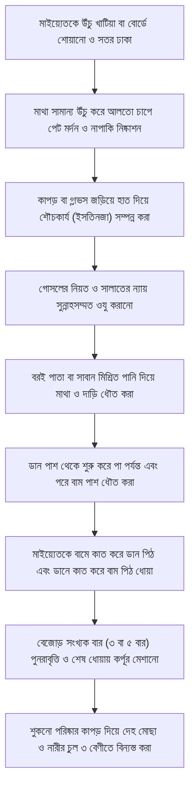

# অধ্যায় ০৭: মাইয়্যেতের গোসল ও কাফনের পূর্ণাঙ্গ শরয়ী বিধান

> **"মাইয়্যেতকে শেষ বিদায় জানানোর প্রতিটি পদক্ষেপে সুন্নাহর পূর্ণ আনুগত্যই ঈমানদারের পরম দায়িত্ব; লৌকিক কুসংস্কার বর্জন করে বিশুদ্ধ পদ্ধতিতে গোসল ও কাফন সম্পন্ন করাই পরকালের প্রথম সম্মাননা।"**

---

## বক্তার পরিচিতি ও আলোচনার প্রেক্ষাপট

- **বক্তা:** প্রফেসর ড. আবু বকর মুহাম্মাদ যাকারিয়া (حفظه الله)
- **প্রেক্ষাপট:** জুমার খুতবা সিরিজ — ‘মৃত্যু’ (পর্ব-৫: মাইয়্যেতের গোসল, কাফন ও দাফন - পর্ব ১)
- **মূল বিষয়বস্তু:** ইসলামে মৃত ব্যক্তির প্রতি জীবিতদের অবশ্যপালনীয় অধিকারসমূহ—মাইয়্যেতকে গোসল দেওয়ার সুন্নাহসম্মত ধারাবাহিক পদ্ধতি, কাফনের শরয়ী পরিমাপ ও নিয়ম, মহামারি (করোনা), অগ্নিদগ্ধ বা খণ্ডিত লাশের বিশেষ বিধান, গর্ভপাতকৃত সন্তানের হুকুম, কাফেরের মৃত্যুর ক্ষেত্রে মুসলিমের করণীয় এবং গোসল ও কাফন কেন্দ্রিক বহুল প্রচলিত ভুল ধারণার প্রামাণিক নিরসন।

---

## ভূমিকা

মৃত্যু কোনো ধ্বংস বা নিঃশেষ হয়ে যাওয়া নয়; বরং এটি ক্ষণস্থায়ী ইহলোক থেকে অনন্ত পারলৌকিক জীবনের দ্বারপ্রান্তে পদার্পণ। পৃথিবীর অন্য কোনো ধর্ম বা জীবনদর্শনে মৃতদেহের এমন সুমহান মর্যাদা, সম্মান ও পরিষ্কার-পরিচ্ছন্নতার বিধিবদ্ধ নীতিমালা পাওয়া যায় না, যেমনটি ইসলাম দান করেছে। আল্লাহ সুবহানাহু ওয়া তা‘আলা মানবজাতিকে শ্রেষ্ঠ মর্যাদা দান করেছেন, আর এই মর্যাদা কেবল জীবিতাবস্থায় নয়, মৃত্যুর পরও বলবৎ থাকে।

একজন মুসলিম যখন মৃত্যুবরণ করে, তখন জীবিত মুসলিম সমাজের ওপর ‘ফরযে কিফায়াহ’ হিসেবে কিছু তাৎক্ষণিক দায়িত্ব বর্তায়। তার মধ্যে সর্বপ্রথম ও সর্বপ্রধান হলো—মাইয়্যেতকে শরয়ী পদ্ধতিতে পবিত্র করা (গোসল দেওয়া) এবং মর্যাদা সহকারে আচ্ছাদিত করা (কাফন পরানো)। প্রিয়জনের বিয়োগব্যথায় কাতর হয়ে অনেকেই অজ্ঞতাবশত বিদ‘আত ও ভিত্তিহীন কুসংস্কারে জড়িয়ে পড়েন। শায়খ ড. আবু বকর মুহাম্মাদ যাকারিয়া এ অধ্যায়ে রাসুলুল্লাহ ﷺ এবং সাহাবায়ে কেরামের বিশুদ্ধ সুন্নাহর আলোকে মৃতদেহের গোসল ও কাফনের পুঙ্খানুপুঙ্খ বিবরণ অত্যন্ত প্রাঞ্জলভাবে তুলে ধরেছেন, যাতে সাধারণ পাঠক স্বীয় পরিমণ্ডলে সুন্নাহর পূর্ণাঙ্গ বাস্তবায়ন ঘটাতে পারেন।

---

## মূল আলোচনা

### ১. তাকওয়ার অপরিহার্যতা ও মৃত্যুর সার্বক্ষণিক প্রস্তুতি

শায়খ তাঁর আলোচনার সূচনায় তাকওয়া অবলম্বনের গুরুত্ব স্মরণ করিয়ে দিয়ে বলেন, তাকওয়াই হলো ইহকাল ও পরকালে নাজাতের একমাত্র পাথেয়। আল্লাহ তা‘আলা পূর্বাপর সকল মানবজাতিকে তাকওয়ার নির্দেশ দিয়েছেন:

> ﴿وَمَن يَتَّقِ اللَّهَ يَجْعَل لَّهُ مَخْرَجًا ۝ وَيَرْزُقْهُ مِنْ حَيْثُ لَا يَحْتَسِبُ﴾  
> **অর্থ:** "আর যে কেউ আল্লাহকে ভয় করে (তাকওয়া অবলম্বন করে), আল্লাহ তার জন্য উত্তরণের কোনো পথ তৈরি করে দেন এবং তাকে এমন উৎস থেকে রিযিক দান করেন যা সে কল্পনাও করতে পারে না।"  
> — [সূরা আত-তালাক, ৬৫:২-৩](URLTEMP0)

তাকওয়ার সবচেয়ে বড় সুফল হলো—মৃত্যুর কঠিন মুহূর্তে এবং কবরের প্রথম ধাপে আল্লাহ তা‘আলা মুত্তাক্বী বান্দার সকল সংকট সহজ করে দেন। মৃত্যু নিশ্চিত ও অনিবার্য:

> ﴿أَيْنَمَا تَكُونُوا يُدْرِككُّمُ الْمَوْتُ وَلَوْ كُنتُمْ فِي بُرُوجٍ مُّشَيَّدَةٍ﴾  
> **অর্থ:** "তোমরা যেখানেই থাক না কেন, মৃত্যু তোমাদের নাগাল পাবেই; এমনকি যদি তোমরা সুদৃঢ় দুর্গের ভেতরেও অবস্থান কর।"  
> — [সূরা আন-নিসা, ৪:৭৮](URLTEMP1)

যেহেতু এই যাত্রাপথ থেকে কেউই ফিরতে পারবে না, তাই জীবিতদের উচিত শরীয়তের নির্ধারিত নিয়মাবলী যথাযথভাবে জেনে রাখা, যাতে কোনো ভাই বা বোনের প্রস্থানে তাকে আল্লাহর নির্দেশিত সম্মানের সাথে বিদায় দেওয়া যায়।

---

### ২. গোসল দেওয়ার দায়িত্ব ও অগ্রাধিকারপ্রাপ্ত ব্যক্তিবর্গ

মাইয়্যেতকে গোসল দেওয়া জীবিত মুসলিমদের ওপর ‘ফরযে কিফায়াহ’ (فرض كفاية)—অর্থাৎ সমাজের কিছু লোক তা আদায় করলে সবাই দায়িত্বমুক্ত হবে, আর কেউ না করলে এলাকার সবাই গুনাহগার হবে।

গোসল কে করাবে, সে ব্যাপারে সুন্নাহর অগ্রাধিকার নিম্নরূপ:

1. **ওসিয়তকৃত ব্যক্তি:** মৃত ব্যক্তি যদি জীবদ্দশায় কোনো দ্বীনদার, আমানতদার ও সুন্নাহর জ্ঞানে পারদর্শী ব্যক্তিকে গোসল করানোর ওসিয়ত করে যান, তবে তিনিই অগ্রাধিকার পাবেন।
2. **স্বামী-স্ত্রী একে অপরকে গোসল দেওয়া:** সহীহ সুন্নাহ মোতাবেক স্বামী তার স্ত্রীকে এবং স্ত্রী তার স্বামীকে গোসল করাতে পারবেন।
   - আয়েশা (رضي الله عنها) বলেন:
     > «لَوِ اسْتَقْبَلْتُ مِنْ أَمْرِي مَا اسْتَدْبَرْتُ، مَا غَسَلَ رَسُولَ اللَّهِ صَلَّى اللهُ عَلَيْهِ وَسَلَّمَ إِلَّا نِسَاؤُهُ»  
     > **অর্থ:** "আমি যদি আগে জানতাম যা পরে জেনেছি, তবে রাসুলুল্লাহ ﷺ-কে তাঁর স্ত্রীগণ ব্যতীত অন্য কেউ গোসল দিত না।"  
     > — [সুনান আবু দাউদ, হাদিস: ৩১৪১](URLTEMP2); শায়খ আলবানী হাদিসটিকে সহীহ বলেছেন।
   - আবু বকর সিদ্দিক (رضي الله عنه)-এর মৃত্যুর পর তাঁর ওসিয়ত অনুযায়ী তাঁর স্ত্রী আসমা বিনতে উমাইস (رضي الله عنها) তাঁকে গোসল করিয়েছিলেন (মুয়াত্তা মালিক: ৫৩৮, সনদ সহীহ)।
3. **নিকটাত্মীয় ও সমলিঙ্গের ব্যক্তি:** পুরুষকে পুরুষরা এবং নারীকে নারীরা গোসল করাবে। এক্ষেত্রে পিতা, পুত্র বা রক্তের নিকটাত্মীয় যারা সুন্নাহ জানেন, তারা প্রাধান্য পাবেন।
4. **গোসল কক্ষে উপস্থিতির শর্ত:** গোসল করানোর সময় শুধু গোসলদাতা এবং প্রয়োজনীয় সাহায্যকারী (এক বা দুইজন) ব্যতীত অন্য কারো অহেতুক ভিড় করা নিষেধ। গোসলদাতাকে অবশ্যই বিশ্বস্ত ও আমানতদার হতে হবে, যাতে মাইয়্যেতের শরীরে কোনো দোষ-ত্রুটি বা বিকৃতি দেখলে তা বাইরে প্রকাশ না করে গোপন রাখে।

---

### ৩. বিশেষ পরিস্থিতিতে গোসলের শরয়ী বিধান

বাস্তব জীবনে নানা অস্বাভাবিক পরিস্থিতিতে মৃত্যুর ঘটনা ঘটে। ইসলামে প্রতিটি অবস্থার জন্য সুনির্দিষ্ট দিকনির্দেশনা রয়েছে:

#### ক. অগ্নিদগ্ধ, বিকৃত বা ক্ষতবিক্ষত লাশ

অগ্নিদগ্ধ বা মারাত্মক সড়ক দুর্ঘটনায় শরীর এমনভাবে পুড়ে বা ক্ষতবিক্ষত হয়ে যায় যে পানি ঢাললে চামড়া ও গোশত খসে পড়ার আশঙ্কা থাকে। এমন ক্ষেত্রে:

- যতটুকু সম্ভব সাবধানে পানি ঢেলে গোসল দিতে হবে।
- যদি স্পর্শ করলে বা পানি ঢাললে শরীর সম্পূর্ণ গলে যাওয়ার বা ছিন্নভিন্ন হওয়ার প্রবল আশঙ্কা থাকে, তবে পানি না ঢেলে সরাসরি কাফন পরিয়ে দেওয়া হবে।
- **তায়াম্মুমের বিধান:** শায়খ স্পষ্ট করেন যে, মাইয়্যেতকে তায়াম্মুম করানোর স্বপক্ষে কোনো বিশুদ্ধ সহীহ মারফু হাদিস নেই। তাই অপারগ হলে কোনো তায়াম্মুম ছাড়াই কাফন পরিয়ে জানাযা পড়ে দাফন করা হবে।

#### খ. মহামারি (যেমন করোনা) বা সংক্রামক রোগে মৃত ব্যক্তি

সংক্রামক ব্যাধিতে মৃত ব্যক্তির ক্ষেত্রে বিশেষজ্ঞ চিকিৎসকদের পরামর্শ নেওয়া আবশ্যক:

- যদি চিকিৎসক বলেন যে ব্যক্তিগত সুরক্ষাসামগ্রী (PPE, গ্লাভস, মাস্ক ইত্যাদি) পরিধান করে গোসল দিলে রোগ ছড়ানোর ঝুঁকি থাকে না, তবে তাকে অবশ্যই সাধারণ মাইয়্যেতের মতো পূর্ণ গোসল দিতে হবে।
- যদি মৃতদেহ স্পর্শ করলেই জীবাণু জীবিত মানুষের দেহে ছড়িয়ে পড়ার সুনিশ্চিত আশঙ্কা থাকে, তবে গোসলদাতা দূর থেকে পাইপ বা পাত্র দিয়ে লাশের ওপর পানি ঢেলে দেবেন।
- যদি পানি ছিটানোও অসম্ভব হয়, তবে সংক্রমণের ঝুঁকি এড়াতে লাশকে প্লাস্টিক বা বিশেষ বডি-ব্যাগে মুড়িয়ে তার ওপর কাফন জড়িয়ে দাফন করা যাবে। এতে জীবিতদের কোনো গুনাহ হবে না।

#### গ. মুসলিম ও অমুসলিমের লাশ মিশে গেলে

কোনো যুদ্ধ, অগ্নিকাণ্ড বা বিমান দুর্ঘটনায় মুসলিম ও কাফেরদের লাশ এমনভাবে পুড়ে বা পিষ্ট হয়ে মিশে গেছে যে কারোরই পরিচয় আলাদা করা সম্ভব হচ্ছে না। এমন অবস্থায় শরীয়তের বিধান হলো:

- সকল লাশকেই গোসল দিতে হবে, কাফন পরাতে হবে এবং মুসলিমদের নিয়ত করে তাদের ওপর জানাযার সালাত আদায় করে মুসলিম কবরস্থানে দাফন করতে হবে। যাতে একজন মুসলিমও গোসল ও জানাযাবিহীন না থেকে যায়।

#### ঘ. লাশের কেবল কোনো খণ্ডিতাংশ পাওয়া গেলে

যদি দুর্ঘটনায় লাশের কোনো সামান্য অংশ (যেমন শুধু একটি হাত বা পা) পাওয়া যায় এবং বাকি দেহাবশেষ পাওয়ার আর কোনো আশা না থাকে:

- যদি নিশ্চিত হওয়া যায় যে অংশটি কোনো মুসলিমের, তবে কেবল ঐ খণ্ডিতাংশের জন্য আলাদা কোনো পূর্ণাঙ্গ গোসল বা জানাযার সালাত নেই।
- বরং তা একটি কাপড়ে পেঁচিয়ে মুসলিমদের কবরস্থানে সমাহিত করতে হবে।

#### ঙ. বিপরীত লিঙ্গের উপস্থিতি এবং কোনো মাহরাম বা সমলিঙ্গ না থাকা

যদি কোনো পুরুষ শুধুমাত্র মহিলাদের মাঝে মারা যায় এবং সেখানে তার কোনো স্ত্রী বা মাহরাম নারী না থাকে, অথবা কোনো নারী পুরুষদের মাঝে মারা যায় এবং সেখানে কোনো স্বামী বা মাহরাম পুরুষ না থাকে:

- এমন চরম সংকটে (যেখানে গোসল দেওয়ার মতো সমলিঙ্গের বা মাহরাম কেউ নেই) বিনা গোসলে তাকে কাফন পরিয়ে জানাযার সালাত আদায় করে দাফন করা হবে।

#### চ. যুদ্ধক্ষেত্রের প্রকৃত শহীদ বনাম হুকমি শহীদ

- **ময়দানের শহীদ (شهيد المعركة):** যারা দ্বীন প্রতিষ্ঠার লক্ষ্যে কাফেরদের বিরুদ্ধে সম্মুখ সমরে নিহত হন, তাদেরকে কোনো গোসল দেওয়া যাবে না এবং রক্তমাখা পোশাকেই দাফন করা হবে। রাসুলুল্লাহ ﷺ উহুদের শহীদদের নির্দেশ দিয়েছিলেন:
  > «زَمِّلُوهُمْ فِي دِمَائِهِمْ»  
  > **অর্থ:** "তাদেরকে রক্তসহ তাদের নিজ নিজ পোশাকেই আচ্ছাদিত করে দাও।"  
  > — [সহীহ বুখারী, হাদিস: ১৩৪৬](URLTEMP3)
- **হুকমি শহীদ (যাদের শাহাদাতের মর্যাদা রয়েছে):** যারা পানিতে ডুবে, আগুনে পুড়ে, পেটের রোগে, মহামারিতে বা প্রসববেদনায় মারা যান—তারা আখেরাতে শহীদের মর্যাদা পেলেও দুনিয়াতে তাদের অবশ্যই পূর্ণাঙ্গ গোসল, কাফন ও জানাযা দিতে হবে।

#### ছ. গর্ভপাতকৃত সন্তান (السِّقْط - আস-সিক্বত্ব)

গর্ভপাত বা সময়ের পূর্বে ভূমিষ্ঠ হওয়া সন্তানের ক্ষেত্রে দুটি সুনির্দিষ্ট অবস্থা রয়েছে:

1. **পূর্ণাঙ্গ আকৃতি প্রকাশ পেলে (সাধারণত ৪ মাস বা ১২০ দিন পর):** যদি বাচ্চার মানবীয় আকৃতি (হাত, পা, মুখমণ্ডল) স্পষ্ট গঠিত হয়, তবে সে জীবিত ভূমিষ্ঠ হোক বা মৃত—তাকে অবশ্যই গোসল দিতে হবে, কাফন পরাতে হবে, নাম রাখতে হবে, জানাযার সালাত পড়তে হবে এবং মুসলিম কবরস্থানে দাফন করতে হবে। এ অবস্থায় সন্তানের মাতার নির্গত রক্ত শরীয়তের দৃষ্টিতে ‘নিফাস’ (نفاس) হিসেবে গণ্য হবে এবং সে সর্বোচ্চ ৪০ দিন সালাত থেকে বিরত থাকবে।
2. **মানবীয় আকৃতি প্রকাশ না পেলে (প্রাথমিক অবয়বহীন পিণ্ড):** যদি ভ্রূণের কোনো মানবীয় অঙ্গ-প্রত্যঙ্গ প্রকাশ না পায়, তবে তাকে কোনো গোসল বা কাফন দেওয়া হবে না এবং তার ওপর জানাযাও পড়া হবে না। কেবল একটি কাপড়ে জড়িয়ে মাটিতে পুঁতে ফেলা হবে। এমতাবস্থায় মায়ের রক্ত নিফাস নয়, বরং ‘ইস্তিহাদাহ্’ (রোগের রক্ত) গণ্য হবে; মা কেবল রক্ত ধুয়ে প্রতি সালাতের জন্য ওযু করে সালাত আদায় করবে।

#### জ. কাফের বা মুরতাদের মৃত্যুর বিধান

কোনো কাফের বা ইসলামত্যাগী মুরতাদ মারা গেলে কোনো মুসলিমের জন্য তার গোসল, কাফন, জানাযা বা দাফন প্রক্রিয়ায় অংশ নেওয়া হারাম।

- আল্লাহ তা‘আলা কঠোরভাবে নিষেধ করেছেন:
  > ﴿وَلَا تُصَلِّ عَلَىٰ أَحَدٍ مِّنْهُم مَّاتَ أَبَدًا وَلَا تَقُمْ عَلَىٰ قَبْرِهِ إِنَّهُمْ كَفَرُوا بِاللَّهِ وَرَسُولِهِ وَمَاتُوا وَهُمْ فَاسِقُونَ﴾  
  > **অর্থ:** "আর তাদের (মুনাফিক ও কাফেরদের) মধ্য থেকে যে কেউ মারা গেলে আপনি কখনো তার ওপর জানাযার সালাত আদায় করবেন না এবং তার কবরের পাশে দাঁড়াবেন না। কারণ তারা আল্লাহ ও তাঁর রাসুলকে অস্বীকার করেছে এবং অবাধ্য অবস্থায় মৃত্যুবরণ করেছে।"  
  > — [সূরা আত-তাওবাহ, ৯:৮৪](URLTEMP4)
- কাফেরের জানাযার পেছনে চলা বা রাজনৈতিক উদ্দেশ্যে তাদের শেষকৃত্যে অংশগ্রহণ করা কুফরির সমতুল্য মারাত্মক অপরাধ। যদি কোনো কাফেরের আত্মীয়স্বজন কেউ না থাকে, তবে স্রেফ দুর্গন্ধ ও পরিবেশ দূষণ এড়াতে তাকে সাধারণ গর্তে মাটিচাপা দিয়ে ঢেকে দিতে হবে।

---

### ৪. সুন্নাহসম্মত গোসলের ধারাবাহিক পদ্ধতি (ধাপে ধাপে)

রাসুলুল্লাহ ﷺ-এর সুন্নাহ ও সাহাবায়ে কেরামের আমল অনুযায়ী মাইয়্যেতকে গোসল করানোর সঠিক কর্মপদ্ধতি নিচে ধারাবাহিকভাবে তুলে ধরা হলো:

#### ধাপ ১: প্রস্তুতি ও সতর আচ্ছাদন

- মাইয়্যেতকে মাটি থেকে সামান্য উঁচু তক্তা বা খাটিয়ায় শোয়াতে হবে।
- গোসল শুরুর পূর্বেই নাভি থেকে হাঁটু পর্যন্ত (পুরুষের ক্ষেত্রে) এবং বুক থেকে হাঁটু পর্যন্ত (নারীর ক্ষেত্রে) একটি মোটা চাদর দিয়ে সতর ঢেকে দিতে হবে, যাতে পানি ঢাললেও সতর উন্মুক্ত না হয়। এরপর পরনের অন্যান্য পোশাক খুলে সাবধানে সরিয়ে ফেলতে হবে।

#### ধাপ ২: পেট মর্দন ও ইস্তিনজা (শৌচকার্য)

- মাইয়্যেতের মাথা ও কাঁধের অংশ সামান্য উঁচু করে বসার ভঙ্গিতে এনে পেটে আলতোভাবে কয়েকবার হাত বুলিয়ে চাপ দিতে হবে, যাতে ভেতরে আটকে থাকা কোনো মলমূত্র বা নাপাকি সহজে বের হয়ে যায়।
- এরপর প্রচুর পানি ঢেলে নাপাকি ভাসিয়ে দিতে হবে।
- গোসলদাতা নিজের হাতে মোটা কাপড় বা গ্লাভস পেঁচিয়ে সতরের নিচে হাত ঢুকিয়ে মাইয়্যেতের মলদ্বার ও লজ্জাস্থান ভালোভাবে পরিষ্কার করে দেবেন। কোনো অবস্থাতেই খালি হাতে স্পর্শ করা বা সতরের দিকে সরাসরি তাকানো যাবে না।

#### ধাপ ৩: ওযু করানো

- গোসলদাতা মনে মনে গোসলের নিয়ত করবেন (মুখে উচ্চারণ বিদ‘আত)।
- মাইয়্যেতকে সাধারণ সালাতের ওযুর মতো ওযু করাতে হবে।
- রাসুলুল্লাহ ﷺ তাঁর কন্যা যাইনাব বা উম্মু কুলসুমের গোসলের সময় মহিলাদের নির্দেশ দিয়েছিলেন:
  > «ابْدَأْنَ بِمَيَامِنِهَا، وَمَوَاضِعِ الوُضُوءِ مِنْهَا»  
  > **অর্থ:** "তোমরা তার ডান দিক থেকে এবং ওযুর অঙ্গসমূহ থেকে গোসল শুরু করো।"  
  > — [সহীহ বুখারী, হাদিস: ১২৫৫](URLTEMP5); [সহীহ মুসলিম, হাদিস: ৯৩৯](URLTEMP6)
- **মুখ ও নাকের সতর্কতা:** মাইয়্যেতের মুখ বা নাকের ভেতরে সরাসরি ঢেলে পানি প্রবেশ করানো যাবে না; বরং ভেজা আঙুল বা কাপড়ের টুকরো দিয়ে দাঁত, মাড়ি ও নাকের ভেতরের অংশ আলতোভাবে মুছে পরিষ্কার করে দিতে হবে।

#### ধাপ ৪: মাথা, দাড়ি ও মূল দেহ ধৌতকরণ

- কুল বা বরই পাতা সিদ্ধ করা হালকা কুসুম গরম পানি (অথবা সাবান-পানি) দিয়ে প্রথমে মাইয়্যেতের মাথা ও দাড়ি ভালোভাবে ধুতে হবে।
- এরপর মাইয়্যেতের ডান পাশ—ঘাড় থেকে শুরু করে ডান হাত, বুক ও পা পর্যন্ত সম্পূর্ণ ধুতে হবে।
- অতঃপর বাম পাশের ঘাড় থেকে শুরু করে বাম পা পর্যন্ত ধৌত করতে হবে।

#### ধাপ ৫: পিঠ ও পেছনের অংশ ধৌতকরণ

- মাইয়্যেতকে বাম কাতে সামান্য উঠিয়ে তার ডান পিঠ ও পেছনের অংশে পানি ঢালতে হবে।
- এরপর ডান কাতে উঠিয়ে বাম পিঠ ও পেছনের অংশে পানি ঢেলে পরিষ্কার করতে হবে (মাইয়্যেতকে উপুড় করে শোয়ানো মাকরূহ)।

#### ধাপ ৬: বেজোড় সংখ্যা রক্ষা ও শেষ ধোয়ায় কর্পূর (কাফুর) প্রয়োগ

- এভাবে সম্পূর্ণ শরীর একবার ধোয়া হলো। প্রয়োজনানুসারে দ্বিতীয় ও তৃতীয়বার একই পদ্ধতিতে ধৌত করতে হবে।
- যদি তিনবারে পরিষ্কার না হয়, তবে পাঁচ বা সাতবার পর্যন্ত বেজোড় সংখ্যায় ধোয়া যাবে।
- রাসুলুল্লাহ ﷺ নির্দেশ দিয়েছেন:
  > «اغْسِلْنَهَا ثَلاَثًا، أَوْ خَمْسًا، أَوْ أَكْثَرَ مِنْ ذَلِكَ إِنْ رَأَيْتُنَّ ذَلِكَ، بِمَاءٍ وَسِدْرٍ، وَاجْعَلْنَ فِي الآخِرَةِ كَافُورًا - أَوْ شَيْئًا مِنْ كَافُورٍ»  
  > **অর্থ:** "তোমরা তাকে তিনবার, পাঁচবার অথবা প্রয়োজন মনে করলে তার চেয়েও বেশিবার বরই পাতাসহ পানি দিয়ে ধৌত করো; আর শেষবারে পানিতে কিছুটা কর্পূর (সুগন্ধি) মিশিয়ে নিও।"  
  > — [সহীহ বুখারী, হাদিস: ১২৫৩](URLTEMP7); [সহীহ মুসলিম, হাদিস: ৯৩৯](URLTEMP8)
- শেষ ধোয়ার পানিতে কর্পূর মেশানোর হিকমত হলো—তা শরীরকে শীতল ও সুদৃঢ় রাখে, পোকা-মাকড় দূরে রাখে এবং মনোরম সুবাস ছড়ায়।

#### ধাপ ৭: পরবর্তী পরিচ্ছন্নতা ও নারীর চুল বিন্যাস

- গোসল শেষে মাইয়্যেতের দেহ একটি শুকনো পরিষ্কার চাদর দিয়ে ভালোভাবে মুছে ফেলতে হবে।
- গোঁফ যদি বেশি লম্বা থাকে তবে তা ছেঁটে দেওয়া যাবে এবং নখ বেশি বড় থাকলে সাবধানে কেটে ফেলা যাবে। তবে অপ্রয়োজনে চুল বা দাড়ি কামানো যাবে না।
- **নারীর চুলের ক্ষেত্রে:** উম্মু আতিয়্যাহ (رضي الله عنها) বর্ণনা করেন, রাসুলুল্লাহ ﷺ-এর কন্যার গোসল শেষে তারা তাঁর চুলগুলো তিন ভাগে বিন্যস্ত করেছিলেন:
  > «وَضَفَرْنَا شَعَرَهَا ثَلاَثَةَ قُرُونٍ، فَأَلْقَيْنَاهُ خَلْفَهَا»  
  > **অর্থ:** "আমরা তাঁর চুলগুলোকে তিনটি বেণীতে বিন্যস্ত করলাম এবং তা পেছনের দিকে ছেড়ে দিলাম।"  
  > — [সহীহ বুখারী, হাদিস: ১২৫৪, ১২৬৩](URLTEMP9)
- **গোসল শেষে কোনো নাপাকি নির্গত হলে:** গোসল শেষ হওয়ার পর যদি মৃতদেহের পেট থেকে পুনরায় সামান্য তরল বা নাপাকি বের হয়, তবে নতুন করে গোসল বা ওযু করানোর কোনো প্রয়োজন নেই। কেবল নির্গত স্থানটি পানি দিয়ে ধুয়ে সেখানে তুলা বা পট্টি দিয়ে আটকে দিলেই যথেষ্ট হবে।

---

### ৫. কাফনের শরয়ী বিধান ও কাফন পরানোর সুন্নাহ পদ্ধতি

#### ক. কাফনের খরচ নির্বাহের ক্রম

কাফনের কাপড় ক্রয়ের খরচ সর্বপ্রথম মাইয়্যেতের নিজস্ব রেখে যাওয়া সম্পদ থেকেই ব্যয় করতে হবে (অন্য কোনো ঋণ বা ওসিয়ত বণ্টনের পূর্বে)। যদি মাইয়্যেতের কোনো সম্পদ না থাকে, তবে জীবদ্দশায় যার ওপর তার ভরণপোষণের দায়িত্ব ছিল (পিতা, পুত্র, দাদা ইত্যাদি), তিনি কাফনের ব্যবস্থা করবেন। যদি তার এমন কেউ না থাকে, তবে বায়তুল মাল বা স্থানীয় মুসলিম সমাজ কাফনের ব্যবস্থা করবে।

#### খ. কাফনের গুণাগুণ ও কাপড়ের রঙ

সুন্নাত হলো কাফনের কাপড় সাদা সুতি হওয়া। রাসুলুল্লাহ ﷺ ইরশাদ করেছেন:

> «الْبَسُوا مِنْ ثِيَابِكُمُ الْبَيَاضَ؛ فَإِنَّهَا مِنْ خَيْرِ ثِيَابِكُمْ، وَكَفِّنُوا فِيهَا مَوْتَاكُمْ»  
> **অর্থ:** "তোমরা সাদা রঙের পোশাক পরিধান করো; কেননা তা তোমাদের সর্বোত্তম পোশাক। আর তোমাদের মৃতদেরও সাদা কাপড়ে কাফন দাও।"  
> — [সুনান আবু দাউদ, হাদিস: ৩৮৭৮](URLTEMP10); শায়খ আলবানী হাদিসটিকে সহীহ বলেছেন।

#### গ. পুরুষ ও নারীর কাফনের পরিমাপ

- **ওয়াজিব পরিমাপ:** পুরো দেহকে ঢেকে ফেলে এমন একটিমাত্র চাদর পেলেও কাফনের ফরযিয়াত আদায় হয়ে যাবে।
- **পুরুষের সুন্নাহ কাফন (৩ চাদর):** রাসুলুল্লাহ ﷺ-কে তিনটি সাদা সুতি কাপড়ের চাদরে কাফন দেওয়া হয়েছিল।
  - উম্মুল মুমিনীন আয়েশা (رضي الله عنها) বলেন:
    > «أَنَّ رَسُولَ اللَّهِ صَلَّى اللهُ عَلَيْهِ وَسَلَّمَ كُفِّنَ فِي ثَلاَثَةِ أَثْوَابٍ يَمَانِيَةٍ بِيضٍ سَحُولِيَّةٍ، مِنْ كُرْسُفٍ، لَيْسَ فِيهَا قَمِيصٌ وَلاَ عِمَامَةٌ»  
    > **অর্থ:** "রাসুলুল্লাহ ﷺ-কে তিনটি ইয়েমেনি সাদা সুতি চাদরে কাফন দেওয়া হয়েছিল, যাতে কোনো জামা (ক্বামীস) কিংবা পাগড়ি (‘ইমামাহ) ছিল না।"  
    > — [সহীহ বুখারী, হাদিস: ১২৬৪](URLTEMP11); [সহীহ মুসলিম, হাদিস: ৯৪১](URLTEMP12)
- **নারীর কাফনের বিধান:** হানাফী মাযহাবে নারীদের জন্য ৫ টুকরো কাপড়ের (ইযার, ক্বামীস, খিমার বা ওড়না, লেফাফা ও সীনাবন্দ) কথা বলা হলেও শায়খ ড. আবু বকর মুহাম্মাদ যাকারিয়া স্পষ্ট করেন যে, নারীর জন্য নির্দিষ্টভাবে ৫ টুকরো কাফনের ব্যাপারে রাসুলুল্লাহ ﷺ থেকে কোনো সহীহ মারফু হাদিস সাব্যস্ত হয়নি (এ সংক্রান্ত লায়লা বিনতে ক্বানিফের হাদিসটি মুহাদ্দিসগণের নিকট দুর্বল)। অতএব, পুরুষদের মতো নারীদেরও ৩টি সাদা চাদরে কাফন দেওয়া পূর্ণ সুন্নাহসম্মত ও বিশুদ্ধতম মত। তবে কেউ চাইলে অতিরিক্ত চাদর দিয়ে সতরের অধিক সতর্কতা নিশ্চিত করতে পারে।

#### ঘ. কাফন পরানোর ধারাবাহিক পদ্ধতি

1. মেঝেতে বা খাটিয়ায় তিনটি চাদর একটির ওপর আরেকটি সাজিয়ে বিছিয়ে দিতে হবে।
2. চাদরগুলোর প্রতিটি স্তরে সুগন্ধি বা ধূপের ধোঁয়া (লোবান/আতর) মাখাতে হবে।
3. মাইয়্যেতকে পিঠের ভর দিয়ে চাদরগুলোর ওপর শোয়াতে হবে।
4. সেজদার অঙ্গসমূহে (কপাল, নাক, দুই হাত, দুই হাঁটু ও দুই পায়ের পাতা) এবং শরীরের ভাঁজগুলোতে সুগন্ধি ও কর্পূর লাগাতে হবে।
5. প্রথমে ওপরের চাদরটির বাম পাশ উঠিয়ে মাইয়্যেতের ডান পাশ ঢেকে দিতে হবে, এরপর ডান পাশ উঠিয়ে বাম পাশের ওপর মুড়িয়ে দিতে হবে।
6. দ্বিতীয় ও তৃতীয় চাদরটিও একইভাবে ক্রমান্বয়ে ডান-বাম করে জড়াতে হবে।
7. চাদরের যে অংশ মাথা ও পায়ের দিকে অতিরিক্ত থাকবে, তা গুটিয়ে নিতে হবে এবং কাফন যাতে খুলে না যায় সেজন্য মাথা, পা ও কোমরের ওপর কাপড়ের ফিতা দিয়ে আলতো করে বেঁধে দিতে হবে (কবরে রাখার পর এ বাঁধনগুলো খুলে দেওয়া সুন্নাত)।

#### ঙ. এহরাম অবস্থায় মৃত ব্যক্তির বিশেষ কাফন (المُحْرِم)

হজ বা ওমরার এহরামরত অবস্থায় কোনো ব্যক্তি মারা গেলে তার বিধান সম্পূর্ণ ভিন্ন।

- আব্দুল্লাহ ইবনে আব্বাস (رضي الله عنهما) বর্ণনা করেন, আরাফাতের ময়দানে এক ব্যক্তি বাহন থেকে পড়ে ঘাড় ভেঙে মৃত্যুবরণ করলে রাসুলুল্লাহ ﷺ বললেন:
  > «اغْسِلُوهُ بِمَاءٍ وَسِدْرٍ، وَكَفِّنُوهُ فِي ثَوْبَيْنِ، وَلاَ تُحَنِّطُوهُ، وَلاَ تُخَمِّرُوا رَأْسَهُ، فَإِنَّ اللَّهَ يَبْعَثُهُ يَوْمَ القِيَامَةِ مُلَبِّيًا»  
  > **অর্থ:** "তোমরা তাকে বরই পাতাসহ পানি দিয়ে গোসল করাও এবং তার পরিহিত দুটি এহরামের কাপড়ে কাফন দাও। তাকে কোনো সুগন্ধি লাগাবে না এবং তার মাথা ঢাকবে না। কেননা ক্বিয়ামতের দিন আল্লাহ তা‘আলা তাকে তালবিয়া পাঠরত অবস্থায় পুনরুত্থিত করবেন।"  
  > — [সহীহ বুখারী, হাদিস: ১২৬৫](URLTEMP13); [সহীহ মুসলিম, হাদিস: ১২০৬](URLTEMP14)
- অতএব, এহরামকারীর মুখ ও মাথা উন্মুক্ত থাকবে, কোনো সেলাই করা কাপড় দেওয়া যাবে না এবং কোনো আতর বা সুগন্ধি প্রয়োগ করা যাবে না।

---

## ভুল ধারণা ও তার নিরসন

| প্রচলিত ভুল ধারণা                                                                                        | সহীহ সুন্নাহসম্মত বাস্তবতা                                                                                                                                                                                                                                                                                        |
| :------------------------------------------------------------------------------------------------------- | :---------------------------------------------------------------------------------------------------------------------------------------------------------------------------------------------------------------------------------------------------------------------------------------------------------------- |
| **১. মৃত্যুর পর স্বামী-স্ত্রীর বৈবাহিক সম্পর্ক শেষ হয়ে যায়, ফলে একে অপরকে গোসল দেওয়া বা দেখা হারাম।** | **সম্পূর্ণ ভিত্তিহীন ও ভ্রান্ত ধারণা।** সহীহ হাদিস দ্বারা প্রমাণিত যে, রাসুলুল্লাহ ﷺ আয়েশা (رضي الله عنها)-কে বলেছিলেন যে তিনি আগে মারা গেলে রাসুল ﷺ নিজে তাকে গোসল দেবেন। আবু বকর (رضي الله عنه)-কে তাঁর স্ত্রী আসমা (رضي الله عنها) গোসল করিয়েছিলেন। সুতরাং স্বামী-স্ত্রী একে অপরকে গোসল দিতে ও দেখতে পারবেন। |
| **২. করোনা বা পোড়া লাশ স্পর্শ করলেই গুনাহ হবে, তাই সরাসরি না ধুয়ে তায়াম্মুম করাতে হবে।**              | **ভুল ধারণা।** মাইয়্যেতকে তায়াম্মুম করানোর কোনো সহীহ দলীল নেই। সতর্কতা অবলম্বন করে (PPE পরে) পানি ঢেলে গোসল দিতে হবে; পানি ঢালা কোনোভাবেই সম্ভব না হলে সরাসরি কাফন পরিয়ে জানাযা ও দাফন করতে হবে।                                                                                                               |
| **৩. যেকোনো গর্ভপাতকৃত রক্তের পিণ্ডকেই গোসল-কাফন দিয়ে জানাযা পড়তে হবে।**                               | **শরীয়তের নীতিবহির্ভূত।** যতক্ষণ না ভ্রূণে পূর্ণ মানবীয় সুরত বা আকৃতি গঠিত হবে (সাধারণত ৪ মাস পর), ততক্ষণ তার ওপর কোনো গোসল, কাফন বা জানাযা নেই; কেবল কাপড়ে পেঁচিয়ে পুঁতে ফেলতে হবে।                                                                                                                          |
| **৪. নারীর কাফন ৫ টুকরো হতেই হবে, ৩ টুকরো দিলে কাফন আদায় হবে না।**                                      | **অতিরঞ্জন।** ৫ কাপড়ের হাদিসটি মুহাদ্দিসগণের নিকট দুর্বল। পুরুষের মতো নারীদেরও ৩টি সাদা চাদরে কাফন দেওয়া পূর্ণাঙ্গ সুন্নাহ। তবে পর্দা ও সতরের স্বার্থে অতিরিক্ত কাপড় ব্যবহার জায়েজ।                                                                                                                           |
| **৫. অমুসলিমদের বা রাজনৈতিক নেতাদের কাফের হলে তাদের জানাযা ও শেষযাত্রায় অংশ নেওয়া সামাজিক শিষ্টাচার।** | **মারাত্মক শিরক ও কুফরি মানসিকতা।** আল্লাহ তা‘আলা সুরা তাওবাহর ৮৪ নম্বর আয়াতে কাফেরের জানাযায় দাঁড়াতে এবং তাদের কবরের পাশে যেতে স্পষ্টভাবে নিষেধ করেছেন।                                                                                                                                                       |
| **৬. গোসলের পর মাইয়্যেতের চুল আচড়ানো বা নখ কামানো বাধ্যতামূলক।**                                       | **বিদ‘আত।** মৃত ব্যক্তির শরীর অত্যন্ত সংবেদনশীল। চুল আঁচড়ানো নিষেধ। নারীর চুল কেবল ৩ বেণীতে বাঁধতে হবে। গোঁফ ও নখ মাত্রাতিরিক্ত লম্বা হলে কাটা যাবে, তবে শরীরের অন্য কোনো চুল কামানো যাবে না।                                                                                                                    |

---

## মূল শিক্ষা সংক্ষেপে

1. **জীবিতদের ওপর মাইয়্যেতের অধিকার:** গোসল ও কাফন হলো ফরযে কিফায়াহ এবং মুসলিম মৃত ব্যক্তির পরম শরয়ী সম্মাননা।
2. **আমানতদারিতা রক্ষা:** গোসলদাতা কেবল তারাই হবেন যারা সুন্নাহ জানেন এবং মৃতদেহের গোপনীয়তা ও ত্রুটি গোপন রাখার মতো পরহেযগার।
3. **সুন্নাহর অনুসরণ:** ৩টি সাদা সুতি কাপড়ে কাফন দেওয়া, শেষ ধোয়ার পানিতে কর্পূর মেশানো এবং নারীর চুল ৩টি বেণীতে পেছনের দিকে রাখা রাসুলুল্লাহ ﷺ-এর সুন্নাহ।
4. **সহজীকরণ ও বাস্তবতা:** অপারগতার সময় ইসলাম কঠোরতা আরোপ করে না; সংক্রামক ব্যাধি বা অঙ্গহানির ক্ষেত্রে সাধ্যমতো পানি ঢেলে বা সরাসরি কাফন পরিয়ে দাফন করাই শরীয়তের ফায়সালা।

---

## আমল ও করণীয়

- [ ] পরিবারের সদস্যদের বিশুদ্ধ সুন্নাহ মোতাবেক গোসল ও কাফনের পদ্ধতি শিক্ষা দেওয়া, যাতে বহিরাগত লোকের ওপর নির্ভর না করতে হয়।
- [ ] জীবদ্দশায় ওসিয়ত করে যাওয়া—যেন মৃত্যুর পর কোনো বিদ‘আতী রসম-রেওয়াজ না করা হয় এবং সুন্নাহ জানা দ্বীনদার ব্যক্তিই গোসল ও কাফন পরিচালনা করেন।
- [ ] স্বামী ও স্ত্রীর একে অপরকে শেষ বিদায়ের সময় গোসল ও কাফনে শরীয়তের সীমার মধ্যে অংশগ্রহণ করার মানসিক প্রস্তুতি রাখা।
- [ ] বাজারে প্রচলিত অতিরিক্ত মূল্যের অপ্রয়োজনীয় জাঁকজমকপূর্ণ কাফনের প্যাকেট বর্জন করে সাধারণ সাদা সুতি কাপড়ের কাফন সংগ্রহ করা।
- [ ] যেকোনো আপদকালীন পরিস্থিতিতে (মহামারি, অগ্নিকাণ্ড) কুসংস্কারমুক্ত হয়ে বিশুদ্ধ সুন্নাহর নির্দেশনা অনুসরণ করা।

---

## শব্দার্থ ও পরিভাষা

- **ফরযে কিফায়াহ (فرض كفاية):** এমন সামাজিক দায়িত্ব, যা সমাজের কতিপয় ব্যক্তি আদায় করলে সমগ্র সমাজ দায়মুক্ত হয়; কিন্তু কেউ আদায় না করলে সবাই গুনাহগার হয়।
- **সিদর (سِدْر):** বরই বা কুল পাতা; প্রাচীনকাল থেকে প্রাকৃতিক পরিষ্কারক ও জীবানুনাশক হিসেবে এর পাতা সিদ্ধ পানি গোসলে ব্যবহার করা হয়।
- **কাফুর (كَافُور):** কর্পূর; এক প্রকার প্রাকৃতিক উদ্বায়ী সুগন্ধি পদার্থ, যা শীতলকারক ও কীটপতঙ্গ প্রতিরোধক।
- **আস-সিক্বত্ব (السِّقْط):** গর্ভপাতকৃত অপরিণত ভ্রূণ বা মৃতজাত সন্তান।
- **মুহরিম (مُحْرِم):** যিনি হজ বা ওমরার উদ্দেশ্যে এহরামের চাদর পরিধান করে তালবিয়া পাঠের মাধ্যমে নিয়তে প্রবেশ করেছেন।
- **লেফাফা (لِفَافَة):** কাফনের বৃহৎ বহিরাবরণী বা চাদর, যা মাইয়্যেতের মাথা থেকে পা পর্যন্ত সম্পূর্ণ শরীর আবৃত করে।

---

## শায়খের পর্যালোচনার জন্য বিশেষ নোট

1. **নারীদের কাফন সংক্রান্ত পর্যালোচনা:** শায়খ খুতবায় উল্লেখ করেছেন যে, নারীদের ক্ষেত্রে হানাফী মাযহাবে ৫ টুকরো কাপড়ের কথা প্রচলিত থাকলেও এর স্বপক্ষে কোনো সহীহ মারফু হাদিস নেই এবং ৩ চাদরে পুরুষ-নারী উভয়ের কাফন সুন্নাহসম্মত। শায়খ চাইলে এই বিষয়ে ফিক্বহী মতপার্থক্য ও তার প্রামাণিক বিশ্লেষণের সারসংক্ষেপটি পুনর্বার নিরীক্ষণ করতে পারেন।
2. **করোনা রোগীর তায়াম্মুম রহিতকরণ:** মহামারিতে মৃত ব্যক্তির ক্ষেত্রে অনেকেই তায়াম্মুম করানোর ফতোয়া দিয়েছিলেন। শায়খ বিশুদ্ধ হাদিসের অনুপস্থিতির কারণে তায়াম্মুমের আবশ্যকতা নাকচ করে সরাসরি কাফন ও জানাযার ফতোয়া দিয়েছেন। এই অংশটি হুবহু সংরক্ষিত রাখা হয়েছে।
3. **গর্ভপাতের আধুনিক চিকিৎসা বিজ্ঞান ও শরয়ী সমন্বয়:** শায়খ খুতবায় তৎকালীন ও আধুনিক চিকিৎসা বিজ্ঞানের ভিত্তিতে মানবীয় সুরত সৃষ্টির সময়সীমা (এক থেকে চার মাস) নিয়ে আলোচনা করেছেন। অধ্যায়ে ফিক্বহী মূলনীতির সাথে চিকিৎসাগত দিকটি সতর্কতার সাথে সমন্বয় করা হয়েছে।
