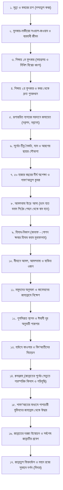

# অধ্যায় ০৯: অনন্ত জীবনের সোপান: বারযাখ থেকে জান্নাত-জাহান্নাম

> **"মৃত্যু কোনো পরিসমাপ্তি নয়, বরং অনন্ত পরকালীন জীবনের সূচনা; কবর, পুনরুত্থান, হাশর, মিজান ও পুলসিরাতের প্রতিটি সোপান ঈমান ও নেক আমলের নির্ভুল কষ্টিপাথর।"**

---

## বক্তার পরিচিতি ও আলোচনার প্রেক্ষাপট

- **বক্তা:** প্রফেসর ড. আবু বকর মুহাম্মাদ যাকারিয়া (حفظه الله)
- **প্রেক্ষাপট:** বিশেষ প্রশ্নোত্তর ও দারস — ‘মৃত্যু পরবর্তী ধাপ সমূহ’
- **মূল বিষয়বস্তু:** মানুষের মৃত্যুর পর থেকে শুরু করে জান্নাত বা জাহান্নামে চূড়ান্ত পরিণতি পর্যন্ত প্রতিটি পারলৌকিক মনযিল—কবরের চাপ ও সাওয়াল-জওয়াব, শিঙ্গায় দুই ফুৎকার, পুনরুত্থান, রূপান্তরিত হাশরের ময়দান, সূর্যের তীব্র নৈকট্য ও ঘাম, আরশের সুশীতল ছায়া, ৫০ হাজার বছরের দীর্ঘ প্রতীক্ষা, শাফা‘আতুল কুবরা, আমলনামা উড়ে আসা ও গোপন হিসাব, মিযানের পাল্লা, পুলসিরাত পারাপার, হাউযে কাওসার ও বিদ‘আতীদের বিতাড়ন, ক্বনত্বরাহ্ (পরস্পরের দেনা-পাওনা নিষ্পত্তি) এবং জান্নাত ও জাহান্নামের শাফা‘আতের প্রামাণিক আকিদাগত ধারাবাহিক রূপরেখা।

---

## ভূমিকা

দুনিয়ার জীবন ক্ষণস্থায়ী মুসাফিরখানার মতো। মানুষ যখন চোখ বন্ধ করে, তখনই তার ক্বিয়ামতের ক্ষুদ্র অধ্যায় শুরু হয়ে যায়। কিন্তু পরকালীন জীবনের পূর্ণাঙ্গ মানচিত্র কেমন হবে? কবর থেকে শুরু করে হাশরের ময়দান, হিসাব-নিকাশ, পুলসিরাত এবং জান্নাতে প্রবেশের মধ্যবর্তী ধাপগুলো কীভাবে সংঘটিত হবে?

অধিকাংশ মানুষ পরকালের এই ধারাবাহিক পর্যায়গুলো সম্পর্কে বিভ্রান্ত অথবা বিচ্ছিন্ন ধারণার শিকার। শায়খ ড. আবু বকর মুহাম্মাদ যাকারিয়া পবিত্র কুরআন এবং রাসুলুল্লাহ ﷺ-এর সহীহ সুন্নাহর ভিত্তিতে মাইয়্যেতের রূহ কবজ হওয়ার পর থেকে জান্নাত বা জাহান্নামে স্থায়ী হওয়া পর্যন্ত মোট সতেরোটি প্রধান সোপান অত্যন্ত প্রাঞ্জল, ভারসাম্যপূর্ণ ও প্রামাণিক ধারাক্রমে উপস্থাপন করেছেন। এই অধ্যায়টি একজন মুমিনের অন্তরে আখেরাতের জীবন্ত প্রতিচ্ছবি এঁকে দেয়, যা তাকে গাফলত থেকে মুক্ত করে সৎকর্মে উদ্বুদ্ধ করতে অনন্য ভূমিকা পালন করে।

---

## মূল আলোচনা

### ১. পরকালীন মহাযাত্রার পূর্ণাঙ্গ রূপরেখা (মানচিত্র)

---

### ২. কবরের চাপ (ضمّة القبر) ও বারযাখের সাওয়াল-জওয়াব

মৃত্যুর পর প্রথম ঘাঁটি হলো কবর বা বারযাখী জগত।

- **কবরের চাপ (দম্মাতুল কবর):** কবরে লাশ রাখার সাথে সাথে দুই পাশের মাটি এমনভাবে চেপে আসে যে এক পাশের পাঁজরের হাড় অন্য পাশে ঢুকে যাওয়ার উপক্রম হয়। রাসুলুল্লাহ ﷺ জানিয়েছেন, এই চাপ থেকে কোনো মানুষই রেহাই পায় না—এমনকি সাদ ইবনে মু‘আয (رضي الله عنه), যাঁর মৃত্যুতে আল্লাহর আরশ কেঁপে উঠেছিল, তিনিও এ চাপের সম্মুখীন হয়েছিলেন, অতঃপর তা শিথিল করা হয় (মুসনাদে আহমাদ: ২৪২৮৬)।
- **মুনকার ও নাকীরের সওয়াল-জওয়াব:** এরপর দুজন নীল-কালো বর্ণের গম্ভীর ফেরেশতা এসে মাইয়্যেতকে বসিয়ে তিনটি চিরন্তন প্রশ্ন করবেন:
  1. ম্যন রব্বুক? (তোমার প্রতিপালক কে?)
  2. মা দ্বীনুক? (তোমার দ্বীন কী?)
  3. মান নাবিয়্যুক? (তোমার নবী কে?)
- যারা খাঁটি মুমিন, আল্লাহ তা‘আলা তাদের অবিচল রাখবেন এবং তারা সঠিক উত্তর দেবে। ফলে তাদের জন্য জান্নাতের বিছানা ও পোশাক দান করা হবে এবং জান্নাতের দিকে একটি দরজা খুলে দেওয়া হবে, যেখান দিয়ে সুশীতল বাতাস ও সুবাস আসতে থাকবে। আর কাফের, মুনাফিক ও কপট বিশ্বাসীরা বলবে, "হায় আফসোস! আমি কিছু জানি না..." ফলে তাদের ওপর শুরু হবে কবরের ভয়াবহ আযাব, যা ক্বিয়ামত পর্যন্ত নিরবচ্ছিন্নভাবে চলতে থাকবে।

---

### ৩. শিঙ্গায় দুই ফুৎকার ও অলৌকিক পুনরুত্থান (البَعْث)

ইসরাফীল (عليه السلام)-এর শিঙ্গায় (صور) ফুৎকারের মাধ্যমে পার্থিব জগতের পরিসমাপ্তি ঘটবে:

1. **প্রথম ফুৎকার (نفخة الصعق - ধ্বংসের ফুৎকার):** এই ফুৎকারের বিকট শব্দে আসমান-জমিনের সকল সৃষ্টি একযোগে মৃত্যুবরণ করবে এবং গোটা মহাবিশ্ব ধূলিসাৎ হয়ে ধ্বংসলীলায় পরিণত হবে।
2. **দ্বিতীয় ফুৎকার (نفخة البعث والنشور - পুনরুত্থানের ফুৎকার):** দীর্ঘ বিরতির পর দ্বিতীয়বার শিঙ্গায় ফুৎকার দেওয়া হবে। মহান আল্লাহ বলেন:

   > ﴿وَنُفِخَ فِي الصُّورِ فَإِذَا هُم مِّنَ الْأَجْدَاثِ إِلَىٰ رَبِّهِمْ يَنسِلُونَ﴾  
   > **অর্থ:** "অতঃপর শিঙ্গায় ফুৎকার দেওয়া হবে; সাথে সাথেই তারা কবর থেকে তাদের প্রতিপালকের দিকে দ্রুত ছুটতে থাকবে।"  
   > — [সূরা ইয়াসীন, ৩৬:৫১](URLTEMP0)

   সবাই কবর থেকে এমন ক্ষিপ্র গতিতে প্রতিযোগিতা করে দৌড়াবে যেন কোনো নির্দিষ্ট লক্ষ্যের দিকে ছুটছে:

   > ﴿يَوْمَ يَخْرُجُونَ مِنَ الْأَجْدَاثِ سِرَاعًا كَأَنَّهُمْ إِلَىٰ نُصُبٍ يُوفِضُونَ﴾  
   > **অর্থ:** "যেদিন তারা কবর থেকে দ্রুতবেগে বের হয়ে আসবে, যেন তারা কোনো পূজনীয় বেদীর দিকে দ্রুত ধাবিত হচ্ছে।"  
   > — [সূরা আল-মা‘আরিজ, ৭০:৪৩](URLTEMP1)

---

### ৪. রূপান্তরিত হাশরের ময়দান ও অসহনীয় তীব্রতা

ক্বিয়ামতের ময়দান বর্তমান পৃথিবীর কোনো মাঠ হবে না। আল্লাহ তা‘আলা এই পৃথিবীকে সম্পূর্ণ বদলে এক অভূতপূর্ব নতুন ময়দানে রূপান্তরিত করবেন:

> ﴿يَوْمَ تُبَدَّلُ الْأَرْضُ غَيْرَ الْأَرْضِ وَالسَّمَاوَاتُ وَبَرَزُوا لِلَّهِ الْوَاحِدِ الْقَهَّارِ﴾  
> **অর্থ:** "যেদিন এই জমিন অন্য এক জমিনে রূপান্তরিত হবে এবং আকাশমণ্ডলীও; আর সকল মানুষ মহাপরাক্রমশালী এক আল্লাহর সামনে এসে হাজির হবে।"  
> — [সূরা ইবরাহীম, ১৪:৪৮](URLTEMP2)

- **ময়দানের বৈশিষ্ট্য:** এটি হবে ধবধবে সাদা, রক্তিম আভা মিশ্রিত রুটির কাইয়ের মতো সমতল এক বিশাল মাঠ; যেখানে কোনো পাহাড়, টিলা, গর্ত, গাছপালা বা কারো মালিকানার সীমানা চিহ্ন থাকবে না (সহীহ বুখারী: ৬৫২১)।
- **মানবজাতির অবস্থা:** মানুষ ক্বিয়ামতের মাঠে সমবেত হবে সম্পূর্ণ নগ্নপদে, উলঙ্গদেহে এবং খতনাবিহীন অবস্থায়।
  - আয়েশা (رضي الله عنها) বিস্ময় প্রকাশ করে রাসুলুল্লাহ ﷺ-কে জিজ্ঞাসা করলেন: "হে আল্লাহর রাসুল! নারী-পুরুষ সবাই কি নগ্নাবস্থায় একে অপরের দিকে তাকাবে না?" রাসুলুল্লাহ ﷺ জবাবে বললেন:
    > «يَا عَائِشَةُ، الأَمْرُ أَشَدُّ مِنْ أَنْ يَنْظُرَ بَعْضُهُمْ إِلَى بَعْضٍ»  
    > **অর্থ:** "হে আয়েশা! সেদিনের পরিস্থিতি এত ভয়াবহ ও হৃদয়বিদারক হবে যে, কারো দিকে কারো তাকানোর কোনো অবকাশই থাকবে না।"  
    > — [সহীহ বুখারী, হাদিস: ৬৫২৭](URLTEMP3); [সহীহ মুসলিম, হাদিস: ২৮৫৯](URLTEMP4)
- **সূর্যের নৈকট্য ও ঘামের প্লাবন:** মিক্বদাদ ইবনুল আসওয়াদ (رضي الله عنه) বর্ণনা করেন, রাসুলুল্লাহ ﷺ বলেছেন:
  > «تُدْنَى الشَّمْسُ يَوْمَ القِيَامَةِ مِنَ الخَلْقِ، حَتَّى تَكُونَ مِنْهُمْ كَمِقْدَارِ مِيلٍ... فَيَكُونُ النَّاسُ عَلَى قَدْرِ أَعْمَالِهِمْ فِي العَرَقِ...»  
  > **অর্থ:** "ক্বিয়ামতের দিন সূর্যকে সৃষ্টির এত কাছে আনা হবে যে তা মাত্র এক মাইল (বা চোখে সুরমা দেওয়ার এক শলাকা) দূরত্বে অবস্থান করবে... তখন মানুষ তাদের আমল অনুপাতে ঘামে নিমজ্জিত হবে। কারো ঘাম হবে গোড়ালি পর্যন্ত, কারো হাঁটু পর্যন্ত, কারো কোমর পর্যন্ত, আর কারো ক্ষেত্রে ঘাম মুখের লাগাম হয়ে তাকে ডুবিয়ে ফেলবে..."  
  > — [সহীহ মুসলিম, হাদিস: ২৮৬৪](URLTEMP5)
- **অহংকারীদের লাঞ্ছনা:** যারা দুনিয়াতে অহংকার প্রদর্শন করত, তারা হাশরের মাঠে ক্ষুদ্র পিপীলিকার ন্যায় মানুষের পায়ের তলায় পিষ্ট হতে থাকবে।
- **আরশের সুশীতল ছায়া:** এই ভয়াবহ দিনে কোনো ছায়া থাকবে না; কেবলমাত্র সেই সাত (বা দশ) শ্রেণীর সৌভাগ্যবান ব্যক্তিরা আল্লাহর আরশের ছায়াতলে সুশীতল আশ্রয় পাবেন, যাদের কথা হাদিসে এসেছে (ন্যায়পরায়ণ শাসক, আল্লাহর ইবাদতে বেড়ে ওঠা যুবক, মসজিদের সাথে অন্তর লেগে থাকা ব্যক্তি, আল্লাহর ভয়ে নির্জনে ক্রন্দনকারী ব্যক্তি প্রমুখ—সহীহ বুখারী: ৬৬০)।

---

### ৫. পঞ্চাশ হাজার বছরের দীর্ঘ প্রতীক্ষা ও শাফা‘আতুল কুবরা

হাশরের ময়দানে বিচার শুরু না হয়ে এক অসহনীয় দীর্ঘ প্রতীক্ষা চলতে থাকবে। এই দিবসের দৈর্ঘ্য হবে দুনিয়ার গণনায় পঞ্চাশ হাজার বছরের সমান:

> ﴿فِي يَوْمٍ كَانَ مِقْدَارُهُ خَمْسِينَ أَلْفَ سَنَةٍ﴾  
> **অর্থ:** "এমন এক দিনে, যার পরিমাণ হলো পঞ্চাশ হাজার বছর।"  
> — [সূরা আল-মা‘আরিজ, ৭০:৪](URLTEMP6)

এই ভয়াবহ অচলাবস্থা থেকে পরিত্রাণ পেতে মানুষ দিগ্বিদিক ছুটে একে একে আদম, নূহ, ইবরাহীম, মুসা ও ঈসা (عليهم السلام)-এর কাছে গিয়ে আল্লাহর দরবারে বিচার শুরুর সুপারিশ করতে আকুল মিনতি জানাবে। কিন্তু প্রত্যেকেই অতীতের কোনো না কোনো ঘটনার কথা স্মরণ করে বিনীতভাবে অপারগতা প্রকাশ করবেন।

অবশেষে সমগ্র মানবজাতি সাইয়্যিদুল মুরসালীন মুহাম্মাদুর রাসুলুল্লাহ ﷺ-এর শরণাপন্ন হবে। রাসুলুল্লাহ ﷺ বলবেন: «أَنَا لَهَا» ("আমিই এর জন্য নির্ধারিত")। অতঃপর তিনি আরশের নিচে গিয়ে সিজদায় লুটিয়ে পড়বেন এবং আল্লাহর এমন কিছু অনুপম প্রশংসাগীতি গাইবেন যা ইতিপূর্বে কখনো কাউকে শেখানো হয়নি। আল্লাহ তা‘আলা বলবেন: "হে মুহাম্মাদ! মাথা ওঠান, চান—আপনাকে দেওয়া হবে, সুপারিশ করুন—কবুল করা হবে।" এটিই হলো 'মাক্বামে মাহমুদ' এবং বিশ্ববাসীর বিচার শুরুর মহতি সুপারিশ বা 'শাফা‘আতুল কুবরা'।

---

### ৬. আমলনামা উড়ে আসা ও গোপন হিসাব (الحِسَاب)

বিচার শুরু হলে আকাশ থেকে সবার আমলনামা পাখির মতো উড়ে এসে হাতে পতিত হবে:

- **ডান হাতে প্রাপ্তদের উল্লাস:** যার আমলনামা ডান হাতে দেওয়া হবে, সে চরম আনন্দে হাশরের মাঠে চিৎকার করে বলতে থাকবে:
  > ﴿فَأَمَّا مَنْ أُوتِيَ كِتَابَهُ بِيَمِينِهِ فَيَقُولُ هَاؤُمُ اقْرَءُوا كِتَابِيَهْ ۝ إِنِّي ظَنَنتُ أَنِّي مُلَاقٍ حِسَابِيَهْ﴾  
  > **অর্থ:** "যার আমলনামা তার ডান হাতে দেওয়া হবে, সে বলবে: 'এই নাও! তোমরা আমার আমলনামা পড়ে দেখো! আমি তো নিশ্চিত বিশ্বাস করতাম যে আমাকে আমার হিসাবের মুখোমুখি হতে হবে'।"  
  > — [সূরা আল-হাক্বক্বাহ, ৬৯:১৯-২০](URLTEMP7)
- **বাম হাতে ও পেছন থেকে প্রাপ্তদের হাহাকার:** যার আমলনামা বাম হাতে এবং পিঠের পেছন দিক থেকে দেওয়া হবে, সে চরম অপমানে বুক চাপড়ে বলবে:
  > ﴿وَأَمَّا مَنْ أُوتِيَ كِتَابَهُ بِشِمَالِهِ فَيَقُولُ يَا لَيْتَنِي لَمْ أُوتَ كِتَابِيَهْ ۝ وَلَمْ أَدْرِ مَا حِسَابِيَهْ ۝ يَا لَيْتَهَا كَانَتِ الْقَاضِيَةَ﴾  
  > **অর্থ:** "আর যাকে তার আমলনামা বাম হাতে দেওয়া হবে, সে বলবে: 'হায় আফসোস! আমাকে যদি আমার আমলনামাই না দেওয়া হতো! আর আমি যদি না জানতাম আমার হিসাব কী! হায়, মৃত্যুই যদি আমার চূড়ান্ত পরিসমাপ্তি হতো!'।"  
  > — [সূরা আল-হাক্বক্বাহ, ৬৯:২৫-২৭](URLTEMP8)
- **হিসাবের ধরন:**
  - মুমিনদের ক্ষেত্রে আল্লাহ তা‘আলা স্বীয় পর্দার অন্তরালে ডেকে নিয়ে তার ছোটখাটো অপরাধগুলো স্বীকার করাবেন এবং বলবেন: "দুনিয়াতে আমি তোমার এ পাপগুলো গোপন রেখেছিলাম, আজ ক্বিয়ামতের দিনও আমি তা ক্ষমা করে দিলাম।" এটি হলো 'সহজ হিসাব' (হিসাবে ইয়াসীর)।
  - আর যার ক্ষেত্রে চুলচেরা জেরা ও বিশ্লেষণ (মুনাফাশাহ্) করা হবে, সে ধ্বংস হয়ে যাবে; কারণ আল্লাহর দয়া ব্যতীত কেউ নিজ আমলে মুক্তি পেতে পারে না (সহীহ বুখারী: ৬৫৩৭)।

---

### ৭. মিযান (المِيزَان) ও আমলের ওজন

হিসাব শেষে ন্যায়বিচারের সুমহান পাল্লা 'মিযান'-এ ওজন করা হবে।
শায়খ ড. আবু বকর মুহাম্মাদ যাকারিয়া কুরআন ও হাদিসের প্রমাণের ভিত্তিতে স্পষ্ট করেন যে, মিযানে তিনটি জিনিসই ওজন করা হবে:

1. **আমলসমূহ:** যা বাস্তব বস্তুতে রূপ ধারণ করবে (যেমন সুরা বাক্বারা ও আলে ইমরান দুটি মেঘমালারূপে আসবে, সুবহানাল্লাহি ওয়া বিহামদিহি পাল্লা ভারী করবে)।
2. **আমলনামার দফতর:** যেমন সেই বিখ্যাত ৯৯টি পাপের দলিলের বিপরীতে একটিমাত্র তাওহীদের 'বিত্বাক্বাহ' (লা ইলাহা ইল্লাল্লাহর কার্ড)-এর ওজন বেশি হবে।
3. **আমলকারী ব্যক্তি স্বয়ং:** আব্দুল্লাহ ইবনে মাসউদ (رضي الله عنه)-এর চিকন পায়ের গোড়ালি মিযানের পাল্লায় ওহুদ পাহাড়ের চেয়েও ভারী হবে; অথচ এক বিশালদেহী অহংকারী কাফেরের ওজন আল্লাহর কাছে মশার ডানার সমানও হবে না (সহীহ বুখারী: ৪৭২৯)।

---

### ৮. পুলসিরাত (الصِّرَاط) পারাপার

মিযানের পর মুশরিক ও কাফেরদের তাদের মিথ্যা উপাস্যদের পেছনে জাহান্নামের অতল গহ্বরে হাঁকিয়ে নিয়ে যাওয়া হবে (সূরা আয-যুমার: ৭১)।
এরপর জাহান্নামের ওপর স্থাপন করা হবে 'পুলসিরাত'—যা চুলের চেয়ে সূক্ষ্ম, তলোয়ারের চেয়ে ধারালো এবং অত্যন্ত পিচ্ছিল এক সেতু, যার দুই পাশে থাকবে ভয়াল কাঁটাযুক্ত বিশাল আঁকড়া (কালাতীব)।

- মুমিনরা তাদের অন্তরের ঈমানী নূরের তীব্রতা অনুপাতে এই পুল পার হবে: কেউ চোখের পলকে, কেউ বিদ্যুতের চমকে, কেউ তীব্র বাতাসের গতিতে, কেউ দ্রুতগামী ঘোড়ার মতো, কেউ দৌড়ে, আবার কেউ হামাগুড়ি দিয়ে ক্ষতবিক্ষত হয়ে পার হবে।
- আর কাফের, মুনাফিক ও মারাত্মক অপরাধীরা আঁকড়ার আঘাতে পা পিছলে নিচের জাহান্নামে নিক্ষিপ্ত হবে।

---

### ৯. হাউযে কাওসার (الحَوْض) ও বিদ‘আতীদের বিতাড়ন

পুলসিরাত পার হওয়ার পর মুমিনদের জন্য অপেক্ষা করবে রাসুলুল্লাহ ﷺ-এর সুমহান 'হাউযে কাওসার'। এর পানি দুধের চেয়ে সাদা, বরফের চেয়ে শীতল এবং মধুর চেয়ে মিষ্টি। এর পানপাত্রগুলো আকাশের তারকারাজির মতো অসংখ্য। যে সৌভাগ্যবান ব্যক্তি এর এক ঢোক পানি পান করবে, সে আর কখনো তৃষ্ণার্ত হবে না।

**বিদ‘আতীদের ভয়াবহ পরিণতি:**
সাহল ইবনে সা‘দ (رضي الله عنه) বর্ণনা করেন, রাসুলুল্লাহ ﷺ ইরশাদ করেছেন:

> «إِنِّي فَرَطُكُمْ عَلَى الحَوْضِ، مَنْ مَرَّ عَلَيَّ شَرِبَ، وَمَنْ شَرِبَ لَمْ يَظْمَأْ أَبَدًا، لَيَرِدَنَّ عَلَيَّ أَقْوَامٌ أَعْرِفُهُمْ وَيَعْرِفُونِي، ثُمَّ يُحَالُ بَيْنِي وَبَيْنَهُمْ... فَأَقُولُ: إِنَّهُمْ مِنِّي! فَيُقَالُ: إِنَّكَ لاَ تَدْرِي مَا أَحْدَثُوا بَعْدَكَ! فَأَقُولُ: سُحْقًا سُحْقًا لِمَنْ غَيَّرَ بَعْدِي»  
> **অর্থ:** "আমি হাউযে তোমাদের অগ্রগামী হব। যে আমার কাছে আসবে সে পান করবে, আর যে পান করবে সে আর কখনো তৃষ্ণার্ত হবে না। নিশ্চয়ই এমন কিছু দল আমার কাছে আসার জন্য অগ্রসর হবে যাদের আমি চিনব এবং তারাও আমাকে চিনবে। অতঃপর আমার ও তাদের মাঝে অন্তরাল তৈরি করে তাদের আটকে দেওয়া হবে... তখন আমি বলব: 'তারা তো আমার উম্মত!' উত্তরে বলা হবে: 'আপনি জানেন না আপনার ইন্তেকালের পর তারা দ্বীনের মধ্যে কী নতুন বিদ‘আত উদ্ভাবন করেছিল!' তখন আমি বলব: 'দূর হয়ে যাও! দূর হয়ে যাও তারা—যারা আমার পর দ্বীনকে পরিবর্তন ও বিকৃত করেছে!'।"  
> — [সহীহ বুখারী, হাদিস: ৬৫৮৩, ৬৫৮৪](URLTEMP9); [সহীহ মুসলিম, হাদিস: ২২৯০](URLTEMP10)

শায়খ অত্যন্ত ব্যথিত চিত্তে সতর্ক করেন, যারা দুনিয়াতে সুন্নাহ পরিহার করে মনগড়া বিদ‘আত সৃষ্টি করেছে, তারা হাশরের সেই মহাকঠিন পিপাসার মুহূর্তে রাসুলুল্লাহ ﷺ-এর হাত থেকে বঞ্চিত ও বিতাড়িত হবে।

---

### ১০. ক্বনত্বরাহ্ (القَنْطَرَة - জান্নাতের প্রবেশদ্বারের পূর্ববর্তী সেতু)

পুলসিরাত পার হলেও মুমিনরা সরাসরি জান্নাতে প্রবেশ করতে পারবে না। জান্নাত ও জাহান্নামের মধ্যবর্তী একটি বিশেষ সেতুতে (যাকে ক্বনত্বরাহ বলা হয়) সকল মুমিনদের আটকে দেওয়া হবে।

- আবু সাঈদ আল-খুদরী (رضي الله عنه) বর্ণনা করেন, রাসুলুল্লাহ ﷺ ইরশাদ করেছেন:
  > «يَخْلُصُ المُؤْمِنُونَ مِنَ النَّارِ، فَيُحْبَسُونَ عَلَى قَنْطَرَةٍ بَيْنَ الجَنَّةِ وَالنَّارِ، فَيُقْتَصُّ لِبَعْضِهِمْ مِنْ بَعْضٍ مَظَالِمُ كَانَتْ بَيْنَهُمْ فِي الدُّنْيَا، حَتَّى إِذَا هُذِّبُوا وَنُقُّوا أُذِنَ لَهُمْ فِي دُخُولِ الجَنَّةِ...»  
  > **অর্থ:** "মুমিনরা যখন জাহান্নাম থেকে নাজাত পাবে, তখন তাদের জান্নাত ও জাহান্নামের মধ্যবর্তী একটি সেতুর ওপর আটকে রাখা হবে। অতঃপর দুনিয়ার জীবনে পরস্পরের মধ্যকার জুলুম ও অন্যায়ের পারস্পরিক প্রতিশোধ ও নিষ্পত্তি গ্রহণ করা হবে। অবশেষে যখন তাদের সম্পূর্ণ পরিশুদ্ধ ও নিষ্পাপ করা হবে, তখন তাদের জান্নাতে প্রবেশের অনুমতি দেওয়া হবে..."  
  > — [সহীহ বুখারী, হাদিস: ৬৫৩৫](URLTEMP11)
- এই স্থানে মুমিনদের অন্তরের সমস্ত হিংসা, বিদ্বেষ, ক্রোধ ও পারস্পরিক ক্ষোভ সম্পূর্ণরূপে বের করে নেওয়া হবে, যাতে তারা সহোদর ভাইয়ের মতো জান্নাতে প্রবেশ করে:
  > ﴿وَنَزَعْنَا مَا فِي صُدُورِهِم مِّنْ غِلٍّ إِخْوَانًا عَلَىٰ سُرُرٍ مُّتَقَابِلِينَ﴾  
  > **অর্থ:** "এবং তাদের অন্তরে যেটুকুও ক্ষোভ বা বিদ্বেষ ছিল আমি তা দূর করে দেব; তারা পরম ভ্রাতৃত্বের সাথে মুখোমুখি হয়ে সুসজ্জিত আসনে অবস্থান করবে।"  
  > — [সূরা আল-হিজর, ১৫:৪৭](URLTEMP12)

---

### ১১. শাফা‘আত ও পাপাচারী মুমিনদের মুক্তি

যেসকল তাওহীদবাদী মুমিন নিজেদের কবিরা গুনাহের কারণে পুলসিরাত পার হতে না পেরে জাহান্নামে পতিত হয়েছিল, তাদের চিরকাল জাহান্নামে থাকতে হবে না।

- নবীগণ, ফেরেশতাগণ, শহীদগণ এবং নেককার মুমিনরা আল্লাহর অনুমতিক্রমে তাদের জন্য সুপারিশ করবেন।
- মুমিনরা বলবে: "হে আমাদের রব! আমাদের যে ভাইয়েরা আমাদের সাথে সালাত আদায় করত ও সিয়াম রাখত, তারা আগুনে পুড়ছে, তাদের ক্ষমা করুন!" আল্লাহ বলবেন: "যাও, যাদের অন্তরে এক দীনার, অর্ধ দীনার কিংবা একটি সরিষার দানা পরিমাণও খাঁটি ঈমান আছে, তাদের জাহান্নাম থেকে বের করে নিয়ে আসো।"
- তবে **মুশরিকদের জন্য কোনো সুপারিশ নেই:** আল্লাহ তা‘আলা সাফ জানিয়ে দিয়েছেন:
  > ﴿فَمَا تَنفَعُهُمْ شَفَاعَةُ الشَّافِعِينَ﴾  
  > **অর্থ:** "অতএব, সুপারিশকারীদের কোনো সুপারিশ তাদের কোনো উপকারে আসবে না।"  
  > — [সূরা আল-মুদ্দাসসির, ৭৪:৪৮](URLTEMP13)
- জাহান্নাম থেকে উদ্ধারকৃত এই কয়লাসম দগ্ধ মুমিনদের জান্নাতের 'নাহরুল হায়াত' (জীবনের ঝরনাধারা)-এ স্নান করানো হবে। ফলে তারা প্লাবনের পলিমাটিতে সতেজ উদ্ভিদের ন্যায় সুশ্রী রূপে জেগে উঠবে এবং তাদের কপালে থাকা 'জাহান্নামী' ছাপও মুছে দেওয়া হবে।

---

### ১২. জান্নাতে প্রবেশ ও পরম সৌভাগ্য

- জান্নাতের দরজায় সর্বপ্রথম কড়া নাড়বেন রাসুলুল্লাহ ﷺ। দারোয়ান ফেরেশতা রিজওয়ান জিজ্ঞাসা করবেন: "আপনি কে?" তিনি বলবেন: "মুহাম্মাদ।" ফেরেশতা বলবেন: "আপনার পূর্বেই কারো জন্য এই দ্বার উন্মুক্ত না করার নির্দেশ আমাকে দেওয়া হয়েছিল" (সহীহ মুসলিম: ১৯৭)।
- **সর্বশেষ জান্নাতীর মর্যাদা:** আব্দুল্লাহ ইবনে মাসউদ (رضي الله عنه) বর্ণিত হাদিসে রাসুলুল্লাহ ﷺ জানিয়েছেন, জাহান্নাম থেকে সর্বশেষে মুক্তি পেয়ে যে ব্যক্তি জান্নাতে প্রবেশ করবে, মহান আল্লাহ তাকে এই সমগ্র দুনিয়ার চেয়েও **দশ গুণ বিশাল জান্নাত** দান করবেন (সহীহ বুখারী: ৬৫৭১; সহীহ মুসলিম: ১৮৬)।
- **জান্নাতুল ফিরদাউস ও সুমহান দিদার:** জান্নাতের সর্বোচ্চ ও সর্বশ্রেষ্ঠ স্তর হলো 'জান্নাতুল ফিরদাউস'। এর ছাদ হলো স্বয়ং আরশুর রহমান।
- জান্নাতীদের সবচেয়ে বড় নেয়ামত কোনো ফলমূল বা হুর নয়; বরং মহান রবের সুমহান ও জ্যোতির্ময় চেহারার সরাসরি দর্শন (দিদার), যা দেখার পর জান্নাতীরা অন্য সব নেয়ামতের কথা ভুলে যাবে!

---

## ভুল ধারণা ও তার নিরসন

| প্রচলিত ভুল ধারণা                                                                                 | সহীহ সুন্নাহসম্মত বাস্তবতা                                                                                                                                                                              |
| :------------------------------------------------------------------------------------------------ | :------------------------------------------------------------------------------------------------------------------------------------------------------------------------------------------------------ |
| **১. মৃত্যুর সাথে সাথেই বিচার শেষ হয়ে মানুষ সরাসরি জান্নাত বা জাহান্নামে চলে যায়।**             | **ভুল ধারণা।** মৃত্যুর পর ক্বিয়ামত পর্যন্ত মানুষের অবস্থান হবে 'বারযাখ' বা কবরের জগতে। ইসরাফীল (আ.)-এর দ্বিতীয় ফুৎকারের পর সকলে হাশরের মাঠে সমবেত হবে এবং পূর্ণাঙ্গ বিচার প্রক্রিয়া সম্পন্ন হবে।     |
| **২. হাশরের ময়দান এই বর্তমান বাংলাদেশ, মক্কা বা ফিলিস্তিনের মাটিতেই হবে।**                       | **কুরআন বিরোধী।** সূরা ইবরাহীমের ৪৮ নং আয়াত মোতাবেক আল্লাহ এই আসমান ও জমিনকে সম্পূর্ণ রূপান্তরিত করে এক অচিন্তনীয় সমতল ময়দানে পরিণত করবেন।                                                           |
| **৩. যেকোনো পীর, ওলী বা বুজুর্গ তাঁর মুরিদকে হাত ধরে হাশরের মাঠে পার করিয়ে দেবেন।**              | **শিরকি বিশ্বাস।** ক্বিয়ামতের দিন কারো সুপারিশ করার নিজস্ব ক্ষমতা থাকবে না। সুপারিশ কেবল আল্লাহর অনুমতি সাপেক্ষে এবং কেবল তাওহীদবাদী মুমিনের জন্যই হবে। শিরককারীর জন্য কোনো সুপারিশকারী থাকবে না।      |
| **৪. দ্বীনের মধ্যে মনগড়া ভালো কাজ (বিদ‘আত) করলেও রাসুলুল্লাহ ﷺ হাউযে কাওসারের পানি পান করাবেন।** | **চরম ভ্রান্তি।** সহীহ বুখারী ও মুসলিমের দ্ব্যর্থহীন ঘোষণা অনুযায়ী, যারা দ্বীনে নতুন বিদ‘আত উদ্ভাবন বা সুন্নাহ পরিবর্তন করেছে, রাসুলুল্লাহ ﷺ নিজেই তাদের "দূর হয়ে যাও!" বলে হাউয থেকে তাড়িয়ে দেবেন। |
| **৫. পুলসিরাত পার হলেই সাথে সাথে জান্নাতে ঢুকে যাওয়া যায়।**                                     | **অপূর্ণ জ্ঞান।** পুলসিরাতের পর 'ক্বনত্বরাহ্' নামক স্থানে মুমিনদের আটকে তাদের মধ্যকার পারস্পরিক হক্ব ও ক্ষোভ নিষ্পত্তি করে সম্পূর্ণ নিষ্কলুষ করা হবে, এরপরই জান্নাতের দ্বার খুলবে।                      |

---

## মূল শিক্ষা সংক্ষেপে

1. **পরকালের বাস্তব মানচিত্র:** বারযাখ থেকে জান্নাত পর্যন্ত প্রতিটি স্তর সত্য ও সুনির্দিষ্ট নিয়মে পরিচালিত হবে।
2. **তাওহীদের অপরিহার্যতা:** কবরের চাপ থেকে শুরু করে মিযান, পুলসিরাত ও শাফা‘আত—প্রতিটি ধাপে মুক্তির মূল চাবিকাঠি হলো খাঁটি তাওহীদ; শিরক থাকলে সকল স্তর ধ্বংস।
3. **সুন্নাহর অনুগমন:** হাউযে কাওসারের সুশীতল পানি পেতে হলে দুনিয়াতে সকল প্রকার বিদ‘আত বর্জন করে রাসুলুল্লাহ ﷺ-এর খাঁটি সুন্নাহর ওপর অটল থাকতে হবে।
4. **হক্বুল ইবাদ (বান্দার হক্ব):** ক্বনত্বরাহ প্রমাণ করে যে, আল্লাহর হক্ব মাফ হলেও বান্দার ওপর করা জুলুম বা গীবতের ক্ষতিপূরণ না দিয়ে জান্নাতে প্রবেশ সম্ভব নয়।

---

## আমল ও করণীয়

- [ ] পাঁচ ওয়াক্ত সালাতের শেষ তাশাহহুদে কবরের আযাব ও দাজ্জালের ফিতনা থেকে মুক্তির মাসনূন দো‘আ পাঠ করা।
- [ ] আরশের ছায়া লাভের সাতটি গুণের (ইনসাফ, যৌবনে ইবাদত, দানশীলতা, নির্জনে ক্রন্দন) অন্তত একটি নিজের জীবনে বাস্তবায়ন করা।
- [ ] সকল প্রকার বিদ‘আতী রসম-রেওয়াজ বর্জন করে প্রতিটি আমল রাসুলুল্লাহ ﷺ-এর সুন্নাহ মোতাবেক সম্পন্ন করা।
- [ ] মানুষের সাথে কৃত অন্যায়, গীবত ও আর্থিক লেনদেনের হক্ব দুনিয়াতেই মাফ চেয়ে বা পরিশোধ করে নিজেকে দায়মুক্ত রাখা।
- [ ] জান্নাতুল ফিরদাউসের জন্য রবের দরবারে কায়মনোবাক্যে নিয়মিত দো‘আ করা।

---

## শব্দার্থ ও পরিভাষা

- **বারযাখ (بَرْزَخ):** মৃত্যু থেকে ক্বিয়ামতের পুনরুত্থান পর্যন্ত অন্তর্বর্তীকালীন আলমে আরওয়াহ বা কবরের জীবন।
- **দম্মাতুল কবর (ضَمَّة القَبْر):** কবরের দুই পাশের মাটির একত্রিত হয়ে মাইয়্যেতের দেহকে প্রচণ্ড শক্তিতে চেপে ধরা।
- **হিসাবে ইয়াসীর (حِسَابًا يَسِيرًا):** মুমিনদের ক্ষেত্রে আল্লাহর রহমতে পর্দার আড়ালে সহজ ও সংক্ষিপ্ত হিসাব গ্রহণ।
- **মুনাফাশাহ্ (المُنَاقَشَة):** চুলচেরা বিশ্লেষণ ও পুঙ্খানুপুঙ্খ জেরা; যার ক্ষেত্রে এটি হবে সে ধ্বংস অনিবার্য।
- **ক্বনত্বরাহ্ (القَنْطَرَة):** পুলসিরাতের পর এবং জান্নাতের পূর্বে অবস্থিত বিশেষ সেতু, যেখানে মুমিনদের পারস্পরিক মনস্তাত্ত্বিক ও হক্ব সংক্রান্ত পরিশুদ্ধি ঘটে।
- **বিত্বাক্বাহ (البِطَاقَة):** একটি বিশেষ ছোট কার্ড যাতে খাঁটি তাওহীদের বাণী 'লা ইলাহা ইল্লাল্লাহ' লিপিবদ্ধ থাকবে এবং যা পাপের ৯৯টি রেজিস্টারের চেয়ে ভারী হবে।

---

## শায়খের পর্যালোচনার জন্য বিশেষ নোট

1. **মিযানে ওজনযোগ্য বস্তুসমূহের সমন্বয়:** শায়খ দারসে আমল, আমলনামা ও আমলকারী ব্যক্তি—এই তিনটিরই ওজন হওয়ার বিষয়ে ইঙ্গিত দিয়েছেন। অধ্যায়ে আহলে সুন্নাত ওয়াল জামা‘আতের প্রখ্যাত মুহাদ্দিসগণের তাহক্বীক্ব অনুযায়ী এই তিনটির সুন্দর সমন্বয় প্রামাণিক হাদিসসহ উপস্থাপন করা হয়েছে।
2. **ক্বনত্বরাহ্-এর ফিক্বহী অবস্থান:** সাধারণ পাঠকদের জন্য পুলসিরাত ও ক্বনত্বরাহর পার্থক্য অনেক সময় অস্পষ্ট থাকে। শায়খের বক্তব্যের আলোকে ক্বনত্বরাহর অবস্থান (পুলসিরাতের পর এবং জান্নাতের পূর্বে) এবং এর অন্তর্নিহিত হিকমত (অন্তরের ক্ষোভ মোচন) অত্যন্ত স্পষ্টভাবে ফুটিয়ে তোলা হয়েছে।
3. **হাউযে কাওসার ও পুলসিরাতের পারস্পরিক ক্রম:** শায়খ দারসে পুলসিরাত পার হওয়ার পর হাউযে কাওসারের পানির বর্ণনার কথা উল্লেখ করেছেন। কোনো কোনো বর্ণনায় হাশরের মাঠে এবং কোনো বর্ণনায় পুলসিরাত পার হওয়ার পর হাউযের কথা এসেছে (আলেমগণের মতে দুটি স্থান বা হাউযের পরিধি উভয় স্থানে বিস্তৃত)। অধ্যায়ে শায়খের বর্ণিত ধারাবাহিকতাটি অক্ষুণ্ণ রাখা হয়েছে।
