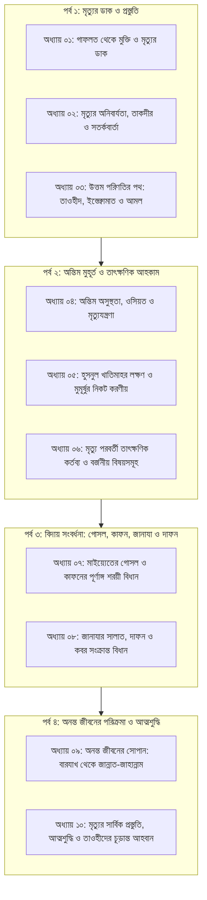
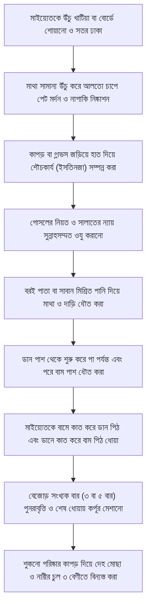
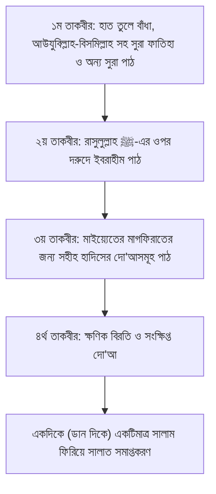
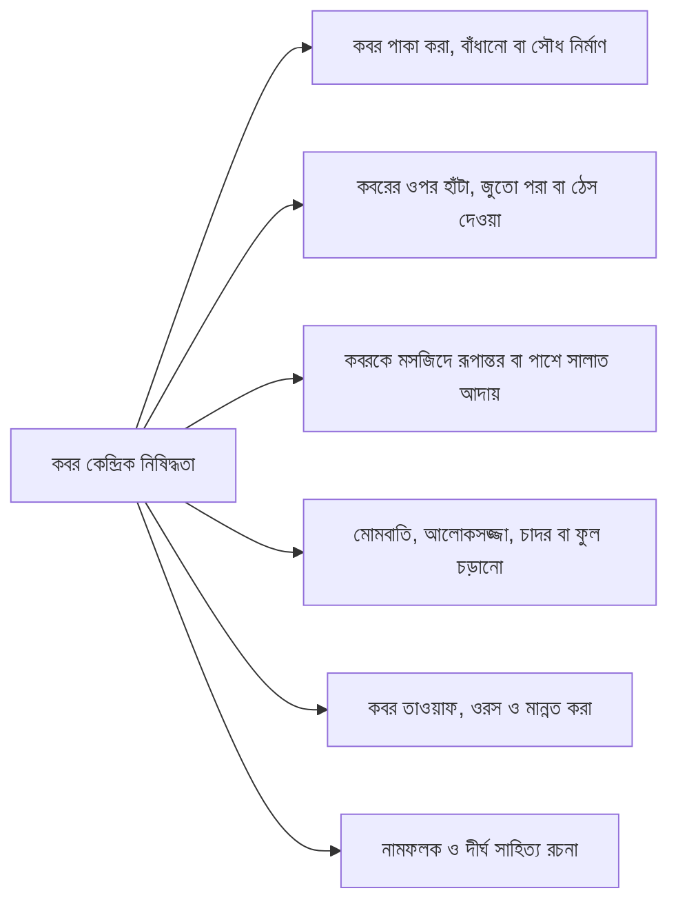
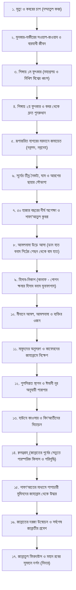
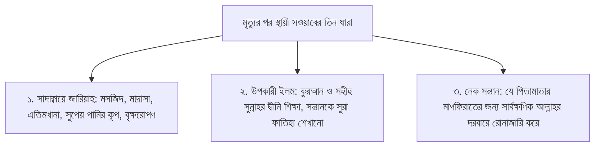

# মৃত্যু, জানাযা ও অনন্ত জীবন: কুরআন ও সুন্নাহর আলোকে প্রস্তুতি ও বিধান

**মূল আলোচনা ও গবেষণা:**  
**প্রফেসর ড. আবু বকর মুহাম্মাদ যাকারিয়া** *(حفظه الله)*  
*প্রফেসর, ফিকহ ও ইসলামিক স্টাডিজ বিভাগ, ইসলামী বিশ্ববিদ্যালয়, কুষ্টিয়া; মদিনা ইসলামী বিশ্ববিদ্যালয়ের পিএইচডি গবেষক ও সুবিখ্যাত তাফসির প্রণেতা।*

---

## গ্রন্থ পরিচিতি ও নিবেদন

মানুষের এই নশ্বর পার্থিব জীবন অনন্ত পরকালীন জীবনের একটি ক্ষুদ্রতম ভূমিকা মাত্র। প্রতিটি আদম সন্তানের জন্য সবচেয়ে নিশ্চিত ও ধ্রুব সত্য হলো—তাকে মৃত্যুর স্বাদ গ্রহণ করতে হবে। কিন্তু আধুনিক বস্তুবাদী জগতের মোহ, গাফলত এবং পার্থিব ভোগবিলাস মানুষকে মৃত্যুর অমোঘ সত্য থেকে গাফেল করে রেখেছে। একই সাথে সমাজজুড়ে মৃত্যু, মাইয়্যেতের গোসল, কাফন, জানাযা ও কবরকে কেন্দ্র করে অনুপ্রবেশ করেছে সহস্র আঞ্চলিক কুসংস্কার, জাহেলিয়াত এবং বিদ‘আতী রসম-রেওয়াজ।

এই সুবিশাল একক গ্রন্থে প্রখ্যাত ইসলামিক স্কলার ও গবেষক **প্রফেসর ড. আবু বকর মুহাম্মাদ যাকারিয়া (حفظه الله)**-এর প্রদত্ত ধারাবাহিক জুমার খুতবা, বিশেষ দারস এবং আন্তর্জাতিক সম্মেলনসমূহের বিশুদ্ধ প্রামাণিক বক্তব্যের ওপর ভিত্তি করে প্রস্তুতকৃত দশটি পূর্ণাঙ্গ অধ্যায়কে এক মলাটে গ্রন্থিত করা হলো।

### এ গ্রন্থের প্রধান বৈশিষ্ট্যসমূহ:
1. **পূর্ণাঙ্গ শারঈ প্রামাণিকতা:** প্রতিটি অধ্যায় কুরআনুল কারীম এবং রাসুলুল্লাহ ﷺ-এর সহীহ সুন্নাহ ও সাহাবায়ে কেরামের আসার দ্বারা সুদৃঢ়।
2. **হরকতসহ নির্ভুল আরবি ইবারত ও ক্লিকযোগ্য রেফারেন্স:** কুরআনের প্রতিটি আয়াত উসমানি লিপিতে পূর্ণ হরকতসহ এবং [Quran.com](https://quran.com) লিংকের সাথে যুক্ত। প্রতিটি হাদিস পূর্ণ হরকত, মূল রাবী, সনদ ও কিতাবের নম্বর এবং [HadithBD.com](https://www.hadithbd.com)-এর সরাসরি লিঙ্কসহ সংকলিত।
3. **সুশৃঙ্খল ধারাবাহিকতা:** মৃত্যুভীতি ও গাফলত থেকে শুরু করে অন্তিম রোগশয্যা, মৃত্যুযন্ত্রণা, গোসল, কাফন, জানাযা, দাফন, কবর এবং অনন্ত জীবনের প্রতিটি মনযিল (বারযাখ, পুনরুত্থান, হাশর, মীযান, পুলসিরাত, হাউযে কাওসার ও জান্নাত) একটি ধারাবাহিক রোডম্যাপে বিন্যস্ত।
4. **বিদ‘আত ও কুসংস্কারের অকাট্য খণ্ডন:** সমাজে প্রচলিত কবরপূজা, মাজার সংস্কৃতি, বিদ‘আতী তালক্বীন, জানাযার পর দ্বিতীয় মোনাজাত, কুলখানি ও চেহলামের মতো যাবতীয় রসমের দালিলিক নিরসন।
5. **সম্পাদকের আমানতদারিতা:** বক্তার নিজস্ব ফিক্বহী অবস্থান (যেমন: জানাযার এক সালাম, করোনা বা পোড়া লাশের বিধান, নারীর কাফনের পরিমাপ) হুবহু সংরক্ষণ করা হয়েছে এবং প্রয়োজনীয় ব্যাখ্যার ক্ষেত্রে 'সম্পাদকীয় সংযোজন' চিহ্নিত করা হয়েছে।

---

## পূর্ণাঙ্গ সূচিপত্র (Master Table of Contents)

---

### পর্ব ১: মৃত্যুর ডাক ও প্রস্তুতি
- **[অধ্যায় ০১: গাফলত থেকে মুক্তি ও মৃত্যুর ডাক](#chapter-01)**  
  *(মানুষের গাফলত বনাম মৃত্যুর অনিবার্যতা; সূরা আল-আম্বিয়ার ১ নম্বর আয়াতের আলোকে জীবনের পরম সতর্কতা; সুস্থতা ও অবসরের সদ্ব্যবহার)*
- **[অধ্যায় ০২: মৃত্যুর অনিবার্যতা, তাকদীর ও সতর্কবার্তা](#chapter-02)**  
  *(অকাল মৃত্যু বিভ্রান্তি নিরসন, তাকদীরের ওপর অটল বিশ্বাস, নির্ধারিত আয়ু ও বার্ধক্য-অসুস্থতার সতর্ক সংকেত)*
- **[অধ্যায় ০৩: উত্তম পরিণতির পথ: তাওহীদ, ইস্তেক্বামাত ও আমল](#chapter-03)**  
  *(হুসনুল খাতিমাহর শর্তাবলী, তাওহীদের ওপর অবিচলতা, অন্তরের ইখলাস, রিয়া ও লৌকিকতা বর্জন এবং খাঁটি তাওবা)*

---

### পর্ব ২: অন্তিম মুহূর্ত ও তাৎক্ষণিক আহকাম
- **[অধ্যায় ০৪: অন্তিম অসুস্থতা, ওসিয়ত ও মৃত্যুযন্ত্রণা](#chapter-04)**  
  *(রোগশয্যার আদব ও সাওয়াব, ওসিয়তের শারঈ নীতিমালা ও এক-তৃতীয়াংশের সীমা, এতিম নাতির অধিকার ও সাক্বারাাতুল মাওত)*
- **[অধ্যায় ০৫: হুসনুল খাতিমাহর লক্ষণ ও মুমূর্ষুর নিকট করণীয়](#chapter-05)**  
  *(মুমূর্ষুকে 'লা ইলাহা ইল্লাল্লাহ'-এর সুন্নাহসম্মত তালক্বীন, হুসনুল খাতিমাহর শারঈ নিদর্শনসমূহ ও শুক্রবার/রমজানের ধারণার তাহক্বীক্ব)*
- **[অধ্যায় ০৬: মৃত্যু পরবর্তী তাৎক্ষণিক কর্তব্য ও বর্জনীয় বিষয়সমূহ](#chapter-06)**  
  *(চোখ বন্ধ করা ও চিবুক বাঁধা, দ্রুত ঋণ পরিশোধ, মাতম ও শোক প্রকাশের সীমা এবং কুলখানি-চল্লিশার বিদ‘আত নিরসন)*

---

### পর্ব ৩: বিদায় সংবর্ধনা: গোসল, কাফন, জানাযা ও দাফন
- **[অধ্যায় ০৭: মাইয়্যেতের গোসল ও কাফনের পূর্ণাঙ্গ শরয়ী বিধান](#chapter-07)**  
  *(স্বামী-স্ত্রীর একে অপরকে গোসল দেওয়া, সুন্নাহসম্মত গোসলের ধারাবাহিক ৭ ধাপ, ৩ চাদরে কাফন, করোনা/অগ্নিদগ্ধ ও গর্ভপাতের বিধান)*
- **[অধ্যায় ০৮: জানাযার সালাত, দাফন ও কবর সংক্রান্ত বিধান](#chapter-08)**  
  *(জানাযার ৪ তাকবীর ও এক সালামের সুন্নাত, খাটিয়ার শিষ্টাচার, লাহাদ খনন, এক বিঘত কবর, মাজার সংস্কৃতির খণ্ডন ও তালক্বীনের বিদ‘আত বর্জন)*

---

### পর্ব ৪: অনন্ত জীবনের পরিক্রমা ও আত্মশুদ্ধি
- **[অধ্যায় ০৯: অনন্ত জীবনের সোপান: বারযাখ থেকে জান্নাত-জাহান্নাম](#chapter-09)**  
  *(কবরের চাপ ও সাওয়াল-জওয়াব, শিঙ্গায় দুই ফুৎকার, পুনরুত্থান, রূপান্তরিত হাশর, সূর্যের তীব্রতা, আরশের ছায়া, মীযান, পুলসিরাত, হাউযে কাওসার ও ক্বনত্বরাহ্)*
- **[অধ্যায় ১০: মৃত্যুর সার্বিক প্রস্তুতি, আত্মশুদ্ধি ও তাওহীদের চূড়ান্ত আহবান](#chapter-10)**  
  *(দাসত্বই মানবজীবনের শ্রেষ্ঠ পরিচয়, কবরের মাটি শক্ত হওয়ার বাস্তবতা, প্রবাহমান তিন সওয়াবের ধারা এবং কবরের তিন প্রশ্নের বাস্তব প্রস্তুতি)*

---

# অধ্যায় ১: গাফলত থেকে মুক্তি ও মৃত্যুর ডাক

### মানুষের চরম উদাসীনতা, সৃষ্টির উদ্দেশ্য ও আখিরাতের সার্বক্ষণিক প্রস্তুতি

---

## ১. বক্তার পরিচিতি ও আলোচনার প্রেক্ষাপট

- **বক্তা:** শাইখ প্রফেসর ড. আবুবকর মুহাম্মাদ যাকারিয়া (হাফিজাহুল্লাহ) — বিশিষ্ট ইসলামী চিন্তাবিদ, গবেষক, তাফসীরকারক ও তুলনামূলক ধর্মতত্ত্ববিদ; সাবেক শিক্ষক ও প্রফেসর, আল-ফিকহ ও ল' ডিপার্টমেন্ট, ইসলামী বিশ্ববিদ্যালয়, কুষ্টিয়া।
- **প্রেক্ষাপট:** ইসলামী বিশ্ববিদ্যালয় কেন্দ্রীয় মসজিদে জুমার সালাতের পূর্বে শিক্ষক, শিক্ষার্থী ও সাধারণ মুসল্লিদের উদ্দেশ্যে প্রদত্ত বিশেষ আত্মশুদ্ধিমূলক ও ঈমান-জাগানিয়া নসীহত।
- **মূল প্রতিপাদ্য:** পার্থিব মোহে নিমজ্জিত মানুষের চরম গাফলত (উদাসীনতা), চোখের সামনে প্রিয়জনদের প্রস্থান, সৃষ্টির প্রকৃত উদ্দেশ্য এবং মৃত্যুর জন্য অন্তরের সার্বক্ষণিক জাগরণ।

---

## ২. ভূমিকা

সমস্ত প্রশংসা মহান পরাক্রমশালী আল্লাহ রাব্বুল ইজ্জতের জন্য, যিনি জীবন ও মৃত্যুকে সৃষ্টি করেছেন মানুষের মধ্য থেকে সর্বোত্তম আমলকারীকে পরীক্ষা করার জন্য। সালাত ও সালাম বর্ষিত হোক মানবতার শ্রেষ্ঠ শিক্ষক মুহাম্মাদুর রাসূলুল্লাহ ﷺ-এর প্রতি, যিনি উম্মাহকে পার্থিব জীবনের মোহমুক্ত হয়ে অনন্ত পরকালের পাথেয় সংগ্রহের নির্দেশ দিয়েছেন।

পার্থিব জীবনের এক অমোঘ, নিরেট ও সর্বজনীন সত্য হলো—যে ব্যক্তি এই পৃথিবীতে এসেছে, তাকে অবশ্যই বিদায় নিতে হবে। মানব ইতিহাসে মৃত্যু এমন এক অপ্রতিরোধ্য বাস্তবতা, যা কেউ কখনো অস্বীকার করতে পারেনি এবং পারবেও না। পার্থিব জীবনে মানুষের টিকে থাকাটাই মূলত সাময়িক ও ক্ষণস্থায়ী; অথচ অধিকাংশ মানুষ এক ভয়াবহ গাফলত ও উদাসীনতার মধ্যে নিমজ্জিত হয়ে বসবাস করছে। তারা এমন এক আচরণ প্রদর্শন করে, যেন তারা এই ধরায় চিরকাল বেঁচে থাকবে অথবা তাদের কোনদিন আল্লাহর আদালতে বিচারের মুখোমুখি হতে হবে না।

শায়খ ড. আবুবকর মুহাম্মাদ যাকারিয়া (হাফিজাহুল্লাহ) এই অধ্যায়ে মানবজাতির সেই আত্মঘাতী গাফলতের স্বরূপ উন্মোচন করেছেন এবং কুরআন ও সুন্নাহর অকাট্য দলিলের আলোকে মৃত্যুর স্মরণ, কবর জিয়ারতের প্রকৃত উদ্দেশ্য এবং আখিরাতের অনন্ত সফলতার সুনির্দিষ্ট রূপরেখা তুলে ধরেছেন।

---

## ৩. মূল আলোচনা

### ৩.১ মানুষের চরম গাফলত ও সৃষ্টির উদ্দেশ্য

মানুষের বাহ্যিক চালচলন, আচার-আচরণ ও দুনিয়াবী উন্মাদনা দেখলে মনে হয়—সে হয়তো আখিরাতে বিশ্বাসই করে না, অথবা সে ধারণা করে বসেছে যে সৃষ্টিকর্তা তাকে কোনো লক্ষ্য-উদ্দেশ্য ছাড়াই নিছক খেল-তামাশার বস্তু হিসেবে অস্তিত্ব দিয়েছেন। মানুষের এই অসার ধারণাকে খণ্ডন করে মহান আল্লাহ তাআলা ঘোষণা করেন:

> **أَفَحَسِبْتُمْ أَنَّمَا خَلَقْنَاكُمْ عَبَثًا وَأَنَّكُمْ إِلَيْنَا لَا تُرْجَعُونَ**
>
> **অনুবাদ:** "তোমরা কি মনে করেছিলে যে, আমরা তোমাদেরকে অনর্থক ও উদ্দেশ্যহীনভাবে সৃষ্টি করেছি এবং তোমরা আমাদের দিকে প্রত্যাবর্তিত হবে না?"  
> — [সূরা আল-মু’মিনূন, ২৩:১১৫](https://quran.com/23/115)

মানুষ যেভাবে খুশিমতো দুনিয়ার বুকে অহংকার প্রকাশ করে এবং প্রবৃত্তির দাসত্বে লিপ্ত হয়, তাতে সে ভুলে যায় তার আদি সূচনার কথা। অথচ সে তো ছিল এক নগণ্য বীর্যবিন্দু! আল্লাহ তাআলা ইরশাদ করেন:

> **أَيَحْسَبُ الْإِنسَانُ أَن يُتْرَكَ سُدًى — أَلَمْ يَكُ نُطْفَةً مِّن مَّنِيٍّ يُمْنَىٰ — ثُمَّ كَانَ عَلَقَةً فَخَلَقَ فَسَوَّىٰ**
>
> **অনুবাদ:** "মানুষ কি মনে করে যে, তাকে এমনিতেই ছেড়ে দেওয়া হবে? সে কি স্খলিত শুক্রের এক বিন্দু বীর্য ছিল না? অতঃপর সে রক্তপিণ্ডে পরিণত হয়েছিল, তারপর আল্লাহ তাকে সৃষ্টি করেছেন এবং সুষম করেছেন।"  
> — [সূরা আল-ক্বিয়ামাহ, ৭৫:৩৬-৩৮](https://quran.com/75/36-38)

তিনি মানুষকে সুন্দরতম অবয়বে সৃষ্টি করেছেন, আবার বার্ধক্য ও মৃত্যুর মাধ্যমে তাকে তার আদি নিঃস্ব অবস্থায় নামিয়ে দেন:

> **لَقَدْ خَلَقْنَا الْإِنسَانَ فِي أَحْسَنِ تَقْوِيمٍ \* ثُمَّ رَدَدْنَاهُ أَسْفَلَ سَافِلِينَ**
>
> **অনুবাদ:** "নিশ্চয়ই আমরা মানুষকে সৃষ্টি করেছি সুন্দরতম গঠনে। অতঃপর আমরা তাকে নামিয়ে দিয়েছি সর্বনিম্নের নিম্নতম স্তরে।"  
> — [সূরা আত-তীন, ৯৫:৪-৫](https://quran.com/95/4-5)

মানুষের সৃষ্টির একমাত্র উদ্দেশ্য হলো একমাত্র আল্লাহর একনিষ্ঠ দাসত্ব (ইবাদত) কায়েম করা। আল্লাহ তাআলা কোনো বান্দার নিকট খাদ্য বা জীবিকা চান না; বরং তিনিই সমগ্র সৃষ্টির একমাত্র রিজিকদাতা:

> **وَمَا خَلَقْتُ الْجِنَّ وَالْإِنسَ إِلَّا لِيَعْبُدُونِ — مَا أُرِيدُ مِنْهُم مِّن رِّزْقٍ وَمَا أُرِيدُ أَن يُطْعِمُونِ — إِنَّ اللَّهَ هُوَ الرَّزَّاقُ ذُو الْقُوَّةِ الْمَتِينُ**
>
> **অনুবাদ:** "আর আমি জ্বিন ও মানবজাতিকে কেবল আমারই ইবাদত করার জন্য সৃষ্টি করেছি। আমি তাদের কাছে কোনো জীবিকা চাই না এবং এও চাই না যে তারা আমাকে আহার করাবে। নিশ্চয়ই আল্লাহ—তিনিই তো পরম রিজিকদাতা, মহাশক্তিধর, পরাক্রমশালী।"  
> — [সূরা আয-যারিয়াত, ৫১:৫৬-৫৮](https://quran.com/51/56-58)

শায়খ গুরুত্বের সাথে স্মরণ করিয়ে দেন: ভূ-পৃষ্ঠে বিচরণশীল কীট-পতঙ্গ থেকে শুরু করে সকল সৃষ্টির রিজিকের দায়িত্ব আল্লাহ নিজের কাঁধে নিয়েছেন [সূরা হূদ, ১১:৬](https://quran.com/11/6)। অথচ দুর্ভাগা মানুষ একমাত্র প্রাণী, যে জীবিকার সংকীর্ণ চিন্তায় আল্লাহর বিধান লঙ্ঘন করে হারাম উপার্জনের পেছনে হন্যে হয়ে ছুটে বেড়ায়!

---

### ৩.২ হিসাবের নৈকট্য বনাম মানুষের সীমাহীন আশা

মানুষের মৃত্যুর সময় এবং কর্মের হিসাবের দিন অতি দ্রুত এগিয়ে আসছে, অথচ মানুষ মুখ ফিরিয়ে উদাসীনতায় দিন কাটাচ্ছে:

> **اقْتَرَبَ لِلنَّاسِ حِسَابُهُمْ وَهُمْ فِي غَفْلَةٍ مُّعْرِضُونَ**
>
> **অনুবাদ:** "মানুষের হিসাব-নিকাশের সময় ঘনিয়ে এসেছে, অথচ তারা উদাসীনতায় মুখ ফিরিয়ে রয়েছে।"  
> — [সূরা আল-আম্বিয়া, ২১:১](https://quran.com/21/1)

যখন মহাপ্রলয় ও কিয়ামত চোখের সামনে এসে উপনীত হবে, তখন কাফের ও গাফেলদের চোখ আতঙ্কে স্থির হয়ে যাবে:

> **وَاقْتَرَبَ الْوَعْدُ الْحَقُّ فَإِذَا هِيَ شَاخِصَةٌ أَبْصَارُ الَّذِينَ كَفَرُوا يَا وَيْلَنَا قَدْ كُنَّا فِي غَفْلَةٍ مِّنْ هَٰذَا بَلْ كُنَّا ظَالِمِينَ**
>
> **অনুবাদ:** "অমোঘ সত্য প্রতিশ্রুত সময় নিকটবর্তী হবে, তখনই কাফেরদের চক্ষু স্থির হয়ে যাবে; (তারা বলবে) ‘হায় দুর্ভোগ আমাদের! আমরা তো এ বিষয়ে গাফেল ছিলাম; বরং আমরা তো ছিলাম সীমালঙ্ঘনকারী!’"  
> — [সূরা আল-আম্বিয়া, ২১:৯৭](https://quran.com/21/97)

কিয়ামতের দিনের অন্যতম নাম হলো 'ইয়াওমুল হাসরাহ' বা চরম পরিতাপ ও আফসোসের দিন:

> **وَأَنذِرْهُمْ يَوْمَ الْحَسْرَةِ إِذْ قُضِيَ الْأَمْرُ وَهُمْ فِي غَفْلَةٍ وَهُمْ لَا يُؤْمِنُونَ**
>
> **অনুবাদ:** "আর তাদেরকে সতর্ক করে দিন পরিতাপের দিন সম্পর্কে, যখন চূড়ান্ত ফয়সালা হয়ে যাবে; অথচ তারা এখনও গাফলতের মধ্যে নিমজ্জিত এবং তারা ঈমান আনছে না।"  
> — [সূরা মারইয়াম, ১৯:৩৯](https://quran.com/19/39)

মানুষ দুনিয়াতে সীমাহীন দীর্ঘ আশার জাল বুনে। ঘর-বাড়ি, ব্যাংক-ব্যালেন্স ও ক্যারিয়ারের হাজারো পরিকল্পনা আঁকতে থাকে, কিন্তু তার আগেই মৃত্যু এসে সব পরিকল্পনা ছিন্নভিন্ন করে দেয়। রাসূলুল্লাহ ﷺ সাহাবায়ে কেরামকে বাস্তব চিত্রাঙ্কনের মাধ্যমে এটি বুঝিয়েছিলেন:

> **عَنْ عَبْدِ اللَّهِ بْنِ مَسْعُودٍ رَضِيَ اللَّهُ عَنْهُ قَالَ: خَطَّ النَّبِيُّ صَلَّى اللَّهُ عَلَيْهِ وَسَلَّمَ خَطًّا مُرَبَّعًا، وَخَطَّ خَطًّا فِي الْوَسَطِ خَارِجًا مِنْهُ، وَخَطَّ خُطَطًا صِغَارًا إِلَى هَذَا الَّذِي فِي الْوَسَطِ مِنْ جَانِبِهِ الَّذِي فِي الْوَسَطِ، وَقَالَ: «هَذَا الْإِنْسَانُ، وَهَذَا أَجَلُهُ مُحِيطٌ بِهِ - أَوْ: قَدْ أَحَاطَ بِهِ - وَهَذَا الَّذِي هُوَ خَارِجٌ أَمَلُهُ، وَهَذِهِ الْخُطَطُ الصِّغَارُ الْأَعْرَاضُ، فَإِنْ أَخْطَأَهُ هَذَا نَهَشَهُ هَذَا، وَإِنْ أَخْطَأَهُ هَذَا نَهَشَهُ هَذَا»**
>
> **অনুবাদ:** আব্দুল্লাহ ইবনে মাসউদ (রাদ্বিয়াল্লাহু আনহু) থেকে বর্ণিত, তিনি বলেন: নবী করীম ﷺ একটি চতুর্ভুজ দাগ টানলেন, আর তার মধ্যস্থলে একটি রেখা টানলেন যা চতুর্ভুজটির বাইরে চলে গেছে। অতঃপর মধ্যবর্তী রেখাটির পাশে কতগুলো ছোট ছোট রেখা টানলেন এবং বললেন: "এটি হলো মানুষ, আর এটি হলো তার মৃত্যু যা তাকে পরিবেষ্টন করে রেখেছে। আর যে রেখাটি বাইরে চলে গেছে, তা হলো তার সুদূরপ্রসারী আশা। আর এই ছোট ছোট রেখাগুলো হলো জীবনের বিভিন্ন বিপদ-আপদ। যদি সে একটি বিপদ থেকে বেঁচে যায়, তবে অন্যটি তাকে দংশন করে; আর যদি দ্বিতীয়টি থেকেও বেঁচে যায়, তবে তৃতীয়টি তাকে দংশন করে।"  
> — **গ্রন্থ:** [সহীহ বুখারী, হাদীস নং ৬৪১৭](https://www.hadithbd.com/hadith/filter/?book=1&hadith=6417) | **মান:** সহীহ।

মৃত্যু উপস্থিত হওয়ার সাথে সাথে চোখের সামনের সমস্ত পার্থিব পর্দা ছিন্ন হয়ে যাবে এবং মানুষ তখন স্পষ্ট সবকিছু দেখতে পাবে:

> **لَّقَدْ كُنتَ فِي غَفْلَةٍ مِّنْ هَٰذَا فَكَشَفْنَا عَنكَ غِطَاءَكَ فَبَصَرُكَ الْيَوْمَ حَدِيدٌ**
>
> **অনুবাদ:** "(তাকে বলা হবে) 'তুমি তো এ দিনটি সম্পর্কে উদাসীন ছিলে; এখন আমরা তোমার চোখের সম্মুখ থেকে পর্দা সরিয়ে দিয়েছি, ফলে আজ তোমার দৃষ্টি অত্যন্ত প্রখর!'"  
> — [সূরা ক্বাফ, ৫০:২২](https://quran.com/50/22)

---

### ৩.৩ চোখের সামনে বিদায় ও মৃত্যুর সতর্কবার্তা (নাযীর)

রাজা-বাদশাহ, ক্ষমতাবান, সম্পদশালী থেকে শুরু করে সমাজের দিনমজুর—সবাই গাফলতে নিমজ্জিত। শায়খ এখানে একটি শিক্ষণীয় ঐতিহাসিক ঘটনা উল্লেখ করেন:

> দাউদ (আলাইহিস সালাম)-এর রাজপ্রাসাদে একদিন আকস্মিকভাবে এক ব্যক্তি প্রবেশ করলেন। বাদশাহ দাউদ (আ.) জিজ্ঞেস করলেন, "আপনি কে এবং কার অনুমতিতে এখানে প্রবেশ করেছেন?"  
> আগন্তুক উত্তর দিলেন, "আমি এমন এক সত্তা, যে কোনো বাদশাহকে পরোয়া করে না, কোনো জাগতিক ক্ষমতা যার পথে বাধা হতে পারে না এবং যার প্রবেশের জন্য কারো অনুমতির প্রয়োজন হয় না!"  
> দাউদ (আ.) তৎক্ষণাৎ উপলব্ধি করলেন এবং বললেন, "তাহলে তো আপনি মালাকুল মাউত (মৃত্যুর ফেরেশতা)!" মালাকুল মাউত বললেন, "হ্যাঁ, আমি মৃত্যুর ফেরেশতা।"  
> দাউদ (আ.) বললেন, "আপনি তো আমার প্রতিপালকের দূত ও আমার বন্ধু; আপনি আমাকে পূর্ব থেকে কিছুটা সংকেত বা বার্তা দিয়ে কেন সতর্ক করলেন না, যাতে আমি আরো বেশি করে ইবাদত-বন্দেগী করে প্রস্তুতি নিতে পারতাম?"  
> মালাকুল মাউত প্রত্যুত্তরে বললেন, "আপনার সেই পূর্ববর্তী সঙ্গী-সাথী ও বন্ধুরা আজ কোথায়? তারা সবাই তো কবরে শায়িত হয়েছে! তাদের চলে যাওয়াই তো ছিল আপনার জন্য সবচেয়ে বড় পূর্বসংকেত ও বার্তা!"

শায়খ উপস্থিত শ্রোতাদের সামনে বাস্তব দৃষ্টান্ত তুলে ধরে বলেন:

> "আজ এই বিশ্ববিদ্যালয়ের (ইসলামী বিশ্ববিদ্যালয়, কুষ্টিয়া) বহু শিক্ষক, সহকর্মী ও সাথী আমাদের চোখের সামনে দুনিয়া ছেড়ে কবরে চলে গেছেন। আমাদের প্রিয় ড. আব্দুল্লাহ জাহাঙ্গীর (রহিমাহুল্লাহ) চলে গেছেন, ড. সাইফুল ইসলাম চলে গেছেন, প্রফেসর মোখলেসুর রহমান স্যার চলে গেছেন, আরো কত আপনজন চোখের পলকে কবরের বাসিন্দা হয়ে গেছেন! কিন্তু আমাদের কি হুঁশ ফিরেছে? আমরা কি কোনোদিন একাকী বসে চিন্তা করেছি যে, আগামীকাল হয়তো এই বিশ্ববিদ্যালয়ের মসজিদে আমারই জানাজা অনুষ্ঠিত হবে?"

মৃত্যুর পূর্বে আল্লাহ তাআলা মানুষের নিকট সতর্কবার্তা পাঠান:

1. **দাড়িতে ও চুলে শুভ্রতা (পাক ধরা):** এটি সংকেত দেয় যে যৌবনের জোয়ার শেষ হয়ে ভাটার টান শুরু হয়েছে।
2. **লাঠির ওপর নির্ভরতা:** দুই পায়ের শক্তি হ্রাস পেয়ে লাঠিরূপী তৃতীয় চরণের ওপর ভর করতে হচ্ছে।
3. **চোখের দৃষ্টি ক্ষীণ হওয়া ও চশমা ব্যবহার:** ইন্দ্রিয়গুলোর দুর্বলতা স্মরণ করিয়ে দেয় যে অবয়ব ভেঙে পড়ছে।
4. **রোগ-ব্যাধিতে আক্রান্ত হওয়া:** দেহপিঞ্জর ধীরে ধীরে রবের আহ্বানে সাড়া দেওয়ার প্রস্তুতি নিচ্ছে।

---

### ৩.৪ জাগতিক সফলতার ভ্রান্তি বনাম প্রকৃত মুক্তি

দুনিয়ার সাধারণ মানুষ সফলতা বলতে বোঝে—রাজধানী শহরে এক বা একাধিক বহুতল বাড়ি, বিলাসবহুল গাড়ি, ব্যাংকভর্তি অর্থ এবং ক্ষমতার দাপট। অথচ রব্বুল আলামীনের কাছে এই পার্থিব চাকচিক্যের কোনো মূল্য নেই। আল্লাহ তাআলা সফলতার চূড়ান্ত মাপকাঠি ঘোষণা করে দিয়েছেন:

> **كُلُّ نَفْسٍ ذَائِقَةُ الْمَوْتِ ۗ وَإِنَّمَا تُوَفَّوْنَ أُجُورَكُمْ يَوْمَ الْقِيَامَةِ ۖ فَمَن زُحْزِحَ عَنِ النَّارِ وَأُدْخِلَ الْجَنَّةَ فَقَدْ فَازَ ۗ وَمَا الْحَيَاةُ الدُّنْيَا إِلَّا مَتَاعُ الْغُرُورِ**
>
> **অনুবাদ:** "প্রত্যেক প্রাণীকে মৃত্যুর স্বাদ গ্রহণ করতে হবে। আর কিয়ামতের দিনই তোমাদের কর্মফল পূর্ণমাত্রায় দেওয়া হবে। সুতরাং যাকে জাহান্নামের আগুন থেকে দূরে রাখা হবে এবং জান্নাতে প্রবেশ করানো হবে, সে-ই প্রকৃত সফলকাম। আর পার্থিব জীবন তো কেবল ধোঁকার সামগ্রী ছাড়া আর কিছুই নয়।"  
> — [সূরা আলে ইমরান, ৩:১৮৫](https://quran.com/3/185)

মৃত্যু থেকে আত্মরক্ষার জন্য মানুষ বিশ্বমানের হাসপাতালে কেবিন বুকিং করে, সিঙ্গাপুর বা আমেরিকায় ছোটাছুটি করে; অথচ সুরক্ষিত দুর্গে থাকলেও মৃত্যু প্রবেশ করবেই:

> **أَيْنَمَا تَكُونُوا يُدْرِككُّمُ الْمَوْتُ وَلَوْ كُنتُمْ فِي بُرُوجٍ مُّشَيَّدَةٍ**
>
> **অনুবাদ:** "তোমরা যেখানেই থাক না কেন, মৃত্যু তোমাদের নাগাল পাবেই; যদিও তোমরা সুদৃঢ় ও সুরক্ষিত দুর্গের অভ্যন্তরে অবস্থান করো।"  
> — [সূরা আন-নিসা, ৪:৭৮](https://quran.com/4/78)

মৃত্যু এমন এক অমোঘ বিধান, যা থেকে স্বয়ং নবী-রাসূলগণও মুক্ত ছিলেন না:

> **إِنَّكَ مَيِّتٌ وَإِنَّهُم مَّيِّتُونَ**
>
> **অনুবাদ:** "(হে নবী!) নিশ্চয়ই আপনিও মরণশীল এবং তারাও মরণশীল।"  
> — [সূরা আয-যুমার, ৩৯:৩০](https://quran.com/39/30)

> **وَمَا جَعَلْنَا لِبَشَرٍ مِّن قَبْلِكَ الْخُلْدَ ۖ أَفَإِن مِّتَّ فَهُمُ الْخَالِدُونَ**
>
> **অনুবাদ:** "আর আপনার পূর্বেও কোনো মানুষের জন্য আমরা অনন্ত জীবন দান করিনি; অতএব আপনার মৃত্যু হলে তারা কি চিরকাল বেঁচে থাকবে?"  
> — [সূরা আল-আম্বিয়া, ২১:৩৪](https://quran.com/21/34)

দুনিয়ার ক্ষণস্থায়ী আরাম ও কষ্টের তুচ্ছতা বোঝাতে রাসূলুল্লাহ ﷺ এক কালজয়ী চিত্র এঁকেছেন:

> **عَنْ أَنَسِ بْنِ مَالِكٍ رَضِيَ اللَّهُ عَنْهُ قَالَ: قَالَ رَسُولُ اللَّهِ صَلَّى اللَّهُ عَلَيْهِ وَسَلَّمَ: «يُؤْتَى بِأَنْعَمِ أَهْلِ الدُّنْيَا مِنْ أَهْلِ النَّارِ يَوْمَ الْقِيَامَةِ، فَيُصْبَغُ فِي النَّارِ صَبْغَةً، ثُمَّ يُقَالُ: يَا ابْنَ آدَمَ، هَلْ رَأَيْتَ خَيْرًا قَطُّ؟ هَلْ مَرَّ بِكَ نَعِيمٌ قَطُّ؟ فَيَقُولُ: لَا وَاللَّهِ يَا رَبِّ. وَيُؤْتَى بِأَشَدِّ النَّاسِ بُؤْسًا فِي الدُّنْيَا مِنْ أَهْلِ الْجَنَّةِ، فَيُصْبَغُ صَبْغَةً فِي الْجَنَّةِ، فَيُقَالُ لَهُ: يَا ابْنَ آدَمَ، هَلْ رَأَيْتَ بُؤْسًا قَطُّ؟ هَلْ مَرَّ بِكَ شِدَّةٌ قَطُّ؟ فَيَقُولُ: لَا وَاللَّهِ يَا رَبِّ، مَا مَرَّ بِي بُؤْسٌ قَطُّ، وَلَا رَأَيْتُ شِدَّةً قَطُّ»**
>
> **অনুবাদ:** আনাস ইবনে মালিক (রাদ্বিয়াল্লাহু আনহু) থেকে বর্ণিত, তিনি বলেন: রাসূলুল্লাহ ﷺ ইরশাদ করেছেন: "কিয়ামতের দিন জাহান্নামীদের মধ্য থেকে এমন এক ব্যক্তিকে নিয়ে আসা হবে, যে দুনিয়াতে সবচেয়ে বেশি সুখ ও ভোগ-বিলাসের অধিকারী ছিল। তাকে জাহান্নামের আগুনে কেবল একটি চুবানি দেওয়া হবে। অতঃপর তাকে জিজ্ঞেস করা হবে: 'হে বনী আদম! তুমি কি জীবনে কখনো কোনো সুখ দেখেছিলে? কখনো কি কোনো আরাম-আয়েশ উপভোগ করেছিলে?' সে বলবে: 'না, আল্লাহর কসম! হে আমার রব, আমি কখনোই কোনো কল্যাণ দেখিনি!'  
> এরপর জান্নাতীদের মধ্য থেকে এমন এক ব্যক্তিকে আনা হবে, যে দুনিয়াতে সর্বাধিক দুঃখ-কষ্ট ও বিপদে জর্জরিত ছিল। তাকে জান্নাতে কেবল একটিবার নিমজ্জিত (ডুব) করা হবে। অতঃপর তাকে জিজ্ঞেস করা হবে: 'হে বনী আদম! তুমি কি কখনো কোনো দুঃখ-কষ্ট দেখেছিলে? তোমার ওপর কি কখনো কোনো বিপদ এসেছিল?' সে বলবে: 'না, আল্লাহর কসম! হে আমার রব, আমার জীবনে কখনো কোনো দুঃখ আসেনি এবং আমি কখনো কোনো কষ্টও ভোগ করিনি!'"  
> — **গ্রন্থ:** [সহীহ মুসলিম, হাদীস নং ২৮০৭](https://www.hadithbd.com/hadith/filter/?book=2&hadith=2807) | **মান:** সহীহ।

---

### ৩.৫ স্বাদের বিনাশকারী মৃত্যুকে স্মরণ ও কবর জিয়ারতের শরয়ী উদ্দেশ্য

মানুষ বাড়ি-গাড়ি ও সম্পদের নতুন নতুন স্বাদে বিভোর থাকে। এই মোহভঙ্গের জন্য রাসূলুল্লাহ ﷺ মৃত্যুকে বারবার স্মরণের তাগিদ দিয়েছেন:

> **عَنْ أَبِي هُرَيْرَةَ رَضِيَ اللَّهُ عَنْهُ قَالَ: قَالَ رَسُولُ اللَّهِ صَلَّى اللَّهُ عَلَيْهِ وَسَلَّمَ: «أَكْثِرُوا مِنْ ذِكْرِ هَاذِمِ اللَّذَّاتِ» - يَعْنِي الْمَوْتَ**
>
> **অনুবাদ:** আবু হুরায়রা (রাদ্বিয়াল্লাহু আনহু) থেকে বর্ণিত, তিনি বলেন: রাসূলুল্লাহ ﷺ ইরশাদ করেছেন: "তোমরা যাবতীয় স্বাদ বিনষ্টকারী বস্তুকে অর্থাৎ মৃত্যুকে বেশি বেশি স্মরণ করো।"  
> — **গ্রন্থ:** [সুনান আত-তিরমিযী, হাদীস নং ২৩০৭](https://www.hadithbd.com/hadith/filter/?book=3&hadith=2307); [সুনান আন-নাসায়ী, হাদীস নং ১৮২৪](https://www.hadithbd.com/hadith/filter/?book=5&hadith=1824); [সুনান ইবনে মাজাহ, হাদীস নং ৪২৫৮](https://www.hadithbd.com/hadith/filter/?book=14&hadith=4258) | **মান:** সহীহ (আলবানী)।

মৃত্যুর এই অনুভূতি হৃদয়ে জাগ্রত করার অন্যতম মাধ্যম হলো কবর জিয়ারত করা। ইসলামের প্রারম্ভে মূর্তিপূজার প্রভাবে কবরে সেজদা বা বাড়াবাড়ির আশঙ্কায় রাসূলুল্লাহ ﷺ কবর জিয়ারত করতে সাময়িকভাবে নিষেধ করেছিলেন। পরবর্তীতে তাওহীদ সুপ্রতিষ্ঠিত হলে তিনি এর অনুমতি প্রদান করেন:

> **عَنْ بُرَيْدَةَ رَضِيَ اللَّهُ عَنْهُ قَالَ: قَالَ رَسُولُ اللَّهِ صَلَّى اللَّهُ عَلَيْهِ وَسَلَّمَ: «نَهَيْتُكُمْ عَنْ زِيَارَةِ الْقُبُورِ فَزُورُوهَا؛ فَإِنَّهَا تُذَكِّرُكُمُ الْآخِرَةَ، وَتُزَهِّدُكُمْ فِي الدُّنْيَا»**
>
> **অনুবাদ:** বুরায়দাহ (রাদ্বিয়াল্লাহু আনহু) থেকে বর্ণিত, তিনি বলেন: রাসূলুল্লাহ ﷺ ইরশাদ করেছেন: "আমি পূর্বে তোমাদেরকে কবর জিয়ারত করতে নিষেধ করেছিলাম; এখন তোমরা কবর জিয়ারত করো। কেননা তা তোমাদেরকে আখিরাতের কথা স্মরণ করিয়ে দেয় এবং দুনিয়ার প্রতি অনাসক্ত করে তোলে।"  
> — **গ্রন্থ:** [সহীহ মুসলিম, হাদীস নং ৯৭৭](https://www.hadithbd.com/hadith/filter/?book=2&hadith=977); [সুনান ইবনে মাজাহ, হাদীস নং ১৫৭১](https://www.hadithbd.com/hadith/filter/?book=14&hadith=1571) | **মান:** সহীহ।

#### কবর জিয়ারতের বিশুদ্ধ ৪টি শারঈ উদ্দেশ্য:

শায়খ অত্যন্ত স্পষ্টভাবে কবর জিয়ারতের শরয়ী উদ্দেশ্য বর্ণনা করেছেন:

1. **আখিরাতের স্মরণ:** নিজের অনিবার্য মৃত্যুর কথা হৃদয়ে জাগ্রত করা।
2. **দুনিয়াবিমুখতা:** সম্পদের মোহ ও অহংকার চূর্ণ করা।
3. **মৃত মুসলিমের জন্য দু'আ:** কবরবাসীর মাগফিরাত ও রহমতের জন্য বিনম্র প্রার্থনা করা।
4. **সুন্নাহর অনুসরণ:** রাসূলুল্লাহ ﷺ-এর নির্দেশ পালন করা।

> **সতর্কবাণী ও আকীদাগত রুলিং:**  
> এই চারটি উদ্দেশ্যের বাইরে কোনো ব্যক্তি যদি কবর থেকে কোনো উপকার পাওয়ার উদ্দেশ্যে যায়, কবরবাসীর কাছে সন্তান, রোগমুক্তি বা সুপারিশ চায়—তবে সে মারাত্মক শিরকে লিপ্ত হবে এবং তার ঈমান ধ্বংস হয়ে যাবে।  
> শায়খ ইমাম আবু হানিফা (রহিমাহুল্লাহ)-এর চমৎকার উক্তি উদ্ধৃত করেন: "যে ব্যক্তি মনে করে কবরবাসী কোনো কিছু দিতে পারে, সে যেন এক ডুবন্ত ব্যক্তির মতো—যে নিজেকে বাঁচানোর জন্য অন্য এক ডুবন্ত ব্যক্তিকে আঁকড়ে ধরতে চায়!"

রাসূলুল্লাহ ﷺ একবার এক মৃত ব্যক্তির কবরের পাশে বসে এত কাঁদলেন যে তাঁর চোখের পানিতে মাটি ভিজে গেল। অতঃপর তিনি সাহাবাদের লক্ষ্য করে বললেন:

> **عَنِ الْبَرَاءِ بْنِ عَازِبٍ رَضِيَ اللَّهُ عَنْهُ قَالَ: كُنَّا مَعَ رَسُولِ اللَّهِ صَلَّى اللَّهُ عَلَيْهِ وَسَلَّمَ فِي جَنَازَةٍ، فَجَلَسَ عَلَى شَفِيرِ الْقَبْرِ، فَبَكَى حَتَّى بَلَّ الثَّرَى، ثُمَّ قَالَ: «يَا إِخْوَانِي! لِمِثْلِ هَذَا فَأَعِدُّوا»**
>
> **অনুবাদ:** বারা ইবনে আযিব (রাদ্বিয়াল্লাহু আনহু) থেকে বর্ণিত, তিনি বলেন: আমরা রাসূলুল্লাহ ﷺ-এর সাথে এক জানাজায় শরিক ছিলাম। তিনি কবরের কিনারে বসে কাঁদলেন, এমনকি চোখের পানিতে মাটি সিক্ত হয়ে গেল। অতঃপর তিনি বললেন: "হে আমার ভাইয়েরা! এই দিনের (এই সংকীর্ণ কবরের) জন্যই তোমরা প্রস্তুতি গ্রহণ করো!"  
> — **গ্রন্থ:** [সুনান ইবনে মাজাহ, হাদীস নং ৪১৯৫](https://www.hadithbd.com/hadith/filter/?book=14&hadith=4195) | **মান:** হাসান (আলবানী)।

একান্তে বসে মৃত্যুকে স্মরণ করা এবং আল্লাহর ভয়ে কাঁদা মুমিনের জন্য শ্রেষ্ঠ আত্মিক সঞ্চয়। হাদীসে কুদসীতে আল্লাহ তাআলা ইরশাদ করেন:

> **«وَإِنْ ذَكَرَنِي فِي نَفْسِهِ ذَكَرْتُهُ فِي نَفْسِي»**  
> "বান্দা যদি আমাকে তার অন্তরে একাকী স্মরণ করে, তবে আমিও তাকে একান্তে একাকী স্মরণ করি।"  
> — [সহীহ বুখারী, হাদীস নং ৭৪০৫](https://www.hadithbd.com/hadith/filter/?book=1&hadith=7405); [সহীহ মুসলিম, হাদীস নং ২৬৭৫](https://www.hadithbd.com/hadith/filter/?book=2&hadith=2675)।

---

### ৩.৬ অনন্ত জীবনের তুলনায় দুনিয়ার সংক্ষিপ্ততা ও অঙ্গপ্রত্যঙ্গের সাক্ষ্য

কিয়ামতের দিন যখন মানুষ উপস্থিত হবে, তখন পার্থিব জীবনের কয়েক দশকের সময়কে তাদের কাছে কেবল একটি ঘণ্টার মতো বা এক সকাল-সন্ধ্যার মতো মনে হবে [সূরা আন-নাযিআত, ৭৯:৪৬](https://quran.com/79/46)। সেদিন মানুষ আফসোস করে বলবে:

> **يَقُولُ يَا لَيْتَنِي قَدَّمْتُ لِحَيَاتِي**
>
> **অনুবাদ:** "সে বলবে: ‘হায় আফসোস! আমি যদি আমার এই (অনন্ত) জীবনের জন্য কিছু সৎকর্ম অগ্রে পাঠাতাম!’"  
> — [সূরা আল-ফাজর, ৮৯:২৪](https://quran.com/89/24)

সেদিন কেউ কোনো অপরাধ গোপন করতে পারবে না। মানুষের মুখ মোহর মেরে দেওয়া হবে এবং তার হাত, পা ও চামড়া রবের নির্দেশে তার বিরুদ্ধে সাক্ষ্য দেবে:

> **وَقَالُوا لِجُلُودِهِمْ لِمَ شَهِدتُّمْ عَلَيْنَا ۖ قَالُوا أَنطَقَنَا اللَّهُ الَّذِي أَنطَقَ كُلَّ شَيْءٍ**
>
> **অনুবাদ:** "তারা তাদের চামড়াকে বলবে: ‘তোমরা আমাদের বিরুদ্ধে সাক্ষ্য দিলে কেন?’ তারা বলবে: ‘আল্লাহ, যিনি সমস্ত বস্তুকে বাকশক্তি দান করেছেন, তিনি আমাদেরকে বাকশক্তি দিয়েছেন।’"  
> — [সূরা ফুসসিলাত, ৪১:২১](https://quran.com/41/21)

হাশরের দিন সমগ্র বিশ্বজগতের প্রতিপালক আসমান ও জমিনকে নিজ হাতের মুঠোয় ধারণ করে অহংকারীদের প্রতি চ্যালেঞ্জ ছুড়ে দিয়ে বলবেন:

> **عَنْ عَبْدِ اللَّهِ بْنِ عُمَرَ رَضِيَ اللَّهُ عَنْهُمَا قَالَ: قَالَ رَسُولُ اللَّهِ صَلَّى اللَّهُ عَلَيْهِ وَسَلَّمَ: «يَطْوِي اللَّهُ عَزَّ وَجَلَّ السَّمَاوَاتِ يَوْمَ الْقِيَامَةِ، ثُمَّ يَأْخُذُهُنَّ بِيَدِهِ الْيُمْنَى، ثُمَّ يَقُولُ: أَنَا الْمَلِكُ، أَيْنَ الْجَبَّارُونَ؟ أَيْنَ الْمُتَكَبِّرُونَ؟ ثُمَّ يَطْوِي الْأَرَضِينَ، ثُمَّ يَأْخُذُهُنَّ بِشِمَالِهِ، ثُمَّ يَقُولُ: أَنَا الْمَلِكُ، أَيْنَ الْجَبَّارُونَ؟ أَيْنَ الْمُتَكَبِّرُونَ؟»**
>
> **অনুবাদ:** আব্দুল্লাহ ইবনে উমর (রাদ্বিয়াল্লাহু আনহুমা) থেকে বর্ণিত, তিনি বলেন: রাসূলুল্লাহ ﷺ ইরশাদ করেছেন: "কিয়ামতের দিন মহান পরাক্রমশালী আল্লাহ আসমানসমূহকে গুটিয়ে নিবেন, অতঃপর সেগুলোকে তাঁর ডান হাতে গ্রহণ করবেন। এরপর তিনি বলবেন: 'আমিই একমাত্র বাদশাহ! আজ কোথায় সেই অত্যাচারী স্বৈরশাসকরা? আজ কোথায় সেই দাম্ভিক অহংকারীরা?' অতঃপর তিনি জমিনসমূহকে গুটিয়ে নিবেন এবং সেগুলোকে তাঁর বাম হাতে গ্রহণ করবেন; তারপর বলবেন: 'আমিই একমাত্র বাদশাহ! আজ কোথায় সেই অত্যাচারী স্বৈরশাসকরা? আজ কোথায় সেই দাম্ভিক অহংকারীরা?'"  
> — **গ্রন্থ:** [সহীহ মুসলিম, হাদীস নং ২৭৮৮](https://www.hadithbd.com/hadith/filter/?book=2&hadith=2788) | **মান:** সহীহ।

আমলনামা উপস্থাপনের সময় পাপীরা বিস্ময়ে চিৎকার করে উঠবে:

> **وَوُضِعَ الْكِتَابُ فَتَرَى الْمُجْرِمِينَ مُشْفِقِينَ مِمَّا فِيهِ وَيَقُولُونَ يَا وَيْلَتَنَا مَالِ هَٰذَا الْكِتَابِ لَا يُغَادِرُ صَغِيرَةً وَلَا كَبِيرَةً إِلَّا أَحْصَاهَا ۚ وَوَجَدُوا مَا عَمِلُوا حَاضِرًا ۗ وَلَا يَظْلِمُ رَبُّكَ أَحَدًا**
>
> **অনুবাদ:** "আর আমলনামা সামনে রাখা হবে; তখন অপরাধীদের তাতে যা আছে তার কারণে ভীত-সন্ত্রস্ত দেখতে পাবে। তারা বলবে: ‘হায় দুর্ভোগ আমাদের! এ কেমন কিতাব, যা ছোট বা বড় কোনো কিছুই গণনা থেকে বাদ দেয়নি!’ আর তারা যা আমল করেছিল তা সামনে উপস্থিত পাবে। আর আপনার রব কারো প্রতি কোনো জুলুম করেন না।"  
> — [সূরা আল-কাহাফ, ১৮:৪৯](https://quran.com/18/49)

---

### ৩.৭ অন্তিম মুহূর্তে সালাফদের দৃষ্টান্ত ও শেষ পরিণতির দুই দল

শায়খ সাহাবায়ে কেরাম ও তাবেয়ীদের মৃত্যুর মুখোমুখি হওয়ার আত্মিক অবস্থা তুলে ধরে আমাদের চেতনাকে নাড়া দিয়েছেন:

1. **আমীরুল মু'মিনীন উমর ইবনুল খাত্তাব (রাদ্বিয়াল্লাহু আনহু):** জান্নাতের নিশ্চিত সুসংবাদপ্রাপ্ত হওয়া সত্ত্বেও শাহাদাতের অন্তিম মুহূর্তে পুত্র আব্দুল্লাহ ইবনে উমরকে বললেন, "আমার গাল মাটিতে রাখো! যদি আমার প্রতিপালক আমাকে দয়া ও ক্ষমা না করেন, তবে আমার ও আমার মায়ের জন্য দুর্ভোগ!"
2. **আমীরুল মু'মিনীন উসমান ইবনে আফফান (রাদ্বিয়াল্লাহু আনহু):** কবরের পাশে দাঁড়িয়ে অশ্রুসিক্ত হতেন এবং বলতেন:
   > **«الْقَبْرُ أَوَّلُ مَنْزِلٍ مِنْ مَنَازِلِ الْآخِرَةِ، فَإِنْ نَجَا مِنْهُ فَمَا بَعْدَهُ أَيْسَرُ مِنْهُ، وَإِنْ لَمْ يَنْجُ مِنْهُ فَمَا بَعْدَهُ أَشَدُّ مِنْهُ»**  
   > "কবর হলো আখিরাতের মঞ্জিলসমূহের সর্বপ্রথম মঞ্জিল। যদি কেউ এখান থেকে মুক্তি পায়, তবে পরবর্তী ধাপগুলো তার জন্য অধিকতর সহজ হয়ে যাবে; আর যদি কেউ এখানে মুক্তি না পায়, তবে পরবর্তী ধাপগুলো তার জন্য আরো ভয়াবহ ও কঠিন হবে।"  
   > — [সুনান আত-তিরমিযী, হাদীস নং ২৩০৮](https://www.hadithbd.com/hadith/filter/?book=3&hadith=2308); [সুনান ইবনে মাজাহ, হাদীস নং ৪২৬৭](https://www.hadithbd.com/hadith/filter/?book=14&hadith=4267) [মান: হাসান]।
3. **মুহাম্মাদ ইবনুল মুনকাদির (রহিমাহুল্লাহ):** বিশিষ্ট তাবেয়ী মৃত্যুর পূর্বে অঝোরে কাঁদছিলেন। কারণ জিজ্ঞেস করা হলে তিনি বললেন: "আমি কাঁদছি এই ভয়ে যে, জীবনে হয়তো এমন কোনো গুনাহ করে ফেলেছি যাকে আমি অতি তুচ্ছ মনে করেছিলাম; অথচ আল্লাহর দরবারে তা ভয়াবহ কোনো অপরাধ হিসেবে গণ্য হয়ে বসে আছে!"

মৃত্যুর ক্ষণে মানুষ দুটি দলে বিভক্ত হয়ে যাবে:

- **প্রথম দল (মুত্তাক্বী মুমিনগণ):** যারা আল্লাহকে একমাত্র রব মেনে তার ওপর অটল ছিল:
  > **إِنَّ الَّذِينَ قَالُوا رَبُّنَا اللَّهُ ثُمَّ اسْتَقَامُوا تَتَنَزَّلُ عَلَيْهِمُ الْمَلَائِكَةُ أَلَّا تَخَافُوا وَلَا تَحْزَنُوا وَأَبْشِرُوا بِالْجَنَّةِ الَّتِي كُنتُمْ تُوعَدُونَ**  
  > **অনুবাদ:** "নিশ্চয় যারা বলে, 'আমাদের রব আল্লাহ', অতঃপর অবিচল থাকে, তাদের কাছে ফেরেশতারা অবতীর্ণ হয়ে বলে, 'তোমরা ভয় পেয়ো না, চিন্তিত হয়ো না এবং সেই জান্নাতের সুসংবাদ গ্রহণ করো, যার প্রতিশ্রুতি তোমাদের দেওয়া হয়েছিল।'"  
  > — [সূরা ফুসসিলাত, ৪১:৩০](https://quran.com/41/30)  
  > মুমিনের রুহ নির্গত হবে অত্যন্ত শান্ত ও কোমলভাবে, যেমনটি পানির মশকের মুখ খুলে দিলে এক ফোঁটা পানি গড়িয়ে পড়ে।
- **দ্বিতীয় দল (কাফের ও ফাসেকরা):** যারা আল্লাহর দ্বীন থেকে মুখ ফিরিয়ে অহংকার করেছিল:
  > **وَلَوْ تَرَىٰ إِذْ يَتَوَفَّى الَّذِينَ كَفَرُوا ۙ الْمَلَائِكَةُ يَضْرِبُونَ وُجُوهَهُمْ وَأَدْبَارَهُمْ وَذُوقُوا عَذَابَ الْحَرِيقِ**  
  > **অনুবাদ:** "আর যদি আপনি দেখতেন যখন ফেরেশতারা কাফেরদের প্রাণ হরণ করে! তারা তাদের মুখে ও পিঠে আঘাত করতে থাকে এবং বলে: ‘তোমরা দহনযন্ত্রণা ভোগ করো!’"  
  > — [সূরা আল-আনফাল, ৮:৫০](https://quran.com/8/50)

---

## ৪. ভুল ধারণা ও তার নিরসন

| প্রচলিত ভুল ধারণা                                                                                   | সহীহ সুন্নাহ ও শারঈ হাকীকত                                                                                                                                                                         |
| :-------------------------------------------------------------------------------------------------- | :------------------------------------------------------------------------------------------------------------------------------------------------------------------------------------------------- |
| **১. গাফলতের ধারণা:** "এখন তো বয়স কম, চাকরি-বাকরি বা রিটায়ারমেন্টের পর শেষ বয়সে ইবাদত করব।"      | **নিরসন:** মৃত্যুর কোনো বয়স বা নোটিশ নেই। যেকোনো মুহূর্তে মালাকুল মাউত এসে উপস্থিত হতে পারেন। যুবকদের জানাজা বৃদ্ধদের আগেই অনুষ্ঠিত হতে দেখা যায়।                                                |
| **২. জাগতিক সফলতাই সব:** বাড়ি, গাড়ি ও জাগতিক প্রতিপত্তি থাকলেই মানুষ সফলকাম।                      | **নিরসন:** কুরআন স্পষ্টভাবে জানিয়ে দিয়েছে—জাহান্নাম থেকে মুক্তি পেয়ে জান্নাতে প্রবেশ করতে পারাই একমাত্র চিরস্থায়ী সফলতা [সূরা আলে ইমরান, ৩:১৮৫]।                                               |
| **৩. কবরে গিয়ে চাওয়া:** মাজার বা ওলী-বুজুর্গদের কবরে গিয়ে সন্তান, শেফা বা মুক্তি চাওয়া জায়েজ।  | **নিরসন:** এটি সুস্পষ্ট শিরকে আকবার (বড় শিরক)। মৃত ব্যক্তি নিজের কোনো উপকার করতে পারে না, অন্যকেও দিতে পারে না। কবর জিয়ারতের উদ্দেশ্য কেবল আখিরাতের স্মরণ ও মৃতের জন্য দু'আ।                     |
| **৪. আল্লাহ কোনো হিসাব নেবেন না:** আল্লাহ অত্যন্ত ক্ষমাশীল, তাই নামায-আমল না করলেও কোনো সমস্যা নেই। | **নিরসন:** আল্লাহ যেমন গাফুরুর রাহীম, তেমনি তিনি আশাদদুল ইক্বাব (কঠোর শাস্তিদাতা)। অকারণ ও অনর্থক কাউকেই সৃষ্টি করা হয়নি, প্রতিটি ধূলিকণা পরিমাণ কাজের হিসাব দিতে হবে [সূরা আল-মু’মিনূন, ২৩:১১৫]। |

---

## ৫. মূল শিক্ষা সংক্ষেপে

1. **মৃত্যুর অনিবার্য বাস্তবতা:** দুনিয়া চিরস্থায়ী থাকার জায়গা নয়; এখানে মানুষ মুসাফির মাত্র।
2. **গাফলত বর্জন:** সুদূরপ্রসারী পার্থিব আশার পেছনে রবের বিধান অবহেলা করা চরম আত্মঘাতী বোকামি।
3. **কবর জিয়ারতের বিশুদ্ধতা:** কবর জিয়ারত করতে হবে দুনিয়াবিমুখ হওয়া ও আখিরাতের স্মরণের উদ্দেশ্যে, কবরবাসীর কাছে কোনো কিছু চাওয়ার জন্য নয়।
4. **শরীরের সাক্ষ্য:** পার্থিব আদালতে মিথ্যা বা অর্থ দিয়ে পার পাওয়া গেলেও আল্লাহর আদালতে মানুষের নিজ ত্বক, হাত ও পা সত্য সাক্ষ্য দেবে।
5. **একাকী আত্মবিশ্লেষণ:** লোকচক্ষুর অন্তরালে নির্জনে বসে নিজের মৃত্যু, সংকীর্ণ কবর ও কিয়ামতের ময়দানের জবাবদিহিতার কথা স্মরণ করে আল্লাহর দরবারে তওবা করা।

---

## ৬. আমল ও করণীয়

1. **দৈনন্দিন মৃত্যুকে স্মরণ করা:** প্রতিদিন বিশেষত রাতের নির্জনে শুয়ে ভাবা—আজকের রাতটিই হতে পারে পৃথিবীর বুকে আমার শেষ রাত।
2. **সুন্নাহসম্মত উপায়ে কবর জিয়ারত করা:** নিয়মিত মুসলিমদের কবরস্থানে যাওয়া, কবরের নীরবতা দেখে শিক্ষা নেওয়া এবং কবরবাসীর মাগফিরাতের জন্য মাসনূন দু'আ পাঠ করা।
3. **হারাম উপার্জন বর্জন:** রিজিকের একমাত্র দায়িত্বশীল আল্লাহ তাআলা; তাই কোনো অবস্থাতেই অবৈধ ও হারাম পথ অবলম্বন না করা।
4. **সৎকাজের দ্রুত বাস্তবায়ন:** কোনো ভালো কাজের চিন্তা এলে বিলম্ব না করে অবিলম্বে তা কার্যকর করা (সালাত, তওবা, দান-সদকা)।
5. **পার্থিব অহংকার চূর্ণ করা:** পদমর্যাদা বা সম্পদের বড়াই পরিহার করে নিজের সৃষ্টিতত্ত্ব (তুচ্ছ বীর্যবিন্দু ও মাটি) স্মরণ রেখে বিনম্র থাকা।

---

## ৭. শব্দার্থ ও পরিভাষা

- **গাফলত (غَفْلَة):** উদাসীনতা, অসচেতনতা; সত্য ও পরিণাম জেনেও দুনিয়ার মোহে অবহেলা করে বসে থাকা।
- **হাযিমুল লাযযাত (هَادِمُ اللَّذَّاتِ):** যাবতীয় স্বাদ-আহ্লাদ ও পার্থিব ভোগবিলাসকে বিনাশকারী বস্তু অর্থাৎ মৃত্যু।
- **লাহাদ (اللَّحْد):** কবরের তলদেশে পশ্চিম পার্শ্বে কিবলার দিকে খাত বা খাঁজ তৈরি করে মৃতদেহ রাখার সুন্নাহসম্মত প্রকোষ্ঠ।
- **শাক্ব (الشَّقّ):** কবরের তলদেশের ঠিক মাঝখান বরাবর সোজা গর্ত করে মৃতদেহ রাখার পদ্ধতি।
- **সাকরাতুল মাউত (سَكْرَةُ الْمَوْتِ):** রুহ কবজ হওয়ার অন্তিম মুহূর্তের তীব্র যন্ত্রণা, অস্থিরতা ও সংজ্ঞাহীনতা।
- **ইয়াওমুল হাসরাহ (يَوْمُ الْحَسْرَةِ):** চরম পরিতাপ, আফসোস ও অনুশোচনার দিন অর্থাৎ কিয়ামতের দিন।
- **নাযীর (نَذِير):** সতর্ককারী বা ভীতি প্রদর্শনকারী লক্ষণ (যেমন: বার্ধক্য, শুভ্র চুল ও কুরআন)।

---

## ৮. শায়খের পর্যালোচনার জন্য বিশেষ নোট (Review Notes)

> [!NOTE]
> **ক. সম্পাদকীয় সংযোজন (Editorial Additions):**
>
> 1. শায়খ তাঁর খুতবায় বক্তব্যের প্রারম্ভে কুষ্টিয়া ইসলামী বিশ্ববিদ্যালয় ক্যাম্পাসের সহকর্মীদের (ড. আব্দুল্লাহ জাহাঙ্গীর রহ., ড. সাইফুল ইসলাম, প্রফেসর মোখলেসুর রহমান) আকস্মিক মৃত্যুর কথা উল্লেখ করে স্থানীয় মুসল্লিদের সচেতন করেছিলেন। গ্রন্থাকারে সার্বজনীন পাঠকদের জন্য সেই প্রেক্ষাপটের ঐতিহাসিক মূল্য অপরিবর্তিত রেখে মূল শিক্ষাকে গুরুত্ব দেওয়া হয়েছে।
> 2. শায়খ দাউদ (আ.) ও মালাকুল মাউতের সংলাপটি সারসংক্ষেপ হিসেবে বর্ণনা করেছেন। প্রাচীন কিতাবুয যুহদ ও তাফসীর গ্রন্থগুলোতে এটি সালাফদের শিক্ষণীয় ইসরাঈলিয়্যাত/আছার হিসেবে উদ্ধৃত।
>
> **খ. আয়াত ও হাদীস তথ্যসূত্র যাচাই:**
>
> 1. হাদীসের রেখাচিত্র: সহীহ বুখারী, হাদীস নং ৬৪১৭ (চতুর্ভুজ ও আশা-মৃত্যুর রেখাচিত্র)।
> 2. দুনিয়ার সুখী ও দুঃখী ব্যক্তির জান্নাত-জাহান্নামে এক মুহূর্ত নিমজ্জনের হাদীস: সহীহ মুসলিম, হাদীস নং ২৮০৭।
> 3. কবর জিয়ারতের হাদীস: সহীহ মুসলিম, হাদীস নং ৯৭৭ (সহীহ)।
> 4. কবরের পাশে রাসূলুল্লাহ ﷺ-এর ক্রন্দন: সুনান ইবনে মাজাহ, হাদীস নং ৪১৯৫ (আলবানীর তাহক্বীক্বে হাসান)।
> 5. আসমান ও জমিন ডান ও বাম হাতে গ্রহণের হাদীস: সহীহ মুসলিম, হাদীস নং ২৭৮৮।
>
> **গ. শায়খের সিদ্ধান্তের জন্য উপস্থাপন:**
>
> - বক্তব্যটিতে সাধারণ মানুষের মাঝে কবর জিয়ারতের প্রচলিত শিরকি বিশ্বাস খণ্ডনে ইমাম আবু হানিফা (রহ.)-এর একটি উপমা উদ্ধৃত হয়েছে। বইয়ের মূল পাঠে এটি ঈমান রক্ষার এক চমৎকার দলিল হিসেবে বহাল রাখা হয়েছে।

[⬆ সূচিপত্রে ফিরে যান](#সূচিপত্র)

---

# অধ্যায় ০২: মৃত্যুর অনিবার্যতা, তাকদীর ও সতর্কবার্তা

### মৃত্যুর স্বরূপ, সুনির্দিষ্ট তাকদীর, সতর্কবার্তা ও মৃত্যুর আগমন মুহূর্তের বাস্তবতা

---

## বক্তার পরিচিতি ও আলোচনার প্রেক্ষাপট

**বক্তা:** প্রফেসর ড. আবু বকর মুহাম্মাদ যাকারিয়া (حفظه الله)  
(প্রফেসর, আল-ফিকহ ওয়াদ-দিরাসাতুল ইসলামিয়্যাহ বিভাগ, ইসলামী বিশ্ববিদ্যালয়, কুষ্টিয়া; মদীনা ইসলামী বিশ্ববিদ্যালয় থেকে ডক্টরেট ডিগ্রিপ্রাপ্ত বিশিষ্ট ফকীহ ও মুফাসসির)  
**প্রেক্ষাপট:** জুমার খুতবা—'মৃত্যু' বিষয়ক ধারাবাহিক আলোচনার প্রথম পর্ব। এ পর্বে শায়খ মৃত্যুর প্রকৃত স্বরূপ, দেহের খাঁচা থেকে রূহের প্রস্থান, মৃত্যুই প্রতিটি ব্যক্তির জন্য তাৎক্ষণিক কিয়ামত হওয়ার বাস্তবতা, সুনির্দিষ্ট তাকদীরের অলঙ্ঘনীয় বিধান, মৃত্যুর পূর্বে আল্লাহর পক্ষ থেকে প্রেরিত সতর্কবার্তা (নাযীর) এবং মৃত্যুর অন্তিম মুহূর্তে মালাকুল মাওত ও ফিরিশতাদের আগমনের রোমহর্ষক দৃশ্য কুরআন ও সহীহ সুন্নাহর আলোকে সুস্পষ্টভাবে তুলে ধরেছেন।

---

## ভূমিকা

সকল প্রশংসা একমাত্র আল্লাহ তাআলার জন্য। আমরা তাঁরই প্রশংসা করি, তাঁরই কাছে সাহায্য প্রার্থনা করি এবং তাঁরই কাছে ক্ষমা ভিক্ষা করি। সালাত ও সালাম বর্ষিত হোক মানবতার মুক্তির দূত, সর্বশ্রেষ্ঠ ও সর্বশেষ রাসূল মুহাম্মাদুর রাসূলুল্লাহ সাল্লাল্লাহু আলাইহি ওয়াসাল্লামের ওপর, তাঁর পরিবারবর্গ ও সম্মানিত সাহাবীগণের ওপর।

মৃত্যু মানবজীবনের সবচেয়ে অবধারিত ও অকাট্য সত্য। দুনিয়ার জীবনে মানুষ যত পরিকল্পনাই করুক না কেন, যত সহায়-সম্পদই গড়ে তুলুক না কেন—জীবনের অন্তিম পরিণতি শুধুই মৃত্যু। কিন্তু চরম পরিতাপের বিষয় হলো, আধুনিক মানুষ কিয়ামতের কাল্পনিক ও বানোয়াট আলামত খুঁজে বেড়ায়, দূরবর্তী ভবিষ্যৎ নিয়ে শঙ্কিত থাকে; অথচ তার নিজের যে ব্যক্তিগত কিয়ামত—অর্থাৎ মৃত্যু—প্রতি মুহূর্তে তার মাথার ওপর ঝুলছে, সে ব্যাপারে সে চরম উদাসীন ও গাফেল। মানুষ দুনিয়ার চিকিৎসা বিজ্ঞানের ওপর ভরসা করে দেশ-বিদেশে ছুটে বেড়ায় মৃত্যুকে বিলম্বিত করার মিথ্যা আশায়। অথচ আল্লাহ সুবহানাহু ওয়া তাআলা প্রতিটি প্রাণের জন্য মৃত্যুর স্থান, কাল ও ক্ষণ তাকদীরে অমোঘভাবে নির্ধারিত করে রেখেছেন।

ঘুমের মাধ্যমে প্রতিদিন আমরা এক প্রকার মৃত্যুর স্বাদ গ্রহণ করি, কিন্তু সকালবেলা নবজীবন পেয়েও আমরা শিক্ষা গ্রহণ করি না। বার্ধক্য, শুভ্র চুল ও রোগ-ব্যাধির মাধ্যমে আল্লাহ প্রতিনিয়ত আমাদের কাছে সতর্কবার্তা (নাযীর) পাঠাচ্ছেন। এই অধ্যায়ে আমরা মৃত্যুর স্বরূপ, তাকদীরের অলঙ্ঘনীয়তা, মৃত্যুর আগমনী সংকেতসমূহ এবং অন্তিম মুহূর্তে মুমিন ও কাফিরের জান কবযের সম্পূর্ণ প্রক্রিয়া জানব—যাতে আমরা গাফলতের ঘুম ভেঙে আখিরাতের পাথেয় সঞ্চয়ে ব্রতী হতে পারি।

---

## মূল আলোচনা

### ১. মৃত্যুর স্বরূপ: রূহ ও দেহপিঞ্জরের বিচ্ছেদ

মানুষ মৃত্যুর কথা শুনলে ভয় পায়, কিন্তু মৃত্যুর প্রকৃত বাস্তবতা গভীরভাবে অনুধাবন করে না। মৃত্যু কী? মৃত্যু হলো আর কিছুই নয়—এই দেহপিঞ্জর থেকে রূহ বা প্রাণের সম্পূর্ণ বিচ্ছেদ ঘটে যাওয়া।

আমাদের এই দৃশ্যমান মাটির দেহের অভ্যন্তরে আল্লাহর নির্দেশক্রমে এক অদৃশ্য সত্তা ফুঁকে দেওয়া হয়েছে, যা হলো 'রূহ' (روح)। আল্লাহ তাআলা যখন নির্দেশ দেন, তখন তাঁর আজ্ঞাবহ ফিরিশতাগণ সেই রূহকে বের হয়ে যাওয়ার নির্দেশ প্রদান করেন। যখন রূহ বের হয়ে যায়, তখনই পার্থিব অর্থে মানুষটির মৃত্যু ঘটে। এটি এমন এক বাস্তবতা, যা থেকে সুরক্ষার কোনো পথ কোনো সৃষ্টির জানা নেই।

আল্লাহ সুবহানাহু ওয়া তাআলা ইরশাদ করেন:

> **أَيْنَمَا تَكُونُوا يُدْرِككُّمُ الْمَوْتُ وَلَوْ كُنتُمْ فِي بُرُوجٍ مُّشَيَّدَةٍ**  
> **অর্থ:** "তোমরা যেখানেই থাক না কেন, মৃত্যু তোমাদেরকে পেয়ে বসবেই; এমনকি তোমরা যদি সুউচ্চ ও সুদৃঢ় দুর্গেও অবস্থান করো।"  
> — [সূরা আন-নিসা, ৪:৭৮](https://quran.com/4/78)

মানুষ যদি লোহার নিশ্ছিদ্র প্রাচীর দিয়ে সুরক্ষিত কোনো কক্ষের ভেতরেও নিজেকে লুকিয়ে রাখে, নির্ধারিত সময়ে মালাকুল মাওত ঠিকই সেখানে প্রবেশ করবেন এবং এক মুহূর্তও ছাড় না দিয়ে রূহ কবয করবেন।

---

### ২. মৃত্যুই মানুষের ব্যক্তিগত কিয়ামত (الموت هو القيامة الصغرى)

আজকাল বহু মানুষকে দেখা যায়, তারা কিয়ামতের নানাবিধ অদ্ভুত আলামত খুঁজে বেড়ায়, ইউটিউব বা সোশ্যাল মিডিয়ায় বিভিন্ন মনগড়া ও চটকদার খবর তৈরি করে মানুষকে আতঙ্কিত করে। অমুক সাগরে কী পাওয়া গেল, মাহদী অমুক বছর চলে আসবেন, অমুক জায়গায় অমুক দানব বের হয়েছে—এসব বানানো গল্পে মানুষ বিভ্রান্ত হচ্ছে।

অথচ রাসূলুল্লাহ সাল্লাল্লাহু আলাইহি ওয়াসাল্লাম স্পষ্ট করে শিখিয়ে গেছেন যে, কোনো ব্যক্তির মৃত্যুই হলো তার ব্যক্তিগত কিয়ামতের সূচনা। মৃত্যুকে হাদীসের পরিভাষায় বলা হয়েছে 'কিয়ামাতে সুগরা' (القيامة الصغرى) বা ছোট কিয়ামত।

হাদীস শরীফে এসেছে, একবার বেদুঈনরা এসে রাসূলুল্লাহ সাল্লাল্লাহু আলাইহি ওয়াসাল্লামকে প্রশ্ন করল: "হে আল্লাহর রাসূল! কিয়ামত কবে সংঘটিত হবে?" তখন রাসূলুল্লাহ সাল্লাল্লাহু আলাইহি ওয়াসাল্লাম উপস্থিত লোকজনের মধ্যে সর্বকনিষ্ঠ এক বালকের মাথায় হাত রেখে বললেন:

> **«إِنْ يَعِشْ هَذَا لَمْ يُدْرِكْهُ الْهَرَمُ حَتَّى تَقُومَ عَلَيْكُمْ سَاعَتُكُمْ»**  
> **অর্থ:** "এই বালকটি যদি বেঁচে থাকে, তবে সে অতি বার্ধক্যে উপনীত হওয়ার পূর্বেই তোমাদের ওপর তোমাদের কিয়ামত এসে যাবে।"  
> — **গ্রন্থ:** [সহীহ বুখারী, হাদীস নং ৬৫১১](https://www.hadithbd.com/hadith/filter/?book=1&hadith=6511); [সহীহ মুসলিম, হাদীস নং ২৯৫২](https://www.hadithbd.com/hadith/filter/?book=2&hadith=2952) | **মান:** মুত্তাফাকুন আলাইহি (সহীহ বুখারী ও সহীহ মুসলিম)।

**শায়খের ব্যাখ্যা:**  
রাসূলুল্লাহ সাল্লাল্লাহু আলাইহি ওয়াসাল্লামের কথার উদ্দেশ্য অত্যন্ত গভীর। মানবজীবনের স্বাভাবিক নিয়ম হলো—বৃদ্ধরা আগে মারা যাবে এবং বাচ্চারা বেশিদিন বেঁচে থাকবে। রাসূলুল্লাহ সাল্লাল্লাহু আলাইহি ওয়াসাল্লাম বোঝালেন, এই ছোট শিশুটি বুড়ো হতে হতে উপস্থিত বয়স্ক ও যুবক সাহাবীদের সমগ্র প্রজন্মই কবরে চলে যাবে। আর কবরে যাওয়া মানেই তো তাদের কিয়ামত শুরু হয়ে যাওয়া!

অতএব, কিয়ামতের আলামত নিয়ে কাল্পনিক গল্প ফেঁদে বিভ্রান্ত হওয়ার কোনো প্রয়োজন নেই। আপনার মৃত্যুর সাথেই আপনার কিয়ামত কায়েম হয়ে গেল। এই মৃত্যুর বিষয়েই সবচেয়ে বেশি জ্ঞান অর্জন করা এবং প্রস্তুতি গ্রহণ করা প্রতিটি মুমিনের ওপর আবশ্যক।

---

### ৩. মৃত্যু: আখিরাতের চিরন্তন জীবনের প্রবেশদ্বার

মৃত্যু কোনো জীবনের সমাপ্তি নয়, বরং তা হলো অনন্ত আখিরাতের জগতে প্রবেশের একমাত্র ফটক বা দরজা। মৃত্যুর মাধ্যমে মানুষ এমন এক জীবনে পা রাখে যার কোনো শেষ নেই। সেই অনন্ত জীবনে কেবল তারাই পরম সৌভাগ্যবান হবে, যারা দুনিয়ার ক্ষণস্থায়ী জীবনে আল্লাহ তাআলার নির্দেশাবলী নিষ্ঠার সাথে পালন করেছে।

মৃত্যুর পর থেকে কিয়ামত ও পুনরুত্থান পর্যন্ত মানুষ যে অন্তর্বর্তীকালীন জীবনে অবস্থান করে, ইসলামী পরিভাষায় তাকে বলা হয় 'আল-বারযাখ' (البرزخ) বা কবরের জীবন।

আল্লাহ তাআলা ইরশাদ করেন:

> **وَمِن وَرَائِهِم بَرْزَخٌ إِلَىٰ يَوْمِ يُبْعَثُونَ**  
> **অর্থ:** "আর তাদের সম্মুখে রয়েছে বারযাখ (এক অন্তর্বর্তীকালীন পর্দা/জগৎ)—পুনরুত্থান দিবস পর্যন্ত।"  
> — [সূরা আল-মুমিনূন, ২৩:১০০](https://quran.com/23/100)

---

### ৪. ঘুম: আমাদের প্রাত্যহিক ছোট মৃত্যু (الموت الأصغر)

আল্লাহ সুবহানাহু ওয়া তাআলা প্রতিটি মানুষকে প্রতিদিন মৃত্যুর একটি জীবন্ত মহড়া দেখিয়ে দেন। সেই মহড়াটি আর কিছুই নয়—আমাদের ঘুম! আল্লাহ তাআলা স্বয়ং পবিত্র কুরআনে ঘুমকে 'মৃত্যু' (তাওয়াফ্ফী) বলে আখ্যায়িত করেছেন।

আল্লাহ তাআলা ইরশাদ করেন:

> **وَهُوَ الَّذِي يَتَوَفَّاكُم بِاللَّيْلِ وَيَعْلَمُ مَا جَرَحْتُم بِالنَّهَارِ ثُمَّ يَبْعَثُكُمْ فِيهِ لِيُقْضَىٰ أَجَلٌ مُّسَمًّى ۖ ثُمَّ إِلَيْهِ مَرْجِعُكُمْ ثُمَّ يُنَبِّئُكُم بِمَا كُنتُمْ تَعْمَلُونَ**  
> **অর্থ:** "আর তিনিই রাতে তোমাদের মৃত্যু (সাময়িক নিদ্রা) দান করেন এবং দিনে তোমরা যা কিছু করো তা তিনি সম্যক অবগত আছেন। অতঃপর দিনে তিনি তোমাদের পুনরুজ্জীবিত করেন—যাতে নির্ধারিত আয়ুষ্কাল পূর্ণ হয়। অতঃপর তাঁরই দিকে তোমাদের প্রত্যাবর্তন, এরপর তোমরা যা করতে তিনি তোমাদের তা জানিয়ে দেবেন।"  
> — [সূরা আল-আনআম, ৬:৬০](https://quran.com/6/60)

অন্য আয়াতে আল্লাহ তাআলা নিদ্রা ও মৃত্যুর মধ্যকার রূহের অবস্থা নিখুঁতভাবে বর্ণনা করেছেন:

> **اللَّهُ يَتَوَفَّى الْأَنفُسَ حِينَ مَوْتِهَا وَالَّتِي لَمْ تَمُتْ فِي مَنَامِهَا ۖ فَيُمْسِكُ الَّتِي قَضَىٰ عَلَيْهَا الْمَوْتَ وَيُرْسِلُ الْأُخْرَىٰ إِلَىٰ أَجَلٍ مُّسَمًّى ۚ إِنَّ فِي ذَٰلِكَ لَآيَاتٍ لِّقَوْمٍ يَتَفَكَّرُونَ**  
> **অর্থ:** "আল্লাহই প্রাণ হরণ করেন তাদের মৃত্যুর সময় এবং যাদের মৃত্যু আসেনি তাদের নিদ্রার সময়। অতঃপর যার জন্য তিনি মৃত্যুর ফয়সালা করেন তার প্রাণ আটকে রাখেন, আর অন্যগুলোকে একটি নির্দিষ্ট মেয়াদের জন্য ছেড়ে দেন। নিশ্চয় এতে চিন্তাশীল সম্প্রদায়ের জন্য বহু নিদর্শন রয়েছে।"  
> — [সূরা আয-যুমার, ৩৯:৪২](https://quran.com/39/42)

প্রতি রাতে যখন আমরা ঘুমাই, তখন আমাদের রূহ আল্লাহর দরবারে চলে যায়। যাদের মৃত্যুর ফয়সালা আল্লাহ লিখে রেখেছেন, তাদের রূহ আর দেহে ফেরত পাঠানো হয় না; তারা ঘুমন্ত অবস্থাতেই মৃত্যুর কোলে ঢলে পড়ে। কত মানুষ রাতে সুস্থ দেহে ঘুমাল, কিন্তু সকালে তার লাশ মিলল—এ ঘটনা অহরহ ঘটছে। আর যাদের আয়ু এখনো বাকি আছে, আল্লাহ তাদের রূহ ফিরিয়ে দেন এবং তারা সকালবেলা নতুন জীবন লাভ করে।

এ কারণেই রাসূলুল্লাহ সাল্লাল্লাহু আলাইহি ওয়াসাল্লাম ঘুম থেকে জেগে ওঠার পর এই কৃতজ্ঞতাসূচক ও স্বীকারোক্তিমূলক দুআ পড়ার শিক্ষা দিয়েছেন:

> **«الْحَمْدُ لِلَّهِ الَّذِي أَحْيَانَا بَعْدَ مَا أَمَاتَنَا وَإِلَيْهِ النُّشُورُ»**  
> **অর্থ:** "সমস্ত প্রশংসা আল্লাহর জন্য, যিনি আমাদের মৃত্যুর (নিদ্রার) পর পুনরায় জীবন দান করলেন; আর তাঁরই কাছে আমাদের পুনরুত্থান ও প্রত্যাবর্তন।"  
> — **গ্রন্থ:** [সহীহ বুখারী, হাদীস নং ৬৩১২](https://www.hadithbd.com/hadith/filter/?book=1&hadith=6312) | **মান:** সহীহ।

প্রতিদিন সকালে এই দুআ পাঠ করে মুমিন স্বীকৃতি দেয়: "হে আল্লাহ! ঘুম থেকে উঠে আজ আমি জীবন পেয়েছি মানে এই নয় যে আমি আর মরব না; একদিন নিশ্চিতভাবেই তোমার কাছে আমাকে ফিরে যেতে হবে।"

---

### ৫. সৃষ্টিজগতের অবধারিত ধ্বংস ও চিরঞ্জীব আল্লাহর সত্তা

মহাবিশ্বের কোনো সৃষ্টিই অমর নয়। আসমান, জমিন, মানব, দানব—সকলকেই ধ্বংস ও মৃত্যুর মুখোমুখি হতে হবে।

আল্লাহ সুবহানাহু ওয়া তাআলা ঘোষণা করেন:

> **كُلُّ شَيْءٍ هَالِكٌ إِلَّا وَجْهَهُ ۚ لَهُ الْحُكْمُ وَإِلَيْهِ تُرْجَعُونَ**  
> **অর্থ:** "আল্লাহর সত্তা (চেহারা) ব্যতীত সবকিছুই ধ্বংসশীল। কর্তৃত্ব কেবল তাঁরই এবং তাঁরই কাছে তোমরা প্রত্যাবর্তিত হবে।"  
> — [সূরা আল-কাসাস, ২৮:৮৮](https://quran.com/28/88)

> [!NOTE]
> **শায়খের ব্যাখ্যা ও তাফসীর:** 'ইল্লা ওয়াজহাহু' (إِلَّا وَجْهَهُ)-এর বিশুদ্ধ অর্থ হলো—আল্লাহ তাআলার সম্মানিত পবিত্র সত্তা ব্যতীত দুনিয়ার সবকিছু বিলীন হয়ে যাবে। তবে আল্লাহর হুকুমে আখিরাতের জান্নাত-জাহান্নাম এবং সেখানে জান্নাতীদের নেয়ামতসমূহ চিরকাল অবশিষ্ট থাকবে। দ্বিতীয়ত, মুফাসসিরীনদের মতে এর আরেকটি বিশুদ্ধ অর্থ হলো: দুনিয়ার সবকিছু ধ্বংস হলেও বান্দা আল্লাহর সন্তুষ্টির উদ্দেশ্যে (وجه الله) যে সকল নেক আমল সম্পাদন করেছে, কেবল সেই আমলই অবিনশ্বর থাকবে এবং আখিরাতে জারি থাকবে।

আল্লাহ তাআলা আরও বলেন:

> **كُلُّ مَنْ عَلَيْهَا فَانٍ ۝ وَيَبْقَىٰ وَجْهُ رَبِّكَ ذُو الْجَلَالِ وَالْإِكْرَامِ**  
> **অর্থ:** "ভূপৃষ্ঠে যা কিছু আছে সবই নশ্বর। কেবল অবশিষ্ট থাকবে আপনার রবের মহামহিম ও মহিমান্বিত সত্তা।"  
> — [সূরা আর-রহমান, ৫৫:২৬-২৭](https://quran.com/55/26)

> **كُلُّ نَفْسٍ ذَائِقَةُ الْمَوْتِ ۗ وَإِنَّمَا تُوَفَّوْنَ أُجُورَكُمْ يَوْمَ الْقِيَامَةِ ۖ فَمَن زُحْزِحَ عَنِ النَّارِ وَأُدْخِلَ الْجَنَّةَ فَقَدْ فَازَ ۗ وَمَا الْحَيَاةُ الدُّنْيَا إِلَّا مَتَاعُ الْغُرُورِ**  
> **অর্থ:** "প্রতিটি প্রাণকেই মৃত্যুর স্বাদ গ্রহণ করতে হবে। আর কিয়ামতের দিনই কেবল তোমাদেরকে পূর্ণ প্রতিদান প্রদান করা হবে। অতঃপর যাকে জাহান্নাম থেকে দূরে সরিয়ে জান্নাতে প্রবেশ করানো হবে, সে-ই প্রকৃত সফলকাম। আর পার্থিব জীবন তো প্রতারণার সামগ্রী ছাড়া কিছুই নয়।"  
> — [সূরা আলে ইমরান, ৩:১৮৫](https://quran.com/3/185)

মৃত্যুযন্ত্রণা অনিবার্যভাবে নেমে আসবেই:

> **وَجَاءَتْ سَكْرَةُ الْمَوْتِ بِالْحَقِّ ۖ ذَٰلِكَ مَا كُنتَ مِنْهُ تَحِيدُ**  
> **অর্থ:** "আর মৃত্যুযন্ত্রণা সত্যসহকারে সমুপস্থিত হবেই; (হে মানুষ!) এ থেকেই তো তুমি পালিয়ে বেড়াতে চাইতে।"  
> — [সূরা ক্বাফ, ৫০:১৯](https://quran.com/50/19)

দুনিয়ার বুকে মানুষ পদ-পদবী, ক্ষমতা, সন্তান ও সম্পদের পেছনে অন্ধের মতো ছুটছে। অথচ কাফনের কাপড়ে কোনো পকেট রাখার ব্যবস্থা নেই। সবকিছু ধুলায় ফেলে এক টুকরো সাদা কাপড়ে জড়িয়ে কবরে যেতে হবে।

আল্লাহ তাআলা স্বয়ং তাঁর হাবীব মুহাম্মাদুর রাসূলুল্লাহ সাল্লাল্লাহু আলাইহি ওয়াসাল্লামকে সম্বোধন করে বলেছেন:

> **إِنَّكَ مَيِّتٌ وَإِنَّهُم مَّيِّتُونَ**  
> **অর্থ:** "নিশ্চয় আপনিও মৃত্যুবরণ করবেন এবং তারাও মৃত্যুবরণ করবে।"  
> — [সূরা আয-যুমার, ৩৯:৩০](https://quran.com/39/30)

এমনকি পূর্ববর্তী কোনো নবীর জন্যও চিরস্থায়ী জীবন রাখা হয়নি:

> **وَمَا جَعَلْنَا لِبَشَرٍ مِّن قَبْلِكَ الْخُلْدَ ۖ أَفَإِن مِّتَّ فَهُمُ الْخَالِدُونَ**  
> **অর্থ:** "আর আপনার পূর্বেও কোনো মানুষের জন্য আমি চিরস্থায়ী জীবন নির্ধারণ করিনি। সুতরাং আপনার যদি মৃত্যু হয়, তবে কি তারা চিরকাল বেঁচে থাকবে?"  
> — [সূরা আল-আম্বিয়া, ২১:৩৪](https://quran.com/21/34)

> [!IMPORTANT]
> **শায়খের আকীদাগত সতর্কতা (খিযির ও ইলিয়াস আলাইহিমাস সালাম সংক্রান্ত):**  
> আমাদের সমাজে বহু মানুষ বিশ্বাস করে যে, খিযির (আ.) কিংবা ইলিয়াস (আ.) নাকি 'অমৃত সুধা' বা সঞ্জীবনী জল পান করে এখনও জীবিত আছেন এবং দেশে দেশে ঘুরে বেড়ান! এটি কুরআন বিরোধী সুস্পষ্ট মিথ্যাচার ও ভ্রান্ত বিশ্বাস। সূরা আল-আম্বিয়ার ৩৪ নম্বর আয়াত অকাট্যভাবে প্রমাণ করে যে, রাসূলুল্লাহ সাল্লাল্লাহু আলাইহি ওয়াসাল্লামের পূর্বে কোনো মানুষকেই চিরস্থায়ী জীবন দেওয়া হয়নি। সুতরাং আমাদের অকাট্য বিশ্বাস—খিযির (আ.) এবং ইলিয়াস (আ.) উভয়েই মৃত্যুবরণ করেছেন।

রাসূলুল্লাহ সাল্লাল্লাহু আলাইহি ওয়াসাল্লাম প্রতিদিন মহান রবের মহত্ত্ব ঘোষণা করে দুআ করতেন:

> **«أَعُوذُ بِعِزَّتِكَ، لَا إِلَهَ إِلَّا أَنْتَ، الَّذِي لَا يَمُوتُ، وَالْجِنُّ وَالْإِنْسُ يَمُوتُونَ»**  
> **অর্থ:** "আমি আপনার মর্যাদার আশ্রয় নিচ্ছি—যিনি ছাড়া কোনো সত্য ইলাহ নেই, যিনি কখনো মৃত্যুবরণ করবেন না; অথচ জিন ও মানবজাতি সকলেই মৃত্যুবরণ করবে।"  
> — **গ্রন্থ:** [সহীহ বুখারী, হাদীস নং ৭৩৮৩](https://www.hadithbd.com/hadith/filter/?book=1&hadith=7383); [সহীহ মুসলিম, হাদীস নং ২৭১৭](https://www.hadithbd.com/hadith/filter/?book=2&hadith=2717) | **মান:** মুত্তাফাকুন আলাইহি (সহীহ বুখারী ও সহীহ মুসলিম)।

অতএব রাসূলুল্লাহ সাল্লাল্লাহু আলাইহি ওয়াসাল্লাম নির্দেশ দিয়েছেন:

> **«أَكْثِرُوا ذِكْرَ هَاذِمِ اللَّذَّاتِ: الْمَوْتِ»**  
> **অর্থ:** "তোমরা সকল স্বাদ-আহ্লাদকে চূর্ণ-বিচূর্ণকারী মৃত্যুকে সর্বাধিক পরিমাণে স্মরণ করো।"  
> — **গ্রন্থ:** [জামে‘ আত-তিরমিযী, হাদীস নং ২৩০৭](https://www.hadithbd.com/hadith/filter/?book=3&hadith=2307) | **মান:** সহীহ।

আজ মানুষ মরণব্যাধি ক্যান্সারে আক্রান্ত হয়ে রক্ত বদলাচ্ছে, তবুও ঘুষ-সুদ, ক্যাসিনো ও হারামের ব্যবসা বন্ধ করছে না। দুনিয়ার ভোগ-বিলাসের মোহ মানুষের অন্তরকে অন্ধ করে দিয়েছে।

---

### ৬. মৃত্যুর সুনির্দিষ্ট তাকদীর ও উম্মুল মুমিনীন উম্মে হাবীবা (রা.)-এর হাদীস

মানুষ ব্যাংকক, সিঙ্গাপুর বা আমেরিকা দৌড়েও মৃত্যুকে এক সেকেন্ড পিছিয়ে দিতে পারবে না। মৃত্যু তাকদীরে সুনির্দিষ্ট।

আল্লাহ তাআলা ইরশাদ করেন:

> **وَمَا كَانَ لِنَفْسٍ أَن تَمُوتَ إِلَّا بِإِذْنِ اللَّهِ كِتَابًا مُّؤَجَّلًا**  
> **অর্থ:** "আল্লাহর হুকুম ছাড়া কোনো প্রাণীর মৃত্যু হতে পারে না; এটি সুনির্দিষ্টভাবে লিখিত মেয়াদ।"  
> — [সূরা আলে ইমরান, ৩:১৪৫](https://quran.com/3/145)

> **وَلِكُلِّ أُمَّةٍ أَجَلٌ ۖ فَإِذَا جَاءَ أَجَلُهُمْ لَا يَسْتَأْخِرُونَ سَاعَةً ۖ وَلَا يَسْتَقْدِمُونَ**  
> **অর্থ:** "প্রত্যেক জাতির একটি নির্দিষ্ট সময়সীমা রয়েছে। সুতরাং যখন তাদের সেই নির্ধারিত সময় উপস্থিত হবে, তখন তারা এক মুহূর্তও পিছিয়ে যেতে পারবে না, আর এগিয়েও আসতে পারবে না।"  
> — [সূরা আল-আ'রাফ, ৭:৩৪](https://quran.com/7/34); [সূরা ইউনুস, ১০:৪৯](https://quran.com/10/49)

> **نَحْنُ قَدَّرْنَا بَيْنَكُمُ الْمَوْتَ وَمَا نَحْنُ بِمَسْبُوقِينَ**  
> **অর্থ:** "আমিই তোমাদের মাঝে মৃত্যুকে সুনির্ধারিত করেছি এবং আমাকে পরাস্ত করার মতো কেউ নেই।"  
> — [সূরা আল-ওয়াক্বিআহ, ৫৬:৬০](https://quran.com/56/60)

> [!NOTE]
> **শায়খের ইলমী ব্যাখ্যা (তাকদীর কি দোয়ার মাধ্যমে পরিবর্তন হয়?):**  
> সহীহ হাদীসে আত্মীয়তার সম্পর্ক রক্ষা ও দোয়ার মাধ্যমে আয়ু বৃদ্ধির কথা বলা হয়েছে। অনেকে মনে করেন, তাকদীর বুঝি ঝুলন্ত (তাকদীরে মুআল্লাক্ব) এবং আল্লাহ পরে সিদ্ধান্ত পরিবর্তন করেন—নাউযুবিল্লাহ, এ ধারণা সঠিক নয়। আল্লাহর অনন্ত জ্ঞানে ও লাওহে মাহফূযে সব স্থিরীকৃত। আল্লাহ অনাদিকাল থেকেই জানতেন যে এই বান্দাকে তিনি নেক আমল, সাদাকাহ বা দোয়ার তাওফীক্ব দেবেন, ফলে তার হায়াত বৃদ্ধি পাবে। সুতরাং দোয়া বা সাদাকাহ করা নিজেই তাকদীরের একটি অন্যতম উপকরণ (সবব)। তাকদীর চারটি ধাপে লিপিবদ্ধ হয়েছে:  
> ১. লাওহে মাহফূযে (আসমান-জমিন সৃষ্টির ৫০ হাজার বছর পূর্বে),  
> ২. মাতৃগর্ভে থাকাবস্থায় (চার মাস বয়সে ফেরেশতা দ্বারা লিখিত),  
> ৩. লাইলাতুল ক্বদরে (বার্ষিক বাজেট হিসেবে), এবং  
> ৪. প্রতিদিনের ফয়সালা হিসেবে। এর বাইরে বিন্দুমাত্র কোনো কিছু ঘটা অসম্ভব।

#### উম্মুল মুমিনীন উম্মে হাবীবা (রা.)-এর ঘটনা ও রাসূলুল্লাহ ﷺ-এর নসীহত:

উম্মুল মুমিনীন উম্মে হাবীবা রামলা বিনতে আবী সুফিয়ান (رضي الله عنها) একবার আল্লাহর দরবারে দুআ করছিলেন:

> "اللَّهُمَّ أَمْتِعْنِي بِزَوْجِي رَسُولِ اللَّهِ صَلَّى اللَّهُ عَلَيْهِ وَسَلَّمَ، وَبِأَبِي أَبِي سُفْيَانَ، وَبِأَخِي مُعَاوِيَةَ"  
> (হে আল্লাহ! আপনি আমাকে আমার স্বামী রাসূলুল্লাহ ﷺ, আমার পিতা আবু সুফিয়ান এবং আমার ভাই মুয়াবিয়ার সান্নিধ্য দীর্ঘায়িত করে উপকৃত ও আনন্দিত করুন!)

রাসূলুল্লাহ সাল্লাল্লাহু আলাইহি ওয়াসাল্লাম তাঁর এই দুআ শুনে বললেন:

> **«قَدْ سَأَلْتِ اللَّهَ لآجَالٍ مَضْرُوبَةٍ، وَأَيَّامٍ مَعْدُودَةٍ، وَأَرْزَاقٍ مَقْسُومَةٍ، لَنْ يُعَجِّلَ شَيْئًا قَبْلَ حِلِّهِ، أَوْ يُؤَخِّرَ شَيْئًا عَنْ حِلِّهِ، وَلَوْ كُنْتِ سَأَلْتِ اللَّهَ أَنْ يُعِيذَكِ مِنْ عَذَابٍ فِي النَّارِ، أَوْ عَذَابٍ فِي الْقَبْرِ، كَانَ خَيْرًا وَأَفْضَلَ»**  
> **অর্থ:** "তুমি আল্লাহর কাছে এমন আয়ু প্রার্থনা করেছ যা সুনির্ধারিত, এমন দিনসমূহ চেয়েছ যা গণনাকৃত এবং এমন রিযিক চেয়েছ যা পূর্ব থেকেই বণ্টনকৃত। কোনো কিছুই তার নির্দিষ্ট সময়ের এক মুহূর্ত পূর্বে এগিয়ে আসবে না কিংবা এক মুহূর্ত বিলম্বিতও হবে না। অথচ তুমি যদি আল্লাহর কাছে জাহান্নামের আযাব এবং কবরের আযাব থেকে পানাহ চাইতে, তবে তা তোমার জন্য অনেক বেশি উত্তম ও কল্যাণকর হতো!"  
> — **গ্রন্থ:** [সহীহ মুসলিম, হাদীস নং ২৬৬৩](https://www.hadithbd.com/hadith/filter/?book=2&hadith=2663) | **মান:** সহীহ।

রাসূলুল্লাহ সাল্লাল্লাহু আলাইহি ওয়াসাল্লাম উম্মতকে শিক্ষা দিয়েছেন দূরদৃষ্টি সম্পন্ন হতে। যে রিযিক ও আয়ু তাকদীরে নির্ধারিত, তা এমনিতেই ঘটে যাবে। বান্দার উচিত সেই জাহান্নাম থেকে মুক্তি ও আখিরাতের নাজাত চাওয়া, যার ওপর বান্দার চিরস্থায়ী সফলতা নির্ভরশীল।

অন্য এক হাদীসে রাসূলুল্লাহ সাল্লাল্লাহু আলাইহি ওয়াসাল্লাম ইরশাদ করেন:

> **«عَجِبَ رَبُّنَا مِنْ قُنُوطِ عِبَادِهِ وَقُرْبِ غِيَرِهِ...»**  
> **অর্থ:** "আমাদের রব তাঁর বান্দার চরম হতাশা ও অস্থিরতা দেখে আশ্চর্য হন, অথচ তাদের বিপদ মুক্তির পরিবর্তন অত্যন্ত নিকটবর্তী!"  
> (মুসনাদু আহমাদ: ১৮৫৩৪; সুনানু ইবনি মাজাহ: ১৮১; হাসান) — [ইবনু মাজাহ হাদীস ১৮১](https://www.hadithbd.com/hadith/filter/?book=14&hadith=181)

বান্দা অল্প বিপদে দিশেহারা হয়ে আত্মহত্যার পথ বেছে নেয়, কারণ সে তাকদীর জানে না। অথচ আল্লাহর কাছে এর সুনির্দিষ্ট সমাধান পূর্ব থেকেই নির্ধারিত। তাই রাসূলুল্লাহ সাল্লাল্লাহু আলাইহি ওয়াসাল্লাম সর্বদা বলতেন:

> **«اللَّهُمَّ لَا عَيْشَ إِلَّا عَيْشُ الْآخِرَةِ»**  
> **অর্থ:** "হে আল্লাহ! আখিরাতের জীবন ছাড়া তো প্রকৃত কোনো জীবনই নেই!"  
> — **গ্রন্থ:** [সহীহ বুখারী, হাদীস নং ২৮৩৪](https://www.hadithbd.com/hadith/filter/?book=1&hadith=2834); [সহীহ মুসলিম, হাদীস নং ১৮০৫](https://www.hadithbd.com/hadith/filter/?book=2&hadith=1805) | **মান:** মুত্তাফাকুন আলাইহি (সহীহ বুখারী ও সহীহ মুসলিম)।

---

### ৭. মৃত্যুর স্থান ও সময়: গায়েবের চাবিকাঠি

কোথায় এবং কখন কার মৃত্যু হবে, তা আল্লাহ তাআলা ছাড়া আসমান-জমিনের কোনো সৃষ্টিই জানে না।

আল্লাহ সুবহানাহু ওয়া তাআলা ইরশাদ করেন:

> **وَمَا تَدْرِي نَفْسٌ مَّاذَا تَكْسِبُ غَدًا ۖ وَمَا تَدْرِي نَفْسٌ بِأَيِّ أَرْضٍ تَمُوتُ ۚ إِنَّ اللَّهَ عَلِيمٌ خَبِيرٌ**  
> **অর্থ:** "আর কোনো প্রাণীই জানে না আগামীকাল সে কী উপার্জন করবে এবং কোনো প্রাণী জানে না কোন ভূমিতে তার মৃত্যু ঘটবে। নিশ্চয় আল্লাহ সর্বজ্ঞ, সম্যক অবহিত।"  
> — [সূরা লুকমান, ৩১:৩৪](https://quran.com/31/34)

ইমাম মালিক (رحمه الله) মদীনায় মৃত্যুবরণের তীব্র আকাঙ্ক্ষার কারণে খুব প্রয়োজন ছাড়া মদীনা মুনাওয়ারা ত্যাগ করতেন না। আল্লাহ তাঁর ইচ্ছা কবুল করেছিলেন। পক্ষান্তরে, কত মানুষ মদীনায় মৃত্যুর আশায় বছরের পর বছর সেখানে অবস্থান করে, কিন্তু মৃত্যুর কিছুদিন পূর্বে দেশে ফিরে আসে এবং স্বদেশে তার দাফন হয়! কারণ কার মৃত্যু কোন মাটিতে লেখা আছে, তা একমাত্র আল্লাহই জানেন।

---

### ৮. মৃত্যুর পূর্ববর্তী সতর্কবার্তা (নাযীর) ও আত্মোপলব্ধি

মৃত্যু হঠাৎ এসে উপস্থিত হওয়ার পূর্বে মহান আল্লাহ প্রতিটি মানুষের কাছে নানা মাধ্যমে সতর্কসংকেত বা 'নাযীর' (الـنَّذِير) প্রেরণ করেন।

আল্লাহ তাআলা জাহান্নামীদের আর্তনাদ উদ্ধৃত করে বলেন:

> **وَهُمْ يَصْطَرِخُونَ فِيهَا رَبَّنَا أَخْرِجْنَا نَعْمَلْ صَالِحًا غَيْرَ الَّذِي كُنَّا نَعْمَلُ ۚ أَوَلَمْ نُعَمِّرْكُم مَّا يَتَذَكَّرُ فِيهِ مَن تَذَكَّرَ وَجَاءَكُمُ النَّذِيرُ ۖ فَذُوقُوا فَمَا لِلظَّالِمِينَ مِن نَّصِيرٍ**  
> **অর্থ:** "আর সেখানে তারা আর্তনাদ করে বলবে, 'হে আমাদের রব! আমাদেরকে বের করে দিন, আমরা পূর্বে যা করতাম তা ছাড়া সৎকাজ করব।' (আল্লাহ বলবেন,) 'আমি কি তোমাদেরকে এমন দীর্ঘ আয়ু দান করিনি, যাতে কেউ উপদেশ গ্রহণ করতে চাইলে উপদেশ গ্রহণ করতে পারত? আর তোমাদের কাছে সতর্ককারীও (নাযীর) এসেছিল। অতএব তোমরা আস্বাদ গ্রহণ করো, যালিমদের কোনো সাহায্যকারী নেই।'"  
> — [সূরা ফাতির, ৩৫:৩৭](https://quran.com/35/37)

ওলামায়ে কেরাম ও মুফাসসিরীনগণ এই 'নাযীর' বা সতর্ককারী নিদর্শনের অত্যন্ত গভীর ব্যাখ্যা প্রদান করেছেন:

১. **চল্লিশ (৪০) বছর বয়সে উপনীত হওয়া:**  
একজন মানুষ যখন চল্লিশ বছরে পৌঁছায়, তখন তার যৌবনের পূর্ণতা শেষ হয়ে জীবনের ভাটা শুরু হয়। এই বয়সে তার পূর্ণরূপে আখিরাতমুখী হওয়া ওয়াজিব।  
আল্লাহ তাআলা সেই দোয়ার শিক্ষা দিয়েছেন:

> **حَتَّىٰ إِذَا بَلَغَ أَشُدَّهُ وَبَلَغَ أَرْبَعِينَ سَنَةً قَالَ رَبِّ أَوْزِعْنِي أَنْ أَشْكُرَ نِعْمَتَكَ الَّتِي أَنْعَمْتَ عَلَيَّ وَعَلَىٰ وَالِدَيَّ وَأَنْ أَعْمَلَ صَالِحًا تَرْضَاهُ وَأَصْلِحْ لِي فِي ذُرِّيَّتِي ۖ إِنِّي تُبْتُ إِلَيْكَ وَإِنِّي مِنَ الْمُسْلِمِينَ**  
> **অর্থ:** "অবশেষে যখন সে পূর্ণ শক্তিতে পৌঁছে এবং চল্লিশ বছরে উপনীত হয়, তখন সে বলে, 'হে আমার রব! আমাকে তাওফীক্ব দান করুন যেন আমি আপনার সেই নিয়ামতের শুকরিয়া আদায় করতে পারি, যা আপনি আমাকে ও আমার পিতা-মাতাকে দান করেছেন; আর যেন এমন সৎকাজ করতে পারি যা আপনি পছন্দ করেন। আর আমার সন্তানদের সংশোধন করে দিন। নিশ্চয় আমি আপনার কাছে তাওবা করলাম এবং নিশ্চয় আমি আত্মসমর্পণকারীদের অন্তর্ভুক্ত।'"  
> — [সূরা আল-আহক্বাফ, ৪৬:১৫](https://quran.com/46/15)  
> রাসূলুল্লাহ সাল্লাল্লাহু আলাইহি ওয়াসাল্লামকেও চল্লিশ বছর বয়সে নবুওয়াত দান করা হয়েছিল।

২. **ষাট (৬০) বছর বয়সে পৌঁছানো (ওযর সমাপ্তি):**  
ষাট বছর পার হওয়ার পর বান্দার আল্লাহর দরবারে ওযর পেশের আর কোনো ভিত্তি থাকে না।  
রাসূলুল্লাহ সাল্লাল্লাহু আলাইহি ওয়াসাল্লাম ইরশাদ করেছেন:

> **«أَعْذَرَ اللَّهُ إِلَى امْرِئٍ أَخَّرَ أَجَلَهُ حَتَّى بَلَّغَهُ سِتِّينَ سَنَةً»**  
> **অর্থ:** "আল্লাহ তাআলা ঐ ব্যক্তির ওযর পেশ করার সমস্ত সুযোগ নিঃশেষ করে দিয়েছেন, যার আয়ুকে তিনি ষাট বছর পর্যন্ত দীর্ঘায়িত করেছেন।"  
> — **গ্রন্থ:** [সহীহ বুখারী, হাদীস নং ৬৪১৯](https://www.hadithbd.com/hadith/filter/?book=1&hadith=6419) | **মান:** সহীহ।

৩. **চুল সাদা হওয়া ও শারীরিক দুর্বলতা (বার্ধক্য):**  
কোনো রোগ ছাড়া যুবকের চুল সাদা হয় না। শুভ্র দাড়ি ও চুল হলো কবরের নীরব চিঠি।  
আল্লাহ তাআলা বলেন:

> **اللَّهُ الَّذِي خَلَقَكُم مِّن ضَعْفٍ ثُمَّ جَعَلَ مِن بَعْدِ ضَعْفٍ قُوَّةً ثُمَّ جَعَلَ مِن بَعْدِ قُوَّةٍ ضَعْفًا وَشَيْبَةً**  
> **অর্থ:** "আল্লাহই তিনি, যিনি তোমাদের দুর্বলতা থেকে সৃষ্টি করেন, অতঃপর দুর্বলতার পর শক্তি দান করেন; অতঃপর শক্তির পর আবার দুর্বলতা ও বার্ধক্য দান করেন।"  
> — [সূরা আর-রূম, ৩০:৫৪](https://quran.com/30/54)  
> মানুষ এখন চশমা ছাড়া দেখতে পারে না, লাঠিতে ভর দিয়ে চলে—এগুলোই মৃত্যুর অগ্রদূত।

৪. **পবিত্র কুরআন মাজীদ:** কুরআন নিজেই মুমিনের জন্য সর্বশ্রেষ্ঠ সতর্ককারী নাযীর।  
৫. **পিতা-মাতা, ভাই-বোন ও সমবয়সীদের মৃত্যু:** নিজের চোখের সামনে স্বজনদের বিদায় স্পষ্ট জানিয়ে দেয় যে পরবর্তী কাতারেই তার অবস্থান।

---

### ৯. অন্তিম মুহূর্ত: মালাকুল মাওত ও হাফাযাহ ফিরিশতাগণের উপস্থিতি

মানুষ যখন পৃথিবীতে চলাচল করে, তখন আল্লাহর পক্ষ থেকে কিছু ফিরিশতা সর্বক্ষণ তাকে নানা অপ্রত্যাশিত বিপদ ও দুর্ঘটনা থেকে রক্ষা করে চলেন। এদের বলা হয় 'হাফাযাহ' (الحفظة) বা হেফাজতকারী ফিরিশতা।

আল্লাহ তাআলা ইরশাদ করেন:

> **وَهُوَ الْقَاهِرُ فَوْقَ عِبَادِهِ ۖ وَيُرْسِلُ عَلَيْكُمْ حَفَظَةً حَتَّىٰ إِذَا جَاءَ أَحَدَكُمُ الْمَوْتُ تَوَفَّتْهُ رُسُلُنَا وَهُمْ لَا يُفَرِّطُونَ**  
> **অর্থ:** "আর তিনি তাঁর বান্দাদের ওপর পরাক্রমশালী। আর তিনি তোমাদের ওপর হেফাজতকারী ফিরিশতাদের প্রেরণ করেন। পরিশেষে যখন তোমাদের কারও মৃত্যু উপস্থিত হয়, তখন আমার প্রেরিত দূতগণ (ফিরিশতারা) তার প্রাণ হরণ করে এবং তারা কোনো ত্রুটি করে না।"  
> — [সূরা আল-আনআম, ৬:৬১](https://quran.com/6/61)

গাড়ি থেকে মানুষ একটুর জন্য বেঁচে যায়, কারণ হাফাযাহ ফিরিশতা তাকে সরিয়ে দেন। কিন্তু মৃত্যুর নির্ধারিত মুহূর্ত যখন চলে আসে, তখন হাফাযাহ ফিরিশতাগণ সরে যান এবং মৃত্যুর দায়িত্বপ্রাপ্ত ফিরিশতাগণ (রাসুল) উপস্থিত হন।

> [!CAUTION]
> **শায়খের পরিভাষা সংশোধন ('আযরাঈল' বনাম 'মালাকুল মাওত'):**  
> আমাদের দেশের মানুষ মৃত্যুর প্রধান ফিরিশতাকে 'আযরাঈল' বলে ডাকে। অথচ কুরআন ও সহীহ সুন্নাহর কোথাও তাঁর নাম 'আযরাঈল' হিসেবে আসেনি; এটি ইসরাঈলী বর্ণনা থেকে প্রবেশ করেছে। কুরআন ও হাদীসে তাঁর নাম স্পষ্টভাবে **'মালাকুল মাওত' (مَلَكُ الْمَوْتِ - মৃত্যুর ফিরিশতা)** হিসেবে উল্লেখিত হয়েছে। তিনি ফিরিশতাদের প্রধান, তবে তাঁর অধীনে বহু সহকারী ফিরিশতা নিয়োজিত থাকেন।

#### বারা ইবনু আযিব (রা.) বর্ণিত মৃত্যু ও রূহ কবযের পূর্ণাঙ্গ দৃশ্য:

একদা রাসূলুল্লাহ সাল্লাল্লাহু আলাইহি ওয়াসাল্লাম বাক্বী গোরস্থানে (শায়খ বলেন: একে জান্নাতুল বাক্বী বলবেন না, হাদীসের পরিভাষায় এটি শুধু 'বাক্বী' বা 'বাক্বীউল গারক্বদ') এক সাহাবীর জানাযায় শরিক হয়ে বসেছিলেন। সেখানে সাহাবীগণকে লক্ষ্য করে রাসূলুল্লাহ ﷺ মৃত্যুর সময়ের যে বিশদ বিবরণ দিয়েছেন, তা অন্তরাত্মা কাঁপিয়ে দেয়:

**১. মুমিনের রূহ কবযের দৃশ্য:**

- মুমিন বান্দার যখন দুনিয়া থেকে বিদায় ও আখিরাতে গমনের সময় হয়, তখন আকাশ থেকে সূর্যের মতো দীপ্তিমান শুভ্র চেহারার রহমতের ফিরিশতাগণ অবতীর্ণ হন।
- তাদের সাথে থাকে জান্নাত থেকে আনা কাফন এবং জান্নাতের সুগন্ধিযুক্ত সুবাস (হাণূত)।
- তারা মুমিনের চোখের দৃষ্টিসীমায় বসে অপেক্ষা করেন, যাতে মুমিন ভীতসন্ত্রস্ত না হয়।
- এরপর মালাকুল মাওত আগমন করে মুমিনের মাথার কাছে বসেন এবং পরম মমতায় বলেন:
  > **«يَا أَيَّتُهَا النَّفْسُ الطَّيِّبَةُ (المُطْمَئِنَّةُ)، اخْرُجِي إِلَى مَغْفِرَةٍ مِنَ اللَّهِ وَرِضْوَانٍ»**  
  > **অর্থ:** "হে পবিত্র ও প্রশান্ত আত্মা! বের হয়ে আসো আল্লাহর ক্ষমা ও সন্তুষ্টির পানে!"
- পানির পাত্র থেকে যেভাবে এক ফোঁটা পানি অনায়াসে গড়িয়ে পড়ে, ঠিক সেভাবে মুমিনের আত্মা অতি সহজে দেহ থেকে বেরিয়ে আসে।
- ফিরিশতাগণ চোখের পলকে সেই রূহ জান্নাতী কাফন ও সুগন্ধিতে জড়িয়ে ঊর্ধ্বাকাশে যাত্রা করেন। আকাশমণ্ডলীর প্রতিটি দ্বারে তাকে উষ্ণ অভ্যর্থনা জানিয়ে ইল্লিয়্যীনে রাখা হয়।

**২. কাফির ও ফাসিকের রূহ কবযের দৃশ্য:**

- যখন কোনো ফাসিক বা কাফিরের দুনিয়া শেষ হয়ে আখিরাতের মুখোমুখী হয়, তখন আসমান থেকে কৃষ্ণবর্ণের, রুক্ষ চেহারার আযাবের ফিরিশতাগণ অবতীর্ণ হয়।
- তাদের সাথে থাকে জাহান্নামের দুর্গন্ধময় নিকৃষ্ট চটের পোশাক।
- মালাকুল মাওত এসে তার শিয়রে বসে বজ্রকণ্ঠে ঘোষণা করেন:
  > **«يَا أَيَّتُهَا النَّفْسُ الْخَبِيثَةُ، اخْرُجِي إِلَى سَخَطٍ مِنَ اللَّهِ وَغَضَبٍ»**  
  > **অর্থ:** "হে অপবিত্র ও নিকৃষ্ট আত্মা! বেরিয়ে আসো আল্লাহর অসন্তুষ্টি ও ভয়াবহ ক্রোধের দিকে!"
- এ কথা শুনে রূহ ভয়ে কাঁপতে কাঁপতে সারা দেহে ছড়িয়ে পড়ে এবং নখের কোণা ও শিরা-উপশিরায় আঁকড়ে ধরে।
- তখন সিক্ত পশমের ওপর বহু কাঁটাযুক্ত লোহার শলাকা টেনে হিঁচড়ে বের করলে যেভাবে গোশত ও শিরা ছিন্নভিন্ন হয়ে যায়, ঠিক সেভাবে মালাকুল মাওত তার রূহ শরীর থেকে ছিঁড়ে বের করেন।

আল্লাহ তাআলা বলেন:

> **وَلَوْ تَرَىٰ إِذْ يَتَوَفَّى الَّذِينَ كَفَرُوا ۙ الْمَلَائِكَةُ يَضْرِبُونَ وُجُوهَهُمْ وَأَدْبَارَهُمْ وَذُوقُوا عَذَابَ الْحَرِيقِ**  
> **অর্থ:** "আর তুমি যদি দেখতে পেতে যখন ফিরিশতারা কাফিরদের প্রাণ হরণ করছিল! তারা তাদের মুখে ও পিঠে আঘাত করছিল এবং বলছিল, 'তোমরা দহন যন্ত্রণা আস্বাদন করো!'"  
> — [সূরা আল-আনফাল, ৮:৫০](https://quran.com/8/50)

এরপর সেই অপবিত্র রূহের জন্য আকাশের কোনো দরজা খোলা হয় না এবং তাকে নিম্নে সিজ্জীনে নিক্ষেপ করা হয়। (সুনানু আবী দাউদ: ৪৭৫৩; মুসনাদু আহমাদ: ১৮৫৩৪; সহীহ) — [আবু দাউদ হাদীস ৪৭৫৩](https://www.hadithbd.com/hadith/filter/?book=4&hadith=4753)

---

### ১০. কণ্ঠনালীতে প্রাণ ও পার্থিব অসহায়ত্ব

মানুষ যখন অন্তিম শয্যায় শায়িত থাকে, তখন তার প্রিয়জনেরা চারপাশে অসহায়ের মতো তাকিয়ে থাকা ছাড়া কিছুই করতে পারে না।

আল্লাহ তাআলা সেই দৃশ্য চিত্রায়িত করে ইরশাদ করেন:

> **فَلَوْلَا إِذَا بَلَغَتِ الْحُلْقُومَ ۝ وَأَنتُمْ حِينَئِذٍ تَنظُرُونَ ۝ وَنَحْنُ أَقْرَبُ إِلَيْهِ مِنكُمْ وَلَٰكِن لَّا تُبْصِرُونَ**  
> **অর্থ:** "অতঃপর যখন প্রাণ কণ্ঠনালীতে এসে পৌঁছায়, আর তোমরা তখন অসহায়ের মতো তাকিয়ে থাকো! বস্তুত আমি তোমাদের চেয়েও তার অধিক নিকটবর্তী, কিন্তু তোমরা তা দেখতে পাও না।"  
> — [সূরা আল-ওয়াক্বিআহ, ৫৬:৮৩-৮৫](https://quran.com/56/83)

> **كَلَّا إِذَا بَلَغَتِ التَّرَاقِيَ ۝ وَقِيلَ مَنْ ۜ رَاقٍ ۝ وَظَنَّ أَنَّهُ الْفِرَاقُ ۝ وَالْتَفَّتِ السَّاقُ بِالسَّاقِ ۝ إِلَىٰ رَبِّكَ يَوْمَئِذٍ الْمَسَاقُ**  
> **অর্থ:** "কখনো নয়! যখন প্রাণ কণ্ঠার হাড়ে পৌঁছে যাবে, এবং বলা হবে, 'কোনো ঝাড়ফুঁককারী আছে কি (যে একে রক্ষা করবে)?' আর সে নিশ্চিতভাবে বুঝতে পারবে যে এটিই বিদায়ের ক্ষণ। আর পায়ের নলার সাথে পায়ের নলা জড়িয়ে যাবে। সেদিন সবকিছু তোমার রবের দিকেই হাঁকিয়ে নেওয়া হবে।"  
> — [সূরা আল-ক্বিয়ামাহ, ৭৫:২৬-৩০](https://quran.com/75/26)

ডাক্তার, কবিরাজ বা কোটি কোটি টাকার সম্পদ—কেউ তখন এক মুহূর্তের জন্যও তাকে রুখতে পারে না।

---

### ১১. খুতবার আদব ও শিষ্টাচার সংক্রান্ত অপরিহার্য ফিক্বহী দিকনির্দেশনা

খুতবার শেষাংশে শায়খ জুমার খুতবা চলাকালীন অত্যন্ত জরুরি একটি শরয়ী বিধানের প্রতি দৃষ্টি আকর্ষণ করেন:

খুতবা চলাকালীন সম্পূর্ণ নীরব থাকা এবং একাগ্রচিত্তে তা শ্রবণ করা প্রত্যেক মুসল্লির ওপর ওয়াজিব। খুতবা চলাকালে কোনো কথা বলা, পাশের কাউকে "চুপ করুন" বলা, কোনো বস্তু হাত দিয়ে নাড়াচাড়া করা বা দানবাক্স চালানো সম্পূর্ণ নিষিদ্ধ।

রাসূলুল্লাহ সাল্লাল্লাহু আলাইহি ওয়াসাল্লাম ইরশাদ করেছেন:

> **«إِذَا قُلْتَ لِصَاحِبِكَ يَوْمَ الْجُمُعَةِ: أَنْصِتْ، وَالإِمَامُ يَخْطُبُ، فَقَدْ لَغَوْتَ»**  
> **অর্থ:** "জুমার দিন ইমাম যখন খুতবা দিচ্ছেন, তখন যদি তুমি তোমার সঙ্গীকে বলো: 'চুপ করো', তবে তুমিও অনর্থক কাজ করলে (এবং তোমার জুমার সওয়াব নষ্ট হয়ে গেল)।"  
> — **গ্রন্থ:** [সহীহ বুখারী, হাদীস নং ৯৩৪](https://www.hadithbd.com/hadith/filter/?book=1&hadith=934); [সহীহ মুসলিম, হাদীস নং ৮৫১](https://www.hadithbd.com/hadith/filter/?book=2&hadith=851) | **মান:** মুত্তাফাকুন আলাইহি (সহীহ বুখারী ও সহীহ মুসলিম)।

**শায়খের নসীহত:**  
আমরা যেহেতু অনারব এবং আপনারা আরবি ভাষা বোঝেন না, তাই দ্বীন শেখানোর উদ্দেশ্যে বাংলায় এই খুতবা উপস্থাপন করা হয়। কিন্তু খুতবা বাংলায় হচ্ছে বলেই একে সাধারণ কোনো আলোচনা সভা মনে করে পারস্পরিক কথাবার্তা বলা বা মনোযোগ নষ্ট করা সম্পূর্ণ হারাম। এমনকি মসজিদে দানবাক্স ঘোরানোর কারণেও মুসল্লিদের একাগ্রতা নষ্ট হয় এবং খুতবার সওয়াব বাতিল হয়ে যায়। শয়তান এই সময় মানুষের অন্তরে বিভিন্ন পার্থিব কথা উদয় করে দেয়। অতএব খুতবা চলাকালে চাটাই বা কোনো বস্তু নাড়া থেকেও বিরত থাকতে হবে।

---

## ভুল ধারণা ও তার নিরসন

১. **ভুল ধারণা: কিয়ামতের তারিখ বা মনগড়া আলামত অনুসন্ধান করা জরুরি।**  
 **সঠিক ধারণা:** রাসূলুল্লাহ ﷺ স্পষ্টভাবে শিক্ষা দিয়েছেন যে, মানুষের নিজের মৃত্যুই হলো তার তাৎক্ষণিক ছোট কিয়ামত (কিয়ামাতে সুগরা)। তাই সোশ্যাল মিডিয়ার ভিত্তিহীন গুজব ও মাহদী বা কিয়ামতের মিথ্যা তারিখ অনুসন্ধানে বিভ্রান্ত না হয়ে নিজের মৃত্যুর প্রস্তুতি নেওয়া ফরজ।

২. **ভুল ধারণা: মৃত্যুর প্রধান ফিরিশতার নাম 'আযরাঈল'।**  
 **সঠিক ধারণা:** কুরআন ও সহীহ সুন্নাহর কোথাও 'আযরাঈল' নাম আসেনি। সহীহ দলীল অনুযায়ী তাঁর নাম কেবলই **'মালাকুল মাওত' (مَلَكُ الْمَوْتِ)**। সুতরাং তাঁকে এই নামেই ডাকা ও বিশ্বাস করা সুন্নাহসম্মত।

৩. **ভুল ধারণা: হযরত খিযির (আ.) ও ইলিয়াস (আ.) সঞ্জীবনী সুধা পান করে আজও দুনিয়ায় জীবিত আছেন।**  
 **সঠিক ধারণা:** এটি কুরআন বিরোধী একটি ভ্রান্ত আকীদা। সূরা আল-আম্বিয়ার ৩৪ নম্বর আয়াতে আল্লাহ স্পষ্টভাবে জানিয়ে দিয়েছেন যে রাসূলুল্লাহ ﷺ-এর পূর্বে কোনো মানুষকেই চিরঞ্জীব করা হয়নি। সুতরাং তাঁরা উভয়েই স্বাভাবিক মৃত্যুবরণ করেছেন।

৪. **ভুল ধারণা: চিকিৎসা, উন্নত দেশ বা হাসপাতালের মাধ্যমে মৃত্যুকে পিছিয়ে দেওয়া সম্ভব।**  
 **সঠিক ধারণা:** চিকিৎসা গ্রহণ করা সুন্নাহ, কিন্তু মৃত্যু তাকদীরে সেকেন্ড পর্যন্ত সুনির্ধারিত। নির্ধারিত মুহূর্ত উপস্থিত হলে সিঙ্গাপুর বা আমেরিকার সর্বাধুনিক প্রযুক্তিও মৃত্যুকে এক মুহূর্ত পিছিয়ে দিতে পারে না।

৫. **ভুল ধারণা: 'জান্নাতুল বাক্বী' বলা সুন্নাহসম্মত নাম।**  
 **সঠিক ধারণা:** মদীনার ঐতিহাসিক কবরস্থানকে সুন্নাহর পরিভাষায় 'বাক্বী' বা 'বাক্বীউল গারক্বদ' (بَقِيعُ الْغَرْقَدِ) বলা হয়। একে জান্নাতুল বাক্বী বলা কোনো প্রমাণিত শরয়ী পরিভাষা নয়।

৬. **ভুল ধারণা: বাংলা খুতবা চলাকালে হালকা কথা বলা বা দানবাক্স চালালে কোনো সমস্যা নেই।**  
 **সঠিক ধারণা:** খুতবা আরবি হোক বা মাতৃভাষায়, খুতবা চলাকালীন কথা বলা, কাউকে নিষেধ করা কিংবা দানবাক্স চালিয়ে মনোযোগ বিঘ্নিত করলে জুমার সম্পূর্ণ সওয়াব নষ্ট হয়ে যায়।

---

## মূল শিক্ষা সংক্ষেপে

- **মৃত্যুর স্বরূপ:** মৃত্যু হলো মানবদেহ থেকে রূহের পৃথকীকরণ।
- **ব্যক্তিগত কিয়ামত:** মানুষের মৃত্যুই তার ছোট কিয়ামতের সূচনা; তাই অলীক আলামত খোঁজার চেয়ে নিজের মৃত্যুর প্রস্তুতি জরুরি।
- **ঘুম থেকে শিক্ষা:** ঘুম হলো ছোট মৃত্যু। প্রতিদিন সকালে ঘুম থেকে উঠে আল্লাহর প্রতি কৃতজ্ঞতা প্রকাশ ও আখিরাতের স্মরণ জাগ্রত করা মুমিনের বৈশিষ্ট্য।
- **তাকদীরের অলঙ্ঘনীয়তা:** মৃত্যু, আয়ু ও রিযিক মাতৃগর্ভে এবং লাওহে মাহফূযে সুনির্ধারিত; দোয়ার তাওফীক্ব ও আয়ু বৃদ্ধিও সেই তাকদীরেরই অংশ।
- **আখিরাতমুখী দূরদৃষ্টি:** ক্ষণস্থায়ী পার্থিব আয়ু কামনার চেয়ে জাহান্নাম থেকে মুক্তি ও জান্নাত চাওয়া অধিক বুদ্ধিমানের কাজ।
- **সতর্কবার্তার মূল্যায়ন:** চল্লিশ ও ষাট বছর বয়স, শুভ্র চুল, বার্ধক্য ও স্বজনদের মৃত্যু হলো আল্লাহর পক্ষ থেকে প্রেরিত সতর্কবার্তা (নাযীর)।
- **মালাকুল মাওতের আগমন:** মুমিনের সামনে ফিরিশতারা শুভ্র ও জান্নাতী সুবাসে আবির্ভূত হন এবং রূহ অতি সহজে বের হয়; কাফিরের আত্মা অত্যন্ত যন্ত্রণাদায়কভাবে ছিন্নভিন্ন করে বের করা হয়।
- **খুতবার সম্মান রক্ষা:** জুমার খুতবা মনোযোগ দিয়ে শোনা ওয়াজিব; এ সময় যেকোনো প্রকার কথা বলা বা অর্থ সংগ্রহ খুতবার ফযীলত বিনষ্ট করে।

---

## আমল ও করণীয়

১. **ঘুমের সুন্নাত দুআ পাঠ:** ঘুম থেকে জাগ্রত হয়ে পূর্ণ আন্তরিকতার সাথে পাঠ করা:

> **«الْحَمْدُ لِلَّهِ الَّذِي أَحْيَانَا بَعْدَ مَا أَمَاتَنَا وَإِلَيْهِ النُّشُورُ»**  
>  (আলহামদু লিল্লাহিল্লাযী আহইয়ানা বা'দা মা আমাতানা ওয়া ইলাইহিন নুশুর)

২. **আল্লাহর চিরঞ্জীব গুণের আশ্রয় গ্রহণ:** প্রতিদিন রাসূলুল্লাহ ﷺ-এর এই দুআটি আমল করা:

> **«أَعُوذُ بِعِزَّتِكَ، لَا إِلَهَ إِلَّا أَنْتَ، الَّذِي لَا يَمُوتُ، وَالْجِنُّ وَالْإِنْسُ يَمُوتُونَ»**  
>  (আ'উযু বি'ইযযাতিকা, লা ইলাহা ইল্লা আনতা, আল্লাযী লা ইয়ামূতু, ওয়াল জিননু ওয়াল ইনসু ইয়ামূতূন)

৩. **চল্লিশোর্ধ্ব বয়সের বিশেষ দুআ:** চল্লিশ বছর বা তার বেশি বয়সে উপনীত হলে সূরা আল-আহক্বাফের ১৫ নম্বর আয়াতের দুআটি প্রাত্যহিক দোয়ায় যুক্ত করা:

> **«رَبِّ أَوْزِعْنِي أَنْ أَشْكُرَ نِعْمَتَكَ الَّتِي أَنْعَمْتَ عَلَيَّ وَعَلَىٰ وَالِدَيَّ وَأَنْ أَعْمَلَ صَالِحًا تَرْضَاهُ وَأَصْلِحْ لِي فِي ذُرِّيَّتِي ۖ إِنِّي تُبْتُ إِلَيْكَ وَإِنِّي مِنَ الْمُسْلِمِينَ»**

৪. **মৃত্যুকে অধিক স্মরণ:** প্রতিদিন দুনিয়াবী কাজের মাঝে কয়েকবার অন্তর দিয়ে ভাবা যে আজই হয়তো আমার জীবনের শেষ দিন।

৫. **জুমার খুতবায় পরিপূর্ণ নীরবতা:** খুতবা চলাকালে মোবাইল সাইলেন্ট রাখা, দানবাক্স না চালানো এবং কোনো রূপ কথাবার্তা না বলে মনোযোগ দিয়ে খুতবা শ্রবণ করা।

---

## শব্দার্থ ও পরিভাষা

- **রূহ (الرُّوح):** আল্লাহর নির্দেশাধীন এক অদৃশ্য মানবীয় প্রাণসত্তা, যা দেহে অবস্থান করলে জীবন এবং বের হয়ে গেলে মৃত্যু ঘটে।
- **বারযাখ (الْبَرْزَخ):** মৃত্যু থেকে কিয়ামত ও হাশরে পুনরুত্থান পর্যন্ত অন্তর্বর্তীকালীন পর্দা বা কবরের জগৎ।
- **নাযীর (النَّذِير):** ভীতির প্রদর্শনকারী বা সতর্ককারী সংকেত (যেমন: বার্ধক্য, চুল পাকা, কুরআন ও বয়স)।
- **মালাকুল মাওত (مَلَكُ الْمَوْتِ):** জান কবযের দায়িত্বে নিয়োজিত প্রধান সম্মানিত ফিরিশতা।
- **হাফাযাহ (الْحَفَظَةُ):** মানুষের সার্বক্ষণিক সুরক্ষায় নিয়োজিত হিফাজতকারী ফিরিশতাবৃন্দ।
- **মাতাউল গুরুর (مَتَاعُ الْغُرُورِ):** প্রতারণা ও ধোঁকার সামগ্রী; যা সাময়িক আনন্দ দিলেও আখিরাত ভুলিয়ে ধ্বংসের দিকে ঠেলে দেয়।
- **ইল্লিয়্যীন (عِلِّيِّينَ):** সপ্তম আসমানে নেককার মুমিনদের রূহের সম্মানিত সংরক্ষণাগার।
- **সিজ্জীন (سِجِّين):** পৃথিবীর সর্বনিম্নে অবস্থিত কাফির-ফাসিকদের অপবিত্র রূহের বন্দিশালা।

---

## শায়খের পর্যালোচনার জন্য বিশেষ নোট (Review Notes)

> [!NOTE]
> **মুহতারাম শায়খের দৃষ্টি আকর্ষণ:**  
> ১. **হাদীসের সনদ ও পাঠ বিন্যাস:** উম্মুল মুমিনীন উম্মে হাবীবা (রা.)-এর দুআ সংক্রান্ত হাদীসটি সহীহ মুসলিমের মূল আরবী পাঠসহ যুক্ত করা হয়েছে। বারা ইবনু আযিব (রা.)-এর প্রসিদ্ধ দীর্ঘ হাদীসটির মূল নির্যাস (মুমিন ও কাফিরের রূহ হরণের অংশ) সহীহ ও হাসান সনদের নির্ভরযোগ্য সংকলন (আবু দাউদ ও মুসনাদে আহমাদ) থেকে প্রমিত বাংলায় উপস্থাপন করা হয়েছে।  
> ২. **আযরাঈল নাম ও খিযির (আ.)-এর মৃত্যু প্রসঙ্গ:** খুতবায় আপনার অকাট্য বক্তব্যের সমর্থনে কুরআনুল কারীমের সংশ্লিষ্ট আয়াতসমূহ (সূরা আল-আনআম ৬:৬১, সূরা আল-আম্বিয়া ২১:৩৪) প্রাসঙ্গিকভাবে পূর্ণ হরকত ও অনুবাদসহ যুক্ত করা হয়েছে।  
> ৩. **খুতবার আদব সংক্রান্ত আলোচনা:** খুতবার শেষভাগে আপনার অত্যন্ত গুরুত্বপূর্ণ দিকনির্দেশনাটি—যেখানে খুতবায় কথা বলা, অন্যকে থামানো এবং মসজিদে খুতবা চলাকালে দানবাক্স চালানোর ব্যাপারে নিষেধাজ্ঞা রয়েছে—আলাদা একটি ফিক্বহী শিরোনামে বইয়ের পাঠকদের জন্য সন্নিবেশিত করা হয়েছে।  
> ৪. **সম্পাদকীয় সংযোজন:** তাকদীরের চারটি পর্যায় (লাওহে মাহফূয, মাতৃগর্ভ, বাৎসরিক ক্বদর ও দৈনিক ফয়সালা) বিষয়ক সংক্ষিপ্ত একাডেমিক টীকাটি আহলুস সুন্নাহর আকীদাহর আলোকে যুক্ত করা হয়েছে, যা আপনার মূল বক্তব্যের সাথে শতভাগ সামঞ্জস্যপূর্ণ।

[⬆ সূচিপত্রে ফিরে যান](#সূচিপত্র)

---

# অধ্যায় ০৩: উত্তম পরিণতির পথ: তাওহীদ, ইস্তেক্বামাত ও আমল

### হুসনুল খাতিমাহ অর্জনের উপায়, সুউল খাতিমাহর কারণ এবং উত্তম মৃত্যুর শরয়ী আলামতসমূহ

---

## বক্তার পরিচিতি ও আলোচনার প্রেক্ষাপট

**বক্তা:** প্রফেসর ড. আবু বকর মুহাম্মাদ যাকারিয়া (حفظه الله)  
(প্রফেসর, আল-ফিকহ ওয়াদ-দিরাসাতুল ইসলামিয়্যাহ বিভাগ, ইসলামী বিশ্ববিদ্যালয়, কুষ্টিয়া; মদীনা ইসলামী বিশ্ববিদ্যালয় থেকে ডক্টরেট ডিগ্রিপ্রাপ্ত বিশিষ্ট ফকীহ ও মুফাসসির)  
**প্রেক্ষাপট:** জুমার খুতবা—৭ ফেব্রুয়ারি ২০২০ খ্রিস্টাব্দ। এ খুতবায় শায়খ মানবজীবনের পরম প্রার্থিত বিষয় 'হুসনুল খাতিমাহ' (উত্তম পরিণতি ও সুন্দর মৃত্যু) কীভাবে অর্জন করতে হয়, সুউল খাতিমাহ বা খারাপ পরিণতির গোপন ব্যাধি ও কারণসমূহ কী কী, এবং কুরআন ও সহীহ সুন্নাহর আলোকে উত্তম মৃত্যুর প্রকৃত আলামতসমূহ কী—তা অত্যন্ত বিশদ ও তত্ত্বপূর্ণভাবে আলোচনা করেছেন।

---

## ভূমিকা

সমস্ত প্রশংসা একমাত্র মহান রব্বুল আলামীনের জন্য, যিনি জীবন ও মৃত্যুকে সৃষ্টি করেছেন কে আমলে সর্বোত্তম তা পরীক্ষা করার জন্য। সালাত ও সালাম বর্ষিত হোক বিশ্বনবী মুহাম্মাদুর রাসূলুল্লাহ সাল্লাল্লাহু আলাইহি ওয়াসাল্লামের ওপর, যাঁর আদর্শই আল্লাহর সন্তুষ্টি ও উত্তম পরিণতি অর্জনের একমাত্র পথ।

মানবজীবনের সফলতার চূড়ান্ত মানদণ্ড হলো তার অন্তিম পরিণতি বা শেষ পরিণাম। একজন মানুষ সারাজীবন কী করল, তার চেয়েও গুরুতর বিষয় হলো—দুনিয়া থেকে বিদায়ের মুহূর্তে তার ঈমান ও তাওহীদের কী অবস্থা রইল। রাসূলুল্লাহ সাল্লাল্লাহু আলাইহি ওয়াসাল্লাম ইরশাদ করেছেন, আমলের ফয়সালা হয় তার সমাপ্তির ওপর ভিত্তি করে। প্রতিটি মুমিনের সুপ্ত আকুলতা থাকে—তার মৃত্যু যেন হয় তাওহীদের ওপর, সিজদারত অবস্থায় কিংবা কোনো নেক আমলের মধ্যে।

কিন্তু উত্তম মৃত্যু বা হুসনুল খাতিমাহ কোনো আকস্মিক দুর্ঘটনা নয়; এটি একটি সুদীর্ঘ সাধনা, নিখাদ তাওহীদ, অবিচল ইস্তেক্বামাত এবং পাপমুক্ত সতর্ক জীবনের স্বাভাবিক ও অনিবার্য সুফল। পক্ষান্তরে অন্তরে নেফাক্বী, শিরক, বিদআত এবং পার্থিব দীর্ঘ আশা লালনকারী ব্যক্তি শেষ মুহূর্তে শয়তানের ফাঁদে পড়ে ঈমানহারা হওয়ার চরম ঝুঁকিতে থাকে। এই অধ্যায়ে আমরা উত্তম পরিণতি অর্জনের দশটি সুদৃঢ় ভিত্তি, খারাপ পরিণতির গোপন কারণসমূহ এবং সুন্নাহর দর্পণে উত্তম মৃত্যুর সুস্পষ্ট আলামতগুলো বিশদভাবে জানব।

---

## মূল আলোচনা

### ১. জীবন ও মৃত্যুর উদ্দেশ্য এবং আমলের পরীক্ষা

আল্লাহ সুবহানাহু ওয়া তাআলা এই নিখিল বিশ্বে মানবজাতিকে কোনো অনর্থক উদ্দেশ্যে সৃষ্টি করেননি।

আল্লাহ তাআলা ইরশাদ করেন:

> **الَّذِي خَلَقَ الْمَوْتَ وَالْحَيَاةَ لِيَبْلُوَكُمْ أَيُّكُمْ أَحْسَنُ عَمَلًا ۚ وَهُوَ الْعَزِيزُ الْغَفُورُ**  
> **অর্থ:** "যিনি সৃষ্টি করেছেন মৃত্যু ও জীবন—যাতে তোমাদেরকে পরীক্ষা করেন যে, তোমাদের মধ্যে কে আমলে সর্বোত্তম? আর তিনি পরাক্রমশালী, পরম ক্ষমাশীল।"  
> — [সূরা আল-মুলক, ৬৭:২](https://quran.com/67/2)

আল্লাহ তাআলা কেবল আমলের আধিক্য দেখতে চান না, বরং দেখতে চান কার আমল সর্বোত্তম—অর্থাৎ কার আমল সবচেয়ে বেশি ইখলাসপূর্ণ এবং সুন্নাহ অনুযায়ী বিশুদ্ধ।

হাদীসে কুদসীতে আল্লাহ সুবহানাহু ওয়া তাআলা ইরশাদ করেন:

> **«يَا عِبَادِي إِنَّمَا هِيَ أَعْمَالُكُمْ أُحْصِيهَا لَكُمْ، ثُمَّ أُوَفِّيكُمْ إِيَّاهَا، فَمَنْ وَجَدَ خَيْرًا فَلْيَحْمَدِ اللَّهَ، وَمَنْ وَجَدَ غَيْرَ ذَلِكَ فَلَا يَلُومَنَّ إِلَّا نَفْسَهُ»**  
> **অর্থ:** "হে আমার বান্দাগণ! এগুলো তো কেবল তোমাদেরই আমল, যা আমি তোমাদের জন্য সংরক্ষণ ও গণনা করে রাখি; অতঃপর তার পূর্ণ প্রতিফল তোমাদের প্রদান করি। অতএব, যে ব্যক্তি তার আমলনামায় কল্যাণ দেখতে পায়, সে যেন আল্লাহর প্রশংসা করে; আর যে ব্যক্তি এর বিপরীত কিছু দেখতে পায়, সে যেন নিজেকে ছাড়া অন্য কাউকে তিরস্কার না করে!"  
> — **গ্রন্থ:** [সহীহ মুসলিম, হাদীস নং ২৫৭৭](https://www.hadithbd.com/hadith/filter/?book=2&hadith=2577) | **মান:** সহীহ।

মানুষের আমল তার মাতৃগর্ভে থাকাবস্থায় তাকদীরে লিপিবদ্ধ হয়েছে। কোনো বান্দা যদি নেক আমল করার তাওফীক্ব লাভ করে, তবে বুঝতে হবে তার তাকদীরে কল্যাণ লেখা হয়েছে। আর যে ব্যক্তি আল্লাহর নির্দেশ পালনে নানা বাহানা ও টালবাহানা খোঁজে, তার পরিণতি ভয়াবহ। অতএব মুমিনের সার্বক্ষণিক ফিকির হওয়া উচিত—কীভাবে সে একটি উত্তম ও নিরাপদ পরিণতি নিয়ে আল্লাহর সাথে সাক্ষাৎ করতে পারবে।

---

### ২. উত্তম পরিণতি (হুসনুল খাতিমাহ) অর্জনের ১০টি মৌলিক উপায়

শায়খ কুরআন ও সুন্নাহর গভীর বিশ্লেষণের মাধ্যমে উত্তম পরিণতি অর্জনের দশটি উপায় তুলে ধরেছেন:

#### প্রথম উপায়: তাওহীদের ওপর অবিচল থাকা

আখিরাতের যাবতীয় সফলতার চাবিকাঠি হলো নিখাদ তাওহীদ। তাওহীদের জন্যই আল্লাহ আসমান ও জমিন সৃষ্টি করেছেন, নবী-রাসূলদের প্রেরণ করেছেন এবং আসমানী কিতাবসমূহ নাযিল করেছেন। আল্লাহ তাআলা পরম দয়ালু; বান্দা যদি সারাজীবন তাওহীদের ওপর অটল থাকে, তবে মৃত্যুর অন্তিম মুহূর্তে আল্লাহ তাকে কখনো তাওহীদ থেকে বঞ্চিত করবেন না।

কিন্তু সারাজীবন শিরক ও কুফরিতে নিমজ্জিত থেকে মৃত্যুর অন্তিম মুহূর্তে কালিমার অভিনয় কোনো কাজে আসে না। দেখুন, যখন ফেরাউন সাগরে ডুবে মরছিল, তখন সে চিৎকার করে বলেছিল:

> **آمَنتُ أَنَّهُ لَا إِلَٰهَ إِلَّا الَّذِي آمَنَتْ بِهِ بَنُو إِسْرَائِيلَ وَأَنَا مِنَ الْمُسْلِمِينَ**  
> **অর্থ:** "আমি ঈমান আনলাম যে, বনী ইসরাঈল যাঁর প্রতি ঈমান এনেছে তিনি ব্যতীত কোনো সত্য ইলাহ নেই এবং আমিও আত্মসমর্পণকারীদের অন্তর্ভুক্ত।"  
> — [সূরা ইউনুস, ১০:৯০](https://quran.com/10/90)

কিন্তু আল্লাহ তার সেই অন্তিম তাওবাকে কঠোরভাবে প্রত্যাখ্যান করে বললেন:

> **آلْآنَ وَقَدْ عَصَيْتَ قَبْلُ وَكُنتَ مِنَ الْمُفْسِدِينَ**  
> **অর্থ:** "এখন বলছ? অথচ এর পূর্বে তুমি নাফরমানি করেছিলে এবং তুমি ফাসাদ সৃষ্টিকারীদের অন্তর্ভুক্ত ছিলে!"  
> — [সূরা ইউনুস, ১০:৯১](https://quran.com/10/91)

অতএব উত্তম পরিণতি চাইলে তাওহীদের তিনটি শাখা—তাওহীদুর রুবূবিয়্যাহ (আল্লাহকে একমাত্র স্রষ্টা ও পরিচালক মানা), তাওহীদুল আসমা ওয়াস-সিফাত (আল্লাহর যাবতীয় নাম ও গুণাবলীতে কোনো বিকৃতি বা সাদৃশ্য ছাড়া বিশ্বাস করা) এবং তাওহীদুল উলূহিয়্যাহ (যাবতীয় ইবাদত একমাত্র আল্লাহর জন্য নিবেদিত করা)—আমাদের চিন্তা, বিশ্বাস ও কর্মে বাস্তবায়ন করতে হবে।

#### দ্বিতীয় উপায়: ইস্তেক্বামাত (দ্বীনের ওপর দৃঢ়তা ও অবিচলতা)

শুধু ঈমানের মৌখিক ঘোষণাই যথেষ্ট নয়; বরং আজীবন সেই ঈমানের ওপর পাহাড়ের মতো অবিচল থাকাকে বলা হয় 'ইস্তেক্বামাত' (الاستقامة)। বিপদে পড়লে আল্লাহকে ডাকা আর বিপদ কেটে গেলে মাজার, পীর বা পার্থিব উপায়ের পেছনে দৌড়ানো ইস্তেক্বামাত নয়।

আল্লাহ তাআলা ইরশাদ করেন:

> **إِنَّ الَّذِينَ قَالُوا رَبُّنَا اللَّهُ ثُمَّ اسْتَقَامُوا تَتَنَزَّلُ عَلَيْهِمُ الْمَلَائِكَةُ أَلَّا تَخَافُوا وَلَا تَحْزَنُوا وَأَبْشِرُوا بِالْجَنَّةِ الَّتِي كُنتُمْ تُوعَدُونَ ۝ نَحْنُ أَوْلِيَاؤُكُمْ فِي الْحَيَاةِ الدُّنْيَا وَفِي الْآخِرَةِ ۖ وَلَكُمْ فِيهَا مَا تَشْتَهِي أَنفُسُكُمْ وَلَكُمْ فِيهَا مَا تَدَّعُونَ**  
> **অর্থ:** "নিশ্চয় যারা বলে, 'আমাদের রব আল্লাহ', অতঃপর এর ওপর অবিচল থাকে—মৃত্যুর সময় তাদের কাছে ফিরিশতারা অবতীর্ণ হয়ে বলতে থাকে: 'তোমরা ভয় পেয়ো না, চিন্তিত হয়ো না এবং সেই জান্নাতের সুসংবাদ গ্রহণ করো যার ওয়াদা তোমাদের দেওয়া হয়েছিল। আমরা দুনিয়ার জীবনেও তোমাদের বন্ধু ছিলাম এবং আখিরাতেও তোমাদের বন্ধু; সেখানে তোমাদের মন যা চাইবে তা-ই পাবে এবং যা দাবি করবে তা-ই উপস্থিত করা হবে।'"  
> — [সূরা ফুসসিলাত, ৪১:৩০-৩১](https://quran.com/41/30)

কুরআন ও সুন্নাহ যা করতে বলেছে তা করা এবং যা বর্জন করতে বলেছে তা দৃঢ়ভাবে বর্জন করাই হলো ইস্তেক্বামাত।

#### তৃতীয় উপায়: সার্বক্ষণিক তাকওয়া অবলম্বন

তাকওয়া কোনো সাময়িক পরিভাষা বা কেবল বিশেষ লেবাসের নাম নয়। তাকওয়া হলো অন্তরের সার্বক্ষণিক সতর্কতা—"আমার রব কি আমার এই কথায় বা কাজে সন্তুষ্ট?"

রাসূলুল্লাহ সাল্লাল্লাহু আলাইহি ওয়াসাল্লাম বাস্তবতার চিত্র এঁকে সতর্ক করেছেন:

> **«حُفَّتِ الْجَنَّةُ بِالْمَكَارِهِ، وَحُفَّتِ النَّارُ بِالشَّهَوَاتِ»**  
> **অর্থ:** "জান্নাতকে ঘিরে রাখা হয়েছে অপ্রীতিকর ও কষ্টকর বিধানাবলী দিয়ে, আর জাহান্নামকে ঘিরে রাখা হয়েছে প্রবৃত্তির লোভনীয় কামনা-বাসনা দিয়ে।"  
> — **গ্রন্থ:** [সহীহ বুখারী, হাদীস নং ৬৪৮৭](https://www.hadithbd.com/hadith/filter/?book=1&hadith=6487); [সহীহ মুসলিম, হাদীস নং ২৮২২](https://www.hadithbd.com/hadith/filter/?book=2&hadith=2822) | **মান:** মুত্তাফাকুন আলাইহি (সহীহ বুখারী ও সহীহ মুসলিম)।

জাহান্নামে যাওয়ার জন্য কোনো মেহনতের প্রয়োজন নেই; শুধু নিজের প্রবৃত্তির লাগামহীন ইচ্ছার অনুসরণ করাই যথেষ্ট। কিন্তু জান্নাতে যেতে হলে সুবহে সাদিকে বিছানা ত্যাগ করে নামাযে দাঁড়াতে হয়, অর্থসম্পদের যাকাত দিতে হয়, ব্যবসায় হালাল-হারাম বিচার করতে হয়। এই সচেতন সংযমের নামই তাকওয়া। আর আল্লাহর দরবারে এই তাকওয়াই হলো শ্রেষ্ঠ মর্যাদার মাপকাঠি (সূরা আল-হুজুরাত, ৪৯:১৩)।

#### চতুর্থ উপায়: সিদক্ব বা পূর্ণ সততা অবলম্বন

জীবনের প্রতিটি ক্ষেত্রে সত্যবাদী হওয়া। ব্যবসা-বাণিজ্য, চাকরি, পারিবারিক জীবন ও কথার মধ্যে নিখাদ সততা বজায় রাখা।

আল্লাহ সুবহানাহু ওয়া তাআলা নির্দেশ দেন:

> **يَا أَيُّهَا الَّذِينَ آمَنُوا اتَّقُوا اللَّهَ وَكُونُوا مَعَ الصَّادِقِينَ**  
> **অর্থ:** "হে ঈমানদারগণ! তোমরা আল্লাহর তাকওয়া অবলম্বন করো এবং সত্যবাদীদের সঙ্গী হও।"  
> — [সূরা আত-তাওবাহ, ৯:১১৯](https://quran.com/9/119)

দুনিয়ার শ্রেষ্ঠ সত্যবাদী ছিলেন নবী-রাসূলগণ। তাঁরা কখনো দ্ব্যর্থবোধক, কূটকৌশলপূর্ণ বা চোখের গোপন ইশারা দিয়ে কথা বলতেন না।

> [!NOTE]
> **রাসূলুল্লাহ ﷺ-এর সততার অনন্য দৃষ্টান্ত:** একদা মক্কা বিজয়ের সময় রাসূলুল্লাহ ﷺ জনৈক ব্যক্তিকে হত্যার নির্দেশ দিয়েছিলেন। কিন্তু সে এসে ইসলাম গ্রহণ করতে চাইলে রাসূল ﷺ নীরব রইলেন। পরে সাহাবীগণ বললেন, "হে আল্লাহর রাসূল! আপনি চোখের একটু ইশারা করলেই তো আমরা তাকে কতল করে দিতাম!" রাসূলুল্লাহ সাল্লাল্লাহু আলাইহি ওয়াসাল্লাম বললেন: **«مَا كَانَ لِنَبِيٍّ أَنْ تَكُونَ لَهُ خَائِنَةُ الْأَعْيُنِ»** (কোনো নবীর জন্য চোখের গোপন ইশারা বা খেয়ানত করা শোভা পায় না। — সুনানু আবী দাউদ: ৪৩৫৯, সহীহ)। নবীরা ছিলেন শতভাগ স্পষ্টবাদী ও সত্যের মূর্ত প্রতীক।

রাসূলুল্লাহ সাল্লাল্লাহু আলাইহি ওয়াসাল্লাম ইরশাদ করেছেন:

> **«عَلَيْكُمْ بِالصِّدْقِ، فَإِنَّ الصِّدْقَ يَهْدِي إِلَى الْبِرِّ، وَإِنَّ الْبِرَّ يَهْدِي إِلَى الْجَنَّةِ...»**  
> **অর্থ:** "তোমরা সততা অবলম্বন করো; কেননা সততা পুণ্যের পথ দেখায়, আর পুণ্য জান্নাতের পথ দেখায়..."  
> — **গ্রন্থ:** [সহীহ বুখারী, হাদীস নং ৬০৯৪](https://www.hadithbd.com/hadith/filter/?book=1&hadith=6094) | **মান:** মুত্তাফাকুন আলাইহি।

যে ব্যক্তি সততার সাথে জীবন কাটায়, সে আল্লাহর সাথে সাক্ষাতের জন্য সর্বদা আগ্রহী থাকে। আর যে মিথ্যায় নিমজ্জিত, সে আল্লাহর সাথে সাক্ষাতকে ভয় পায়।  
রাসূলুল্লাহ সাল্লাল্লাহু আলাইহি ওয়াসাল্লাম ইরশাদ করেছেন:

> **«مَنْ أَحَبَّ لِقَاءَ اللَّهِ أَحَبَّ اللَّهُ لِقَاءَهُ، وَمَنْ كَرِهَ لِقَاءَ اللَّهِ كَرِهَ اللَّهُ لِقَاءَهُ»**  
> **অর্থ:** "যে ব্যক্তি আল্লাহর সাথে সাক্ষাৎ পছন্দ করে, আল্লাহও তার সাথে সাক্ষাৎ পছন্দ করেন। আর যে আল্লাহর সাথে সাক্ষাৎ অপছন্দ করে, আল্লাহও তার সাথে সাক্ষাৎ অপছন্দ করেন।"  
> — **গ্রন্থ:** [সহীহ বুখারী, হাদীস নং ৬৫০৭](https://www.hadithbd.com/hadith/filter/?book=1&hadith=6507) | **মান:** মুত্তাফাকুন আলাইহি।

#### পঞ্চম উপায়: তাওবাতুন নাসূহ ও অবিরাম ইস্তিগফার

মানুষ হিসেবে আমাদের ভুলত্রুটি ও গুনাহ হবেই। কিন্তু উত্তম ব্যক্তি সে-ই, যে গুনাহের সাথে সাথে তাওবা করে।

রাসূলুল্লাহ সাল্লাল্লাহু আলাইহি ওয়াসাল্লাম ইরশাদ করেন:

> **«كُلُّ بَنِي آدَمَ خَطَّاءٌ، وَخَيْرُ الْخَطَّائِينَ التَّوَّابُونَ»**  
> **অর্থ:** "প্রতিটি আদম সন্তানই ভুলকারী বা পাপী; আর পাপীদের মধ্যে সর্বোত্তম হলো তওবাকারীগণ।"  
> — **গ্রন্থ:** [জামে‘ আত-তিরমিযী, হাদীস নং ২৪৯৯](https://www.hadithbd.com/hadith/filter/?book=3&hadith=2499) | **মান:** হাসান।

যে সময়টুকু আমরা আল্লাহর আনুগত্যের বাইরে কাটাচ্ছি, সে সময়টুকুই আমাদের জন্য গুনাহের কারণ। সাইয়্যিদুল খালক্ব মুহাম্মাদুর রাসূলুল্লাহ সাল্লাল্লাহু আলাইহি ওয়াসাল্লাম—যার পূর্বাপর সমস্ত গুনাহ ক্ষমা করে দেওয়া হয়েছিল—তিনিও দিনে ৭০ থেকে ১০০ বারের বেশি তাওবা ও ইস্তিগফার করতেন (সহীহুল বুখারী: ৬৩০৭)।

তওবার সবচেয়ে মোক্ষম স্থান হলো সিজদা। বান্দা যখন নিজের নাক ও কপাল মাটিতে ঘষে সিজদায় লুটিয়ে পড়ে, তখন সে আল্লাহর সবচেয়ে নিকটবর্তী হয়।  
রাসূলুল্লাহ সাল্লাল্লাহু আলাইহি ওয়াসাল্লাম ইরশাদ করেছেন:

> **«أَقْرَبُ مَا يَكُونُ الْعَبْدُ مِنْ رَبِّهِ وَهُوَ سَاجِدٌ، فَأَكْثِرُوا الدُّعَاءَ»**  
> **অর্থ:** "বান্দা তার রবের সবচেয়ে নিকটবর্তী হয় যখন সে সিজদারত থাকে। অতএব তোমরা সিজদায় বেশি বেশি দুআ করো।"  
> — **গ্রন্থ:** [সহীহ মুসলিম, হাদীস নং ৪৮২](https://www.hadithbd.com/hadith/filter/?book=2&hadith=482) | **মান:** সহীহ।

রাসূলুল্লাহ সাল্লাল্লাহু আলাইহি ওয়াসাল্লাম কিয়ামতের পূর্ব মুহূর্তের ভবিষ্যদ্বাণী করে বলেছেন:

> **«حَتَّى تَكُونَ السَّجْدَةُ الْوَاحِدَةُ خَيْرًا مِنَ الدُّنْيَا وَمَا فِيهَا»**  
> **অর্থ:** "...এমনকি তখন একটি মাত্র সিজদা সমগ্র দুনিয়া এবং তার মধ্যে যা কিছু আছে তার চেয়েও বেশি মূল্যবান হবে!"  
> — **গ্রন্থ:** [সহীহ বুখারী, হাদীস নং ২২২২](https://www.hadithbd.com/hadith/filter/?book=1&hadith=2222) | **মান:** মুত্তাফাকুন আলাইহি।

আজ মানুষ কীভাবে সালাত কমানো যায়, কীভাবে সংক্ষেপ করা যায় সেই ফন্দি আঁটে। অথচ সালাত ও সিজদাই ছিল সালাফে সালেহীনের সবচেয়ে বড় আনন্দের খোরাক।

আল্লাহ তাআলা বান্দার তাওবা ভালোবাসেন। হাদীসে এসেছে:

> **«وَالَّذِي نَفْسِي بِيَدِهِ لَوْ لَمْ تُذْنِبُوا لَذَهَبَ اللَّهُ بِكُمْ، وَلَجَاءَ بِقَوْمٍ يُذْنِبُونَ، فَيَسْتَغْفِرُونَ اللَّهَ فَيَغْفِرُ لَهُمْ»**  
> **অর্থ:** "সেই সত্তার শপথ যাঁর হাতে আমার প্রাণ! তোমরা যদি কোনো পাপ না করতে, তবে আল্লাহ তোমাদের উঠিয়ে নিয়ে এমন এক কওম সৃষ্টি করতেন যারা পাপ করত এবং আল্লাহর কাছে ক্ষমা প্রার্থনা করত, আর আল্লাহ তাদের ক্ষমা করে দিতেন!"  
> — **গ্রন্থ:** [সহীহ মুসলিম, হাদীস নং ২৭৪৯](https://www.hadithbd.com/hadith/filter/?book=2&hadith=2749) | **মান:** সহীহ।

#### ষষ্ঠ উপায়: বেশি বেশি দুআ করা ও দোয়ার শক্তিকে উপলব্ধি করা

দুআ হলো মুমিনের সবচেয়ে বড় হাতিয়ার। হেদায়েত লাভের পর অন্তরের বক্রতা থেকে বাঁচার জন্য আল্লাহ তাআলা দুআ শিখিয়ে দিয়েছেন:

> **رَبَّنَا لَا تُزِغْ قُلُوبَنَا بَعْدَ إِذْ هَدَيْتَنَا وَهَبْ لَنَا مِن لَّدُنكَ رَحْمَةً ۚ إِنَّكَ أَنتَ الْوَهَّابُ**  
> **অর্থ:** "হে আমাদের রব! সরল পথ প্রদর্শনের পর আপনি আমাদের অন্তরকে সত্যলঙ্ঘনকারী বানাবেন না এবং আপনার নিকট থেকে আমাদের অনুগ্রহ দান করুন। নিশ্চয় আপনি মহা দাতা।"  
> — [সূরা আলে ইমরান, ৩:৮](https://quran.com/3/8)

দরিদ্র সাহাবীগণ যখন আফসোস করে বললেন যে ধনীরা সম্পদ দান করে সব সওয়াব নিয়ে গেল, তখন রাসূলুল্লাহ ﷺ তাঁদেরকে সালাতের পর তাসবীহ (৩৩ বার সুবহানাল্লাহ, ৩৩ বার আলহামদুলিল্লাহ, ৩৪ বার আল্লাহু আকবার) পাঠের শিক্ষা দিলেন (সহীহুল বুখারী: ৮৪৩)। দোয়ার মাধ্যমে দরিদ্র ব্যক্তিও ধনীদের অতিক্রম করতে পারে।

যাকারিয়্যা (আ.) চরম বার্ধক্যে উপনীত হয়ে, স্ত্রীর বন্ধ্যাত্ব সত্ত্বেও হতাশ হননি; তিনি অবিরাম দুআ করেছিলেন:

> **قَالَ رَبِّ إِنِّي وَهَنَ الْعَظْمُ مِنِّي وَاشْتَعَلَ الرَّأْسُ شَيْبًا وَلَمْ أَكُن بِدُعَائِكَ رَبِّ شَقِيًّا**  
> **অর্থ:** "তিনি বললেন, 'হে আমার রব! আমার অস্থি দুর্বল হয়ে পড়েছে এবং বার্ধক্যে মাথা শুভ্র হয়ে গেছে; আর হে আমার রব! আপনাকে ডেকে আমি কখনো ব্যর্থ মনোরথ হইনি।'"  
> — [সূরা মারইয়াম, ১৯:৪](https://quran.com/19/4)

আল্লাহ তাঁর দুআ কবুল করে ইয়াহইয়া (আ.)-কে দান করেছিলেন। বীর মাউনায় কাফিররা যখন ৭০ জন সাহাবীকে ধোঁকা দিয়ে হত্যা করল, রাসূলুল্লাহ ﷺ পুরো এক মাসব্যাপী কুনূতে নাযিলাহ পড়ে বদদুআ করেছিলেন এবং আল্লাহ কাফিরদের চরম লাঞ্ছিত করেছিলেন (সহীহুল বুখারী: ১০০২)। দুআকে কখনো দুর্বল মনে করবেন না। সন্তানদের জন্য বদদুআ না করে তাদের হেদায়েতের জন্য সর্বদা ক্রন্দন করুন।

#### সপ্তম উপায়: পার্থিব দীর্ঘ আশা সংক্ষেপ করা (ক্বাসরুল আমাল)

মানুষের দীর্ঘ পার্থিব আশা (طول الأمل) তার আখিরাতের সর্বনাশ ডেকে আনে। এক বাড়ি হলে দুই বাড়ি, দুই জমি হলে চার জমি—এমনকি সুদী ব্যাংকের লোন নিয়েও মানুষ দালানকোঠা বাড়িয়ে চলে।

রাসূলুল্লাহ সাল্লাল্লাহু আলাইহি ওয়াসাল্লাম বালির ওপর দাগ টেনে দেখিয়েছেন: একটি চতুষ্কোণ রেখা—যার মাঝে মানুষ অবস্থান করছে। চতুষ্কোণের সীমানাটি হলো তার আয়ু বা মৃত্যু। আর এই সীমানা ভেদ করে বাইরে চলে গেছে তার অন্তহীন লম্বা আশার রেখা! আশা পূরণ হওয়ার পূর্বেই মৃত্যুর দেওয়াল তাকে ঘিরে ফেলে (সহীহুল বুখারী: ৬৪১৭)।

দুনিয়া ও আখিরাত হলো সতীন স্ত্রীর মতো—একটিকে খুশি করতে গেলে অপরটি রুষ্ট হয়। আপনি দুনিয়ার পেছনে যত ছুটবেন, আখিরাত তত ক্ষতিগ্রস্ত হবে।

রাসূলুল্লাহ সাল্লাল্লাহু আলাইহি ওয়াসাল্লাম সুসংবাদ দিয়েছেন:

> **«يَدْخُلُ فُقَرَاءُ الْمُؤْمِنِينَ الْجَنَّةَ قَبْلَ أَغْنِيَائِهِمْ بِنِصْفِ يَوْمٍ: خَمْسِمِائَةِ عَامٍ»**  
> **অর্থ:** "দরিদ্র মুমিনগণ ধনীদের চেয়ে অর্ধেক দিন—অর্থাৎ পাঁচশত বছর পূর্বে জান্নাতে প্রবেশ করবে!"  
> — **গ্রন্থ:** [জামে‘ আত-তিরমিযী, হাদীস নং ২৩৫৩](https://www.hadithbd.com/hadith/filter/?book=3&hadith=2353) | **মান:** সহীহ।

কারণ তাদের হিসাব-নিকাশের দীর্ঘ ঝামেলা নেই। একজন সৎ রিকশাচালক তার হালাল উপার্জন ও সহজ হিসাবের কারণে কোটিপতির চেয়ে শত শত বছর আগে জান্নাতের সুখে অবগাহন করবে।

#### অষ্টম উপায়: মৃত্যুকে সর্বদা স্মরণে জাগ্রত রাখা

মানুষ বলে—"মসজিদে যাওয়ার সময় পাই না, নামাযের সময় পাই না, আত্মীয়ের সাথে দেখা করার সময় পাই না।" কিন্তু মালাকুল মাওত যখন এসে দাঁড়ান, তখন সমস্ত ব্যবসা, সমস্ত মিটিং ও সমস্ত ব্যস্ততা মুহূর্তের মধ্যে শেষ হয়ে যায়! তখন আর কেউ বলতে পারে না—"আমার সময় নেই, আমাকে একটু পরে ধরুন।" অতএব মৃত্যুকে বেশি বেশি স্মরণ করুন।

#### নবম উপায়: মৃত্যুর পূর্বে আল্লাহর প্রতি সুধারণা (হুসনুয যান) পোষণ করা

মানুষ যখন বার্ধক্যে পৌঁছায় বা অন্তিম অসুস্থতায় পতিত হয়, তখন শয়তানের সর্বপ্রধান অস্ত্র হয় তাকে আল্লাহর রহমত থেকে নিরাশ করা। এই সময় বান্দাকে আল্লাহর ক্ষমা ও দয়ার প্রতি পূর্ণ সুধারণা পোষণ করতে হবে।

হাদীসে কুদসীতে আল্লাহ তাআলা ঘোষণা করেন:

> **«أَنَا عِنْدَ ظَنِّ عَبْدِي بِي»**  
> **অর্থ:** "আমি আমার বান্দার সাথে তেমনি আচরণ করি, যেমন সে আমার প্রতি ধারণা পোষণ করে।"  
> — **গ্রন্থ:** [সহীহ বুখারী, হাদীস নং ৭৪০৫](https://www.hadithbd.com/hadith/filter/?book=1&hadith=7405) | **মান:** মুত্তাফাকুন আলাইহি।

রাসূলুল্লাহ সাল্লাল্লাহু আলাইহি ওয়াসাল্লাম কঠোরভাবে তাকীদ করেছেন:

> **«لَا يَمُوتَنَّ أَحَدُكُمْ إِلَّا وَهُوَ يُحْسِنُ بِاللَّهِ الظَّنَّ»**  
> **অর্থ:** "তোমাদের কেউ যেন আল্লাহর প্রতি সুধারণা পোষণ করা ব্যতীত মৃত্যুবরণ না করে!"  
> — **গ্রন্থ:** [সহীহ মুসলিম, হাদীস নং ২৮৭৭](https://www.hadithbd.com/hadith/filter/?book=2&hadith=2877) | **মান:** সহীহ।

মুমিন ভাববে: "আমি দুর্বল, আমার আমল সামান্য; কিন্তু আমার রব গাফুরুর রাহীম। আমি তাঁর তাওহীদের ওপর আছি, তিনি আমাকে নিশ্চয়ই ক্ষমা করবেন।"

#### দশম উপায়: সুউল খাতিমাহ বা খারাপ পরিণতির কারণসমূহ বর্জন করা

উত্তম পরিণতি পেতে হলে খারাপ পরিণতির কারণগুলো উপড়ে ফেলতে হবে। নিচে এর বিশদ বিবরণ দেওয়া হলো।

---

### ৩. সুউল খাতিমাহ (খারাপ পরিণতি)-এর মারাত্মক কারণসমূহ

শায়খ সতর্ক করে বলেন, যাদের পরিণতি অন্তিম মুহূর্তে খারাপ হয়, তারা মূলত জীবনে এমন কিছু মারাত্মক অপরাধ বা অন্তরের ব্যাধিতে লিপ্ত ছিল:

১. **আল্লাহ ও তাঁর ওয়াদা সম্পর্কে অন্তরে সংশয় পোষণ করা:**  
 রাসূলুল্লাহ ﷺ বলেছেন, আল্লাহর সন্তুষ্টির উদ্দেশ্যে কেউ কোনো হারাম বস্তু ত্যাগ করলে আল্লাহ তাকে তার চেয়েও উত্তম বস্তু দান করেন। কিন্তু বহু মানুষ হুজুরের ওয়াজ ভেবে এতে সংশয় রাখে; ফলে দৃষ্টির অপব্যবহার, টিভি-সিনেমা ও অন্যায় ছাড়তে পারে না। এই গোপন সংশয় সুউল খাতিমাহর কারণ।

২. **নিফাক্ব বা দ্বীন থেকে অন্তরের দূরত্ব:**  
 মুখে দ্বীনের কথা বলা, মসজিদের সভাপতি বা মুতাওয়াল্লী হয়ে মাতব্বরি করা; অথচ নিজে দ্বীন শেখে না, পরিবারকে দ্বীন শেখায় না, কুরআন বোঝার চেষ্টা করে না—এটি মুনাফিকীর সুস্পষ্ট আলামত। এই নিফাক্ব অন্তিম মুহূর্তে ঈমান ছিনিয়ে নেয়।

৩. **শিরক এবং পীর-মাজার-তাবীজের ওপর নির্ভরশীলতা:**  
 মানুষ যখন মনে করে আল্লাহ সরাসরি শুনবেন না, কোনো মাধ্যম ধরতে হবে—তখনই সে শিরকে লিপ্ত হয়। এই শিরকী বিশ্বাস নিয়ে মারা গেলে চিরস্থায়ী জাহান্নাম অবধারিত।

৪. **শরীয়তে নবউদ্ভাবিত বিদআতে লিপ্ত হওয়া:**  
 ইবাদতের ক্ষেত্রে রাসূলুল্লাহ ﷺ-এর সুন্নাহর বাইরে নিজের মনগড়া তরিকা আবিষ্কার করা—যেমন মিলাদ-কিয়াম, সম্মিলিত বানোয়াট যিকিরের নৃত্য বা মনগড়া সালাত-দরূদ পাঠ করা। শায়খ দ্ব্যর্থহীন ভাষায় বলেন: **"একটি বিদআত আরও অনেকগুলো বিদআতকে টেনে আনে।"** বিদআত টিকিয়ে রাখতে গিয়ে মানুষ কুরআন-হাদীসের অপব্যাখ্যা ও মিথ্যাচারের আশ্রয় নেয়, যা তার পরিণতি ধ্বংস করে দেয়।

৫. **কুরআন ও সুন্নাহর বিধানকে কার্যত অস্বীকার করা:**  
 মুখে না বললেও কর্মে শরীয়তকে অস্বীকার করা; যেমন জেনেশুনে সুদের সাথে জড়িত থাকা বা সরকারি-বেসরকারি পদে বসে প্রকাশ্য ঘুষ খাওয়া। রাসূলুল্লাহ ﷺ সুদখোর ও ঘুষখোর উভয়ের ওপর লা'নত করেছেন।

৬. **তাওবায় কালক্ষেপণ করা (তাসবীফ):**  
 "এখনই তো সময় আছে, বৃদ্ধ বয়সে তওবা করে নেব, কোনো পীরের কাছে বায়াত হয়ে নেব কিংবা চিল্লায় গিয়ে সংশোধন হব"—এই টালবাহানাই হলো শয়তানের সবচেয়ে বড় ফাঁদ। হঠাৎ দুর্ঘটনা বা স্ট্রোক এসে তওবার দরজাই বন্ধ করে দেয়।

৭. **মৃত্যুকে সম্পূর্ণ ভুলে থাকা ও কেবল দুনিয়ায় দীর্ঘায়ুর চিকিৎসা খোঁজা:**  
 পরকালের জন্য এক মিনিট ব্যয় না করে কেবল বিদেশে গিয়ে কোটি টাকা খরচ করে বাঁচতে চাওয়া।

---

### ৪. হুসনুল খাতিমাহ বা উত্তম মৃত্যুর সুপ্রমাণিত শরয়ী আলামতসমূহ

কোনো ব্যক্তি ভালো পরিণতি নিয়ে দুনিয়া থেকে বিদায় নিয়েছে কি না, তার কিছু অকাট্য আলামত রাসূলুল্লাহ সাল্লাল্লাহু আলাইহি ওয়াসাল্লাম সুস্পষ্টভাবে জানিয়ে দিয়েছেন:

> [!CAUTION]
> **শায়খের বিদআত সতর্কতা (জানাযায় "লোকটি কেমন ছিল?" জিজ্ঞেস করার কুপ্রথা):**  
> হাদীস শরীফে এসেছে, একবার সাহাবীগণের পাশ দিয়ে একটি জানাযা নিয়ে যাওয়া হচ্ছিল। সাহাবীগণ স্বতঃস্ফূর্তভাবে সেই মৃত ব্যক্তির প্রশংসা করলেন। রাসূলুল্লাহ সাল্লাল্লাহু আলাইহি ওয়াসাল্লাম বললেন: **«وَجَبَتْ»** (তার জন্য জান্নাত ওয়াজিব হয়ে গেল)। অপর একটি জানাযা যাওয়ার সময় মানুষ স্বতঃস্ফূর্তভাবে তার খারাপ কাজের কথা আলোচনা করল। তিনি বললেন: **«وَجَبَتْ»** (তার জন্য জাহান্নাম ওয়াজিব হয়ে গেল)। অতঃপর রাসূলুল্লাহ ﷺ বললেন: **«أَنْتُمْ شُهَدَاءُ اللَّهِ فِي الْأَرْضِ»** (তোমরা জমিনে আল্লাহর সাক্ষী। — সহীহুল বুখারী: ১৩৬৭; সহীহ মুসলিম: ৯৪৯)।  
> কিন্তু আমাদের সমাজে আজ এটি একটি হাস্যকর ও বানোয়াট বিদআতে রূপ নিয়েছে! ইমাম সাহেব জানাযার পর দাঁড়িয়ে উপস্থিত মানুষকে প্রকাশ্যে জিজ্ঞাসা করেন: "ভাইয়েরা, লোকটি কেমন ছিল?" আর মানুষ সামাজিক লজ্জায় পড়ে সমস্বরে বলে: "ভালো ছিল!" এই কৃত্রিম ও লজ্জিত সাক্ষ্য দিয়ে আল্লাহর কাছে কোনো ফায়দা হবে না। হাদীসের উদ্দেশ্য হলো—মানুষের অন্তর থেকে নিঃস্বার্থভাবে যে প্রকৃত প্রশংসা স্বতঃস্ফূর্তভাবে বের হয়ে আসে, কারণ আল্লাহ যখন কোনো বান্দাকে ভালোবাসেন, তখন আসমানে জিবরীল (আ.)-কে ডেকে ভালোবাসার ঘোষণা দেন এবং জমিনেও মানুষের অন্তরে তার ভালোবাসা সৃষ্টি করে দেন (সহীহুল বুখারী: ৩২০৯)। অতএব লোকদেখানো এই বিদআতী প্রথা অবশ্যই বর্জনীয়।

#### কুরআন ও সুন্নাহ নির্দেশিত উত্তম মৃত্যুর সুনির্দিষ্ট আলামতসমূহ:

১. **মৃত্যুকালে তাওহীদের কালিমা নসীব হওয়া:**  
 রাসূলুল্লাহ সাল্লাল্লাহু আলাইহি ওয়াসাল্লাম ইরশাদ করেছেন:

> **«مَنْ كَانَ آخِرُ كَلَامِهِ لَا إِلَهَ إِلَّا اللَّهُ دَخَلَ الْجَنَّةَ»**  
> **অর্থ:** "যার সর্বশেষ বাক্য হবে 'লা ইলাহা ইল্লাল্লাহ', সে জান্নাতে প্রবেশ করবে।"  
> (সুনানু আবী দাউদ: ৩১১৬; সহীহ) — [আবু দাউদ হাদীস ৩১১৬](https://www.hadithbd.com/hadith/filter/?book=4&hadith=3116)

২. **মৃত্যুর সময় কপালে বিন্দু বিন্দু ঘাম বের হওয়া:**  
 রাসূলুল্লাহ সাল্লাল্লাহু আলাইহি ওয়াসাল্লাম ইরশাদ করেছেন:

> **«مَوْتُ الْمُؤْمِنِ بِعَرَقِ الْجَبِينِ»**  
> **অর্থ:** "মুমিনের মৃত্যু ঘটে কপালে ঘাম বের হওয়ার মাধ্যমে।"  
> — **গ্রন্থ:** [জামে‘ আত-তিরমিযী, হাদীস নং ৯৮২](https://www.hadithbd.com/hadith/filter/?book=3&hadith=982) | **মান:** সহীহ।

৩. **আল্লাহর দ্বীন শেখা, প্রচার ও সুরক্ষার পথে শাহাদাত বরণ:**  
 আল্লাহর পথ কেবল অস্ত্রের লড়াই নয়; বরং যারা কুরআন, হাদীস ও সুন্নাহ শেখার ও মানুষের কাছে পৌঁছানোর দাওয়াতী সংগ্রামে আত্মনিয়োগ করে মৃত্যুবরণ করে, তারাও আল্লাহর পথের মুজাহিদ।

৪. **মহামারীতে (তাউন/প্লেগ/করোনা) ধৈর্যসহকারে ঈমানের ওপর মৃত্যুবরণ:**  
 রাসূলুল্লাহ সাল্লাল্লাহু আলাইহি ওয়াসাল্লাম মহামারীতে ধৈর্যশীল মুমিনের মৃত্যুকে শাহাদাততুল্য ঘোষণা করেছেন (সহীহুল বুখারী: ৫৭৩৪)। ঈমানদারের জন্য এতে কেবলই লাভ আর কল্যাণ।

৫. **পেটের পীড়া ও মারাত্মক উদরাময় রোগে মৃত্যু (المبطون):**  
 হাদীস অনুযায়ী পেটের অভ্যন্তরীণ রোগে কষ্ট পেয়ে মারা যাওয়া ব্যক্তি শহীদের মর্যাদা লাভ করে।

৬. **গর্ভধারণ বা সন্তান প্রসবকালে কোনো নারীর মৃত্যু:**  
 সন্তান পেটে থাকা অবস্থায় কিংবা প্রসবকালীন ও নিফাস অবস্থায় কোনো নারী মারা গেলে আল্লাহ তাকে বিশেষ রহমতে শহীদের মর্যাদা দান করেন।

৭. **পানিতে ডুবে মৃত্যু (الغريق) অথবা আগুনে পুড়ে মৃত্যু।**  
৮. **ধ্বংসাবশেষ বা বিল্ডিং ধসে চাপা পড়ে মৃত্যু (صاحب الهدم), অথবা বিমান দুর্ঘটনায় মৃত্যু।**  
৯. **নিজের দ্বীন, জীবন, পরিবার ও সম্পদ রক্ষা করতে গিয়ে নিহত হওয়া:**  
 রাসূলুল্লাহ সাল্লাল্লাহু আলাইহি ওয়াসাল্লাম ইরশাদ করেছেন:

> **«مَنْ قُتِلَ دُونَ مَالِهِ فَهُوَ شَهِيدٌ، وَمَنْ قُتِلَ دُونَ دِينِهِ فَهُوَ شَهِيدٌ، وَمَنْ قُتِلَ دُونَ دَمِهِ فَهُوَ شَهِيدٌ، وَمَنْ قُتِلَ دُونَ أَهْلِهِ فَهُوَ شَهِيدٌ»**  
> **অর্থ:** "যে ব্যক্তি তার সম্পদ রক্ষায় নিহত হয় সে শহীদ, যে ব্যক্তি তার দ্বীন রক্ষায় নিহত হয় সে শহীদ, যে ব্যক্তি নিজের জীবন রক্ষায় নিহত হয় সে শহীদ, এবং যে ব্যক্তি তার পরিবার রক্ষায় নিহত হয় সে-ও শহীদ।"  
> — **গ্রন্থ:** [জামে‘ আত-তিরমিযী, হাদীস নং ১৪১৮](https://www.hadithbd.com/hadith/filter/?book=3&hadith=1418) | **মান:** সহীহ।

১০. **সীমান্তে মুসলিমদের পাহারা দেওয়া অবস্থায় (রিবাত্ব) মৃত্যু।**  
১১. **যেকোনো নেক আমল সম্পাদনরত অবস্থায় মৃত্যু:**  
 যেমন নামাযের মধ্যে, সিয়ামরত অবস্থায়, একামত দেওয়া অবস্থায় কিংবা নামাযের অপেক্ষারত অবস্থায়।

> [!IMPORTANT]
> **শায়খের অত্যন্ত ভারসাম্যপূর্ণ নসীহত:**  
> কোনো ব্যক্তি সিজদায় বা মসজিদে মারা যায়নি বলেই তার পরিণতি খারাপ—এমন মূর্খতাবশত ফয়সালা করা সম্পূর্ণ অনুচিত। সৃষ্টির সর্বশ্রেষ্ঠ মানব মুহাম্মাদুর রাসূলুল্লাহ সাল্লাল্লাহু আলাইহি ওয়াসাল্লাম সিজদায় বা মসজিদের মিম্বরে মারা যাননি; তিনি ইন্তিকাল করেছেন তাঁর নিজ ঘরে বিছানায় শায়িত অবস্থায়। সিদ্দীকে আকবর আবু বকর (রা.) ও খালিদ ইবনুল ওয়ালীদ (রা.) বিছানায় মারা গেছেন।  
> মূল বিষয় হলো—**আমলে সালেহ করতে করতে জীবন অতিবাহিত করা**। আপনি যোহরের সালাত আদায় করে আসরের প্রতীক্ষায় আছেন, এই মধ্যবর্তী সময়ে আপনার মৃত্যু হলে আপনি সালাতের সওয়াবের ভেতরেই মৃত্যুবরণ করলেন!  
> রাসূলুল্লাহ সাল্লাল্লাহু আলাইহি ওয়াসাল্লাম বলেছেন, কিয়ামতের দিন যে সাত শ্রেণীর মানুষ আরশের নিচে ছায়া পাবে, তাদের একজন হলো: **«وَرَجُلٌ قَلْبُهُ مُعَلَّقٌ فِي الْمَسَاجِدِ»** (ঐ ব্যক্তি যার অন্তর মসজিদের সাথে লটকানো থাকে; অর্থাৎ এক সালাত শেষ করে পরবর্তী সালাতের ফিকিরে ব্যাকুল থাকে। — সহীহুল বুখারী: ৬৬০)।

---

## ভুল ধারণা ও তার নিরসন

১. **ভুল ধারণা: মৃত্যুর সময় কেবল কালিমা পড়লেই নাজাত নিশ্চিত, সারাজীবন যাই করা হোক না কেন।**  
 **সঠিক ধারণা:** যে ব্যক্তি সারাজীবন তাওহীদ ও ইস্তেক্বামাতের ওপর অবিচল ছিল, আল্লাহ তাকেই কেবল শেষ মুহূর্তে কালিমার তাওফীক্ব দেন। সারাজীবন ফাসাদ সৃষ্টিকারী ব্যক্তি ফেরাউনের মতো শেষ মুহূর্তে চাইলেও কালিমা নসীব হয় না।

২. **ভুল ধারণা: জানাযার পর মানুষকে ডেকে "লোকটি কেমন ছিল?" জিজ্ঞেস করা সুন্নাত।**  
 **সঠিক ধারণা:** এটি আমাদের সমাজের একটি ভিত্তিহীন বিদআত। হাদীসে বর্ণিত সাহাবীগণের সাক্ষ্য ছিল কোনো কৃত্রিম ঘোষণা ছাড়া অন্তরের গভীর থেকে স্বতঃস্ফূর্ত সাক্ষ্য। লোকলজ্জায় পড়ে বলা ভালো উক্তি আল্লাহর কাছে কোনো সাক্ষ্য হিসেবে গণ্য হয় না।

৩. **ভুল ধারণা: কেবল সিজদায় বা মসজিদে মারা যাওয়াই ভালো মৃত্যুর একমাত্র মাপকাঠি।**  
 **সঠিক ধারণা:** এটি একটি সুন্দর লক্ষণ নিঃসন্দেহে; কিন্তু একমাত্র লক্ষণ নয়। সর্বশ্রেষ্ঠ নবী মুহাম্মাদুর রাসূলুল্লাহ ﷺ এবং শ্রেষ্ঠ সাহাবী আবু বকর (রা.) বিছানায় ইন্তিকাল করেছিলেন। গুরুত্বপূর্ণ বিষয় হলো ঈমান ও সুন্নাহর ওপর প্রতিষ্ঠিত থাকা।

৪. **ভুল ধারণা: কোনো আত্মীয় বা সন্তানের অসদাচরণে অতিষ্ঠ হয়ে তাদের ওপর বদদুআ করা সমাধান এনে দেয়।**  
 **সঠিক ধারণা:** বদদুআ পরিস্থিতিকে আরও বিষাক্ত করে তোলে। ঈমানদারের হাতিয়ার হলো হেদায়েতের দুআ করা; যাকারিয়্যা (আ.)-এর মতো নিরবচ্ছিন্নভাবে আল্লাহর কাছে দুআ চালিয়ে যেতে হবে।

৫. **ভুল ধারণা: দ্বীনী খেদমতের জন্য মসজিদে পদ-পদবী দখল করাই যথেষ্ট।**  
 **সঠিক ধারণা:** কুরআন ও সুন্নাহর জ্ঞান অর্জন ব্যতিরেকে কেবল ক্ষমতার জোরে মসজিদের মোতাওয়াল্লী বা কমিটির পদ দখল করা নিফাক্বীর অন্তর্ভুক্ত; এটি আখিরাতে সুউল খাতিমাহর কারণ হতে পারে।

---

## মূল শিক্ষা সংক্ষেপে

- **হুসনুল খাতিমাহর ভিত্তি:** খাঁটি তাওহীদ, দ্বীনের ওপর অটল ইস্তেক্বামাত এবং লোকচক্ষুর অন্তরালে সার্বক্ষণিক তাকওয়া।
- **সততা ও সিদক্ব:** সততা নেক কাজের দিকে এবং নেক কাজ জান্নাতের দিকে নিয়ে যায়; নবীদের নীতি হলো কোনো ধোঁকা বা গোপন চাতুর্যহীন স্পষ্ট সত্যবাদিতা।
- **সিজদার মহত্ত্ব:** বান্দা সিজদায় আল্লাহর সর্বাধিক নিকটবর্তী হয়; কিয়ামতের পূর্বে একটি মাত্র সিজদা সমগ্র পার্থিব সম্পদের চেয়ে মূল্যবান হবে।
- **আশার রাশ টানা:** দুনিয়ার দীর্ঘ লোভনীয় আশা মানুষের পরকালকে ধ্বংস করে; দুনিয়াবী হিসাব যত সংক্ষেপ হবে, আখিরাতের পারাপার তত সহজ হবে।
- **সুউল খাতিমাহর বিষবাষ্প:** আল্লাহর ওয়াদায় সংশয়, মুনাফিকী, মাজার-তাবীজের শিরক এবং ইবাদতে বিদআতের অনুপ্রবেশ মানুষের অন্তিম পরিণতিকে ঈমানহারা করে তোলে।
- **শাহাদাতের প্রশস্ততা:** যুদ্ধক্ষেত্রের বাইরেও মহামারী, পেটের পীড়া, প্রসবকালীন কষ্ট, আগুনে বা পানিতে ডুবে এবং পরিবার-সম্পদ রক্ষায় মৃত্যুবরণকারী মুমিন শহীদের মর্যাদা পায়।
- **আল্লাহর প্রতি সুধারণা:** মৃত্যুর অন্তিম ক্ষণে আল্লাহর দয়া ও ক্ষমার প্রতি দৃঢ় সুধারণা পোষণ করা ওয়াজিব।

---

## আমল ও করণীয়

১. **অবিচলতার দুআ নিয়মিত পাঠ করা:**

> **رَبَّنَا لَا تُزِغْ قُلُوبَنَا بَعْدَ إِذْ هَدَيْتَنَا وَهَبْ لَنَا مِن لَّدُنكَ رَحْمَةً ۚ إِنَّكَ أَنتَ الْوَهَّابُ**  
>
> **অনুবাদ:** "হে আমাদের রব! সরল পথ প্রদর্শনের পর আপনি আমাদের অন্তরসমূহকে সত্যচ্যুত করবেন না এবং আপনার নিকট থেকে আমাদেরকে অনুগ্রহ দান করুন; নিশ্চয় আপনিই মহাদাতা।"  
> — [সূরা আলে ইমরান, ৩:৮](https://quran.com/3/8)

২. **দৈনিক শতবার ইস্তিগফার:** রাসূলুল্লাহ ﷺ-এর সুন্নাহ অনুসরণে প্রতিদিন কমপক্ষে ১০০ বার আন্তরিকভাবে ইস্তিগফার ও তওবা করা।

৩. **সালাতের পর সুন্নাত তাসবীহ পাঠ:** প্রত্যেক সালাতের পর ৩৩ বার সুবহানাল্লাহ, ৩৩ বার আলহামদুলিল্লাহ, ও ৩৪ বার আল্লাহু আকবার পাঠ করা।

৪. **হারাম বর্জনে দৃঢ়তা:** কোনো অবৈধ লোভনীয় সুযোগ সামনে আসলে আল্লাহর ভয়ে তা পরিত্যাগ করা—এই বিশ্বাসে যে আল্লাহ এর চেয়েও উত্তম প্রতিদান দান করবেন।

৫. **মসজিদের সাথে অন্তরকে যুক্ত রাখা:** এক সালাত শেষ করার পর পরবর্তী সালাতের অপেক্ষা করা, যাতে সার্বক্ষণিক সালাতরত থাকার সওয়াব জারি থাকে।

---

## শব্দার্থ ও পরিভাষা

- **হুসনুল খাতিমাহ (حُسْنُ الْخَاتِمَةِ):** শুভ বা উত্তম পরিণতি; ঈমান ও নেক আমলের ওপর সুন্দর মৃত্যুলাভ।
- **সুউল খাতিমাহ (سُوءُ الْخَاتِمَةِ):** অশুভ বা নিকৃষ্ট পরিণতি; মৃত্যুর অন্তিম মুহূর্তে ঈমানহারা হওয়া বা কুফরী-গুনাহর ওপর মৃত্যু।
- **ইস্তেক্বামাত (الِاسْتِقَامَةُ):** সত্য দ্বীন ও সুন্নাহর ওপর আমৃত্যু দৃঢ় ও অবিচল থাকা।
- **ক্বাসরুল আমাল (قَصْرُ الْأَمَلِ):** পার্থিব লোভ-লালসা ও দীর্ঘ আশাকে সীমিত করে পরকালের প্রস্তুতিকে অগ্রাধিকার দেওয়া।
- **তুলুল আমাল (طُولُ الْأَمَلِ):** দুনিয়ায় চিরকাল বেঁচে থাকার অলীক ও দীর্ঘ আশা, যা মানুষকে গাফেল বানিয়ে ফেলে।
- **মাবতূন (الْمَبْطُونُ):** পেটের অভ্যন্তরীণ জটিল রোগে কষ্ট পেয়ে মৃত্যুবরণকারী ব্যক্তি, যাকে সুন্নাহে শহীদের মর্যাদা দেওয়া হয়েছে।
- **রিবাত্ব (الرِّبَاطُ):** শত্রুর আক্রমণ থেকে মুসলিম উম্মাহ ও দেশকে রক্ষার উদ্দেশ্যে সীমান্তে অতন্দ্র পাহারা দেওয়া।

---

## শায়খের পর্যালোচনার জন্য বিশেষ নোট (Review Notes)

> [!NOTE]
> **মুহতারাম শায়খের দৃষ্টি আকর্ষণ:**  
> ১. **হাদীস ও আয়াতের বিন্যাস:** আপনার খুতবায় উল্লেখিত জানাযায় সাহাবীদের প্রশংসা সংক্রান্ত হাদীস (সহীহ বুখারী ১৩৬৭), উম্মুল মুমিনীনগণের আলোচনা এবং শহীদদের বিভিন্ন শ্রেণীবিভাগ সহীহ বুখারী, মুসলিম ও সুনান গ্রন্থসমূহ থেকে নিখুঁত আরবী পাঠ ও নির্ভরযোগ্য নম্বরসহ সাজানো হয়েছে।  
> ২. **জানাযায় বিদআতী প্রথার খণ্ডন:** জানাযা শেষে উপস্থিত মুসল্লিদের ডেকে "লোকটি কেমন ছিল?" জিজ্ঞেস করার যে সামাজিক কুপ্রথা ও বিদআতকে আপনি তীব্রভাবে সতর্ক করেছিলেন, তা পাঠকদের জন্য একটি পৃথক ও স্পষ্ট সতর্কতা হিসেবে সন্নিবেশিত হয়েছে।  
> ৩. **আমলে সালেহর ওপর মৃত্যুর ব্যাখ্যা:** রাসূলুল্লাহ ﷺ এবং সাহাবীগণের বিছানায় ইন্তিকালের অনন্য দৃষ্টান্তের মাধ্যমে আপনি যে ভারসাম্যপূর্ণ ফিক্বহী নসীহত করেছিলেন—অর্থাৎ কেবল সিজদায় মারা যাওয়াই জান্নাতের একমাত্র শর্ত নয়, বরং সার্বক্ষণিক নেক আমলে থাকাটাই আসল—তা চমৎকারভাবে ফুটিয়ে তোলা হয়েছে।  
> ৪. **সম্পাদকীয় সংযোজন:** বিভিন্ন শ্রেণীর শহীদদের হাদীসের সনদ ও সূত্রসমূহ (যেমন নিজের সম্পদ, দ্বীন ও পরিবার রক্ষার হাদীসটি তিরমিযী ১৪১৮) পাঠকদের তাৎক্ষণিক অনুসন্ধানের সুবিধার্থে সংযুক্ত করা হয়েছে।

[⬆ সূচিপত্রে ফিরে যান](#সূচিপত্র)

---

# অধ্যায় ০৪: অন্তিম অসুস্থতা, ওসিয়ত ও মৃত্যুযন্ত্রণা

### রুগ্নাবস্থার বিধান, ওসিয়তের গুরুত্ব, শরয়ী চিকিৎসা, সাক্বরাতুল মাওত এবং জান কবযের প্রাক্কালে শয়তানের চক্রান্ত

---

## বক্তার পরিচিতি ও আলোচনার প্রেক্ষাপট

**বক্তা:** প্রফেসর ড. আবু বকর মুহাম্মাদ যাকারিয়া (حفظه الله)  
(প্রফেসর, আল-ফিকহ ওয়াদ-দিরাসাতুল ইসলামিয়্যাহ বিভাগ, ইসলামী বিশ্ববিদ্যালয়, কুষ্টিয়া; মদীনা ইসলামী বিশ্ববিদ্যালয় থেকে ডক্টরেট ডিগ্রিপ্রাপ্ত বিশিষ্ট ফকীহ ও মুফাসসির)  
**প্রেক্ষাপট:** জুমার খুতবা—'মৃত্যু' বিষয়ক ধারাবাহিক আলোচনার দ্বিতীয় পর্ব। এ খুতবায় শায়খ অন্তিম রোগশয্যায় শায়িত ব্যক্তির করণীয় ও আত্মিক প্রস্তুতি, তাকদীরের ওপর সবর ও অভিযোগের সঠিক ফিক্বহ, ওসিয়ত লেখার আবশ্যকীয় বিধান ও এতিম নাতি-নাতনীদের অধিকার সংরক্ষণ, শরীয়তসম্মত চিকিৎসার প্রকারভেদ, সাক্বরাতুল মাওত বা মৃত্যুযন্ত্রণার হিকমত এবং অন্তিম মুহূর্তে শয়তানের সর্বগ্রাসী ধোঁকা থেকে ঈমান সুরক্ষার বাস্তব দিকনির্দেশনা প্রদান করেছেন।

---

## ভূমিকা

সমস্ত প্রশংসা একমাত্র আল্লাহ তাআলার জন্য। সালাত ও সালাম বর্ষিত হোক সেই মহান নবীর ওপর, যিনি চরম রোগকষ্ট ও অন্তিম মুহূর্তেও উম্মতকে তাওহীদ, সালাত ও ধৈর্যের সর্বোচ্চ শিক্ষা দিয়ে গেছেন।

সুস্থতা ও অসুস্থতা মানবজীবনের অবিচ্ছেদ্য বাস্তবতা। মানুষ যখন কঠিন মরণব্যাধিতে আক্রান্ত হয়, তখন তার সামনে পার্থিব জীবনের ক্ষণস্থায়িত্ব এবং আখিরাতের অনন্ত জগতের ভয়াবহ বাস্তবতা সুস্পষ্ট হয়ে ওঠে। কিন্তু দুঃখজনকভাবে বহু মানুষ কঠিন ব্যাধিতে পতিত হয়ে তাকদীরের বিরুদ্ধে বিদ্রোহ করে, মানুষের কাছে অনুযোগ ও বিলাপ করে নিজের নেক আমল ধ্বংস করে ফেলে; কিংবা মৃত্যুকে পিছিয়ে দেওয়ার মিথ্যা আশায় বিদেশের হাসপাতালে কোটি টাকা উড়িয়েও শেষ রক্ষা করতে পারে না। অনেকে আবার ইসলাম নির্দেশিত অতীব গুরুত্বপূর্ণ 'ওসিয়ত' না লিখে পরিবারে ভয়াবহ কলহ ও শরীয়ত বিরোধী সম্পদ বণ্টনের বীজ বপন করে কবরে চলে যায়।

এমনকি স্বয়ং সাইয়্যিদুল মুরসালীন মুহাম্মাদুর রাসূলুল্লাহ সাল্লাল্লাহু আলাইহি ওয়াসাল্লামকেও মৃত্যুযন্ত্রণার (সাক্বরাতুল মাওত) মুখোমুখি হতে হয়েছিল। এই অধ্যায়ে আমরা অন্তিম অসুস্থতায় মুমিনের করণীয়, ওসিয়ত লেখার শরয়ী নীতিমালা, হালাল ও হারাম চিকিৎসার সীমারেখা, মৃত্যুযন্ত্রণার স্বরূপ এবং জান কবযের ক্রান্তিলগ্নে শয়তানের চক্রান্ত থেকে বাঁচার সোনালী দিকনির্দেশনা সম্পর্কে বিস্তারিত জানব।

---

## মূল আলোচনা

### ১. দুনিয়ার বিচিত্র অবস্থা এবং ইয়াউমুত তাগাবুন (ঠক বোঝার দিন)

দুনিয়ার জীবনে মানুষের অবস্থা সর্বদা একরকম থাকে না। কখনো মানুষ ভয়ে থাকে, কখনো নিরাপত্তায়; কখনো সে সুস্থ, পরক্ষণেই অসুস্থ; কখনো তাগড়া যুবক, এরপর জরাজীর্ণ বৃদ্ধ; কখনো ধনী, কখনো নিঃস্ব। তবে যে অবস্থাতেই মানুষ থাকুক না কেন, শেষ পর্যন্ত তাকে মৃত্যুর অমোঘ নিয়মের কাছে সম্পূর্ণ আত্মসমর্পণ করতেই হয়।

আল্লাহ তাআলা ইরশাদ করেন:

> **قُلْ إِنَّ الْمَوْتَ الَّذِي تَفِرُّونَ مِنْهُ فَإِنَّهُ مُلَاقِيكُمْ ۖ ثُمَّ تُرَدُّونَ إِلَىٰ عَالِمِ الْغَيْبِ وَالشَّهَادَةِ فَيُنَبِّئُكُم بِمَا كُنتُمْ تَعْمَلُونَ**  
> **অর্থ:** "বলুন! তোমরা যে মৃত্যু থেকে পালিয়ে বেড়াচ্ছ, তা অবশ্যই তোমাদের সাথে সাক্ষাৎ করবে। অতঃপর তোমাদের ফিরিয়ে নেওয়া হবে অদৃশ্য ও দৃশ্যের পরিজ্ঞাতা আল্লাহর নিকট; তখন তিনি তোমাদের জানিয়ে দেবেন যা তোমরা করতে।"  
> — [সূরা আল-জুমুআহ, ৬২:৮](https://quran.com/62/8)

মানুষ উন্নত চিকিৎসার জন্য সারা দুনিয়ার বড় বড় হাসপাতাল চষে বেড়ায়। হয়তো সে দশ বা বিশ বছর বেশি বাঁচবে, কিন্তু মৃত্যু তাকে একদিন স্পর্শ করবেই। অথচ অনন্ত জীবনের জন্য মানুষ কোনো মেহনত করে না।

কিয়ামতের ময়দানে প্রতিটি মানুষ আফসোস করে বলবে:

> **يَقُولُ يَا لَيْتَنِي قَدَّمْتُ لِحَيَاتِي**  
> **অর্থ:** "সে বলবে: 'হায় আফসোস! আমি যদি আমার অনন্ত জীবনের জন্য কিছু অগ্রিম পাঠাতাম!'"  
> — [সূরা আল-ফাজর, ৮৯:২৪](https://quran.com/89/24)

সেদিন মানুষ বুঝতে পারবে যে পার্থিব জীবন কোনো জীবনই ছিল না; আসল জীবন তো কেবল আখিরাতের জীবন। সেদিন প্রত্যেকে নিজেকে ঠকে এসেছে বলে মনে করবে। তাই আল্লাহ তাআলা কিয়ামত দিবসের নাম দিয়েছেন 'ইয়াউমুত তাগাবুন' (يَوْمُ التَّغَابُنِ) বা ঠক বোঝার দিন (সূরা আত-তাগাবুন, ৬৪:৯)। মুমিন আফসোস করবে—কেন সে ঘুমিয়ে ও দুনিয়ার পেছনে সময় না কাটিয়ে আরও বেশি আমল করল না! আর কাফির তো আক্ষেপের সাগরে নিমজ্জিত হবে।

---

### ২. অন্তিম অসুস্থতায় মুমিনের ৭টি আত্মিক কর্তব্য

একজন মানুষ যখন এমন কোনো কঠিন ব্যাধিতে আক্রান্ত হয় যাতে তার মৃত্যুর সম্ভাবনা তৈরি হয়, তখন শরীয়তের দৃষ্টিতে তার ওপর বিশেষ কিছু দায়িত্ব আরোপিত হয়:

১. **আল্লাহর ফয়সালা ও তাকদীরের ওপর অবিচল ঈমান রাখা:**  
 মনে-প্রাণে বিশ্বাস করা যে, আল্লাহর হুকুম ছাড়া গাছের একটি পাতাও নড়ে না। যা আমার ওপর আপতিত হয়েছে, তা কখনো ভুলক্রমে অন্য কারো ওপর যাওয়ার ছিল না।

২. **আল্লাহর ফয়সালার ওপর ধৈর্য (সবর) ধারণ করা:**  
 সবর না করলেও কিন্তু অসুস্থতা কাটবে না এবং মরণও ঠেকবে না; অথচ সবর করলে বান্দার জন্য আল্লাহর বিশেষ রহমত ও মাগফিরাত অবধারিত হয়ে যায়।  
 আল্লাহ তাআলা ইরশাদ করেন:

> **أُولَٰئِكَ عَلَيْهِمْ صَلَوَاتٌ مِّن رَّبِّهِمْ وَرَحْمَةٌ ۖ وَأُولَٰئِكَ هُمُ الْمُهْتَدُونَ**  
> **অর্থ:** "এদের ওপরই তাদের রবের পক্ষ থেকে বিশেষ অনুগ্রহ ও রহমত বর্ষিত হয়, আর এরাই হলো সঠিক হেদায়েতপ্রাপ্ত।"  
> — [সূরা আল-বাকারা, ২:১৫৭](https://quran.com/2/157)

৩. **আল্লাহ সম্পর্কে পূর্ণ সুধারণা (হুসনুয যান) রাখা:**  
 রোগশয্যায় মুমিন কখনো আল্লাহর দয়া থেকে নিরাশ হবে না। সে অন্তরে বলবে: "আমি অনেক গুনাহ করেছি, কিন্তু আমার রব মহা ক্ষমাশীল। তিনি আমাকে ক্ষমা করবেন, কবরকে প্রশস্ত করবেন এবং জান্নাত নসীব করবেন।"  
 রাসূলুল্লাহ সাল্লাল্লাহু আলাইহি ওয়াসাল্লাম ইরশাদ করেছেন:

> **«لَا يَمُوتَنَّ أَحَدُكُمْ إِلَّا وَهُوَ يُحْسِنُ بِاللَّهِ الظَّنَّ»**  
> **অর্থ:** "তোমাদের কেউ যেন আল্লাহর প্রতি সুধারণা পোষণ করা ব্যতীত মৃত্যুবরণ না করে।"  
> — **গ্রন্থ:** [সহীহ মুসলিম, হাদীস নং ২৮৭৭](https://www.hadithbd.com/hadith/filter/?book=2&hadith=2877) | **মান:** সহীহ।  
>  হাদীসে কুদসীতে আল্লাহ তাআলা বলেন: **«أَنَا عِنْدَ ظَنِّ عَبْدِي بِي»** (আমি আমার বান্দার সাথে তেমনি আচরণ করি, যেমন সে আমার প্রতি ধারণা পোষণ করে। — সহীহুল বুখারী: ৭৪০৫)।

৪. **কষ্টের কারণে মৃত্যুর কামনা না করা, বরং আরোগ্য বা কল্যাণের দুআ করা:**  
 রোগ-বালাই যত তীব্রই হোক না কেন, কোনো অবস্থাতেই অধৈর্য হয়ে মৃত্যুর কামনা বা প্রার্থনা করা হারাম।  
 রাসূলুল্লাহ সাল্লাল্লাহু আলাইহি ওয়াসাল্লাম ইরশাদ করেছেন:

> **«لَا يَتَمَنَّيَنَّ أَحَدُكُمُ الْمَوْتَ لِضُرٍّ نَزَلَ بِهِ، فَإِنْ كَانَ لَا بُدَّ مُتَمَنِّيًا فَلْيَقُلْ: اللَّهُمَّ أَحْيِنِي مَا كَانَتِ الْحَيَاةُ خَيْرًا لِي، وَتَوَفَّنِي إِذَا كَانَتِ الْوَفَاةُ خَيْرًا لِي»**  
> **অর্থ:** "তোমাদের কেউ যেন কোনো বিপদে বা রোগকষ্টে পতিত হয়ে কিছুতেই মৃত্যুর কামনা না করে। যদি একান্তই কামনা করতে হয়, তবে সে যেন বলে: 'হে আল্লাহ! আমাকে ততদিন পর্যন্ত জীবিত রাখুন যতদিন বেঁচে থাকা আমার জন্য কল্যাণকর হয়; আর আমাকে মৃত্যু দান করুন যখন মৃত্যুবরণ করা আমার জন্য কল্যাণকর হয়।'"  
> — **গ্রন্থ:** [সহীহ বুখারী, হাদীস নং ৫৬৭১](https://www.hadithbd.com/hadith/filter/?book=1&hadith=5671); [সহীহ মুসলিম, হাদীস নং ২৬৮০](https://www.hadithbd.com/hadith/filter/?book=2&hadith=2680) | **মান:** মুত্তাফাকুন আলাইহি (সহীহ বুখারী ও সহীহ মুসলিম)।

৫. **মানুষের হক ও আল্লাহর হক আদায় করে নিজেকে দায়মুক্ত করা:**  
 কারো ঋণ থাকলে তা পরিশোধ করা, কোনো আমানত থাকলে ফিরিয়ে দেওয়া এবং কাউকে মনে কষ্ট দিয়ে থাকলে জীবদ্দশাতেই মাফ চেয়ে নেওয়া।

৬. **অভিযোগ কেবল আল্লাহর কাছে নিবেদন করা, মানুষের কাছে তাকদীরের বিরুদ্ধে বিলাপ না করা:**  
 আমাদের সমাজে দেখা যায়, অসুস্থ ব্যক্তি কোনো শুভাকাঙ্ক্ষীকে পেলেই আল্লাহর বিরুদ্ধে নালিশের সুরে বিলাপ করতে থাকে—"অমুকের জন্য এই হলো, আমার ভাগ্যে কত কষ্ট!" এটি তাকদীরের ওপর ফোড়ন কাটা এবং সুস্পষ্ট নাফরমানী। রোগের বিবরণ ডাক্তারের কাছে চিকিৎসার স্বার্থে প্রকাশ করা জায়েয; কিন্তু সাধারণ মানুষের কাছে আল্লাহর ফয়সালার বিরুদ্ধে ক্ষোভ প্রকাশ করা হারাম।  
 মুমিনের আদর্শ হলেন ইয়াকূব (আলাইহিস সালাম), যিনি চরম বিরহ ও বেদনায় বলেছিলেন:

> **قَالَ إِنَّمَا أَشْكُو بَثِّي وَحُزْنِي إِلَى اللَّهِ**  
> **অর্থ:** "তিনি বললেন, 'আমি তো কেবল আমার অসহনীয় দুঃখ ও শোকের অভিযোগ একমাত্র আল্লাহর সমীক্ষেই পেশ করছি।'"  
> — [সূরা ইউসুফ, ১২:৮৬](https://quran.com/12/86)

রাসূলুল্লাহ সাল্লাল্লাহু আলাইহি ওয়াসাল্লাম তীব্র জ্বরে আক্রান্ত হয়ে সাহাবীদের বলেছিলেন:

> **«إِنِّي أُوعَكُ كَمَا يُوعَكُ رَجُلَانِ مِنْكُمْ»**  
> **অর্থ:** "নিশ্চয় আমি তোমাদের মধ্যকার দুজন সাধারণ ব্যক্তির সমান তীব্র জ্বরে কষ্ট পাচ্ছি।"  
> — **গ্রন্থ:** [সহীহ বুখারী, হাদীস নং ৫৬৪৮](https://www.hadithbd.com/hadith/filter/?book=1&hadith=5648) | **মান:** মুত্তাফাকুন আলাইহি।
>  তীব্র কষ্ট সত্ত্বেও তিনি পরিপূর্ণরূপে আল্লাহর কাছে নিজেকে সঁপে দিয়েছিলেন।

৭. **সর্বাবস্থায় আল্লাহর ওপর তাওয়াক্কুল (ভরসা) বজায় রাখা।**

---

### ৩. ওসিয়তের গুরুত্ব, শরয়ী বিধান এবং এতিম নাতি-নাতনীদের অধিকার

মৃত্যুর পূর্বে ওসিয়ত লিখে রাখা সুন্নাত ও অন্যতম গুরুত্বপূর্ণ শরয়ী দায়িত্ব।

রাসূলুল্লাহ সাল্লাল্লাহু আলাইহি ওয়াসাল্লাম ইরশাদ করেছেন:

> **«مَا حَقُّ امْرِئٍ مُسْلِمٍ، لَهُ شَيْءٌ يُوصِي فِيهِ، يَبِيتُ لَيْلَتَيْنِ إِلَّا وَوَصِيَّتُهُ مَكْتُوبَةٌ عِنْدَهُ»**  
> **অর্থ:** "কোনো মুসলিম ব্যক্তির যদি ওসিয়ত করার মতো কোনো বিষয় থাকে, তবে তার পক্ষে এমন দুটি রাতও অতিবাহিত করা সংগত নয় যে তার কাছে তার ওসিয়তটি লিখিত থাকবে না।"  
> — **গ্রন্থ:** [সহীহ বুখারী, হাদীস নং ২৭৩৮](https://www.hadithbd.com/hadith/filter/?book=1&hadith=2738); [সহীহ মুসলিম, হাদীস নং ১৬২৭](https://www.hadithbd.com/hadith/filter/?book=2&hadith=1627) | **মান:** মুত্তাফাকুন আলাইহি (সহীহ বুখারী ও সহীহ মুসলিম)।

> [!IMPORTANT]
> **শায়খের যুগান্তকারী ফিক্বহী দিকনির্দেশনা (এতিম নাতি-নাতনীদের জন্য ওসিয়ত):**  
> ওসিয়ত দুই প্রকার:  
> **ক. ওয়াজিব ওসিয়ত:** মানুষের দেনা-পাওনা, আমানত এবং শরয়ী হক আদায়ের জন্য ওসিয়ত লেখা ওয়াজিব।  
> এর মধ্যে সমসাময়িক সমাজের সবচেয়ে স্পর্শকাতর ও অপরিহার্য বিষয় হলো—**এতিম নাতি-নাতনীদের জন্য ওসিয়ত করা!**  
> ইসলামী মীরাছের মূলনীতি অনুযায়ী, কোনো ব্যক্তির পুত্র জীবিত থাকলে মৃত পুত্রের সন্তানরা (নাতি-নাতনী) সরাসরি মিরাস পায় না (قاعدَة الحجب: নিকটবর্তী আত্মীয় দূরবর্তীকে বঞ্চিত করে)। ফলে কোনো ব্যক্তির জীবদ্দশায় যদি তার কোনো সন্তান মারা যায়, তবে তার এতিম সন্তানরা দাদার মৃত্যুর পর চরম নিঃস্ব ও অসহায় হয়ে পড়ে। তখন বাধ্য হয়ে তারা ধর্মনিরপেক্ষ আদালতের দ্বারস্থ হয় এবং প্রচলিত আইনের মাধ্যমে চাচাদের কাছ থেকে অংশ নিতে গিয়ে শরীয়ত বিরোধী পন্থায় সম্পদ গ্রহণ করে এবং পরিবারে চরম গৃহযুদ্ধ ও শত্রুতা তৈরি হয়।  
> শায়খ স্পষ্ট করে বলেন: **"দাদাদের উচিত তাদের জীবদ্দশাতেই মোট সম্পত্তির এক-তৃতীয়াংশের (১/৩) মধ্য থেকে এই অসহায় এতিম নাতি-নাতনীদের জন্য ওসিয়ত লিখে যাওয়া!"** এটি তাদের জন্য ওয়াজিবের সমতুল্য। এর মাধ্যমে যেমন এতিমদের হক সুনিশ্চিত হয়, তেমনি গোটা পরিবার শরীয়ত লঙ্ঘন ও আদালতের হারাম মোকদ্দমা থেকে রক্ষা পায়।  
> **খ. নফল ওসিয়ত:** কোনো মসজিদ, মাদ্রাসা, দ্বীনী দাওয়াত বা গরিব আত্মীয়ের জন্য এক-তৃতীয়াংশের মধ্যে সম্পদ দান করে যাওয়া।

#### ওসিয়তের শরয়ী সীমারেখা:

১. ওসিয়ত সর্বসাকুল্যে মোট সম্পত্তির **এক-তৃতীয়াংশের (১/৩) বেশি হতে পারবে না**। সাদ ইবনু আবী ওয়াক্কাস (রা.)-কে রাসূলুল্লাহ ﷺ বলেছিলেন: **«الثُّلُثُ، وَالثُّلُثُ كَثِيرٌ»** (এক-তৃতীয়াংশ করতে পারো, আর এক-তৃতীয়াংশও অনেক বেশি। — সহীহুল বুখারী: ২৭৪৪; সহীহ মুসলিম: ১৬২৮)।  
২. **ওয়ারিসের জন্য কোনো ওসিয়ত করা সম্পূর্ণ হারাম:**  
 রাসূলুল্লাহ সাল্লাল্লাহু আলাইহি ওয়াসাল্লাম ইরশাদ করেছেন:

> **«إِنَّ اللَّهَ قَدْ أَعْطَى كُلَّ ذِي حَقٍّ حَقَّهُ، فَلَا وَصِيَّةَ لِوَارِثٍ»**  
> **অর্থ:** "নিশ্চয় আল্লাহ প্রত্যেক হকদারকে তার ন্যায্য অধিকার (মীরাছ) দান করেছেন; অতএব কোনো ওয়ারিসের জন্য কোনো ওসিয়ত প্রযোজ্য নয়।"  
> — **গ্রন্থ:** [জামে‘ আত-তিরমিযী, হাদীস নং ২১২০](https://www.hadithbd.com/hadith/filter/?book=3&hadith=2120) | **মান:** সহীহ।

---

### ৪. চিকিৎসা গ্রহণের শরয়ী নীতিমালা ও প্রকারভেদ

অসুস্থ হলে চিকিৎসা গ্রহণ করা সুন্নাত। রাসূলুল্লাহ সাল্লাল্লাহু আলাইহি ওয়াসাল্লাম ইরশাদ করেছেন:

> **«تَدَاوَوْا فَإِنَّ اللَّهَ عَزَّ وَجَلَّ لَمْ يَضَعْ دَاءً إِلَّا وَضَعَ لَهُ دَوَاءً...»**  
> **অর্থ:** "তোমরা চিকিৎসা গ্রহণ করো; কেননা মহান আল্লাহ এমন কোনো রোগ সৃষ্টি করেননি যার প্রতিষেধক তিনি নির্ধারণ করেননি..."  
> — **গ্রন্থ:** [সুনান আবূ দাঊদ, হাদীস নং ৩৮৫৫](https://www.hadithbd.com/hadith/filter/?book=4&hadith=3855) | **মান:** সহীহ।

ইসলামী শরীয়তের দৃষ্টিতে চিকিৎসা গ্রহণের হুকুম চার প্রকার:
১. **ওয়াজিব চিকিৎসা:** যে ক্ষেত্রে নিশ্চিত জানা যায় যে হালাল ঔষধ বা চিকিৎসা গ্রহণ না করলে মৃত্যু ঘটবে বা কোনো অঙ্গহানি হবে—সে ক্ষেত্রে চিকিৎসা গ্রহণ করা ওয়াজিব। সেখানে চিকিৎসা না নিয়ে মরতে বসে থাকা আত্মহত্যা ও আত্মধ্বংসের নামান্তর, যা কুরআনে কঠোরভাবে নিষিদ্ধ (সূরা আল-বাকারা ২:১৯৫, সূরা আন-নিসা ৪:২৯)।
২. **মুস্তাহাব ও মুবাহ চিকিৎসা:** সাধারণ রোগ-ব্যাধিতে সুস্থতার উদ্দেশ্যে বৈধ ঔষধ পথ্য সেবন করা।
৩. **মাকরূহ চিকিৎসা:** কোনো স্পষ্ট রোগ নেই, অথচ অযথা সন্দেহবাতিকগ্রস্ত হয়ে শরীরের যত্রতত্র কাটাছেঁড়া ও অপ্রয়োজনীয় ঔষধ খেয়ে বেড়ানো।
৪. **হারাম ও শিরকী চিকিৎসা:**

- কোনো স্পষ্ট হারাম বস্তু (যেমন মদ বা অপবিত্র উপাদান) দিয়ে তৈরি ঔষধ গ্রহণ করা। রাসূলুল্লাহ ﷺ বলেছেন: আল্লাহ হারামের মধ্যে উম্মতের রোগমুক্তি রাখেননি (বায়হাকী)।
- রোগমুক্তির আশায় মাজার, পীর ফকিরের দরবার, শিরকী তাবীজ বা কুফরী ঝাড়ফুঁকের দ্বারস্থ হওয়া সম্পূর্ণ হারাম এবং ঈমানহারা হয়ে মারা যাওয়ার পথ।

> [!TIP]
> **মুসলিম চিকিৎসকের অগ্রাধিকার:** চিকিৎসা গ্রহণের ক্ষেত্রে একজন আল্লাহভীরু দ্বীনদার মুসলিম ডাক্তারকে অগ্রাধিকার দেওয়া উচিত। কারণ তিনি রোগীর শরয়ী আমানত রক্ষা করবেন, অপ্রয়োজনীয় অর্থদণ্ড দেবেন না এবং নারী রোগীর ক্ষেত্রে সতর ও পর্দার পবিত্রতা সংরক্ষণ করবেন।

---

### ৫. রুগ্ন ব্যক্তির সেবা ও সাক্ষাতের ফযীলত

অসুস্থ মুমিনের সেবা করা ও তাকে দেখতে যাওয়া সুন্নাতে মুয়াক্কাদাহ এবং এক মুসলিমের ওপর অপর মুসলিমের পবিত্র অধিকার।

রাসূলুল্লাহ সাল্লাল্লাহু আলাইহি ওয়াসাল্লাম ইরশাদ করেছেন:

> **«مَنْ عَادَ مَرِيضًا لَمْ يَزَلْ فِي خُرْفَةِ الْجَنَّةِ حَتَّى يَرْجِعَ»**  
> **অর্থ:** "যে ব্যক্তি কোনো অসুস্থ রোগীকে দেখতে যায়, সে ফিরে আসা পর্যন্ত জান্নাতের ফল বাগানে বিচরণ করতে থাকে।"  
> — **গ্রন্থ:** [সহীহ মুসলিম, হাদীস নং ২৫৬৮](https://www.hadithbd.com/hadith/filter/?book=2&hadith=2568) | **মান:** সহীহ।

**রোগীর কাছে উপস্থিতদের করণীয়:**

- রোগীকে তওবা ও ইস্তিগফারের কথা নরম সুরে স্মরণ করিয়ে দেওয়া।
- তার কোনো অপ্রকাশিত ওসিয়ত বা দায়দেনা আছে কি না তা জেনে নেওয়া।
- রোগীর সামনে হতাশাজনক কথা না বলে তাকে আল্লাহর রহমত ও দীর্ঘায়ুর আশার বাণী শুনিয়ে সান্ত্বনা দেওয়া।

---

### ৬. সাক্বরাতুল মাওত (মৃত্যুযন্ত্রণা) ও রাসূলুল্লাহ ﷺ-এর অন্তিম মুহূর্ত

মৃত্যুযন্ত্রণা বা 'সাক্বরাতুল মাওত' (سكرة الموت) এমন এক অবধারিত বাস্তবতা, যা থেকে কোনো মানুষই নিষ্কৃতি পায় না।

আল্লাহ তাআলা ইরশাদ করেন:

> **وَجَاءَتْ سَكْرَةُ الْمَوْتِ بِالْحَقِّ ۖ ذَٰلِكَ مَا كُنتَ مِنْهُ تَحِيدُ**  
> **অর্থ:** "আর মৃত্যুযন্ত্রণা সত্যসহকারে সমুপস্থিত হবেই; (হে মানুষ!) এ থেকেই তো তুমি পালিয়ে বেড়াতে চাইতে।"  
> — [সূরা ক্বাফ, ৫০:১৯](https://quran.com/50/19)

স্বয়ং রাসূলুল্লাহ সাল্লাল্লাহু আলাইহি ওয়াসাল্লামের অন্তিম মুহূর্তে তীব্র মৃত্যুযন্ত্রণা উপস্থিত হয়েছিল। তাঁর শিয়রে একটি পানির পাত্র রাখা ছিল; তিনি তাতে বরকতময় হাত ডুবিয়ে মুখমণ্ডলে বুলিয়ে দিচ্ছিলেন এবং বলছিলেন:

> **«لَا إِلَهَ إِلَّا اللَّهُ، إِنَّ لِلْمَوْتِ سَكَرَاتٍ»**  
> **অর্থ:** "লা ইলাহা ইল্লাল্লাহ (আল্লাহ ছাড়া কোনো সত্য ইলাহ নেই)! নিশ্চয় মৃত্যুর রয়েছে ভয়াবহ তীব্র যন্ত্রণা ও মাতাল করা কষ্ট!"  
> — **গ্রন্থ:** [সহীহ বুখারী, হাদীস নং ৪৪৪৯](https://www.hadithbd.com/hadith/filter/?book=1&hadith=4449) | **মান:** সহীহ।

উম্মুল মুমিনীন আয়েশা (رضي الله عنها) বলেন:

> **«فَمَا أَغْبِطُ أَحَدًا بِمَوْتٍ هَيِّنٍ بَعْدَ الَّذِي رَأَيْتُ مِنْ شِدَّةِ مَوْتِ رَسُولِ اللَّهِ صَلَّى اللَّهُ عَلَيْهِ وَسَلَّمَ»**  
> **অর্থ:** "রাসূলুল্লাহ ﷺ-এর মৃত্যুর সেই তীব্র কষ্ট প্রত্যক্ষ করার পর আমি আর কারো সহজ মৃত্যু দেখে ঈর্ষান্বিত হই না।"  
> — **গ্রন্থ:** [জামে‘ আত-তিরমিযী, হাদীস নং ৯৭০](https://www.hadithbd.com/hadith/filter/?book=3&hadith=970); [সুনান আন-নাসায়ী, হাদীস নং ১৮৩৯](https://www.hadithbd.com/hadith/filter/?book=6&hadith=1839) | **মান:** সহীহ (তিরমিযী, আলবানী)।

> [!NOTE]
> **শায়খের হিকমতপূর্ণ ব্যাখ্যা (আল্লাহ কেন নেককারদের মৃত্যুযন্ত্রণা দেন?):**  
> ১. **মর্যাদা বৃদ্ধি (রিফাতুদ্দারাজাত):** নবীদের কোনো গুনাহ নেই; তাঁদের এই তীব্র কষ্ট তাঁদের জান্নাতী মর্যাদাকে অনন্য উচ্চতায় অধিষ্ঠিত করে।  
> ২. **গুনাহের কাফফারা:** সাধারণ নেককার মুমিন বান্দার অবশিষ্ট ছোটখাটো ত্রুটি-বিচ্যুতিসমূহ এই মৃত্যুযন্ত্রণার মাধ্যমে ধুয়ে মুছে সাফ করে দেওয়া হয়, যাতে সে সম্পূর্ণ নিষ্পাপ হয়ে আল্লাহর সাক্ষাৎ লাভ করে।  
> ৩. রাসূলুল্লাহ ﷺ বলেছেন: মানুষের মধ্যে সবচেয়ে কঠিন পরীক্ষা হয় নবীদের, এরপর তাদের সর্বাধিক সদৃশ নেককার ব্যক্তিদের (তিরমিযী: ২৩৯৮)।

পক্ষান্তরে, আল্লাহর পথে প্রকৃত শহীদের জন্য এই মৃত্যুকষ্টকে পানি পানের মতো সহজ করে দেওয়া হয়।  
রাসূলুল্লাহ সাল্লাল্লাহু আলাইহি ওয়াসাল্লাম ইরশাদ করেছেন:

> **«مَا يَجِدُ الشَّهِيدُ مِنْ مَسِّ الْقَتْلِ إِلَّا كَمَا يَجِدُ أَحَدُكُمْ مِنْ مَسِّ الْقَرْصَةِ»**  
> **অর্থ:** "একজন শহীদ হত্যার কষ্ট কেবল ততটুকুই অনুভব করে, যেমন তোমাদের কেউ একটি পিঁপড়ার কামড়ের সামান্য চিমটি অনুভব করে!"  
> — **গ্রন্থ:** [জামে‘ আত-তিরমিযী, হাদীস নং ১৬৬৮](https://www.hadithbd.com/hadith/filter/?book=3&hadith=1668) | **মান:** সহীহ।  
> (শায়খ সতর্ক করেন: এই শাহাদাত কেবল বৈধ শরয়ী জিহাদের ক্ষেত্রে প্রযোজ্য; কোনো দলাদলি, হঠকারিতা বা আত্মঘাতী বিস্ফোরণে মারা যাওয়ার জন্য নয়।)

---

### ৭. অন্তিম মুহূর্তে তওবা কবুল না হওয়া ও মিথ্যাবাদীদের পরিণতি

মৃত্যুর ফেরেশতা ও আখেরাতের দৃশ্য যখন উন্মোচিত হয়ে যায়, তখন আর তওবা কবুল করা হয় না।

আল্লাহ তাআলা জাহান্নামী পাপীদের অন্তিম আর্তনাদ তুলে ধরেছেন:

> **حَتَّىٰ إِذَا جَاءَ أَحَدَهُمُ الْمَوْتُ قَالَ رَبِّ ارْجِعُونِ ۝ لَعَلِّي أَعْمَلُ صَالِحًا فِيمَا تَرَكْتُ ۚ كَلَّا ۚ إِنَّهَا كَلِمَةٌ هُوَ قَائِلُهَا ۖ وَمِن وَرَائِهِم بَرْزَخٌ إِلَىٰ يَوْمِ يُبْعَثُونَ**  
> **অর্থ:** "পরিশেষে যখন তাদের কারও মৃত্যু উপস্থিত হয়, তখন সে বলে: 'হে আমার রব! আমাকে পুনরায় দুনিয়ায় ফেরত পাঠান—যাতে আমি যে সৎকাজ ছেড়ে এসেছিলাম তা সম্পাদন করতে পারি।' কখনো নয়! এটি তো কেবল তার মুখের একটি কথার কথা মাত্র। আর তাদের সম্মুখে রয়েছে বারযাখ—পুনরুত্থান দিবস পর্যন্ত।"  
> — [সূরা আল-মুমিনূন, ২৩:৯৯-১০০](https://quran.com/23/99)

কণ্ঠনালীতে প্রাণ আসার পূর্ব পর্যন্ত তওবার দরজা উন্মুক্ত থাকে:

> **«إِنَّ اللَّهَ يَقْبَلُ تَوْبَةَ الْعَبْدِ مَا لَمْ يُغَرْغِرْ»**  
> **অর্থ:** "নিশ্চয় আল্লাহ বান্দার তওবা কবুল করেন যতক্ষণ না তার প্রাণ কণ্ঠনালীতে এসে ঘরঘর করতে শুরু করে।"  
> — **গ্রন্থ:** [জামে‘ আত-তিরমিযী, হাদীস নং ৩৫৩৭](https://www.hadithbd.com/hadith/filter/?book=3&hadith=3537) | **মান:** হাসান।

আল্লাহ সুবহানাহু ওয়া তাআলা দিনরাত তাঁর ক্ষমার হাত প্রসারিত করে রেখেছেন:

> **«إِنَّ اللَّهَ تَعَالَى يَبْسُطُ يَدَهُ بِاللَّيْلِ لِيَتُوبَ مُسِيءُ النَّهَارِ، وَيَبْسُطُ يَدَهُ بِالنَّهَارِ لِيَتُوبَ مُسِيءُ اللَّيْلِ، حَتَّى تَطْلُعَ الشَّمْسُ مِنْ مَغْرِبِهَا»**  
>
> **অনুবাদ:** "নিশ্চয় আল্লাহ তা‘আলা রাতে তাঁর হাত প্রসারিত করেন যেন দিনে পাপকারী ব্যক্তি তাওবা করে; এবং দিনে তাঁর হাত প্রসারিত করেন যেন রাতে পাপকারী ব্যক্তি তাওবা করে—যতক্ষণ না পশ্চিম দিক থেকে সূর্য উদিত হয়।"  
> — **গ্রন্থ:** [সহীহ মুসলিম, হাদীস নং ২৭৫৯](https://www.hadithbd.com/hadith/filter/?book=2&hadith=2759) | **মান:** সহীহ।

কিন্তু কণ্ঠনালীতে প্রাণ আটকে যাওয়ার পর এবং কাফির অবস্থায় মৃত্যুর মুখোমুখি হলে কোনো তওবা গৃহীত হয় না (সূরা আন-নিসা, ৪:১৮)।

বিশেষ করে যারা আল্লাহর ওপর মিথ্যাচার করে এবং আল্লাহর শরীয়তের বাইরে নতুন বিধান জারি করতে চায় (যেমন নবুওয়াতের ভণ্ড দাবিদার কাদিয়ানী ও শরীয়ত বিরোধী আইনপ্রণেতাগণ), তাদের মৃত্যুর দৃশ্য তুলে ধরে আল্লাহ ইরশাদ করেন:

> **وَمَنْ أَظْلَمُ مِمَّنِ افْتَرَىٰ عَلَى اللَّهِ كَذِبًا أَوْ قَالَ أُوحِيَ إِلَيَّ وَلَمْ يُوحَ إِلَيْهِ شَيْءٌ وَمَن قَالَ سَأُنزِلُ مِثْلَ مَا أَنزَلَ اللَّهُ ۗ وَلَوْ تَرَىٰ إِذِ الظَّالِمُونَ فِي غَمَرَاتِ الْمَوْتِ وَالْمَلَائِكَةُ بَاسِطُو أَيْدِيهِمْ أَخْرِجُوا أَنفُسَكُمُ ۖ الْيَوْمَ تُجْزَوْنَ عَذَابَ الْهُونِ بِمَا كُنتُمْ تَقُولُونَ عَلَى اللَّهِ غَيْرَ الْحَقِّ وَكُنتُمْ عَنْ آيَاتِهِ تَسْتَكْبِرُونَ**  
> **অর্থ:** "আর তার চেয়ে বড় যালিম আর কে হতে পারে, যে আল্লাহর ওপর মিথ্যা অপবাদ আরোপ করে কিংবা বলে: 'আমার প্রতি ওহী নাযিল হয়েছে' অথচ তার প্রতি কিছুই নাযিল হয়নি; এবং যে বলে: 'আল্লাহ যেরূপ নাযিল করেছেন আমিও তদ্রূপ নাযিল করব'? আর তুমি যদি দেখতে পেতে যখন যালিমরা মৃত্যুযন্ত্রণায় পতিত হয় এবং ফিরিশতারা তাদের হাত প্রসারিত করে বলতে থাকে: 'তোমাদের প্রাণ তোমরাই বের করো! আজ তোমাদের অপমানজনক শাস্তি প্রদান করা হবে—যেহেতু তোমরা আল্লাহর ওপর অন্যায় কথা বলতে এবং তাঁর আয়াতসমূহের বিরুদ্ধে অহংকার প্রদর্শন করতে!'"  
> — [সূরা আল-আনআম, ৬:৯৩](https://quran.com/6/93)

---

### ৮. জানাযার খাটে লাশের আর্তনাদ ও রাসূলুল্লাহ ﷺ-এর শেষ বাক্য

মৃত্যুর পর যখন লাশকে কাফন পরিয়ে খাটে উঠিয়ে নেওয়া হয়, তখন সেই লাশও কথা বলে!

রাসূলুল্লাহ সাল্লাল্লাহু আলাইহি ওয়াসাল্লাম ইরশাদ করেছেন:

> **«إِذَا وُضِعَتِ الْجِنَازَةُ، وَاحْتَمَلَهَا الرِّجَالُ عَلَى أَعْنَاقِهِمْ، فَإِنْ كَانَتْ صَالِحَةً قَالَتْ: قَدِّمُونِي قَدِّمُونِي، وَإِنْ كَانَتْ غَيْرَ صَالِحَةٍ قَالَتْ لِأَهْلِهَا: يَا وَيْلَهَا، أَيْنَ يَذْهَبُونَ بِهَا؟ يَسْمَعُ صَوْتَهَا كُلُّ شَيْءٍ إِلَّا الإِنْسَانَ، وَلَوْ سَمِعَ الإِنْسَانُ لَصَعِقَ»**  
> **অর্থ:** "যখন জানাযা প্রস্তুত করে পুরুষেরা তা কাঁধে তুলে নেয়, তখন সে যদি নেককার হয় তবে বলতে থাকে: 'আমাকে দ্রুত এগিয়ে নিয়ে চলো! আমাকে দ্রুত এগিয়ে নিয়ে চলো!' আর যদি সে নেককার না হয়, তবে চিৎকার করে বলতে থাকে: 'হায় আমার দুর্ভাগ্য! তোমরা একে নিয়ে কোথায় যাচ্ছ?' মানুষ ছাড়া সৃষ্টির সবকিছুই তার এই আর্তনাদ শুনতে পায়; আর মানুষ যদি তা শুনতে পেত, তবে বজ্রাহতের মতো বেহুঁশ হয়ে প্রাণ হারিয়ে ফেলত!"  
> — **গ্রন্থ:** [সহীহ বুখারী, হাদীস নং ১৩১৪](https://www.hadithbd.com/hadith/filter/?book=1&hadith=1314); [সহীহ বুখারী, হাদীস নং ১৩৮০](https://www.hadithbd.com/hadith/filter/?book=1&hadith=1380) | **মান:** সহীহ।

আর রাসূলুল্লাহ সাল্লাল্লাহু আলাইহি ওয়াসাল্লামের পার্থিব জীবনের সর্বশেষ উচ্চারণ ছিল:

> **«اللَّهُمَّ اغْفِرْ لِي وَارْحَمْنِي، وَأَلْحِقْنِي بِالرَّفِيقِ الْأَعْلَى»**  
> **অর্থ:** "হে আল্লাহ! আমাকে ক্ষমা করুন, আমাকে রহম করুন এবং আমাকে সুউচ্চ মহান সঙ্গীদের (নবী, সিদ্দীক্ব ও শহীদদের) সান্নিধ্যে মিলিয়ে নিন।"  
> — **গ্রন্থ:** [সহীহ বুখারী, হাদীস নং ৪৪৪০](https://www.hadithbd.com/hadith/filter/?book=1&hadith=4440); [সহীহ মুসলিম, হাদীস নং ২৪৪৪](https://www.hadithbd.com/hadith/filter/?book=2&hadith=2444) | **মান:** মুত্তাফাকুন আলাইহি (সহীহ বুখারী ও সহীহ মুসলিম)।

---

### ৯. অন্তিম মুহূর্তে শয়তানের সর্বগ্রাসী আক্রমণ ও ইমাম আহমাদ (র.)-এর ঘটনা

মৃত্যুর অন্তিম মুহূর্তে শয়তান তার সমস্ত শক্তি নিয়োগ করে মুমিন বান্দার ঈমান ছিনিয়ে নেওয়ার শেষ অপচেষ্টা চালায়। যাদের অন্তরে সংশয় ছিল, তাদের সে বিভ্রান্ত করে। কিন্তু আল্লাহ তাআলা মুখলেস মুমিনদের অবিচল রাখেন।

আল্লাহ তাআলা ইরশাদ করেন:

> **يُثَبِّتُ اللَّهُ الَّذِينَ آمَنُوا بِالْقَوْلِ الثَّابِتِ فِي الْحَيَاةِ الدُّنْيَا وَفِي الْآخِرَةِ ۖ وَيُضِلُّ اللَّهُ الظَّالِمِينَ ۚ وَيَفْعَلُ اللَّهُ مَا يَشَاءُ**  
> **অর্থ:** "আল্লাহ মুমিনদেরকে সুদৃঢ় বাণীর (তাওহীদের) মাধ্যমে দুনিয়ার জীবনে এবং আখিরাতেও সুপ্রতিষ্ঠিত রাখেন; আর যালিমদেরকে আল্লাহ পথভ্রষ্ট করেন। আর আল্লাহ যা ইচ্ছা তা-ই সম্পাদন করেন।"  
> — [সূরা ইব্রাহীম, ১৪:২৭](https://quran.com/14/27)

> [!NOTE]
> **ইমাম আহমাদ ইবনু হাম্বল (رحمه الله)-এর অন্তিম পরীক্ষা:**  
> ইমাম আহমাদ যখন মৃত্যুশয্যায় বেহুঁশ হচ্ছিলেন এবং হুঁশ ফিরছিল, তখন তাঁর প্রিয় পুত্র সালিহ লক্ষ্য করলেন তিনি বারবার হাত নেড়ে বলছেন: **"لاَ بَعْدُ، لاَ بَعْدُ" (না, এখনো নয়! না, এখনো নয়!)**।  
> হুঁশ ফেরার পর সালিহ জিজ্ঞাসা করলেন, "হে পিতা! আপনি অন্তিম মুহূর্তে কার সাথে এমন কথা বলছেন?"  
> ইমাম আহমাদ উত্তর দিলেন: "শয়তান আমার শিয়রে দাঁড়িয়ে নখ কামড়ে আফসোস করে বলছিল: 'হে আহমাদ! তুমি তো আমার হাত ফসকে নাজাত পেয়ে গেলে!' আর আমি তাকে জবাবে বলছিলাম: 'না, এখনো নয়! এখনো রূহ আমার দেহেই রয়েছে; যতক্ষণ না শেষ নিঃশ্বাস তাওহীদের ওপর নিশ্চিতভাবে বের হয়ে যায়, ততক্ষণ পর্যন্ত আমি তোমার প্রতারণা থেকে সম্পূর্ণ নিরাপদ নই!'"

পরিশেষে শায়খ সূরা আল-আসরের আলোকে স্মরণ করিয়ে দেন—সমগ্র মানবজাতি কঠিন ক্ষতির মধ্যে নিমজ্জিত; কেবল তারাই মুক্তি পাবে যারা ঈমান আনবে, সৎকর্ম করবে, সত্যের দাওয়াত দেবে এবং ধৈর্যের উপদেশ দেবে (সূরা আল-আসর, ১০৩:১-৩)।

---

## ভুল ধারণা ও তার নিরসন

১. **ভুল ধারণা: রোগযন্ত্রণায় অতিষ্ঠ হয়ে মৃত্যুকামনা করা বা নিজেকে মেরে ফেলা থেকে বাঁচার চেষ্টা না করা জায়েয।**  
 **সঠিক ধারণা:** যেকোনো শারীরিক বা মানসিক কষ্টে মৃত্যুর কামনা করা শরীয়তে সম্পূর্ণ হারাম। বরং রাসূলুল্লাহ ﷺ শিখিয়েছেন বেঁচে থাকাতে কল্যাণ হলে জীবন এবং মৃত্যুতে কল্যাণ হলে মৃত্যুর দুআ করতে।

২. **ভুল ধারণা: এতিম নাতি-নাতনীদের মিরাস থেকে বঞ্চিত করে কেবল জীবিত সন্তানদের সব সম্পত্তি দেওয়া শরীয়তের স্বাভাবিক নিয়ম।**  
 **সঠিক ধারণা:** শরীয়তের মিরাস নীতিতে পুত্র থাকলে নাতি সরাসরি অংশ পায় না ঠিকই, তবে দাদার ওপর নৈতিক ও শরয়ী ওয়াজিব হলো—তার মোট সম্পত্তির এক-তৃতীয়াংশের (১/৩) ভেতর থেকে এই এতিম নাতি-নাতনীদের নামে ওসিয়ত লিখে যাওয়া, যাতে তারা নিঃস্ব না হয় এবং আদালতে গিয়ে শরীয়ত বিরোধী বিরোধ তৈরি না হয়।

৩. **ভুল ধারণা: যে সন্তান বা ওয়ারিস সেবা করেছে তার নামে বিশেষ ওসিয়ত করে যাওয়া জায়েয।**  
 **সঠিক ধারণা:** শরীয়তের অকাট্য নীতি হলো—«لَا وَصِيَّةَ لِوَارِثٍ» (কোনো বৈধ ওয়ারিসের জন্য কোনো ওসিয়ত প্রযোজ্য নয়)। পিতা যদি কোনো নির্দিষ্ট ওয়ারিসের জন্য ওসিয়ত করে যায়, তা শরীয়তে বাতিল ও বাতিলযোগ্য জুলুম।

৪. **ভুল ধারণা: নেককার মানুষদের অন্তিম মুহূর্তে মৃত্যুযন্ত্রণা হয় না; যাদের কষ্ট হয় তারা পাপী।**  
 **সঠিক ধারণা:** এটি চরম অজ্ঞতাপ্রসূত ধারণা। সর্বশ্রেষ্ঠ মানব রাসূলুল্লাহ ﷺ তীব্র সাক্বরাতুল মাওত প্রত্যক্ষ করেছিলেন। নেককারদের এই কষ্ট তাদের জান্নাতী মর্যাদা বৃদ্ধি করে এবং অবশিষ্ট গুনাহের কাফফারা হিসেবে কাজ করে।

৫. **ভুল ধারণা: অন্তিম মুহূর্তে অসুস্থ ব্যক্তির সামনে মৃত্যু বা আখেরাতের কথা আলোচনা করলে সে ভয় পাবে, তাই তা গোপন রাখা উচিত।**  
 **সঠিক ধারণা:** এটি ভুল। রোগীকে নরম সুরে আল্লাহর রহমত, ক্ষমা এবং তওবা-ইস্তিগফারের কথা স্মরণ করিয়ে দেওয়া এবং অসম্পূর্ণ ওসিয়ত লিখে রাখার তাগিদ দেওয়া উপস্থিতদের জন্য সুন্নাত।

---

## মূল শিক্ষা সংক্ষেপে

- **আসল জীবনের উপলব্ধি:** পার্থিব জীবন ক্ষণস্থায়ী ধোঁকার সামগ্রী; কিয়ামত দিবসে (ইয়াউমুত তাগাবুন) মানুষ বুঝতে পারবে যে আখিরাতের আমল ছাড়া সবই শূন্য।
- **তাকদীরের প্রতি আনুগত্য:** রোগে-শোকে মানুষের কাছে বিলাপ না করে একমাত্র আল্লাহর কাছে রোনাজারী করতে হবে; সবর করলে আল্লাহর পক্ষ থেকে বিশেষ রহমত মেলে।
- **ওসিয়তের গুরুত্ব:** মুসলিম ব্যক্তির দুটি রাতও ওসিয়তপত্র ছাড়া অতিবাহিত করা সংগত নয়; ওয়ারিসদের বঞ্চিত না করে সর্বোচ্চ এক-তৃতীয়াংশের ভেতর ওসিয়ত সীমাবদ্ধ রাখতে হবে।
- **হালাল চিকিৎসা গ্রহণ:** জীবন রক্ষার্থে নিশ্চিত চিকিৎসা নেওয়া ওয়াজিব; তবে মাজার, তাবীজ ও হারাম উপাদানের চিকিৎসা থেকে সম্পূর্ণ দূরে থাকতে হবে।
- **রোগী দেখার ফযীলত:** রোগীর পরিচর্যা ও দেখাশোনা করা জান্নাতের ফলবাগানে বিচরণের সমতুল্য সুন্নাত।
- **সাক্বরাতুল মাওতের হিকমত:** নবীদের কষ্ট মর্যাদা বৃদ্ধির জন্য এবং সাধারণ মুমিনের কষ্ট পাপমোচনের জন্য।
- **তওবার সময়সীমা:** প্রাণ কণ্ঠনালীতে আটকে যাওয়ার পূর্বেই তওবা করতে হবে; আখেরাতের পর্দা উন্মোচিত হলে তওবা অগ্রাহ্য হয়।
- **শয়তানের অন্তিম ষড়যন্ত্র:** মৃত্যুর মুহূর্তে শয়তানের অপকৌশল রুখতে আল্লাহর কাছে অবিচলতা প্রার্থনা করতে হবে।

---

## আমল ও করণীয়

১. **কষ্টের সময় সুন্নাত দুআ পাঠ:**

> **«اللَّهُمَّ أَحْيِنِي مَا كَانَتِ الْحَيَاةُ خَيْرًا لِي، وَتَوَفَّنِي إِذَا كَانَتِ الْوَفَاةُ خَيْرًا لِي»**  
>
> **অনুবাদ:** "হে আল্লাহ! আমাকে সে পর্যন্ত জীবিত রাখুন যতক্ষণ জীবিত থাকাটা আমার জন্য কল্যাণকর হয়, আর আমাকে তখনই মৃত্যু দিন যখন মৃত্যুটা আমার জন্য কল্যাণকর হয়।"  
> — **গ্রন্থ:** [সহীহ বুখারী, হাদীস নং ৫৬৭১](https://www.hadithbd.com/hadith/filter/?book=1&hadith=5671) | **মান:** সহীহ।

২. **ওসিয়তপত্র প্রস্তুত রাখা:** নিজের যাবতীয় দেনা-পাওনা, আমানত এবং এতিম নাতি-নাতনী বা জনকল্যাণমূলক খাতের এক-তৃতীয়াংশের ওসিয়ত আজই লিখে রাখা।

৩. **রুগ্ন ব্যক্তির জন্য সুন্নাত দুআ:** কোনো অসুস্থ ব্যক্তিকে দেখতে গেলে সাতবার এই দুআ পাঠ করা:

> **«أَسْأَلُ اللَّهَ الْعَظِيمَ رَبَّ الْعَرْشِ الْعَظِيمِ أَنْ يَشْفِيَكَ»**  
>
> **অনুবাদ:** "আমি মহান আরশের অধিপতি মহান আল্লাহর নিকট প্রার্থনা করছি, তিনি যেন আপনাকে আরোগ্য দান করেন।"  
> — **গ্রন্থ:** [জামে‘ আত-তিরমিযী, হাদীস নং ২০৮৩](https://www.hadithbd.com/hadith/filter/?book=3&hadith=2083) | **মান:** সহীহ।

৪. **মানুষের হক আদায়ে ত্বরিৎ পদক্ষেপ:** মৃত্যুর পূর্বেই আত্মীয়-স্বজন ও পাওনাদারদের সমস্ত পাওনা পরিশোধ করে নিজেকে মুক্ত করা।

৫. **সুস্থতার দিনে তওবা সম্পাদন:** বিলম্ব না করে প্রতিটি গুনাহের পর অবিলম্বে আন্তরিক তওবায় লিপ্ত হওয়া।

---

## শব্দার্থ ও পরিভাষা

- **সাক্বরাতুল মাওত (سَكْرَةُ الْمَوْتِ):** মৃত্যুর তীব্র যন্ত্রণা ও সংজ্ঞাহীনকারী অন্তিম বিহ্বলতা।
- **ইয়াউমুত তাগাবুন (يَوْمُ التَّغَابُنِ):** পারস্পরিক ক্ষতি বা ঠক অনুধাবনের দিন; কিয়ামত দিবসের একটি পবিত্র কুরআনিক নাম।
- **ওসিয়ত (الْوَصِيَّةُ):** মৃত্যুর পর কার্যকর করার জন্য নিজের সম্পদ বা দায়-দায়িত্বের ব্যাপারে লিখিত শরয়ী নির্দেশনামা।
- **হাজব (الْحَجْبُ):** ইসলামী মিরাস বিজ্ঞানের নিয়ম—নিকটবর্তী ওয়ারিসের উপস্থিতিতে অপেক্ষাকৃত দূরবর্তী আত্মীয়ের মিরাস থেকে বঞ্চিত হওয়া।
- **গারগারাহ (الْغَرْغَرَةُ):** মৃত্যুর অন্তিম মুহূর্তে কণ্ঠনালীতে প্রাণবায়ু আটকে গিয়ে ঘরঘর শব্দ হওয়া।
- **খুরফাতুল জান্নাহ (خُرْفَةُ الْجَنَّةِ):** জান্নাতের সুপক্ব ফলের বাগান, যেখানে ইচ্ছামতো ফল চয়ন করা যায়।
- **রাফীক্বুল আ'লা (الرَّفِيقُ الْأَعْلَى):** ঊর্ধ্বজগতের মহান ও সম্মানিত সঙ্গীগণ (নবী, সিদ্দীক্ব, শহীদ ও সালেহীন)।

---

## শায়খের পর্যালোচনার জন্য বিশেষ নোট (Review Notes)

> [!NOTE]
> **মুহতারাম শায়খের দৃষ্টি আকর্ষণ:**  
> ১. **এতিম নাতি-নাতনীদের ওসিয়ত সংক্রান্ত ফিক্বহী সমাধান:** সমাজে প্রচলিত মীরাছ সংকট ও আদালতের মোকদ্দমা রোধে এক-তৃতীয়াংশের মধ্যে দাদার ওসিয়ত করার যে চমৎকার ও বাস্তবানুগ ফিক্বহী সমাধান আপনি দিয়েছেন, তা একটি স্বতন্ত্র ও বিস্তারিত শিরোনামে বইয়ে আলোকপাত করা হয়েছে।  
> ২. **চিকিৎসা গ্রহণের প্রকারভেদ:** চিকিৎসা কখনো ওয়াজিব, কখনো মুস্তাহাব, কখনো মাকরূহ এবং কখনো হারাম—আপনার এই ফিক্বহী বিন্যাসটি সাধারণ পাঠকদের জন্য বুলেট পয়েন্টে স্পষ্টভাবে উপস্থাপন করা হয়েছে।  
> ৩. **রাসূলুল্লাহ ﷺ-এর অন্তিম কষ্ট ও সাক্বরাতের তাফসীর:** রাসূলুল্লাহ ﷺ-এর মৃত্যুর তীব্রতা সংক্রান্ত সহীহ বুখারীর হাদীস এবং নেককারদের জন্য এর হিকমত (গুনাহের কাফফারা ও মর্যাদা বৃদ্ধি) সুন্দরভাবে সুবিন্যস্ত করা হয়েছে।  
> ৪. **ইমাম আহমাদ (র.)-এর ঘটনা:** শয়তানের শেষ ধোঁকা বিষয়ক ইমাম আহমাদ ইবনু হাম্বলের শিক্ষণীয় ঐতিহাসিক ঘটনাটি খুতবার মূল ভাব বজায় রেখে পূর্ণাঙ্গভাবে উদ্ধৃত করা হয়েছে।

[⬆ সূচিপত্রে ফিরে যান](#সূচিপত্র)

---

# অধ্যায় ০৫: হুসনুল খাতিমাহর লক্ষণ ও মৃত্যুপথযাত্রীর নিকট করণীয়

### তালক্বীনের সুন্নাহ আদব, মুমূর্ষুর পরিচর্যা, মৃত্যু উপস্থিতির বিদআতসমূহ এবং শুভ পরিণতির নিদর্শন

---

## বক্তার পরিচিতি ও আলোচনার প্রেক্ষাপট

**বক্তা:** প্রফেসর ড. আবু বকর মুহাম্মাদ যাকারিয়া (حفظه الله)  
(প্রফেসর, আল-ফিকহ ওয়াদ-দিরাসাতুল ইসলামিয়্যাহ বিভাগ, ইসলামী বিশ্ববিদ্যালয়, কুষ্টিয়া; মদীনা ইসলামী বিশ্ববিদ্যালয় থেকে ডক্টরেট ডিগ্রিপ্রাপ্ত বিশিষ্ট ফকীহ ও মুফাসসির)  
**প্রেক্ষাপট:** জুমার খুতবা—'মৃত্যু' বিষয়ক ধারাবাহিক আলোচনার তৃতীয় পর্ব। এ খুতবায় শায়খ মৃত্যু উপস্থিত হওয়ার সময়ের বাস্তব চিত্র, কবরের প্রথম মনযিলের ভয়াবহতা, মুমূর্ষু ব্যক্তির শিয়রে উপস্থিত স্বজনদের শরয়ী দায়িত্ব ও তালক্বীনের সুন্নাহসম্মত আদব, কেবলামুখী করা ও সূরা ইয়াসীন পাঠ সংক্রান্ত প্রচলিত কুসংস্কার ও বিদআতের স্বরূপ উন্মোচন এবং হুসনুল খাতিমাহর অকাট্য আলামতসমূহ বিস্তারিতভাবে আলোচনা করেছেন।

---

## ভূমিকা

সমস্ত প্রশংসা আল্লাহ সুবহানাহু ওয়া তাআলার জন্য, যিনি মানবজাতিকে জীবনের প্রতিটি পদক্ষেপে সুন্নাহর সুদৃঢ় আলোকবর্তিকা দান করেছেন। সালাত ও সালাম বর্ষিত হোক সেই রাসূলের ওপর, যিনি জীবনের সূচনালগ্ন থেকে অন্তিম বিদায়ের প্রতিটি মুহূর্তের আদব ও ফিক্বহ উম্মতকে সুস্পষ্টভাবে শিখিয়ে গেছেন।

জীবন এক প্রবঞ্চনাময় ছায়া। কয়েক মাস পূর্বে যাদের সাথে আমরা কথা বলেছি, মঙ্গলাকাঙ্ক্ষা বিনিময় করেছি, তাদের বহুজন আজ মাটির নিচে চিরতরে শুয়ে আছেন। তাঁদের জানাযায় শরিক হওয়ার সুযোগও হয়তো আমরা পাইনি। আইসিইউ, সিসিইউ কিংবা কৃত্রিম ভেন্টিলেটরের কোনো আধুনিক যন্ত্রই মালাকুল মাওতের আগমনে এক সেকেন্ডও মৃত্যুকে বিলম্বিত করতে পারে না।

কিন্তু চরম পরিতাপের বিষয় হলো, মুসলিম সমাজে কোনো ব্যক্তি যখন মৃত্যুপথযাত্রী হয়, তখন তার চারপাশের মানুষ সুন্নাহর জ্ঞান না থাকার কারণে নানা ভিত্তিহীন বিদআত ও কুসংস্কারে মেতে ওঠে। কেউ তাকে লা ইলাহা ইল্লাল্লাহ বলার জন্য জোরজবরদস্তি ও ধমকাধমকি করে, কেউ কেবলামুখী করার জন্য টানাটানি করে, আবার কেউ হুজুর ডেকে এনে মৃতপ্রায় ব্যক্তির সামনে কুরআন তেলাওয়াত ও খতমে তাহলীলের ব্যবসা খোলে। এই অধ্যায়ে আমরা মুমূর্ষু ব্যক্তির পাশে উপস্থিতদের শরয়ী দায়িত্ব, তালক্বীনের প্রকৃত আদব, মৃতপ্রায় ব্যক্তির সামনে ভালো কথা বলার গুরুত্ব এবং কুরআন ও সহীহ সুন্নাহ নির্দেশিত হুসনুল খাতিমাহর প্রকৃত লক্ষণসমূহ প্রামাণ্যভাবে জানব।

---

## মূল আলোচনা

### ১. কবরের প্রথম মনযিল ও উসমান (রা.)-এর ক্রন্দন

মৃত্যু নিশ্চিত এবং অবধারিত। তবে মৃত্যুর চেয়েও ভয়াবহ চিন্তা হলো মৃত্যুর পরবর্তী অন্তর্বর্তীকালীন জগত—কবর! নির্জন মাটির গর্তে একাকী মানুষকে ফেলে প্রিয়জনেরা ফিরে আসবে। সেখানে মাটির দুই পার্শ্বের ভয়াবহ চাপ (দ্বাম্মাতুল কবর) এবং মুনকার-নাকীরের প্রশ্নের মুখোমুখি হতে হবে।

আমীরুল মুমিনীন উসমান ইবনু আফফান (رضي الله عنه) যখন কোনো কবরের পাশে দাঁড়াতেন, তখন এত বেশি কাঁদতেন যে তাঁর দাড়ি মোবারক চোখের পানিতে ভিজে যেত।

সাহাবীগণ তাঁকে জিজ্ঞাসা করলেন:

> "হে আমীরুল মুমিনীন! জান্নাত ও জাহান্নামের আলোচনা করা হলে আপনি এত কাঁদেন না, অথচ কবরের পাশে আসলে এত ক্রন্দন করেন কেন?"  
> উসমান (রা.) বললেন, রাসূলুল্লাহ সাল্লাল্লাহু আলাইহি ওয়াসাল্লাম ইরশাদ করেছেন:  
> **«إِنَّ الْقَبْرَ أَوَّلُ مَنْزِلٍ مِنْ مَنَازِلِ الْآخِرَةِ، فَإِنْ نَجَا مِنْهُ فَمَا بَعْدَهُ أَيْسَرُ مِنْهُ، وَإِنْ لَمْ يَنْجُ مِنْهُ فَمَا بَعْدَهُ أَشَدُّ مِنْهُ»**  
> **অর্থ:** "নিশ্চয় কবর হলো আখিরাতের মনযিলসমূহের সর্বপ্রথম মনযিল। অতএব যে ব্যক্তি এ স্থান থেকে মুক্তি পাবে, তার পরবর্তী ঘাঁটিগুলো আরও সহজ হয়ে যাবে। আর যে এখান থেকে নাজাত পাবে না, তার পরবর্তী ঘাঁটিগুলো এর চেয়েও অনেক বেশি কঠিন ও ভয়াবহ হবে!"  
> — **গ্রন্থ:** [জামে‘ আত-তিরমিযী, হাদীস নং ২৩০৮](https://www.hadithbd.com/hadith/filter/?book=3&hadith=2308) | **মান:** হাসান।

আজ মানুষ মহামারীর মধ্যেও আইসিইউ খুলে, ওষুধের কৃত্রিম সংকট তৈরি করে ও চিকিৎসার নামে রোগীদের জিম্মি করে কোটি কোটি টাকা লুটপাটে ব্যস্ত। অথচ যে কোনো মুহূর্তে তাকে এই সাড়ে তিন হাত মাটির অন্ধকার কবরে একাকী গিয়ে দাঁড়াতে হবে।

---

### ২. মৃত্যুর পূর্বপ্রস্তুতি ও সার্বক্ষণিক পাথেয় সঞ্চয়

মৃত্যু যেকোনো মুহূর্তে এসে যেতে পারে বিধায় মুমিনকে সর্বদা পাঁচটি মৌলিক বিষয়ে প্রস্তুত থাকতে হয়:

#### ক. সার্বক্ষণিক তাওবা ও ইস্তিগফার:

যখন সূরা আন-নাসর (إِذَا جَاءَ نَصْرُ اللَّهِ وَالْفَتْحُ) নাযিল হলো, উমর (রা.) মজলিসে প্রবীণ বদরী সাহাবীদের এর অর্থ জিজ্ঞাসা করলেন। সবাই বললেন—আল্লাহ বিজয় দান করলে শুকরিয়া ও তাওবা করার হুকুম। কিন্তু তরুণ আব্দুল্লাহ ইবনে আব্বাস (রা.) বললেন: "না, বরং এই সূরায় রাসূলুল্লাহ ﷺ-এর পার্থিব জীবনের সমাপ্তি ও মৃত্যুর পূর্বাভাস দেওয়া হয়েছে।"

উম্মুল মুমিনীন আয়েশা (رضي الله عنها) বলেন, এই সূরা নাযিলের পর রাসূলুল্লাহ ﷺ সালাতের রুকু ও সিজদায় অবিরাম এই দুআটি পাঠ করতেন:

> **«سُبْحَانَكَ اللَّهُمَّ رَبَّنَا وَبِحَمْدِكَ اللَّهُمَّ اغْفِرْ لِي»**  
> **অর্থ:** "হে আমাদের রব আল্লাহ! আপনার পবিত্রতা ও প্রশংসা সহকারে গুণগান করছি; হে আল্লাহ! আপনি আমাকে ক্ষমা করে দিন।"  
> — **গ্রন্থ:** [সহীহ বুখারী, হাদীস নং ৭৯২](https://www.hadithbd.com/hadith/filter/?book=1&hadith=792); [সহীহ মুসলিম, হাদীস নং ৪৮৪](https://www.hadithbd.com/hadith/filter/?book=2&hadith=484) | **মান:** মুত্তাফাকুন আলাইহি (সহীহ বুখারী ও সহীহ মুসলিম)।

রাসূলুল্লাহ ﷺ-এর পূর্বাপর সমস্ত ত্রুটি ক্ষমা করা সত্ত্বেও তিনি দৈনিক শতবার ইস্তিগফার করতেন; তবে আমাদের কত বেশি তাওবা করা উচিত!

#### খ. আখিরাতকে প্রাধান্য দেওয়া ও জান্নাতের গৃহ নির্মাণ:

পার্থিব ব্যাংক ব্যালেন্স ও আলিশান দালানের অহংকার না করে আখিরাতের বাড়ি নির্মাণে মনোযোগী হওয়া উচিত। রাসূলুল্লাহ ﷺ জানিয়েছেন, দিনে-রাতে ১২ রাকাত সুন্নাত রাতেবা (ফরজের আগে-পরের নিয়মিত সুন্নাত) আদায় করলে জান্নাতে একটি প্রাসাদ নির্মিত হয় (সহীহ মুসলিম: ৭২৮)। ফজর সালাতের পর সূর্যোদয় পর্যন্ত মসজিদে যিকিরে বসে দুই রাকাত সালাতুদ্দোহা (ইশরাক্ব) আদায় করলে পূর্ণ একটি হজ্জ ও ওমরার সওয়াব লাভ হয় (তিরমিযী: ৫৮৬)। সন্তানকে দুনিয়াদার না বানিয়ে দ্বীনদার আখেরাতমুখী বানানোই প্রকৃত পাথেয়।

#### গ. বান্দার যুলুম থেকে সম্পূর্ণ মুক্ত হওয়া (খুরূজ মিনায যুলুম):

মানুষের অধিকার হরণ করা সবচেয়ে বিপজ্জনক। সন্তানকে সম্পত্তি বন্টনে ইচ্ছাকৃত বৈষম্য করা, কাউকে গালি দেওয়া বা কারও সম্পদ অন্যায়ভাবে আত্মসাৎ করা মারাত্মক যুলুম। বিশেষ করে সরকারি-বেসরকারি পদে যারা ঘুষ খেয়েছেন, তাদের এই হারাম টাকা অবিলম্বে মালিকদের ফেরত দিতে হবে; মালিক খুঁজে না পেলে সাওয়াবের আশা ব্যতিরেকে তাদের পক্ষ থেকে সাদাকাহ করে নিজেকে মুক্ত করতে হবে।

রাসূলুল্লাহ সাল্লাল্লাহু আলাইহি ওয়াসাল্লাম হাশরের ময়দানের চরম দেউলিয়া বা 'মুফলিস' সম্পর্কে সতর্ক করে ইরশাদ করেন:

> **«أَتَدْرُونَ مَا الْمُفْلِسُ؟ قَالُوا: الْمُفْلِسُ فِينَا مَنْ لَا دِرْهَمَ لَهُ وَلَا مَتَاعَ، فَقَالَ: إِنَّ الْمُفْلِسَ مِنْ أُمَّتِي يَأْتِي يَوْمَ الْقِيَامَةِ بِصَلَاةٍ، وَصِيَامٍ، وَزَكَاةٍ، وَيَأْتِي قَدْ شَتَمَ هَذَا، وَقَذَفَ هَذَا، وَأَكَلَ مَالَ هَذَا، وَسَفَكَ دَمَ هَذَا، وَضَرَبَ هَذَا، فَيُعْطَى هَذَا مِنْ حَسَنَاتِهِ، وَهَذَا مِنْ حَسَنَاتِهِ، فَإِنْ فَنِيَتْ حَسَنَاتُهُ قَبْلَ أَنْ يُقْضَى مَا عَلَيْهِ أُخِذَ مِنْ خَطَايَاهُمْ فَطُرِحَتْ عَلَيْهِ، ثُمَّ طُرِحَ فِي النَّارِ»**  
> **অর্থ:** "তোমরা কি জানো নিঃস্ব ও দেউলিয়া কে? সাহাবীগণ বললেন: যার দিরহাম বা ধন-সম্পদ নেই। রাসূলুল্লাহ ﷺ বললেন: 'আমার উম্মতের প্রকৃত দেউলিয়া সে, যে কিয়ামতের দিন পর্বতসম নামায, রোযা ও যাকাত নিয়ে উপস্থিত হবে; কিন্তু সে অমুককে গালি দিয়েছিল, অমুকের ওপর অপবাদ দিয়েছিল, অমুকের সম্পদ আত্মসাৎ করেছিল, অমুকের রক্ত প্রবাহিত করেছিল এবং অমুককে প্রহার করেছিল। ফলে তার নেক আমল থেকে এদের সবাইকে পাওনা পরিশোধ করা হবে। অতঃপর তার নেক আমল নিঃশেষ হয়ে গেলে পাওনাদারদের পাপসমূহ তার ঘাড়ে চাপিয়ে দেওয়া হবে এবং তাকে মুখ থুবড়ে জাহান্নামে নিক্ষেপ করা হবে!'"  
> — **গ্রন্থ:** [সহীহ মুসলিম, হাদীস নং ২৫৮১](https://www.hadithbd.com/hadith/filter/?book=2&hadith=2581) | **মান:** সহীহ।

দুনিয়াতে রাসূলুল্লাহ ﷺ শুতেন খেজুর পাতার সাধারণ চাটাইয়ে, যার রশির দাগ তাঁর পিঠে বসে যেত। উমর (রা.) কেঁদে ফেললে রাসূলুল্লাহ ﷺ বলেছিলেন:

> **«مَا لِي وَلِلدُّنْيَا، مَا أَنَا فِي الدُّنْيَا إِلَّا كَرَاكِبٍ اسْتَظَلَّ تَحْتَ شَجَرَةٍ، ثُمَّ رَاحَ وَتَرَكَهَا»**  
> **অর্থ:** "দুনিয়ার সাথে আমার কী সম্পর্ক? আমি তো দুনিয়াতে কেবল সেই আরোহী পথিকের মতো, যে গ্রীষ্মের দুপুরে একটি গাছের ছায়ায় সামান্য বিশ্রাম নিল, অতঃপর তা ত্যাগ করে আবার পথ চলতে শুরু করল!"  
> — **গ্রন্থ:** [জামে‘ আত-তিরমিযী, হাদীস নং ২৩৭৭](https://www.hadithbd.com/hadith/filter/?book=3&hadith=2377) | **মান:** সহীহ।

#### ঘ. হারাম ও সন্দেহজনক বিষয় বর্জন:

হারাম অর্থে কোনো কল্যাণ নেই। আল্লাহ পবিত্র এবং তিনি পবিত্র ও হালাল ছাড়া কিছুই কবুল করেন না (সহীহ মুসলিম: ১০১৫)। হালাল উপার্জন থেকে এক টুকরো খেজুরও যদি আল্লাহর রাস্তায় দান করা হয়, আল্লাহ তা ডান হাতে গ্রহণ করে প্রতিপালন করেন এবং হাশরের মাঠে তা বিশাল পর্বতের মতো মহিমান্বিত করে তোলেন (সহীহুল বুখারী: ১৪১০)।

মানুষ মারা গেলে তার তিনটি আমল জারি থাকে: সাদাকায়ে জারিয়া, এমন ইলম যা দ্বারা মানুষ উপকৃত হয় এবং নেক সন্তান যে তার জন্য দুআ করে (সহীহ মুসলিম: ১৬৩১)।

---

### ৩. মুমূর্ষু ব্যক্তির নিকট সুন্নাত আদবসমূহ

কোনো ব্যক্তি যখন অন্তিম রোগশয্যায় পতিত হয় এবং মৃত্যুর লক্ষণ প্রকাশ পায়, তখন তার শিয়রে উপস্থিত ব্যক্তিদের কিছু সুনির্দিষ্ট সুন্নাত বিধান পালন করতে হয়:

#### ১. তালক্বীন করা (লা ইলাহা ইল্লাল্লাহ মনে করিয়ে দেওয়া):

রাসূলুল্লাহ সাল্লাল্লাহু আলাইহি ওয়াসাল্লাম ইরশাদ করেছেন:

> **«لَقِّنُوا مَوْتَاكُمْ لَا إِلَهَ إِلَّا اللَّهُ»**  
> **অর্থ:** "তোমরা তোমাদের মুমূর্ষু ব্যক্তিদের 'লা ইলাহা ইল্লাল্লাহ'-এর তালক্বীন করাও (স্মরণ করিয়ে দাও)।"  
> — **গ্রন্থ:** [সহীহ মুসলিম, হাদীস নং ৯১৬](https://www.hadithbd.com/hadith/filter/?book=2&hadith=916) | **মান:** সহীহ।

> [!IMPORTANT]
> **তালক্বীনের সঠিক সুন্নাহ আদব:**  
> তালক্বীন শব্দের অর্থ জোরজবরদস্তি করা নয়। মুমূর্ষু ব্যক্তিকে আদেশসূচক সুরে বলা যাবে না—"বলুন! লা ইলাহা ইল্লাল্লাহ পড়ুন!" কারণ মৃত্যুযন্ত্রণায় কাতর ব্যক্তি এতে বিরক্ত হয়ে নাউযুবিল্লাহ অস্বীকার করে বসতে পারে, যা চরম বিপর্যয় ডেকে আনবে।  
> **সুন্নাত পদ্ধতি হলো:** তার পাশে বসে নরম ও শ্রুতিমধুর স্বরে নিজে নিজে 'লা ইলাহা ইল্লাল্লাহ' উচ্চারণ করতে থাকা—যাতে তার কানে এই শব্দ প্রবেশ করে এবং সে নিজ থেকেই তা পাঠ করে।  
> **ইমাম আবু ইউসুফ (رحمه الله)-এর ফিক্বহী শিক্ষা:** ইমাম আবু ইউসুফের অন্তিম মুহূর্তে এক ব্যক্তি তাঁকে জোর করে কালিমা পড়াতে গেলে তিনি তীব্র আপত্তি জানান এবং বলেন: মুমূর্ষু ব্যক্তিকে চাপ দিতে নেই; বরং তার সামনে কেবল শান্তভাবে উচ্চারণ করতে হয়। ইমাম আবু ইউসুফ এই ফিক্বহী মাসআলা ব্যাখ্যা শেষ করেই রব্বুল আলামীনের সান্নিধ্যে চলে যান।

#### ২. রোগীর সামনে কেবল সুন্দর ও আশাব্যঞ্জক কথা বলা:

মৃত্যুশয্যায় থাকা ব্যক্তির সামনে কোনো পার্থিব বিবাদ, জমিজমার কথা বা হতাশাজনক কথা বলা হারাম।  
রাসূলুল্লাহ সাল্লাল্লাহু আলাইহি ওয়াসাল্লাম ইরশাদ করেছেন:

> **«إِذَا حَضَرْتُمُ الْمَرِيضَ، أَوِ الْمَيِّتَ، فَقُولُوا خَيْرًا، فَإِنَّ الْمَلَائِكَةَ يُؤَمِّنُونَ عَلَى مَا تَقُولُونَ»**  
> **অর্থ:** "যখন তোমরা কোনো অসুস্থ রোগী অথবা মুমূর্ষু ব্যক্তির কাছে উপস্থিত হও, তখন কেবল ভালো ও কল্যাণকর কথা বলো; কারণ তোমরা যা-ই বলো, ফিরিশতাগণ তার ওপর 'আমীন' (হে আল্লাহ! কবুল করুন) বলেন!"  
> — **গ্রন্থ:** [সহীহ মুসলিম, হাদীস নং ৯১৯](https://www.hadithbd.com/hadith/filter/?book=2&hadith=919) | **মান:** সহীহ।

**উম্মুল মুমিনীন আয়েশা (রা.) ও ইবনে আব্বাস (রা.)-এর অনন্য ঘটনা:**  
আয়েশা (রা.) যখন মৃত্যুশয্যায় শায়িত, তখন প্রখ্যাত মুফাসসির সাহাবী আব্দুল্লাহ ইবনে আব্বাস (রা.) তাঁর কক্ষে প্রবেশ করে বললেন, "হে উম্মুল মুমিনীন! আপনি সুসংবাদ গ্রহণ করুন! স্বয়ং আল্লাহ তাআলা সপ্ত আসমানের ওপর থেকে পবিত্র কুরআনে আপনার নিষ্পাপ চরিত্রের ঘোষণা নাযিল করেছেন। রাসূলুল্লাহ ﷺ আপনাকে সর্বাধিক ভালোবাসতেন এবং আপনারই ঘরে আপনার বুকে মাথা রেখে তিনি ইন্তিকাল করেছেন!" আয়েশা (রা.) এতে চরম মানসিক শান্তি লাভ করেন। অন্তিম মুহূর্তে রোগীকে আল্লাহর রহমতের সুসংবাদ শোনানোই সুন্নাত।

#### ৩. অমুসলিম রোগীকে দেখতে যাওয়া ও কালিমার দাওয়াত:

অসুস্থ ব্যক্তি অমুসলিম হলেও তাকে দেখতে যাওয়া এবং তাকে তাওহীদের দাওয়াত দেওয়া সুন্নাত।  
রাসূলুল্লাহ ﷺ-এর এক ইহুদী খাদেম বালক যখন চরম অসুস্থ হয়ে মৃত্যুর মুখোমুখি হলো, তখন তিনি তাকে দেখতে গেলেন। বালকটির শিয়রে বসে পরম মমতায় বললেন: "তুমি লা ইলাহা ইল্লাল্লাহ বলো।" বালকটি তার পিতার দিকে তাকাল। তার পিতা বলল: "আবুল কাসেম (মুহাম্মদ ﷺ)-এর আনুগত্য করো।" তখন বালকটি কালিমা পাঠ করল এবং ইসলাম গ্রহণ করে মৃত্যুবরণ করল। রাসূলুল্লাহ ﷺ অত্যন্ত আনন্দিত হয়ে বললেন:

> **«الْحَمْدُ لِلَّهِ الَّذِي أَنْقَذَهُ بِي مِنَ النَّارِ»**  
> **অর্থ:** "সমস্ত প্রশংসা আল্লাহর জন্য, যিনি আমার মাধ্যমে এই ছেলেটিকে জাহান্নামের আগুন থেকে মুক্তি দিলেন!"  
> — **গ্রন্থ:** [সহীহ বুখারী, হাদীস নং ১৩৫৬](https://www.hadithbd.com/hadith/filter/?book=1&hadith=1356) | **মান:** সহীহ।

#### ৪. জানাযার অনুগমন করা (২ ক্বীরাত নেকী):

জানাযার সালাতে অংশ নিলে ১ ক্বীরাত (ওহুদ পাহাড় পরিমাণ নেকী) এবং দাফন পর্যন্ত উপস্থিত থাকলে ২ ক্বীরাত নেকী আমলনামায় লিপিবদ্ধ হয় (সহীহুল বুখারী: ৪৭; সহীহ মুসলিম: ৯৪৫)।

---

### ৪. মুমূর্ষু ব্যক্তির ক্ষেত্রে প্রচলিত কুসংস্কার ও বিদআতসমূহ

শায়খ এই অধ্যায়ে আমাদের সমাজের কিছু বহুল প্রচলিত বিদআতের স্বরূপ উন্মোচন করেছেন:

#### ক. মৃত্যুর পূর্বে রোগীকে জোরপূর্বক কেবলামুখী করার চেষ্টা:

অনেকে মুমূর্ষু রোগীর খাটিয়া বা চৌকি ঘুরিয়ে কেবলামুখী করার জন্য পেরেশান হয়ে পড়ে এবং রোগীর শারীরিক কষ্ট বৃদ্ধি করে।  
**শায়খের ফিক্বহী বিশ্লেষণ:**  
জীবিত মুমূর্ষু ব্যক্তিকে মৃত্যুর পূর্বে কেবলার দিকে ঘোরানোর কোনো বিশুদ্ধ প্রমাণ রাসূলুল্লাহ ﷺ থেকে পাওয়া যায় না। আয়েশা (রা.)-এর কোলে রাসূলুল্লাহ ﷺ ইন্তিকাল করেছিলেন, কিন্তু তাঁকে কেবলার দিকে ঘোরানো হয়েছিল বলে কোনো সহীহ হাদীস নেই। আল-বারা ইবনু মা'রূর (রা.)-এর যে বর্ণনা দিয়ে কেউ কেউ দলিল দেন, তা য'ঈফ (দুর্বল)। তবে কেউ যদি নিজের জন্য ওসিয়ত করে যায় এবং রোগীর কোনো কষ্ট না হয়, তবে তা করা জায়েয; নতুবা এটিকে কোনো ওয়াজিব বা সুন্নাত মনে করে রোগীকে কষ্ট দেওয়া অনুচিত।

#### খ. সূরা ইয়াসীন পাঠ ও হুজুর ডেকে খতমে তাহলীলের ব্যবসা:

মুমূর্ষু ব্যক্তির সামনে সূরা ইয়াসীন পাঠ করা সম্পর্কে যে হাদীসটি প্রচলিত রয়েছে:

> **«اقْرَءُوا عَلَى مَوْتَاكُمْ يس»** (তোমাদের মুমূর্ষুদের ওপর সূরা ইয়াসীন পাঠ করো)  
> — **মুহাদ্দিসীনদের সর্বসম্মত ফয়সালা অনুযায়ী এই হাদীসটি য'ঈফ (অনির্ভরযোগ্য ও দুর্বল)**।

রোগী যখন মৃত্যুর যন্ত্রণায় ছটফট করছে, তখন ভাড়াতে হুজুর ডেকে এনে সুর করে সূরা ইয়াসীন পড়ানো কিংবা রোগী যেন তাড়াতাড়ি মরে যায় সেজন্য 'খতমে তাহলীল' পড়ানো চরম জাহালাত ও নিকৃষ্ট বিদআত।  
তবে রোগীর কোনো আলেম স্বজন যদি আখিরাতের আশাবাদ ও আল্লাহর রহমত জাগ্রত করার উদ্দেশ্যে কুরআনের অর্থবোধক কোনো আয়াত (যেমন সূরা ইয়াসীনের পুনরুত্থান ও জান্নাতের বিবরণ) নসীহত হিসেবে পড়ে শোনান, তবে তা জায়েয। কিন্তু কোনো মৃতপ্রায় ব্যক্তির ওপর কোনো বিশেষ সূরা চাপিয়ে দেওয়ার সুন্নাহসম্মত কোনো ভিত্তি নেই।

#### গ. রোগী কষ্ট পেলে "লোকটি মহাপাপী ছিল" বলে অপবাদ দেওয়া:

অনেকে মূর্খতাবশত বলে—"লোকটি সারাজীবন কত গুনাহ করেছে, তাই আজ মৃত্যুর সময় এত কষ্ট পাচ্ছে!" এটি চরম জাহালাত। মুমিনের কষ্ট তার গুনাহের কাফফারা এবং জান্নাতে মর্যাদা বৃদ্ধির কারণ। পক্ষান্তরে অনেক ফাসিক-কাফির কোনো শারীরিক কষ্ট ছাড়াই শান্তিতে মারা যায়, অথচ কবরে তাদের জন্য অপেক্ষা করছে অন্তহীন আযাব।

---

### ৫. শুভ পরিণতির (হুসনুল খাতিমাহ) অকাট্য আলামতসমূহ

রাসূলুল্লাহ সাল্লাল্লাহু আলাইহি ওয়াসাল্লাম কুরআন ও সুন্নাহর মাধ্যমে হুসনুল খাতিমাহর কিছু সুস্পষ্ট আলামত বর্ণনা করেছেন:

১. **মৃত্যুকালে তাওহীদের কালিমা (লা ইলাহা ইল্লাল্লাহ) নসীব হওয়া:**  
 রাসূলুল্লাহ ﷺ বলেছেন: "যার শেষ বাক্য হবে লা ইলাহা ইল্লাল্লাহ, সে জান্নাতে প্রবেশ করবে" (আবু দাউদ: ৩১১৬)।  
২. **মৃত্যুর সময় কপালে বিন্দু বিন্দু ঘাম বের হওয়া (عَرَقُ الْجَبِينِ):**  
 রাসূলুল্লাহ ﷺ বলেছেন: মুমিনের মৃত্যু হয় কপালে ঘাম বের হওয়ার মাধ্যমে (তিরমিযী: ৯৮২)।  
৩. **আল্লাহর দ্বীন শেখা, প্রচার বা জিহাদের ময়দানে শহীদ হওয়া।**  
৪. **ইসলামী রাষ্ট্রের সীমান্ত পাহারারত অবস্থায় (রিবাত্ব) মৃত্যুবরণ করা।**  
৫. **নিজের পরিবার, আত্মরক্ষা, দ্বীন বা বৈধ সম্পদ রক্ষা করতে গিয়ে নিহত হওয়া।**  
৬. **পেটের পীড়া ও মারাত্মক অভ্যন্তরীণ রোগে (المبطون) মৃত্যুবরণ করা।**  
৭. **মহামারীতে (প্লেগ, করোনা প্রভৃতি) ঈমানের সাথে ধৈর্য ধরে মৃত্যুবরণ করা।**  
৮. **পানিতে ডুবে, আগুনে পুড়ে কিংবা বিল্ডিং ধসে চাপা পড়ে মৃত্যুবরণ করা।**  
৯. **সন্তান প্রসবকালীন বা প্রসবোত্তর নিফাস অবস্থায় (৪০ দিনের মধ্যে) কোনো নারীর মৃত্যু হওয়া।**  
১০. **কোনো নেক আমলরত অবস্থায় জীবনাবসান হওয়া:** যেমন সালাতে, যিকিরে, সিয়ামরত অবস্থায় বা দ্বীনের দাওয়াত প্রদানকালে।

> [!CAUTION]
> **দিন ও মাস সংক্রান্ত ভুল ধারণার অপনোদন:**  
> ১. **জুমার দিনে (শুক্রবার) মৃত্যু:** জুমার দিনে মারা গেলে কবরের আযাব মাফ হয়ে যায় মর্মে বর্ণিত হাদীসটি মুহাদ্দিসগণের নিকট **য'ঈফ (দুর্বল)**। শুক্রবার, শনিবার, বুধবার বা অন্য কোনো দিন মৃত্যুর ভালো-মন্দের মাপকাঠি নয়। আবু জাহেল ও বহু মুনাফিক্ব জুমার দিনে মারা গেছে; পক্ষান্তরে বিশ্বনবী মুহাম্মদ ﷺ ও সিদ্দীকে আকবর আবু বকর (রা.) সোমবারে ইন্তিকাল করেছেন!  
> ২. **রমযান মাসে মৃত্যু:** রমযান মাসে মারা গেলেই স্বয়ংক্রিয়ভাবে জান্নাত অবধারিত—এমন কোনো সহীহ দলিল নেই। মানুষ কী ঈমান ও আমল নিয়ে মারা গেল, সেটাই আল্লাহর কাছে একমাত্র বিবেচ্য।

---

### ৬. মৃত্যুর মুহূর্তে আল্লাহর প্রতি আশাবাদ (হুসনুয যান) বৃদ্ধি করা

সুস্থ অবস্থায় মুমিনের অন্তরে ভয় ও আশা সমানুপাতিক থাকবে (খওফ ও রজা)। কিন্তু মৃত্যুর অন্তিম শয্যায় বান্দাকে আল্লাহর ক্ষমা ও করুণার প্রতি **আশাবাদকে (হুসনুয যান) বহু গুণ বাড়িয়ে দিতে হবে**।

বান্দা অন্তরে বিশ্বাস করবে: "আমার মতো নগণ্য বান্দাকে জাহান্নামের আগুনে জ্বালিয়ে আল্লাহর কোনো লাভ নেই। আমি তাওহীদের ওপর আছি, আমার রব পরম দয়ালু; তিনি আমাকে অবশ্যই ক্ষমা করে জান্নাত দান করবেন।"

রাসূলুল্লাহ সাল্লাল্লাহু আলাইহি ওয়াসাল্লাম দ্ব্যর্থহীনভাবে আদেশ করেছেন:

> **«لَا يَمُوتَنَّ أَحَدُكُمْ إِلَّا وَهُوَ يُحْسِنُ بِاللَّهِ الظَّنَّ»**  
> **অর্থ:** "তোমাদের প্রত্যেকেই যেন আল্লাহর প্রতি সুধারণা পোষণ করে মৃত্যুবরণ করে।"  
> — **গ্রন্থ:** [সহীহ মুসলিম, হাদীস নং ২৮৭৭](https://www.hadithbd.com/hadith/filter/?book=2&hadith=2877) | **মান:** সহীহ।

---

## ভুল ধারণা ও তার নিরসন

১. **ভুল ধারণা: মুমূর্ষু রোগীকে বারবার ধমক দিয়ে "লা ইলাহা ইল্লাল্লাহ বলো" বলে বাধ্য করা সুন্নাত।**  
 **সঠিক ধারণা:** এটি মারাত্মক ভুল ও ক্ষতিকর পদ্ধতি। সুন্নাত হলো রোগীর পাশে বসে নিজে মৃদু ও মিষ্টি স্বরে কালিমা পড়তে থাকা, যাতে সে শুনে শুনে নিজে থেকেই কালিমা পাঠ করতে উদ্বুদ্ধ হয়।

২. **ভুল ধারণা: মুমূর্ষু ব্যক্তির শিয়রে পেশাদার ক্বারী ডেকে দ্রুত সূরা ইয়াসীন খতম করা ওয়াজিব।**  
 **সঠিক ধারণা:** মুমূর্ষু ব্যক্তির ওপর সূরা ইয়াসীন পাঠ সংক্রান্ত হাদীসটি য'ঈফ। আখেরাতের স্মরণ ও আল্লাহর রহমতের আশার জন্য অর্থ বুঝিয়ে কোনো আয়াত শোনানো জায়েয হলেও কোনো পেশাদার হুজুর ডেকে আনুষ্ঠানিক খতম পড়ানোর কোনো ভিত্তি নেই।

৩. **ভুল ধারণা: মৃত্যুর প্রাক্কালে রোগীকে যেভাবেই হোক টেনে-হিঁচড়ে কেবলামুখী করতেই হবে।**  
 **সঠিক ধারণা:** মুমূর্ষু অবস্থায় রোগীকে জোর করে কেবলামুখী করার কোনো বাধ্যতামূলক বিধান সহীহ সুন্নাহে নেই। বরং রোগী যেভাবে স্বস্তি পায় সেভাবে রাখা উচিত।

৪. **ভুল ধারণা: জুমার দিনে বা রমযান মাসে মারা গেলেই সে সরাসরি জান্নাতী।**  
 **সঠিক ধারণা:** দিন বা মাসের ওপর জান্নাত নির্ভর করে না; নির্ভর করে বান্দার নিখাদ ঈমান ও নেক আমলের ওপর। জুমার দিনে মৃত্যুর ফযীলতের হাদীসটি য'ঈফ।

৫. **ভুল ধারণা: করোনা বা কোনো ছোঁয়াচে রোগে আক্রান্ত স্বজনকে বনের ভেতর বা হাসপাতালে একা ফেলে পালিয়ে যাওয়া জায়েয।**  
 **সঠিক ধারণা:** এটি অমানবিক এবং কাবীরা গুনাহ। স্বাস্থ্যবিধি মেনে অসুস্থ পিতা-মাতা বা স্বজনের সেবা করা মুসলিমের পবিত্র দায়িত্ব।

---

## মূল শিক্ষা সংক্ষেপে

- **কবরের হিসাব সবচেয়ে কঠিন:** কবর আখিরাতের প্রথম মনযিল; এখানে মুক্তি পেলে পরবর্তী ধাপগুলো সহজ হয়ে যায়।
- **তালক্বীনের কোমলতা:** মুমূর্ষু ব্যক্তিকে কালিমার তালক্বীন করাতে হবে অত্যন্ত কোমলভাবে, নিজে পাঠ করার মাধ্যমে; কোনো রূপ জবরদস্তি ছাড়া।
- **মুমূর্ষুর পাশে ভালো কথা:** রোগীর শিয়রে কেবল আশাব্যঞ্জক ও কল্যাণকর কথা বলতে হবে; কারণ ফিরিশতারা প্রতিটি কথার ওপর আমীন বলেন।
- **দেউলিয়া হওয়া থেকে মুক্তি:** হাশরের মাঠে মুফলিস বা দেউলিয়া হওয়া থেকে বাঁচতে দুনিয়াতেই মানুষের পাওনা ও যুলুমের ক্ষতিপূরণ মিটিয়ে নিতে হবে।
- **কুসংস্কার বর্জন:** কেবলামুখী করার বাড়াবাড়ি এবং সূরা ইয়াসীনের আনুষ্ঠানিক বানোয়াট খতম থেকে বেরিয়ে এসে সহীহ সুন্নাহর অনুসরণ করতে হবে।
- **মৃত্যুর ক্ষণে আশাবাদ:** মৃত্যুর অন্তিম মুহূর্তে আল্লাহর দয়া ও ক্ষমার প্রতি পূর্ণ সুধারণা পোষণ করা ওয়াজিব।

---

## আমল ও করণীয়

১. **সালাতের সুন্নাত দুআ পাঠ:** রুকু ও সিজদায় এই দুআটি বেশি বেশি পাঠ করা:

> **«سُبْحَانَكَ اللَّهُمَّ رَبَّنَا وَبِحَمْدِكَ اللَّهُمَّ اغْفِرْ لِي»**  
>
> **অনুবাদ:** "হে আমাদের রব আল্লাহ! আপনার পবিত্রতা ও প্রশংসা সহকারে গুণগান করছি; হে আল্লাহ! আপনি আমাকে ক্ষমা করে দিন।"  
> — **গ্রন্থ:** [সহীহ বুখারী, হাদীস নং ৭৯২](https://www.hadithbd.com/hadith/filter/?book=1&hadith=792) | **মান:** মুত্তাফাকুন আলাইহি (সহীহ বুখারী ও সহীহ মুসলিম)

২. **ঘুমানোর পূর্বে মাসনূন আজকার পাঠ:** শয়তানের কুমন্ত্রণা থেকে বাঁচতে ও পবিত্র অবস্থায় মৃত্যুর প্রস্তুতি হিসেবে ঘুমানোর পূর্বে আয়াতুল কুরসী, সূরা ইখলাস, ফালাক্ব ও নাস পাঠ করে ফু দেওয়া।

৩. **মুমূর্ষুর শিয়রে কোমল তালক্বীন:** কোনো প্রিয়জন বা মুসলিম ভাইয়ের মৃত্যুর সময় পাশে বসে কোমল স্বরে অবিরাম লা ইলাহা ইল্লাল্লাহ পাঠ করা।

৪. **জানাযার সালাত ও দাফনে অংশগ্রহণ:** কোনো মুসলিমের মৃত্যুর সংবাদ পেলে জানাযা ও দাফনে শরিক হয়ে দুই ক্বীরাত নেকী অর্জনের চেষ্টা করা।

৫. **জীবদ্দশাতেই দায়মুক্তি:** পাওনাদার, সহকর্মী, প্রতিবেশী ও অধীনস্থদের সমস্ত বকেয়া ও হক পরিশোধ করে নিজেকে দায়মুক্ত রাখা।

---

## শব্দার্থ ও পরিভাষা

- **তালক্বীন (التَّلْقِينُ):** কোনো বিষয় মুখে উচ্চারণ করে অপরকে তা মনে করিয়ে দেওয়া ও শেখানো; পরিভাষায় মুমূর্ষু ব্যক্তিকে লা ইলাহা ইল্লাল্লাহ স্মরণ করিয়ে দেওয়া।
- **দ্বাম্মাতুল কবর (ضَمَّةُ الْقَبْرِ):** কবরের অভ্যন্তরে মৃতদেহের ওপর মাটির দুই পাশের প্রকম্পিত ও প্রচণ্ড চাপ।
- **মুফলিস (الْمُفْلِسُ):** পার্থিব অর্থে দরিদ্র নয়; বরং আখিরাতের ময়দানে পর্বতসম নেক আমল নিয়ে এসেও মানুষের হক নষ্ট করার কারণে সর্বস্বান্ত জাহান্নামী ব্যক্তি।
- **ক্বীরাত (الْقِيرَاطُ):** হাদীসের পরিভাষায় সাওয়াবের এক বিশাল পরিমাপ, যা ওহুদ পাহাড়ের সমান বিশাল।
- **রিবাত্ব (الرِّبَاطُ):** আল্লাহর সন্তুষ্টির উদ্দেশ্যে মুসলিম ভূমির সীমান্তে সতর্ক প্রহরা দেওয়া।
- **আরাক্বুল জাবীন (عَرَقُ الْجَبِينِ):** মৃত্যুর সময় মুমিনের কপালে ঘামের ফোঁটা দৃশ্যমান হওয়া, যা হুসনুল খাতিমাহর সুন্নাহ নির্দেশিত আলামত।

---

## শায়খের পর্যালোচনার জন্য বিশেষ নোট (Review Notes)

> [!NOTE]
> **মুহতারাম শায়খের দৃষ্টি আকর্ষণ:**  
> ১. **সূরা ইয়াসীন ও জুমার দিনের হাদীসের তাহক্বীক্ব:** মুমূর্ষু ব্যক্তির ওপর সূরা ইয়াসীন পাঠের হাদীস («اقْرَءُوا عَلَى مَوْتَاكُمْ يس») এবং জুমার দিনে মৃত্যুর ফযীলত সংক্রান্ত বর্ণনাসমূহ মুহাদ্দিসগণের সর্বসম্মত তাহক্বীক্ব অনুযায়ী 'য'ঈফ' হওয়ার যে সুস্পষ্ট বক্তব্য আপনি দিয়েছেন, তা বৈজ্ঞানিক ও ফিক্বহী দলীলের সাথে সন্নিবেশিত হয়েছে।  
> ২. **ইমাম আবু ইউসুফ (র.)-এর তালক্বীন সংক্রান্ত ঘটনা:** তালক্বীন করার আদব বোঝাতে ইমাম আবু ইউসুফের অন্তিম মুহূর্তের ফিক্বহী নসীহতের ঘটনাটি প্রাঞ্জল ভাষায় বইয়ের মূল আলোচনায় অন্তর্ভুক্ত করা হয়েছে।  
> ৩. **মহামারী ও অসুস্থ স্বজনদের ত্যাগ করার তীব্র নিন্দা:** কোভিড-১৯ মহামারীর প্রেক্ষাপটে সমাজের মানুষের নিষ্ঠুরতা (মা-বাবাকে বনে ফেলে যাওয়া) এবং তার বিপরীতে রাসূলুল্লাহ ﷺ-এর ইহুদী কিশোরের সেবায় ছুটে যাওয়ার অনন্য সুন্নাতটি অত্যন্ত শক্তিশালী ও দরদী ভাষায় উপস্থাপন করা হয়েছে।  
> ৪. **সম্পাদকীয় সংযোজন:** জানাযার সালাত ও দাফনে উপস্থিতির ফযীলত সংক্রান্ত হাদীসটি (সহীহ বুখারী ৪৭) এবং মুফলিস সংক্রান্ত হাদীসটির (সহীহ মুসলিম ২৫৮১) পূর্ণ আরবী মতন ও নির্ভরযোগ্য নম্বর পাঠকদের সুবিধার্থে সংযুক্ত করা হয়েছে।

[⬆ সূচিপত্রে ফিরে যান](#সূচিপত্র)

---

# অধ্যায় ০৬: মৃত্যু পরবর্তী তাৎক্ষণিক কর্তব্য ও বর্জনীয় বিষয়সমূহ

### মৃত্যুর শারীরিক আলামত, তাৎক্ষণিক ৮টি সুন্নাত আমল, শোক পালনের বিধান (ইহদাদ), ঋণ পরিশোধের ত্বরা এবং প্রচলিত কুসংস্কারের মূলোৎপাটন

---

## বক্তার পরিচিতি ও আলোচনার প্রেক্ষাপট

**বক্তা:** প্রফেসর ড. আবু বকর মুহাম্মাদ যাকারিয়া (حفظه الله)  
(প্রফেসর, আল-ফিকহ ওয়াদ-দিরাসাতুল ইসলামিয়্যাহ বিভাগ, ইসলামী বিশ্ববিদ্যালয়, কুষ্টিয়া; মদীনা ইসলামী বিশ্ববিদ্যালয় থেকে ডক্টরেট ডিগ্রিপ্রাপ্ত বিশিষ্ট ফকীহ ও মুফাসসির)  
**প্রেক্ষাপট:** জুমার খুতবা—'মৃত্যু' বিষয়ক ধারাবাহিক আলোচনার চতুর্থ পর্ব (মৃত ব্যক্তি কেন্দ্রিক করণীয় ও বর্জনীয় বিষয়সমূহ)। এ খুতবায় শায়খ মৃত্যু নিশ্চিত হওয়ার ছয়টি শারীরিক নিদর্শন, মৃত্যুর পরপরই সুন্নাত নির্দেশিত আটটি অপরিহার্য পদক্ষেপ, ঋণ পরিশোধ ও অভিভাবকের দায়িত্ব, বিধবা নারীর শোক পালনের (ইহদাদ) শরয়ী সীমারেখা, বিলাপ বনাম ক্রন্দন, মৃত ব্যক্তির চেহারা দর্শন ও চুম্বনের বিধান, স্বামী-স্ত্রী একে অপরকে গোসল দেওয়ার বিশুদ্ধ ফিক্বহ এবং প্রচলিত নানাবিধ বিদআতের অকাট্য খণ্ডন উপস্থাপন করেছেন।

---

## ভূমিকা

সমস্ত প্রশংসা জগৎসমূহের প্রতিপালক মহান আল্লাহর জন্য। সালাত ও সালাম বর্ষিত হোক রাসূলুল্লাহ সাল্লাল্লাহু আলাইহি ওয়াসাল্লামের ওপর, যিনি জীবনের মতো মৃত্যুর ক্ষেত্রেও উম্মতকে এক নিখুঁত ও ভারসাম্যপূর্ণ জীবনবিধান দান করেছেন।

মানুষের প্রাণবায়ু যখন দেহপিঞ্জর ত্যাগ করে, তখন সে এক সম্পূর্ণ নতুন জগতে প্রবেশ করে। কিন্তু এই মুহূর্তে তার পার্থিব অবয়ব এবং তার রেখে যাওয়া পরিবার-পরিজনের জন্য শরীয়তের সুনির্দিষ্ট কিছু হুকুম-আহকাম সক্রিয় হয়ে ওঠে। অত্যন্ত পরিতাপের বিষয় হলো, মুসলিম সমাজে অধিকাংশ মানুষ এই সূক্ষ্ম সুন্নাতসমূহ জানে না। ফলে মৃত্যু ঘটার সাথে সাথেই জাহিলিয়্যাতের পুরনো কুসংস্কার মাথাচাড়া দিয়ে ওঠে। কোথাও শুরু হয় বুক চাপড়ে বিলাপের মাতম, কোথাও লাশ ঘিরে ভাড়াতে লোক ডেকে কুরআন পাঠ ও প্রদর্শনীর মহড়া, কোথাও বা বিধবা নারীকে আজীবন নিঃসঙ্গ রাখার অমানবিক ফয়সালা চাপিয়ে দেওয়া হয়। আবার অনেকে ভুলবশত বিশ্বাস করে যে, স্বামী-স্ত্রী মারা গেলে একে অপরকে দেখা বা ছোঁয়াও হারাম হয়ে যায়!

ইসলাম এক পূর্ণাঙ্গ জীবনব্যবস্থা (Complete Code of Life)। মৃত্যু পরবর্তী প্রতিটি সেকেন্ডে আমাদের কী দায়িত্ব, কীভাবে মৃতের প্রতি সম্মান প্রদর্শন করতে হবে, কীভাবে দ্রুত ঋণমুক্ত করে তাকে অনন্ত সফরের জন্য প্রস্তুত করতে হবে—এই অধ্যায়ে আমরা সেই সমস্ত বিশুদ্ধ দিকনির্দেশনা বিস্তারিতভাবে জানব।

---

## মূল আলোচনা

### ১. মৃত্যু নিশ্চিত হওয়ার ৬টি শারীরিক আলামত

কোনো ব্যক্তি ইন্তিকাল করেছেন কি না, তা অনুধাবনের জন্য শরীয়ত ও চিকিৎসা বিজ্ঞানের আলোকে ছয়টি সুস্পষ্ট শারীরিক পরিবর্তন পরিলক্ষিত হয়:

১. **চোয়াল নিচের দিকে ঝুলে যাওয়া:** চোয়ালের পেশি সম্পূর্ণ শিথিল হয়ে নিচের দিকে নেমে আসে।  
২. **নাক একদিকে সামান্য হেলে বা বাঁকা হয়ে যাওয়া।**  
৩. **উভয় হাতের কব্জি নিস্তেজ হয়ে শক্তি হারিয়ে ফেলা:** হাত তুললে তা আর কোনো শক্তি পায় না, স্বাভাবিকভাবে ঝুলে পড়ে।  
৪. **উভয় পায়ের পেশি নিস্তেজ হয়ে ছড়িয়ে পড়া।**  
৫. **চক্ষুর মণি স্থির হয়ে যাওয়া এবং শরীর শীতল হয়ে যাওয়া:** চোখের পলক আর পড়ে না এবং রক্ত সঞ্চালন বন্ধ হয়ে যাওয়ায় তাপমাত্রা দ্রুত কমতে থাকে।  
৬. **নিঃশ্বাস ও হৃদস্পন্দন সম্পূর্ণরূপে বন্ধ হয়ে যাওয়া।**

> [!NOTE]
> **চিকিৎসাগত সতর্কতা:** নিঃশ্বাস বন্ধ হওয়ার সাথে সাথেই অনেক সময় সাধারণ মানুষ নিশ্চিত হতে পারে না। কারণ কখনো কখনো হার্ট সাময়িক থেমে যেতে পারে (Cardiac Pause), যা আবার চালু হতে পারে। এজন্য অভিজ্ঞ চিকিৎসকের মাধ্যমে ক্লিনিক্যাল ডেথ নিশ্চিত করে নেওয়া জরুরি। কিন্তু দীর্ঘ দিন কৃত্রিম ভেন্টিলেটরে বাতাস দিয়ে রেখে অহংকার প্রদর্শন করা শরীয়তসম্মত নয়; রূহ চলে যাওয়ার পর লাশ কেবল আটকে রাখা হয় মাত্র।

---

### ২. মৃত্যু নিশ্চিত হওয়ার পর তাৎক্ষণিক ৮টি সুন্নাত আমল

মৃত ব্যক্তির মৃত্যু নিশ্চিত হওয়ার সাথে সাথে উপস্থিত আত্মীয়-স্বজনদের নিম্নলিখিত আটটি আমল সম্পাদন করা সুন্নাত:

১. **মৃতের চোখ দুটি আলতোভাবে বন্ধ করে দেওয়া:**  
 মৃত্যুর সময় সাধারণত মানুষের চোখ খোলা থাকে; কারণ রূহ যখন ঊর্ধ্বাকাশে চলে যায়, তখন চোখ তার দিকে তাকিয়ে থাকে।  
 রাসূলুল্লাহ সাল্লাল্লাহু আলাইহি ওয়াসাল্লাম ইরশাদ করেছেন:

> **«إِنَّ الرُّوحَ إِذَا قُبِضَ تَبِعَهُ الْبَصَرُ»**  
> **অর্থ:** "নিশ্চয় যখন রূহ কবয করা হয়, তখন চক্ষু তার অনুগমন করে (তাকিয়ে থাকে)।"  
> — **গ্রন্থ:** [সহীহ মুসলিম, হাদীস নং ৯২০](https://www.hadithbd.com/hadith/filter/?book=2&hadith=920) | **মান:** সহীহ।

২. **মৃতের জন্য মাগফিরাত ও নিজের জন্য সুন্নাত দুআ পাঠ:**  
 আবু সালামাহ (রা.) যখন ইন্তিকাল করেন, তখন রাসূলুল্লাহ ﷺ তাঁর ঘরে প্রবেশ করে নিজ হাতে তাঁর চোখ দুটি বন্ধ করে দিলেন এবং এই ঐতিহাসিক দুআটি পাঠ করলেন:

> **«اللَّهُمَّ اغْفِرْ لِأَبِي سَلَمَةَ، وَارْفَعْ دَرَجَتَهُ فِي الْمَهْدِيِّينَ، وَاخْلُفْهُ فِي عَقِبِهِ فِي الْغَابِرِينَ، وَاغْفِرْ لَنَا وَلَهُ يَا رَبَّ الْعَالَمِينَ، وَافْسَحْ لَهُ فِي قَبْرِهِ، وَنَوِّرْ لَهُ فِيهِ»**  
> **অর্থ:** "হে আল্লাহ! আপনি আবু সালামাহকে ক্ষমা করে দিন, হেদায়েতপ্রাপ্তদের মাঝে তার মর্যাদা সমুন্নত করুন এবং তার পশ্চাতে রেখে যাওয়া পরিবারের জন্য আপনি উত্তম প্রতিনিধি হয়ে যান। আর হে রব্বুল আলামীন! আমাদের এবং তাকে ক্ষমা করুন, তার কবরকে তার জন্য প্রশস্ত করে দিন এবং তাতে জ্যোতি (নূর) দান করুন!"  
> — **গ্রন্থ:** [সহীহ মুসলিম, হাদীস নং ৯২০](https://www.hadithbd.com/hadith/filter/?book=2&hadith=920) | **মান:** সহীহ।  
>  (উপস্থিত ব্যক্তি আরবি না জানলে নিজ ভাষায় এই ভাবার্থের দুআ পাঠ করবে।)

৩. **চিবুক ও চোয়াল একটি নরম কাপড় দিয়ে মাথার সাথে আলতো করে বেঁধে দেওয়া:** যাতে মুখ হাঁ হয়ে বিকৃত না হয়ে যায়।  
৪. **হাত ও পা সোজা করে স্বাভাবিক অবস্থায় রাখা:** শরীর শক্ত হয়ে যাওয়ার আগেই অঙ্গ-প্রত্যঙ্গ সোজা করে রাখা।  
৫. **মৃতদেহকে মাটি থেকে সামান্য উঁচুতে (তক্তা বা চৌকিতে) রাখা:** জমিনের আর্দ্রতা ও পোকা-মাকড় থেকে সুরক্ষার জন্য।  
৬. **শরীরের ব্যবহৃত অতিরিক্ত ও ভারী পোশাক খুলে ফেলা।**  
৭. **একটি বড় পরিচ্ছন্ন চাদর দিয়ে পুরো শরীর ঢেকে রাখা:**  
 উম্মুল মুমিনীন আয়েশা (رضي الله عنها) বর্ণনা করেন, রাসূলুল্লাহ সাল্লাল্লাহু আলাইহি ওয়াসাল্লাম যখন ইন্তিকাল করেন, তখন একটি নকশী করা সুতি চাদর (হিবারাহ) দিয়ে তাঁর পবিত্র দেহ ঢেকে দেওয়া হয়েছিল (সহীহুল বুখারী: ৫৮১৪; সহীহ মুসলিম: ৯৪২)।  
৮. **গোসল ও কাফন-দাফনের প্রস্তুতিতে দ্রুততা অবলম্বন করা:**  
 রাসূলুল্লাহ সাল্লাল্লাহু আলাইহি ওয়াসাল্লাম ইরশাদ করেছেন:

> **«أَسْرِعُوا بِالْجِنَازَةِ، فَإِنْ تَكُ صَالِحَةً فَخَيْرٌ تُقَدِّمُونَهَا، وَإِنْ يَكُ سِوَى ذَلِكَ، فَشَرٌّ تَضَعُونَهُ عَنْ رِقَابِكُمْ»**  
> **অর্থ:** "তোমরা জানাযা নিয়ে দ্রুত চলো; কেননা সে যদি নেককার হয়, তবে তো তোমরা তাকে কল্যাণের দিকেই দ্রুত এগিয়ে দিচ্ছ। আর যদি সে এর বিপরীত হয়, তবে এটি এমন এক অকল্যাণ যাকে তোমরা তোমাদের কাঁধ থেকে দ্রুত নামিয়ে দিচ্ছ!"  
> — **গ্রন্থ:** [সহীহ বুখারী, হাদীস নং ১৩১৫](https://www.hadithbd.com/hadith/filter/?book=1&hadith=1315) | **মান:** মুত্তাফাকুন আলাইহি।

---

### ৩. মৃত্যু পরবর্তী বহুল প্রচলিত বিদআতসমূহ বর্জন

মৃত ব্যক্তি কেন্দ্র করে সমাজে প্রচলিত বহু কুপ্রথা সুন্নাহর সম্পূর্ণ পরিপন্থী:

- **ভাড়াতে ক্বারী এনে কুরআন পাঠ ও খতমে তাহলীল:** মৃত্যুর পর হুজুর ডেকে খতম পড়ানো বা লাশের পাশে বসে সুর করে তিলাওয়াত করা সুন্নাহ বিরোধী বিদআত।
- **লাশ প্রদর্শন ও রাজনৈতিক শ্রদ্ধা নিবেদন:** লাশ সামনে রেখে ঘণ্টার পর ঘণ্টা বক্তব্য দেওয়া, পুষ্পস্তবক অর্পণ করা, কিংবা ভিন্ন ভিন্ন শহরে বারবার জানাযার আয়োজন করা সুন্নাহর স্পষ্ট লঙ্ঘন।
- **আতর-লোবানের ধোঁয়া দিয়ে প্রদর্শনী করা:** কাফন-দাফন দ্রুত সম্পাদন না করে লোকদেখানো আড়ম্বর তৈরি করা ইসলাম সমর্থন করে না।

---

### ৪. অভিভাবক ও ওয়ারিসদের মৌলিক দায়িত্বসমূহ

মৃত ব্যক্তির ত্যাজ্য সম্পত্তি থেকে সর্বপ্রথম চারটি হক পর্যায়ক্রমে আদায় করতে হয়:
১. **কাফন ও দাফনের যাবতীয় প্রাথমিক খরচ নির্বাহ করা।**
২. **মৃতের সমস্ত ঋণ পরিশোধ করা (সবচেয়ে গুরুত্বপূর্ণ ওয়াজিব):**

- **আল্লাহর হক সংক্রান্ত ঋণ:** যেমন অনাদায়ি যাকাত, কাফফারা, মান্নত কিংবা ফরজ হজ্জ বাকি থাকলে তা মীরাছ বণ্টনের পূর্বেই মূল সম্পত্তি থেকে পরিশোধ করতে হবে।  
  রাসূলুল্লাহ সাল্লাল্লাহু আলাইহি ওয়াসাল্লাম ইরশাদ করেছেন:
  > **«فَدَيْنُ اللَّهِ أَحَقُّ أَنْ يُقْضَى»**  
  > **অর্থ:** "আল্লাহর ঋণ পরিশোধ করা অধিকতর পাওনা ও বেশি হকদার।"  
  > — **গ্রন্থ:** [সহীহ বুখারী, হাদীস নং ১৮৫২](https://www.hadithbd.com/hadith/filter/?book=1&hadith=1852) | **মান:** মুত্তাফাকুন আলাইহি।
- **বান্দার হক সংক্রান্ত ঋণ:** কোনো মানুষের পাওনা, দোকান-বাকি, ব্যাংক ঋণ বা সরকারি ঋণ পরিশোধ না করা পর্যন্ত মুমিনের রূহ কবরে আটকে থাকে।  
   রাসূলুল্লাহ সাল্লাল্লাহু আলাইহি ওয়াসাল্লাম ইরশাদ করেছেন: > **«نَفْسُ الْمُؤْمِنِ مُعَلَّقَةٌ بِدَيْنِهِ حَتَّى يُقْضَى عَنْهُ»**  
   > **অর্থ:** "মুমিনের আত্মা তার ঋণের সাথে ঝুলন্ত অবস্থায় আটকে রাখা হয়, যতক্ষণ না তার পক্ষ থেকে তা পরিশোধ করা হয়।"  
   > — **গ্রন্থ:** [জামে‘ আত-তিরমিযী, হাদীস নং ১০৭৮](https://www.hadithbd.com/hadith/filter/?book=3&hadith=1078) | **মান:** সহীহ।  
   রাসূলুল্লাহ ﷺ ঋণগ্রস্ত ব্যক্তির জানাযা পড়তেন না; আবু কাতাদাহ (রা.) মৃতের দুই দীনার ঋণের দায়িত্ব নেওয়ার পর তিনি জানাযা পড়েন। পরে ঋণ পরিশোধিত হলে রাসূলুল্লাহ ﷺ বললেন: **«الْآنَ بَرَدَتْ عَلَيْهِ جِلْدُهُ»** (এখন তার গায়ের চামড়া শীতল ও শান্ত হলো! — মুসনাদু আহমাদ)।
  > [!CAUTION]
  > **জনগণের সম্পদ ও ট্রেনের টিকিট ফাঁকির ভয়াবহ পরিণতি:**  
  > শায়খ কঠোরভাবে সতর্ক করেন: অনেকেই ট্রেনের টিকিট না কেটে ভ্রমণ করে কিংবা সরকারি সম্পদ আত্মসাৎ করে মারা যায়। এটি দেশের ১৮ কোটি মানুষের সম্পদ! ১৮ কোটি মানুষের হক আত্মসাৎ করে কবরে গেলে তাদের কাছে মাফ চাওয়ার কোনো উপায় থাকবে না এবং হাশরের মাঠে পর্বতসম আমল থাকা সত্ত্বেও সে চূড়ান্ত দেউলিয়া হয়ে জাহান্নামে যাবে।
  > ৩. **জায়েজ ওসিয়ত বাস্তবায়ন করা (সর্বোচ্চ এক-তৃতীয়াংশের মধ্যে):**  
  >  বিশেষ করে এতিম নাতি-নাতনীদের অংশ ওসিয়তের মাধ্যমে দ্রুত প্রদান করা।
  > ৪. **অবশিষ্ট সম্পত্তি শরয়ী ওয়ারিসদের মধ্যে বণ্টন করা।**

---

### ৫. যে দেশে মৃত্যু, সেখানেই দ্রুত দাফন করা

ইসলামের বিধান হলো—যে ব্যক্তি যে শহরে বা দেশে মারা যাবে, তাকে সেই শহরের নিকটস্থ মুসলিম কবরস্থানেই দাফন করতে হবে।

- লাশ নিয়ে গ্রাম-গঞ্জে দৌড়াদৌড়ি করা কিংবা বিদেশ থেকে ফ্রিজিং করে বহু দিন পর দেশে এনে গলিত বিকৃত লাশ প্রদর্শন করা সুন্নাহ বিরোধী।
- যদি কোনো কাফির দেশে মুসলিম মারা যায় যেখানে মুসলিম গোরস্থান নেই, কেবল তখনই লাশ মুসলিম দেশে স্থানান্তর করা জায়েয। নতুবা সাধারণ আবেগ পূরণার্থে লাশ টানাটানি করা কোনো শরয়ী দায়িত্ব নয়।

---

### ৬. মৃত ব্যক্তির চেহারা দর্শন ও চুম্বনের বিধান

মৃত্যুর পর শোকাহত স্বজনদের জন্য মৃতের চেহারা দেখা, কপালে বা গালে চুম্বন করা এবং নিঃশব্দে অশ্রু বিসর্জন করা সম্পূর্ণ জায়েয ও সুন্নাত দ্বারা প্রমাণিত।

রাসূলুল্লাহ সাল্লাল্লাহু আলাইহি ওয়াসাল্লাম যখন ইন্তিকাল করেন, তখন আবু বকর সিদ্দীক্ব (رضي الله عنه) মদীনার উপকণ্ঠ সুন্হ থেকে ছুটে এসে রাসূলুল্লাহ ﷺ-এর পবিত্র মুখের ওপর থেকে চাদর সরিয়ে ঝুঁকে পড়ে তাঁর দুই চোখের মাঝে চুম্বন করলেন এবং কেঁদে বললেন:

> **«بِأَبِي أَنْتَ وَأُمِّي، طِبْتَ حَيًّا وَمَيِّتًا، وَالَّذِي نَفْسِي بِيَدِهِ لَا يَجْمَعُ اللَّهُ عَلَيْكَ مَوْتَتَيْنِ أَبَدًا»**  
> **অর্থ:** "আমার পিতা-মাতা আপনার ওপর কুরবান হোক! আপনি জীবিতাবস্থায়ও যেমন পবিত্র ও সুবাসিত ছিলেন, মৃত্যুর পরও তেমনি নিষ্কলুষ ও পবিত্র! আর যাঁর হাতে আমার প্রাণ তাঁর শপথ, আল্লাহ কখনোই আপনার ওপর দুটি মৃত্যু একত্র করবেন না।"  
> — **গ্রন্থ:** [সহীহ বুখারী, হাদীস নং ১২৪১](https://www.hadithbd.com/hadith/filter/?book=1&hadith=1241) | **মান:** সহীহ।

---

### ৭. বিধবা নারীর শোক পালনের (ইহদাদ) বিধান

কোনো মহিলার স্বামী ইন্তিকাল করলে ইসলামী শরীয়তে তার ওপর সুনির্দিষ্ট মেয়াদে শোক পালন করা ওয়াজিব, যাকে পরিভাষায় 'আল-ইহদাদ' (الإحداد) বলা হয়।

আল্লাহ তাআলা ইরশাদ করেন:

> **وَالَّذِينَ يُتَوَفَّوْنَ مِنكُمْ وَيَذَرُونَ أَزْوَاجًا يَتَرَبَّصْنَ بِأَنفُسِهِنَّ أَرْبَعَةَ أَشْهُرٍ وَعَشْرًا**  
> **অর্থ:** "আর তোমাদের মধ্য থেকে যারা মৃত্যুবরণ করে এবং স্ত্রীদের রেখে যায়, তারা নিজেদেরকে চার মাস দশ দিন প্রতীক্ষায় রাখবে।"  
> — [সূরা আল-বাকারা, ২:২৩৪](https://quran.com/2/234)

> [!IMPORTANT]
> **ইহদাদের মূল বিধানসমূহ (৪ মাস ১০ দিন):**  
> ১. **কোনো রূপ প্রসাধন ও অলঙ্কার বর্জন:** স্বর্ণ, রৌপ্য, হীরা, মুক্তা বা যে কোনো ধাতুর তৈরি অলঙ্কার (কানের দুল, চুড়ি, আংটি, চেইন) পরা সম্পূর্ণ নিষিদ্ধ।  
> ২. **সুগন্ধি নিষিদ্ধ:** কোনো আতর, পারফিউম বা সুবাসিত তেল ব্যবহার করা যাবে না।  
> ৩. **রঙিন ও দৃষ্টি আকর্ষণকারী পোশাক পরিহার:** সাদাসিধে ও অনাড়ম্বর পোশাক পরিধান করবে (আমাদের সমাজে প্রচলিত সাদা বা হালকা রঙের শালীন কাপড় পরিধান করা সম্পূর্ণ সঠিক)।  
> ৪. **সৌন্দর্যবর্ধন নিষিদ্ধ:** চোখে সুরমা এবং হাতে বা চুলে মেহেদি ব্যবহার করা যাবে না।  
> ৫. **স্বামীর ঘর ত্যাগ না করা:** শোকের পুরো সময়কাল সে স্বামীর ঘরেই অবস্থান করবে। রাতের বেলা কোনো অবস্থাতেই বাইরে রাত্রিযাপন করতে পারবে না। দিনের বেলা একান্ত খাবার সংগ্রহ, চিকিৎসা বা কোনো অনন্যোপায় শরয়ী চাকরির প্রয়োজন ছাড়া বাইরে বের হবে না।  
> ৬. **বিবাহের প্রস্তাব গ্রহণ নিষিদ্ধ:** এই সময়ে কোনো বিয়ের প্রস্তাব গ্রহণ বা বিয়ের আসরে যাওয়া নিষিদ্ধ।

#### ইহদাদের হিকমত ও বিধবা বিবাহের সুন্নাত পুনরুজ্জীবন:

ইহদাদের উদ্দেশ্য হলো স্বামীর দাম্পত্য অনুগ্রহের মূল্যায়ন এবং গর্ভাশয় সন্তানমুক্ত কি না তা নিশ্চিত করা।

শায়খ কঠোর ভাষায় সমাজের সেই কুসংস্কারের প্রতিবাদ করেন যেখানে বিধবা নারীদের আজীবন বিবাহহীন নিঃসঙ্গ জীবন কাটাতে বাধ্য করা হয়! সাহাবায়ে কেরামের যুগে নারীগণ স্বামীর মৃত্যুর পর ইহদাদ শেষ করেই পুনরায় বিবাহবন্ধনে আবদ্ধ হতেন। অনেক মহিয়সী নারী জীবনের বিভিন্ন ধাপে একাধিকবার বিয়ে করেছেন। বিধবাদের পুনরায় বিয়ে না দেওয়ার যে জাহিলী সংস্কৃতি সমাজে তৈরি হয়েছে, তার কারণে ব্যভিচার ও পারিবারিক অনাচার বৃদ্ধি পাচ্ছে। অতএব ইহদাদ শেষ হলে বিধবাদের সম্মানজনক পুনর্বিবাহের ব্যবস্থা করা সমাজের দায়িত্ব।

---

### ৮. নীরব ক্রন্দন বনাম বিলাপ (আন-নিয়াহা)

স্বজনের মৃত্যুতে অন্তরে দুঃখবোধ হওয়া এবং চোখ দিয়ে নীরবে অশ্রু প্রবাহিত হওয়া দুর্বলতা নয়, বরং তা আল্লাহর রহমতের নিদর্শন।

রাসূলুল্লাহ সাল্লাল্লাহু আলাইহি ওয়াসাল্লামের পুত্র ইবরাহীম যখন কোলে শেষ নিঃশ্বাস ত্যাগ করছিলেন, তখন রাসূলুল্লাহ ﷺ-এর চোখ দিয়ে অশ্রুধারা ঝরে পড়ছিল। আব্দুর রহমান ইবনু আওফ (রা.) বিস্মিত হয়ে জিজ্ঞাসা করলেন: "হে আল্লাহর রাসূল! আপনিও কাঁদছেন?"  
রাসূলুল্লাহ সাল্লাল্লাহু আলাইহি ওয়াসাল্লাম ইরশাদ করলেন:

> **«إِنَّ الْعَيْنَ تَدْمَعُ، وَالْقَلْبَ يَحْزَنُ، وَلَا نَقُولُ إِلَّا مَا يَرْضَى رَبُّنَا، وَإِنَّا بِفِرَاقِكَ يَا إِبْرَاهِيمُ لَمَحْزُونُونَ»**  
> **অর্থ:** "চোখ অশ্রু ঝরায়, অন্তর ব্যথিত হয়; তবে আমরা মুখে কেবল তা-ই বলি যাতে আমাদের রব সন্তুষ্ট হন। আর হে ইবরাহীম! তোমার বিরহে আমরা নিশ্চিতভাবেই গভীর শোকাহত!"  
> — **গ্রন্থ:** [সহীহ বুখারী, হাদীস নং ১৩০৩](https://www.hadithbd.com/hadith/filter/?book=1&hadith=1303) | **মান:** মুত্তাফাকুন আলাইহি।

কিন্তু যা সম্পূর্ণ হারাম ও কাবীরা গুনাহ, তা হলো **'নিয়াহা' (النياحة)** বা চিৎকার দিয়ে বিলাপ করা, বুক চাপড়ানো, জামার কলার ছেঁড়া এবং চুল টেনে চিৎকার করা।

রাসূলুল্লাহ সাল্লাল্লাহু আলাইহি ওয়াসাল্লাম ইরশাদ করেছেন:

> **«لَيْسَ مِنَّا مَنْ ضَرَبَ الْخُدُودَ، وَشَقَّ الْجُيُوبَ، وَدَعَا بِدَعْوَى الْجَاهِلِيَّةِ»**  
> **অর্থ:** "সে আমাদের দলভুক্ত নয়—যে ব্যক্তি শোকে গালে চড় মারে, জামার বুক চিরে ফেলে এবং জাহিলিয়্যাতের মতো চিৎকার করে বিলাপ করে!"  
> — **গ্রন্থ:** [সহীহ বুখারী, হাদীস নং ১২৯৪](https://www.hadithbd.com/hadith/filter/?book=1&hadith=1294) | **মান:** মুত্তাফাকুন আলাইহি।

হাদীসে এসেছে, পরিবারের মাতম ও বিলাপের কারণে মৃত ব্যক্তিকে কবরে শাস্তি দেওয়া হয় (সহীহুল বুখারী: ১২৮৬)। বিশেষ করে যে ব্যক্তি জানত যে তার স্বজনরা বিলাপ করবে, অথচ সে জীবিতাবস্থায় তা ওসিয়তের মাধ্যমে নিষেধ করে যায়নি।

মহামারীতে আক্রান্ত হয়ে উম্মে সালামাহ (রা.)-এর মতো এই পবিত্র দুআ পাঠ করা উচিত:

> **«إِنَّا لِلَّهِ وَإِنَّا إِلَيْهِ رَاجِعُونَ، اللَّهُمَّ أْجُرْنِي فِي مُصِيبَتِي، وَأَخْلِفْ لِي خَيْرًا مِنْهَا»**  
>
> **অনুবাদ:** "নিশ্চয় আমরা সবাই আল্লাহর জন্য এবং নিশ্চিতভাবেই আমরা সবাই তাঁরই দিকে প্রত্যাবর্তনকারী। হে আল্লাহ! আমার এই বিপদে আমাকে প্রতিদান দিন এবং এর বিনিময়ে আমাকে এর চেয়ে উত্তম কিছু দান করুন।"  
> — **গ্রন্থ:** [সহীহ মুসলিম, হাদীস নং ৯১৮](https://www.hadithbd.com/hadith/filter/?book=2&hadith=918) | **মান:** সহীহ।

---

### ৯. ময়নাতদন্ত ও অঙ্গদানের শরয়ী হুকুম

মানুষের শরীর মহান আল্লাহর দেওয়া পবিত্র আমানত। মানুষ নিজের দেহের মালিক নয়।

রাসূলুল্লাহ সাল্লাল্লাহু আলাইহি ওয়াসাল্লাম মৃতদেহের অঙ্গহানি ও বিকৃতি করাকে (মুছলাহ) কঠোরভাবে হারাম ঘোষণা করেছেন।

- **ময়নাতদন্ত (Post-mortem):** কোনো হত্যাকাণ্ডের রহস্য উন্মোচন বা আইনি প্রমাণ ব্যতিরেকে সাধারণ ক্ষেত্রে মৃতদেহ কাটাছেঁড়া করা সম্পূর্ণ হারাম।
- **অঙ্গদান:** মানুষ তার জীবদ্দশায় রক্ত বা এমন অঙ্গ (যেমন লিভারের কিছু অংশ) দান করতে পারে যা পুনরায় উৎপন্ন হয়। কিন্তু মৃত্যুর পর চোখ বা বাহ্যিক অঙ্গ কেটে মৃতদেহের চেহারা বিকৃত করা সংখ্যাগরিষ্ঠ ওলামায়ে কেরামের মতে জায়েয নয়। তবে কোনো কোনো ফকীহ দৃষ্টিহীনকে সুরক্ষার জন্য শর্তসাপেক্ষে কেবল কর্নিয়া প্রতিস্থাপনে সীমিত ছাড় দিয়েছেন।

---

### ১০. স্বামী-স্ত্রী একে অপরকে গোসল দেওয়ার বিশুদ্ধ বিধান

আমাদের সমাজে অত্যন্ত শক্তভাবে একটি ভ্রান্ত ধারণা প্রচলিত আছে যে, স্বামী বা স্ত্রী মারা গেলে তারা একে অপরের জন্য বেগানা হয়ে যায়; এমনকি একজন অপরজনকে দেখা বা গোসল দেওয়াও নাকি হারাম হয়ে যায়! শায়খ এই ভিত্তিহীন কুসংস্কারের তীব্র প্রতিবাদ জানিয়ে কুরআন ও সহীহ হাদীসের অকাট্য প্রমাণ পেশ করেছেন:

১. **রাসূলুল্লাহ ﷺ ও আয়েশা (রা.)-এর হাদীস:**  
 একদা রাসূলুল্লাহ সাল্লাল্লাহু আলাইহি ওয়াসাল্লাম বাক্বী থেকে ঘরে ফিরে দেখলেন আয়েশা (রা.) তীব্র মাথা ব্যথায় আর্তনাদ করছেন। রাসূলুল্লাহ ﷺ কৌতুক করে বললেন:

> **«مَا ضَرَّكِ لَوْ مِتِّ قَبْلِي، فَغَسَّلْتُكِ، وَكَفَّنْتُكِ، وَصَلَّيْتُ عَلَيْكِ، وَدَفَنْتُكِ»**  
> **অর্থ:** "তুমি যদি আমার পূর্বে মারা যেতে, তবে তোমার কী-ই বা ক্ষতি হতো? আমি নিজে তোমাকে গোসল দিতাম, তোমাকে কাফন পরাতাম, তোমার ওপর জানাযার সালাত আদায় করতাম এবং তোমাকে কবরে দাফন করতাম!"  
> (সুনানু ইবনি মাজাহ: ১৪৬৫; মুসনাদু আহমাদ; সহীহ) — [ইবনু মাজাহ হাদীস ১৪৬৫](https://www.hadithbd.com/hadith/filter/?book=14&hadith=1465)  
>  রাসূলুল্লাহ ﷺ-এর এই উক্তি অকাট্যভাবে প্রমাণ করে যে, স্ত্রী মারা গেলে স্বামী তাকে গোসল দিতে পারে।

২. **আয়েশা (রা.)-এর আক্ষেপ:**  
 রাসূলুল্লাহ ﷺ-এর ওফাতের পর উম্মুল মুমিনীন আয়েশা (رضي الله عنها) বলেছিলেন:

> **«لَوِ اسْتَقْبَلْتُ مِنْ أَمْرِي مَا اسْتَدْبَرْتُ، مَا غَسَّلَ رَسُولَ اللَّهِ صَلَّى اللَّهُ عَلَيْهِ وَسَلَّمَ إِلَّا نِسَاؤُهُ»**  
> **অর্থ:** "আমরা যদি পূর্বাহ্নেই বিষয়টি অবগত হতাম যা পরবর্তীতে উপলব্ধি করেছি, তবে রাসূলুল্লাহ ﷺ-কে তাঁর পুণ্যবতী স্ত্রীগণ ব্যতীত অন্য কেউ গোসল দিত না!"  
> (সুনানু আবী দাউদ: ৩১৪১; সহীহ) — [আবু দাউদ হাদীস ৩১৪১](https://www.hadithbd.com/hadith/filter/?book=4&hadith=3141)

৩. **সাহাবীগণের আমল:**  
 আমীরুল মুমিনীন আলী ইবনু আবী তালিব (رضي الله عنه) তাঁর প্রিয়তমা স্ত্রী সাইয়্যিদাতু নিসায়িল আলামীন ফাতিমাতুয যাহরা (رضي الله عنها)-কে নিজ হাতে গোসল করিয়েছিলেন।

অতএব, স্ত্রী মারা গেলে স্বামী তাকে এবং স্বামী মারা গেলে স্ত্রী তাকে গোসল দিতে পারে এবং শেষ বিদায়ের সময় দেখতে পারে। যে স্বামী-স্ত্রী আজীবন একে অপরের ভূষণ ছিল, মৃত্যুর পর তাদের পর হয়ে যাওয়ার দাবি কুরআন ও সুন্নাহ বিরোধী একটি ভিত্তিহীন কুসংস্কার।

---

## ভুল ধারণা ও তার নিরসন

১. **ভুল ধারণা: স্বামী মারা গেলে স্ত্রী স্বামীর লাশ দেখতে পারে না এবং স্ত্রী মারা গেলে স্বামী দেখতে পারে না; কারণ পর্দা নষ্ট হয়ে গেছে।**  
 **সঠিক ধারণা:** এটি চরম ভ্রান্ত ধারণা। সহীহ সুন্নাহ অনুযায়ী স্বামী-স্ত্রী একে অপরকে শেষবারের মতো দেখতে পারে, চুম্বন করতে পারে এবং এমনকি একে অপরকে গোসলও দিতে পারে। আলী (রা.) ফাতিমা (রা.)-কে গোসল দিয়েছিলেন।

২. **ভুল ধারণা: কোনো মানুষ অপঘাতে বা অল্প বয়সে মারা গেলে তাকে 'অকাল মৃত্যু' বলা যায়।**  
 **সঠিক ধারণা:** ইসলামে 'অকাল মৃত্যু' বলে কিছু নেই। প্রতিটি মানুষের মৃত্যুর সেকেন্ড পর্যন্ত তাকদীরে পূর্বনির্ধারিত। অকাল মৃত্যু বলা মূলত তাকদীরের ওপর আপত্তি তোলার শামিল।

৩. **ভুল ধারণা: বিধবা নারীর শোক পালন কেবল ৪০ দিন।**  
 **সঠিক ধারণা:** ৪০ দিন হলো সন্তান প্রসবের পর নিফাসের সর্বোচ্চ মেয়াদ। স্বামীর মৃত্যুর পর বিধবার শোক পালনের (ইহদাদ) মেয়াদ সুনির্দিষ্টভাবে **চার মাস দশ দিন** (সূরা আল-বাকারা, ২:২৩৪)।

৪. **ভুল ধারণা: শোকে চোখ দিয়ে পানি পড়লেই মৃত ব্যক্তি কবরে আযাব ভোগ করে।**  
 **সঠিক ধারণা:** কেবল চোখের পানি ঝরা রহমত ও স্বাভাবিক শোক; এতে কোনো গুনাহ নেই। গুনাহ ও কবরের আযাবের কারণ হলো 'নিয়াহা'—অর্থাৎ চিৎকার করে বিলাপ করা, গাল চাপড়ানো এবং আল্লাহর তাকদীরের বিরুদ্ধে বিদ্রোহ করা।

৫. **ভুল ধারণা: মৃত্যুর পর দ্রুত ভাড়াতে ক্বারী ডেকে কুরআন খতম ও খতমে তাহলীল পড়ানো সওয়াবের কাজ।**  
 **সঠিক ধারণা:** এটি একটি নবউদ্ভাবিত বিদআত। মৃত্যুর পর যা করণীয় তা হলো দ্রুত গোসল, কাফন, জানাযা ও দাফনের ব্যবস্থা করা এবং মৃতের পক্ষ থেকে ঋণ পরিশোধ করা।

---

## মূল শিক্ষা সংক্ষেপে

- **শারীরিক পরিবর্তন:** চোয়াল ঝুলে যাওয়া, নাক হেলে পড়া ও শরীর শীতল হয়ে যাওয়া মৃত্যুর নিশ্চিত নিদর্শন।
- **তাৎক্ষণিক সুন্নাত:** চোখ বন্ধ করে দেওয়া, চোয়াল বাঁধা, শরীর চাদরে ঢাকা এবং মাগফিরাতের দুআ করা অবিলম্বে কর্তব্য।
- **ঋণের প্রাধান্য:** মীরাছ বণ্টনের পূর্বে সর্বাগ্রে কাফন-দাফন এবং আল্লাহর ঋণ ও বান্দার সমস্ত ঋণ পরিশোধ করা ফরজ।
- **চেহারা দর্শন ও চুম্বন:** আবু বকর (রা.)-এর সুন্নাহ অনুসরণে শোকাহত স্বজনদের জন্য মৃতের চেহারা দেখা ও কপালে চুম্বন করা জায়েয।
- **ইহদাদের বিধান:** বিধবা নারী ৪ মাস ১০ দিন স্বামীর ঘরে অবস্থান করে সাজসজ্জা, সুগন্ধি ও বিয়ে পরিহার করে শোক পালন করবে।
- **বিলাপের ভয়াবহতা:** জাহিলিয়্যাতের মাতম ও বিলাপ হারাম; মুমিনের ভূষণ হলো ধৈর্য ও ইন্নালিল্লাহ পাঠ করা।
- **দাম্পত্যের সম্মান:** স্বামী-স্ত্রী একে অপরকে গোসল দিতে পারে এবং দেখতে পারে; এ নিয়ে কোনো শরয়ী নিষেধাজ্ঞা নেই।

---

## আমল ও করণীয়

১. **মৃতের চোখ বন্ধ করার সময় মাসনূন দুআ পাঠ:**

> **«اللَّهُمَّ اغْفِرْ لَهُ، وَارْفَعْ دَرَجَتَهُ فِي الْمَهْدِيِّينَ، وَاخْلُفْهُ فِي عَقِبِهِ فِي الْغَابِرِينَ، وَاغْفِرْ لَنَا وَلَهُ يَا رَبَّ الْعَالَمِينَ، وَافْسَحْ لَهُ فِي قَبْرِهِ، وَنَوِّرْ لَهُ فِيهِ»**  
>
> **অনুবাদ:** "হে আল্লাহ! আপনি তাকে ক্ষমা করে দিন, হেদায়েতপ্রাপ্তদের মাঝে তার মর্যাদা সমুন্নত করুন এবং তার পশ্চাতে রেখে যাওয়া পরিবারের জন্য আপনি উত্তম অভিভাবক হয়ে যান। আর হে রব্বুল আলামীন! আমাদের এবং তাকে ক্ষমা করুন, তার কবরকে তার জন্য প্রশস্ত করে দিন এবং তাতে নূর দান করুন।"  
> — **গ্রন্থ:** [সহীহ মুসলিম, হাদীস নং ৯২০](https://www.hadithbd.com/hadith/filter/?book=2&hadith=920) | **মান:** সহীহ।

২. **বিপদে ইস্তিরজা পাঠ:** স্বজনের মৃত্যুর সংবাদ শুনে পূর্ণ আন্তরিকতার সাথে পাঠ করা:

> **«إِنَّا لِلَّهِ وَإِنَّا إِلَيْهِ رَاجِعُونَ، اللَّهُمَّ أْجُرْنِي فِي مُصِيبَتِي، وَأَخْلِفْ لِي خَيْرًا مِنْهَا»**  
>  (সহীহ মুসলিম: ৯১৮)

৩. **পাবলিক দেনা-পাওনা পরিশোধ:** বাস বা ট্রেনের ভাড়া, সরকারি বিল বা যে কোনো দেনা অবিলম্বে পরিশোধ করে নিজেকে মুক্ত করা।

৪. **পরিবারকে বিলাপের বিরুদ্ধে ওসিয়ত:** পরিবারকে আজই নির্দেশ দেওয়া যেন আমার মৃত্যুর পর কোনো রূপ বিলাপ বা মাতম না করা হয়।

৫. **বিধবাদের প্রতি সুন্নাত আচরণ:** সমাজে বিধবাদের ৪ মাস ১০ দিনের ইহদাদের পর তাদের সম্মানজনক পুনর্বিবাহে উৎসাহিত করা।

---

## শব্দার্থ ও পরিভাষা

- **আল-ইহদাদ (الْإِحْدَادُ):** স্বামীর মৃত্যুর পর বিধবা নারীর জন্য ৪ মাস ১০ দিন নির্দিষ্ট শর্তে সাজসজ্জা ও বিবাহ বর্জন করে শোক পালন করা।
- **আন-নিয়াহা (النِّيَاحَةُ):** উচ্চৈঃস্বরে চিৎকার করে বিলাপ করা, মৃতের গুণগান গেয়ে মাতম করা এবং বুক-গাল চাপড়ানো।
- **মুছলাহ (الْمُثْلَةُ):** মৃতদেহের নাক, কান বা কোনো অঙ্গ কেটে চেহারা বিকৃত করা, যা শরীয়তে কঠোরভাবে নিষিদ্ধ।
- **দাইনুল্লাহ (دَيْنُ اللَّهِ):** আল্লাহর ঋণ; যেমন অনাদায়ি যাকাত, কাফফারা, মান্নত বা ফরজ হজ্জ।
- **ইস্তিরজা (الِاسْتِرْجَاعُ):** বিপদের সময় "ইন্না লিল্লাহি ওয়া ইন্না ইলাইহি রাজিঊন" পাঠ করে আল্লাহর কাছে নিজেকে সঁপে দেওয়া।

---

## শায়খের পর্যালোচনার জন্য বিশেষ নোট (Review Notes)

> [!NOTE]
> **মুহতারাম শায়খের দৃষ্টি আকর্ষণ:**  
> ১. **মৃত্যুর শারীরিক আলামত ও তাৎক্ষণিক ৮টি সুন্নাত:** আপনার খুতবায় বর্ণিত চোয়াল ঝুলে যাওয়া, নাক হেলে পড়া সহ ছয়টি শারীরিক লক্ষণ এবং চোখ বন্ধ করার সাথে সাথে আবু সালামাহর হাদীসটি (সহীহ মুসলিম ৯২০) প্রামাণ্যভাবে সাজানো হয়েছে।  
> ২. **স্বামী-স্ত্রী একে অপরকে গোসল দেওয়ার ফিক্বহ:** সমাজে প্রচলিত ভুল ধারণার বিপরীতে রাসূলুল্লাহ ﷺ কর্তৃক আয়েশা (রা.)-কে গোসল দেওয়ার আগ্রহের হাদীস (ইবনু মাজাহ ১৪৬৫) এবং আয়েশা (রা.)-এর উক্তি (আবু দাউদ ৩১৪১) উদ্ধৃত করে সামাজিক কুসংস্কারের বিরুদ্ধে জোরালো দলিল উপস্থাপন করা হয়েছে।  
> ৩. **বিধবা নারীর ইহদাদ ও পুনর্বিবাহের গুরুত্ব:** ৪ মাস ১০ দিনের ইহদাদের বিশদ নিয়মাবলীর পাশাপাশি বিধবাদের সমাজে পুনর্বিবাহের সুন্নাহ পুনরুজ্জীবনে আপনার ক্ষুরধার নসীহতটি অত্যন্ত শ্রদ্ধার সাথে ফুটিয়ে তোলা হয়েছে।  
> ৪. **জনগণের ঋণ সংক্রান্ত হুঁশিয়ারি:** ট্রেনের টিকিট না কাটা ও সরকারি তহবিল তছরুপের কারণে ১৮ কোটি মানুষের হকের যে ভয়াবহ আযাবের কথা আপনি সতর্ক করেছেন, তা পাঠকদের চোখ খুলে দেওয়ার মতো করে সন্নিবেশিত করা হয়েছে।

[⬆ সূচিপত্রে ফিরে যান](#সূচিপত্র)

---

# অধ্যায় ০৭: মাইয়্যেতের গোসল ও কাফনের পূর্ণাঙ্গ শরয়ী বিধান

> **"মাইয়্যেতকে শেষ বিদায় জানানোর প্রতিটি পদক্ষেপে সুন্নাহর পূর্ণ আনুগত্যই ঈমানদারের পরম দায়িত্ব; লৌকিক কুসংস্কার বর্জন করে বিশুদ্ধ পদ্ধতিতে গোসল ও কাফন সম্পন্ন করাই পরকালের প্রথম সম্মাননা।"**

---

## বক্তার পরিচিতি ও আলোচনার প্রেক্ষাপট

- **বক্তা:** প্রফেসর ড. আবু বকর মুহাম্মাদ যাকারিয়া (حفظه الله)
- **প্রেক্ষাপট:** জুমার খুতবা সিরিজ — ‘মৃত্যু’ (পর্ব-৫: মাইয়্যেতের গোসল, কাফন ও দাফন - পর্ব ১)
- **মূল বিষয়বস্তু:** ইসলামে মৃত ব্যক্তির প্রতি জীবিতদের অবশ্যপালনীয় অধিকারসমূহ—মাইয়্যেতকে গোসল দেওয়ার সুন্নাহসম্মত ধারাবাহিক পদ্ধতি, কাফনের শরয়ী পরিমাপ ও নিয়ম, মহামারি (করোনা), অগ্নিদগ্ধ বা খণ্ডিত লাশের বিশেষ বিধান, গর্ভপাতকৃত সন্তানের হুকুম, কাফেরের মৃত্যুর ক্ষেত্রে মুসলিমের করণীয় এবং গোসল ও কাফন কেন্দ্রিক বহুল প্রচলিত ভুল ধারণার প্রামাণিক নিরসন।

---

## ভূমিকা

মৃত্যু কোনো ধ্বংস বা নিঃশেষ হয়ে যাওয়া নয়; বরং এটি ক্ষণস্থায়ী ইহলোক থেকে অনন্ত পারলৌকিক জীবনের দ্বারপ্রান্তে পদার্পণ। পৃথিবীর অন্য কোনো ধর্ম বা জীবনদর্শনে মৃতদেহের এমন সুমহান মর্যাদা, সম্মান ও পরিষ্কার-পরিচ্ছন্নতার বিধিবদ্ধ নীতিমালা পাওয়া যায় না, যেমনটি ইসলাম দান করেছে। আল্লাহ সুবহানাহু ওয়া তা‘আলা মানবজাতিকে শ্রেষ্ঠ মর্যাদা দান করেছেন, আর এই মর্যাদা কেবল জীবিতাবস্থায় নয়, মৃত্যুর পরও বলবৎ থাকে।

একজন মুসলিম যখন মৃত্যুবরণ করে, তখন জীবিত মুসলিম সমাজের ওপর ‘ফরযে কিফায়াহ’ হিসেবে কিছু তাৎক্ষণিক দায়িত্ব বর্তায়। তার মধ্যে সর্বপ্রথম ও সর্বপ্রধান হলো—মাইয়্যেতকে শরয়ী পদ্ধতিতে পবিত্র করা (গোসল দেওয়া) এবং মর্যাদা সহকারে আচ্ছাদিত করা (কাফন পরানো)। প্রিয়জনের বিয়োগব্যথায় কাতর হয়ে অনেকেই অজ্ঞতাবশত বিদ‘আত ও ভিত্তিহীন কুসংস্কারে জড়িয়ে পড়েন। শায়খ ড. আবু বকর মুহাম্মাদ যাকারিয়া এ অধ্যায়ে রাসুলুল্লাহ ﷺ এবং সাহাবায়ে কেরামের বিশুদ্ধ সুন্নাহর আলোকে মৃতদেহের গোসল ও কাফনের পুঙ্খানুপুঙ্খ বিবরণ অত্যন্ত প্রাঞ্জলভাবে তুলে ধরেছেন, যাতে সাধারণ পাঠক স্বীয় পরিমণ্ডলে সুন্নাহর পূর্ণাঙ্গ বাস্তবায়ন ঘটাতে পারেন।

---

## মূল আলোচনা

### ১. তাকওয়ার অপরিহার্যতা ও মৃত্যুর সার্বক্ষণিক প্রস্তুতি

শায়খ তাঁর আলোচনার সূচনায় তাকওয়া অবলম্বনের গুরুত্ব স্মরণ করিয়ে দিয়ে বলেন, তাকওয়াই হলো ইহকাল ও পরকালে নাজাতের একমাত্র পাথেয়। আল্লাহ তা‘আলা পূর্বাপর সকল মানবজাতিকে তাকওয়ার নির্দেশ দিয়েছেন:

> ﴿وَمَن يَتَّقِ اللَّهَ يَجْعَل لَّهُ مَخْرَجًا ۝ وَيَرْزُقْهُ مِنْ حَيْثُ لَا يَحْتَسِبُ﴾  
> **অর্থ:** "আর যে কেউ আল্লাহকে ভয় করে (তাকওয়া অবলম্বন করে), আল্লাহ তার জন্য উত্তরণের কোনো পথ তৈরি করে দেন এবং তাকে এমন উৎস থেকে রিযিক দান করেন যা সে কল্পনাও করতে পারে না।"  
> — [সূরা আত-তালাক, ৬৫:২-৩](https://quran.com/65/2-3)

তাকওয়ার সবচেয়ে বড় সুফল হলো—মৃত্যুর কঠিন মুহূর্তে এবং কবরের প্রথম ধাপে আল্লাহ তা‘আলা মুত্তাক্বী বান্দার সকল সংকট সহজ করে দেন। মৃত্যু নিশ্চিত ও অনিবার্য:

> ﴿أَيْنَمَا تَكُونُوا يُدْرِككُّمُ الْمَوْتُ وَلَوْ كُنتُمْ فِي بُرُوجٍ مُّشَيَّدَةٍ﴾  
> **অর্থ:** "তোমরা যেখানেই থাক না কেন, মৃত্যু তোমাদের নাগাল পাবেই; এমনকি যদি তোমরা সুদৃঢ় দুর্গের ভেতরেও অবস্থান কর।"  
> — [সূরা আন-নিসা, ৪:৭৮](https://quran.com/4/78)

যেহেতু এই যাত্রাপথ থেকে কেউই ফিরতে পারবে না, তাই জীবিতদের উচিত শরীয়তের নির্ধারিত নিয়মাবলী যথাযথভাবে জেনে রাখা, যাতে কোনো ভাই বা বোনের প্রস্থানে তাকে আল্লাহর নির্দেশিত সম্মানের সাথে বিদায় দেওয়া যায়।

---

### ২. গোসল দেওয়ার দায়িত্ব ও অগ্রাধিকারপ্রাপ্ত ব্যক্তিবর্গ

মাইয়্যেতকে গোসল দেওয়া জীবিত মুসলিমদের ওপর ‘ফরযে কিফায়াহ’ (فرض كفاية)—অর্থাৎ সমাজের কিছু লোক তা আদায় করলে সবাই দায়িত্বমুক্ত হবে, আর কেউ না করলে এলাকার সবাই গুনাহগার হবে।

গোসল কে করাবে, সে ব্যাপারে সুন্নাহর অগ্রাধিকার নিম্নরূপ:

1. **ওসিয়তকৃত ব্যক্তি:** মৃত ব্যক্তি যদি জীবদ্দশায় কোনো দ্বীনদার, আমানতদার ও সুন্নাহর জ্ঞানে পারদর্শী ব্যক্তিকে গোসল করানোর ওসিয়ত করে যান, তবে তিনিই অগ্রাধিকার পাবেন।
2. **স্বামী-স্ত্রী একে অপরকে গোসল দেওয়া:** সহীহ সুন্নাহ মোতাবেক স্বামী তার স্ত্রীকে এবং স্ত্রী তার স্বামীকে গোসল করাতে পারবেন।
   - আয়েশা (رضي الله عنها) বলেন:
     > «لَوِ اسْتَقْبَلْتُ مِنْ أَمْرِي مَا اسْتَدْبَرْتُ، مَا غَسَلَ رَسُولَ اللَّهِ صَلَّى اللهُ عَلَيْهِ وَسَلَّمَ إِلَّا نِسَاؤُهُ»  
     > **অর্থ:** "আমি যদি আগে জানতাম যা পরে জেনেছি, তবে রাসুলুল্লাহ ﷺ-কে তাঁর স্ত্রীগণ ব্যতীত অন্য কেউ গোসল দিত না।"  
     > — [সুনান আবু দাউদ, হাদিস: ৩১৪১](https://www.hadithbd.com/hadith/filter/?book=4&hadith=3141); শায়খ আলবানী হাদিসটিকে সহীহ বলেছেন।
   - আবু বকর সিদ্দিক (رضي الله عنه)-এর মৃত্যুর পর তাঁর ওসিয়ত অনুযায়ী তাঁর স্ত্রী আসমা বিনতে উমাইস (رضي الله عنها) তাঁকে গোসল করিয়েছিলেন (মুয়াত্তা মালিক: ৫৩৮, সনদ সহীহ)।
3. **নিকটাত্মীয় ও সমলিঙ্গের ব্যক্তি:** পুরুষকে পুরুষরা এবং নারীকে নারীরা গোসল করাবে। এক্ষেত্রে পিতা, পুত্র বা রক্তের নিকটাত্মীয় যারা সুন্নাহ জানেন, তারা প্রাধান্য পাবেন।
4. **গোসল কক্ষে উপস্থিতির শর্ত:** গোসল করানোর সময় শুধু গোসলদাতা এবং প্রয়োজনীয় সাহায্যকারী (এক বা দুইজন) ব্যতীত অন্য কারো অহেতুক ভিড় করা নিষেধ। গোসলদাতাকে অবশ্যই বিশ্বস্ত ও আমানতদার হতে হবে, যাতে মাইয়্যেতের শরীরে কোনো দোষ-ত্রুটি বা বিকৃতি দেখলে তা বাইরে প্রকাশ না করে গোপন রাখে।

---

### ৩. বিশেষ পরিস্থিতিতে গোসলের শরয়ী বিধান

বাস্তব জীবনে নানা অস্বাভাবিক পরিস্থিতিতে মৃত্যুর ঘটনা ঘটে। ইসলামে প্রতিটি অবস্থার জন্য সুনির্দিষ্ট দিকনির্দেশনা রয়েছে:

#### ক. অগ্নিদগ্ধ, বিকৃত বা ক্ষতবিক্ষত লাশ

অগ্নিদগ্ধ বা মারাত্মক সড়ক দুর্ঘটনায় শরীর এমনভাবে পুড়ে বা ক্ষতবিক্ষত হয়ে যায় যে পানি ঢাললে চামড়া ও গোশত খসে পড়ার আশঙ্কা থাকে। এমন ক্ষেত্রে:

- যতটুকু সম্ভব সাবধানে পানি ঢেলে গোসল দিতে হবে।
- যদি স্পর্শ করলে বা পানি ঢাললে শরীর সম্পূর্ণ গলে যাওয়ার বা ছিন্নভিন্ন হওয়ার প্রবল আশঙ্কা থাকে, তবে পানি না ঢেলে সরাসরি কাফন পরিয়ে দেওয়া হবে।
- **তায়াম্মুমের বিধান:** শায়খ স্পষ্ট করেন যে, মাইয়্যেতকে তায়াম্মুম করানোর স্বপক্ষে কোনো বিশুদ্ধ সহীহ মারফু হাদিস নেই। তাই অপারগ হলে কোনো তায়াম্মুম ছাড়াই কাফন পরিয়ে জানাযা পড়ে দাফন করা হবে।

#### খ. মহামারি (যেমন করোনা) বা সংক্রামক রোগে মৃত ব্যক্তি

সংক্রামক ব্যাধিতে মৃত ব্যক্তির ক্ষেত্রে বিশেষজ্ঞ চিকিৎসকদের পরামর্শ নেওয়া আবশ্যক:

- যদি চিকিৎসক বলেন যে ব্যক্তিগত সুরক্ষাসামগ্রী (PPE, গ্লাভস, মাস্ক ইত্যাদি) পরিধান করে গোসল দিলে রোগ ছড়ানোর ঝুঁকি থাকে না, তবে তাকে অবশ্যই সাধারণ মাইয়্যেতের মতো পূর্ণ গোসল দিতে হবে।
- যদি মৃতদেহ স্পর্শ করলেই জীবাণু জীবিত মানুষের দেহে ছড়িয়ে পড়ার সুনিশ্চিত আশঙ্কা থাকে, তবে গোসলদাতা দূর থেকে পাইপ বা পাত্র দিয়ে লাশের ওপর পানি ঢেলে দেবেন।
- যদি পানি ছিটানোও অসম্ভব হয়, তবে সংক্রমণের ঝুঁকি এড়াতে লাশকে প্লাস্টিক বা বিশেষ বডি-ব্যাগে মুড়িয়ে তার ওপর কাফন জড়িয়ে দাফন করা যাবে। এতে জীবিতদের কোনো গুনাহ হবে না।

#### গ. মুসলিম ও অমুসলিমের লাশ মিশে গেলে

কোনো যুদ্ধ, অগ্নিকাণ্ড বা বিমান দুর্ঘটনায় মুসলিম ও কাফেরদের লাশ এমনভাবে পুড়ে বা পিষ্ট হয়ে মিশে গেছে যে কারোরই পরিচয় আলাদা করা সম্ভব হচ্ছে না। এমন অবস্থায় শরীয়তের বিধান হলো:

- সকল লাশকেই গোসল দিতে হবে, কাফন পরাতে হবে এবং মুসলিমদের নিয়ত করে তাদের ওপর জানাযার সালাত আদায় করে মুসলিম কবরস্থানে দাফন করতে হবে। যাতে একজন মুসলিমও গোসল ও জানাযাবিহীন না থেকে যায়।

#### ঘ. লাশের কেবল কোনো খণ্ডিতাংশ পাওয়া গেলে

যদি দুর্ঘটনায় লাশের কোনো সামান্য অংশ (যেমন শুধু একটি হাত বা পা) পাওয়া যায় এবং বাকি দেহাবশেষ পাওয়ার আর কোনো আশা না থাকে:

- যদি নিশ্চিত হওয়া যায় যে অংশটি কোনো মুসলিমের, তবে কেবল ঐ খণ্ডিতাংশের জন্য আলাদা কোনো পূর্ণাঙ্গ গোসল বা জানাযার সালাত নেই।
- বরং তা একটি কাপড়ে পেঁচিয়ে মুসলিমদের কবরস্থানে সমাহিত করতে হবে।

#### ঙ. বিপরীত লিঙ্গের উপস্থিতি এবং কোনো মাহরাম বা সমলিঙ্গ না থাকা

যদি কোনো পুরুষ শুধুমাত্র মহিলাদের মাঝে মারা যায় এবং সেখানে তার কোনো স্ত্রী বা মাহরাম নারী না থাকে, অথবা কোনো নারী পুরুষদের মাঝে মারা যায় এবং সেখানে কোনো স্বামী বা মাহরাম পুরুষ না থাকে:

- এমন চরম সংকটে (যেখানে গোসল দেওয়ার মতো সমলিঙ্গের বা মাহরাম কেউ নেই) বিনা গোসলে তাকে কাফন পরিয়ে জানাযার সালাত আদায় করে দাফন করা হবে।

#### চ. যুদ্ধক্ষেত্রের প্রকৃত শহীদ বনাম হুকমি শহীদ

- **ময়দানের শহীদ (شهيد المعركة):** যারা দ্বীন প্রতিষ্ঠার লক্ষ্যে কাফেরদের বিরুদ্ধে সম্মুখ সমরে নিহত হন, তাদেরকে কোনো গোসল দেওয়া যাবে না এবং রক্তমাখা পোশাকেই দাফন করা হবে। রাসুলুল্লাহ ﷺ উহুদের শহীদদের নির্দেশ দিয়েছিলেন:
  > «زَمِّلُوهُمْ فِي دِمَائِهِمْ»  
  > **অর্থ:** "তাদেরকে রক্তসহ তাদের নিজ নিজ পোশাকেই আচ্ছাদিত করে দাও।"  
  > — [সহীহ বুখারী, হাদিস: ১৩৪৬](https://www.hadithbd.com/hadith/filter/?book=1&hadith=1346)
- **হুকমি শহীদ (যাদের শাহাদাতের মর্যাদা রয়েছে):** যারা পানিতে ডুবে, আগুনে পুড়ে, পেটের রোগে, মহামারিতে বা প্রসববেদনায় মারা যান—তারা আখেরাতে শহীদের মর্যাদা পেলেও দুনিয়াতে তাদের অবশ্যই পূর্ণাঙ্গ গোসল, কাফন ও জানাযা দিতে হবে।

#### ছ. গর্ভপাতকৃত সন্তান (السِّقْط - আস-সিক্বত্ব)

গর্ভপাত বা সময়ের পূর্বে ভূমিষ্ঠ হওয়া সন্তানের ক্ষেত্রে দুটি সুনির্দিষ্ট অবস্থা রয়েছে:

1. **পূর্ণাঙ্গ আকৃতি প্রকাশ পেলে (সাধারণত ৪ মাস বা ১২০ দিন পর):** যদি বাচ্চার মানবীয় আকৃতি (হাত, পা, মুখমণ্ডল) স্পষ্ট গঠিত হয়, তবে সে জীবিত ভূমিষ্ঠ হোক বা মৃত—তাকে অবশ্যই গোসল দিতে হবে, কাফন পরাতে হবে, নাম রাখতে হবে, জানাযার সালাত পড়তে হবে এবং মুসলিম কবরস্থানে দাফন করতে হবে। এ অবস্থায় সন্তানের মাতার নির্গত রক্ত শরীয়তের দৃষ্টিতে ‘নিফাস’ (نفاس) হিসেবে গণ্য হবে এবং সে সর্বোচ্চ ৪০ দিন সালাত থেকে বিরত থাকবে।
2. **মানবীয় আকৃতি প্রকাশ না পেলে (প্রাথমিক অবয়বহীন পিণ্ড):** যদি ভ্রূণের কোনো মানবীয় অঙ্গ-প্রত্যঙ্গ প্রকাশ না পায়, তবে তাকে কোনো গোসল বা কাফন দেওয়া হবে না এবং তার ওপর জানাযাও পড়া হবে না। কেবল একটি কাপড়ে জড়িয়ে মাটিতে পুঁতে ফেলা হবে। এমতাবস্থায় মায়ের রক্ত নিফাস নয়, বরং ‘ইস্তিহাদাহ্’ (রোগের রক্ত) গণ্য হবে; মা কেবল রক্ত ধুয়ে প্রতি সালাতের জন্য ওযু করে সালাত আদায় করবে।

#### জ. কাফের বা মুরতাদের মৃত্যুর বিধান

কোনো কাফের বা ইসলামত্যাগী মুরতাদ মারা গেলে কোনো মুসলিমের জন্য তার গোসল, কাফন, জানাযা বা দাফন প্রক্রিয়ায় অংশ নেওয়া হারাম।

- আল্লাহ তা‘আলা কঠোরভাবে নিষেধ করেছেন:
  > ﴿وَلَا تُصَلِّ عَلَىٰ أَحَدٍ مِّنْهُم مَّاتَ أَبَدًا وَلَا تَقُمْ عَلَىٰ قَبْرِهِ إِنَّهُمْ كَفَرُوا بِاللَّهِ وَرَسُولِهِ وَمَاتُوا وَهُمْ فَاسِقُونَ﴾  
  > **অর্থ:** "আর তাদের (মুনাফিক ও কাফেরদের) মধ্য থেকে যে কেউ মারা গেলে আপনি কখনো তার ওপর জানাযার সালাত আদায় করবেন না এবং তার কবরের পাশে দাঁড়াবেন না। কারণ তারা আল্লাহ ও তাঁর রাসুলকে অস্বীকার করেছে এবং অবাধ্য অবস্থায় মৃত্যুবরণ করেছে।"  
  > — [সূরা আত-তাওবাহ, ৯:৮৪](https://quran.com/9/84)
- কাফেরের জানাযার পেছনে চলা বা রাজনৈতিক উদ্দেশ্যে তাদের শেষকৃত্যে অংশগ্রহণ করা কুফরির সমতুল্য মারাত্মক অপরাধ। যদি কোনো কাফেরের আত্মীয়স্বজন কেউ না থাকে, তবে স্রেফ দুর্গন্ধ ও পরিবেশ দূষণ এড়াতে তাকে সাধারণ গর্তে মাটিচাপা দিয়ে ঢেকে দিতে হবে।

---

### ৪. সুন্নাহসম্মত গোসলের ধারাবাহিক পদ্ধতি (ধাপে ধাপে)

রাসুলুল্লাহ ﷺ-এর সুন্নাহ ও সাহাবায়ে কেরামের আমল অনুযায়ী মাইয়্যেতকে গোসল করানোর সঠিক কর্মপদ্ধতি নিচে ধারাবাহিকভাবে তুলে ধরা হলো:

#### ধাপ ১: প্রস্তুতি ও সতর আচ্ছাদন

- মাইয়্যেতকে মাটি থেকে সামান্য উঁচু তক্তা বা খাটিয়ায় শোয়াতে হবে।
- গোসল শুরুর পূর্বেই নাভি থেকে হাঁটু পর্যন্ত (পুরুষের ক্ষেত্রে) এবং বুক থেকে হাঁটু পর্যন্ত (নারীর ক্ষেত্রে) একটি মোটা চাদর দিয়ে সতর ঢেকে দিতে হবে, যাতে পানি ঢাললেও সতর উন্মুক্ত না হয়। এরপর পরনের অন্যান্য পোশাক খুলে সাবধানে সরিয়ে ফেলতে হবে।

#### ধাপ ২: পেট মর্দন ও ইস্তিনজা (শৌচকার্য)

- মাইয়্যেতের মাথা ও কাঁধের অংশ সামান্য উঁচু করে বসার ভঙ্গিতে এনে পেটে আলতোভাবে কয়েকবার হাত বুলিয়ে চাপ দিতে হবে, যাতে ভেতরে আটকে থাকা কোনো মলমূত্র বা নাপাকি সহজে বের হয়ে যায়।
- এরপর প্রচুর পানি ঢেলে নাপাকি ভাসিয়ে দিতে হবে।
- গোসলদাতা নিজের হাতে মোটা কাপড় বা গ্লাভস পেঁচিয়ে সতরের নিচে হাত ঢুকিয়ে মাইয়্যেতের মলদ্বার ও লজ্জাস্থান ভালোভাবে পরিষ্কার করে দেবেন। কোনো অবস্থাতেই খালি হাতে স্পর্শ করা বা সতরের দিকে সরাসরি তাকানো যাবে না।

#### ধাপ ৩: ওযু করানো

- গোসলদাতা মনে মনে গোসলের নিয়ত করবেন (মুখে উচ্চারণ বিদ‘আত)।
- মাইয়্যেতকে সাধারণ সালাতের ওযুর মতো ওযু করাতে হবে।
- রাসুলুল্লাহ ﷺ তাঁর কন্যা যাইনাব বা উম্মু কুলসুমের গোসলের সময় মহিলাদের নির্দেশ দিয়েছিলেন:
  > «ابْدَأْنَ بِمَيَامِنِهَا، وَمَوَاضِعِ الوُضُوءِ مِنْهَا»  
  > **অর্থ:** "তোমরা তার ডান দিক থেকে এবং ওযুর অঙ্গসমূহ থেকে গোসল শুরু করো।"  
  > — [সহীহ বুখারী, হাদিস: ১২৫৫](https://www.hadithbd.com/hadith/filter/?book=1&hadith=1255); [সহীহ মুসলিম, হাদিস: ৯৩৯](https://www.hadithbd.com/hadith/filter/?book=2&hadith=939)
- **মুখ ও নাকের সতর্কতা:** মাইয়্যেতের মুখ বা নাকের ভেতরে সরাসরি ঢেলে পানি প্রবেশ করানো যাবে না; বরং ভেজা আঙুল বা কাপড়ের টুকরো দিয়ে দাঁত, মাড়ি ও নাকের ভেতরের অংশ আলতোভাবে মুছে পরিষ্কার করে দিতে হবে।

#### ধাপ ৪: মাথা, দাড়ি ও মূল দেহ ধৌতকরণ

- কুল বা বরই পাতা সিদ্ধ করা হালকা কুসুম গরম পানি (অথবা সাবান-পানি) দিয়ে প্রথমে মাইয়্যেতের মাথা ও দাড়ি ভালোভাবে ধুতে হবে।
- এরপর মাইয়্যেতের ডান পাশ—ঘাড় থেকে শুরু করে ডান হাত, বুক ও পা পর্যন্ত সম্পূর্ণ ধুতে হবে।
- অতঃপর বাম পাশের ঘাড় থেকে শুরু করে বাম পা পর্যন্ত ধৌত করতে হবে।

#### ধাপ ৫: পিঠ ও পেছনের অংশ ধৌতকরণ

- মাইয়্যেতকে বাম কাতে সামান্য উঠিয়ে তার ডান পিঠ ও পেছনের অংশে পানি ঢালতে হবে।
- এরপর ডান কাতে উঠিয়ে বাম পিঠ ও পেছনের অংশে পানি ঢেলে পরিষ্কার করতে হবে (মাইয়্যেতকে উপুড় করে শোয়ানো মাকরূহ)।

#### ধাপ ৬: বেজোড় সংখ্যা রক্ষা ও শেষ ধোয়ায় কর্পূর (কাফুর) প্রয়োগ

- এভাবে সম্পূর্ণ শরীর একবার ধোয়া হলো। প্রয়োজনানুসারে দ্বিতীয় ও তৃতীয়বার একই পদ্ধতিতে ধৌত করতে হবে।
- যদি তিনবারে পরিষ্কার না হয়, তবে পাঁচ বা সাতবার পর্যন্ত বেজোড় সংখ্যায় ধোয়া যাবে।
- রাসুলুল্লাহ ﷺ নির্দেশ দিয়েছেন:
  > «اغْسِلْنَهَا ثَلاَثًا، أَوْ خَمْسًا، أَوْ أَكْثَرَ مِنْ ذَلِكَ إِنْ رَأَيْتُنَّ ذَلِكَ، بِمَاءٍ وَسِدْرٍ، وَاجْعَلْنَ فِي الآخِرَةِ كَافُورًا - أَوْ شَيْئًا مِنْ كَافُورٍ»  
  > **অর্থ:** "তোমরা তাকে তিনবার, পাঁচবার অথবা প্রয়োজন মনে করলে তার চেয়েও বেশিবার বরই পাতাসহ পানি দিয়ে ধৌত করো; আর শেষবারে পানিতে কিছুটা কর্পূর (সুগন্ধি) মিশিয়ে নিও।"  
  > — [সহীহ বুখারী, হাদিস: ১২৫৩](https://www.hadithbd.com/hadith/filter/?book=1&hadith=1253); [সহীহ মুসলিম, হাদিস: ৯৩৯](https://www.hadithbd.com/hadith/filter/?book=2&hadith=939)
- শেষ ধোয়ার পানিতে কর্পূর মেশানোর হিকমত হলো—তা শরীরকে শীতল ও সুদৃঢ় রাখে, পোকা-মাকড় দূরে রাখে এবং মনোরম সুবাস ছড়ায়।

#### ধাপ ৭: পরবর্তী পরিচ্ছন্নতা ও নারীর চুল বিন্যাস

- গোসল শেষে মাইয়্যেতের দেহ একটি শুকনো পরিষ্কার চাদর দিয়ে ভালোভাবে মুছে ফেলতে হবে।
- গোঁফ যদি বেশি লম্বা থাকে তবে তা ছেঁটে দেওয়া যাবে এবং নখ বেশি বড় থাকলে সাবধানে কেটে ফেলা যাবে। তবে অপ্রয়োজনে চুল বা দাড়ি কামানো যাবে না।
- **নারীর চুলের ক্ষেত্রে:** উম্মু আতিয়্যাহ (رضي الله عنها) বর্ণনা করেন, রাসুলুল্লাহ ﷺ-এর কন্যার গোসল শেষে তারা তাঁর চুলগুলো তিন ভাগে বিন্যস্ত করেছিলেন:
  > «وَضَفَرْنَا شَعَرَهَا ثَلاَثَةَ قُرُونٍ، فَأَلْقَيْنَاهُ خَلْفَهَا»  
  > **অর্থ:** "আমরা তাঁর চুলগুলোকে তিনটি বেণীতে বিন্যস্ত করলাম এবং তা পেছনের দিকে ছেড়ে দিলাম।"  
  > — [সহীহ বুখারী, হাদিস: ১২৫৪, ১২৬৩](https://www.hadithbd.com/hadith/filter/?book=1&hadith=1263)
- **গোসল শেষে কোনো নাপাকি নির্গত হলে:** গোসল শেষ হওয়ার পর যদি মৃতদেহের পেট থেকে পুনরায় সামান্য তরল বা নাপাকি বের হয়, তবে নতুন করে গোসল বা ওযু করানোর কোনো প্রয়োজন নেই। কেবল নির্গত স্থানটি পানি দিয়ে ধুয়ে সেখানে তুলা বা পট্টি দিয়ে আটকে দিলেই যথেষ্ট হবে।

---

### ৫. কাফনের শরয়ী বিধান ও কাফন পরানোর সুন্নাহ পদ্ধতি

#### ক. কাফনের খরচ নির্বাহের ক্রম

কাফনের কাপড় ক্রয়ের খরচ সর্বপ্রথম মাইয়্যেতের নিজস্ব রেখে যাওয়া সম্পদ থেকেই ব্যয় করতে হবে (অন্য কোনো ঋণ বা ওসিয়ত বণ্টনের পূর্বে)। যদি মাইয়্যেতের কোনো সম্পদ না থাকে, তবে জীবদ্দশায় যার ওপর তার ভরণপোষণের দায়িত্ব ছিল (পিতা, পুত্র, দাদা ইত্যাদি), তিনি কাফনের ব্যবস্থা করবেন। যদি তার এমন কেউ না থাকে, তবে বায়তুল মাল বা স্থানীয় মুসলিম সমাজ কাফনের ব্যবস্থা করবে।

#### খ. কাফনের গুণাগুণ ও কাপড়ের রঙ

সুন্নাত হলো কাফনের কাপড় সাদা সুতি হওয়া। রাসুলুল্লাহ ﷺ ইরশাদ করেছেন:

> «الْبَسُوا مِنْ ثِيَابِكُمُ الْبَيَاضَ؛ فَإِنَّهَا مِنْ خَيْرِ ثِيَابِكُمْ، وَكَفِّنُوا فِيهَا مَوْتَاكُمْ»  
> **অর্থ:** "তোমরা সাদা রঙের পোশাক পরিধান করো; কেননা তা তোমাদের সর্বোত্তম পোশাক। আর তোমাদের মৃতদেরও সাদা কাপড়ে কাফন দাও।"  
> — [সুনান আবু দাউদ, হাদিস: ৩৮৭৮](https://www.hadithbd.com/hadith/filter/?book=4&hadith=3878); শায়খ আলবানী হাদিসটিকে সহীহ বলেছেন।

#### গ. পুরুষ ও নারীর কাফনের পরিমাপ

- **ওয়াজিব পরিমাপ:** পুরো দেহকে ঢেকে ফেলে এমন একটিমাত্র চাদর পেলেও কাফনের ফরযিয়াত আদায় হয়ে যাবে।
- **পুরুষের সুন্নাহ কাফন (৩ চাদর):** রাসুলুল্লাহ ﷺ-কে তিনটি সাদা সুতি কাপড়ের চাদরে কাফন দেওয়া হয়েছিল।
  - উম্মুল মুমিনীন আয়েশা (رضي الله عنها) বলেন:
    > «أَنَّ رَسُولَ اللَّهِ صَلَّى اللهُ عَلَيْهِ وَسَلَّمَ كُفِّنَ فِي ثَلاَثَةِ أَثْوَابٍ يَمَانِيَةٍ بِيضٍ سَحُولِيَّةٍ، مِنْ كُرْسُفٍ، لَيْسَ فِيهَا قَمِيصٌ وَلاَ عِمَامَةٌ»  
    > **অর্থ:** "রাসুলুল্লাহ ﷺ-কে তিনটি ইয়েমেনি সাদা সুতি চাদরে কাফন দেওয়া হয়েছিল, যাতে কোনো জামা (ক্বামীস) কিংবা পাগড়ি (‘ইমামাহ) ছিল না।"  
    > — [সহীহ বুখারী, হাদিস: ১২৬৪](https://www.hadithbd.com/hadith/filter/?book=1&hadith=1264); [সহীহ মুসলিম, হাদিস: ৯৪১](https://www.hadithbd.com/hadith/filter/?book=2&hadith=941)
- **নারীর কাফনের বিধান:** হানাফী মাযহাবে নারীদের জন্য ৫ টুকরো কাপড়ের (ইযার, ক্বামীস, খিমার বা ওড়না, লেফাফা ও সীনাবন্দ) কথা বলা হলেও শায়খ ড. আবু বকর মুহাম্মাদ যাকারিয়া স্পষ্ট করেন যে, নারীর জন্য নির্দিষ্টভাবে ৫ টুকরো কাফনের ব্যাপারে রাসুলুল্লাহ ﷺ থেকে কোনো সহীহ মারফু হাদিস সাব্যস্ত হয়নি (এ সংক্রান্ত লায়লা বিনতে ক্বানিফের হাদিসটি মুহাদ্দিসগণের নিকট দুর্বল)। অতএব, পুরুষদের মতো নারীদেরও ৩টি সাদা চাদরে কাফন দেওয়া পূর্ণ সুন্নাহসম্মত ও বিশুদ্ধতম মত। তবে কেউ চাইলে অতিরিক্ত চাদর দিয়ে সতরের অধিক সতর্কতা নিশ্চিত করতে পারে।

#### ঘ. কাফন পরানোর ধারাবাহিক পদ্ধতি

1. মেঝেতে বা খাটিয়ায় তিনটি চাদর একটির ওপর আরেকটি সাজিয়ে বিছিয়ে দিতে হবে।
2. চাদরগুলোর প্রতিটি স্তরে সুগন্ধি বা ধূপের ধোঁয়া (লোবান/আতর) মাখাতে হবে।
3. মাইয়্যেতকে পিঠের ভর দিয়ে চাদরগুলোর ওপর শোয়াতে হবে।
4. সেজদার অঙ্গসমূহে (কপাল, নাক, দুই হাত, দুই হাঁটু ও দুই পায়ের পাতা) এবং শরীরের ভাঁজগুলোতে সুগন্ধি ও কর্পূর লাগাতে হবে।
5. প্রথমে ওপরের চাদরটির বাম পাশ উঠিয়ে মাইয়্যেতের ডান পাশ ঢেকে দিতে হবে, এরপর ডান পাশ উঠিয়ে বাম পাশের ওপর মুড়িয়ে দিতে হবে।
6. দ্বিতীয় ও তৃতীয় চাদরটিও একইভাবে ক্রমান্বয়ে ডান-বাম করে জড়াতে হবে।
7. চাদরের যে অংশ মাথা ও পায়ের দিকে অতিরিক্ত থাকবে, তা গুটিয়ে নিতে হবে এবং কাফন যাতে খুলে না যায় সেজন্য মাথা, পা ও কোমরের ওপর কাপড়ের ফিতা দিয়ে আলতো করে বেঁধে দিতে হবে (কবরে রাখার পর এ বাঁধনগুলো খুলে দেওয়া সুন্নাত)।

#### ঙ. এহরাম অবস্থায় মৃত ব্যক্তির বিশেষ কাফন (المُحْرِم)

হজ বা ওমরার এহরামরত অবস্থায় কোনো ব্যক্তি মারা গেলে তার বিধান সম্পূর্ণ ভিন্ন।

- আব্দুল্লাহ ইবনে আব্বাস (رضي الله عنهما) বর্ণনা করেন, আরাফাতের ময়দানে এক ব্যক্তি বাহন থেকে পড়ে ঘাড় ভেঙে মৃত্যুবরণ করলে রাসুলুল্লাহ ﷺ বললেন:
  > «اغْسِلُوهُ بِمَاءٍ وَسِدْرٍ، وَكَفِّنُوهُ فِي ثَوْبَيْنِ، وَلاَ تُحَنِّطُوهُ، وَلاَ تُخَمِّرُوا رَأْسَهُ، فَإِنَّ اللَّهَ يَبْعَثُهُ يَوْمَ القِيَامَةِ مُلَبِّيًا»  
  > **অর্থ:** "তোমরা তাকে বরই পাতাসহ পানি দিয়ে গোসল করাও এবং তার পরিহিত দুটি এহরামের কাপড়ে কাফন দাও। তাকে কোনো সুগন্ধি লাগাবে না এবং তার মাথা ঢাকবে না। কেননা ক্বিয়ামতের দিন আল্লাহ তা‘আলা তাকে তালবিয়া পাঠরত অবস্থায় পুনরুত্থিত করবেন।"  
  > — [সহীহ বুখারী, হাদিস: ১২৬৫](https://www.hadithbd.com/hadith/filter/?book=1&hadith=1265); [সহীহ মুসলিম, হাদিস: ১২০৬](https://www.hadithbd.com/hadith/filter/?book=2&hadith=1206)
- অতএব, এহরামকারীর মুখ ও মাথা উন্মুক্ত থাকবে, কোনো সেলাই করা কাপড় দেওয়া যাবে না এবং কোনো আতর বা সুগন্ধি প্রয়োগ করা যাবে না।

---

## ভুল ধারণা ও তার নিরসন

| প্রচলিত ভুল ধারণা                                                                                        | সহীহ সুন্নাহসম্মত বাস্তবতা                                                                                                                                                                                                                                                                                        |
| :------------------------------------------------------------------------------------------------------- | :---------------------------------------------------------------------------------------------------------------------------------------------------------------------------------------------------------------------------------------------------------------------------------------------------------------- |
| **১. মৃত্যুর পর স্বামী-স্ত্রীর বৈবাহিক সম্পর্ক শেষ হয়ে যায়, ফলে একে অপরকে গোসল দেওয়া বা দেখা হারাম।** | **সম্পূর্ণ ভিত্তিহীন ও ভ্রান্ত ধারণা।** সহীহ হাদিস দ্বারা প্রমাণিত যে, রাসুলুল্লাহ ﷺ আয়েশা (رضي الله عنها)-কে বলেছিলেন যে তিনি আগে মারা গেলে রাসুল ﷺ নিজে তাকে গোসল দেবেন। আবু বকর (رضي الله عنه)-কে তাঁর স্ত্রী আসমা (رضي الله عنها) গোসল করিয়েছিলেন। সুতরাং স্বামী-স্ত্রী একে অপরকে গোসল দিতে ও দেখতে পারবেন। |
| **২. করোনা বা পোড়া লাশ স্পর্শ করলেই গুনাহ হবে, তাই সরাসরি না ধুয়ে তায়াম্মুম করাতে হবে।**              | **ভুল ধারণা।** মাইয়্যেতকে তায়াম্মুম করানোর কোনো সহীহ দলীল নেই। সতর্কতা অবলম্বন করে (PPE পরে) পানি ঢেলে গোসল দিতে হবে; পানি ঢালা কোনোভাবেই সম্ভব না হলে সরাসরি কাফন পরিয়ে জানাযা ও দাফন করতে হবে।                                                                                                               |
| **৩. যেকোনো গর্ভপাতকৃত রক্তের পিণ্ডকেই গোসল-কাফন দিয়ে জানাযা পড়তে হবে।**                               | **শরীয়তের নীতিবহির্ভূত।** যতক্ষণ না ভ্রূণে পূর্ণ মানবীয় সুরত বা আকৃতি গঠিত হবে (সাধারণত ৪ মাস পর), ততক্ষণ তার ওপর কোনো গোসল, কাফন বা জানাযা নেই; কেবল কাপড়ে পেঁচিয়ে পুঁতে ফেলতে হবে।                                                                                                                          |
| **৪. নারীর কাফন ৫ টুকরো হতেই হবে, ৩ টুকরো দিলে কাফন আদায় হবে না।**                                      | **অতিরঞ্জন।** ৫ কাপড়ের হাদিসটি মুহাদ্দিসগণের নিকট দুর্বল। পুরুষের মতো নারীদেরও ৩টি সাদা চাদরে কাফন দেওয়া পূর্ণাঙ্গ সুন্নাহ। তবে পর্দা ও সতরের স্বার্থে অতিরিক্ত কাপড় ব্যবহার জায়েজ।                                                                                                                           |
| **৫. অমুসলিমদের বা রাজনৈতিক নেতাদের কাফের হলে তাদের জানাযা ও শেষযাত্রায় অংশ নেওয়া সামাজিক শিষ্টাচার।** | **মারাত্মক শিরক ও কুফরি মানসিকতা।** আল্লাহ তা‘আলা সুরা তাওবাহর ৮৪ নম্বর আয়াতে কাফেরের জানাযায় দাঁড়াতে এবং তাদের কবরের পাশে যেতে স্পষ্টভাবে নিষেধ করেছেন।                                                                                                                                                       |
| **৬. গোসলের পর মাইয়্যেতের চুল আচড়ানো বা নখ কামানো বাধ্যতামূলক।**                                       | **বিদ‘আত।** মৃত ব্যক্তির শরীর অত্যন্ত সংবেদনশীল। চুল আঁচড়ানো নিষেধ। নারীর চুল কেবল ৩ বেণীতে বাঁধতে হবে। গোঁফ ও নখ মাত্রাতিরিক্ত লম্বা হলে কাটা যাবে, তবে শরীরের অন্য কোনো চুল কামানো যাবে না।                                                                                                                    |

---

## মূল শিক্ষা সংক্ষেপে

1. **জীবিতদের ওপর মাইয়্যেতের অধিকার:** গোসল ও কাফন হলো ফরযে কিফায়াহ এবং মুসলিম মৃত ব্যক্তির পরম শরয়ী সম্মাননা।
2. **আমানতদারিতা রক্ষা:** গোসলদাতা কেবল তারাই হবেন যারা সুন্নাহ জানেন এবং মৃতদেহের গোপনীয়তা ও ত্রুটি গোপন রাখার মতো পরহেযগার।
3. **সুন্নাহর অনুসরণ:** ৩টি সাদা সুতি কাপড়ে কাফন দেওয়া, শেষ ধোয়ার পানিতে কর্পূর মেশানো এবং নারীর চুল ৩টি বেণীতে পেছনের দিকে রাখা রাসুলুল্লাহ ﷺ-এর সুন্নাহ।
4. **সহজীকরণ ও বাস্তবতা:** অপারগতার সময় ইসলাম কঠোরতা আরোপ করে না; সংক্রামক ব্যাধি বা অঙ্গহানির ক্ষেত্রে সাধ্যমতো পানি ঢেলে বা সরাসরি কাফন পরিয়ে দাফন করাই শরীয়তের ফায়সালা।

---

## আমল ও করণীয়

- [ ] পরিবারের সদস্যদের বিশুদ্ধ সুন্নাহ মোতাবেক গোসল ও কাফনের পদ্ধতি শিক্ষা দেওয়া, যাতে বহিরাগত লোকের ওপর নির্ভর না করতে হয়।
- [ ] জীবদ্দশায় ওসিয়ত করে যাওয়া—যেন মৃত্যুর পর কোনো বিদ‘আতী রসম-রেওয়াজ না করা হয় এবং সুন্নাহ জানা দ্বীনদার ব্যক্তিই গোসল ও কাফন পরিচালনা করেন।
- [ ] স্বামী ও স্ত্রীর একে অপরকে শেষ বিদায়ের সময় গোসল ও কাফনে শরীয়তের সীমার মধ্যে অংশগ্রহণ করার মানসিক প্রস্তুতি রাখা।
- [ ] বাজারে প্রচলিত অতিরিক্ত মূল্যের অপ্রয়োজনীয় জাঁকজমকপূর্ণ কাফনের প্যাকেট বর্জন করে সাধারণ সাদা সুতি কাপড়ের কাফন সংগ্রহ করা।
- [ ] যেকোনো আপদকালীন পরিস্থিতিতে (মহামারি, অগ্নিকাণ্ড) কুসংস্কারমুক্ত হয়ে বিশুদ্ধ সুন্নাহর নির্দেশনা অনুসরণ করা।

---

## শব্দার্থ ও পরিভাষা

- **ফরযে কিফায়াহ (فرض كفاية):** এমন সামাজিক দায়িত্ব, যা সমাজের কতিপয় ব্যক্তি আদায় করলে সমগ্র সমাজ দায়মুক্ত হয়; কিন্তু কেউ আদায় না করলে সবাই গুনাহগার হয়।
- **সিদর (سِدْر):** বরই বা কুল পাতা; প্রাচীনকাল থেকে প্রাকৃতিক পরিষ্কারক ও জীবানুনাশক হিসেবে এর পাতা সিদ্ধ পানি গোসলে ব্যবহার করা হয়।
- **কাফুর (كَافُور):** কর্পূর; এক প্রকার প্রাকৃতিক উদ্বায়ী সুগন্ধি পদার্থ, যা শীতলকারক ও কীটপতঙ্গ প্রতিরোধক।
- **আস-সিক্বত্ব (السِّقْط):** গর্ভপাতকৃত অপরিণত ভ্রূণ বা মৃতজাত সন্তান।
- **মুহরিম (مُحْرِم):** যিনি হজ বা ওমরার উদ্দেশ্যে এহরামের চাদর পরিধান করে তালবিয়া পাঠের মাধ্যমে নিয়তে প্রবেশ করেছেন।
- **লেফাফা (لِفَافَة):** কাফনের বৃহৎ বহিরাবরণী বা চাদর, যা মাইয়্যেতের মাথা থেকে পা পর্যন্ত সম্পূর্ণ শরীর আবৃত করে।

---

## শায়খের পর্যালোচনার জন্য বিশেষ নোট

1. **নারীদের কাফন সংক্রান্ত পর্যালোচনা:** শায়খ খুতবায় উল্লেখ করেছেন যে, নারীদের ক্ষেত্রে হানাফী মাযহাবে ৫ টুকরো কাপড়ের কথা প্রচলিত থাকলেও এর স্বপক্ষে কোনো সহীহ মারফু হাদিস নেই এবং ৩ চাদরে পুরুষ-নারী উভয়ের কাফন সুন্নাহসম্মত। শায়খ চাইলে এই বিষয়ে ফিক্বহী মতপার্থক্য ও তার প্রামাণিক বিশ্লেষণের সারসংক্ষেপটি পুনর্বার নিরীক্ষণ করতে পারেন।
2. **করোনা রোগীর তায়াম্মুম রহিতকরণ:** মহামারিতে মৃত ব্যক্তির ক্ষেত্রে অনেকেই তায়াম্মুম করানোর ফতোয়া দিয়েছিলেন। শায়খ বিশুদ্ধ হাদিসের অনুপস্থিতির কারণে তায়াম্মুমের আবশ্যকতা নাকচ করে সরাসরি কাফন ও জানাযার ফতোয়া দিয়েছেন। এই অংশটি হুবহু সংরক্ষিত রাখা হয়েছে।
3. **গর্ভপাতের আধুনিক চিকিৎসা বিজ্ঞান ও শরয়ী সমন্বয়:** শায়খ খুতবায় তৎকালীন ও আধুনিক চিকিৎসা বিজ্ঞানের ভিত্তিতে মানবীয় সুরত সৃষ্টির সময়সীমা (এক থেকে চার মাস) নিয়ে আলোচনা করেছেন। অধ্যায়ে ফিক্বহী মূলনীতির সাথে চিকিৎসাগত দিকটি সতর্কতার সাথে সমন্বয় করা হয়েছে।

[⬆ সূচিপত্রে ফিরে যান](#সূচিপত্র)

---

# অধ্যায় ০৮: জানাযার সালাত, দাফন ও কবর সংক্রান্ত বিধান

> **"জানাযার সালাত ও দাফন হলো মাইয়্যেতের জন্য অন্তিম দো‘আ ও সুন্নাহর আমানত; কবরকে শিরক, বিদ‘আত ও লৌকিক প্রদর্শনী থেকে মুক্ত রেখে বিশুদ্ধ পদ্ধতিতে সমাহিত করাই পরকালীন মুক্তির পথ।"**

---

## বক্তার পরিচিতি ও আলোচনার প্রেক্ষাপট

- **বক্তা:** প্রফেসর ড. আবু বকর মুহাম্মাদ যাকারিয়া (حفظه الله)
- **প্রেক্ষাপট:** জুমার খুতবা সিরিজ — ‘মৃত্যু’ (পর্ব-৫-এর শেষাংশ ও পর্ব-৬: জানাযা, দাফন ও কবর সংক্রান্ত মাসায়েল)
- **মূল বিষয়বস্তু:** জানাযার সালাতের শারঈ হুকুম, ফযিলত ও সুন্নাহসম্মত ধারাবাহিক পদ্ধতি; খাটিয়া বহন ও কবর পর্যন্ত গমনের আদব; দাফন নিষিদ্ধ তিনটি সময়; লাহাদ ও শাক্বক্ব খনন; কবরে লাশ রাখার সুন্নাহ নীতিমালা; কবর বাঁধানো, সৌধ নির্মাণ, আলোকসজ্জা ও মাজার সংস্কৃতির অকাট্য খণ্ডন; কবর স্থানান্তর ও পুনর্খননের শারঈ সীমা এবং দাফন-পরবর্তী প্রচলিত সকল বিদ‘আতের প্রামাণিক নিরসন।

---

## ভূমিকা

মাইয়্যেতের গোসল ও কাফন সমাপ্তির পর সবচেয়ে গুরুত্বপূর্ণ দায়িত্ব হলো—তার মাগফিরাতের জন্য মুসলিম সমাজের পক্ষ থেকে সম্মিলিতভাবে মহান আল্লাহর দরবারে সুপারিশ পেশ করা, যার শরয়ী রূপ হলো ‘সালাতুল জানাযা’। জানাযার সালাত কোনো আনুষ্ঠানিক আনুষ্ঠানিকতা নয়, বরং এটি মৃত ভাই বা বোনের ক্ষমার জন্য একনিষ্ঠ মুনাজাত।

দুর্ভাগ্যবশত, বর্তমান সমাজে জানাযা ও দাফন প্রক্রিয়া চরম অজ্ঞতা, আঞ্চলিক কুসংস্কার এবং বিদ‘আতের অভয়ারণ্যে পরিণত হয়েছে। জানাযার সালাত শেষে বিদ‘আতী দ্বিতীয় মুনাজাত, বারবার মুখ খুলে দেখার বিশৃঙ্খলা, কবরে লাশ নামানোর সময় মনগড়া দো‘আ পাঠ, তথাকথিত তালক্বীনের নামে কবরবাসীকে উত্তর শিখিয়ে দেওয়ার ভিত্তিহীন প্রথা এবং কবরকে কেন্দ্র করে মাজারপূজা ও সৌধ নির্মাণের মতো ভয়াবহ শিরকি কার্যকলাপ আমাদের সমাজে শিকড় গেড়ে বসেছে। শায়খ ড. আবু বকর মুহাম্মাদ যাকারিয়া কুরআন ও সহীহ সুন্নাহর অকাট্য দলীলের ভিত্তিতে জানাযা, খাটিয়া বহন, দাফন ও কবরের প্রতিটি ধাপ সুবিন্যস্তভাবে স্পষ্ট করেছেন, যা প্রতিটি মুসলিমের জেনে রাখা অপরিহার্য।

---

## মূল আলোচনা

### ১. সালাতুল জানাযার শারঈ হুকুম ও ফযিলত

জানাযার সালাত আদায় করা জীবিত মুসলিমদের ওপর ‘ফরযে কিফায়াহ’। সমাজের একাংশ আদায় করলে সবাই দায়িত্বমুক্ত হবে, তবে কেউ আদায় না করলে এলাকার সকলেই গুনাহগার হবে।

#### ক. জানাযায় মুওয়াহহিদ (তাওহীদবাদী) মুসল্লির গুরুত্ব

জানাযার সালাতে মুসল্লির সংখ্যা বেশি হওয়া নিঃসন্দেহে মুস্তাহাব। তবে লোকসংখ্যার চেয়েও অধিক গুরুত্বপূর্ণ হলো মুসল্লিদের ঈমান ও তাওহীদের বিশুদ্ধতা। রাসুলুল্লাহ ﷺ ইরশাদ করেছেন:

> «مَا مِنْ رَجُلٍ مُسْلِمٍ يَمُوتُ، فَيَقُومُ عَلَى جَنَازَتِهِ أَرْبَعُونَ رَجُلًا، لَا يُشْرِكُونَ بِاللَّهِ شَيْئًا، إِلَّا شَفَّعَهُمُ اللَّهُ فِيهِ»  
> **অর্থ:** "কোনো মুসলিম ব্যক্তি মৃত্যুবরণ করলে তার জানাযায় যদি এমন চল্লিশজন লোক দাঁড়ায় যারা আল্লাহর সাথে কাউকে শরীক করে না (খাঁটি তাওহীদবাদী), তবে আল্লাহ তাদের সুপারিশ তার পক্ষে অবশ্যই কবুল করবেন।"  
> — [সহীহ মুসলিম, হাদিস: ৯৪৮](https://www.hadithbd.com/hadith/filter/?book=2&hadith=948)

শায়খ গুরুত্ব দিয়ে উল্লেখ করেন, এমন স্থানে জানাযার ব্যবস্থা করা বা ওসিয়ত করে যাওয়া উচিত যেখানে শিরক-মুক্ত সহীহ আক্বীদার লোকজনের উপস্থিতি বেশি থাকে। কারণ যারা নিজেরাই শিরকে লিপ্ত, তাদের সুপারিশ আল্লাহর দরবারে কবুল হয় না।

#### খ. জানাযার স্থান (খোলা ময়দান বনাম মসজিদ)

- সুন্নাহ হলো জানাযার সালাত মসজিদের বাইরে কোনো উন্মুক্ত ময়দানে বা নির্ধারিত জানাযাগাহে আদায় করা। রাসুলুল্লাহ ﷺ হাবশার বাদশাহ নাজাশীর গায়েবানা জানাযা এবং সাধারণ সাহাবীদের জানাযা মদিনার মসজিদের বাইরের খোলা ময়দানে আদায় করেছিলেন।
- তবে কোনো অসুবিধা বা বৃষ্টির কারণে মসজিদের ভেতরে জানাযা পড়াও সম্পূর্ণ জায়েজ। রাসুলুল্লাহ ﷺ সুহাইল ইবনে বায়দা (رضي الله عنه)-এর জানাযা মসজিদের ভেতরে পড়েছিলেন (সহীহ মুসলিম: ৯৭৩)।

---

### ২. সালাতুল জানাযার সুন্নাহসম্মত ধারাবাহিক পদ্ধতি (ধাপে ধাপে)

মাইয়্যেতকে কিবলা ও ইমামের মাঝখানে রাখতে হবে।

- **ইমামের দাঁড়ানোর অবস্থান:** পুরুষ মাইয়্যেতের ক্ষেত্রে ইমাম দাঁড়াবেন মাইয়্যেতের **মাথা বরাবর**; আর নারী মাইয়্যেতের ক্ষেত্রে ইমাম দাঁড়াবেন খাটিয়ার **কোমর বা মধ্যভাগ বরাবর** (সহীহ বুখারী: ১৩৩১, ১৩৩২)।

#### ১ম তাকবীর (তাকবীরে তাহরীমা ও ক্বিরাআত)

- ইমাম ও মুক্তাদি হাত কাঁধ বা কানের লতি পর্যন্ত উঠিয়ে 'আল্লাহু আকবার' বলবেন এবং ডান হাত বাম হাতের ওপর বুকে বাঁধবেন।
- **ছানা (সুবহানাকা) পড়ার বিধান:** জানাযার সালাতে ছানা পড়ার ব্যাপারে রাসুলুল্লাহ ﷺ থেকে কোনো সহীহ মারফু হাদিস বর্ণিত হয়নি। যদিও কতিপয় সাহাবী ও তাবেঈ থেকে বর্ণিত আছে, তবে রাসুলুল্লাহ ﷺ-এর আমলকে প্রাধান্য দিয়ে ছানা না পড়াই উত্তম।
- এরপর অনুচ্চস্বরে (মনে মনে) আউযুবিল্লাহ ও বিসমিল্লাহ পাঠ করে **সুরা আল-ফাতিহা** পাঠ করবেন।
- সুরা ফাতিহার সাথে অন্য কোনো সুরা বা কয়েকটি আয়াত মিলানো সুন্নাত।
  - তালহা ইবনে আব্দুল্লাহ ইবনে ‘আওফ বর্ণনা করেন:
    > «صَلَّيْتُ خَلْفَ ابْنِ عَبَّاسٍ رَضِيَ اللَّهُ عَنْهُمَا عَلَى جَنَازَةٍ فَقَرَأَ بِفَاتِحَةِ الكِتَابِ وَسُورَةٍ، وَجَهَرَ حَتَّى أَسْمَعَنَا، فَلَمَّا فَرَغَ أَخَذْتُ بِيَدِهِ فَسَأَلْتُهُ، فَقَالَ: لِتَعْلَمُوا أَنَّهَا سُنَّةٌ وَحَقٌّ»  
    > **অর্থ:** "আমি জানাযার সালাতে ইবনে আব্বাস (رضي الله عنهما)-এর পেছনে সালাত আদায় করলাম। তিনি সুরা আল-ফাতিহা ও অন্য একটি সুরা পাঠ করলেন এবং তা উচ্চৈঃস্বরে পড়লেন যাতে আমরা শুনতে পাই। সালাত শেষে আমি তাঁর হাত ধরে জিজ্ঞাসা করলাম। তিনি বললেন: 'আমি উচ্চৈঃস্বরে পড়েছি যাতে তোমরা জানতে পারো যে এটি সুন্নাত ও সত্য'।"  
    > — [সহীহ বুখারী, হাদিস: ১৩৩৫](https://www.hadithbd.com/hadith/filter/?book=1&hadith=1335)

#### ২য় তাকবীর (দরুদ পাঠ)

- দ্বিতীয়বার 'আল্লাহু আকবার' বলে রাসুলুল্লাহ ﷺ-এর ওপর দরুদ পাঠ করবেন। সাধারণ সালাতের শেষ বৈঠকে পঠিত **দরুদে ইবরাহীম**-ই পাঠ করতে হবে। কোনো বানোয়াট বা সমাজে প্রচলিত অতিরিক্ত শব্দযুক্ত দরুদ পড়া যাবে না।

#### ৩য় তাকবীর (মাইয়্যেতের জন্য দো‘আ)

- তৃতীয় তাকবীর দিয়ে অত্যন্ত ইখলাসের সাথে মাইয়্যেতের ক্ষমার জন্য দো‘আ করতে হবে। সহীহ হাদিসে বর্ণিত দো‘আসমূহ:

  > «اللَّهُمَّ اغْفِرْ لِحَيِّنَا وَمَيِّتِنَا، وَشَاهِدِنَا وَغَائِبِنَا، وَصَغِيرِنَا وَكَبِيرِنَا، وَذَكَرِنَا وَأُنْثَانَا، اللَّهُمَّ مَنْ أَحْيَيْتَهُ مِنَّا فَأَحْيِهِ عَلَى الإِسْلَامِ، وَمَنْ تَوَفَّيْتَهُ مِنَّا فَتَوَفَّهُ عَلَى الإِيمَانِ، اللَّهُمَّ لَا تَحْرِمْنَا أَجْرَهُ، وَلَا تُضِلَّنَا بَعْدَهُ»  
  > **অর্থ:** "হে আল্লাহ! আমাদের জীবিত ও মৃত, উপস্থিত ও অনুপস্থিত, ছোট ও বড়, পুরুষ ও নারী সকলকে ক্ষমা করে দিন। হে আল্লাহ! আমাদের মধ্য থেকে যাকে আপনি জীবিত রাখবেন তাকে ইসলামের ওপর জীবিত রাখুন এবং যাকে মৃত্যু দান করবেন তাকে ঈমানের সাথে মৃত্যু দান করুন। হে আল্লাহ! এর সওয়াব থেকে আমাদের বঞ্চিত করবেন না এবং এর পর আমাদের বিভ্রান্ত করবেন না।"  
  > — [সুনান আবু দাউদ, হাদিস: ৩২০১](https://www.hadithbd.com/hadith/filter/?book=4&hadith=3201); শায়খ আলবানী হাদিসটিকে সহীহ বলেছেন।

  আওফ ইবনে মালিক (رضي الله عنه) বর্ণিত রাসুলুল্লাহ ﷺ-এর আরেকটি জামে দো‘আ:

  > «اللَّهُمَّ اغْفِرْ لَهُ وَارْحَمْهُ، وَعَافِهِ وَاعْفُ عَنْهُ، وَأَكْرِمْ نُزُلَهُ، وَوَسِّعْ مُدْخَلَهُ، وَاغْسِلْهُ بِالْمَاءِ وَالثَّلْجِ وَالْبَرَدِ، وَنَقِّهِ مِنَ الْخَطَايَا كَمَا نَقَّيْتَ الثَّوْبَ الْأَبْيَضَ مِنَ الدَّنَسِ...»  
  > **অর্থ:** "হে আল্লাহ! তাকে ক্ষমা করুন, তার ওপর রহম করুন, তাকে নিরাপত্তা দিন ও তার ত্রুটি মার্জনা করুন। তার মেহমানদারি মর্যাদাপূর্ণ করুন, তার কবরকে প্রশস্ত করে দিন। তাকে পানি, বরফ ও শিলা দিয়ে ধুয়ে দিন এবং তাকে গুনাহ থেকে এমনভাবে পরিচ্ছন্ন করুন যেমন সাদা কাপড় ময়লা থেকে পরিচ্ছন্ন করা হয়..."  
  > — [সহীহ মুসলিম, হাদিস: ৯৬৩](https://www.hadithbd.com/hadith/filter/?book=2&hadith=963)

- **নাবালক শিশুর জানাযায় দো‘আ:** শিশু নিষ্পাপ হওয়ায় তার ক্ষেত্রে মাগফিরাতের পরিবর্তে পিতামাতার জন্য পরকালীন সম্পদ ও সুপারিশকারী হওয়ার দো‘আ করা সুন্নাত:
  > «اللَّهُمَّ اجْعَلْهُ لَنَا فَرَطًا، وَسَلَفًا، وَأَجْرًا»  
  > **অর্থ:** "হে আল্লাহ! এ শিশুকে আমাদের জন্য অগ্রগামী পাথেয়, পূর্বগামী সুপারিশকারী এবং মহা প্রতিদান হিসেবে কবুল করুন।"  
  > — [সহীহ বুখারী, কিতাবুল জানায়িয, পরিচ্ছেদ: ৬৫ (মু‘আল্লাক্ব)](https://www.hadithbd.com/hadith/filter/?book=1&hadith=65)

#### ৪র্থ তাকবীর ও সালাম ফিরানো

- চতুর্থ তাকবীর দেওয়ার পর কিছুক্ষণ নীরব থেকে সংক্ষিপ্ত দো‘আ করা রাসুলুল্লাহ ﷺ-এর সুন্নাহ। অনেকে তাকবীর দিয়েই তাড়াহুড়ো করে সালাম ফিরিয়ে দেন, যা অনুচিত।
- **সালাম ফিরানোর পদ্ধতি:** সহীহ সুন্নাহ মোতাবেক জানাযার সালাতে **ডান দিকে একটিমাত্র সালাম** («السَّلَامُ عَلَيْكُمْ وَرَحْمَةُ اللهِ») ফিরিয়ে সালাত সমাপ্ত করতে হবে।
  - আবু হুরায়রা (رضي الله عنه) বর্ণনা করেন:
    > «أَنَّ رَسُولَ اللَّهِ صَلَّى اللهُ عَلَيْهِ وَسَلَّمَ صَلَّى عَلَى جَنَازَةٍ، فَكَبَّرَ عَلَيْهَا أَرْبَعًا، وَسَلَّمَ تَسْلِيمَةً وَاحِدَةً»  
    > **অর্থ:** "রাসুলুল্লাহ ﷺ জানাযার সালাতে চারটি তাকবীর দিয়েছিলেন এবং একটিমাত্র সালাম ফিরিয়েছিলেন।"  
    > — মুস্তাদরাকে হাকিম: ১/৫১3, বায়হাক্বী: ৪/৪৩; শায়খ আলবানী হাদিসটিকে সহীহ বলেছেন (আহকামুল জানায়িয, পৃ. ১৬৩)।
  - শায়খ স্পষ্ট করেন, যদিও হানাফী, শাফেঈ ও মালেকী মাযহাবে দুই সালাম প্রচলিত এবং এর স্বপক্ষে কিছু দুর্বল বর্ণনা রয়েছে বিধায় দুই সালাম ফিরালেও সালাত বাতিল হবে না; তবে বিশুদ্ধতম সুন্নাহ হলো এক সালাম ফিরানো।

---

### ৩. জানাযা সংক্রান্ত কতিপয় বিশেষ মাসায়েল

1. **কাতার বিন্যাস:** জানাযার সালাতে তিনটি কাতার করা মুস্তাহাব। মুক্তাদি কম হলেও তিন কাতারে বিভক্ত হয়ে দাঁড়ানো উত্তম।
2. **একাধিক জানাযা একত্র হলে:** ইমামের সামনে প্রথমে প্রাপ্তবয়স্ক পুরুষদের খাটিয়া, এরপর বালকদের খাটিয়া এবং সবশেষে মহিলাদের খাটিয়া কিবলার দিকে সাজাতে হবে। একটিমাত্র সালাত আদায় করলেই সকলের জানাযা সম্পন্ন হবে।
3. **মাসবূকের বিধান (যার তাকবীর ছুটে গেছে):** জামা‘আতে দেরিতে এসে যে ব্যক্তি ইমামকে কোনো তাকবীরে পাবে, সে তাকবীর দিয়ে জামা‘আতে শামিল হবে। ইমামের সালাম ফিরানোর পর যদি খাটিয়া সঙ্গে সঙ্গে উঠিয়ে নেওয়া হয়, তবে দ্রুত কেবল অবশিষ্ট তাকবীরগুলো বলে সালাম ফিরাবে। আর যদি মাইয়্যেত কিছুক্ষণ উপস্থিত থাকে, তবে পঠিতব্য দো‘আসহ পূর্ণাঙ্গভাবে ছুটে যাওয়া তাকবীর আদায় করে সালাম ফিরাবে।
4. **পরবর্তী তাকবীরগুলোতে রফ‘উল ইয়াদাইন:** প্রথম তাকবীরে হাত তোলা সুন্নাত হওয়ার ব্যাপারে ইজমা রয়েছে। পরবর্তী তাকবীরগুলোতে হাত তোলা রাসুলুল্লাহ ﷺ থেকে মারফু সূত্রে প্রমাণিত না হলেও সাহাবায়ে কেরাম (যেমন ইবনে উমর রা.) থেকে প্রমাণিত। তাই কেউ হাত উঠালে তার বিরোধিতা করা যাবে না।
5. **আত্মহত্যাকারী, সরকারি সম্পদ আত্মসাৎকারী ও বিদ‘আতীর জানাযা:**
   - এদের জানাযা সাধারণ মুসলিমরা আদায় করে দাফন করবে।
   - তবে সমাজের শীর্ষস্থানীয় আলেম ও গণ্যমান্য ব্যক্তিবর্গ এদের জানাযা বর্জন করবেন, যাতে জীবিতরা এহেন মহাপাপ থেকে শিক্ষা গ্রহণ করে। রাসুলুল্লাহ ﷺ তীর বা ছুরি দিয়ে আত্মহত্যাকারীর জানাযা নিজে পড়েননি, কিন্তু সাহাবীদের পড়ার নির্দেশ দিয়েছিলেন (সহীহ মুসলিম: ৯৭৮)।
6. **বেনামাযীর জানাযা:** যে ব্যক্তি সালাত আদায় করত না এবং বেনামাযী অবস্থায় মারা গেছে, তার ওপর জানাযা পড়া সম্পূর্ণ নাজায়েজ। কারণ সালাত পরিত্যাগকারী কাফেরদের অন্তর্ভুক্ত।
7. **গায়েবানা জানাযার শারঈ সীমারেখা:** গায়েবানা জানাযা ঢালাওভাবে প্রতিটি মৃত্যুর ক্ষেত্রে পড়া বিদ‘আত। এটি কেবল সেই মুসলিমের ক্ষেত্রে প্রযোজ্য যিনি এমন স্থানে বা অবস্থায় মৃত্যুবরণ করেছেন যেখানে তার ওপর কোনো জানাযার সালাত আদায় করার মতো কোনো মুসলিম ছিল না (যেমন কাফের দেশে গোপন মুসলিম, সাগরে সলিলসমাধি বা বিমানে ভস্মীভূত হওয়া)। বাদশাহ নাজাশীর ক্ষেত্রে রাসুলুল্লাহ ﷺ এ কারণেই গায়েবানা জানাযা পড়েছিলেন, কারণ হাবশায় তার জানাযা পড়ার মতো কোনো মুমিন ছিল না।

---

### ৪. খাটিয়া বহন ও কবর পর্যন্ত গমনের আদব

#### ক. জানাযার অনুগমনে দুই ক্বীরাত সওয়াব

রাসুলুল্লাহ ﷺ ইরশাদ করেছেন:

> «مَنِ اتَّبَعَ جَنَازَةَ مُسْلِمٍ، إِيمَانًا وَاحْتِسَابًا، وَكَانَ مَعَهُ حَتَّى يُصَلَّى عَلَيْهَا وَيُفْرَغَ مِنْ دَفْنِهَا، فَإِنَّه يَرْجِعُ مِنَ الأَجْرِ بِقِيرَاطَيْنِ، كُلُّ قِيرَاطٍ مِثْلُ أُحُدٍ، وَمَنْ صَلَّى عَلَيْهَا ثُمَّ رَجَعَ قَبْلَ أَنْ تُدْفَنَ، فَإِنَّهُ يَرْجِعُ بِقِيرَاطٍ»  
> **অর্থ:** "যে ব্যক্তি কোনো মুসলিমের জানাযায় ঈমান ও সাওয়াবের আশায় শামিল হয় এবং সালাত আদায় ও দাফন সম্পন্ন হওয়া পর্যন্ত তার সাথে থাকে, সে দুই ক্বীরাত সওয়াব নিয়ে ফিরবে; যার প্রতিটি ক্বীরাত ওহুদ পাহাড়ের সমতুল্য। আর যে ব্যক্তি কেবল জানাযা পড়ে দাফনের পূর্বে ফিরে আসে, সে এক ক্বীরাত সওয়াব পাবে।"  
> — [সহীহ বুখারী, হাদিস: ৪৭](https://www.hadithbd.com/hadith/filter/?book=1&hadith=47); [সহীহ মুসলিম, হাদিস: ৯৪৫](https://www.hadithbd.com/hadith/filter/?book=2&hadith=945)

#### খ. জানাযা দেখে দাঁড়িয়ে যাওয়া

কোনো জানাযা নিয়ে যেতে দেখলে বসা থাকলে উঠে দাঁড়ানো সুন্নাত—এমনকি তা অমুসলিমের লাশ হলেও।

- জাবির ইবনে আব্দুল্লাহ (رضي الله عنهما) বর্ণনা করেন:
  > «مَرَّتْ بِنَا جَنَازَةٌ فَقَامَ لَهَا النَّبِيُّ صَلَّى اللهُ عَلَيْهِ وَسَلَّمَ وَقُمْنَا، فَقُلْنَا: يَا رَسُولَ اللَّهِ، إِنَّهَا جَنَازَةُ يَهُودِيٍّ! قَالَ: إِذَا رَأَيْتُمُ الجَنَازَةَ، فَقُومُوا - وفي رواية: أَلَيْسَتْ نَفْسًا؟»  
  > **অর্থ:** "আমাদের সামনে দিয়ে একটি জানাযা অতিক্রম করছিল, তা দেখে নবী ﷺ দাঁড়িয়ে গেলেন এবং আমরাও দাঁড়ালাম। আমরা বললাম: 'হে আল্লাহর রাসুল! এ তো এক ইহুদির লাশ!' তিনি বললেন: 'যখনই তোমরা জানাযা দেখবে দাঁড়িয়ে যাবে।' অন্য বর্ণনায় রয়েছে: 'সে কি একজন মানুষ নয়?'"  
  > — [সহীহ বুখারী, হাদিস: ১৩১১, ১৩১২](https://www.hadithbd.com/hadith/filter/?book=1&hadith=1312); [সহীহ মুসলিম, হাদিস: ৯৬১](https://www.hadithbd.com/hadith/filter/?book=2&hadith=961)

#### গ. খাটিয়ার পেছনে গমনের সুন্নাহ শিষ্টাচার

1. **হেঁটে চলা উত্তম:** খাটিয়ার সাথে হেঁটে চলা সুন্নাত। পদব্রজীরা খাটিয়ার সামনে-পেছনে ডানে-বামে চলতে পারবে, তবে আরোহীরা পেছনে থাকবে। কবর কাছে হলে কোনো কারণে গাড়িতে না নিয়ে কাঁধে বহন করাই সুন্নাত।
2. **সম্পূর্ণ নীরবতা:** খাটিয়ার সাথে চলার সময় সম্পূর্ণ নীরবতা অবলম্বন করতে হবে। সাহাবায়ে কেরাম এমন নীরব থাকতেন যেন তাদের মাথার ওপর পাখি বসেছে।
3. **চিৎকার ও শব্দ বর্জন:** সমাজে প্রচলিত খাটিয়ার পেছনে উচ্চৈঃস্বরে 'কালিমা শাহাদাত', 'লা ইলাহা ইল্লাল্লাহ' বা তাকবীর দেওয়া স্পষ্ট বিদ‘আত। খাটিয়ার সাথে কোনো আগুন, মোমবাতি বা আলো বহন করাও নিষিদ্ধ।
4. **নারীদের কবরস্থানে গমন নিষেধ:** নারীদের জানাযার পেছনে পেছনে কবরস্থান পর্যন্ত গমন রাসুলুল্লাহ ﷺ কঠোরভাবে নিষেধ করেছেন। তবে মসজিদে উপস্থিত থাকা অবস্থায় জানাযার সালাতে নারীরা শামিল হতে পারবেন।

---

### ৫. দাফন নিষিদ্ধ তিনটি সময়

উক্ববা ইবনে ‘আমের আল-জুহানী (رضي الله عنه) বর্ণনা করেন:

> «ثَلَاثُ سَاعَاتٍ كَانَ رَسُولُ اللَّهِ صَلَّى اللهُ عَلَيْهِ وَسَلَّمَ يَنْهَانَا أَنْ نُصَلِّيَ فِيهِنَّ، أَوْ أَنْ نَقْبُرَ فِيهِنَّ مَوْتَانَا: حِينَ تَطْلُعُ الشَّمْسُ بَازِغَةً حَتَّى تَرْتَفِعَ، وَحِينَ يَقُومُ قَائِمُ الظَّهِيرَةِ حَتَّى تَمِيلَ الشَّمْسُ، وَحِينَ تَضَيَّفُ الشَّمْسُ لِلْغُرُوبِ حَتَّى تَغْرُبَ»  
> **অর্থ:** "তিনটি এমন সময় রয়েছে যেগুলোতে রাসুলুল্লাহ ﷺ আমাদের সালাত আদায় করতে অথবা আমাদের মৃতদের দাফন করতে নিষেধ করতেন:  
> ১. সূর্য উদিত হওয়ার সময় থেকে তা পূর্ণরূপে ওপরে ওঠা পর্যন্ত (ইশরাক্ব পর্যন্ত);  
> ২. ঠিক দ্বিপ্রহরের সময় যতক্ষণ না সূর্য পশ্চিমাকাশে ঢলে পড়ে; এবং  
> ৩. সূর্য অস্তমিত হওয়ার উপক্রম থেকে সম্পূর্ণ ডুবে যাওয়া পর্যন্ত।"  
> — [সহীহ মুসলিম, হাদিস: ৮৩৭](https://www.hadithbd.com/hadith/filter/?book=2&hadith=837)

অতএব, এ তিনটি নির্দিষ্ট ক্ষণ ব্যতীত দিনে বা রাতে যেকোনো সময় মাইয়্যেতকে দাফন করা জায়েজ।

---

### ৬. কবর খনন ও দাফনের সুন্নাহ পদ্ধতি

#### ক. লাহাদ (اللَّحْد) বনাম শাক্বক্ব (الشَّقّ)

- **লাহাদ (বগলী কবর):** কবর বুক সমান সোজা খনন করে নিচের অংশে পশ্চিম (কিবলার) দিকে একটি কুঠুরি বা খাঁজ কাটা। এটি সুন্নাহ ও সর্বাধিক উত্তম পদ্ধতি। সাদ ইবনে আবি ওয়াক্কাস (رضي الله عنه) মৃত্যুর পূর্বে বলেছিলেন:
  > «الْحَدُوا لِي لَحْدًا، وَانْصِبُوا عَلَيَّ اللَّبِنَ نَصْبًا، كَمَا صُنِعَ بِرَسُولِ اللَّهِ صَلَّى اللهُ عَلَيْهِ وَسَلَّمَ»  
  > **অর্থ:** "তোমরা আমার জন্য লাহাদ (বগলী) কবর খনন করো এবং আমার ওপর কাঁচা ইট খাড়া করে দিও, যেমনিভাবে রাসুলুল্লাহ ﷺ-এর ক্ষেত্রে করা হয়েছিল।"  
  > — [সহীহ মুসলিম, হাদিস: ৯৬৬](https://www.hadithbd.com/hadith/filter/?book=2&hadith=966)
- **শাক্বক্ব (সিন্দুকি কবর):** নরম মাটির কারণে যদি লাহাদ ভেঙে পড়ার আশঙ্কা থাকে, তবে সোজা সিন্দুকের মতো গভীর গর্ত করে মাঝখানে লাশ রেখে ওপর দিয়ে আচ্ছাদন দেওয়াও শরীয়তসম্মত।

#### খ. কবরে নামানো ও শায়িত করার নিয়ম

1. কেবলমাত্র পুরুষরাই মাইয়্যেতকে কবরে নামাবে (নারীর ক্ষেত্রেও তার নিকটতম পুরুষ মাহরাম বা অভিভাবক নামাবে)।
2. মাইয়্যেতকে কবরের পায়ের দিক থেকে প্রবেশ করানো সুন্নাত।
3. কবরে লাশ রাখার সময় পাঠ করবে:
   > «بِسْمِ اللَّهِ، وَعَلَى سُنَّةِ رَسُولِ اللَّهِ» (وفي رواية: «وَعَلَى مِلَّةِ رَسُولِ اللَّهِ»)  
   > **অর্থ:** "আল্লাহর নামে এবং রাসুলুল্লাহ ﷺ-এর সুন্নাহ (বা আদর্শ ও দ্বীনের) ওপর (শায়িত করছি)।"  
   > — **গ্রন্থ:** [সুনান আবূ দাঊদ, হাদীস নং ৩২১৩](https://www.hadithbd.com/hadith/filter/?book=4&hadith=3213) | **মান:** সহীহ (আলবানী)।
4. মাইয়্যেতকে ডান কাতে কিবলামুখী করে শোয়াতে হবে। কেবল মুখ নয়, বরং পুরো শরীরকেই কিবলামুখী করে হেলে রাখা সুন্নাত (ঘুমানোর সুন্নাহ পদ্ধতির ন্যায়)।
5. কাফনের চাদরে দেওয়া বাঁধনগুলো কবরে শায়িত করার পর খুলে দিতে হবে।
6. এরপর কাঁচা ইট বা বাঁশের টুকরো দিয়ে কুঠুরি বন্ধ করে মাটি দেওয়া হবে।
7. **নির্দিষ্ট দো‘আ পড়ে তিন মুঠ মাটি দেওয়ার খণ্ডন:** সমাজে প্রচলিত প্রথম মুঠে 'মিনহা খালাক্বনাকুম', দ্বিতীয় মুঠে 'ওয়া ফীহা নু‘ঈদুকুম' এবং তৃতীয় মুঠে 'ওয়া মিনহা নুখরিজুকুম' পড়ার হাদিসটি মুহাদ্দিসগণের সর্বসম্মতিক্রমে অত্যন্ত দুর্বল ও অপ্রমাণিত। অতএব, মনে মনে বিসমিল্লাহ বলে সাধারণভাবেই মাটি ফেলতে হবে।
8. **কবরের উচ্চতা:** কবরকে মাটি থেকে কেবল **এক বিঘত (প্রায় ৪-৯ ইঞ্চি) পরিমাণ উঁচু** করা সুন্নাত এবং উটের পিঠের মতো সামান্য উত্তল (কোঁজাকৃতির) রাখা উত্তম, যাতে এটি কবর হিসেবে চিহ্নিত থাকে। এর অতিরিক্ত মাটি দিয়ে স্তূপ করা শরীয়তে নিষিদ্ধ।

---

### ৭. কবর সংক্রান্ত শরয়ী নিষিদ্ধতা ও শিরক-বিদ‘আতের খণ্ডন

কবরস্থান হলো আখেরাতের স্মারক স্থান; একে কেন্দ্র করে কোনো প্রকার বাড়াবাড়ি (غلو) বা ছাড়াছাড়ি (تفريط) কোনোটাই ইসলাম অনুমোদন করে না।

#### ক. কবর বাঁধানো ও সৌধ নির্মাণ কঠোরভাবে হারাম

রাসুলুল্লাহ ﷺ কবর পাকা করা ও তার ওপর কোনো স্থাপনা নির্মাণ করতে কঠোরভাবে নিষেধ করেছেন:

> «نَهَى رَسُولُ اللَّهِ صَلَّى اللهُ عَلَيْهِ وَسَلَّمَ أَنْ يُجَصَّصَ القَبْرُ، وَأَنْ يُقْعَدَ عَلَيْهِ، وَأَنْ يُبْنَى عَلَيْهِ»  
> **অর্থ:** "রাসুলুল্লাহ ﷺ কবর চুনকাম (পাকা) করতে, তার ওপর বসতে এবং তার ওপর কোনো ইমারত (সৌধ বা গম্বুজ) নির্মাণ করতে নিষেধ করেছেন।"  
> — [সহীহ মুসলিম, হাদিস: ৯৭০](https://www.hadithbd.com/hadith/filter/?book=2&hadith=970)

আলী ইবনে আবি তালিব (رضي الله عنه) আবুল হাইয়্যাজ আল-আসাদীকে বলেছিলেন:

> «أَلَا أَبْعَثُكَ عَلَى مَا بَعَثَنِي عَلَيْهِ رَسُولُ اللَّهِ صَلَّى اللهُ عَلَيْهِ وَسَلَّمَ؟ أَنْ لَا تَدَعَ تِمْثَالًا إِلَّا طَمَسْتَهُ، وَلَا قَبْرًا مُشْرِفًا إِلَّا سَوَّيْتَهُ»  
> **অর্থ:** "আমি কি তোমাকে এমন এক মিশনে পাঠাব না যে মিশনে রাসুলুল্লাহ ﷺ আমাকে পাঠিয়েছিলেন? তা হলো—কোনো প্রতিকৃতি (মূর্তি/ছবি) দেখলে তা নিশ্চিহ্ন করবে এবং কোনো উঁচু কবর দেখলে তা মাটির সমান (এক বিঘতের সুন্নাহ মাপে) করে দেবে।"  
> — [সহীহ মুসলিম, হাদিস: ৯৬৯](https://www.hadithbd.com/hadith/filter/?book=2&hadith=969)

#### খ. জীবিতাবস্থায় নিজের কবর খুঁড়ে রাখা ও কবরে শোয়ার বিদ‘আত

অনেক লোক মৃত্যুর আগেই নিজের জন্য পাকা কবর বানিয়ে রাখে বা কবরের ভেতর শুয়ে জিকির-আযকার করে। এটি দ্বীনের মধ্যে নতুন আবিষ্কৃত নিকৃষ্ট বিদ‘আত। রাসুলুল্লাহ ﷺ বা সাহাবায়ে কেরাম কখনো এ জাতীয় কাজ করেননি।

#### গ. খাটিয়া বা বাক্সসহ কবরে দাফন

মাইয়্যেতকে কাঠের বাক্স বা কফিনসহ কবরে রাখা কাফেরদের প্রথা। শরীর পুড়ে বা গলে না গেলে সাধারণ অবস্থায় কফিনসহ দাফন করা নাজায়েজ।

#### ঘ. কবরের ওপর জুতা পায়ে চলা ও বসা

কবরের ওপর জুতা পায়ে হাঁটা, লাথি দেওয়া বা ঠেস দিয়ে বসা হারাম। রাসুলুল্লাহ ﷺ কবরের ওপর বসা সম্পর্কে বলেছেন, কবরের ওপর বসার চেয়ে আগুনের অঙ্গারের ওপর বসে কাপড় পুড়ে চামড়ায় আগুন লাগা উত্তম (সহীহ মুসলিম: ৯৭১)।

#### ঙ. কবরকে কেন্দ্র করে মাজারপূজা ও শিরকি রসম

1. **কবরে সালাত আদায় ও মসজিদ নির্মাণ:** কবরের পাশে বা কবরকে সামনে রেখে সালাত আদায় করা হারাম। আল্লাহ তা‘আলা আসহাবে কাহাফের ঘটনায় যারা কবরের ওপর মসজিদ নির্মাণ করেছিল তাদের 'বাড়াবাড়িকারী সম্প্রদায়' হিসেবে আখ্যায়িত করেছেন। রাসুলুল্লাহ ﷺ দো‘আ করেছিলেন:
   > «اللَّهُمَّ لَا تَجْعَلْ قَبْرِي وَثَنًا يُعْبَدُ»  
   > **অর্থ:** "হে আল্লাহ! আমার কবরকে এমন প্রতিমা বানাবেন না যার পূজা করা হয়।"  
   > — [মুয়াত্তা মালিক, হাদিস: ৪১৪](https://www.hadithbd.com/hadith/filter/?book=7&hadith=414); শায়খ আলবানী হাদিসটিকে সহীহ বলেছেন।
2. **আলোকসজ্জা, মোমবাতি, চাদর ও ফুল:** কবরে মোমবাতি জ্বালানো, বৈদ্যুতিক লাইটিং করা, গিলাফ বা চাদর চড়ানো এবং ফুল দেওয়া সম্পূর্ণ হারাম ও বিজাতীয় সংস্কৃতি।
3. **কবর তাওয়াফ ও ওরস:** বায়তুল্লাহ ব্যতীত পৃথিবীর কোনো কবর তাওয়াফ করা প্রকাশ্য শিরক। কবরে মৃত ওলীর সন্তুষ্টির উদ্দেশ্যে মান্নত করা, ওরস, বৈসাল বা তথাকথিত খুশরোজের নামে সম্মেলন করা সুস্পষ্ট জাহেলিয়াত ও বিদ‘আত।
4. **নামফলক লেখা:** কবরের ওপর দীর্ঘ কবিতা বা সাহিত্য লেখা সুন্নাহ পরিপন্থী। তবে কবর চেনার জন্য মাথার কাছে কেবল একটি সাধারণ পাথর রেখে দেওয়া সুন্নাত।

---

### ৮. কবর স্থানান্তর ও পুনর্খননের শারঈ নীতিমালা

কোনো মুসলিমের কবর একান্ত শারঈ ওযর ব্যতীত স্থানান্তর করা হারাম। তবে নিম্নোক্ত বিশেষ অবস্থায় কবর স্থানান্তর বা পুনর্খনন জায়েজ:

1. **প্রাকৃতিক দুর্যোগ ও ক্ষয়ক্ষতি:** কবর যদি পানিতে ডুবে যায়, নদীভাঙন বা বন্যার কবলে পড়ে লাশ ভেসে যাওয়ার ঝুঁকি থাকে, তবে দেহাবশেষ তুলে নিরাপদ উঁচু স্থানে স্থানান্তর করা যাবে।
2. **জনকল্যাণমূলক বাধ্যবাধকতা:** বৃহত্তর জনকল্যাণে যদি কোনো অপরিহার্য রাস্তা বা স্থাপনার আওতায় কবর পড়ে যায়, তবে রাষ্ট্রীয় ব্যবস্থাপনায় তা অন্য মুসলিম কবরস্থানে সম্মানের সাথে সরিয়ে নিতে হবে।
3. **কাফেরদের দেশে অবমাননার আশঙ্কা:** অমুসলিম দেশে মুসলিমের কবর অবমাননা বা ধ্বংসের ঝুঁকি থাকলে তা মুসলিম দেশে স্থানান্তর করা জায়েজ।
4. **বিনা গোসলে বা কাফনে দাফন করা হলে:** যদি ভুলবশত কাউকে গোসল না দিয়ে দাফন করা হয়, তবে দেহ নষ্ট হওয়ার পূর্বেই কবর খুলে তাকে বের করে শরয়ী গোসল ও কাফন দিয়ে পুনরায় দাফন করতে হবে।
5. **অন্যের জবরদখলকৃত জমিতে দাফন:** অন্যের জমিতে জবরদখল করে দাফন করা হলে মালিকের দাবির প্রেক্ষিতে লাশ সরিয়ে নেওয়া ওয়াজিব; কারণ অন্যের হক আত্মসাৎ করে পরকালীন মুক্তি সম্ভব নয়।

---

### ৯. দাফন-পরবর্তী সুন্নাহ বনাম বিদ‘আতী কার্যকলাপ

#### ক. সহীহ সুন্নাহ: কবরের পাশে দাঁড়িয়ে ক্ষমার ব্যক্তিগত দো‘আ

দাফন সম্পন্ন হওয়ার পর কবরের পাশে কিছুক্ষণ অবস্থান করা এবং মাইয়্যেতের অবিচলতার জন্য মনে মনে আল্লাহর দরবারে দো‘আ করা সুন্নাত। উসমান ইবনে আফ্ফান (رضي الله عنه) বর্ণনা করেন:

> «كَانَ النَّبِيُّ صَلَّى اللهُ عَلَيْهِ وَسَلَّمَ إِذَا فَرَغَ مِنْ دَفْنِ المَيِّتِ وَقَفَ عَلَيْهِ، فَقَالَ: اسْتَغْفِرُوا لِأَخِيكُمْ، وَسَلُوا لَهُ بِالتَّثْبِيتِ، فَإِنَّهُ الْآنَ يُسْأَلُ»  
> **অর্থ:** "নবী ﷺ যখন মাইয়্যেতের দাফন সম্পন্ন করতেন, তখন কবরের পাশে দাঁড়াতেন এবং বলতেন: 'তোমাদের এই ভাইয়ের জন্য আল্লাহর কাছে ক্ষমা প্রার্থনা করো এবং সে যেন অবিচল থাকে তার জন্য দো‘আ করো; কেননা এখনই তাকে (কবরে) সওয়াল-জওয়াব করা হচ্ছে'।"  
> — [সুনান আবু দাউদ, হাদিস: ৩২২১](https://www.hadithbd.com/hadith/filter/?book=4&hadith=3221); শায়খ আলবানী হাদিসটিকে সহীহ বলেছেন।

এ সময় মুসল্লিগণ প্রত্যেকে নিঃশব্দে ব্যক্তিগতভাবে দো‘আ করবে: "হে আল্লাহ! আপনি তাকে ক্ষমা করে দিন এবং প্রশ্নের সঠিক উত্তরের ওপর অবিচল রাখুন।"

#### খ. বর্জনীয় বিদ‘আতসমূহ

1. **দাফন শেষে সম্মিলিত হাত তুলে মোনাজাত:** রাসুলুল্লাহ ﷺ বা সাহাবায়ে কেরাম কখনো দাফন শেষে হাত তুলে সম্মিলিত মোনাজাত করেননি। এটি পরবর্তী যুগের বানোয়াট প্রথা।
2. **কবরের পাশে দাঁড়িয়ে 'তালক্বীন' পাঠ:** তথাকথিত "হে অমুকের পুত্র অমুক! মনে রেখো তোমার রব আল্লাহ, তোমার দ্বীন ইসলাম..." বলে কবরের পাশে দাঁড়িয়ে উত্তর শিখিয়ে দেওয়ার হাদিসটি মুহাদ্দিসগণের সর্বসম্মতিক্রমে চরম দুর্বল ও মওযু (জাল)। মৃত্যুর পর মৃত ব্যক্তি জীবিতদের এই তালক্বীন দ্বারা কোনো উপকৃত হতে পারে না; বরং কবরে ঈমানের ওপর অবিচলতা সম্পূর্ণ তার দুনিয়ার আমলের ওপর নির্ভরশীল।
3. **কবরে আজান দেওয়া:** মাইয়্যেতকে কবরে নামানোর সময় চার কোণায় বা কবরের পাশে দাঁড়িয়ে আজান দেওয়া সুস্পষ্ট বিদ‘আত। শরীয়তে এর কোনো দলীল নেই।
4. **জানাযার পর লাশ খুলে মুখ প্রদর্শনী:** জানাযার সালাতের পর বারবার কাফন খুলে জনগণকে মুখ দেখানোর হিড়িক সুন্নাহ পরিপন্থী এবং মাইয়্যেতকে কষ্ট দেওয়ার শামিল। আত্মীয়দের দেখতে হলে তা গোসল ও কাফনের পূর্বে বা ঘরেই দেখা শেষ করতে হবে।

---

## ভুল ধারণা ও তার নিরসন

| প্রচলিত ভুল ধারণা                                                                                     | সহীহ সুন্নাহসম্মত বাস্তবতা                                                                                                                                             |
| :---------------------------------------------------------------------------------------------------- | :--------------------------------------------------------------------------------------------------------------------------------------------------------------------- |
| **১. জানাযার সালাত শেষে ইমামের নেতৃত্বে সম্মিলিত হাত তুলে মুনাজাত করা বাধ্যতামূলক।**                  | **সম্পূর্ণ বিদ‘আত।** জানাযার সালাত নিজেই একটি স্বয়ংসম্পূর্ণ দোয়া ও মুনাজাত। সালাতের পর দ্বিতীয় দফা সম্মিলিত দোয়ার কোনো প্রমাণ রাসুলুল্লাহ ﷺ বা সাহাবীদের যুগে নেই। |
| **২. কবরে মাটি দেওয়ার সময় তিন মুঠোয় তিনটি নির্দিষ্ট আয়াত পড়া সুন্নাত।**                          | **অপ্রমাণিত ও দুর্বল।** এ সংক্রান্ত হাদিস অত্যন্ত দুর্বল। বিসমিল্লাহ বলে সাধারণভাবে মাটি দেওয়াই সুন্নাত।                                                              |
| **৩. মৃত ব্যক্তি যাতে সওয়াল-জওয়াবে না ঘাবড়ায়, সেজন্য কবরের পাশে মৌলভী দাঁড়িয়ে তালক্বীন পড়বে।** | **বিদ‘আত।** তালক্বীনের বর্ণিত হাদিস জাল। রাসুলুল্লাহ ﷺ-এর নির্দেশ হলো কবরের পাশে দাঁড়িয়ে তার জন্য ক্ষমা ও সাবেত কদমের ব্যক্তিগত দোয়া করা।                           |
| **৪. কবরে লাশ নামানোর সময় চার কোণায় আজান দিতে হবে।**                                                | **ভিত্তিহীন বিদ‘আত।** ইসলামে কবরে আজান দেওয়ার কোনো বিধান নেই।                                                                                                         |
| **৫. বুজুর্গ বা মা-বাবার কবর বাঁধানো ও গম্বুজ নির্মাণ সম্মান প্রদর্শনের অংশ।**                        | **কঠোরভাবে হারাম।** সহীহ মুসলিমের ৯৭০ ও ৯৬৯ নং হাদিস অনুযায়ী রাসুলুল্লাহ ﷺ কবর পাকা করা ও উঁচু সৌধ নির্মাণ কঠোরভাবে নিষিদ্ধ করেছেন।                                   |
| **৬. একই ব্যক্তির একাধিক স্থানে একাধিকবার জানাযা পড়া বিরাট পুণ্যের কাজ।**                            | **বিদ‘আত।** এক ব্যক্তির জন্য একবারই জানাযা সুন্নাত। লাশ নিয়ে টানাটানি করে বিভিন্ন স্থানে বারবার জানাযা দেওয়া সুন্নাহর পরিপন্থী।                                      |

---

## মূল শিক্ষা সংক্ষেপে

1. **ইখলাস ও তাওহীদ:** জানাযার সুপারিশ কবুল হওয়ার পূর্বশর্ত হলো উপস্থিত মুসল্লিদের খাঁটি তাওহীদবাদী হওয়া।
2. **এক সালামে জানাযা সমাপ্তি:** বিশুদ্ধ হাদিস অনুসারে জানাযার সালাতে ডান দিকে একটিমাত্র সালাম ফিরানোই অগ্রাধিকারযোগ্য সুন্নাত।
3. **কবরের সম্মান ও সাদাসিধা রূপ:** কবরকে বাঁধানো বা পাকা না করে এক বিঘত পরিমাণ উঁচু রাখা এবং কোনো প্রকার মাজার সংস্কৃতিতে জড়িয়ে না পড়া।
4. **দাফন-পরবর্তী অবিচলতা:** কবরের পাশে দাঁড়িয়ে মৃত ভাইয়ের জন্য মাগফিরাত ও সাওয়াল-জওয়াবের অবিচলতার ব্যক্তিগত দো‘আই রাসুলুল্লাহ ﷺ-এর নির্দেশিত পদ্ধতি।

---

## আমল ও করণীয়

- [ ] জানাযার সালাতের ধারাবাহিক তাকবীর, ক্বিরাআত ও সহীহ দো‘আসমূহ মুখস্থ করা ও অর্থ অনুধাবন করা।
- [ ] জানাযার সালাত শেষে বিদ‘আতী দ্বিতীয় মুনাজাত বর্জন করে সরাসরি দাফনের প্রস্তুতি নেওয়া।
- [ ] খাটিয়ার পেছনে চলার সময় অযথা কথা, শ্লোগান বা সমস্বরে জিকির না করে সম্পূর্ণ নীরবতা রক্ষা করে আখেরাতকে স্মরণ করা।
- [ ] নিজের আত্মীয়-স্বজনের কবর পাকা করা থেকে বিরত থাকা এবং পূর্বে পাকা করা থাকলে তা সুন্নাহর আলোকে সংশোধন করা।
- [ ] দাফন সম্পন্ন হওয়ার পর কিছুক্ষণ কবরের পাশে দাঁড়িয়ে মাইয়্যেতের অবিচলতা ও ক্ষমার জন্য একান্তে কাতর হয়ে দো‘আ করা।

---

## শব্দার্থ ও পরিভাষা

- **লাহাদ (اللَّحْد):** বগলী কবর; কবরের তলদেশে পশ্চিম (কিবলার) পাশের দেয়ালে প্রকোষ্ঠ তৈরি করে লাশ শায়িত করার খাঁজ।
- **শাক্বক্ব (الشَّقّ):** সিন্দুকি কবর; সোজা গর্ত করে তলদেশের ঠিক মাঝখানে লাশ রেখে ওপর দিয়ে আচ্ছাদন দেওয়া।
- **ক্বীরাত (قِيرَاط):** পারলৌকিক মহা প্রতিদানের শারঈ পরিমাপ, যার এক একটির ওজন ওহুদ পাহাড়ের সমান।
- **তালক্বীন (تَلْقِين):** মৃত্যুপথযাত্রীকে জীবদ্দশায় লা ইলাহা ইল্লাল্লাহ মনে করিয়ে দেওয়া সুন্নাত; কিন্তু মৃত্যুর পর কবরের পাশে দাঁড়িয়ে উত্তর শিখিয়ে দেওয়া বিদ‘আত।
- **মাসবূক্ব (مَسْبُوق):** জামা‘আতের সালাতে যে ব্যক্তি ইমামের সাথে প্রথম থেকে শামিল হতে পারেনি, বরং কিছু অংশ অতিবাহিত হওয়ার পর যোগ দিয়েছে।

---

## শায়খের পর্যালোচনার জন্য বিশেষ নোট

1. **এক সালামের ফতোয়া:** শায়খ খুতবায় উল্লেখ করেছেন যে, তিনি মসজিদে জানাযার সালাতে এক সালাম ফিরানোর পর অনেকে বিতর্ক তৈরি করেছিল। কিন্তু শায়খ স্পষ্ট করেছেন যে, এক সালামই শক্তিশালী সহীহ সনদে সাব্যস্ত এবং দুই সালামের হাদিস সনদের দিক থেকে দুর্বল। অধ্যায়ে শায়খের এই অবস্থানকে মুহাদ্দিসগণের তাহক্বীক্বসহ সযত্নে সংরক্ষণ করা হয়েছে।
2. **দায়িত্বশীল আলেমদের জানাযা বর্জন:** আত্মহত্যাকারী বা সরকারি সম্পদ আত্মসাৎকারীর ক্ষেত্রে শায়খ নির্দেশ দিয়েছেন যে, সাধারণ মানুষ জানাযা পড়লেও সমাজের বড় আলেম বা ইমামরা তাদের জানাযায় যাবেন না। এটি অত্যন্ত সময়োপযোগী শারঈ প্রতিরোধমূলক দিকনির্দেশনা হিসেবে অধ্যায়ে তুলে ধরা হয়েছে।
3. **কবর স্থানান্তর ও জনস্বার্থ:** জনকল্যাণে রাস্তা বা অন্যান্য কারণে কবর স্থানান্তরের শারঈ যৌক্তিকতা ও শর্তাবলী শায়খের বক্তব্য অনুযায়ী সুবিন্যস্ত করা হয়েছে।

[⬆ সূচিপত্রে ফিরে যান](#সূচিপত্র)

---

# অধ্যায় ০৯: অনন্ত জীবনের সোপান: বারযাখ থেকে জান্নাত-জাহান্নাম

> **"মৃত্যু কোনো পরিসমাপ্তি নয়, বরং অনন্ত পরকালীন জীবনের সূচনা; কবর, পুনরুত্থান, হাশর, মিজান ও পুলসিরাতের প্রতিটি সোপান ঈমান ও নেক আমলের নির্ভুল কষ্টিপাথর।"**

---

## বক্তার পরিচিতি ও আলোচনার প্রেক্ষাপট

- **বক্তা:** প্রফেসর ড. আবু বকর মুহাম্মাদ যাকারিয়া (حفظه الله)
- **প্রেক্ষাপট:** বিশেষ প্রশ্নোত্তর ও দারস — ‘মৃত্যু পরবর্তী ধাপ সমূহ’
- **মূল বিষয়বস্তু:** মানুষের মৃত্যুর পর থেকে শুরু করে জান্নাত বা জাহান্নামে চূড়ান্ত পরিণতি পর্যন্ত প্রতিটি পারলৌকিক মনযিল—কবরের চাপ ও সাওয়াল-জওয়াব, শিঙ্গায় দুই ফুৎকার, পুনরুত্থান, রূপান্তরিত হাশরের ময়দান, সূর্যের তীব্র নৈকট্য ও ঘাম, আরশের সুশীতল ছায়া, ৫০ হাজার বছরের দীর্ঘ প্রতীক্ষা, শাফা‘আতুল কুবরা, আমলনামা উড়ে আসা ও গোপন হিসাব, মিযানের পাল্লা, পুলসিরাত পারাপার, হাউযে কাওসার ও বিদ‘আতীদের বিতাড়ন, ক্বনত্বরাহ্ (পরস্পরের দেনা-পাওনা নিষ্পত্তি) এবং জান্নাত ও জাহান্নামের শাফা‘আতের প্রামাণিক আকিদাগত ধারাবাহিক রূপরেখা।

---

## ভূমিকা

দুনিয়ার জীবন ক্ষণস্থায়ী মুসাফিরখানার মতো। মানুষ যখন চোখ বন্ধ করে, তখনই তার ক্বিয়ামতের ক্ষুদ্র অধ্যায় শুরু হয়ে যায়। কিন্তু পরকালীন জীবনের পূর্ণাঙ্গ মানচিত্র কেমন হবে? কবর থেকে শুরু করে হাশরের ময়দান, হিসাব-নিকাশ, পুলসিরাত এবং জান্নাতে প্রবেশের মধ্যবর্তী ধাপগুলো কীভাবে সংঘটিত হবে?

অধিকাংশ মানুষ পরকালের এই ধারাবাহিক পর্যায়গুলো সম্পর্কে বিভ্রান্ত অথবা বিচ্ছিন্ন ধারণার শিকার। শায়খ ড. আবু বকর মুহাম্মাদ যাকারিয়া পবিত্র কুরআন এবং রাসুলুল্লাহ ﷺ-এর সহীহ সুন্নাহর ভিত্তিতে মাইয়্যেতের রূহ কবজ হওয়ার পর থেকে জান্নাত বা জাহান্নামে স্থায়ী হওয়া পর্যন্ত মোট সতেরোটি প্রধান সোপান অত্যন্ত প্রাঞ্জল, ভারসাম্যপূর্ণ ও প্রামাণিক ধারাক্রমে উপস্থাপন করেছেন। এই অধ্যায়টি একজন মুমিনের অন্তরে আখেরাতের জীবন্ত প্রতিচ্ছবি এঁকে দেয়, যা তাকে গাফলত থেকে মুক্ত করে সৎকর্মে উদ্বুদ্ধ করতে অনন্য ভূমিকা পালন করে।

---

## মূল আলোচনা

### ১. পরকালীন মহাযাত্রার পূর্ণাঙ্গ রূপরেখা (মানচিত্র)

---

### ২. কবরের চাপ (ضمّة القبر) ও বারযাখের সাওয়াল-জওয়াব

মৃত্যুর পর প্রথম ঘাঁটি হলো কবর বা বারযাখী জগত।

- **কবরের চাপ (দম্মাতুল কবর):** কবরে লাশ রাখার সাথে সাথে দুই পাশের মাটি এমনভাবে চেপে আসে যে এক পাশের পাঁজরের হাড় অন্য পাশে ঢুকে যাওয়ার উপক্রম হয়। রাসুলুল্লাহ ﷺ জানিয়েছেন, এই চাপ থেকে কোনো মানুষই রেহাই পায় না—এমনকি সাদ ইবনে মু‘আয (رضي الله عنه), যাঁর মৃত্যুতে আল্লাহর আরশ কেঁপে উঠেছিল, তিনিও এ চাপের সম্মুখীন হয়েছিলেন, অতঃপর তা শিথিল করা হয় (মুসনাদে আহমাদ: ২৪২৮৬)।
- **মুনকার ও নাকীরের সওয়াল-জওয়াব:** এরপর দুজন নীল-কালো বর্ণের গম্ভীর ফেরেশতা এসে মাইয়্যেতকে বসিয়ে তিনটি চিরন্তন প্রশ্ন করবেন:
  1. ম্যন রব্বুক? (তোমার প্রতিপালক কে?)
  2. মা দ্বীনুক? (তোমার দ্বীন কী?)
  3. মান নাবিয়্যুক? (তোমার নবী কে?)
- যারা খাঁটি মুমিন, আল্লাহ তা‘আলা তাদের অবিচল রাখবেন এবং তারা সঠিক উত্তর দেবে। ফলে তাদের জন্য জান্নাতের বিছানা ও পোশাক দান করা হবে এবং জান্নাতের দিকে একটি দরজা খুলে দেওয়া হবে, যেখান দিয়ে সুশীতল বাতাস ও সুবাস আসতে থাকবে। আর কাফের, মুনাফিক ও কপট বিশ্বাসীরা বলবে, "হায় আফসোস! আমি কিছু জানি না..." ফলে তাদের ওপর শুরু হবে কবরের ভয়াবহ আযাব, যা ক্বিয়ামত পর্যন্ত নিরবচ্ছিন্নভাবে চলতে থাকবে।

---

### ৩. শিঙ্গায় দুই ফুৎকার ও অলৌকিক পুনরুত্থান (البَعْث)

ইসরাফীল (عليه السلام)-এর শিঙ্গায় (صور) ফুৎকারের মাধ্যমে পার্থিব জগতের পরিসমাপ্তি ঘটবে:

1. **প্রথম ফুৎকার (نفخة الصعق - ধ্বংসের ফুৎকার):** এই ফুৎকারের বিকট শব্দে আসমান-জমিনের সকল সৃষ্টি একযোগে মৃত্যুবরণ করবে এবং গোটা মহাবিশ্ব ধূলিসাৎ হয়ে ধ্বংসলীলায় পরিণত হবে।
2. **দ্বিতীয় ফুৎকার (نفخة البعث والنشور - পুনরুত্থানের ফুৎকার):** দীর্ঘ বিরতির পর দ্বিতীয়বার শিঙ্গায় ফুৎকার দেওয়া হবে। মহান আল্লাহ বলেন:

   > ﴿وَنُفِخَ فِي الصُّورِ فَإِذَا هُم مِّنَ الْأَجْدَاثِ إِلَىٰ رَبِّهِمْ يَنسِلُونَ﴾  
   > **অর্থ:** "অতঃপর শিঙ্গায় ফুৎকার দেওয়া হবে; সাথে সাথেই তারা কবর থেকে তাদের প্রতিপালকের দিকে দ্রুত ছুটতে থাকবে।"  
   > — [সূরা ইয়াসীন, ৩৬:৫১](https://quran.com/36/51)

   সবাই কবর থেকে এমন ক্ষিপ্র গতিতে প্রতিযোগিতা করে দৌড়াবে যেন কোনো নির্দিষ্ট লক্ষ্যের দিকে ছুটছে:

   > ﴿يَوْمَ يَخْرُجُونَ مِنَ الْأَجْدَاثِ سِرَاعًا كَأَنَّهُمْ إِلَىٰ نُصُبٍ يُوفِضُونَ﴾  
   > **অর্থ:** "যেদিন তারা কবর থেকে দ্রুতবেগে বের হয়ে আসবে, যেন তারা কোনো পূজনীয় বেদীর দিকে দ্রুত ধাবিত হচ্ছে।"  
   > — [সূরা আল-মা‘আরিজ, ৭০:৪৩](https://quran.com/70/43)

---

### ৪. রূপান্তরিত হাশরের ময়দান ও অসহনীয় তীব্রতা

ক্বিয়ামতের ময়দান বর্তমান পৃথিবীর কোনো মাঠ হবে না। আল্লাহ তা‘আলা এই পৃথিবীকে সম্পূর্ণ বদলে এক অভূতপূর্ব নতুন ময়দানে রূপান্তরিত করবেন:

> ﴿يَوْمَ تُبَدَّلُ الْأَرْضُ غَيْرَ الْأَرْضِ وَالسَّمَاوَاتُ وَبَرَزُوا لِلَّهِ الْوَاحِدِ الْقَهَّارِ﴾  
> **অর্থ:** "যেদিন এই জমিন অন্য এক জমিনে রূপান্তরিত হবে এবং আকাশমণ্ডলীও; আর সকল মানুষ মহাপরাক্রমশালী এক আল্লাহর সামনে এসে হাজির হবে।"  
> — [সূরা ইবরাহীম, ১৪:৪৮](https://quran.com/14/48)

- **ময়দানের বৈশিষ্ট্য:** এটি হবে ধবধবে সাদা, রক্তিম আভা মিশ্রিত রুটির কাইয়ের মতো সমতল এক বিশাল মাঠ; যেখানে কোনো পাহাড়, টিলা, গর্ত, গাছপালা বা কারো মালিকানার সীমানা চিহ্ন থাকবে না (সহীহ বুখারী: ৬৫২১)।
- **মানবজাতির অবস্থা:** মানুষ ক্বিয়ামতের মাঠে সমবেত হবে সম্পূর্ণ নগ্নপদে, উলঙ্গদেহে এবং খতনাবিহীন অবস্থায়।
  - আয়েশা (رضي الله عنها) বিস্ময় প্রকাশ করে রাসুলুল্লাহ ﷺ-কে জিজ্ঞাসা করলেন: "হে আল্লাহর রাসুল! নারী-পুরুষ সবাই কি নগ্নাবস্থায় একে অপরের দিকে তাকাবে না?" রাসুলুল্লাহ ﷺ জবাবে বললেন:
    > «يَا عَائِشَةُ، الأَمْرُ أَشَدُّ مِنْ أَنْ يَنْظُرَ بَعْضُهُمْ إِلَى بَعْضٍ»  
    > **অর্থ:** "হে আয়েশা! সেদিনের পরিস্থিতি এত ভয়াবহ ও হৃদয়বিদারক হবে যে, কারো দিকে কারো তাকানোর কোনো অবকাশই থাকবে না।"  
    > — [সহীহ বুখারী, হাদিস: ৬৫২৭](https://www.hadithbd.com/hadith/filter/?book=1&hadith=6527); [সহীহ মুসলিম, হাদিস: ২৮৫৯](https://www.hadithbd.com/hadith/filter/?book=2&hadith=2859)
- **সূর্যের নৈকট্য ও ঘামের প্লাবন:** মিক্বদাদ ইবনুল আসওয়াদ (رضي الله عنه) বর্ণনা করেন, রাসুলুল্লাহ ﷺ বলেছেন:
  > «تُدْنَى الشَّمْسُ يَوْمَ القِيَامَةِ مِنَ الخَلْقِ، حَتَّى تَكُونَ مِنْهُمْ كَمِقْدَارِ مِيلٍ... فَيَكُونُ النَّاسُ عَلَى قَدْرِ أَعْمَالِهِمْ فِي العَرَقِ...»  
  > **অর্থ:** "ক্বিয়ামতের দিন সূর্যকে সৃষ্টির এত কাছে আনা হবে যে তা মাত্র এক মাইল (বা চোখে সুরমা দেওয়ার এক শলাকা) দূরত্বে অবস্থান করবে... তখন মানুষ তাদের আমল অনুপাতে ঘামে নিমজ্জিত হবে। কারো ঘাম হবে গোড়ালি পর্যন্ত, কারো হাঁটু পর্যন্ত, কারো কোমর পর্যন্ত, আর কারো ক্ষেত্রে ঘাম মুখের লাগাম হয়ে তাকে ডুবিয়ে ফেলবে..."  
  > — [সহীহ মুসলিম, হাদিস: ২৮৬৪](https://www.hadithbd.com/hadith/filter/?book=2&hadith=2864)
- **অহংকারীদের লাঞ্ছনা:** যারা দুনিয়াতে অহংকার প্রদর্শন করত, তারা হাশরের মাঠে ক্ষুদ্র পিপীলিকার ন্যায় মানুষের পায়ের তলায় পিষ্ট হতে থাকবে।
- **আরশের সুশীতল ছায়া:** এই ভয়াবহ দিনে কোনো ছায়া থাকবে না; কেবলমাত্র সেই সাত (বা দশ) শ্রেণীর সৌভাগ্যবান ব্যক্তিরা আল্লাহর আরশের ছায়াতলে সুশীতল আশ্রয় পাবেন, যাদের কথা হাদিসে এসেছে (ন্যায়পরায়ণ শাসক, আল্লাহর ইবাদতে বেড়ে ওঠা যুবক, মসজিদের সাথে অন্তর লেগে থাকা ব্যক্তি, আল্লাহর ভয়ে নির্জনে ক্রন্দনকারী ব্যক্তি প্রমুখ—সহীহ বুখারী: ৬৬০)।

---

### ৫. পঞ্চাশ হাজার বছরের দীর্ঘ প্রতীক্ষা ও শাফা‘আতুল কুবরা

হাশরের ময়দানে বিচার শুরু না হয়ে এক অসহনীয় দীর্ঘ প্রতীক্ষা চলতে থাকবে। এই দিবসের দৈর্ঘ্য হবে দুনিয়ার গণনায় পঞ্চাশ হাজার বছরের সমান:

> ﴿فِي يَوْمٍ كَانَ مِقْدَارُهُ خَمْسِينَ أَلْفَ سَنَةٍ﴾  
> **অর্থ:** "এমন এক দিনে, যার পরিমাণ হলো পঞ্চাশ হাজার বছর।"  
> — [সূরা আল-মা‘আরিজ, ৭০:৪](https://quran.com/70/4)

এই ভয়াবহ অচলাবস্থা থেকে পরিত্রাণ পেতে মানুষ দিগ্বিদিক ছুটে একে একে আদম, নূহ, ইবরাহীম, মুসা ও ঈসা (عليهم السلام)-এর কাছে গিয়ে আল্লাহর দরবারে বিচার শুরুর সুপারিশ করতে আকুল মিনতি জানাবে। কিন্তু প্রত্যেকেই অতীতের কোনো না কোনো ঘটনার কথা স্মরণ করে বিনীতভাবে অপারগতা প্রকাশ করবেন।

অবশেষে সমগ্র মানবজাতি সাইয়্যিদুল মুরসালীন মুহাম্মাদুর রাসুলুল্লাহ ﷺ-এর শরণাপন্ন হবে। রাসুলুল্লাহ ﷺ বলবেন: «أَنَا لَهَا» ("আমিই এর জন্য নির্ধারিত")। অতঃপর তিনি আরশের নিচে গিয়ে সিজদায় লুটিয়ে পড়বেন এবং আল্লাহর এমন কিছু অনুপম প্রশংসাগীতি গাইবেন যা ইতিপূর্বে কখনো কাউকে শেখানো হয়নি। আল্লাহ তা‘আলা বলবেন: "হে মুহাম্মাদ! মাথা ওঠান, চান—আপনাকে দেওয়া হবে, সুপারিশ করুন—কবুল করা হবে।" এটিই হলো 'মাক্বামে মাহমুদ' এবং বিশ্ববাসীর বিচার শুরুর মহতি সুপারিশ বা 'শাফা‘আতুল কুবরা'।

---

### ৬. আমলনামা উড়ে আসা ও গোপন হিসাব (الحِسَاب)

বিচার শুরু হলে আকাশ থেকে সবার আমলনামা পাখির মতো উড়ে এসে হাতে পতিত হবে:

- **ডান হাতে প্রাপ্তদের উল্লাস:** যার আমলনামা ডান হাতে দেওয়া হবে, সে চরম আনন্দে হাশরের মাঠে চিৎকার করে বলতে থাকবে:
  > ﴿فَأَمَّا مَنْ أُوتِيَ كِتَابَهُ بِيَمِينِهِ فَيَقُولُ هَاؤُمُ اقْرَءُوا كِتَابِيَهْ ۝ إِنِّي ظَنَنتُ أَنِّي مُلَاقٍ حِسَابِيَهْ﴾  
  > **অর্থ:** "যার আমলনামা তার ডান হাতে দেওয়া হবে, সে বলবে: 'এই নাও! তোমরা আমার আমলনামা পড়ে দেখো! আমি তো নিশ্চিত বিশ্বাস করতাম যে আমাকে আমার হিসাবের মুখোমুখি হতে হবে'।"  
  > — [সূরা আল-হাক্বক্বাহ, ৬৯:১৯-২০](https://quran.com/69/19-20)
- **বাম হাতে ও পেছন থেকে প্রাপ্তদের হাহাকার:** যার আমলনামা বাম হাতে এবং পিঠের পেছন দিক থেকে দেওয়া হবে, সে চরম অপমানে বুক চাপড়ে বলবে:
  > ﴿وَأَمَّا مَنْ أُوتِيَ كِتَابَهُ بِشِمَالِهِ فَيَقُولُ يَا لَيْتَنِي لَمْ أُوتَ كِتَابِيَهْ ۝ وَلَمْ أَدْرِ مَا حِسَابِيَهْ ۝ يَا لَيْتَهَا كَانَتِ الْقَاضِيَةَ﴾  
  > **অর্থ:** "আর যাকে তার আমলনামা বাম হাতে দেওয়া হবে, সে বলবে: 'হায় আফসোস! আমাকে যদি আমার আমলনামাই না দেওয়া হতো! আর আমি যদি না জানতাম আমার হিসাব কী! হায়, মৃত্যুই যদি আমার চূড়ান্ত পরিসমাপ্তি হতো!'।"  
  > — [সূরা আল-হাক্বক্বাহ, ৬৯:২৫-২৭](https://quran.com/69/25-27)
- **হিসাবের ধরন:**
  - মুমিনদের ক্ষেত্রে আল্লাহ তা‘আলা স্বীয় পর্দার অন্তরালে ডেকে নিয়ে তার ছোটখাটো অপরাধগুলো স্বীকার করাবেন এবং বলবেন: "দুনিয়াতে আমি তোমার এ পাপগুলো গোপন রেখেছিলাম, আজ ক্বিয়ামতের দিনও আমি তা ক্ষমা করে দিলাম।" এটি হলো 'সহজ হিসাব' (হিসাবে ইয়াসীর)।
  - আর যার ক্ষেত্রে চুলচেরা জেরা ও বিশ্লেষণ (মুনাফাশাহ্) করা হবে, সে ধ্বংস হয়ে যাবে; কারণ আল্লাহর দয়া ব্যতীত কেউ নিজ আমলে মুক্তি পেতে পারে না (সহীহ বুখারী: ৬৫৩৭)।

---

### ৭. মিযান (المِيزَان) ও আমলের ওজন

হিসাব শেষে ন্যায়বিচারের সুমহান পাল্লা 'মিযান'-এ ওজন করা হবে।
শায়খ ড. আবু বকর মুহাম্মাদ যাকারিয়া কুরআন ও হাদিসের প্রমাণের ভিত্তিতে স্পষ্ট করেন যে, মিযানে তিনটি জিনিসই ওজন করা হবে:

1. **আমলসমূহ:** যা বাস্তব বস্তুতে রূপ ধারণ করবে (যেমন সুরা বাক্বারা ও আলে ইমরান দুটি মেঘমালারূপে আসবে, সুবহানাল্লাহি ওয়া বিহামদিহি পাল্লা ভারী করবে)।
2. **আমলনামার দফতর:** যেমন সেই বিখ্যাত ৯৯টি পাপের দলিলের বিপরীতে একটিমাত্র তাওহীদের 'বিত্বাক্বাহ' (লা ইলাহা ইল্লাল্লাহর কার্ড)-এর ওজন বেশি হবে।
3. **আমলকারী ব্যক্তি স্বয়ং:** আব্দুল্লাহ ইবনে মাসউদ (رضي الله عنه)-এর চিকন পায়ের গোড়ালি মিযানের পাল্লায় ওহুদ পাহাড়ের চেয়েও ভারী হবে; অথচ এক বিশালদেহী অহংকারী কাফেরের ওজন আল্লাহর কাছে মশার ডানার সমানও হবে না (সহীহ বুখারী: ৪৭২৯)।

---

### ৮. পুলসিরাত (الصِّرَاط) পারাপার

মিযানের পর মুশরিক ও কাফেরদের তাদের মিথ্যা উপাস্যদের পেছনে জাহান্নামের অতল গহ্বরে হাঁকিয়ে নিয়ে যাওয়া হবে (সূরা আয-যুমার: ৭১)।
এরপর জাহান্নামের ওপর স্থাপন করা হবে 'পুলসিরাত'—যা চুলের চেয়ে সূক্ষ্ম, তলোয়ারের চেয়ে ধারালো এবং অত্যন্ত পিচ্ছিল এক সেতু, যার দুই পাশে থাকবে ভয়াল কাঁটাযুক্ত বিশাল আঁকড়া (কালাতীব)।

- মুমিনরা তাদের অন্তরের ঈমানী নূরের তীব্রতা অনুপাতে এই পুল পার হবে: কেউ চোখের পলকে, কেউ বিদ্যুতের চমকে, কেউ তীব্র বাতাসের গতিতে, কেউ দ্রুতগামী ঘোড়ার মতো, কেউ দৌড়ে, আবার কেউ হামাগুড়ি দিয়ে ক্ষতবিক্ষত হয়ে পার হবে।
- আর কাফের, মুনাফিক ও মারাত্মক অপরাধীরা আঁকড়ার আঘাতে পা পিছলে নিচের জাহান্নামে নিক্ষিপ্ত হবে।

---

### ৯. হাউযে কাওসার (الحَوْض) ও বিদ‘আতীদের বিতাড়ন

পুলসিরাত পার হওয়ার পর মুমিনদের জন্য অপেক্ষা করবে রাসুলুল্লাহ ﷺ-এর সুমহান 'হাউযে কাওসার'। এর পানি দুধের চেয়ে সাদা, বরফের চেয়ে শীতল এবং মধুর চেয়ে মিষ্টি। এর পানপাত্রগুলো আকাশের তারকারাজির মতো অসংখ্য। যে সৌভাগ্যবান ব্যক্তি এর এক ঢোক পানি পান করবে, সে আর কখনো তৃষ্ণার্ত হবে না।

**বিদ‘আতীদের ভয়াবহ পরিণতি:**
সাহল ইবনে সা‘দ (رضي الله عنه) বর্ণনা করেন, রাসুলুল্লাহ ﷺ ইরশাদ করেছেন:

> «إِنِّي فَرَطُكُمْ عَلَى الحَوْضِ، مَنْ مَرَّ عَلَيَّ شَرِبَ، وَمَنْ شَرِبَ لَمْ يَظْمَأْ أَبَدًا، لَيَرِدَنَّ عَلَيَّ أَقْوَامٌ أَعْرِفُهُمْ وَيَعْرِفُونِي، ثُمَّ يُحَالُ بَيْنِي وَبَيْنَهُمْ... فَأَقُولُ: إِنَّهُمْ مِنِّي! فَيُقَالُ: إِنَّكَ لاَ تَدْرِي مَا أَحْدَثُوا بَعْدَكَ! فَأَقُولُ: سُحْقًا سُحْقًا لِمَنْ غَيَّرَ بَعْدِي»  
> **অর্থ:** "আমি হাউযে তোমাদের অগ্রগামী হব। যে আমার কাছে আসবে সে পান করবে, আর যে পান করবে সে আর কখনো তৃষ্ণার্ত হবে না। নিশ্চয়ই এমন কিছু দল আমার কাছে আসার জন্য অগ্রসর হবে যাদের আমি চিনব এবং তারাও আমাকে চিনবে। অতঃপর আমার ও তাদের মাঝে অন্তরাল তৈরি করে তাদের আটকে দেওয়া হবে... তখন আমি বলব: 'তারা তো আমার উম্মত!' উত্তরে বলা হবে: 'আপনি জানেন না আপনার ইন্তেকালের পর তারা দ্বীনের মধ্যে কী নতুন বিদ‘আত উদ্ভাবন করেছিল!' তখন আমি বলব: 'দূর হয়ে যাও! দূর হয়ে যাও তারা—যারা আমার পর দ্বীনকে পরিবর্তন ও বিকৃত করেছে!'।"  
> — [সহীহ বুখারী, হাদিস: ৬৫৮৩, ৬৫৮৪](https://www.hadithbd.com/hadith/filter/?book=1&hadith=6584); [সহীহ মুসলিম, হাদিস: ২২৯০](https://www.hadithbd.com/hadith/filter/?book=2&hadith=2290)

শায়খ অত্যন্ত ব্যথিত চিত্তে সতর্ক করেন, যারা দুনিয়াতে সুন্নাহ পরিহার করে মনগড়া বিদ‘আত সৃষ্টি করেছে, তারা হাশরের সেই মহাকঠিন পিপাসার মুহূর্তে রাসুলুল্লাহ ﷺ-এর হাত থেকে বঞ্চিত ও বিতাড়িত হবে।

---

### ১০. ক্বনত্বরাহ্ (القَنْطَرَة - জান্নাতের প্রবেশদ্বারের পূর্ববর্তী সেতু)

পুলসিরাত পার হলেও মুমিনরা সরাসরি জান্নাতে প্রবেশ করতে পারবে না। জান্নাত ও জাহান্নামের মধ্যবর্তী একটি বিশেষ সেতুতে (যাকে ক্বনত্বরাহ বলা হয়) সকল মুমিনদের আটকে দেওয়া হবে।

- আবু সাঈদ আল-খুদরী (رضي الله عنه) বর্ণনা করেন, রাসুলুল্লাহ ﷺ ইরশাদ করেছেন:
  > «يَخْلُصُ المُؤْمِنُونَ مِنَ النَّارِ، فَيُحْبَسُونَ عَلَى قَنْطَرَةٍ بَيْنَ الجَنَّةِ وَالنَّارِ، فَيُقْتَصُّ لِبَعْضِهِمْ مِنْ بَعْضٍ مَظَالِمُ كَانَتْ بَيْنَهُمْ فِي الدُّنْيَا، حَتَّى إِذَا هُذِّبُوا وَنُقُّوا أُذِنَ لَهُمْ فِي دُخُولِ الجَنَّةِ...»  
  > **অর্থ:** "মুমিনরা যখন জাহান্নাম থেকে নাজাত পাবে, তখন তাদের জান্নাত ও জাহান্নামের মধ্যবর্তী একটি সেতুর ওপর আটকে রাখা হবে। অতঃপর দুনিয়ার জীবনে পরস্পরের মধ্যকার জুলুম ও অন্যায়ের পারস্পরিক প্রতিশোধ ও নিষ্পত্তি গ্রহণ করা হবে। অবশেষে যখন তাদের সম্পূর্ণ পরিশুদ্ধ ও নিষ্পাপ করা হবে, তখন তাদের জান্নাতে প্রবেশের অনুমতি দেওয়া হবে..."  
  > — [সহীহ বুখারী, হাদিস: ৬৫৩৫](https://www.hadithbd.com/hadith/filter/?book=1&hadith=6535)
- এই স্থানে মুমিনদের অন্তরের সমস্ত হিংসা, বিদ্বেষ, ক্রোধ ও পারস্পরিক ক্ষোভ সম্পূর্ণরূপে বের করে নেওয়া হবে, যাতে তারা সহোদর ভাইয়ের মতো জান্নাতে প্রবেশ করে:
  > ﴿وَنَزَعْنَا مَا فِي صُدُورِهِم مِّنْ غِلٍّ إِخْوَانًا عَلَىٰ سُرُرٍ مُّتَقَابِلِينَ﴾  
  > **অর্থ:** "এবং তাদের অন্তরে যেটুকুও ক্ষোভ বা বিদ্বেষ ছিল আমি তা দূর করে দেব; তারা পরম ভ্রাতৃত্বের সাথে মুখোমুখি হয়ে সুসজ্জিত আসনে অবস্থান করবে।"  
  > — [সূরা আল-হিজর, ১৫:৪৭](https://quran.com/15/47)

---

### ১১. শাফা‘আত ও পাপাচারী মুমিনদের মুক্তি

যেসকল তাওহীদবাদী মুমিন নিজেদের কবিরা গুনাহের কারণে পুলসিরাত পার হতে না পেরে জাহান্নামে পতিত হয়েছিল, তাদের চিরকাল জাহান্নামে থাকতে হবে না।

- নবীগণ, ফেরেশতাগণ, শহীদগণ এবং নেককার মুমিনরা আল্লাহর অনুমতিক্রমে তাদের জন্য সুপারিশ করবেন।
- মুমিনরা বলবে: "হে আমাদের রব! আমাদের যে ভাইয়েরা আমাদের সাথে সালাত আদায় করত ও সিয়াম রাখত, তারা আগুনে পুড়ছে, তাদের ক্ষমা করুন!" আল্লাহ বলবেন: "যাও, যাদের অন্তরে এক দীনার, অর্ধ দীনার কিংবা একটি সরিষার দানা পরিমাণও খাঁটি ঈমান আছে, তাদের জাহান্নাম থেকে বের করে নিয়ে আসো।"
- তবে **মুশরিকদের জন্য কোনো সুপারিশ নেই:** আল্লাহ তা‘আলা সাফ জানিয়ে দিয়েছেন:
  > ﴿فَمَا تَنفَعُهُمْ شَفَاعَةُ الشَّافِعِينَ﴾  
  > **অর্থ:** "অতএব, সুপারিশকারীদের কোনো সুপারিশ তাদের কোনো উপকারে আসবে না।"  
  > — [সূরা আল-মুদ্দাসসির, ৭৪:৪৮](https://quran.com/74/48)
- জাহান্নাম থেকে উদ্ধারকৃত এই কয়লাসম দগ্ধ মুমিনদের জান্নাতের 'নাহরুল হায়াত' (জীবনের ঝরনাধারা)-এ স্নান করানো হবে। ফলে তারা প্লাবনের পলিমাটিতে সতেজ উদ্ভিদের ন্যায় সুশ্রী রূপে জেগে উঠবে এবং তাদের কপালে থাকা 'জাহান্নামী' ছাপও মুছে দেওয়া হবে।

---

### ১২. জান্নাতে প্রবেশ ও পরম সৌভাগ্য

- জান্নাতের দরজায় সর্বপ্রথম কড়া নাড়বেন রাসুলুল্লাহ ﷺ। দারোয়ান ফেরেশতা রিজওয়ান জিজ্ঞাসা করবেন: "আপনি কে?" তিনি বলবেন: "মুহাম্মাদ।" ফেরেশতা বলবেন: "আপনার পূর্বেই কারো জন্য এই দ্বার উন্মুক্ত না করার নির্দেশ আমাকে দেওয়া হয়েছিল" (সহীহ মুসলিম: ১৯৭)।
- **সর্বশেষ জান্নাতীর মর্যাদা:** আব্দুল্লাহ ইবনে মাসউদ (رضي الله عنه) বর্ণিত হাদিসে রাসুলুল্লাহ ﷺ জানিয়েছেন, জাহান্নাম থেকে সর্বশেষে মুক্তি পেয়ে যে ব্যক্তি জান্নাতে প্রবেশ করবে, মহান আল্লাহ তাকে এই সমগ্র দুনিয়ার চেয়েও **দশ গুণ বিশাল জান্নাত** দান করবেন (সহীহ বুখারী: ৬৫৭১; সহীহ মুসলিম: ১৮৬)।
- **জান্নাতুল ফিরদাউস ও সুমহান দিদার:** জান্নাতের সর্বোচ্চ ও সর্বশ্রেষ্ঠ স্তর হলো 'জান্নাতুল ফিরদাউস'। এর ছাদ হলো স্বয়ং আরশুর রহমান।
- জান্নাতীদের সবচেয়ে বড় নেয়ামত কোনো ফলমূল বা হুর নয়; বরং মহান রবের সুমহান ও জ্যোতির্ময় চেহারার সরাসরি দর্শন (দিদার), যা দেখার পর জান্নাতীরা অন্য সব নেয়ামতের কথা ভুলে যাবে!

---

## ভুল ধারণা ও তার নিরসন

| প্রচলিত ভুল ধারণা                                                                                 | সহীহ সুন্নাহসম্মত বাস্তবতা                                                                                                                                                                              |
| :------------------------------------------------------------------------------------------------ | :------------------------------------------------------------------------------------------------------------------------------------------------------------------------------------------------------ |
| **১. মৃত্যুর সাথে সাথেই বিচার শেষ হয়ে মানুষ সরাসরি জান্নাত বা জাহান্নামে চলে যায়।**             | **ভুল ধারণা।** মৃত্যুর পর ক্বিয়ামত পর্যন্ত মানুষের অবস্থান হবে 'বারযাখ' বা কবরের জগতে। ইসরাফীল (আ.)-এর দ্বিতীয় ফুৎকারের পর সকলে হাশরের মাঠে সমবেত হবে এবং পূর্ণাঙ্গ বিচার প্রক্রিয়া সম্পন্ন হবে।     |
| **২. হাশরের ময়দান এই বর্তমান বাংলাদেশ, মক্কা বা ফিলিস্তিনের মাটিতেই হবে।**                       | **কুরআন বিরোধী।** সূরা ইবরাহীমের ৪৮ নং আয়াত মোতাবেক আল্লাহ এই আসমান ও জমিনকে সম্পূর্ণ রূপান্তরিত করে এক অচিন্তনীয় সমতল ময়দানে পরিণত করবেন।                                                           |
| **৩. যেকোনো পীর, ওলী বা বুজুর্গ তাঁর মুরিদকে হাত ধরে হাশরের মাঠে পার করিয়ে দেবেন।**              | **শিরকি বিশ্বাস।** ক্বিয়ামতের দিন কারো সুপারিশ করার নিজস্ব ক্ষমতা থাকবে না। সুপারিশ কেবল আল্লাহর অনুমতি সাপেক্ষে এবং কেবল তাওহীদবাদী মুমিনের জন্যই হবে। শিরককারীর জন্য কোনো সুপারিশকারী থাকবে না।      |
| **৪. দ্বীনের মধ্যে মনগড়া ভালো কাজ (বিদ‘আত) করলেও রাসুলুল্লাহ ﷺ হাউযে কাওসারের পানি পান করাবেন।** | **চরম ভ্রান্তি।** সহীহ বুখারী ও মুসলিমের দ্ব্যর্থহীন ঘোষণা অনুযায়ী, যারা দ্বীনে নতুন বিদ‘আত উদ্ভাবন বা সুন্নাহ পরিবর্তন করেছে, রাসুলুল্লাহ ﷺ নিজেই তাদের "দূর হয়ে যাও!" বলে হাউয থেকে তাড়িয়ে দেবেন। |
| **৫. পুলসিরাত পার হলেই সাথে সাথে জান্নাতে ঢুকে যাওয়া যায়।**                                     | **অপূর্ণ জ্ঞান।** পুলসিরাতের পর 'ক্বনত্বরাহ্' নামক স্থানে মুমিনদের আটকে তাদের মধ্যকার পারস্পরিক হক্ব ও ক্ষোভ নিষ্পত্তি করে সম্পূর্ণ নিষ্কলুষ করা হবে, এরপরই জান্নাতের দ্বার খুলবে।                      |

---

## মূল শিক্ষা সংক্ষেপে

1. **পরকালের বাস্তব মানচিত্র:** বারযাখ থেকে জান্নাত পর্যন্ত প্রতিটি স্তর সত্য ও সুনির্দিষ্ট নিয়মে পরিচালিত হবে।
2. **তাওহীদের অপরিহার্যতা:** কবরের চাপ থেকে শুরু করে মিযান, পুলসিরাত ও শাফা‘আত—প্রতিটি ধাপে মুক্তির মূল চাবিকাঠি হলো খাঁটি তাওহীদ; শিরক থাকলে সকল স্তর ধ্বংস।
3. **সুন্নাহর অনুগমন:** হাউযে কাওসারের সুশীতল পানি পেতে হলে দুনিয়াতে সকল প্রকার বিদ‘আত বর্জন করে রাসুলুল্লাহ ﷺ-এর খাঁটি সুন্নাহর ওপর অটল থাকতে হবে।
4. **হক্বুল ইবাদ (বান্দার হক্ব):** ক্বনত্বরাহ প্রমাণ করে যে, আল্লাহর হক্ব মাফ হলেও বান্দার ওপর করা জুলুম বা গীবতের ক্ষতিপূরণ না দিয়ে জান্নাতে প্রবেশ সম্ভব নয়।

---

## আমল ও করণীয়

- [ ] পাঁচ ওয়াক্ত সালাতের শেষ তাশাহহুদে কবরের আযাব ও দাজ্জালের ফিতনা থেকে মুক্তির মাসনূন দো‘আ পাঠ করা।
- [ ] আরশের ছায়া লাভের সাতটি গুণের (ইনসাফ, যৌবনে ইবাদত, দানশীলতা, নির্জনে ক্রন্দন) অন্তত একটি নিজের জীবনে বাস্তবায়ন করা।
- [ ] সকল প্রকার বিদ‘আতী রসম-রেওয়াজ বর্জন করে প্রতিটি আমল রাসুলুল্লাহ ﷺ-এর সুন্নাহ মোতাবেক সম্পন্ন করা।
- [ ] মানুষের সাথে কৃত অন্যায়, গীবত ও আর্থিক লেনদেনের হক্ব দুনিয়াতেই মাফ চেয়ে বা পরিশোধ করে নিজেকে দায়মুক্ত রাখা।
- [ ] জান্নাতুল ফিরদাউসের জন্য রবের দরবারে কায়মনোবাক্যে নিয়মিত দো‘আ করা।

---

## শব্দার্থ ও পরিভাষা

- **বারযাখ (بَرْزَخ):** মৃত্যু থেকে ক্বিয়ামতের পুনরুত্থান পর্যন্ত অন্তর্বর্তীকালীন আলমে আরওয়াহ বা কবরের জীবন।
- **দম্মাতুল কবর (ضَمَّة القَبْر):** কবরের দুই পাশের মাটির একত্রিত হয়ে মাইয়্যেতের দেহকে প্রচণ্ড শক্তিতে চেপে ধরা।
- **হিসাবে ইয়াসীর (حِسَابًا يَسِيرًا):** মুমিনদের ক্ষেত্রে আল্লাহর রহমতে পর্দার আড়ালে সহজ ও সংক্ষিপ্ত হিসাব গ্রহণ।
- **মুনাফাশাহ্ (المُنَاقَشَة):** চুলচেরা বিশ্লেষণ ও পুঙ্খানুপুঙ্খ জেরা; যার ক্ষেত্রে এটি হবে সে ধ্বংস অনিবার্য।
- **ক্বনত্বরাহ্ (القَنْطَرَة):** পুলসিরাতের পর এবং জান্নাতের পূর্বে অবস্থিত বিশেষ সেতু, যেখানে মুমিনদের পারস্পরিক মনস্তাত্ত্বিক ও হক্ব সংক্রান্ত পরিশুদ্ধি ঘটে।
- **বিত্বাক্বাহ (البِطَاقَة):** একটি বিশেষ ছোট কার্ড যাতে খাঁটি তাওহীদের বাণী 'লা ইলাহা ইল্লাল্লাহ' লিপিবদ্ধ থাকবে এবং যা পাপের ৯৯টি রেজিস্টারের চেয়ে ভারী হবে।

---

## শায়খের পর্যালোচনার জন্য বিশেষ নোট

1. **মিযানে ওজনযোগ্য বস্তুসমূহের সমন্বয়:** শায়খ দারসে আমল, আমলনামা ও আমলকারী ব্যক্তি—এই তিনটিরই ওজন হওয়ার বিষয়ে ইঙ্গিত দিয়েছেন। অধ্যায়ে আহলে সুন্নাত ওয়াল জামা‘আতের প্রখ্যাত মুহাদ্দিসগণের তাহক্বীক্ব অনুযায়ী এই তিনটির সুন্দর সমন্বয় প্রামাণিক হাদিসসহ উপস্থাপন করা হয়েছে।
2. **ক্বনত্বরাহ্-এর ফিক্বহী অবস্থান:** সাধারণ পাঠকদের জন্য পুলসিরাত ও ক্বনত্বরাহর পার্থক্য অনেক সময় অস্পষ্ট থাকে। শায়খের বক্তব্যের আলোকে ক্বনত্বরাহর অবস্থান (পুলসিরাতের পর এবং জান্নাতের পূর্বে) এবং এর অন্তর্নিহিত হিকমত (অন্তরের ক্ষোভ মোচন) অত্যন্ত স্পষ্টভাবে ফুটিয়ে তোলা হয়েছে।
3. **হাউযে কাওসার ও পুলসিরাতের পারস্পরিক ক্রম:** শায়খ দারসে পুলসিরাত পার হওয়ার পর হাউযে কাওসারের পানির বর্ণনার কথা উল্লেখ করেছেন। কোনো কোনো বর্ণনায় হাশরের মাঠে এবং কোনো বর্ণনায় পুলসিরাত পার হওয়ার পর হাউযের কথা এসেছে (আলেমগণের মতে দুটি স্থান বা হাউযের পরিধি উভয় স্থানে বিস্তৃত)। অধ্যায়ে শায়খের বর্ণিত ধারাবাহিকতাটি অক্ষুণ্ণ রাখা হয়েছে।

[⬆ সূচিপত্রে ফিরে যান](#সূচিপত্র)

---

# অধ্যায় ১০: মৃত্যুর সার্বিক প্রস্তুতি, আত্মশুদ্ধি ও তাওহীদের চূড়ান্ত আহবান

> **"পার্থিব সকল উপাধি ও অহমিকার ঊর্ধ্বে 'আল্লাহর দাসত্ব'-ই মানুষের একমাত্র চিরন্তন পরিচয়; কবরের মাটি শক্ত হওয়ার পূর্বেই আখেরাতের পাথেয় সঞ্চয় এবং সুন্নাহর পূর্ণ আনুগত্যই অনন্ত জীবনের রক্ষাকবচ।"**

---

## বক্তার পরিচিতি ও আলোচনার প্রেক্ষাপট

- **বক্তা:** প্রফেসর ড. আবু বকর মুহাম্মাদ যাকারিয়া (حفظه الله)
- **প্রেক্ষাপট:** ঐতিহাসিক ইসলামী সম্মেলন — ডাকবাংলা বাজার মদিনাতুল উলুম রহমানিয়া ও হাফেজিয়া মাদ্রাসা (বিষয়: মৃত্যু)
- **মূল বিষয়বস্তু:** পার্থিব মোহ ও ক্ষমতার অন্তঃসারশূন্যতা; ফয়সালার দিনের নিঃসঙ্গতা; কবরের মাটি শক্ত হওয়ার কঠোর বাস্তবতা; মৃত্যুর পর সওয়াবের তিনটি স্থায়ী উৎস (সাদাক্বায়ে জারিয়াহ, ইলমে নাফে' ও নেক সন্তান); মৃত্যুর সার্বক্ষণিক আত্মিক প্রস্তুতি; আল্লাহর অবারিত নেয়ামতের শোকর ও 'হামদ'-এর মহত্ত্ব; আমলের অহংকার বর্জন ও কেবল রহমতের প্রত্যাশা; অর্থলিপ্সা, লোভ ও 'আবদুদ্দুনিয়া' হওয়ার বিরুদ্ধে হুশিয়ারি এবং কবরের তিনটি চিরন্তন প্রশ্নের বাস্তব প্রস্তুতি।

---

## ভূমিকা

মানুষ যখন পৃথিবীতে আসে, তখন তার হাতে কিছু থাকে না; আবার যখন বিদায় নেয়, তখন শুভ্র কাফনের কাপড় ছাড়া পার্থিব ধন-সম্পদ, ক্ষমতা ও অহংকারের কানাকড়িও তার সাথে যায় না। অথচ সেই মানবজাতিই দুনিয়ার ক্ষণস্থায়ী ভোগবিলাসে এমনভাবে মগ্ন হয়ে পড়েছে যেন এই ধরাদামই তার চিরস্থায়ী আবাস! বাড়ি-গাড়ির প্রাচুর্য, ক্ষমতার দাপট, দলীয় উপাধি আর অর্থলিপ্সা মানুষকে মৃত্যুর মতো অপ্রিয় অথচ অনিবার্য সত্য থেকে শতযোজন দূরে সরিয়ে রেখেছে।

এই সমাপনী অধ্যায়ে শায়খ প্রফেসর ড. আবু বকর মুহাম্মাদ যাকারিয়া অত্যন্ত মর্মস্পর্শী ও আবেগঘন ভাষায় এক আধ্যাত্মিক জাগরণী নসীহত পেশ করেছেন। তিনি চোখে আঙুল দিয়ে দেখিয়ে দিয়েছেন যে, ক্বিয়ামতের মাঠে কোনো মন্ত্রী, এমপি, চেয়ারম্যান, প্রফেসর বা চৌধুরীর দুনিয়াবী পদমর্যাদার অস্তিত্ব থাকবে না; সেদিন পরিচয় থাকবে কেবল একটিই—'ঈমানদার' বনাম 'কাফের'। কবরের মাটি শুকিয়ে শক্ত হয়ে যাওয়ার সাথে সাথে রক্তমাংসের সন্তানরাও পিতামাতাকে বিস্মৃতির অতল গহ্বরে ঠেলে দেয়। অতএব, অন্তিম শ্বাস ফুরিয়ে যাওয়ার পূর্বেই কীভাবে একজন মুসলিম নিজের আত্মাকে পরিশুদ্ধ করবে, আল্লাহর দাসত্বকে হৃদয়ে স্থান দেবে এবং সুন্নাহর পূর্ণাঙ্গ অনুসরণের মাধ্যমে কবরের তিনটি প্রশ্নের উত্তর প্রস্তুত রাখবে—এ অধ্যায়ে তারই চূড়ান্ত দিকনির্দেশনা বিধৃত হয়েছে।

---

## মূল আলোচনা

### ১. দাসত্বই মানুষের প্রকৃত পরিচয় ও অহমিকার পরিসমাপ্তি

শায়খ তাঁর আবেগাপ্লুত আলোচনার শুরুতে মানুষের পার্থিব পরিচয় বনাম আধ্যাত্মিক বাস্তবতার তুলনামূলক চিত্র তুলে ধরেন। পৃথিবীতে মানুষ কত পরিচয় নিয়ে গর্ব করে: কেউ সংসদ সদস্য, কেউ মন্ত্রী, কেউ বিশ্ববিদ্যালয়ের অধ্যাপক, কেউ সমাজের প্রভাবশালী চেয়ারম্যান, আবার কেউ বা কোটিপতি ব্যবসায়ী। কিন্তু মহান আল্লাহর দরবারে এই পার্থিব পদবীগুলোর কোনো স্থান নেই।

হাশরের ময়দানে সকল মানুষের সমস্ত জাগতিক উপাধি ধূলিসাৎ হয়ে যাবে। সেখানে বিশ্ববাসীর পরিচয় হবে কেবলমাত্র দুটি:

1. **খাঁটি ঈমানদার (মু'মিন-মুওয়াহহিদ):** যারা এক আল্লাহর একনিষ্ঠ দাসত্ব করেছিল।
2. **কাফের ও মুনাফিক:** যারা আল্লাহর পরিবর্তে নিজেদের প্রবৃত্তি, সম্পদ বা দুনিয়াবী প্রভুদের দাসত্ব করেছিল।

শায়খ বলেন:

> "দাসত্ব (উবূদিয়্যাহ) পরম মূল্যবান এক সম্পদ। আমি আল্লাহর দাস, আপনিও আল্লাহর দাস। এই দাসত্ব প্রতিষ্ঠা করাই জীবনের একমাত্র সাফল্য।"

---

### ২. ফয়সালার দিন (يَوْمُ الفَصْل) ও নিঃসঙ্গ হাশর

ক্বিয়ামতের দিনকে কুরআনে 'ইয়াওমুল ফাসল' বা ফয়সালার দিন আখ্যায়িত করা হয়েছে। আল্লাহ তা‘আলা ইরশাদ করেন:

> ﴿إِنَّ يَوْمَ الْفَصْلِ مِيقَاتُهُمْ أَجْمَعِينَ ۝ يَوْمَ لَا يُغْنِي مَوْلًى عَن مَّوْلًى شَيْئًا وَلَا هُمْ يُنصَرُونَ﴾  
> **অর্থ:** "নিশ্চয় ফয়সালার দিনটি তাদের সকলের জন্য নির্ধারিত সময়। যেদিন কোনো বন্ধু অপর কোনো বন্ধুর সামান্যতম উপকারে আসবে না এবং তারা কোনো সাহায্যও পাবে না।"  
> — [সূরা আদ-দুখান, ৪৪:৪০-৪১](https://quran.com/44/40-41)

সেদিন দুনিয়ার পরম ঘনিষ্ঠ বন্ধু, শ্রদ্ধেয় পিতা, স্নেহের সন্তান বা প্রিয়তমা স্ত্রী—কেউ কারো উপকারে আসবে না। যে সন্তানকে সুখী করার জন্য পিতা সারাজীবন হারাম রুজি উপার্জন করেছিল, সে সন্তানও হাশরের মাঠে নিজের একটিমাত্র নেকির প্রয়োজনে পিতার দিক থেকে মুখ ফিরিয়ে নেবে। সেদিন কেবল মানুষের ঈমান ও নেক আমলই তার উপকারে আসবে।

আল্লাহ তা‘আলা সেই মুত্তাক্বীদের জন্য সুসংবাদ দিয়েছেন:

> ﴿إِنَّ الَّذِينَ آمَنُوا وَعَمِلُوا الصَّالِحَاتِ كَانَتْ لَهُمْ جَنَّاتُ الْفِرْدَوْسِ نُزُلًا﴾  
> **অর্থ:** "নিশ্চয় যারা ঈমান এনেছে এবং সৎকর্ম সম্পাদন করেছে, তাদের আপ্যায়নের জন্য রয়েছে জান্নাতুল ফিরদাউস।"  
> — [সূরা আল-কাহফ, ১৮:১০৭](https://quran.com/18/107)

---

### ৩. কবরের মাটি তাজা বনাম শক্ত: পার্থিব আত্মীয়তার নির্মম বাস্তবতা

শায়খ গ্রামীণ ও সামাজিক বাস্তবতার এক অত্যন্ত হৃদয়স্পর্শী চিত্র ফুটিয়ে তুলে বলেন:

> "কবরের মাটি যতক্ষণ পর্যন্ত তাজা ও ভেজা থাকে, ততক্ষণ পর্যন্ত সন্তান-সন্ততি কবরের পাশে এসে কান্নাকাটি ও দো‘আ করতে থাকে। কিন্তু কবরের মাটি যখন শুকিয়ে শক্ত হয়ে যায়, তখন সন্তানরাও বাবাকে ভুলে যেতে শুরু করে। নাতিরা দাদাকে ভুলে যায়। নাতিরা মনে রাখে না যে দাদার সম্পত্তির ওপর সে সুরম্য অট্টালিকা নির্মাণ করেছে! দুই-তিন প্রজন্ম পেরিয়ে চতুর্থ প্রজন্মে পদার্পণ করলে তো মানুষ তার পরদাদার নামটিও আর স্মরণ করতে পারে না!"

যে সম্পদ ও সন্তানের জন্য মানুষ সারাজীবন হন্যে হয়ে হারাম উপার্জন করল, রাত-দিন এক করে মেধা বিলিয়ে দিল, মৃত্যুর কয়েক বছর পরই সেই সন্তানরা তাকে সম্পূর্ণরূপে বিস্মৃত হয়ে যায়। অতএব, অন্যের ভোগবিলাসের জন্য নিজের আখেরাত ধ্বংস না করে প্রতিটি মানুষের উচিত জীবদ্দশাতেই স্বীয় পরকালের পাথেয় আল্লাহর কাছে পাঠিয়ে দেওয়া।

---

### ৪. মৃত্যুর পর বহমান সওয়াবের তিনটি স্থায়ী ধারা

মৃত্যুর পর মানুষের সকল আমলের দরজা চিরতরে বন্ধ হয়ে যায়। তবে রাসুলুল্লাহ ﷺ জানিয়েছেন, তিনটি আমলের প্রতিদান কবরেও নিরবচ্ছিন্নভাবে জারি থাকে:

#### ক. সাদাক্বায়ে জারিয়াহ (স্থায়ী জনকল্যাণমূলক দান)

এমন দান যার উপকারিতা দীর্ঘকাল স্থায়ী হয়। যেমন মসজিদ নির্মাণ, কুরআন শিক্ষার মাদ্রাসা প্রতিষ্ঠা, এতিমখানা পরিচালনা বা বৃক্ষরোপণ করা। যতদিন সেই প্রতিষ্ঠান চলবে বা গাছের ফল-ছায়া মানুষ ভোগ করবে, কবরে শুয়ে দাতা তার সওয়াব পেতে থাকবে।

#### খ. উপকারী দ্বীনি ইলম (العِلْمُ النَّافِع)

কুরআন ও সুন্নাহর বিশুদ্ধ ইলম মানুষকে শিক্ষা দেওয়া বা প্রচার করা।

- শায়খ মদিনা বিশ্ববিদ্যালয়ে তাঁর এক উস্তাদের অসাধারণ নসীহত উল্লেখ করে বলেন:
  > "তুমি নিজে তোমার সন্তানকে সর্বপ্রথম সূরা আল-ফাতিহা শিক্ষা দেবে। কারণ সালাতে সূরা ফাতিহা পাঠ করা ওয়াজিব; সন্তান যতদিন সালাত আদায় করবে এবং সূরা ফাতিহা পাঠ করবে, তুমি কবরে শুয়ে সেই সালাতের পূর্ণ সওয়াব পেতে থাকবে!"

#### গ. নেক সন্তান যে পিতামাতার জন্য দো‘আ করে

সন্তানকে কেবলমাত্র ডাক্তার বা ইঞ্জিনিয়ার বানিয়ে অঢেল বৈষয়িক সম্পদ রেখে যাওয়াই পিতার দায়িত্ব নয়; বরং সন্তানকে খাঁটি ঈমানদার ও সালাতী মানুষ হিসেবে গড়ে তোলাই আসল সম্পদ।

- আবু হুরায়রা (رضي الله عنه) বর্ণনা করেন, রাসুলুল্লাহ ﷺ ইরশাদ করেছেন:
  > «إِنَّ الرَّجُلَ لَتُرْفَعُ دَرَجَتُهُ فِي الجَنَّةِ، فَيَقُولُ: أَنَّى هَذَا؟ فَيُقَالُ: بِاسْتِغْفَارِ وَلَدِكَ لَكَ»  
  > **অর্থ:** "জান্নাতে কোনো ব্যক্তির মর্যাদা হঠাৎ বহু গুণে বৃদ্ধি করে দেওয়া হবে। তখন সে বিস্মিত হয়ে বলবে: 'হে আমার রব! এ তো আমার আমলের চেয়েও অনেক বেশি, এটা কোত্থেকে আসলো?' তখন তাকে বলা হবে: 'তোমার মৃত্যুর পর তোমার সন্তানের তোমার জন্য ক্ষমা প্রার্থনার (ইস্তিগফারের) কারণে এ মর্যাদা দান করা হয়েছে'।"  
  > — [সুনান ইবনে মাজাহ, হাদিস: ৩৬৬০](https://www.hadithbd.com/hadith/filter/?book=14&hadith=3660); শায়খ আলবানী হাদিসটিকে হাসান বলেছেন।

শায়খ বলেন, সন্তানকে নিজের জন্য 'সাদাক্বা' বানিয়ে যেতে হবে। সন্তান যদি নেককার হয়, তবে সে দুনিয়ার সবচেয়ে বড় সম্পদ; আর সন্তান যদি বেনামাযী ও পাপাচারী হয়, তবে সে পিতামাতার জন্য কবরে আযাবের কারণ হবে।

---

### ৫. মৃত্যুর সার্বক্ষণিক স্মরণ ও আত্মিক প্রস্তুতি

রাসুলুল্লাহ ﷺ ইরশাদ করেছেন:

> «أَكْثِرُوا ذِكْرَ هَاذِمِ اللَّذَّاتِ: المَوْتِ»  
> **অর্থ:** "তোমরা পার্থিব সকল ভোগ-উপভোগকে নিঃশেষ করে দানকারী মৃত্যুকে বেশি বেশি স্মরণ করো।"  
> — [জামে‘ আত-তিরমিযী, হাদিস: ২৩০৭](https://www.hadithbd.com/hadith/filter/?book=3&hadith=2307); শায়খ আলবানী হাদিসটিকে সহীহ বলেছেন।

শায়খ ব্যাখ্যা করেন, মৃত্যুকে স্মরণ করার অর্থ মুখে কেবল 'মৃত্যু মৃত্যু' জপা নয়; বরং প্রতি মুহূর্তে এই অনুভূতি হৃদয়ে জাগ্রত রাখা যে—"আমি হয়তো এই মুহূর্তেই মারা যাব, অথবা আর কিছুক্ষণ পর আমার ডাক আসবে; মৃত্যুর পর কবরের প্রথম রাতে আমার অবস্থা কেমন হবে?"

- **সাহাবায়ে কেরামের অনন্য আদর্শ:** তাবেঈগণ বর্ণনা করেছেন, তাঁরা সাহাবায়ে কেরামকে এমন এক অবস্থায় পেয়েছেন যে, যদি তাদের কাউকে এসে বলা হতো: "আগামীকাল আপনার মৃত্যু হবে", তবে তাদের নতুন করে বাড়তি নেক আমল বৃদ্ধি করার মতো কোনো সুযোগ ছিল না! কারণ তারা জীবনের প্রতিটি ক্ষণই মৃত্যুর পূর্ণ প্রস্তুতির সাথে আল্লাহর ইবাদতে অতিবাহিত করতেন।
- **আল্লাহর সাক্ষাতকে ভালোবাসা:** রাসুলুল্লাহ ﷺ ইরশাদ করেছেন:
  > «مَنْ أَحَبَّ لِقَاءَ اللَّهِ أَحَبَّ اللَّهُ لِقَاءَهُ، وَمَنْ كَرِهَ لِقَاءَ اللَّهِ كَرِهَ اللَّهُ لِقَاءَهُ»  
  > **অর্থ:** "যে ব্যক্তি আল্লাহর সাথে সাক্ষাৎ করাকে পছন্দ করে, আল্লাহও তার সাথে সাক্ষাৎ করাকে ভালোবাসেন। আর যে ব্যক্তি আল্লাহর সাথে সাক্ষাৎকে অপছন্দ করে, আল্লাহও তার সাক্ষাৎ অপছন্দ করেন।"  
  > — [সহীহ বুখারী, হাদিস: ৬৫০৭](https://www.hadithbd.com/hadith/filter/?book=1&hadith=6507); [সহীহ মুসলিম, হাদিস: ২৬৮৪](https://www.hadithbd.com/hadith/filter/?book=2&hadith=2684)

---

### ৬. প্রকৃত সম্পদ বনাম পার্থিব সম্পদের মায়াজাল

মানুষ সারাজীবন "আমার সম্পদ! আমার সম্পত্তি!" বলে চিৎকার করে। কিন্তু রাসুলুল্লাহ ﷺ এর প্রকৃত বাস্তবতা উন্মোচন করেছেন:

- আব্দুল্লাহ ইবনুশ শিখখীর (رضي الله عنه) বর্ণনা করেন, তিনি রাসুলুল্লাহ ﷺ-এর কাছে গেলেন, তখন তিনি সূরা আত-তাকাসুর তেলাওয়াত করছিলেন। রাসুলুল্লাহ ﷺ বললেন:
  > «يَقُولُ ابْنُ آدَمَ: مَالِي مَالِي! وَهَلْ لَكَ يَا ابْنَ آدَمَ مِنْ مَالِكَ إِلَّا مَا أَكَلْتَ فَأَفْنَيْتَ، أَوْ لَبِسْتَ فَأَبْلَيْتَ، أَوْ تَصَدَّقْتَ فَأَمْضَيْتَ؟»  
  > **অর্থ:** "আদম সন্তান বলে: 'আমার সম্পদ, আমার সম্পদ!' অথচ হে বনি আদম! তোমার সম্পদের মধ্য থেকে তোমার জন্য কেবল ততটুকুই রয়েছে—যা তুমি আহার করে নিঃশেষ করে ফেলেছ, কিংবা যা পরিধান করে জীর্ণ করে ফেলেছ, অথবা যা আল্লাহর পথে দান করে আখেরাতের জন্য জমা রেখেছ! এ ছাড়া যা আছে তা অন্যের জন্য রেখে তুমি দুনিয়া থেকে বিদায় নেবে।"  
  > — [সহীহ মুসলিম, হাদিস: ২৯৫৮, ২৯৫৯](https://www.hadithbd.com/hadith/filter/?book=2&hadith=2959)

আল্লাহ সুবহানাহু ওয়া তা‘আলা বলেন:

> ﴿مَا عِندَكُمْ يَنفَدُ ۖ وَمَا عِندَ اللَّهِ بَاقٍ﴾  
> **অর্থ:** "তোমাদের কাছে যা কিছু আছে তা নিঃশেষ হয়ে যাবে; আর যা কিছু আল্লাহর কাছে আছে তা চিরকাল অক্ষয় হয়ে থাকবে।"  
> — [সূরা আন-নাহল, ১৬:৯৬](https://quran.com/16/96)

শায়খ সাম্প্রতিক দুর্নীতির বাস্তবতা তুলে ধরে বলেন, বিদেশে শত শত বিলাসবহুল বাড়ি বা কোটি কোটি টাকার সম্পদ স্তূপ করে মানুষ আসলে নিজের জাহান্নামের আযাবের বোঝাই ভারী করছে। কারণ হাশরের মাঠে প্রতিটি পয়সার দুটি হিসাব দিতে হবে: কোত্থেকে উপার্জন করেছিলে এবং কোথায় তা ব্যয় করেছিলে?

---

### ৭. আল্লাহর অবারিত নেয়ামত, শোকর ও 'হামদ'-এর মহত্ত্ব

আল্লাহ তা‘আলা মানবজাতিকে এমন অসংখ্য নেয়ামতের সাগরে ডুবিয়ে রেখেছেন যা মানুষ কল্পনাও করতে পারে না:

> ﴿وَإِن تَعُدُّوا نِعْمَتَ اللَّهِ لَا تُحْصُوهَا ۗ إِنَّ الْإِنسَانَ لَظَلُومٌ كَفَّارٌ﴾  
> **অর্থ:** "আর যদি তোমরা আল্লাহর নেয়ামত গণনা করতে চাও, তবে কখনো তার সংখ্যা নিরূপণ করতে পারবে না। নিশ্চয় মানুষ চরম অত্যাচারী ও অকৃতজ্ঞ।"  
> — [সূরা ইবরাহীম, ১৪:৩৪](https://quran.com/14/34)

- **করোনার বাস্তব শিক্ষা:** করোনা মহামারির সময় মানুষ একটি সিলিন্ডার অক্সিজেনের জন্য লক্ষ লক্ষ টাকা খরচ করেও শ্বাস নিতে পারেনি। অথচ মহান আল্লাহ প্রতিনিয়ত কোনো বিল ছাড়াই কোটি কোটি মানুষকে উন্মুক্ত বিশুদ্ধ বাতাস দিয়ে বাঁচিয়ে রেখেছেন।
- সুপেয় পানি, সুস্থ দেহ, দুটি অক্ষিগোলক, একটি সুস্থ দাঁতের মূল্য মানুষ অসুস্থ না হলে অনুধাবন করতে পারে না।
- **আমলের অহংকার বর্জন ও কেবল রহমতের প্রত্যাশা:**  
  আহলে সুন্নাত ওয়াল জামা‘আতের মৌলিক আকিদা হলো—বান্দা তার কোনো আমল দিয়ে জান্নাত ক্রয় করতে পারবে না; কারণ বান্দার সারা জীবনের সকল নেক আমল একত্রিত করলেও তা আল্লাহর একটি চোখের নেয়ামতের সমমূল্য হবে না!
  - রাসুলুল্লাহ ﷺ ইরশাদ করেছেন:
    > «لَنْ يُدْخِلَ أَحَدًا مِنْكُمْ عَمَلُهُ الجَنَّةَ» قَالُوا: وَلاَ أَنْتَ يَا رَسُولَ اللَّهِ؟ قَالَ: «وَلاَ أَنَا، إِلَّا أَنْ يَتَغَمَّدَنِي اللَّهُ بِمَغْفِرَةٍ وَرَحْمَةٍ»  
    > **অর্থ:** "তোমাদের কারো আমল তাকে জান্নাতে প্রবেশ করাতে পারবে না।' সাহাবীগণ আরয করলেন: 'হে আল্লাহর রাসুল! আপনিও কি নন?' তিনি বললেন: 'না, আমিও না; যদি না আল্লাহ আমাকে তাঁর ক্ষমা ও অপার রহমত দিয়ে আবৃত করে নেন'।"  
    > — [সহীহ বুখারী, হাদিস: ৫৬৭৩](https://www.hadithbd.com/hadith/filter/?book=1&hadith=5673); [সহীহ মুসলিম, হাদিস: ২৮১৬](https://www.hadithbd.com/hadith/filter/?book=2&hadith=2816)
- **উম্মতে মুহাম্মাদীর গৌরব ‘আল-হাম্মাদূন’:**  
  এ কারণেই মুমিনের মুখে সার্বক্ষণিক উচ্চারিত হবে ‘আলহামদুলিল্লাহ’। ক্বিয়ামতের দিন রাসুলুল্লাহ ﷺ-এর পতাকার নাম হবে ‘লিওয়ায়ে হামদ’ (প্রশংসার ঝাণ্ডা), উম্মতের পরিচয় হবে ‘আল-হাম্মাদূন’ (আল্লাহর প্রশংসাকারী জাতি) এবং জান্নাতীদের সর্বশেষ বাক্য হবে:
  > ﴿وَآخِرُ دَعْوَاهُمْ أَنِ الْحَمْدُ لِلَّهِ رَبِّ الْعَالَمِينَ﴾  
  > **অর্থ:** "আর তাদের (জান্নাতীদের) সর্বশেষ নিবেদন ও দো‘আ হবে: 'সকল প্রশংসা নিখিল বিশ্বের প্রতিপালক মহান আল্লাহর জন্য'।"  
  > — [সূরা ইউনুস, ১০:১০](https://quran.com/10/10)

---

### ৮. অর্থলিপ্সা, প্রবৃত্তি পূজা ও 'আবদুদ্দুনিয়া' হওয়ার বিরুদ্ধে হুশিয়ারি

শায়খ অত্যন্ত কঠোর ভাষায় সমাজে প্রচলিত অর্থলিপ্সার নিন্দা করে বলেন, অনেকেই মনে করে টাকা আর ঘুষ ছাড়া জীবন চলে না। কিন্তু রাসুলুল্লাহ ﷺ অর্থলিপ্সুকে চরম অভিশাপ দিয়েছেন:

> «تَعِسَ عَبْدُ الدِّينَارِ، وَعَبْدُ الدِّرْهَمِ، وَعَبْدُ الخَمِيصَةِ، إِنْ أُعْطِيَ رَضِيَ، وَإِنْ لَمْ يُعْطَ سَخِطَ، تَعِسَ وَانْتَكَسَ...»  
> **অর্থ:** "ধ্বংস হোক স্বর্ণমুদ্রার (দিনারের) দাস! ধ্বংস হোক রৌপ্যমুদ্রার (দিরহামের) দাস! ধ্বংস হোক উত্তম পোশাক ও বিলাসিতার দাস! তাকে সম্পদ দেওয়া হলে সে সন্তুষ্ট হয়, আর না দেওয়া হলে ক্ষুব্ধ ও অসন্তুষ্ট হয়। সে ধ্বংস হোক এবং মুখ থুবড়ে নিপতিত হোক...।"  
> — [সহীহ বুখারী, হাদিস: ২৮৮৭](https://www.hadithbd.com/hadith/filter/?book=1&hadith=2887)

মানুষ টাকার সামনে সেজদা না করলেও যখন তার অন্তরে সম্পদের মোহ এমন চরম রূপ ধারণ করে যে সে হালাল-হারামের পরোয়া করে না, ঈমান ও সালাত বিসর্জন দিয়ে সম্পদের পেছনে ছোটে—তখন সে প্রকৃতপক্ষে টাকারই পুজারী ও দাসে পরিণত হয়। আল্লাহ তা‘আলা বলেন:

> ﴿أَفَرَأَيْتَ مَنِ اتَّخَذَ إِلَٰهَهُ هَوَاهُ﴾  
> **অর্থ:** "আপনি কি তাকে দেখেছেন, যে তার প্রবৃত্তিকে নিজের উপাস্য (ইলাহ) বানিয়ে নিয়েছে?"  
> — [সূরা আল-জাসিয়াহ, ৪৫:২৩](https://quran.com/45/23)

---

### ৯. কবরের তিনটি প্রশ্নের সফল উত্তরের বাস্তব প্রস্তুতি

কবরের তিনটি প্রশ্নের উত্তর (রব্বি আল্লাহ, দ্বীনি আল-ইসলাম, নাবিয়্যি মুহাম্মাদ ﷺ) কোনো মৌখিক মুখস্থ বিদ্যার বিষয় নয়। যে ব্যক্তি দুনিয়ায় এগুলোর ওপর বাস্তব জীবন পরিচালনা করবে, মৃত্যুর পর তার মুখ দিয়েই কেবল স্বতঃস্ফূর্তভাবে সঠিক উত্তর উচ্চারিত হবে।

#### ক. প্রথম প্রশ্ন: 'মান রব্বুক?' (তোমার রব কে?)

- আল্লাহকে রব মানার অর্থ হলো—লাভ-ক্ষতি, জীবন-মৃত্যু, রোগ-আরোগ্য এবং আশা-ভরসার একমাত্র কেন্দ্রবিন্দু আল্লাহকে সাব্যস্ত করা।
- কোনো পীর, মাজার, গণক, তাবিজ, এমপি বা মন্ত্রীর দাসত্ব না করে কেবল আল্লাহর সার্বভৌম দাসত্ব হৃদয়ে ধারণ করা।
- সর্বেশ্বরবাদ (সবকিছুর মধ্যেই ঈশ্বর বাস করে—যা ছিল ফেরাউনের আইডিওলজি) বর্জন করে আরশের ওপর সমাসীন এক ও লা-শরীক আল্লাহর তাওহীদের ওপর অবিচল থাকা।

#### খ. দ্বিতীয় প্রশ্ন: 'মান নাবিয়্যুক?' (তোমার নবী কে?)

রাসুলুল্লাহ ﷺ-কে সত্যিকার অর্থে নবী ও রাসুল হিসেবে মানতে হলে **পাঁচটি অপরিহার্য শর্ত** পূরণ করতে হবে:

1. রাসুলুল্লাহ ﷺ অদৃশ্য ও পরকাল সংক্রান্ত যা কিছু সংবাদ দিয়েছেন, তা কোনো সংশয় ব্যতীত পূর্ণ সত্য বলে বিশ্বাস করা (কবরের আযাব, নেয়ামত, পুলসিরাত, মীযান)।
2. তিনি যেসব কাজের আদেশ দিয়েছেন, কোনো প্রকার অজুহাত ব্যতীত তা সানন্দে পালন করা।
3. তিনি যেসব পাপ ও হারাম বর্জন করতে বলেছেন, তা সম্পূর্ণ পরিত্যাগ করা।
4. তিনি যে শরীয়ত ও সুন্নাহ নিয়ে এসেছেন, কেবল সে পদ্ধতিতেই ইবাদত সম্পন্ন করা (মনগড়া বিদ‘আত ও বেশরা তরীকা বর্জন করা)।
5. রাসুলুল্লাহ ﷺ-কে নিজের জীবন, পরিবার ও পৃথিবীর সকল মানুষের চেয়ে অধিক ভালোবাসা এবং তাঁর প্রতিটি সুন্নাহকে (যেমন সালাতে রফ‘উল ইয়াদাইন, কাতারবদ্ধে পায়ে পা মেলানো, তাকদীরের ওপর সন্তুষ্টি) সানন্দে নিজের জীবনে গ্রহণ করা।

#### গ. তৃতীয় প্রশ্ন: 'মা দ্বীনুক?' (তোমার দ্বীন কী?)

- ইসলামকে জীবনের একমাত্র সামগ্রিক বিধান হিসেবে গ্রহণ করা।
- আল্লাহ তা‘আলা দ্ব্যর্থহীন ঘোষণা দিয়েছেন:
  > ﴿إِنَّ الدِّينَ عِندَ اللَّهِ الْإِسْلَامُ﴾  
  > **অর্থ:** "নিশ্চয় আল্লাহর নিকট একমাত্র গ্রহণযোগ্য মনোনীত দ্বীন হলো ইসলাম।"  
  > — [সূরা আলে ইমরান, ৩:১৯](https://quran.com/3/19)
- ইসলামকে বাদ দিয়ে ধর্মনিরপেক্ষতা, গণতন্ত্র, সমাজতন্ত্র বা বিজাতীয় কোনো তন্ত্র-মন্ত্রকে পরকালীন মুক্তির পথ মনে করলে কবরে সে প্রশ্নের কোনো উত্তর দিতে পারবে না।

---

### ১০. অন্তিম সত্যের মুখোমুখি: জীবনের ইতিটান

শায়খ তাঁর আবেগাপ্লুত বক্তব্যের সমাপ্তি টানেন মৃত্যুর সেই অমোঘ ঘোষণার মাধ্যমে:

> ﴿قُلْ إِنَّ الْمَوْتَ الَّذِي تَفِرُّونَ مِنْهُ فَإِنَّهُ مُلَاقِيكُمْ ۖ ثُمَّ تُرَدُّونَ إِلَىٰ عَالِمِ الْغَيْبِ وَالشَّهَادَةِ فَيُنَبِّئُكُم بِمَا كُنتُمْ تَعْمَلُونَ﴾  
> **অর্থ:** "বলুন! তোমরা যে মৃত্যু থেকে পলায়ন করছ, সেই মৃত্যু অবশ্যই তোমাদের মুখোমুখি হবে। অতঃপর তোমাদের ফিরিয়ে নেওয়া হবে অদৃশ্য ও দৃশ্যমান সকল বিষয়ে অবগত আল্লাহর দরবারে; তখন তিনি তোমাদের জানিয়ে দেবেন যা কিছু তোমরা দুনিয়াতে করতে।"  
> — [সূরা আল-জুমু‘আহ, ৬২:৮](https://quran.com/62/8)

মৃত্যুর পর কোনো মানুষ যখন আর্তনাদ করে বলবে: "হে আমার রব! আমাকে আরেকবার পৃথিবীতে ফেরত পাঠান, এবার আমি কেবল সৎকাজই করব!"—আল্লাহ তা‘আলা সাফ জানিয়ে দেবেন: "কখনোই নয়! এটি তার মুখের একটি নিছক কথা মাত্র" (সূরা আল-মুমিনূন: ৯৯-১০০)।

অতএব, যখনই কোনো মুসলিম কারো মৃত্যুর সংবাদ শুনবে, সে যেন কেবল মুখে নয়, হৃদয়ের গভীর থেকে পাঠ করে:

> **﴿إِنَّا لِلَّهِ وَإِنَّا إِلَيْهِ رَاجِعُونَ﴾**  
>
> **অনুবাদ:** "নিশ্চয় আমরা সবাই আল্লাহরই জন্য এবং নিশ্চিতভাবেই আমরা সবাই তাঁরই দিকে প্রত্যাবর্তনকারী।"  
> — [সূরা আল-বাক্বারা, ২:১৫৬](https://quran.com/2/156)

---

## ভুল ধারণা ও তার নিরসন

| প্রচলিত ভুল ধারণা                                                                                          | সহীহ সুন্নাহসম্মত বাস্তবতা                                                                                                                                                                           |
| :--------------------------------------------------------------------------------------------------------- | :--------------------------------------------------------------------------------------------------------------------------------------------------------------------------------------------------- |
| **১. সন্তান ডাক্তার-ইঞ্জিনিয়ার হয়ে প্রচুর টাকা পাঠালেই পিতা হিসেবে দায়িত্ব শেষ ও কবরে শান্তি নিশ্চিত।** | **ভুল ধারণা।** সন্তান নেককার ও সালাতী না হলে এবং মা-বাবার জন্য নিয়মিত মাগফিরাত প্রার্থনা না করলে সেই টাকা কবরে কোনো উপকারে আসবে না, বরং অবাধ্য সন্তানের পাপের দায় মা-বাবার ওপর বর্তাতে পারে।       |
| **২. অনেক নেক আমল করলেই নিশ্চিত জান্নাতে যাওয়া যাবে, আল্লাহর রহমতের আর দরকার নেই।**                       | **মারাত্মক অহংকার ও বিভ্রান্তি।** সহীহ বুখারীর ৫৬৭৩ নং হাদিস অনুযায়ী, কোনো বান্দাই কেবল নিজ আমল দিয়ে জান্নাতে যেতে পারবে না; রাসুলুল্লাহ ﷺ-ও আল্লাহর রহমত ও ক্ষমা ব্যতীত জান্নাতে প্রবেশ করবেন না। |
| **৩. কবরের তিন প্রশ্নের উত্তর পরীক্ষার মতো মুখে মুখস্থ রাখলেই ফেরেশতাদের সামনে বলা যাবে।**                 | **ভিত্তিহীন।** কবরের উত্তর দেওয়া সম্পূর্ণ অন্তরের ঈমান ও দুনিয়ার বাস্তব আমলের ওপর নির্ভরশীল। মুনাফিক ও কাফেররা মুখস্থ থাকলেও কবরে বলবে: "হায়! আমি কিছুই জানি না!"                                 |
| **৪. আল্লাহ সর্বত্র বিরাজমান এবং সবকিছুর ভেতরেই ঈশ্বর রয়েছে।**                                            | **কুফরি ও সর্বেশ্বরবাদী বিশ্বাস।** এটি প্রাচীন ফেরাউনের আইডিওলজি। কুরআন ও সুন্নাহর দ্ব্যর্থহীন আকিদা হলো—আল্লাহ তা‘আলা তাঁর সত্তায় আরশের ওপর সমুন্নত এবং জ্ঞানের মাধ্যমে সবকিছুর সাথে রয়েছেন।      |
| **৫. সম্পদ বেশি কামানোই জীবনের মূল সাফল্য, যেভাবে হোক টাকা আসলেই হলো।**                                    | **আত্মঘাতী পথ।** রাসুলুল্লাহ ﷺ টাকা ও পোশাকের দাসদের ওপর লানত দিয়েছেন। হালাল পথে অল্প উপার্জনই কবরে শান্তির কারণ, আর হারাম পথে কোটি টাকার পাহাড় জাহান্নামের জ্বালানি।                              |

---

## মূল শিক্ষা সংক্ষেপে

1. **উবূদিয়্যাহ বা দাসত্ব:** মানবজীবনের সর্বোচ্চ সম্মান হলো আল্লাহর খাঁটি গোলাম হওয়া; জাগতিক সকল অহংকার হাশরের মাঠে চূর্ণ হয়ে যাবে।
2. **স্থায়ী বিনিয়োগ:** মসজিদ-মাদ্রাসায় সাদাক্বায়ে জারিয়াহ, দ্বীনি ইলমের প্রচার এবং সন্তানকে সালাতী নেককার বানানোই কবরের অন্ধকার দূর করার চিরন্তন আলো।
3. **আল্লাহর নেয়ামতের হামদ:** প্রতিনিয়ত আল্লাহর নেয়ামতের শোকরগুজারি করা এবং সকল অবস্থায় 'আলহামদুলিল্লাহ' মুখে ও অন্তরে ধারণ করা।
4. **সুন্নাহর আপসহীন আনুগত্য:** রাসুলুল্লাহ ﷺ-এর সুন্নাহকে নিজের প্রাণের চেয়েও বেশি ভালোবাসা এবং কবরের তিন প্রশ্নের জন্য নিজেকে সার্বক্ষণিক প্রস্তুত রাখা।

---

## আমল ও করণীয়

- [ ] নিজের সন্তানকে কুরআন শিক্ষা দেওয়া এবং অন্তত সূরা আল-ফাতিহা নিজে বিশুদ্ধভাবে শিখিয়ে চিরন্তন সওয়াবের ভাগীদার হওয়া।
- [ ] স্থায়ী সাদাক্বায়ে জারিয়াহর নিয়তে মসজিদ, মাদ্রাসা বা কোনো জনকল্যাণমূলক কাজে নিয়মিত সামর্থ্যানুযায়ী দান করা।
- [ ] প্রতি রাতে ঘুমানোর পূর্বে নিজের হিসাব নিজে নেওয়া—যদি আজ রাতে আমার মৃত্যু হয়, তবে আমার আমলনামায় আল্লাহর সন্তুষ্টির কী সম্বল রয়েছে?
- [ ] হারাম উপার্জন, সুদ, ঘুষ ও দুর্নীতি থেকে তওবা করে অল্প হালাল উপার্জনে তুষ্ট থাকার অভ্যাস গড়ে তোলা।
- [ ] পাঁচ ওয়াক্ত সালাতের পর ও দৈনন্দিন জীবনের প্রতিটি পদে 'আলহামদুলিল্লাহ' বলে শোকর আদায় করা।

---

## শব্দার্থ ও পরিভাষা

- **উবূদিয়্যাহ (عُبُودِيَّة):** মহান আল্লাহর পূর্ণ ভালোবাসা, ভয় ও শ্রদ্ধার সাথে নিঃশর্ত আনুগত্য ও দাসত্ব প্রকাশ করা।
- **ইয়াওমুল ফাসল (يَوْمُ الفَصْل):** ফয়সালার দিন; ক্বিয়ামতের সেই সুমহান দিবস যেদিন সত্য ও মিথ্যার চূড়ান্ত বিচার সম্পন্ন হবে।
- **সাদাক্বায়ে জারিয়াহ (صَدَقَة جَارِيَة):** প্রবাহমান দান; এমন জনকল্যাণমূলক দান যার সুফল দাতার মৃত্যুর পরও দীর্ঘকাল চলতে থাকে।
- **আবদুদ্দুনিয়া / আবদুদ্দিনার (عَبْدُ الدُّنْيَا / عَبْدُ الدِّينَارِ):** দুনিয়ার দাস বা অর্থের দাস; যে ব্যক্তি অর্থের লোভে হালাল-হারামের সীমারেখা ভুলে যায়।
- **লিওয়ায়ে হামদ (لِوَاءُ الحَمْد):** প্রশংসার পতাকা; ক্বিয়ামতের দিন রাসুলুল্লাহ ﷺ-এর হাতে যে সুমহান প্রশংসার ঝাণ্ডা অর্পণ করা হবে।
- **আল-হাম্মাদূন (الحَمَّادُون):** উম্মতে মুহাম্মাদীর গৌরবময় উপাধি, যার অর্থ হলো সর্বাবস্থায় মহান আল্লাহর প্রশংসাকারী দল।

---

## শায়খের পর্যালোচনার জন্য বিশেষ নোট

1. **ভাষণের আবেগ ও মাধুর্য সংরক্ষণ:** শায়খ এই সম্মেলনে হাজার হাজার সাধারণ মুসল্লির উদ্দেশ্যে অত্যন্ত দরদমাখা ও প্রাঞ্জল ভাষায় বক্তব্য রেখেছিলেন। অধ্যায়টিতে শায়খের সেই আবেগময় উপস্থাপনার সুর অক্ষুণ্ণ রেখে একটি আন্তর্জাতিক মানের গ্রন্থোপযোগী ভাষায় রূপান্তর করা হয়েছে।
2. **সর্বেশ্বরবাদ বনাম তাওহীদের বিশ্লেষণ:** শায়খ বক্তৃতায় ফেরাউনের দর্শন এবং বাউল/লালন মতবাদের সর্বেশ্বরবাদী বিভ্রান্তির প্রতি কঠোর ইঙ্গিত দিয়েছিলেন। গ্রন্থে বিষয়টি কুরআন ও সুন্নাহর বিশুদ্ধ আকিদার আলোকে স্পষ্টভাবে সন্নিবেশিত করা হয়েছে।
3. **সুরা ফাতিহা শিক্ষার তাৎপর্য:** শায়খের মদিনার উস্তাদের দেওয়া নসীহতটি (সন্তানকে নিজে সুরা ফাতিহা শেখানো) অত্যন্ত সময়োপযোগী এবং হৃদয়গ্রাহী এক আমল হিসেবে অধ্যায়ে বিশেষ গুরুত্ব দিয়ে তুলে ধরা হয়েছে।

[⬆ সূচিপত্রে ফিরে যান](#সূচিপত্র)

---

## সমাপনী মুনাজাত ও নিবেদন

**الْحَمْدُ لِلَّهِ رَبِّ الْعَالَمِينَ، وَالصَّلَاةُ وَالسَّلَامُ عَلَى نَبِيِّنَا مُحَمَّدٍ وَعَلَى آلِهِ وَصَحْبِهِ أَجْمَعِينَ**

মহান রাব্বুল আলামীনের অশেষ রহমতে 'মৃত্যু, জানাযা ও অনন্ত জীবন' শীর্ষক এই একক প্রামাণিক গ্রন্থটির সংকলন ও সম্পাদনার কাজ পরিসমাপ্ত হলো।

হে আল্লাহ! আপনি আমাদের এই নগণ্য শ্রমকে খাঁটি ইখলাসের সাথে কবুল করে নিন। সম্মানিত আলোচক প্রফেসর ড. আবু বকর মুহাম্মাদ যাকারিয়া *(حفظه الله)*-কে দীর্ঘ নেক হায়াত দান করুন, তাঁর ইলমে ও জীবনে বরকত দিন এবং এই গ্রন্থের সাথে সংশ্লিষ্ট প্রত্যেককে, এর পাঠকদের ও সকল মুমিন মুসলিমকে মৃত্যুর কঠিন সংকট, কবরের ভয়াবহ আযাব, হাশরের ময়দানের লাঞ্ছনা এবং জাহান্নামের বহ্নিশিখা থেকে রক্ষা করে সুশীতল জান্নাতুল ফিরদাউসের স্থায়ী অধিবাসী হিসেবে কবুল করে নিন।

**رَبَّنَا تَقَبَّلْ مِنَّا إِنَّكَ أَنتَ السَّمِيعُ الْعَلِيمُ ۝ وَتُبْ عَلَيْنَا إِنَّكَ أَنتَ التَّوَّابُ الرَّحِيمُ**  
**আমীন, ইয়া রব্বাল আলামীন!**

