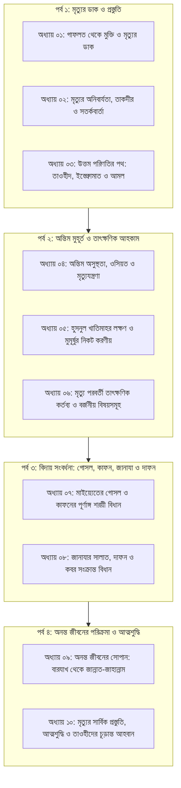

# মৃত্যু, জানাযা ও অনন্ত জীবন: কুরআন ও সুন্নাহর আলোকে প্রস্তুতি ও বিধান

**মূল আলোচনা ও গবেষণা:**  
**প্রফেসর ড. আবু বকর মুহাম্মাদ যাকারিয়া** (حفظه الله)  
প্রফেসর, ফিকহ ও ইসলামিক স্টাডিজ বিভাগ, ইসলামী বিশ্ববিদ্যালয়, কুষ্টিয়া; মদিনা ইসলামী বিশ্ববিদ্যালয়ের পিএইচডি গবেষক ও সুবিখ্যাত তাফসির প্রণেতা।

---

## গ্রন্থ পরিচিতি ও নিবেদন

মানুষের এই নশ্বর পার্থিব জীবন অনন্ত পরকালীন জীবনের একটি ক্ষুদ্রতম ভূমিকা মাত্র। প্রতিটি আদম সন্তানের জন্য সবচেয়ে নিশ্চিত ও ধ্রুব সত্য হলো—তাকে মৃত্যুর স্বাদ গ্রহণ করতে হবে। কিন্তু আধুনিক বস্তুবাদী জগতের মোহ, গাফলত এবং পার্থিব ভোগবিলাস মানুষকে মৃত্যুর অমোঘ সত্য থেকে গাফেল করে রেখেছে। একই সাথে সমাজজুড়ে মৃত্যু, মাইয়্যেতের গোসল, কাফন, জানাযা ও কবরকে কেন্দ্র করে অনুপ্রবেশ করেছে সহস্র আঞ্চলিক কুসংস্কার, জাহেলিয়াত এবং বিদ‘আতী রসম-রেওয়াজ।

এই যুগান্তকারী গ্রন্থটি রচিত হয়েছে প্রখ্যাত ইসলামিক স্কলার ও গবেষক **প্রফেসর ড. আবু বকর মুহাম্মাদ যাকারিয়া (حفظه الله)**-এর প্রদত্ত ধারাবাহিক জুমার খুতবা, বিশেষ দারস এবং আন্তর্জাতিক সম্মেলনসমূহের বিশুদ্ধ প্রামাণিক বক্তব্যের ওপর ভিত্তি করে। কথ্য ভাষার রূপান্তর ঘটিয়ে এটিকে একটি উচ্চমানের, আন্তর্জাতিক মানের প্রকাশনাযোগ্য প্রাঞ্জল বই হিসেবে সংকলন করা হয়েছে।

### এ গ্রন্থের প্রধান বৈশিষ্ট্যসমূহ:

1. **পূর্ণাঙ্গ শারঈ প্রামাণিকতা:** প্রতিটি আলোচনা কুরআনুল কারীম এবং রাসুলুল্লাহ ﷺ-এর সহীহ সুন্নাহ ও সাহাবায়ে কেরামের আসার দ্বারা সুদৃঢ়।
2. **হরকতসহ নির্ভুল আরবি ইবারত ও ক্লিকযোগ্য রেফারেন্স:** কুরআনের প্রতিটি আয়াত উসমানি লিপিতে পূর্ণ হরকতসহ এবং [Quran.com](URLTEMP0) লিংকের সাথে যুক্ত। প্রতিটি হাদিস পূর্ণ হরকত, মূল রাবী, সনদ ও কিতাবের নম্বর এবং [HadithBD.com](URLTEMP1)-এর সরাসরি লিঙ্কসহ সংকলিত।
3. **সুশৃঙ্খল ধারাবাহিকতা:** মৃত্যুভীতি ও গাফলত থেকে শুরু করে অন্তিম রোগশয্যা, মৃত্যুযন্ত্রণা, গোসল, কাফন, জানাযা, দাফন, কবর এবং অনন্ত জীবনের প্রতিটি মনযিল (বারযাখ, পুনরুত্থান, হাশর, মীযান, পুলসিরাত, হাউযে কাওসার ও জান্নাত) একটি ধারাবাহিক মাস্টার রোডম্যাপে বিন্যস্ত।
4. **বিদ‘আত ও কুসংস্কারের অকাট্য খণ্ডন:** সমাজে প্রচলিত কবরপূজা, মাজার সংস্কৃতি, বিদ‘আতী তালক্বীন, জানাযার পর দ্বিতীয় মোনাজাত, কুলখানি ও চেহলামের মতো যাবতীয় রসমের দালিলিক নিরসন।
5. **সম্পাদকের আমানতদারিতা:** বক্তার নিজস্ব ফিক্বহী অবস্থান (যেমন: জানাযার এক সালাম, করোনা বা পোড়া লাশের বিধান, নারীর কাফনের পরিমাপ) হুবহু সংরক্ষণ করা হয়েছে এবং প্রয়োজনীয় ব্যাখ্যার ক্ষেত্রে 'সম্পাদকীয় সংযোজন' চিহ্নিত করা হয়েছে।

---

## পূর্ণাঙ্গ সূচিপত্র (Master Table of Contents)

---

### পর্ব ১: মৃত্যুর ডাক ও প্রস্তুতি

#### [অধ্যায় ০১: গাফলত থেকে মুক্তি ও মৃত্যুর ডাক](file:///g:/My%20Drive/edu/basic-islam/অধ্যায়০১গাফলতথেকেমুক্তিওমৃত্যুরডাক.md)

- **মূল ভাবনা:** মানুষের গাফলত বনাম মৃত্যুর অনিবার্যতা; সূরা আল-আম্বিয়ার ১ নম্বর আয়াতের আলোকে জীবনের পরম সতর্কতা।
- **প্রধান আলোচ্য বিষয়:** মৃত্যুর স্বাদ গ্রহণ প্রত্যেকের জন্য অবধারিত; মানুষের উদাসীনতা ও হঠাৎ মৃত্যুর ভয়াবহতা; সুস্থতা ও অবসর সময়ের মূল্য; রূহ কবজের বাস্তবতা ও প্রস্তুত থাকার ডাক।

#### [অধ্যায় ০২: মৃত্যুর অনিবার্যতা, তাকদীর ও সতর্কবার্তা](file:///g:/My%20Drive/edu/basic-islam/অধ্যায়০২মৃত্যুরঅনিবার্যতাতাকদীরওসতর্কবার্তা.md)

- **মূল ভাবনা:** নির্দিষ্ট মেয়াদের পূর্বে কারো মৃত্যু হয় না; তথাকথিত 'অকাল মৃত্যু' বলে কিছু নেই।
- **প্রধান আলোচ্য বিষয়:** তাকদীরের ওপর অটল ঈমান; আজল বা নির্ধারিত সময়সীমা; খিজির ও ইলিয়াস (আলাইহিমাস সালাম)-এর মৃত্যুর সুনিশ্চিত আকিদা; বার্ধক্য ও অসুস্থতা হলো মৃত্যুর জীবন্ত পূর্বাভাস।

#### [অধ্যায় ০৩: উত্তম পরিণতির পথ: তাওহীদ, ইস্তেক্বামাত ও আমল](file:///g:/My%20Drive/edu/basic-islam/অধ্যায়০৩উত্তমপরিণতিরপথতাওহীদইস্তেক্বামাতওআমল.md)

- **মূল ভাবনা:** হুসনুল খাতিমাহ (উত্তম পরিণতি) কোনো আকস্মিক লটারি নয়, বরং আজীবন তাওহীদ ও আনুগত্যের ফসল।
- **প্রধান আলোচ্য বিষয়:** সুদৃঢ় ইস্তেক্বামাত; অন্তরের কপটতা দূরীকরণ; রিয়া ও লৌকিকতা বর্জন; শেষ আমলের ওপর ফলাফলের নির্ভরতা এবং তাওবার সুবর্ণ সুযোগ।

---

### পর্ব ২: অন্তিম মুহূর্ত ও তাৎক্ষণিক আহকাম

#### [অধ্যায় ০৪: অন্তিম অসুস্থতা, ওসিয়ত ও মৃত্যুযন্ত্রণা](file:///g:/My%20Drive/edu/basic-islam/অধ্যায়০৪অন্তিমঅসুস্থতাওসিয়তওমৃত্যুযন্ত্রণা.md)

- **মূল ভাবনা:** রোগশয্যা হলো গুনাহ মোচনের সুবর্ণ সুযোগ এবং জীবনের দেনা-পাওনা চুকিয়ে যাওয়ার অন্তিম স্টেশন।
- **প্রধান আলোচ্য বিষয়:** রোগশয্যার আদব ও সাওয়াব; ওসিয়তের শারঈ নীতিমালা ও এক-তৃতীয়াংশের সীমা; এতিম নাতি-নাতনীর জন্য দাদার ওয়াজিব ওসিয়তের প্রামাণিক ফতোয়া; মৃত্যুযন্ত্রণা (সাক্বারাাতুল মাওত) ও রাসুলুল্লাহ ﷺ-এর অন্তিম মুহূর্ত।

#### [অধ্যায় ০৫: হুসনুল খাতিমাহর লক্ষণ ও মুমূর্ষুর নিকট করণীয়](file:///g:/My%20Drive/edu/basic-islam/অধ্যায়০৫হুসনুলখাতিমাহরলক্ষণওমুমূর্ষুরনিকটকরণীয়.md)

- **মূল ভাবনা:** মুমূর্ষু ব্যক্তির পাশে উপস্থিত আত্মীয়দের দায়িত্ব এবং ভালো পরিণতির শারঈ নিদর্শন।
- **প্রধান আলোচ্য বিষয়:** মৃত্যুপথযাত্রীকে 'লা ইলাহা ইল্লাল্লাহ'-এর সুন্নাহসম্মত তালক্বীন; হুসনুল খাতিমাহর শারঈ নিদর্শনসমূহ; শুক্রবার বা রমজানে মৃত্যুর প্রচলিত ধারণার সঠিক মূল্যায়ন; সূরা ইয়াসীন পাঠ সংক্রান্ত দুর্বল হাদিসের তাহক্বীক্ব।

#### [অধ্যায় ০৬: মৃত্যু পরবর্তী তাৎক্ষণিক কর্তব্য ও বর্জনীয় বিষয়সমূহ](file:///g:/My%20Drive/edu/basic-islam/অধ্যায়০৬মৃত্যুপরবর্তীতাৎক্ষণিককর্তব্যওবর্জনীয়.md)

- **মূল ভাবনা:** আত্মা নির্গত হওয়ার পরবর্তী মুহূর্তগুলোতে সুন্নাহসম্মত দায়িত্ব ও জাহেলী প্রথা বর্জন।
- **প্রধান আলোচ্য বিষয়:** চোখ বন্ধ করে দেওয়া ও চিবুক বাঁধা; দ্রুত ঋণ পরিশোধের বাধ্যবাধকতা; শোক প্রকাশে 'সবরে জামীল'; বুক চাপড়ানো ও মাতম (নিয়াহা)-এর কঠোর নিষেধাজ্ঞা; চল্লিশা, কুলখানি ও মিলাদের মতো বিদ‘আতী ভোজের অকাট্য খণ্ডন।

---

### পর্ব ৩: বিদায় সংবর্ধনা: গোসল, কাফন, জানাযা ও দাফন

#### [অধ্যায় ০৭: মাইয়্যেতের গোসল ও কাফনের পূর্ণাঙ্গ শরয়ী বিধান](file:///g:/My%20Drive/edu/basic-islam/অধ্যায়০৭মাইয়্যেতেরগোসলওকাফনেরশরয়ীবিধান.md)

- **মূল ভাবনা:** মাইয়্যেতের প্রথম সম্মাননা হলো সুন্নাহসম্মত পবিত্রতা ও সাদা পোশাকে আচ্ছাদন।
- **প্রধান আলোচ্য বিষয়:** স্বামী-স্ত্রীর একে অপরকে গোসল দেওয়ার বিশুদ্ধ বিধান; ধাপে ধাপে সুন্নাহসম্মত গোসলের নিয়ম; করোনা, অগ্নিদগ্ধ ও খণ্ডিত লাশের বিধান; গর্ভপাতকৃত সন্তানের হুকুম; পুরুষের ৩ চাদরে কাফন ও নারীর কাফনের তাহক্বীক্ব; এহরামরত মৃত ব্যক্তির বিধান।

#### [অধ্যায় ০৮: জানাযার সালাত, দাফন ও কবর সংক্রান্ত বিধান](file:///g:/My%20Drive/edu/basic-islam/অধ্যায়০৮জানাযারসালাতদাফনওকবরযিয়ারত.md)

- **মূল ভাবনা:** জানাযা হলো মাগফিরাতের দো‘আ এবং কবর হলো আখেরাতের প্রথম মনযিল।
- **প্রধান আলোচ্য বিষয়:** জানাযার সালাতের ধারাবাহিক তাকবীর ও এক সালামের সুন্নাত; খাটিয়া বহনের শিষ্টাচার ও নীরবতা; দাফন নিষিদ্ধ তিনটি সময়; লাহাদ কবর খনন; কবরে নামানোর দো‘আ ও এক বিঘত উঁচু করা; কবর বাঁধানো, সৌধ নির্মাণ, চাদর-মোমবাতি ও মাজার সংস্কৃতির কঠোর নিষেধাজ্ঞা; দাফন শেষে ব্যক্তিগত দো‘আ বনাম তথাকথিত তালক্বীন ও মোনাজাতের বিদ‘আত বর্জন।

---

### পর্ব ৪: অনন্ত জীবনের পরিক্রমা ও আত্মশুদ্ধি

#### [অধ্যায় ০৯: অনন্ত জীবনের সোপান: বারযাখ থেকে জান্নাত-জাহান্নাম](file:///g:/My%20Drive/edu/basic-islam/অধ্যায়০৯অনন্তজীবনেরসোপানবারযাখথেকেজান্নাত.md)

- **মূল ভাবনা:** পরকালীন মহাযাত্রার পূর্ণাঙ্গ মানচিত্র ও নিখুঁত ধারাবাহিক পর্যায়সমূহ।
- **প্রধান আলোচ্য বিষয়:** কবরের চাপ ও সওয়াল-জওয়াব; শিঙ্গায় দুই ফুৎকার ও অলৌকিক পুনরুত্থান; রূপান্তরিত হাশরের ময়দান; সূর্যের তীব্র নৈকট্য ও আরশের সুশীতল ছায়া; ৫০ হাজার বছরের অপেক্ষা ও শাফা‘আতুল কুবরা; আমলনামা বণ্টন ও মিযান; পুলসিরাত পারাপার; হাউযে কাওসার ও বিদ‘আতীদের বিতাড়ন; ক্বনত্বরাহ্-এর পরিশুদ্ধি এবং জান্নাতুল ফিরদাউস ও আল্লাহর দিদার।

#### [অধ্যায় ১০: মৃত্যুর সার্বিক প্রস্তুতি, আত্মশুদ্ধি ও তাওহীদের চূড়ান্ত আহবান](file:///g:/My%20Drive/edu/basic-islam/অধ্যায়১০মৃত্যুরসার্বিকপ্রস্তুতিওআত্মশুদ্ধি.md)

- **মূল ভাবনা:** ঐতিহাসিক ইসলামী সম্মেলনের আবেগাপ্লুত নসীহত—পার্থিব অহমিকার অবসান ও আল্লাহর পূর্ণ দাসত্বে প্রত্যাবর্তন।
- **প্রধান আলোচ্য বিষয়:** দাসত্বই প্রকৃত পরিচয়; ফয়সালার দিনের নিঃসঙ্গতা; কবরের মাটি শক্ত হওয়ার বাস্তবতা; বহমান তিন সওয়াব (সাদাক্বায়ে জারিয়াহ, ইলমে নাফে' ও নেক সন্তান); আল্লাহর নেয়ামতের হামদ; আমলের অহংকার বর্জন; অর্থলিপ্সা ও দুনিয়াপূজার বিরুদ্ধে হুশিয়ারি এবং কবরের তিন প্রশ্নের বাস্তব প্রস্তুতি।

---

## সমাপনী দোয়া

মহান আল্লাহ সুবহানাহু ওয়া তা‘আলার দরবারে কায়মনোবাক্যে প্রার্থনা—তিনি যেন এই গ্রন্থটিকে বক্তা প্রফেসর ড. আবু বকর মুহাম্মাদ যাকারিয়া, সম্পাদকবৃন্দ এবং এর পাঠকদের জন্য সদাক্বায়ে জারিয়াহ হিসেবে কবুল করে নেন। কবরের প্রথম অন্ধকার রাতকে নূর দিয়ে আলোকিত করে দেন এবং হাশরের মহাকঠিন দিবসে রাসুলুল্লাহ ﷺ-এর সুপারিশ ও জান্নাতুল ফিরদাউস নসীব করেন। আমীন, ইয়া রব্বাল আলামীন!
